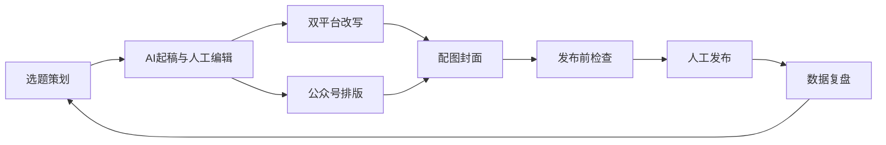

# 01 阶段一：定位、目标用户、核心场景与可行性初判

> - 状态：已确认（2026-10-09）。Q-1 至 Q-4 的结论见第 7 节和 D-002、D-005 至 D-007
> - 最后更新：2026-10-09
> - 依赖：[91-事实核验台账](91-事实核验台账.md)（引用 F / V / X 编号）、[90-决策与变更记录](90-决策与变更记录.md)

---

## 1. 本阶段要回答的问题

1. 产品到底做什么、不做什么？
2. 给谁用？
3. 用户在什么场景下用它？
4. 在两个平台的规则下，每项核心能力能否实现？用什么方式实现？

---

## 2. 产品定位

### 2.1 需要先纠正的认知

"AI 智能运营平台"如果理解为"AI 自动写、自动发、自动回复"，**在两个平台上都不可行**：

- 微信：运营规范 3.27 明确禁止用 AI、脚本、接口替代真人完成创作和发布，也禁止批量连续自动发布（F-004）。另外，你的个人号本来就没有接口发布权限（F-001）。
- 小红书：没有发布接口（F-101），并且明确封禁 AI 托管代发的账号、禁止自动回复评论私信（F-103、F-104）。

所以本项目的"智能"应该体现在**让人做得更快、更好**，而不是**替人做**。这不只是合规上的妥协。两个平台的推荐机制都在打压低质、同质的 AIGC 内容（F-005、F-104），"人主导、AI 辅助"的内容本身也更容易获得流量。

### 2.2 定位陈述（草案）

> 面向中文内容创作者的 **AI 创作副驾驶**：围绕"一次创作，双平台适配"，在选题、起稿、改写、排版、配图、发布前检查和数据复盘上提供 AI 辅助；**创作判断和发布动作始终由人完成**。

### 2.3 核心价值（按优先级）

1. **一稿双平台**：把公众号长图文改写成小红书笔记（或反向），节省最多的重复劳动。
2. **创作提效**：选题灵感、大纲、初稿、润色、标题备选，由人挑选和修改。
3. **发布前把关**：敏感词和违规风险提示、事实核查提示、AI 声明提醒，降低违规和限流风险。
4. **集中管理**：选题、草稿、素材、发布记录、数据复盘放在一个地方。

### 2.4 明确不做（非目标）

见 X-001 至 X-006：

- 小红书自动发布、自动互动、批量数据爬取（V4 起只允许低频读取单篇公开页面，见 D-047）；
- 微信无人值守的定时批量发布；
- 任何模拟登录或浏览器自动化代操作；
- 涨粉、刷量、养号类功能（同样违反平台规则）。V4 的"起号定位"指内容定位与规划，不涉及账号行为操作（D-047）。

---

## 3. 目标用户分析

### 3.1 三类候选用户对比

| 维度 | A 自用 / 小团队 | B 代运营机构 | C 开放 SaaS |
| --- | --- | --- | --- |
| 典型用户 | 你自己、个人创作者、2–5 人内容小组 | 同时运营多个客户账号的工作室 | 任何注册用户 |
| 账号数量 | 1–5 个 | 10–100 个 | 不限 |
| 微信接入方式 | 直接用自己公众号的 AppID / AppSecret | 需要微信第三方平台（服务商资质、授权流程）；个人号能否授权待 V-002 | 必须走第三方平台 |
| 合规负担 | 低；是否需要生成式 AI 备案待 V-007，大概率较轻 | 中；涉及客户数据、多方授权 | 高；向公众提供生成式 AI 服务通常涉及备案、内容安全、用户实名等义务（待 V-007 细化） |
| 系统复杂度 | 低：单租户、简单权限 | 中：多账号、多成员、角色权限、客户隔离 | 高：多租户、注册计费、风控、客服 |
| 与"个人号"现状的匹配 | 好，可以立刻用自己的号验证 | 一般，客户账号类型各不相同 | 差 |
| 验证产品价值的速度 | 快：你就是第一个用户，反馈闭环最短 | 中 | 慢 |

### 3.2 推荐：MVP 面向 A（自用 / 小团队），架构预留向 B 扩展

理由：

1. **你就是第一个真实用户**。产品"好不好用"可以每天自己验证，不需要先找用户。
2. **合规和资质成本最低**。不必一开始就申请第三方平台资质或处理生成式 AI 服务备案。
3. **复杂度可控**。先把"创作 → 改写 → 检查 → 发布辅助 → 复盘"这条主链路做扎实。
4. **不锁死未来**。数据模型从第一天起就设计成"一个工作区下有多个平台账号和多个成员"，以后扩展到代运营时不需要推倒重来。

不推荐一开始就做 C：资质和合规门槛高，而且"开放给所有人用"会放大平台违规风险（用户可能拿它批量灌水，导致产品被定性为 3.27.3 所说的"自动化创作服务"）。

> 待决问题 Q-1：是否接受"MVP 面向自用 / 小团队"？

### 3.3 MVP 用户画像（假设推荐被接受）

- **角色 1 创作者（主角）**：负责选题、写作和发布，同时运营 1 个公众号和 1 个小红书号；有内容想法但时间有限；希望一份内容同时在两个平台发布。
- **角色 2 协作者（可选，后续版本）**：帮忙改稿、做图或查数据，不一定有发布权限。

---

## 4. 核心业务场景

每个场景都写清：触发条件、操作者、AI 的作用、**人工确认点**（human-in-the-loop 的具体落点）。

### S1 选题策划

- 触发：创作者需要决定下一篇写什么。
- AI 作用：根据账号定位、历史内容和用户输入的方向，给出选题建议和角度；整理用户收集的灵感素材。
- 人工确认点：由人选定选题，或修改后入库。
- 约束：不爬取平台热榜（X-003）；热点信息来源需要合规（阶段 2 和 3 调研）。V4 起改为受控采集，见 D-047 与 11 文档。

### S2 AI 起稿

- 触发：选题确定后开始写作。
- AI 作用：生成大纲，再按大纲分段起草；也可以基于用户的口述或要点扩写。
- 人工确认点：人逐段编辑；系统记录"人工修改比例"等创作参与指标，用于自查和后续的合规提示。
- 约束：避免"脱离真实创作者表达"（F-004 3.27.1）。产品要鼓励用户输入自己的观点和经历，而不是一键成文。

### S3 一稿双平台改写

- 触发：公众号文章定稿后，需要同步到小红书（或反向）。
- AI 作用：把长文改写成小红书风格，包括标题、分段、表情符号、话题标签和字数控制；拆分配图建议。
- 人工确认点：人审阅并修改改写稿。
- 约束：避免模板化的同质输出（F-104 "AI 低质"）；改写要保留作者个人表达。

### S4 公众号排版

- 触发：文章需要排成公众号格式。
- AI 作用：按选定的样式模板自动排版，并推荐小标题和重点标注。
- 人工确认点：人预览后调整。
- 约束：公众号 HTML 能力边界待 V-010。

### S5 配图与封面

- 触发：文章和笔记需要封面、插图。
- AI 作用：根据内容生成配图提示或 AI 图片，并按平台尺寸裁剪。
- 人工确认点：人挑选和替换。
- 约束：不生成他人可识别的肖像，不模仿受版权保护的作品（F-104 "AI 侵权"）；AI 图片需要标识（V-008）。

### S6 发布前检查

- 触发：内容准备发布。
- AI 作用：
  - 敏感词和违规风险提示；
  - 事实核查提示，标出需要核实的数据和断言；
  - AI 声明提醒：小红书勾选"笔记含 AI 合成内容"（F-104），公众号声明 AI 辅助（F-005）；
  - 平台格式校验（如摘要不超过 120 字，F-002）。
- 人工确认点：人逐项确认后才进入发布步骤。

### S7 发布辅助

- 公众号（个人号）：系统调用 `draft/add` 把文章写入草稿箱（F-002），由人登录公众号后台预览并点击"发表"或"群发"（F-001、X-005）。
- 小红书（MVP）：系统生成"发布包"，包括标题、正文、话题和按顺序编号的图片，支持一键复制、打包下载；由人在小红书 App 或网页端手动发布，并勾选 AI 声明。
- 小红书（后续版本，可选）：开发移动 App 接入分享 SDK（F-102），把内容送进小红书 App，由用户确认发布（申请门槛待 V-009）。
- 人工确认点：发布动作 100% 由人完成。系统只记录"已发布"状态，以及用户手动回填的发布链接。

### S8 数据复盘

- 触发：内容发布一段时间后，需要复盘效果。
- 公众号：如果个人号能用数据统计接口（待 V-001），就自动拉取；否则由人手动录入关键数据。
- 小红书：无官方接口（F-101），创作者中心也没有导出功能（V-006 已核验），由人手动录入或上传数据截图识别（D-051）。
- AI 作用：基于数据给出复盘结论和下一步选题建议，结果回流到 S1。
- 人工确认点：人决定采纳哪些建议。

### 场景主链路

---

## 5. 能力可行性矩阵（基于个人主体公众号）

| 能力 | 官方 API 方案 | 合规替代方案 | 状态 | 依据 |
| --- | --- | --- | --- | --- |
| AI 选题、起稿、改写、排版建议 | 调用大模型 API（与平台无关） | — | 可行（模型选型在阶段 2） | — |
| 公众号写入草稿 | `draft/add` | 生成排版好的 HTML，由人复制进后台编辑器 | 已验证可行 | F-002 |
| 公众号发表、群发 | `freepublish/submit`：需企业认证号 | `draft/add` 后由人在后台点发表 | 接口方式对个人号不可行；替代方案可行 | F-001、X-005 |
| 公众号上传图片素材 | 素材管理接口 | 由人在后台上传 | 待验证 | V-001 |
| 公众号数据统计 | datacube 系列接口 | 人工录入 | 待验证 | V-001 |
| 公众号评论、消息管理 | 相关接口 | 人在后台处理 | 待验证（非 MVP 重点） | V-001 |
| 小红书发布 | 无官方服务端接口 | MVP：发布包 + 人工发布；后续：原生 App + 分享 SDK | 服务端自动发布不可实现；替代方案可行 | F-101、F-102、X-001 |
| 小红书数据 | 无官方接口 | 人工录入或截图识别 | 接口方式不可实现；后台无导出功能（V-006 已核验） | F-101、V-006、X-003 |
| 小红书评论、私信 | 无，且禁止自动回复 | 不做 | 不可实现（禁止） | X-002 |
| 小红书账号登录授权 | OAuth（仅能拿到用户基本信息） | — | 可行，但 MVP 价值低，暂不需要 | F-101 |
| AI 内容标识 | — | 发布前检查提醒用户声明；导出图片加标识 | 要求细节待验证 | F-104、V-008 |
| 多账号、多成员 | 微信第三方平台 | 每个账号单独配置 AppID / Secret | 待验证（非 MVP） | V-002 |

**结论：** MVP 的主链路（S1 到 S8）在合规前提下**全部可以实现**。代价是两个平台的"最后一步发布"都由人完成，小红书数据需要人工录入或导入。以上能力中没有任何一项依赖违规手段。

---

## 6. 关键风险（初判，阶段 7 详细展开）

| 风险 | 等级 | 说明 | 初步对策 |
| --- | --- | --- | --- |
| 平台判定为"非真人自动化创作" | 高 | 3.27 的边界模糊（V-004） | 强制人工编辑和确认环节；限制单日推送草稿数量；不提供定时自动发布 |
| 平台规则变化 | 高 | 2025–2026 年两个平台都在持续收紧 | 事实台账定期复核；平台接入做成可替换的适配层 |
| AI 输出质量（事实错误、同质化） | 中 | 影响推荐流量和账号信誉 | 事实核查提示；个性化风格设定；人工改写 |
| 凭证泄露（AppSecret） | 中 | 泄露后他人可以操作公众号 | 服务端加密存储；不进代码仓库；IP 白名单 |
| 小红书侧体验较弱 | 中 | 只能手动发布和录入数据 | 把发布包做到"复制即发"；后续评估移动 App |

---

## 7. 待决问题（需要你确认）

| 编号 | 问题 | 我的建议 | 影响 |
| --- | --- | --- | --- |
| Q-1 | MVP 目标用户是否为"自用 / 小团队"？ | 是，架构预留多账号、多成员 | 决定系统复杂度、合规范围、是否需要第三方平台 |
| Q-2 | 是否计划把公众号升级为企业认证号？ | 暂不需要。认证号能用接口发表，但 3.27 仍要求人工触发，收益有限；需要数据统计等能力时再评估（取决于 V-001 结果） | 决定微信侧能力上限 |
| Q-3 | 你的内容主要在哪个垂直领域？ | 请告诉我实际领域（如职场、母婴、科技、美食） | 影响 AI 提示词设计、竞品选择、敏感词策略 |
| Q-4 | 小红书侧 MVP 是否接受"Web 端发布包 + 手动发布"？ | 接受；移动 App 和分享 SDK 放到后续版本评估 | 决定 MVP 是否需要开发原生 App（成本差异巨大） |

**确认结果（2026-10-09）：**

- Q-1：采纳建议，MVP 面向自用 / 小团队（D-002）。
- Q-2：暂不升级，等 V-001 结果再评估（D-005）。
- Q-3：多领域，暂不绑定垂直方向；改为"账号人设配置"（D-006）。
- Q-4：采纳建议，Web 端发布包 + 人工发布（D-007）。

---

## 8. 阶段确认后新增的待定需求

阶段 4 统一分级为 MVP、后续版本或不做。

| 编号 | 需求 | 来源 | 说明 | 相关依据 | 分级结果 |
| --- | --- | --- | --- | --- | --- |
| R-P01 | 漫画类内容能力：分镜脚本、逐格文案、角色设定与跨图一致性、对白气泡、AI 绘图与编辑 | 用户举例（情感漫画账号），2026-10-09 | 是"内容形态 = 漫画"对应的工作流分支，比图文笔记重得多；AI 图像生成方案和成本在阶段 2 / 6 评估 | D-008；F-104（鼓励原创 AI 角色，禁止 AI 造假、侵权，需声明 AI 内容）；V-008 | 已分级，见 D-018：文字部分为 MVP P1，AI 出图和角色一致性为 V2（[04-需求与功能分级](04-需求与功能分级.md) M8） |

## 9. 下一阶段预告：阶段 2 平台能力深度核验

处理 V-001 至 V-010，产出 `02-平台能力深度核验.md`：

1. 微信"账号类型 × 接口"完整能力矩阵（逐个查阅官方文档的"适用范围"表）。
2. 申请公众号测试号，实测 `draft/add` 等核心接口（只做验证性实验，不写产品代码）。
3. 核实小红书 Web 端的分享入口、创作者中心数据导出、分享 SDK 申请门槛。
4. 核实生成式 AI 备案和 AI 内容标识的法规要求。
5. 初步对比大模型供应商（中文能力、价格、合规备案状态、API 稳定性）。
