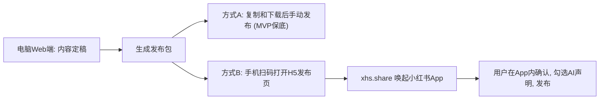

# 02 阶段二：平台能力深度核验

> - 状态：已确认（2026-10-09）。Q-5 至 Q-8 的结论见 D-009 至 D-012；第 6 节的实地核验（V-001 实账复核、V-006、V-011）移到开发阶段处理（D-032）；第 5 节的盲测时间和候选范围已由 D-027、D-028 调整
> - 最后更新：2026-10-09
> - 依赖：[91-事实核验台账](91-事实核验台账.md)（本阶段新增 F-006 至 F-012、F-106 至 F-107、F-201 至 F-203，并更新 V 项状态）

---

## 1. 本阶段结论摘要

1. **微信侧的 MVP 链路已确认可行**。个人号可以调用草稿全套接口（新增、修改、查询、删除）和图片上传接口，足以支撑"系统写草稿 → 人在后台发表"（F-002、F-006、F-007）。
2. **个人号拿不到的能力已确认**：发表、群发、数据统计、粉丝列表、自定义菜单都要求企业认证（F-001、F-008、F-009）。所以公众号数据复盘只能靠人工录入或后台导出，不能自动拉取。
3. **微信接口测试号不能用来验证草稿接口**（F-010）。要实测只能用你的真实个人号；写入草稿不会发表，风险很低。
4. **小红书 H5 分享有新线索**：社区开发者使用 `xhs.share` 的 JS SDK，可以从手机网页唤起小红书 App，带入标题、正文和图片（F-107）。但官方文档没有公开这套 SDK，申请门槛未知，状态仍是**待验证**。
5. **合规负担比预想的轻**：只自用、不向公众提供服务时，《生成式人工智能服务管理暂行办法》不适用，无需备案（F-201）。但你作为发布者，仍然必须在平台上主动声明 AI 内容（F-202）。
6. **大模型价格的公开信息互相矛盾**：几篇第三方文章对同一模型给出的价格差距达到数倍，不能作为依据。选型要以官方价格页加你自己的样本盲测为准（第 5 节）。

---

## 2. 微信公众号："账号类型 × 接口"能力矩阵

说明：

- ✔ 表示官方文档"适用范围"中标注公众号可调用，含个人主体。
- "仅认证"表示只有企业主体且已认证的账号可调用。
- 个人主体无法认证。

| 能力 | 接口 | 个人号（你） | 企业认证号 | MVP 用途 | 依据 |
| --- | --- | --- | --- | --- | --- |
| 获取调用凭证 | `/cgi-bin/token` | ✔（每日 2000 次） | ✔ | 必需 | F-003、F-011 |
| 新增草稿 | `/cgi-bin/draft/add` | ✔（每日 1000 次） | ✔ | 核心：写入草稿 | F-002 |
| 修改 / 查询 / 删除草稿、草稿总数 | `draft/update`、`draft/get`、`draft/batchget`、`draft/delete`、`draft/count` | ✔ | ✔ | 同步修改；检查草稿是否已被发表（发表后会从草稿箱消失） | F-006 |
| 上传正文图片 | `/cgi-bin/media/uploadimg` | ✔（jpg/png，不超过 1MB，不占素材库额度） | ✔ | 必需：正文图片必须走此接口，外链图片会被过滤 | F-007 |
| 上传永久素材 | `/cgi-bin/material/add_material` | ✔（图片不超过 10MB） | ✔ | 必需：封面 `thumb_media_id` 必须是永久素材 | F-007 |
| 发表、发布状态、已发布列表 | `freepublish/*` | ✗ | ✔（每日 100 次） | 个人号无法使用 | F-001 |
| 群发 | `message/mass/sendall` | ✗ | ✔（每日 100 次） | 个人号无法使用 | F-008 |
| 数据统计 | `datacube/getarticlesummary` 等 | ✗ | ✔ | 个人号无法使用，改为人工录入 | F-008 |
| 粉丝列表 | `/cgi-bin/user/get` | ✗ | ✔ | 非 MVP | F-009 |
| 自定义菜单 | `/cgi-bin/menu/create` | ✗ | ✔ | 非 MVP | F-009 |

**草稿正文的技术约束**（F-012）：

- 支持 HTML；少于 2 万字符，且小于 1MB；
- 会移除 JS；外部图片 URL 会被过滤；
- 支持"图片消息（newspic）"类型，最多 20 张图，首图即封面。这适合漫画类内容（R-P01）。
- 摘要上限 120 字（F-002）。

具体能用哪些 CSS 样式，仍需实测（V-010）。

### 2.1 对 D-005（暂不升级认证）的复核

升级为企业认证号后多出来的能力，主要是：

- 接口发表和群发：受运营规范 3.27 约束，仍然必须由人触发，相比人工点击"发表"只省一步；
- 数据统计自动拉取：这是真正的收益；
- 粉丝和菜单管理：非 MVP。

**结论：维持 D-005**。唯一有分量的收益是数据自动化。如果后台的"导出数据"（V-011）可以覆盖复盘需求，升级就没有必要。

---

## 3. 小红书：官方渠道的完整盘点

| 渠道 | 能做什么 | 不能做什么 | 门槛 | 状态 |
| --- | --- | --- | --- | --- |
| 开放平台 OAuth（openaccount） | 获取用户授权、基本信息；Web 端走扫码设备授权 | 发布笔记、读取笔记数据 | 创建应用，审核约 1–3 个工作日 | 已验证（F-101、F-106） |
| 分享 SDK（Android / iOS / 鸿蒙原生） | 把图文（1–18 张）或视频送进小红书 App，由用户确认发布 | 服务端自动发布 | 需要原生 App；Android 需与小红书商务沟通、提供包名，以获取 AppKey | 已验证（F-102） |
| H5 JS SDK（`xhs.share`） | 从手机网页唤起小红书 App，带入标题、正文、公网图片 URL | 桌面浏览器直接使用（只能在手机上唤起 App）；本地图片 | 需要 appKey 和服务端签名；安卓部分浏览器有兼容问题 | **待验证**：仅有社区证据，脚本来自官方 CDN，未见官方公开文档（F-107、V-005） |
| 创作者中心数据导出 | 据称可导出笔记表现、粉丝数据为 Excel | — | 据称需要实名认证 | **待验证**：只有第三方文章，需你实地确认（V-006） |
| 聚光 Marketing API | 广告投放与报表 | 普通内容运营 | 广告主身份 | 与本项目无关（F-105） |

### 3.1 对 D-007（小红书用 Web 发布包）的影响

如果 H5 JS SDK 可以申请到，可以在发布包的基础上增加一个"增强"路径：

方式 B 仍然由用户本人在 App 内确认发布，符合 F-103、F-104。它的前提是：申请到 appKey，并且图片放在公网可访问的地址（需要对象存储，并注意图片外泄风险）。

**建议：MVP 保留方式 A 作为保底，同时尝试申请方式 B；申请成功就把它作为 MVP 的增强项。**

> 决策结果：用户选择不申请（D-009）。小红书侧只采用方式 A。

---

## 4. 法规与 AI 标识

| 主题 | 结论 | 对产品的要求 | 依据 |
| --- | --- | --- | --- |
| 生成式 AI 服务备案 | 只自用或团队内部使用、不向境内公众提供服务时，不适用《暂行办法》，无需备案或登记 | MVP 无需备案。**警示**：一旦对外提供服务（包括给客户使用的代运营场景），就成为"服务提供者"。调用已备案模型 API 且不微调时，走地方网信办登记（约 1–3 个月）；把私有语料注入提示（RAG）可能影响能否走登记 | F-201 |
| AI 内容标识（用户侧） | 用户通过传播平台发布 AI 生成合成内容时，应主动声明，并使用平台提供的标识功能 | 发布前检查（S6）强制提醒：小红书勾选"笔记含 AI 合成内容"，公众号声明 AI 辅助 | F-202、F-104 |
| AI 内容标识（服务提供者侧） | 服务提供者需加显式标识，并在文件元数据中写入隐式标识（GB 45438-2025，2025-09-01 起实施） | 自用不属于"服务提供者"，不是强制项。建议后续版本为 AI 生成图片写入 GB 45438 格式的元数据，成本低，并为将来扩展做准备（阶段 4 定级） | F-203 |

---

## 5. 大模型供应商：选型方法（不在本阶段拍板）

### 5.1 为什么现在不定具体模型

- 公开的第三方价格信息互相矛盾。例如同一款 DeepSeek 模型，在不同文章里价格相差 4 倍以上，不能作为依据。
- 模型迭代非常快（以月为单位）。现在定死，开发时大概率已经过时。
- "中文写作好不好"高度依赖你的风格和领域，只能用你的真实样本来测。

### 5.2 推荐的选型原则（作为阶段 6 架构约束）

1. **模型无关**：系统通过统一的"模型适配层"调用模型，配置化切换，不绑定单一厂商。
2. **按任务分级**：起稿、改写用质量优先的模型；分类、摘要、敏感词预检用低价模型；配图用独立的文生图服务。
3. **只选已备案的国内模型作为主力**：一是合规，二是将来对外时可以走"登记"而不是"备案"（F-201）。具体备案号以网信办公告为准。
4. **盲测定型**：阶段 6 用 10–20 篇你的真实选题，对 3–4 个候选模型做盲评，评分维度包括风格贴合度、事实错误率、同质化程度和成本。

候选范围（价格和型号以各家官方价格页为准，届时再核实）：

- 文本：DeepSeek、通义千问、豆包、智谱 GLM、Kimi；
- 图像：通义万相、豆包 Seedream、智谱 CogView 等。

---

## 6. 需要你配合的实地核验

以下事项公开资料无法替代实地确认，请在方便时完成，截图即可：

| 编号 | 操作 | 目的 |
| --- | --- | --- |
| V-001 | 公众号后台 → 设置与开发 → 接口权限，截图 | 用真实账号复核第 2 节矩阵 |
| V-011 | 公众号后台 → 数据分析（内容分析、用户分析），看是否有"下载 / 导出"按钮 | 决定公众号数据复盘用导入还是手动录入 |
| V-006 | 小红书 App → 创作者中心 → 数据中心，看是否有导出 Excel；导出一份示例，注意隐藏敏感信息 | 决定小红书数据复盘的导入格式 |

**可选的验证性实验**（需要你同意）：

- 用你的真实个人号，写一个**一次性验证脚本**（不属于产品代码），调用 `uploadimg`、`add_material`、`draft/add` 写入一篇测试草稿。
- 目的：验证 HTML 和 CSS 的支持范围（V-010）、图片约束、IP 白名单流程。
- 草稿不会自动发表，验证完在后台删除即可。
- 需要你提供 AppID 和 AppSecret，并在后台配置运行机器的出口 IP。注意：Secret 只放在本地环境变量里，绝不写进文件或代码仓库。

---

## 7. 待决问题

| 编号 | 问题 | 我的建议 | 影响 |
| --- | --- | --- | --- |
| Q-5 | 是否尝试申请小红书分享开放平台（H5 JS SDK）？ | 是。MVP 以发布包保底，申请成功就增加"手机扫码唤起发布" | 小红书侧体验；是否需要对象存储公网图片 |
| Q-6 | 是否维持"暂不升级企业认证"（D-005）？ | 维持；等 V-011 结果出来，如果后台可以导出数据就不必升级 | 公众号数据复盘的自动化程度 |
| Q-7 | 大模型选型是否采用"模型无关适配层 + 阶段 6 盲测定型"？ | 是 | 架构约束；避免过早绑定厂商 |
| Q-8 | 是否同意做第 6 节的验证性实验？ | 同意，但放在阶段 6 架构设计前完成即可，不阻塞阶段 3 | V-010 的结论；排版功能的边界 |

---

## 8. 未解决事项（转入后续阶段）

| 编号 | 事项 | 当前状态 | 去向 |
| --- | --- | --- | --- |
| V-002 | 微信第三方平台与个人号授权 | 推迟：MVP 不需要（D-002） | 将来扩展到代运营时再查 |
| V-004 | 运营规范 3.27 的具体判定边界 | 无法完全验证：官方只给出原则，"鼓励工具辅助，反对完全替代真人"；有案例显示单日多篇被判违规 | 阶段 5 和 7 采用保守设计：强制人工编辑、单日草稿推送上限、无定时自动发布 |
| V-005 | 小红书 H5 JS SDK 的官方可用性和申请门槛 | 待验证 | 取决于 Q-5，需要联系小红书商务 |
| V-009 | 原生分享 SDK 的申请门槛 | 部分验证：需要登记应用信息，Android 需提供包名并与商务对接；是否要求企业主体未知 | 与 V-005 一并咨询 |
| V-010 | 公众号 HTML / CSS 支持范围 | 部分验证（F-012） | 取决于 Q-8 |
