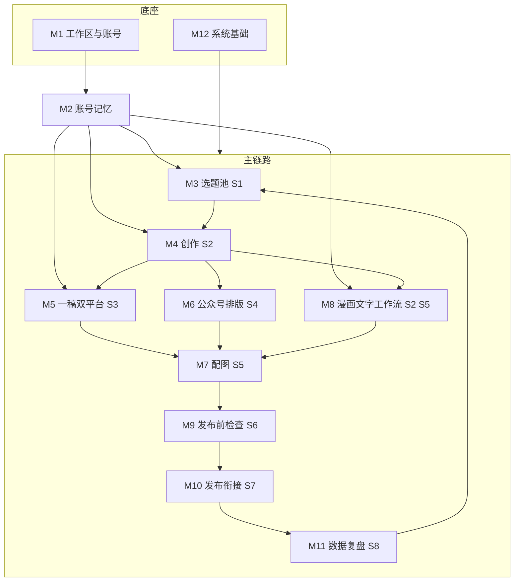

# 04 阶段四：需求与功能分级

> - 状态：已确认（2026-10-09）。Q-15 至 Q-18 均采纳建议，见第 9.2 节和 D-020。设计补充（D-033）新增第 3.1 节和 5 项 P0
> - 最后更新：2026-10-09
> - 依赖：[01-定位与可行性](01-定位与可行性.md)、[02-平台能力深度核验](02-平台能力深度核验.md)、[03-竞品调研](03-竞品调研.md)、[90-决策与变更记录](90-决策与变更记录.md)、[91-事实核验台账](91-事实核验台账.md)

---

## 1. 本阶段要回答的问题

1. 产品完整要做哪些功能？
2. 哪些进 MVP，哪些放后续版本，哪些明确不做？
3. 每个 MVP 功能做到什么程度才算"完成"（验收标准）？

本阶段只定义"做什么"和"做到什么程度"。页面怎么排、按钮放哪里属于阶段 5；数据表和技术选型属于阶段 6。

---

## 2. 分级规则

| 级别 | 含义 | 判定条件 |
| --- | --- | --- |
| **P0** | MVP 必做 | 缺了它主链路（S1 到 S8）走不通，或者它直接承载三大差异点之一（D-013），或者它是合规底线 |
| **P1** | MVP 应做，可砍 | 明显提升体验或效率，但缺了它主链路仍能用手工方式走通；开发排期紧张时优先砍 |
| **V2** | 后续版本 | 有价值，但依赖未定的外部条件（认证、文生图服务、更多用户），或成本明显高于 MVP 阶段的收益 |
| **不做** | 明确排除 | 违反平台规则或法律，或与产品定位冲突 |

排序原则：同级别内按 D-013 的差异点排序，即账号记忆 > 一稿双平台 > 合规把关与发布衔接。

本阶段新确认的范围决策：

- **D-018**：漫画能力拆分。MVP 做文字部分（角色设定卡、分镜脚本、逐格文案和对白），AI 出图和跨图角色一致性放到 V2。
- **D-019**：MVP 只做单用户登录，数据模型预留成员和角色字段（历史范围）。
- **D-036**：多租户工作区 + 邀请码多成员协作（开放自建、一人多工作区、owner/editor）。

---

## 3. 功能模块总览

共 12 个模块。M1 和 M12 是底座，M2 是贯穿所有 AI 功能的"账号记忆"，其余模块对应 S1 到 S8 场景。

### 3.1 平台与账号类型组合（D-033、D-048）

账号类型在创建时从预设清单中选定（D-008、D-048），**创建后固定**：普通设置、更新 API 与 confirm=true 都不能修改（D-048 第 5.2 节）；业务定位（领域、受众、人设、支柱、风格）与可选的"类型补充说明"仍可随时调整。类型决定作品的编辑器、检查项和发布方式；每日推荐、选题、方案与大纲都必须匹配账号类型及其领域相关性。每个类型都必须有真实工作流支撑，未实现的能力不得作为类型提供。

| 平台 | 账号类型 | 编辑器 | 发布方式 | 级别 |
| --- | --- | --- | --- | --- |
| 公众号 | 长图文 long_article | 完整编辑器（标题、加粗、列表、引用、链接、图片） | 图文消息草稿（news） | P0 |
| 公众号 | 问答体长图文 qa_article | 长图文编辑器＋问答体大纲/起草模板（D-048） | 图文消息草稿（news） | P1 |
| 公众号 | 资讯简报 briefing | 长图文编辑器＋简报模板（导语＋条目，篇幅更紧） | 图文消息草稿（news） | P1 |
| 公众号 | 图文卡片 card_post | 卡片编辑器（段落即卡片＋逐卡 AI 配图） | 图片消息草稿（newspic） | P1 |
| 公众号 | 口播脚本 script | 文字编辑器＋镜头化脚本模板（脚本辅助，不生成视频） | 图文消息草稿（news） | P1 |
| 公众号 | 漫画 comic | 漫画文字工作流（M8） | 图片消息草稿（newspic） | P1 |
| 小红书 | 图文笔记 image_note | 精简编辑器（只有段落、列表、表情，见 06 文档第 5.4 节） | 发布包 | P0 |
| 小红书 | 清单/合集笔记 list_note | 精简编辑器＋清单模板（D-048） | 发布包 | P1 |
| 小红书 | 图文卡片 card_post | 卡片编辑器（逐卡 AI 配图） | 发布包（卡片图＋文案） | P1 |
| 小红书 | 口播脚本 script | 文字编辑器＋镜头化脚本模板（脚本辅助，不生成视频） | 发布包 | P1 |
| 小红书 | 漫画 comic | 漫画文字工作流（M8） | 发布包 | P1 |

说明：公众号不提供 image_note（图片消息与小红书笔记差异大），小红书不提供 long_article（没有长图文形态）。新类型的产出物与工作流边界见 90 文档 D-048 第 9 节。

**派生规则**（派生只允许跨平台，D-023；D-048 首批不新增派生路径）：

| 源类型 | 目标类型 | 级别 | 说明 |
| --- | --- | --- | --- |
| 公众号长图文 | 小红书图文笔记 | P0 | 压缩改写，按段落对应（FR-M5-02） |
| 小红书图文笔记 | 公众号长图文 | P0 | 扩写，按要点对应（FR-M5-04） |
| 漫画 | 另一平台的漫画 | P1 | 复用分格、角色引用和图片，只改写旁白和对白的平台表达（**已实现**，D-042） |
| 长图文或图文笔记 | 漫画，或反向 | 不支持 | 形态差异过大，改写质量无法保证；需要时新建作品，可引用同一选题 |
| 问答体/简报/清单/卡片/脚本 | 任何类型 | 不支持 | 尚未实现转换，派生入口禁用（D-048 第 5.9 节）；后续开放需单独决策 |

---

## 4. 功能清单

编号规则：`FR-模块-序号`。"依据"列引用事实（F / X / V）或决策（D）。

### M1 工作区与账号

| 编号 | 功能 | 级别 | 场景 | 依据 |
| --- | --- | --- | --- | --- |
| FR-M1-01 | 用户登录（账号密码），会话超时自动退出；会话绑定当前工作区 | P0 | 全部 | D-019、D-036 |
| FR-M1-02 | 平台账号管理：新增、编辑、停用或彻底删除公众号或小红书账号；一个工作区可有多个账号 | P0 | 全部 | D-008、D-037 |
| FR-M1-03 | 公众号凭证配置：录入 AppID / AppSecret，加密保存，界面只显示脱敏值（仅 owner） | P0 | S7 | F-003、D-012、D-036 |
| FR-M1-04 | 公众号连通性检测：一键测试获取 access_token，失败时给出可读原因（如 IP 未加白名单 40164） | P0 | S7 | F-003 |
| FR-M1-05 | 账号切换：全局当前账号切换，所有内容按账号隔离显示 | P0 | 全部 | D-008 |
| FR-M1-06 | 多成员与角色权限（owner / editor / viewer） | P0 | 全部 | D-036、D-038 |
| FR-M1-07 | 微信第三方平台授权接入（代运营场景） | V2 | S7 | D-002、V-002 |
| FR-M1-08 | 密码重置：忘记密码时在服务器上按用户名执行命令重置；界面不提供"忘记密码"入口 | P0 | 全部 | D-033、D-036 |
| FR-M1-09 | 开放注册：注册后自动创建个人工作区并成为 owner | P0 | 全部 | D-036 |
| FR-M1-10 | 工作区切换：一人可属多个工作区，顶栏切换当前工作区 | P0 | 全部 | D-036 |
| FR-M1-11 | 邀请码：owner 生成/撤销；成员凭码加入工作区（可过期、限次） | P0 | 全部 | D-036 |
| FR-M1-12 | 全站超级管理员（永久账号 `skyeder`）：用户/工作区管控、进入任意工作区、全站审计与用量、开放注册与维护模式 | P0 | 全部 | D-044 |

### M2 账号记忆（第一差异点）

| 编号 | 功能 | 级别 | 场景 | 依据 |
| --- | --- | --- | --- | --- |
| FR-M2-01 | 账号定位档案：账号类型（创建时从预设清单选定，创建后固定，D-048；8 个唯一预设类型、11 个平台×类型组合，见第 3.1 节）、类型补充说明（可选，只影响 AI 提示词）、定位标签、目标读者、人设与语气、禁用词 | P0 | S1–S5 | D-006、D-008、D-048 |
| FR-M2-02 | 风格样本：粘贴或导入 3–10 篇本人过往作品，作为该账号的写作风格参考 | P0 | S2、S3 | D-013、D-014 |
| FR-M2-03 | 个人素材库：记录经历、观点、案例、数据（含来源），可打标签、可指定归属账号或工作区共享 | P0 | S1、S2 | D-008、D-014 |
| FR-M2-04 | 上下文自动注入：所有 AI 生成任务自动带入当前账号的定位档案、风格样本和用户选中的素材；生成结果显示"本次使用了哪些素材" | P0 | S1–S5 | D-013 |
| FR-M2-05 | AI 风格摘要：从风格样本提炼一段风格描述，用户可编辑后保存 | P1 | S2、S3 | D-013 |
| FR-M2-06 | 素材快速收集：在任意页面一键把一段文字存入素材库 | P1 | S1 | — |

### M3 选题池（S1）

| 编号 | 功能 | 级别 | 场景 | 依据 |
| --- | --- | --- | --- | --- |
| FR-M3-01 | 灵感收集：手动记录选题想法，按账号归属 | P0 | S1 | — |
| FR-M3-02 | AI 选题建议：基于定位档案、素材库、历史作品和复盘结论生成选题和角度，人工选择后入库 | P0 | S1 | D-016 |
| FR-M3-03 | 选题状态流转：待定、已采用、已放弃；已采用的选题可一键开始创作 | P0 | S1 | — |
| FR-M3-04 | 选题去重提示：新选题与历史作品相似时提醒 | P1 | S1 | F-104（同质化） |
| FR-M3-05 | 热点选题（受控采集的公开热榜、RSS、联网搜索、用户粘贴；V4 起见 11 文档） | V2 | S1 | D-016、D-047 |
| FR-M3-06 | 账号运营方案：赛道、读者、差异化、内容支柱、节奏、阶段、追踪关键词、禁区；起号向导生成 2–3 个草稿，人选择编辑后启用；带版本（11 文档 EX-Q-01） | V4 | S1 | D-047 |
| FR-M3-07 | 内容大纲：按方案节奏生成未来 4 周槽位，AI 逐槽建议选题，逐槽采用进入日历（EX-Q-02） | V4 | S1 | D-047 |
| FR-M3-08 | 每日热点：按账号匹配热点，给出相关理由、切入角度、风险标签；逐条转选题（EX-R-01） | V4 | S1 | D-047 |
| FR-M3-09 | 每日作品推荐：基于方案、大纲、热点、素材、复盘、选题池给出当日推荐，每条带可跳转依据；逐条采用（EX-S-01） | V4 | S1 | D-047 |
| FR-M3-10 | 采集参数：部署变量 + 超管强度 + 工作区来源三层控制；小红书、公众号公开页面低频读取，风控即停（11 文档第 3 节） | V4 | S1 | D-047 |
| FR-M3-11 | 对标参考：读取用户提供的单篇笔记 / 文章链接，只展示 AI 提炼的方法，正文 7 天删除且不进入创作上下文（EX-T-05） | V4 | S1 | D-047 |

### M4 创作（S2）

| 编号 | 功能 | 级别 | 场景 | 依据 |
| --- | --- | --- | --- | --- |
| FR-M4-01 | 观点先行：开始起稿前必须填写"我的核心观点"（至少一句），可选关联素材 | P0 | S2 | D-014、F-004 3.27.1 |
| FR-M4-02 | AI 大纲：根据选题、观点和素材生成大纲，人工调整后确认 | P0 | S2 | — |
| FR-M4-03 | 分段起稿：按大纲逐段生成，每段可重新生成、改写、扩写、缩写 | P0 | S2 | D-014 |
| FR-M4-04 | 富文本 / Markdown 编辑器：人工逐段编辑，自动保存，保留版本历史 | P0 | S2 | — |
| FR-M4-05 | 标题备选：生成 5 个以上标题候选，由人选定或改写 | P0 | S2 | — |
| FR-M4-06 | 摘要生成：公众号摘要，强制不超过 120 字 | P0 | S2 | F-002 |
| FR-M4-07 | 人工参与度指标：统计人工修改比例，仅供自查；不用于对抗检测 | P1 | S2 | D-014 |
| FR-M4-08 | 口述或要点扩写：用户粘贴要点或语音转写文字，AI 整理成稿 | P1 | S2 | — |
| FR-M4-10 | 单篇作品可从编辑器导出 Markdown，保留标题、段落与图片链接顺序 | P2 | S2 | OPT-38、D-107 |

### M5 一稿双平台（第二差异点，S3）

| 编号 | 功能 | 级别 | 场景 | 依据 |
| --- | --- | --- | --- | --- |
| FR-M5-01 | 源作品与衍生作品关联：从一篇作品派生另一平台版本，两者保持双向链接 | P0 | S3 | D-008 |
| FR-M5-02 | 公众号长文改写为小红书笔记：标题、分段、话题标签、字数控制，带入目标账号的定位档案和风格 | P0 | S3 | D-013 |
| FR-M5-03 | 小红书笔记扩写为公众号长文 | P0 | S3 | D-013 |
| FR-M5-04 | 对照编辑：源稿和改写稿左右并排，可逐段重新改写 | P0 | S3 | — |
| FR-M5-05 | 源稿更新提醒：源作品修改后，提示衍生作品可能需要同步 | P1 | S3 | — |
| FR-M5-06 | 小红书笔记配图分页建议：把内容拆成若干图片页的文案（封面页、要点页） | P1 | S3、S5 | — |

### M6 公众号排版（S4）

| 编号 | 功能 | 级别 | 场景 | 依据 |
| --- | --- | --- | --- | --- |
| FR-M6-01 | 格式转换：编辑内容转为公众号兼容 HTML（无 JS、内联样式、少于 2 万字符且小于 1MB） | P0 | S4 | D-015、F-012 |
| FR-M6-02 | 主题：3–5 套简洁主题，一键切换 | P0 | S4 | D-015 |
| FR-M6-03 | 预览：模拟手机宽度预览 | P0 | S4 | — |
| FR-M6-04 | 复制 HTML：作为写入草稿失败时的兜底，可复制后粘贴进公众号后台编辑器 | P0 | S4、S7 | 01 文档第 5 节 |
| FR-M6-05 | 账号默认主题：每个公众号可设默认主题 | P1 | S4 | — |
| FR-M6-06 | 组件化模板编辑器 | 不做 | S4 | D-015 |
| FR-M6-07 | 手机扫码只读预览：生成 24 小时有效的预览链接与二维码 | P2 | S4 | OPT-37、D-106 |

### M7 配图（S5）

| 编号 | 功能 | 级别 | 场景 | 依据 |
| --- | --- | --- | --- | --- |
| FR-M7-01 | 图片上传与管理：按作品归档，支持排序 | P0 | S5、S7 | F-007 |
| FR-M7-02 | 图片自动处理：转 jpg / png、压缩到平台限制（公众号正文图不超过 1MB） | P0 | S7 | F-007 |
| FR-M7-03 | 配图建议与提示词：按段落给出配图建议和文生图提示词，供用户在外部工具或公众号官方 AI 配图中使用 | P1 | S5 | D-017 |
| FR-M7-04 | 平台尺寸裁剪：公众号封面、小红书竖图（3:4）等预设比例 | P1 | S5 | D-017 |
| FR-M7-05 | AI 出图（接入文生图服务） | V2 | S5 | D-017 |
| FR-M7-06 | 导出图片加 AI 生成标识（显式水印或元数据） | V2 | S5 | F-203（自用为可选） |
| FR-M7-07 | 公众号封面：从作品图片中选择或单独上传；分别框选 2.35:1（消息列表大图）和 1:1（转发卡片小图）两个裁剪区域，以坐标形式交给微信，不改动原图；没有封面不能推送 | P0 | S5、S7 | F-013、D-033 |

### M8 漫画文字工作流（S2、S5，按 D-018）

| 编号 | 功能 | 级别 | 场景 | 依据 |
| --- | --- | --- | --- | --- |
| FR-M8-01 | 角色设定卡：角色名、外貌、性格、口头禅、参考图（用户上传），归属账号 | P1 | S2 | D-018、R-P01 |
| FR-M8-02 | 分镜脚本：根据选题和观点生成 N 格分镜（场景、角色、动作、镜头） | P1 | S2 | D-018 |
| FR-M8-03 | 逐格文案与对白：每格的旁白和对白，字数控制，便于放进气泡 | P1 | S2 | D-018 |
| FR-M8-04 | 每格绘图提示词：结合角色设定卡生成，用户在外部工具出图后回传图片 | P1 | S5 | D-018、D-017 |
| FR-M8-05 | AI 出图与跨图角色一致性 | V2 | S5 | D-018 |
| FR-M8-06 | 对白气泡自动排版 | V2 | S5 | D-018 |

说明：内容形态为"漫画"的账号，创作入口自动切换到 M8 流程；产出的图片走 M10 的公众号图片消息（`newspic`，最多 20 张，F-012）或小红书发布包。

### M9 发布前检查（S6，不可跳过）

| 编号 | 功能 | 级别 | 场景 | 依据 |
| --- | --- | --- | --- | --- |
| FR-M9-01 | 敏感词提示：通用词库 + 账号禁用词 + 用户自定义词库，命中处高亮并说明原因 | P0 | S6 | D-006 |
| FR-M9-02 | 事实核查标注：AI 标出数据、引用、绝对化断言等需要人工核实的句子 | P0 | S6 | F-005 |
| FR-M9-03 | AI 声明提醒：公众号提示声明 AI 辅助；小红书提示勾选"笔记含 AI 合成内容" | P0 | S6、S7 | F-104、F-202 |
| FR-M9-04 | 平台格式校验：摘要不超过 120 字；HTML 大小和字符数；图片格式和大小；公众号图片消息不超过 20 张；小红书图片 1–18 张 | P0 | S6 | F-002、F-007、F-012、F-102、V-012 |
| FR-M9-05 | 检查清单确认：所有检查项逐项确认（可标记"已知悉，保留"），全部确认后才能进入发布衔接 | P0 | S6 | D-001 |
| FR-M9-06 | 同质化提示：与本账号历史作品相似度过高时提醒 | P1 | S6 | F-104 |
| FR-M9-07 | 广告法极限词检查（"最""第一"等） | P1 | S6 | — |

### M10 发布衔接（S7，第三差异点）

| 编号 | 功能 | 级别 | 场景 | 依据 |
| --- | --- | --- | --- | --- |
| FR-M10-01 | 公众号写入草稿：正文图片经 `uploadimg` 上传并替换链接，封面经 `add_material` 上传，再调用 `draft/add`；成功后提供跳转公众号后台的链接 | P0 | S7 | F-002、F-007 |
| FR-M10-02 | 公众号草稿更新：作品修改后可用 `draft/update` 覆盖原草稿，避免草稿箱堆积重复稿；覆盖前检测草稿是否在公众号后台被改过，改过时让用户选择"覆盖"或"另存为新草稿" | P0 | S7 | F-006、D-033 |
| FR-M10-03 | 公众号图片消息草稿（`newspic`），用于漫画或图集 | P1 | S7 | F-012、D-018 |
| FR-M10-04 | 小红书发布包：标题、正文、话题分别一键复制；图片按顺序编号，打包下载 | P0 | S7 | D-007、D-009 |
| FR-M10-05 | 发布状态回填：由人标记"已发布"并填写发布链接和时间 | P0 | S7、S8 | D-001 |
| FR-M10-06 | 公众号草稿状态同步：通过 `draft/batchget` 判断草稿是否已从草稿箱消失，提示用户确认是否已发表 | P1 | S7 | F-006 |
| FR-M10-07 | 单日推送上限：每个公众号每天写入草稿默认最多 3 次（含更新，Q-16），超出需人工二次确认；可调整，不可关闭 | P0 | S7 | F-004 3.27.2、V-004 |
| FR-M10-08 | 小红书移动 App + 分享 SDK | V2 | S7 | F-102、D-009 |
| FR-M10-09 | 定时发布、批量发布、接口发表 | 不做 | S7 | X-004、X-005 |
| FR-M10-10 | 公众号文章字段：作者、是否开启评论、是否仅粉丝可评论、阅读原文链接；账号级默认值，推送时可逐篇修改。原创声明和 AI 内容声明接口不支持，推送成功页提醒到后台设置 | P0 | S7 | F-013、D-033 |

### M11 数据复盘（S8）

| 编号 | 功能 | 级别 | 场景 | 依据 |
| --- | --- | --- | --- | --- |
| FR-M11-01 | 手动录入数据：按作品录入阅读、点赞、收藏、评论、分享、涨粉等（字段见 Q-17），支持多次录入不同时间点 | P0 | S8 | F-008、X-003 |
| FR-M11-02 | 数据看板：按账号查看作品表现列表和简单趋势 | P0 | S8 | — |
| FR-M11-03 | AI 复盘：基于数据和作品内容给出复盘结论和下一轮选题建议，人工采纳后进入选题池 | P0 | S8、S1 | 01 文档 S8 |
| FR-M11-04 | 导入表格（CSV）；原"导入平台导出文件"因两个平台后台都没有导出功能而改为通用表格导入（D-051） | P1 | S8 | V-006、V-011（已核验：无导出） |
| FR-M11-05 | 公众号数据接口自动拉取（`datacube`） | V2 | S8 | F-008（需企业认证） |

### M12 系统基础

| 编号 | 功能 | 级别 | 场景 | 依据 |
| --- | --- | --- | --- | --- |
| FR-M12-01 | 模型适配层：通过配置切换模型供应商，按任务类型指定模型 | P0 | 全部 | D-011 |
| FR-M12-02 | AI 用量统计：按账号、任务类型统计调用次数和 token 消耗，可设每日上限 | P0 | 全部 | 03 文档第 5 节 |
| FR-M12-03 | 操作日志：记录写入草稿、修改凭证、发布状态变更等关键操作 | P0 | 全部 | — |
| FR-M12-04 | 凭证加密存储与 access_token 集中缓存刷新 | P0 | S7 | F-003、F-011 |
| FR-M12-05 | 提示词模板管理：工作区级通用模板，可编辑 | P1 | 全部 | D-006 |
| FR-M12-06 | 数据导出与备份：作品、素材、复盘数据可导出 | P1 | 全部 | — |
| FR-M12-07 | 模型配置页：在界面中添加模型供应商（名称、接口地址、API 密钥、模型名），为每种任务类型指定模型，可一键测试连通 | P0 | 全部 | D-011、D-028、D-033 |
| FR-M12-08 | 删除与回收站：作品、选题、素材、风格样本、角色卡删除后进入回收站，保留 30 天可恢复，到期自动彻底删除；平台账号可停用（可恢复）或彻底删除（二次确认，不可恢复）（D-037） | P0 | 全部 | NFR-07、D-033、D-037 |

---

## 5. P0 / P1 功能的用户故事与验收标准

格式：**故事**（作为……我想……以便……）；**验收**（给定 / 当 / 那么）。同一模块中相近的功能合并描述。

### M1 工作区与账号

**FR-M1-01 至 FR-M1-05**
- 故事：作为创作者，我想在一个地方管理我所有的公众号和小红书账号，以便切换账号时内容不会串。
- 验收：
  1. 给定未登录，当访问任意页面，那么跳转登录页；登录后空闲超过设定时长自动退出。
  2. 给定已有公众号 A 和小红书 B，当切换到 B，那么选题、作品、素材（仅 B 归属和共享的）、复盘只显示 B 的数据。
  3. 给定录入 AppSecret，当保存后再次查看，那么只显示脱敏值（如前 4 位加星号）；数据库中不存在明文。
  4. 给定凭证正确但服务器 IP 不在白名单，当点击连通性检测，那么提示"IP 未加入白名单"并显示需要添加的出口 IP。

**FR-M1-08**
- 验收：在服务器上执行重置命令并输入新密码（不少于 12 位）后，可以用新密码登录；所有已有会话失效，登录锁定解除；操作日志中有一条"命令行重置密码"记录。

### M2 账号记忆

**FR-M2-01 至 FR-M2-04**
- 故事：作为创作者，我想让系统记住每个账号是谁、怎么说话、我有哪些真实素材，以便不用每次重新交代，并且 AI 写出来的像我。
- 验收：
  1. 给定账号内容形态为"漫画"，当开始创作，那么进入漫画文字工作流（M8）；为"长图文"或"图文笔记"时进入常规创作（M4）。
  2. 给定账号已设置风格样本和禁用词，当执行任意 AI 生成任务，那么生成结果下方显示"本次参考：定位档案、风格样本 N 篇、素材 X、Y"。
  3. 给定一条素材归属账号 A，当在账号 B 下生成内容，那么该素材不可选；工作区共享的素材在 A、B 下都可选。
  4. 给定禁用词"XX"，当 AI 生成内容中出现"XX"，那么发布前检查会命中并提示。

**FR-M2-05、FR-M2-06（P1）**
- 验收：风格摘要生成后可编辑保存，后续生成任务使用编辑后的版本；任意页面选中文字后一步存入素材库，并默认归属当前账号。

### M3 选题池

**FR-M3-01 至 FR-M3-03**
- 故事：作为创作者，我想把灵感和 AI 建议集中在选题池里挑选，以便每次写作都从一个经过我判断的选题开始。
- 验收：
  1. 给定当前账号已有定位档案，当请求 AI 选题建议，那么返回不少于 5 条带角度说明的建议；每条需人工点击"入库"才进入选题池。
  2. 给定一条"已采用"选题，当点击"开始创作"，那么创建作品并自动带入选题标题和角度。
  3. 给定 AI 选题建议（`topics/suggest`），那么不出现来自平台热榜的抓取内容。热点类选题只经由 FR-M3-05 / FR-M3-08 产生，并标注来源与原文链接（D-047；原"MVP 无外部数据源"约束到 V4 为止）。

**FR-M3-05 至 FR-M3-11（V4）**：验收标准见 [11 文档](11-账号运营与热点采集规划.md) 各条目与第 11 节测试计划；全部逐条采用，不提供批量。

**FR-M3-04（P1）**：新入库选题与本账号历史作品标题或主题高度相似时显示提醒，不阻止入库。

### M4 创作

**FR-M4-01 至 FR-M4-06**
- 故事：作为创作者，我想先说出自己的观点，再让 AI 按大纲分段起草，我逐段修改，以便成稿保留我的表达，而不是一键成文。
- 验收：
  1. 给定"我的核心观点"为空，当点击"生成大纲"，那么按钮不可用并提示先填写观点。
  2. 给定大纲已确认，当分段起稿，那么每段独立生成，可单独重新生成、改写、扩写、缩写；系统不提供"一键生成全文并直接进入发布"的入口。
  3. 给定编辑中的作品，当关闭页面后重新打开，那么内容不丢失；可查看并恢复历史版本。
  4. 当生成标题候选，那么不少于 5 个；当生成摘要，那么结果不超过 120 字，超出时自动截断并提示。

**FR-M4-07、FR-M4-08（P1）**
- 验收：作品页显示"人工修改比例"（基于 AI 原始输出与最终稿的差异），仅自己可见、仅作参考；粘贴要点后 AI 能整理成带小标题的初稿。

**FR-M4-10（P2，OPT-38）**：编辑器“更多”菜单可下载当前单篇作品的 Markdown，包含作品标题、按现有顺序排列的段落标题与正文；正文中的本地作品图片链接转换为当前站点的绝对资源地址，图片与段落顺序保持一致。

### M5 一稿双平台

**FR-M5-01 至 FR-M5-04**
- 故事：作为同时运营公众号和小红书的创作者，我想把定稿的公众号文章一键改成小红书笔记（或反过来），并对照修改，以便节省重复劳动，同时两个版本风格各自贴合账号。
- 验收：
  1. 给定公众号作品 P，当选择"派生到小红书账号 B"，那么生成衍生作品 Q，P 和 Q 互相显示链接。
  2. 改写结果使用账号 B 的定位档案和风格，包含标题、正文、话题标签；正文字数超出设定上限时提示（具体字数上限待 V-012 核实）。
  3. 对照编辑界面左侧为源稿、右侧为改写稿，可选中右侧某段单独重新改写。
  4. 反向（小红书扩写为公众号）同样满足以上 1 至 3 条。

**FR-M5-05、FR-M5-06（P1）**：源作品在派生后被修改时，衍生作品顶部显示"源稿已更新"提示；可生成小红书分页文案（封面页加若干要点页）。

### M6 公众号排版

**FR-M6-01 至 FR-M6-04**
- 故事：作为创作者，我想选一个简洁主题，看到接近手机上的效果，再推送到草稿箱，以便不再去第三方编辑器里重新排版。
- 验收：
  1. 给定一篇含标题、引用、列表、图片的文章，当转换为 HTML，那么输出不含 `<script>`，样式全部内联，且字符数少于 2 万、大小小于 1MB；超出时提示并阻止推送。
  2. 切换主题后预览即时更新；提供不少于 3 套主题。
  3. 复制的 HTML 粘贴进公众号后台编辑器后，标题、段落、列表、引用的样式基本保留（以 D-012 实测结果为准）。

**FR-M6-05（P1）**：每个公众号可设默认主题，新作品自动使用。

### M7 配图

**FR-M7-01、FR-M7-02**
- 验收：
  1. 上传 png、jpg、webp、heic 中任一格式，系统转为 jpg 或 png；推送公众号正文前，单图压缩到 1MB 以下。
  2. 作品内图片可拖动排序，顺序同时用于小红书发布包的编号。
  3. 上传前通过图片配置读取校验像素数，超过 1600 万像素时拒绝；上传成功后保留原图并生成 256、512 像素宽的缩略图。
  4. 图片库和作品列表使用 256 像素宽缩略图；打开图片预览和编辑时仍读取原图。

**FR-M7-03、FR-M7-04（P1）**
- 验收：按段落生成配图建议和中文提示词，可一键复制；裁剪提供小红书 3:4 等预设比例，裁剪结果另存为新图片（公众号封面的比例框选已由 FR-M7-07 在 P0 中覆盖）。

**FR-M7-07**
- 验收：
  1. 给定长图文作品没有封面，那么"写入草稿"按钮不可用，并提示"请先设置封面"。
  2. 选择封面后显示 2.35:1 和 1:1 两个裁剪框，默认居中，可拖动和缩放；保存的是相对坐标（0 到 1），原图不变。
  3. 封面图不满足格式或大小要求时自动转换和压缩，失败时给出原因。

### M8 漫画文字工作流（P1）

**FR-M8-01 至 FR-M8-04**
- 故事：作为运营漫画账号的创作者，我想先写好角色设定和分镜脚本，再逐格生成文案、对白和绘图提示词，以便我在外部工具出图时角色和剧情保持一致。
- 验收：
  1. 角色设定卡归属账号，可被该账号所有漫画作品引用。
  2. 给定选题和观点，当生成分镜，那么输出用户指定格数（如 4、6、9 格），每格包含场景、出场角色、动作、镜头和对白。
  3. 每格对白有字数上限提示（便于放进气泡）。
  4. 每格绘图提示词自动包含所引用角色的外貌描述；用户回传图片后，图片按格序排列，可直接进入发布前检查。

### M9 发布前检查

**FR-M9-01 至 FR-M9-05**
- 故事：作为创作者，我想在发布前由系统帮我过一遍敏感词、事实和格式，并提醒我做 AI 声明，以便降低违规和限流风险。
- 验收：
  1. 给定作品未完成全部检查项确认，那么"写入公众号草稿"和"生成小红书发布包"按钮不可用。
  2. 敏感词命中处高亮，显示来源词库（通用、账号禁用词、自定义）；用户可选择修改或标记"已知悉，保留"。
  3. 事实核查将有作者素材出处的句子与待核实句子分开显示；每条仍需人工勾选"已核实"或"已修改"。素材支撑不代表系统已验证事实真实性。
  4. 小红书发布包页面和公众号推送成功页面都显示 AI 声明提醒，且检查清单中有对应的确认项。
  5. 格式校验不通过（如摘要超过 120 字、单图超过限制）时给出具体位置和修复建议。
  6. 检查结果和确认记录随作品保存，可回看。

**FR-M9-06、FR-M9-07（P1）**：与本账号历史作品相似度超过阈值时提示；命中广告法极限词时提示并给出替换建议。

### M10 发布衔接

**FR-M10-01、FR-M10-02、FR-M10-07**
- 故事：作为个人公众号的创作者，我想把排好版的文章连同图片直接推到草稿箱，然后自己去后台预览发表，以便省掉复制粘贴和逐张传图。
- 验收：
  1. 给定检查已全部确认，当点击"写入草稿"，那么正文图片全部经 `uploadimg` 上传并替换为微信返回的 URL，封面经 `add_material` 上传，`draft/add` 成功后显示"已写入草稿"和后台跳转链接。
  2. 任一步骤失败时，显示失败步骤和可读原因（如 token 失效、IP 白名单、图片超限），不留下半成品草稿；同时提供"复制 HTML"兜底。
  3. 同一作品已有草稿时，再次推送默认调用 `draft/update` 覆盖，并提示"将覆盖已有草稿"。推送前先读取草稿，如果内容与本系统上次推送后的记录不一致（说明在后台改过），提示"该草稿在公众号后台被修改过，覆盖会丢失后台的修改"，由用户选择"仍然覆盖"或"另存为新草稿"；无法判断时按"改过"处理。
  6. 标题超过 32 字、作者超过 16 字时在格式校验中提示并阻止推送；作者、评论开关、阅读原文链接取账号默认值，推送确认框中可修改。
  7. 推送成功页列出需要在公众号后台手动完成的事项：原创声明、AI 内容声明（如适用）、预览后发表。
  4. 给定当日推送次数已达上限，当再次推送，那么弹出二次确认，说明原因（降低 3.27.2 风险）。
  5. 系统中不存在任何调用发表或群发接口的入口。

**FR-M10-04、FR-M10-05**
- 故事：作为小红书创作者，我想拿到一个"复制即发"的发布包，以便在手机或网页上手动发布时最省事。
- 验收：
  1. 标题、正文、话题标签分别有独立的一键复制按钮；复制正文时保留换行和表情。
  2. 图片打包下载为 zip，文件名按发布顺序编号（如 `01.jpg`、`02.jpg`）。
  3. 发布包页面显示 AI 声明提醒，以及"发布后回填链接"的入口。
  4. 用户标记"已发布"时可填写链接和发布时间；未回填的作品在列表中显示"待回填"。

**FR-M10-03、FR-M10-06（P1）**：可推送 `newspic` 图片消息草稿（不超过 20 张，首图为封面）；系统检测到草稿已从草稿箱消失时提示用户确认是否已发表，不自动改状态。

### M11 数据复盘

**FR-M11-01 至 FR-M11-03**
- 故事：作为创作者，我想记录每篇作品的表现，并让 AI 帮我总结规律、建议下一步写什么，以便越写越准。
- 验收：
  1. 已发布作品可录入多个时间点的数据（如发布后 1 天、7 天）。
  2. 数据看板按账号列出作品和关键指标，支持按指标排序。
  3. AI 复盘输出结论和不少于 3 条下一轮选题建议；人工点击"采纳"后进入选题池，并标注来源为"复盘"。

**FR-M11-04（P1）**：导入表格时自动匹配作品（按标题或发布时间），无法匹配的行由人工指定。V-006、V-011 已核验两个平台后台都没有导出功能（2026-10-11），本条只覆盖用户自己整理的 CSV；批量补数据改由截图识别承担（14 文档 4.4，D-051）。

### M12 系统基础

**FR-M12-01 至 FR-M12-04**
- 验收：
  1. 更换模型供应商只需修改配置，不改业务代码；不同任务类型（如起稿、检查）可配置不同模型。
  2. 用量页显示按日、按账号、按任务类型的调用次数和 token 数；用户开启每日上限后（默认关闭，D-027），达到上限时 AI 功能暂停并提示。
  3. 写入草稿、修改凭证、标记发布、修改检查确认等操作留有日志（时间、操作、对象、结果）。
  4. access_token 在服务端统一缓存，过期前自动刷新；同一账号不会因并发请求重复获取 token。

**FR-M12-07、FR-M12-08**
- 验收：
  1. 模型 API 密钥保存后只显示脱敏值，数据库中加密存储；修改密钥需要再次输入登录密码。
  2. 给定某任务类型未指定模型，那么使用"默认模型"；默认模型也未配置时，AI 功能提示"请先配置模型"，其他功能正常。
  3. 删除作品后，作品从列表消失并出现在回收站；30 天内可恢复，恢复后内容、版本、图片完整。
  4. 回收站中可手动"彻底删除"，需再次确认；到期后由后台任务自动彻底删除，相关图片文件一并删除。
  5. 删除一篇有衍生作品的源作品时，提示存在衍生关系；衍生作品保留，源作品链接显示"源作品已删除"。

**FR-M12-05、FR-M12-06（P1）**：提示词模板可在界面中查看和编辑；作品、素材、复盘数据可导出为 Markdown 或 CSV。

---

## 6. 不可关闭的人工确认点

这些节点在任何版本中都不能做成"可选"或"可跳过"，用来防止 03 文档第 6 节所说的"越用越像全自动"的漂移。后续若有需求要求取消其中任何一项，必须新开决策并重新评估合规风险。

| 编号 | 确认点 | 所在功能 | 防范的风险 |
| --- | --- | --- | --- |
| H-01 | 选题由人选定入库 | FR-M3-02 | 3.27.1 脱离真实创作者表达 |
| H-02 | 起稿前必须填写本人观点 | FR-M4-01 | 3.27.1；F-104 同质化 |
| H-03 | 大纲由人确认后才能分段起稿 | FR-M4-02 | 3.27.1 |
| H-04 | 发布前检查逐项确认 | FR-M9-05 | F-005 事实错误、未声明 AI |
| H-05 | 写入草稿由人点击触发，且每次只推一篇 | FR-M10-01 | 3.27.2 批量连续发布 |
| H-06 | 发表、群发、小红书发布全部由人在平台上完成 | M10 全部 | X-001、X-004、X-005、F-103 |
| H-07 | 发布状态由人回填，系统不自动判定 | FR-M10-05、FR-M10-06 | 避免误判；保持人对发布结果负责 |
| H-08 | AI 复盘建议由人采纳后才进入选题池 | FR-M11-03 | 避免形成"AI 自己选题、自己写"的闭环 |

---

## 7. 非功能需求

| 编号 | 类别 | 要求 | 依据 |
| --- | --- | --- | --- |
| NFR-01 | 凭证安全 | AppSecret 加密存储，密钥与数据库分离；不进代码仓库和日志；界面只显示脱敏值 | F-003、D-012 |
| NFR-02 | 平台调用 | 所有微信接口只在服务端调用；服务器有固定出口 IP；token 集中缓存，日调用量远低于 F-011 额度 | F-003、F-011 |
| NFR-03 | 推送节制 | 每个公众号每日写入草稿有默认上限；不提供任何批量或定时推送 | F-004、X-004 |
| NFR-04 | AI 成本可控 | 用量可见，可设每日上限；超限时降级为提示，不静默失败 | 03 文档第 5 节 |
| NFR-05 | 模型可替换 | 业务逻辑不依赖特定模型供应商；主力模型只选已备案国内模型 | D-011 |
| NFR-06 | 数据隔离 | 账号级数据按 D-008 的范围隔离；数据模型预留工作区和成员字段 | D-008、D-019 |
| NFR-07 | 数据安全 | 编辑内容自动保存；支持导出备份；删除先进回收站，保留 30 天后才彻底删除（FR-M12-08）；彻底删除前二次确认 | D-033 |
| NFR-08 | 性能 | 单段 AI 生成的首字响应不超过 5 秒（流式输出）；页面常规操作响应不超过 1 秒 | — |
| NFR-09 | 可维护 | 平台接入（微信、小红书发布包）做成独立适配层，平台规则变化时只改适配层 | 01 文档第 6 节 |
| NFR-10 | 合规文案 | 界面和文档不出现"一键爆文、全自动运营、去 AI 味、过检测"等表述 | D-013、D-014 |
| NFR-11 | 浏览器 | 支持最新版 Chrome、Edge 与手机浏览器。V3 起关键页面移动端可用：工作台、快速收集（含 PWA 分享目标）、灵感收件箱、发布包、数据录入、通知；手机上使用底部导航。编辑器在手机上可浏览和小改，不保证完整排版体验 | D-007、D-046 |

NFR-08 的数字是初始目标，阶段 6 结合模型选型复核。

---

## 8. 后续版本与不做清单

### 8.1 V2 清单

| 功能 | 编号 | 前置条件或触发条件 |
| --- | --- | --- |
| viewer 角色与只读协作 | （扩展 FR-M1-06） | **已实现（D-038）** |
| 邮箱发送邀请 | （扩展 FR-M1-11） | **已实现（D-038，需配置 SMTP）** |
| 微信第三方平台接入 | FR-M1-07 | 转向代运营（D-002）；未做 |
| 热点选题 | FR-M3-05 | **已实现（D-038；合规摘要+模型）**；V4 接入受控采集（D-047） |
| AI 出图 | FR-M7-05 | **已实现（D-038；OpenAI 兼容 images）** |
| 图片 AI 标识 | FR-M7-06 | **已实现（可见水印 + ai_generated）** |
| 漫画 AI 出图与角色一致性、气泡排版 | FR-M8-05、FR-M8-06 | **已实现（外貌+参考图约束提示词；气泡叠加）** |
| 小红书移动 App + 分享 SDK | FR-M10-08 | **伴侣 App + 系统分享 + 深链已交付**；官方 SDK 待资质（D-009） |
| 公众号数据接口自动拉取 | FR-M11-05 | **接口已实现**；实账需企业认证权限 |

### 8.2 不做清单

| 事项 | 原因 | 依据 |
| --- | --- | --- |
| 小红书服务端自动发布 | 无官方接口；逆向违规 | X-001 |
| 小红书评论、私信自动回复 | 平台禁止 | X-002 |
| 小红书数据批量爬取（搜索、列表、评论、用户信息；逆向签名、登录态、代理池、自动化浏览器） | 违规且有法律风险；V4 只允许低频读取单篇公开页面（FR-M3-11） | X-003、D-047 |
| 微信定时、批量自动发布 | 违反 3.27.2 | X-004、FR-M10-09 |
| 个人号接口发表 | 权限已回收 | X-005 |
| 模拟登录、浏览器自动化代发 | 违规，账号风险高 | X-006 |
| "去 AI 味 / 规避 AI 检测" | 违反平台规则；不解决根本问题 | D-014 |
| 组件化排版模板编辑器 | 与秀米、135 正面竞争，收益低 | D-015、FR-M6-06 |
| 行业、竞品大数据分析 | 数据来源只能靠大规模采集；V4 的对标参考只读用户给出的少量单篇链接，不做统计分析 | 03 文档第 3 节 D、D-047 |
| 涨粉、刷量、养号、互刷类功能 | 违反平台规则。注：V4 的"起号定位"（FR-M3-06）是内容定位与规划，不涉及任何账号行为操作 | 01 文档第 2.4 节、D-047 |
| 一键生成全文并直接发布 | 违反 3.27.1；破坏人工确认点 | F-004、H-02、H-03 |

---

## 9. MVP 范围汇总与待决问题

### 9.1 MVP 范围

| 模块 | P0 数 | P1 数 | MVP 内容一句话 |
| --- | --- | --- | --- |
| M1 工作区与账号 | 10 | 0 | 注册/登录、多租户工作区、邀请码协作、多账号、凭证与连通性、命令行按用户名重置密码（D-036） |
| M2 账号记忆 | 4 | 2 | 定位档案、风格样本、素材库、自动注入 |
| M3 选题池 | 3 | 1 | 灵感收集、AI 选题建议、状态流转 |
| M4 创作 | 6 | 2 | 观点先行、大纲、分段起稿、编辑、标题、摘要 |
| M5 一稿双平台 | 4 | 2 | 源 / 衍生作品关联、双向改写、对照编辑 |
| M6 公众号排版 | 4 | 1 | 格式转换、3–5 套主题、预览、复制兜底 |
| M7 配图 | 3 | 2 | 图片管理与压缩、公众号封面选择；建议和自由裁剪为 P1 |
| M8 漫画文字工作流 | 0 | 4 | 角色卡、分镜、逐格文案、绘图提示词 |
| M9 发布前检查 | 5 | 2 | 敏感词、事实核查、AI 声明、格式校验、逐项确认 |
| M10 发布衔接 | 6 | 2 | 公众号写入和更新草稿、文章字段、小红书发布包、状态回填、推送上限 |
| M11 数据复盘 | 3 | 1 | 手动录入、看板、AI 复盘回流选题 |
| M12 系统基础 | 6 | 2 | 模型适配与配置页、用量统计、日志、凭证与 token、回收站 |
| **合计** | **50** | **21** | |

P0 共 50 项（原 45 项，设计补充 D-033 新增 FR-M1-08、FR-M7-07、FR-M10-10、FR-M12-07、FR-M12-08），可以完整跑通"账号设定 → 选题 → 观点先行起稿 → 双平台改写 → 排版 → 检查 → 公众号草稿 / 小红书发布包 → 复盘"这条主链路。

如果排期紧张，P1 的建议砍除顺序（先砍的在前）：FR-M12-05、FR-M12-06、FR-M9-07、FR-M5-05、FR-M3-04、FR-M4-08、FR-M10-06、FR-M2-06。M8 漫画文字工作流作为一个整体保留或推迟，不建议只做一半。

### 9.2 待决问题

| 编号 | 问题 | 我的建议 | 影响 |
| --- | --- | --- | --- |
| Q-15 | 是否确认第 9.1 节的 MVP 范围（P0 45 项、P1 21 项）？ | 确认；P1 按第 9.1 节顺序在阶段 8 排期时再决定取舍 | 阶段 5 只为 P0 和 P1 设计流程和页面 |
| Q-16 | 每个公众号每日写入草稿的默认上限？ | 3 次（含更新），超出需二次确认；可在设置中调整，但不能关闭 | 3.27.2 风险缓冲（V-004 无官方阈值） |
| Q-17 | 复盘数据录入字段是否够用：阅读（浏览）、点赞、在看（公众号）、收藏（小红书）、评论、分享、涨粉？ | 先用这 7 个字段，允许自定义备注；V-006、V-011 结果出来后按导出文件字段对齐 | 数据模型和看板设计 |
| Q-18 | M8 漫画文字工作流是否作为 P1 整体保留？ | 保留。你目前没有实际的漫画账号，如果短期不会开，可以整体推迟到 V2，减少约 4 项开发量 | 开发排期 |

**确认结果（2026-10-09）：**

- Q-15：确认 MVP 范围；P1 在阶段 8 排期时按第 9.1 节顺序取舍。
- Q-16：每个公众号每日写入草稿默认上限 3 次（含更新），超出需二次确认；可调整，不可关闭。
- Q-17：先用 7 个字段加自定义备注；V-006、V-011 有结果后对齐导出文件字段。
- Q-18：M8 作为 P1 整体保留。

### 9.3 本阶段新增的待验证项

- V-012：小红书图文笔记的标题字数、正文字数、图片数量上限（手动发布时）。目前只有 F-102 中分享 SDK 的"1–18 张图"有官方依据，标题和正文字数上限没有找到官方文档。可以在小红书 App 发布页实地确认，结果用于 FR-M5-02 和 FR-M9-04 的校验规则。在开发阶段处理（D-032）。

---

## 10. 下一阶段预告：阶段 5 业务流程与交互

范围以本文档确认后的 P0 和 P1 为准，产出 `05-业务流程与交互.md`：

1. 主链路端到端流程图，以及每个人工确认点（H-01 至 H-08）在界面上的落点。
2. 页面清单与导航结构。
3. 关键页面的线框说明：账号档案、创作编辑器、对照改写、发布前检查、公众号推送、小红书发布包、复盘看板。
4. 异常处理：微信接口失败、AI 生成失败或超限、图片超限、草稿已被发表等。
