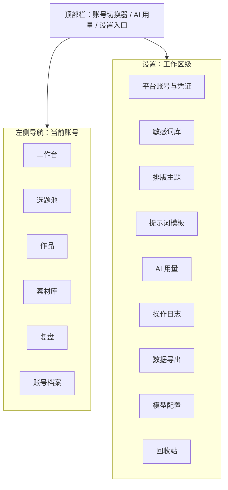
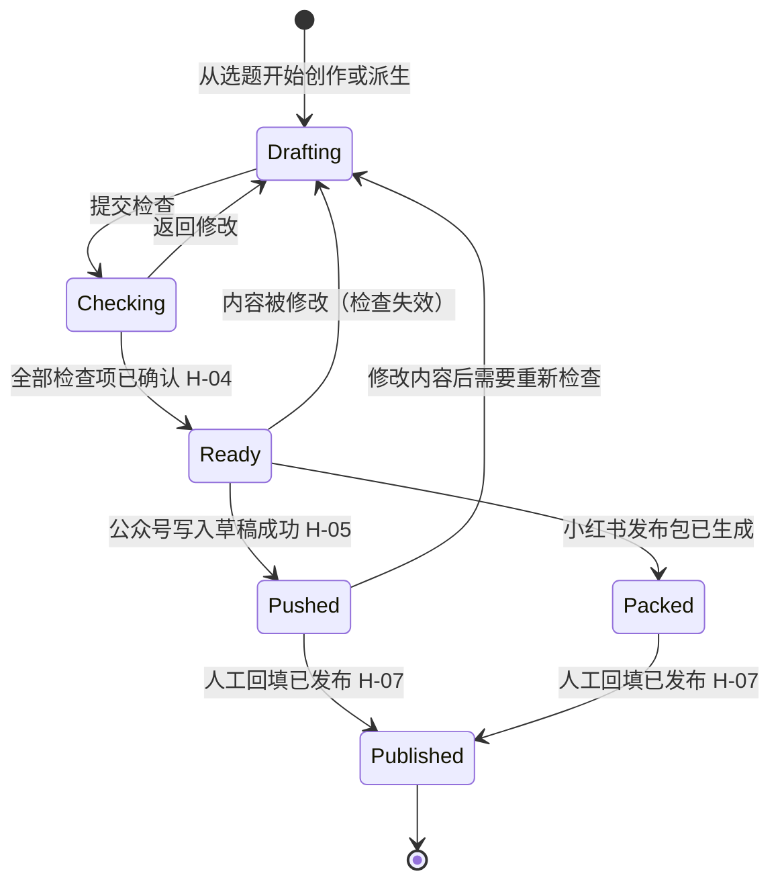
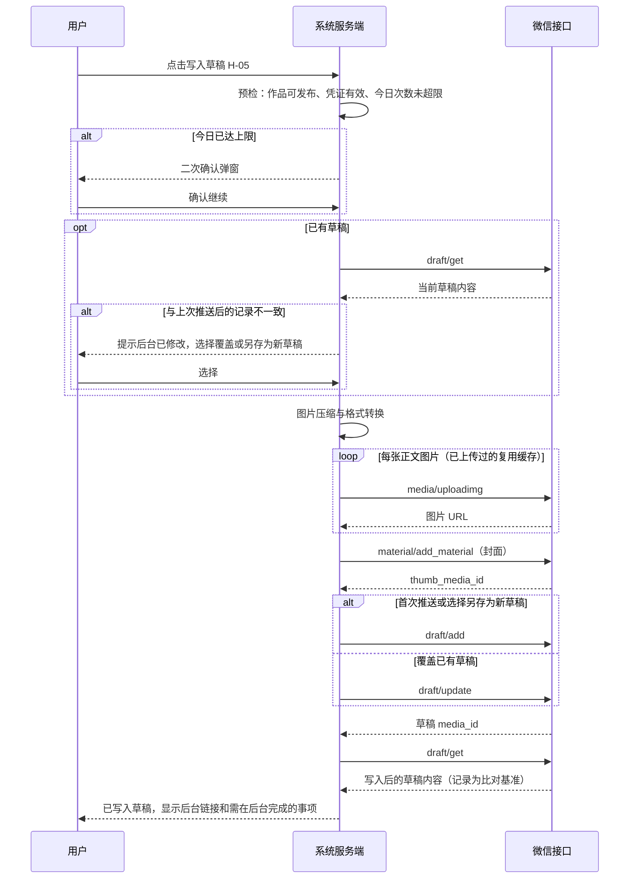

# 05 阶段五：业务流程与交互

> - 状态：已确认（2026-10-09）。Q-21 至 Q-24 均采纳建议，见第 10 节和 D-023。设计补充（D-033）新增 P-22、P-23、第 6.13 和 6.14 节、E-18 至 E-22
> - 最后更新：2026-10-09
> - 依赖：[04-需求与功能分级](04-需求与功能分级.md)（功能编号 FR、人工确认点 H、非功能需求 NFR）、[90-决策与变更记录](90-决策与变更记录.md)、[91-事实核验台账](91-事实核验台账.md)

---

## 1. 本阶段要回答的问题

1. 用户从打开系统到完成一篇双平台内容，具体经过哪些步骤？
2. 系统有哪些页面，怎么导航？
3. 关键页面上有什么、怎么操作？
4. 出错或遇到边界情况时系统怎么反应？

范围：只覆盖 04 文档确认的 P0 和 P1 功能（D-020）。本文档不涉及视觉设计（颜色、字体），也不涉及技术实现。

本阶段已确认的结构决策：

- **D-021（Q-19）**：导航按"账号优先"组织。顶部先选当前账号，左侧导航里的内容都属于当前账号。
- **D-022（Q-20）**：创作编辑器采用分段块编辑器。按大纲段落分块，每块有独立的 AI 操作，所见即所得，底层存 Markdown。

---

## 2. 交互原则

| 编号 | 原则 | 具体体现 |
| --- | --- | --- |
| UX-01 | 账号是第一上下文 | 顶部账号切换器始终可见；切换后所有列表只显示该账号的数据和工作区共享数据（D-008、D-021） |
| UX-02 | 人工确认点看得见、绕不过 | H-01 至 H-08 在界面上体现为"必须人工点击的按钮"或"必须勾选的清单"，不提供"跳过"或"全部确认"按钮 |
| UX-03 | AI 输出永远是草稿 | AI 生成的内容进入可编辑区域，带"AI 生成"浅色标记；人工修改后标记消失 |
| UX-04 | AI 用了什么要说清楚 | 每次生成后显示"本次参考：定位档案、风格样本 N 篇、素材 X、Y"（FR-M2-04） |
| UX-05 | 一次只做一件事 | 创作按"观点 → 大纲 → 分段起稿"逐步推进，不提供一键成文入口（H-02、H-03） |
| UX-06 | 少切换 | 推送公众号成功后直接给出后台链接；小红书发布包页面在手机浏览器上可用（借鉴壹伴，03 文档第 5 节） |
| UX-07 | 失败可读、可恢复 | 所有错误都说明"哪一步、为什么、怎么办"，并提供兜底路径（如复制 HTML） |
| UX-08 | 合规文案 | 界面文字不出现"一键爆文、全自动、去 AI 味、过检测"（NFR-10） |

---

## 3. 信息架构与导航

### 3.1 导航结构



- 账号切换器显示"平台图标 + 账号名 + 内容形态"，例如"公众号 · 某某笔记 · 长图文"。
- 素材库默认显示"当前账号 + 工作区共享"，可筛选。
- 账号档案集中放定位档案、风格样本、角色设定卡（仅漫画形态）、禁用词、默认主题（仅公众号）。

### 3.2 页面清单

| 编号 | 页面 | 所属 | 承载功能 | 级别 |
| --- | --- | --- | --- | --- |
| P-01 | 登录 | 全局 | FR-M1-01 | P0 |
| P-02 | 首次使用引导 | 全局 | FR-M1-02 至 04、FR-M2-01 | P0 |
| P-03 | 工作台 | 账号 | 待办汇总（待回填、待检查、草稿中）、快捷入口 | P0 |
| P-04 | 选题池 | 账号 | FR-M3-01 至 04 | P0 |
| P-05 | 作品列表 | 账号 | 作品状态筛选、源 / 衍生关系 | P0 |
| P-06 | 创作编辑器 | 账号 | FR-M4-01 至 08、FR-M7-01 至 04、FR-M7-07 | P0 |
| P-07 | 漫画编辑器 | 账号 | FR-M8-01 至 04 | P1 |
| P-08 | 对照改写 | 账号 | FR-M5-01 至 06 | P0 |
| P-09 | 排版预览 | 账号 | FR-M6-01 至 05 | P0 |
| P-10 | 发布前检查 | 账号 | FR-M9-01 至 07 | P0 |
| P-11 | 公众号推送 | 账号 | FR-M10-01 至 03、06、07、10 | P0 |
| P-12 | 小红书发布包 | 账号 | FR-M10-04、05 | P0 |
| P-13 | 素材库 | 账号 | FR-M2-03、06 | P0 |
| P-14 | 复盘看板 | 账号 | FR-M11-01 至 04 | P0 |
| P-15 | 账号档案 | 账号 | FR-M2-01、02、05，FR-M8-01，FR-M6-05 | P0 |
| P-16 | 平台账号与凭证 | 设置 | FR-M1-02 至 04 | P0 |
| P-17 | 敏感词库 | 设置 | FR-M9-01 | P0 |
| P-18 | AI 用量 | 设置 | FR-M12-02 | P0 |
| P-19 | 操作日志 | 设置 | FR-M12-03 | P0 |
| P-20 | 提示词模板 | 设置 | FR-M12-05 | P1 |
| P-21 | 数据导出 | 设置 | FR-M12-06 | P1 |
| P-22 | 模型配置 | 设置 | FR-M12-01、07 | P0 |
| P-23 | 回收站 | 设置 | FR-M12-08 | P0 |

密码重置（FR-M1-08）没有页面，在服务器上用命令完成，见 6.14 节。

排版主题（FR-M6-02）在 MVP 是内置的 3 到 5 套，只在 P-09 和 P-15 中选择，不单独做管理页面。

---

## 4. 作品状态机

作品是贯穿主链路的核心对象。每个作品属于一个平台账号，可以有一个源作品（派生关系）。



| 状态 | 界面名称 | 说明 |
| --- | --- | --- |
| Drafting | 创作中 | 可自由编辑 |
| Checking | 检查中 | 发布前检查页面打开中，检查项未全部确认 |
| Ready | 可发布 | 检查已全部确认；此时可推送公众号或生成小红书发布包 |
| Pushed | 已进草稿箱 | 仅公众号；保存微信返回的草稿 media_id |
| Packed | 发布包已生成 | 仅小红书 |
| Published | 已发布 | 由人回填链接和时间；之后进入复盘 |

规则：

1. **检查失效**：Ready、Pushed、Packed 状态下修改正文、标题、摘要、图片中的任何一项，作品回到"创作中"，需要重新检查（细节见 Q-21）。
2. **已发布后修改**：已发布的作品默认只读。如需修改（例如修正错别字后在后台重新编辑），点击"解锁编辑"并二次确认；修改不会同步到平台，只更新系统记录。
3. **草稿被发表**：系统发现公众号草稿已从草稿箱消失（FR-M10-06）时，作品显示"可能已发表，请回填"，不自动改为"已发布"（H-07）。

---

## 5. 主链路端到端流程

以"公众号长文首发，再派生小红书笔记"为例。方括号中为人工确认点。


派生不要求源作品先发布。用户也可以在源作品"可发布"后立即派生，两个平台并行推进。

---

## 6. 子流程与关键页面

每个子流程给出步骤、页面要点和线框说明。线框用文字描述区域布局，不代表视觉稿。

### 6.1 首次使用引导（P-02）

步骤：

1. 设置登录密码（单用户，D-019）。
2. 添加第一个平台账号：选平台（公众号 / 小红书）、填账号名称、选内容形态（长图文 / 图文笔记 / 漫画）。
3. 如果是公众号：填 AppID、AppSecret，系统显示服务器出口 IP 并提示加入后台白名单，然后做连通性检测（FR-M1-04）。可以选择"稍后配置"，此时公众号推送功能不可用，但创作功能可用。
4. 填写定位档案最少字段（见 Q-22）。
5. 引导页提示"建议粘贴 3 篇以上过往作品作为风格样本"，可跳过；跳过后工作台会持续显示"补充风格样本"提醒。

### 6.2 账号档案（P-15）

分为 5 个标签页：

| 标签页 | 内容 | 说明 |
| --- | --- | --- |
| 定位 | 内容形态、定位标签、目标读者、人设与语气、禁用词 | 内容形态修改需要二次确认，因为它会改变创作流程（D-008） |
| 风格样本 | 样本列表（标题、字数、添加时间）；AI 风格摘要（P1）可编辑 | 建议 3–10 篇；超过 10 篇提示只取最近 10 篇 |
| 角色设定卡 | 角色列表；每个角色含名称、外貌、性格、口头禅、参考图 | 仅内容形态为"漫画"时显示（P1） |
| 排版 | 默认主题（P1）；公众号文章默认值：作者（不超过 16 字）、是否开启评论、是否仅粉丝可评论、阅读原文链接（FR-M10-10） | 仅公众号显示 |
| 平台信息 | 链接到 P-16 的凭证配置 | 不在此页直接显示凭证 |

### 6.3 选题池（P-04）

- 列表按状态分栏：待定 / 已采用 / 已放弃；每条显示来源标记（手动、AI 建议、复盘）。
- "AI 选题建议"按钮打开右侧抽屉：可输入方向关键词（可选），生成不少于 5 条建议，每条带角度说明和"入库"按钮；没有"全部入库"按钮（H-01）。
- 去重提示（P1）：入库时相似度高则显示"与《某作品》相似"，可继续入库。
- "已采用"的选题有"开始创作"按钮，创建作品并进入 P-06（漫画账号进入 P-07）。

### 6.4 创作编辑器（P-06）

```text
+---------------------------------------------------------------+
| 顶部：作品标题（选定后显示） | 状态：创作中 | 版本历史 | 提交检查 |
+--------------------+------------------------------------------+
| 左栏：创作步骤      | 中栏：分段块编辑区                          |
| 1 核心观点  [已填]  |  [段落 1 标题]                             |
| 2 大纲      [已确认]|   正文……（AI 生成段带浅色标记）               |
| 3 分段起稿  [3/6]   |   操作：重新生成 改写 扩写 缩写 插入素材      |
| 4 标题与摘要        |  [段落 2 标题] ……                          |
| 5 配图与封面        |  [+ 新增段落]                              |
+--------------------+------------------------------------------+
| 右栏（可收起）：本次参考的素材 / 账号档案摘要 / 人工修改比例（P1） |
+---------------------------------------------------------------+
```

步骤与规则：

1. **核心观点**（H-02）：至少一句话；可从素材库勾选素材。未填写时"生成大纲"按钮不可用。
2. **大纲**（H-03）：AI 生成后以可编辑列表展示，可增删、拖动排序；点击"确认大纲"后才能进入分段起稿。确认后仍可修改大纲，新增的大纲项会生成空段落。
3. **分段起稿**：每个段落块单独点击"起草本段"。不提供"全部起草"按钮（UX-05）。每次生成会显示流式输出，生成中可取消。
4. **逐段编辑**：块内为所见即所得编辑，支持加粗、引用、列表、链接、图片；底层保存 Markdown（D-022）。自动保存间隔不超过 10 秒，每次 AI 生成和手动保存都形成一个版本。
5. **标题与摘要**：生成不少于 5 个标题候选，点选后可再修改；公众号标题输入框显示"N / 32"、摘要显示"N / 120"，超出时不可保存（F-013）。小红书标题的字数上限以 V-012 结果为准。
6. **配图与封面**：右侧或段落内上传图片；P1 功能"配图建议"在每个段落块的操作中提供"生成配图建议"，结果是可复制的文字和提示词。公众号作品需设置封面（FR-M7-07）：从作品图片中点选或单独上传，然后在弹窗中调整 2.35:1 和 1:1 两个裁剪框（默认居中），旁边同时预览"消息列表大图"和"转发卡片小图"的效果。
7. **小红书作品的编辑器**：工具栏只有段落、有序和无序列表、表情；不提供小标题、加粗、引用、链接（小红书正文是纯文本，见 06 文档第 5.4 节）。从其他来源粘贴的格式自动去掉。
8. **提交检查**：进入 P-10。

快捷操作：选中块内任意文字可唤出"改写选中部分"和"存入素材库"（FR-M2-06）。

### 6.5 漫画编辑器（P-07，P1）

```text
+---------------------------------------------------------------+
| 顶部：作品标题 | 格数：6 | 引用角色：小A 小B | 提交检查            |
+--------------------+------------------------------------------+
| 左栏：步骤          | 中栏：分镜表                                |
| 1 核心观点          | 格 1  场景 / 角色 / 动作 / 镜头               |
| 2 角色选择          |       旁白 / 对白（字数 N/30）              |
| 3 分镜脚本          |       绘图提示词 [复制]                      |
| 4 逐格文案          |       图片 [上传]                           |
| 5 回传图片          | 格 2 ……                                   |
+--------------------+------------------------------------------+
```

- 步骤 1 同样受 H-02 约束。
- 步骤 3 生成分镜后，需要人点击"确认分镜"才能生成逐格文案（与 H-03 同等约束）。
- 每格绘图提示词自动拼入所选角色的外貌描述；用户在外部工具出图后逐格上传。
- 所有格都有图片后，图片按格序排列，可进入发布前检查。公众号侧以图片消息（`newspic`）推送，小红书侧进入发布包。

### 6.6 对照改写（P-08）

入口：作品列表或创作编辑器中的"派生到其他账号"。

1. 选择目标账号（只列出平台不同、且内容形态符合 04 文档第 3.1 节派生规则的账号；同平台派生在 MVP 不提供，避免同质内容，F-104）。
2. 系统创建衍生作品，自动以目标账号的定位档案和风格进行改写，并跳转到对照页。

```text
+------------------------------+--------------------------------+
| 左：源作品（只读）             | 右：衍生作品（可编辑）            |
| 段落 1                        | 段落 1'  [重新改写本段]           |
| 段落 2                        | 段落 2'  [重新改写本段]           |
+------------------------------+--------------------------------+
| 底部：话题标签（小红书） | 字数 N / 上限（待 V-012） | 图片分页建议（P1） |
+---------------------------------------------------------------+
```

- 左右段落按对应关系对齐，点击一侧段落时高亮另一侧对应段落。
- 源作品之后若被修改，衍生作品顶部显示"源稿已更新"，可查看差异（P1）；不自动重新改写。
- 改写完成后，衍生作品按 6.4 的规则继续编辑，再提交检查。

### 6.7 排版预览（P-09，仅公众号）

- 左侧主题列表（3–5 套），右侧为手机宽度预览；切换即时生效。
- 底部显示 HTML 字符数和大小（"N / 20000 字符"，F-012）；超出时显示红色并阻止进入推送。
- "复制 HTML"按钮始终可用，作为推送失败的兜底（FR-M6-04）。

### 6.8 发布前检查（P-10）

```text
+---------------------------------------------------------------+
| 作品：某某标题 | 目标：公众号 A | 已确认 7 / 10                   |
+--------------------------------+------------------------------+
| 左：正文（命中处高亮，点击定位）   | 右：检查清单                    |
|                                | [格式] 摘要 98/120     自动通过 |
|                                | [格式] 图片 5 张，均 <1MB 通过  |
|                                | [敏感词] "XX"（自定义词库）      |
|                                |    ( ) 已修改  ( ) 已知悉，保留  |
|                                | [事实] "某数据 35%"              |
|                                |    ( ) 已核实  ( ) 已修改        |
|                                | [AI 声明] 我会在发布时声明 AI 辅助 |
|                                |    [ ] 已知悉                   |
+--------------------------------+------------------------------+
| 底部：返回修改 | 确认完成（全部确认前不可用）                       |
+---------------------------------------------------------------+
```

- 检查项分四类：格式校验（自动判定，不通过时必须修改，不能"保留"）、敏感词、事实核查、AI 声明。
- 敏感词和事实核查每条都需要单独选择处理方式，没有"全部确认"按钮（H-04）。
- 在左侧直接修改正文后，系统自动重新跑检查；已确认且对应文字没变的项保持确认（Q-21）。
- P1 项（同质化提示、广告法极限词）作为提示项出现在清单中，同样需要确认。
- 确认完成后作品进入"可发布"，页面按目标平台给出下一步按钮：公众号为"去推送"，小红书为"生成发布包"。

### 6.9 公众号推送（P-11）



页面要点：

- 推送前显示摘要卡片：标题、封面（两个裁剪比例的预览）、摘要、图片数、本次是"新建"还是"覆盖已有草稿"、今日已推送次数（"1 / 3"，D-020）。
- 摘要卡片中的文章字段（FR-M10-10）：作者、开启评论、仅粉丝可评论、阅读原文链接，默认取账号档案中的设置，可本次修改；修改不回写账号默认值。
- 推送过程显示步骤进度（压缩、上传图片 N/M、上传封面、检查后台修改、写入草稿），失败时停在失败步骤。
- 后台修改检测：系统在每次写入成功后读取一次草稿，保存其内容哈希作为基准；下次推送前再读取比对。哈希不一致，或者没有基准、读取失败时，都按"可能改过"提示用户选择"仍然覆盖"或"另存为新草稿"。另存为新草稿时，旧草稿保留在草稿箱，作品改为关联新草稿。该检测是否可靠取决于 V-015（同一草稿两次读取结果是否一致）；如果不一致，退化为"每次覆盖前都提示"。
- 成功页显示"去公众号后台"按钮和一份后台待办清单：预览检查排版；按需设置原创声明；如果内容使用了 AI 辅助，按平台要求做 AI 内容声明；发表后回来回填链接。原创声明和 AI 声明接口不支持，只能在后台设置（F-013）。
- 一次只推一篇；作品列表中没有多选推送（H-05）。
- 已上传的图片按内容哈希缓存微信 URL，重试或更新草稿时不重复上传。

### 6.10 小红书发布包（P-12）

```text
+------------------------------------------+
| 标题（N 字）                     [复制]    |
| 正文（N 字，保留换行和表情）       [复制]    |
| 话题：#话题1 #话题2               [复制]    |
| 图片：01 02 03 04（可预览）    [下载 zip]   |
|      手机端：可逐张长按保存                 |
+------------------------------------------+
| 提醒：发布时请在"笔记内容声明"中勾选          |
|      "笔记含 AI 合成内容"（F-104）          |
+------------------------------------------+
| 已发布？ [回填链接和时间]                    |
+------------------------------------------+
```

- 页面针对手机浏览器做单列布局（NFR-11），便于在手机上逐项复制、保存图片后直接打开小红书发布。手机访问方式见 Q-23。
- 每个复制按钮点击后显示"已复制"；复制正文时不包含话题，话题单独复制，便于在小红书中用话题选择器添加。
- 图片 zip 内文件名按顺序编号（`01.jpg`、`02.jpg`）。

### 6.11 发布回填与复盘（P-14）

- 回填入口出现在三处：推送成功页、发布包页、工作台的"待回填"列表。回填内容为发布链接（可选）和发布时间（默认当前时间）。
- 复盘看板列出当前账号已发布作品，每行显示最近一次录入的指标；点击进入数据录入，可添加多个时间点（如发布后 1 天、7 天）。
- 字段：阅读、点赞、在看（公众号）、收藏（小红书）、评论、分享、涨粉，加备注（D-020）。按平台只显示适用字段。
- "AI 复盘"按钮可针对单篇或最近 N 篇生成结论和不少于 3 条选题建议；每条建议有"采纳到选题池"按钮（H-08）。
- 导入导出文件（P1）：上传文件后显示字段映射和作品匹配预览，人工确认后写入；能否实现取决于 V-006、V-011。

### 6.12 平台账号与凭证（P-16）

- 列表显示每个平台账号的名称、平台、内容形态、凭证状态（未配置 / 正常 / 异常）、最近一次检测时间。
- 凭证编辑：AppSecret 输入后只显示脱敏值；修改凭证需要再次输入登录密码，并写入操作日志（FR-M12-03）。
- 页面固定显示服务器出口 IP，提示加入公众号后台白名单（F-003）。
- 停用账号：停用后该账号不出现在账号切换器中，数据保留；不提供删除平台账号（避免误删），需要时在 V2 结合数据导出处理（D-033）。

### 6.13 模型配置（P-22）

- **供应商列表**：每条包含名称、接口地址（OpenAI 兼容）、API 密钥（保存后只显示脱敏值）、可用模型名（可填多个）、状态。新增或修改密钥需要再次输入登录密码，并写入操作日志。
- **测试连通**：用一句固定的测试消息调用一次，显示成功与否和耗时；失败时显示供应商返回的错误信息（去掉密钥）。
- **任务路由**：表格列出 06 文档第 5.1 节的任务类型，每行选择"供应商 + 模型"；另设一个"默认模型"，未单独指定的任务使用默认模型。
- 页面顶部固定提示：只添加服务条款明确"API 数据不用于训练"的供应商（D-028）。
- 未配置任何模型时，所有 AI 按钮置灰并提示"请先在模型配置中添加模型"，非 AI 功能正常使用；首次使用引导（6.1 节）在最后一步提示配置模型，可跳过。

### 6.14 删除、回收站与密码重置

**删除与回收站（P-23）**：

- 作品、选题、素材、风格样本、角色卡都可以删除；删除时二次确认，删除后进入回收站。
- 回收站按类型分栏，显示名称、所属账号、删除时间、剩余保留天数；可"恢复"或"彻底删除"（再次确认）。
- 保留 30 天，到期由后台任务彻底删除数据和相关图片文件。
- 删除源作品时提示"有 N 篇衍生作品"，衍生作品不受影响，只显示"源作品已删除"；恢复源作品后关联自动恢复。
- 已进草稿箱的作品被删除时，提示"公众号草稿箱中的草稿不会被删除"；系统不调用 `draft/delete`，避免误删用户在后台改过的草稿。
- 被删除的素材如果已被作品引用，作品中的引用记录保留，显示"素材已删除"。

**密码重置（FR-M1-08）**：

- 单用户系统没有邮箱或短信渠道，所以界面不提供"忘记密码"。登录页在多次失败后提示"忘记密码请在服务器上执行重置命令"，并给出文档位置。
- 命令在服务器上通过容器执行（具体命令见 06 文档第 5.9 节），交互式输入新密码，不在命令行参数中出现密码。

---

## 7. 工作台（P-03）

工作台是登录后的默认页面，显示当前账号的待办：

| 卡片 | 内容 | 点击后 |
| --- | --- | --- |
| 待回填 | 已进草稿箱或发布包已生成，但未回填的作品；草稿疑似已发表的置顶 | 打开回填 |
| 进行中 | 创作中、检查中的作品 | 打开编辑器或检查页 |
| 可发布 | 检查已确认、未推送或未生成发布包的作品 | 打开推送或发布包 |
| 待补充 | 风格样本少于 3 篇、公众号凭证未配置或异常 | 打开账号档案或凭证页 |
| 复盘提醒 | 已发布满 1 天或 7 天但未录入数据的作品 | 打开数据录入 |
| 今日概况 | 今日已推送次数、AI 用量 | 打开用量页 |

---

## 8. 异常与边界处理

| 编号 | 场景 | 系统行为 | 兜底 |
| --- | --- | --- | --- |
| E-01 | access_token 获取失败（AppSecret 错误） | 推送停止，提示"凭证错误，请到平台账号页检查" | 复制 HTML 手动粘贴 |
| E-02 | IP 不在白名单（40164） | 提示需要加入白名单的出口 IP 和操作路径 | 同上 |
| E-03 | 正文图片超过 1MB 或格式不支持 | 推送前自动压缩、转换；压缩后仍超限时在检查阶段报错并定位图片 | 人工替换图片 |
| E-04 | 部分图片上传成功后某张失败 | 停在失败图片，已成功的保留缓存；重试时只上传剩余图片 | 复制 HTML |
| E-05 | draft/add 失败（如内容超限） | 显示微信返回的错误码和可读说明；不产生草稿 | 回到排版预览修改 |
| E-06 | draft/update 失败，原草稿已被发表或删除 | 提示"原草稿已不在草稿箱，可能已发表"；提供两个选项：回填已发布，或新建草稿（计入当日次数） | — |
| E-07 | 今日推送次数已达上限 | 二次确认弹窗，说明原因（3.27.2 风险）；确认后继续并记录日志 | — |
| E-08 | 当日微信接口额度用尽 | 提示明日再试（F-011，自用场景极少出现） | 复制 HTML |
| E-09 | AI 生成失败或超时 | 段落块保留原内容，显示"生成失败，重试"；不覆盖已有文字 | 手动编辑 |
| E-10 | AI 用量达到每日上限 | AI 按钮置灰并提示；编辑、检查（非 AI 部分）、推送不受影响 | 调整上限 |
| E-11 | AI 输出包含账号禁用词 | 正常显示，检查阶段命中并提示（不在生成时静默替换，保持可解释） | — |
| E-12 | 编辑中网络断开 | 本地暂存，恢复后自动同步；顶部显示"离线，未保存" | — |
| E-13 | 同一作品在两个浏览器标签页同时编辑 | 后保存的一方提示"内容已在其他地方修改"，可查看差异后选择保留哪个版本 | — |
| E-14 | 已发布作品被修改 | 需"解锁编辑"并二次确认；修改不同步到平台 | — |
| E-15 | 切换账号时有未保存内容 | 先自动保存，再切换 | — |
| E-16 | 修改账号内容形态（如长图文改为漫画） | 二次确认；已有作品保持原流程，新作品使用新流程 | — |
| E-17 | 小红书图片超过上限 | 检查阶段报错（上限以 V-012 结果为准，暂按 18 张） | 人工删减 |
| E-18 | 草稿在公众号后台被修改过 | 推送前提示"覆盖会丢失后台的修改"，选择"仍然覆盖"或"另存为新草稿"（另存计入当日次数） | 复制 HTML |
| E-19 | 未设置封面 | "写入草稿"不可用，提示先设置封面 | — |
| E-20 | 模型未配置或模型密钥失效 | AI 按钮置灰或返回"模型不可用"，提示到模型配置页检查；不影响编辑和推送 | 手动编辑 |
| E-21 | 忘记登录密码 | 登录页提示在服务器上执行重置命令 | — |
| E-22 | 恢复回收站中的作品时，原账号已停用 | 允许恢复，作品随账号一起不可见；重新启用账号后可见 | — |

---

## 9. 人工确认点在界面上的落点

| 确认点 | 页面 | 界面形式 | 不提供的入口 |
| --- | --- | --- | --- |
| H-01 选题入库 | P-04 | 每条建议单独的"入库"按钮 | 全部入库 |
| H-02 填写观点 | P-06、P-07 | 观点为空时"生成大纲 / 分镜"按钮不可用 | 跳过观点 |
| H-03 确认大纲 | P-06、P-07 | "确认大纲 / 确认分镜"按钮 | 全部起草、一键成文 |
| H-04 逐项确认检查 | P-10 | 每项单独选择处理方式 | 全部确认、跳过检查 |
| H-05 写入草稿 | P-11 | 单篇"写入草稿"按钮，超限二次确认 | 批量推送、定时推送 |
| H-06 平台上发布 | P-11、P-12 | 只提供跳转链接和发布包 | 任何发表、群发、代发入口 |
| H-07 回填已发布 | P-03、P-11、P-12 | 回填表单 | 自动改为已发布 |
| H-08 采纳复盘建议 | P-14 | 每条建议单独"采纳"按钮 | 自动写入选题池 |

---

## 10. 待决问题

| 编号 | 问题 | 我的建议 | 影响 |
| --- | --- | --- | --- |
| Q-21 | 检查确认后修改内容，检查怎么失效？ | 自动重新跑全部检查；已确认且对应文字没变的项保留确认，新命中的项需要确认；格式项每次重新判定。比"全部重来"省事，又不会漏掉新问题 | 检查页交互；阶段 6 需要按文本片段记录确认 |
| Q-22 | 首次引导中定位档案的必填字段？ | 必填：内容形态、至少 1 个定位标签、目标读者（一句话）。人设语气、禁用词、风格样本可后补，由工作台持续提醒 | 首次上手速度 vs AI 输出质量 |
| Q-23 | 手机上怎么打开小红书发布包？ | 手机浏览器直接登录本系统（单用户，会话可保持 7 天）。不建议生成免登录的分享链接，因为那会让未发布的内容可以被任何拿到链接的人访问，且需要公网可访问的图片地址（D-009 已规避这一点） | 部署时系统是否需要能从手机访问（阶段 6 部署方案） |
| Q-24 | 是否允许同平台派生（如公众号 A 派生到公众号 C）？ | MVP 不允许，只允许跨平台派生。同平台的多个账号发相似内容容易被判定为同质或搬运（F-104、F-004 3.27.1） | 派生入口的账号列表 |

**确认结果（2026-10-09）：**

- Q-21：部分失效。自动重跑全部检查，已确认且对应文字没变的项保留确认，新命中项需确认，格式项每次重新判定。
- Q-22：首次引导必填内容形态、至少 1 个定位标签、目标读者；其余后补，工作台持续提醒。
- Q-23：手机浏览器登录本系统，会话保持 7 天；不提供免登录分享链接。
- Q-24：MVP 只允许跨平台派生。

---

## 11. 下一阶段预告：阶段 6 数据与技术架构

阶段 6 开始前需要完成 D-012 的真实公众号验证实验（写入测试草稿，验证 HTML / CSS、图片约束和 IP 白名单）。阶段 6 产出 `06-数据与技术架构.md`：

1. 数据模型：工作区、平台账号、账号档案、素材、选题、作品（含版本、段落块、派生关系）、检查记录、推送记录、复盘数据。
2. 模块划分与平台适配层设计。
3. AI 编排：上下文注入、提示词模板、模型适配层，以及 D-011 的模型盲测方案。
4. 安全：凭证加密、会话、日志。
5. 技术选型与部署方案（含固定出口 IP、手机可访问性）。
