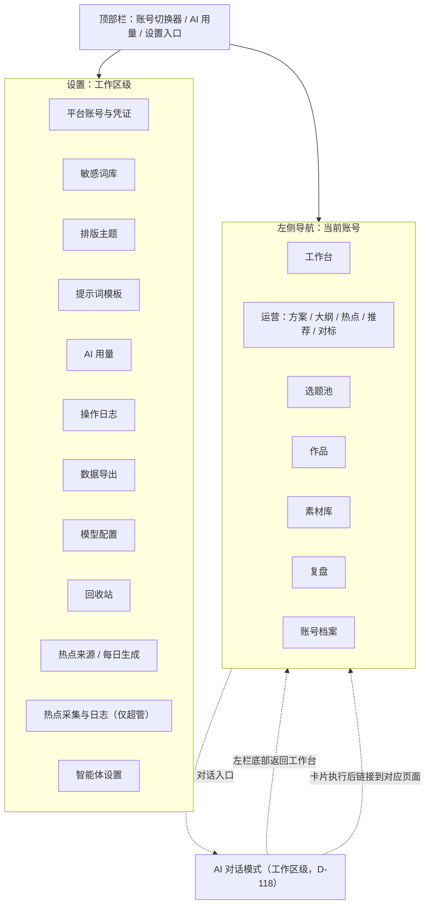
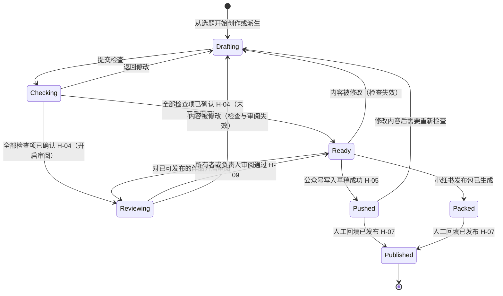
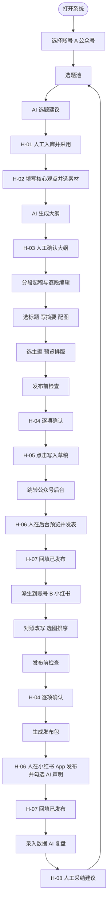
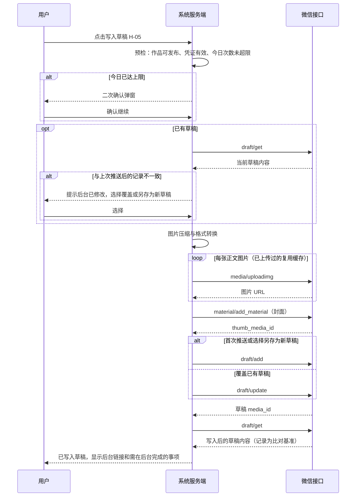
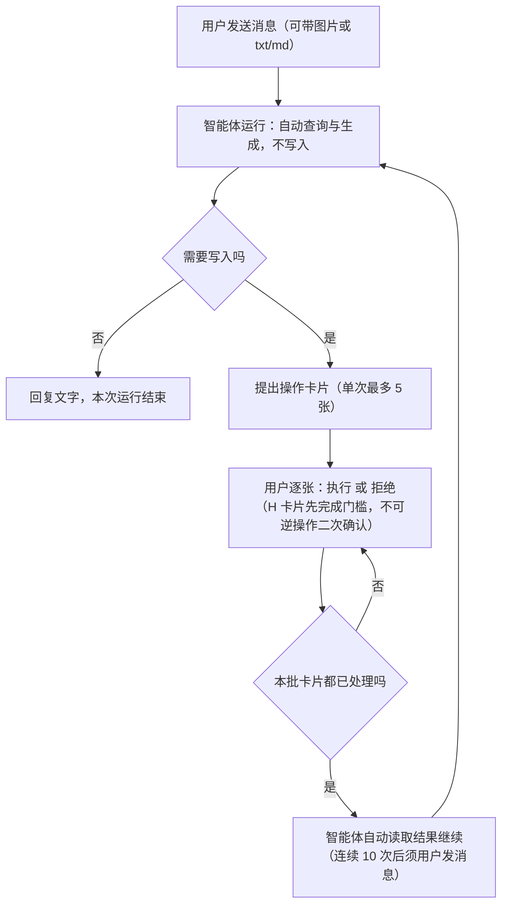

# 05 阶段五：业务流程与交互

> 2026-10-21 D-133 改造草案：当前账号摘要后增加清晰的登录/打开后台/重新登录及“同步平台账号”入口；已有连接不再隐藏重登。账号与历史作品同步、日常指标刷新分开意图和接口，共享执行/访问控制；结果进入可浏览的平台作品视图，不覆盖本地稿件或直接更新发布事实。用户已确认首版包含已发布正文/媒体地址及可得统计，不含评论明细、原始媒体下载或平台草稿。2026-10-23 D-147 已接通桌面“同步平台账号”按钮的固定本机 intent 和单向结果回执；同日 D-148 把「刷新作品指标」「继续同步」「刷新此篇指标」三处同根因入口也收敛为固定本机 intent（指标刷新可带单个 `platformWorkId`，继续同步按 `operationId` + `expectedOperationRevision`）。这两次都只修复入口调用链，D-133 全平台覆盖与端到端验收仍待完成。详细流程、按钮矩阵、异常/续传及 UI 验收以 [20 §21](20-平台登录与作品数据自动回填设计.md#platform-account-sync-redesign) 为唯一详细方案，评审前不改变本文件原有已实现流程。

> 2026-10-19 文档增量：第 15 节记录 D-122 v0.5 复审后的实施交互；按用户确认的 CL-01/02/03/04核心/06 范围继续，不按旧 v0.3 增加交付历史/轮次/素材版本库/完整归档流程。

> - 状态：已确认（2026-10-09）。Q-21 至 Q-24 均采纳建议，见第 10 节和 D-023。设计补充（D-033）新增 P-22、P-23、第 6.13 和 6.14 节、E-18 至 E-22
> - 最后更新：2026-10-09
> - 依赖：[04-需求与功能分级](04-需求与功能分级.md)（功能编号 FR、人工确认点 H、非功能需求 NFR）、[90-决策与变更记录](90-决策与变更记录.md)、[91-事实核验台账](91-事实核验台账.md)

---

## 1. 本阶段要回答的问题

1. 用户从打开系统到完成一篇双平台内容，具体经过哪些步骤？
2. 系统有哪些页面，怎么导航？
3. 关键页面上有什么、怎么操作？
4. 出错或遇到边界情况时系统怎么反应？

范围：只覆盖 04 文档确认的 P0 和 P1 功能（D-020）。本文档不涉及视觉设计（颜色、字体），也不涉及技术实现。

本阶段已确认的结构决策：

- **D-021（Q-19）**：导航按"账号优先"组织。顶部先选当前账号，左侧导航里的内容都属于当前账号。
- **D-022（Q-20）**：创作编辑器采用分段块编辑器。按大纲段落分块，每块有独立的 AI 操作，所见即所得，底层存 Markdown。

---

## 2. 交互原则

| 编号 | 原则 | 具体体现 |
| --- | --- | --- |
| UX-01 | 账号是第一上下文 | 顶部账号切换器始终可见；切换后所有列表只显示该账号的数据和工作区共享数据（D-008、D-021） |
| UX-02 | 人工确认点看得见、绕不过 | H-01 至 H-08 在界面上体现为"必须人工点击的按钮"或"必须勾选的清单"，不提供"跳过"或"全部确认"按钮；智能体的操作卡片同样逐张点击，不提供"全部执行"（D-117） |
| UX-03 | AI 输出永远是草稿 | AI 生成的内容进入可编辑区域，带"AI 生成"浅色标记；人工修改后标记消失 |
| UX-04 | AI 用了什么要说清楚 | 每次生成后显示"本次参考：定位档案、风格样本 N 篇、素材 X、Y"（FR-M2-04） |
| UX-05 | 一次只做一件事 | 创作按"观点 → 大纲 → 分段起稿"逐步推进，不提供一键成文入口（H-02、H-03） |
| UX-06 | 少切换 | 推送公众号成功后直接给出后台链接；小红书发布包页面在手机浏览器上可用（借鉴壹伴，03 文档第 5 节） |
| UX-07 | 失败可读、可恢复 | 所有错误都说明"哪一步、为什么、怎么办"，并提供兜底路径（如复制 HTML） |
| UX-08 | 合规文案 | 界面文字不出现"一键爆文、全自动、去 AI 味、过检测"（NFR-10） |

---

## 3. 信息架构与导航

### 3.1 导航结构



- AI 对话（P-29，D-117、D-118）是工作区级页面，不随账号切换而改变路由。桌面端从工作区左栏底部进入；左栏 logo 区和整体尺寸保持不变，菜单主体以左滑动画切换为新对话、搜索和对话标题列表，底部提供“返回工作台”。手机上从顶栏图标进入，底部导航不变；当前账号标签默认取顶栏账号。

- 账号切换器显示"平台图标 + 账号名 + 内容形态"，例如"公众号 · 某某笔记 · 长图文"。
- Electron 顶栏只保留一个工作区与账号统一入口（D-125）：按钮同时展示工作区名称与当前平台/账号；弹层内「公众号」「小红书」各占一个 Tab，显示各平台有效账号数量与对应账号列表，取消平台的展开/收起。打开时默认选中当前账号所属平台，无账号时默认公众号；切换 Tab 仅浏览账号，点选账号才切换业务上下文。空平台展示明确空态，添加入口（仅所有者）预选当前 Tab 的平台。统一入口负责切换账号/工作区及创建账号/工作区；账号与成员管理统一从“设置”进入，入口内不重复提供管理平台账号、成员与邀请导航。Web 保留原有展开式合并菜单。弹层左对齐入口，再次点击、点击外部、按 Escape 或导航后关闭；支持 Tab 的左右方向键及 Home/End。切换账号沿用原路由逻辑，切换工作区沿用既有会话切换与缓存清理，不改变权限或数据范围。
- D-132 当前账号设置增量（2026-10-22，主路径已实施）：Electron 顶部统一入口独占账号切换，账号设置移入“当前账号”作用域，只展示当前账号的资料、平台登录与数据回填，不列其他账号/平台；创建、停用恢复改从顶部进入。D-132 专项 30/30、相关设置回归 40/40；T-132 全矩阵仍有待验项。旧深链、脏表单、迟到请求、本机登录固定目标和 UI 规格以 [17 §10.6](17-Electron客户端改造方案.md#current-account-settings-plan) 为唯一详细基线。Web 原总览及其他工作区设置保持兼容。
- D-134 Electron 设置收敛（2026-10-22，代码已实现）：登录前、登录后均在当前可见窗口打开统一设置宿主；本机 `connection`、`ai`、`account-device`、`diagnostics` 四面板保留在隔离的本机视图中，线上页面无本机 API。统一宿主汇总 React 草稿和本机 dirty/busy 状态，按既有保存/丢弃规则离开；工作区桌面 AI 策略由现有服务端角色授权，平台设置绑定顶部当前账号。定向回归与本地离线窗口复用验收已通过；真实平台登录和 Windows DPI 场景待验。完整导航、异常与清理流程见 [17 §10.7](17-Electron客户端改造方案.md#electron-settings-center-local-settings-embedding-d134) 和统一设计稿。
- 素材库默认显示"当前账号 + 工作区共享"，可筛选。
- 素材列表首次显示 50 条；“加载更多素材”每次再显示 50 条，筛选变化后从首批开始。通过 `focus` 地址定位的素材即使不在首批也保持可定位（D-109、OPT-40）。
- 账号档案集中放定位档案、风格样本、角色设定卡（仅漫画形态）、禁用词、默认主题（仅公众号）。
- Web 工作区设置菜单默认显示“平台账号与凭证、模型配置、成员与邀请、偏好设置”四项；其他设置归入默认折叠的“高级设置”，展开状态保存在本地。原有设置路由均可直接访问，命令面板仍可搜索全部设置（OPT-18、D-112）。Electron 按 D-126 的历史分类与 D-134 现行同窗呈现运行；功能归属、背景保留、草稿保护及本机信任边界见 17 文档 §10.5～§10.7；头像菜单不再展开高级设置长列表。

### 3.2 页面清单

| 编号 | 页面 | 所属 | 承载功能 | 级别 |
| --- | --- | --- | --- | --- |
| P-01 | 登录 / 注册 | 全局 | FR-M1-01、FR-M1-09、FR-M1-11（填邀请码） | P0 |
| P-02 | 首次使用引导 | 全局 | FR-M1-09（兼容 setup）；登录后配置见 D-035 | P0 |
| P-24 | 成员与邀请 | 设置 | FR-M1-06、FR-M1-10、FR-M1-11 | P0 |
| P-03 | 工作台 | 账号 | 待办汇总（待回填、待检查、草稿中）、快捷入口 | P0 |
| P-04 | 选题池 | 账号 | FR-M3-01 至 04 | P0 |
| P-05 | 作品列表 | 账号 | FR-M4-09 至 FR-M4-11；作品状态筛选、源 / 衍生关系、自由标签管理与筛选 | P0 |
| P-06 | 创作编辑器 | 账号 | FR-M4-01 至 08、FR-M7-01 至 04、FR-M7-07 | P0 |
| P-07 | 漫画编辑器 | 账号 | FR-M8-01 至 04 | P1 |
| P-08 | 对照改写 | 账号 | FR-M5-01 至 06 | P0 |
| P-09 | 排版预览 | 账号 | FR-M6-01 至 05 | P0 |
| P-10 | 发布前检查 | 账号 | FR-M9-01 至 07 | P0 |
| P-11 | 公众号推送 | 账号 | FR-M10-01 至 03、06、07、10 | P0 |
| P-12 | 小红书发布包 | 账号 | FR-M10-04、05 | P0 |
| P-13 | 素材库 | 账号 | FR-M2-03、06 | P0 |
| P-14 | 复盘看板 | 账号 | FR-M11-01 至 04 | P0 |
| P-15 | 账号档案 | 账号 | FR-M2-01、02、05，FR-M8-01，FR-M6-05 | P0 |
| P-16 | 平台账号与凭证 | 设置 | FR-M1-02 至 04 | P0 |
| P-17 | 敏感词库 | 设置 | FR-M9-01 | P0 |
| P-18 | AI 用量 | 设置 | FR-M12-02 | P0 |
| P-19 | 操作日志 | 设置 | FR-M12-03 | P0 |
| P-20 | 提示词模板 | 设置 | FR-M12-05 | P1 |
| P-21 | 数据导出 | 设置 | FR-M12-06 | P1 |
| P-22 | 模型配置 | 设置 | FR-M12-01、07 | P0 |
| P-23 | 回收站 | 设置 | FR-M12-08 | P0 |
| P-25 | 账号运营 | 账号 | FR-M3-06 至 FR-M3-09；方案、大纲、热点、每日推荐、对标参考 | V4 |
| P-26 | 热点采集与日志 | 超管设置 | FR-M3-10、FR-M3-11；部署/全站开关、来源、敏感平台限额与日志 | V4 |
| P-27 | 热点来源 | 工作区设置 | 已启用来源选择、自定义 RSS、原生联网搜索配置；所有者写 | V4 |
| P-28 | 每日生成 | 工作区设置 | off/on_open/background、时间、主推/备选默认；所有者写 | V4 |
| P-29 | 智能体 | 工作区 | FR-M13-01 至 FR-M13-11；对话列表、消息流、操作卡片、附件、模型选择（16 文档第 12 节） | D-117 |
| P-30 | 智能体设置 | 工作区设置 | FR-M13-12；开关、观察者可用、允许自选模型；所有者写 | D-117 |

P-05 作品列表与 P-13 图片库中的图片使用 256 像素宽缩略图；图片库打开详情和编辑器中的图片操作仍使用原图。

公众号长图文作品列表提供单篇“导入旧文”入口。用户粘贴 Markdown 或公众号复制的富文本，填写作品标题和可选发布日期后先预览按小标题拆分的段落；点击“确认导入为已发布作品”才创建作品。第一阶段不读取公开链接、不导入多篇；导入不触发推送或发表，已发布状态由用户明确确认（OPT-21、D-110）。

P-13 图片库可编辑单张图片的替代文字。AI 单图建议只填入编辑框，不会自动保存；作者点击保存后该文字用于公众号排版 HTML。只读成员仅查看替代文字。

P-05 作品可由有写权限的成员逐条添加或移除自由标签；标签筛选写入地址查询参数，便于刷新、复制和保存视图。只读成员可查看标签。标签不改变作品正文、修订号或检查状态。

密码重置（FR-M1-08）没有页面，在服务器上用命令完成，见 6.14 节。

排版主题（FR-M6-02）在 MVP 是内置的 3 到 5 套，只在 P-09 和 P-15 中选择，不单独做管理页面。

---

## 4. 作品状态机

作品是贯穿主链路的核心对象。每个作品属于一个平台账号，可以有一个源作品（派生关系）。



| 状态 | 界面名称 | 说明 |
| --- | --- | --- |
| Drafting | 创作中 | 可自由编辑 |
| Checking | 检查中 | 发布前检查已发起、检查项未全部确认；只是"正在检查"，不是独立的持久阶段。内容一改即回「创作中」（D-135） |
| Reviewing | 待审阅 | 仅当作品开启「发布前需要审阅」（默认关闭，D-046）；检查已全部确认，等待所有者或负责人审阅通过（H-09），此时不能推送或生成发布包 |
| Ready | 可发布 | 检查已全部确认（开启审阅时还需审阅通过）；此时可推送公众号或生成小红书发布包 |
| Pushed | 已进草稿箱 | 仅公众号；保存微信返回的草稿 media_id |
| Packed | 发布包已生成 | 仅小红书 |
| Published | 已发布 | 由人回填链接和时间；之后进入复盘 |

规则：

1. **检查失效**：Checking、Reviewing、Ready、Pushed、Packed 状态下修改正文、标题、摘要、观点、图片中的任何一项，作品回到"创作中"，需要重新检查（细节见 Q-21）；开启审阅的作品还需要重新审阅。计划发布日、目标字数、负责人、审阅开关、后台待办不算内容修改，不会让检查失效。
4. **计划发布日**：只用于日历和提醒，任何状态都不会因为到达计划日而自动推送或发布（HC-16）。
2. **已发布后修改**：已发布的作品默认只读。如需修改（例如修正错别字后在后台重新编辑），点击"解锁编辑"并二次确认；修改不会同步到平台，只更新系统记录。工作区 owner/editor 均可执行，viewer 不可执行。
3. **草稿被发表**：系统发现公众号草稿已从草稿箱消失（FR-M10-06）时，作品显示"可能已发表，请回填"，不自动改为"已发布"（H-07）。

---

## 5. 主链路端到端流程

以"公众号长文首发，再派生小红书笔记"为例。方括号中为人工确认点。



派生不要求源作品先发布。用户也可以在源作品"可发布"后立即派生，两个平台并行推进。

---

## 6. 子流程与关键页面

每个子流程给出步骤、页面要点和线框说明。线框用文字描述区域布局，不代表视觉稿。

### 6.1 首次使用引导（P-02）

（D-035 / D-036）平台侧配置全部放到登录后；身份改为可注册的多用户多工作区。

1. 未登录可进入「注册」：用户名 + 密码 → 自动创建个人工作区（owner）并登录；或「登录」。兼容路径：库中尚无任何用户时，`/setup` 仍可创建第一个用户（与注册等价）。
2. 已登录后顶栏可切换工作区；设置中「成员与邀请」：owner 生成/撤销邀请码、管理成员；任意成员可输入邀请码加入其他工作区，或再创建一个工作区并切换过去（D-041）。
3. 登录后若尚无平台账号，进入「平台账号与凭证」并打开添加账号；可随时离开。
4. 公众号凭证、定位档案、风格样本、模型配置分别在设置页 / 账号档案 / 模型配置中完成；工作台对未完成项持续提醒（可跳过，不阻断创作入口以外的浏览）。

### 6.2 账号档案（P-15）

分为 5 个标签页：

| 标签页 | 内容 | 说明 |
| --- | --- | --- |
| 定位 | 账号类型（本页只读展示，修改入口在设置页的"修改类型"，D-123）、类型补充说明、定位标签、目标读者、人设与语气、禁用词 | 账号类型可在同平台内迁移（D-123）：设置页二次确认后生效，已有作品按自身形态快照保持原类型；跨平台仍需新建账号。业务定位可随时调整，不影响类型 |
| 风格样本 | 样本列表（标题、字数、添加时间）；AI 风格摘要（P1）可编辑 | 建议 3–10 篇；超过 10 篇提示只取最近 10 篇 |
| 角色设定卡 | 角色列表；每个角色含名称、外貌、性格、口头禅、参考图 | 仅内容形态为"漫画"时显示（P1） |
| 排版 | 默认主题（P1）；公众号文章默认值：作者（不超过 16 字）、是否开启评论、是否仅粉丝可评论、阅读原文链接（FR-M10-10） | 仅公众号显示 |
| 平台信息 | 链接到 P-16 的凭证配置 | 不在此页直接显示凭证 |

### 6.3 选题池（P-04）

- 列表按状态分栏：待定 / 已采用 / 已放弃；每条显示来源标记（手动、AI 建议、复盘）。
- `Topics` 与 `Calendar` 的选题列表按置顶、创建时间和 ID 稳定排序，默认每页 50 条；用“加载更多”逐页查看，状态页签显示该状态的总条数（D-101）。
- "AI 选题建议"按钮打开右侧抽屉：可输入方向关键词（可选），生成不少于 5 条建议，每条带角度说明和"入库"按钮；没有"全部入库"按钮（H-01）。
- 采纳或拒绝 AI 标题/选题时记录候选原文与原因，供后续同类生成参考；选题仍逐条入库，重复拒绝形成的记忆仍需作者逐条确认（D-115、OPT-48）。
- 去重提示（P1）：入库时相似度高则显示"与《某作品》相似"，可继续入库。
- "已采用"的选题有"开始创作"按钮，创建作品并进入 P-06（漫画账号进入 P-07）。
- 待定选题可单条“采用并开始写”，一次人工点击采用当前条目并进入编辑器；保留单独“采用”用于只排期不写。核心观点和大纲确认仍由作者完成（D-082、OPT-56）。
- 快速收集灵感成功后可点“去整理”直达当前账号收件箱；编辑器的空素材入口可去素材库或在原页打开同一收件箱整理界面。逐条转为素材时可自行勾选“同时关联到当前作品”，默认不勾选，仍需点存为素材确认（D-083、OPT-57）。
- 选题页签与素材范围、类型、引用情况、关键词、标签保存在地址，刷新或同工作区成员打开复制地址会恢复条件；切换替换当前历史记录，原权限隔离不变（D-084、OPT-58）。
- 放弃单条选题后成功提示保留十秒“撤销”，恢复其放弃前的状态，不增加确认弹窗，不影响已有作品或其他选题（D-086、OPT-60）。
- 状态更新成功后使用服务端选题更新当前列表缓存，不重拉整表；个人星标立即切换且请求期间不可重复操作，失败时恢复原状态；热点转选题仅刷新热点与选题数据（D-094、OPT-68）。

### 6.4 创作编辑器（P-06）

```text
+---------------------------------------------------------------+
| 顶部：作品标题（选定后显示） | 状态：创作中 | 版本历史 | 提交检查 |
+--------------------+------------------------------------------+
| 左栏：创作步骤      | 中栏：分段块编辑区                          |
| 1 核心观点  [已填]  |  [段落 1 标题]                             |
| 2 大纲      [已确认]|   正文……（AI 生成段带浅色标记）               |
| 3 分段起稿  [3/6]   |   操作：重新生成 改写 扩写 缩写 插入素材      |
| 4 标题与摘要        |  [段落 2 标题] ……                          |
| 5 配图与封面        |  [+ 新增段落]                              |
+--------------------+------------------------------------------+
| 右栏（可收起）：本次参考的素材 / 账号档案摘要 / 人工修改比例（P1） |
+---------------------------------------------------------------+
```

步骤与规则：

1. **核心观点**（H-02）：至少一句话；可从素材库勾选素材。未填写时"生成大纲"按钮不可用。
2. **大纲**（H-03）：AI 生成后以可编辑列表展示，可增删、拖动排序；点击"确认大纲"后才能进入分段起稿。确认后仍可修改大纲，新增的大纲项会生成空段落。
3. **分段起稿**：每个段落块单独点击"起草本段"。不提供"全部起草"按钮（UX-05）。每次生成会显示流式输出，生成中可取消。
4. **逐段编辑**：块内为所见即所得编辑，支持加粗、引用、列表、链接、图片；底层保存 Markdown（D-022）。自动保存间隔不超过 10 秒，每次 AI 生成和手动保存都形成一个版本。
5. **标题与摘要**：生成不少于 5 个标题候选，可参考近期采纳/拒绝样例；点选后可再修改。拒绝反馈可选择“太夸张”等原因；公众号标题输入框显示"N / 32"、摘要显示"N / 120"，超出时不可保存（F-013）。小红书标题的字数上限以 V-012 结果为准。
6. **配图与封面**：右侧或段落内上传图片；P1 功能"配图建议"在每个段落块的操作中提供"生成配图建议"，结果是可复制的文字和提示词。公众号作品需设置封面（FR-M7-07）：从作品图片中点选或单独上传，然后在弹窗中调整 2.35:1 和 1:1 两个裁剪框（默认居中），旁边同时预览"消息列表大图"和"转发卡片小图"的效果。
7. **小红书作品的编辑器**：工具栏只有段落、有序和无序列表、表情；不提供小标题、加粗、引用、链接（小红书正文是纯文本，见 06 文档第 5.4 节）。从其他来源粘贴的格式自动去掉。
8. **提交检查**：进入 P-10。

快捷操作：选中块内任意文字可唤出"改写选中部分"和"存入素材库"（FR-M2-06）。

编辑器顶层作品页的“更多”菜单提供单篇 Markdown 下载；导出当前作品标题、按顺序排列的段落标题与正文，并把本地作品图片路径改为当前站点的绝对资源地址。该操作沿用“更多”菜单现有的可写成员权限，不涉及批量导出（OPT-38、D-107）。

窄屏助手侧栏（D-099，OPT-25）：窗口小于 xl 时，助手侧栏改为覆盖正文的右侧抽屉，初始关闭，不挤压编辑区；编辑器中的助手按钮打开当前页签，Ctrl/⌘+J 打开副驾驶，再按一次关闭。抽屉可通过关闭按钮、遮罩或 Esc 关闭；素材、副驾驶、待核实、通读、体检、批注、动态七项工具沿用原功能。宽屏固定侧栏及其本机偏好保持不变。

素材读取（D-065，OPT-10）：素材列表只展示前 120 字与元数据；查看、编辑、标签建议/接受或插入引用时按单条读取全文，摘要不用于覆盖正文。作品打开不预取整份素材正文，观点卡列表等待选择素材或人工打开素材侧栏；已绑定但尚未读取列表时仍显示关联数量。绑定与接受保持逐条人工确认。

后台标签页（D-066，OPT-22）：隐藏时暂停在线心跳、批注与通知轮询，关闭通知推送连接及重连计时器；切回立即刷新并恢复推送。通知 SSE 断开后先立即重连一次，之后按 1、2、4 秒指数退避，最长 60 秒，实际等待随机缩短最多 20%；浏览器恢复在线时立即重连（D-095，OPT-69）。在线提示沿用 30 秒过期，保存及 AI 任务继续执行。

通知、收件箱和批注（D-096，OPT-72）：列表按创建时间倒序每页返回 50 条，通过时间与记录 ID 游标逐页加载；通知保留未读数与活动 AI 任务数，收件箱显示当前状态的总数，批注保留未解决数量且提及链接仍能定位到目标批注。

保存与冲突（D-062，OPT-63/07/26）：每段标题和正文合并为完整快照，保存请求串行，排队期间继续输入会合并到下一次；重新起草人工确认后先等待未保存修改落库，失败/冲突时不启动生成。AI 生成期间同段被修改时保留现有内容并提供“替换 / 保留当前 / 对比”，替换仍须比较当前修订；历史恢复、大纲确认、排序、作品标题/摘要使用基准修订，冲突通过内容对比由用户决定，不静默覆盖。

D-089（OPT-65）：输入法仍在组字时，回车不触发选题生成、命令执行、确认或 Ctrl/⌘+Enter 快捷操作；候选提交后再次按回车仍执行原动作。统一判断同时排除 `isComposing` 与 `keyCode=229`。

继续编辑（D-072、OPT-54）：文字作品在本机记住最后聚焦段落和侧栏页签；无地址锚点时重新打开自动定位并显示可关闭的“已回到上次编辑的第 N 段”提示。地址锚点优先，批注提及仍打开批注；记录不包含正文，已删除的段落不恢复位置。

恢复改写前（D-073、OPT-71）：AI 改写/候选采纳及重新起草成功后，段落保留恢复按钮，十秒撤销提示仍可用；下一次手动修改后失效，后续 AI 写回改用最新快照。恢复仍自动保存并遵守修订冲突；内容已变、只读或生成中不覆盖。Ctrl/⌘+Z 撤销以当前段落为单位，不跨段落。

单篇复制（D-067，OPT-20）：作品列表及作品页头更多菜单中的复制为新草稿，先等待当前保存，再创建同账号的新草稿并打开。正文、分格、图文卡片和图片保留，原作独立；新草稿仍须确认大纲/分镜并重新逐项检查，不继承推送、发布或数据，也不建立派生关系。

正文完成后的下一步（D-078、D-114、D-116、OPT-47、OPT-55）：文字编辑器的段落全部写好、观点和大纲已确认后，主线依次导航到标题、封面/笔记图片、发布前检查。公众号编辑器直达检查，检查页和推送页保留“看排版”入口。有计划日提醒时仍保持优先级，但链接指向当前缺少的步骤。没有相应步骤锚点的漫画/卡片不产生文字编辑器链接。已发布且尚无小红书衍生作品的公众号长文提示作者回到原作品页手动派生，不自动创建或生成。

### 6.5 漫画编辑器（P-07，P1）

```text
+---------------------------------------------------------------+
| 顶部：作品标题 | 格数：6 | 引用角色：小A 小B | 提交检查            |
+--------------------+------------------------------------------+
| 左栏：步骤          | 中栏：分镜表                                |
| 1 核心观点          | 格 1  场景 / 角色 / 动作 / 镜头               |
| 2 角色选择          |       旁白 / 对白（字数 N/30）              |
| 3 分镜脚本          |       绘图提示词 [复制]                      |
| 4 逐格文案          |       图片 [上传]                           |
| 5 回传图片          | 格 2 ……                                   |
+--------------------+------------------------------------------+
```

- 步骤 1 同样受 H-02 约束。
- 步骤 3 生成分镜后，需要人点击"确认分镜"才能生成逐格文案（与 H-03 同等约束）。
- 每格绘图提示词自动拼入所选角色的外貌描述；用户在外部工具出图后逐格上传。
- 所有格都有图片后，图片按格序排列，可进入发布前检查。公众号侧以图片消息（`newspic`）推送，小红书侧进入发布包。

### 6.6 对照改写（P-08）

入口：作品列表或创作编辑器中的"派生到其他账号"。

1. 选择目标账号（只列出平台不同、且账号类型符合 04 文档第 3.1 节派生规则的账号；同平台派生在 MVP 不提供，避免同质内容，F-104；D-048 首批只保留 长图文↔图文笔记 与 漫画↔漫画 两条路径，新类型入口禁用）。
2. 系统创建衍生作品，自动以目标账号的定位档案和风格进行改写，并跳转到对照页。

D-088（OPT-53）：漫画派生完成后进入 `/works/{id}`，按作品形态显示漫画编辑器；漫画对照页的“打开漫画编辑器”也回到该作品首页。文字作品仍进入段落对照页。

```text
+------------------------------+--------------------------------+
| 左：源作品（只读）             | 右：衍生作品（可编辑）            |
| 段落 1                        | 段落 1'  [重新改写本段]           |
| 段落 2                        | 段落 2'  [重新改写本段]           |
+------------------------------+--------------------------------+
| 底部：话题标签（小红书） | 字数 N / 上限（待 V-012） | 图片分页建议（P1） |
+---------------------------------------------------------------+
```

- 左右段落按对应关系对齐，点击一侧段落时高亮另一侧对应段落。
- 源作品之后若被修改，衍生作品顶部显示"源稿已更新"，可查看差异（P1）；不自动重新改写。
- 改写仍有空段时继续编辑；所有段落正文完成后，对照页主按钮“去检查”直达既有检查页，公众号和小红书均适用。此公众号入口由用户单独确认，仅改变派生对照页流程；编辑器直达检查由 OPT-55（D-116）另行完成；每项检查与审阅仍须人工确认，检查通过后的平台下一步入口保持（D-087、OPT-61）。

### 6.7 排版预览（P-09，仅公众号）

- 左侧主题列表（3–5 套），右侧为手机宽度预览；切换即时生效。
- 底部显示 HTML 字符数和大小（"N / 20000 字符"，F-012）；超出时显示红色并阻止进入推送。
- "复制 HTML"按钮始终可用，作为推送失败的兜底（FR-M6-04）。
- 提供"生成手机扫码预览"入口，生成 24 小时有效的只读链接和二维码；手机页面复用公众号 HTML 渲染器，过期后不再返回正文或图片。此入口不执行写入草稿、发表或群发（OPT-37、D-106）。
- 检查页和公众号推送页均可通过“看排版”返回此预览；从编辑器进入检查不再强制经过预览（D-116、OPT-55）。

### 6.8 发布前检查（P-10）

```text
+---------------------------------------------------------------+
| 作品：某某标题 | 目标：公众号 A | 已确认 7 / 10                   |
+--------------------------------+------------------------------+
| 左：正文（命中处高亮，点击定位）   | 右：检查清单                    |
|                                | [格式] 摘要 98/120     自动通过 |
|                                | [格式] 图片 5 张，均 <1MB 通过  |
|                                | [敏感词] "XX"（自定义词库）      |
|                                |    ( ) 已修改  ( ) 已知悉，保留  |
|                                | [事实] "某数据 35%"              |
|                                |    ( ) 已核实  ( ) 已修改        |
|                                | [AI 声明] 我会在发布时声明 AI 辅助 |
|                                |    [ ] 已知悉                   |
+--------------------------------+------------------------------+
| 底部：返回修改 | 确认完成（全部确认前不可用）                       |
+---------------------------------------------------------------+
```

- 检查项分四类：格式校验（自动判定，不通过时必须修改，不能"保留"）、敏感词、事实核查、AI 声明。
- 事实核查按“有素材支撑”和“待核实”分组；前者显示对应的素材引句。素材支撑只表示作者关联素材能对应正文内容，不代表系统验证了事实真实性。两组中的每条事实仍需单独选择处理方式，没有“全部确认”按钮（H-04）。敏感词同样逐条处理。
- 在左侧直接修改正文后，系统自动重新跑检查；已确认且对应文字没变的项保持确认（Q-21）。
- P1 项（同质化提示、广告法极限词）作为提示项出现在清单中，同样需要确认。
- 检查项的定位主体使用可通过 Tab 聚焦、按 Enter 选择的按钮；每项的确认和处理选项仍由作者单独操作（D-098、OPT-75）。
- 公众号排版 HTML 超过 20000 字符或 1 MiB 时仍由格式检查拦截；作者可以从本页进入可选的排版预览（D-116、OPT-55）。
- 确认完成后作品进入"可发布"，页面按目标平台给出下一步按钮：公众号为"去推送"，小红书为"生成发布包"。

### 6.9 公众号推送（P-11）



页面要点：

- 推送前显示摘要卡片：标题、封面（两个裁剪比例的预览）、摘要、图片数、本次是"新建"还是"覆盖已有草稿"、今日已推送次数（"1 / 3"，D-020）。
- 摘要卡片中的文章字段（FR-M10-10）：作者、开启评论、仅粉丝可评论、阅读原文链接，默认取账号档案中的设置，可本次修改；修改不回写账号默认值。
- 推送过程显示步骤进度（压缩、上传图片 N/M、上传封面、检查后台修改、写入草稿），失败时停在失败步骤。
- 已关联公众号草稿时可手动同步草稿箱状态；请求期间按钮显示加载状态并禁用，避免重复请求，作品状态仍由作者处理（D-098、OPT-75）。
- 后台修改检测：系统在每次写入成功后读取一次草稿，保存其内容哈希作为基准；下次推送前再读取比对。哈希不一致，或者没有基准、读取失败时，都按"可能改过"提示用户选择"仍然覆盖"或"另存为新草稿"。另存为新草稿时，旧草稿保留在草稿箱，作品改为关联新草稿。该检测是否可靠取决于 V-015（同一草稿两次读取结果是否一致）；如果不一致，退化为"每次覆盖前都提示"。
- 成功页显示"去公众号后台"按钮和一份后台待办清单：预览检查排版；按需设置原创声明；如果内容使用了 AI 辅助，按平台要求做 AI 内容声明；发表后回来回填链接。原创声明和 AI 声明接口不支持，只能在后台设置（F-013）。
- 一次只推一篇；作品列表中没有多选推送（H-05）。
- 单篇并发（D-061，OPT-06）：写入期间按钮禁用；另一会话写入同篇时显示“正在写入，请稍候”，本次不新建草稿、不重复计成功次数，完成或失败后由用户再次决定是否重试。超限确认及后台修改的覆盖/另存选择保持不变。
- 已上传的图片按内容哈希缓存微信 URL，重试或更新草稿时不重复上传。

### 6.10 小红书发布包（P-12）

D-085（OPT-59）：生成发布包失败提示保留人工“重试”，检查/审阅门槛拒绝时可“去检查”；分页文案建议和每日推荐生成/替换失败复用统一 AI 错误处理。推荐单条非 AI 处理失败可人工重试，状态过期可刷新推荐，不自动操作其他条目。

D-090（OPT-70）：全局提示默认显示 8 秒；错误提示带重试、配置或检查等操作时不自动关闭，可由用户手动关闭。其他显式设置时长的既有提示沿用自己的时长。

```text
+------------------------------------------+
| 标题（N 字）                     [复制]    |
| 正文（N 字，保留换行和表情）       [复制]    |
| 话题：#话题1 #话题2               [复制]    |
| 图片：01 02 03 04（可预览）    [下载 zip]   |
|      手机端：可逐张长按保存                 |
+------------------------------------------+
| 提醒：发布时请在"笔记内容声明"中勾选          |
|      "笔记含 AI 合成内容"（F-104）          |
+------------------------------------------+
| 已发布？ [回填链接和时间]                    |
+------------------------------------------+
```

- 页面针对手机浏览器做单列布局（NFR-11），便于在手机上逐项复制、保存图片后直接打开小红书发布。手机访问方式见 Q-23。
- 每个复制按钮点击后显示"已复制"；复制正文时不包含话题，话题单独复制，便于在小红书中用话题选择器添加。
- 图片 zip 内文件名按顺序编号（`01.jpg`、`02.jpg`）。

D-092、D-116（OPT-62、OPT-55）：作品页的创作、公众号排版预览、发布前检查、公众号推送或小红书发布包主操作统一显示在页头右侧。命令面板提供当前作品的检查、公众号排版预览、公众号写入或小红书发布包入口及派生操作；这些入口只打开当前作品已有页面或派生选择，不执行写入或生成发布包。编辑器的公众号“排版并检查”直达检查，小红书提交检查仍进入检查；检查和推送页均保留公众号排版预览入口。检查逐项确认、审阅、写入草稿和发布包生成仍由用户分别点击，H-01 至 H-08 不变。

D-093（OPT-67）：共享对话框打开时将焦点放在对话框内，优先保留显式自动聚焦项，否则聚焦第一个可操作控件；Tab 与 Shift+Tab 在对话框内循环。Esc、关闭按钮、遮罩或取消关闭后，焦点返回触发对话框的元素（该元素仍存在时）。

### 6.11 发布回填与复盘（P-14）

- 回填入口出现在三处：推送成功页、发布包页、工作台的"待回填"列表。回填内容为发布链接（可选）和发布时间（默认当前时间）。
- 复盘看板列出当前账号已发布作品，每行显示最近一次录入的指标；点击进入数据录入，可添加多个时间点（如发布后 1 天、7 天）。
- 字段：阅读、点赞、在看（公众号）、收藏（小红书）、评论、分享、涨粉，加备注（D-020）。按平台只显示适用字段。
- "AI 复盘"按钮可针对单篇或最近 N 篇生成结论和不少于 3 条选题建议；每条建议有"采纳到选题池"按钮（H-08）。
- 导入表格（P1）：上传 CSV 后显示字段映射和作品匹配预览，人工确认后写入。两个平台后台都没有导出功能（V-006、V-011 已核验），这里只用于用户自己整理的表格；截图识别见 14 文档 4.4（D-051）。
- **本机平台登录与采集（P1，D-129／D-131）**：桌面版业务账号详情中的“在本机扫码登录”只把目标账号和平台通过固定 UI intent 交给客户端设置窗；本人选择已验证签名的 Chrome／Edge，在专用 profile 的完整官方页面完成扫码或其它官方验证，随后回 OPS 请求核对并明确确认身份。只有服务端 create／verify 回执成功才显示连接已验证。关闭浏览器、取消或身份不符均不创建新连接。头条可打开官方登录页，但稳定身份和服务端身份能力未验证前保持“待验证”，不建立数据连接或自动读取；头条作品继续用发布包手动发布。普通 Web 不展示假本机能力。
  - 采集按需触发，不批量：单次采集只读取该连接**已逐篇绑定**的已发布作品，未绑定的作品不进结果；已删除/隐藏的作品不生成观测，也不因此推断删除。
  - 数据只进观测表，**不自动写入正式指标**（`auto_adopt` 默认关闭）；数字旁标注口径未知的字段（观看数、阅读数、分享数）只展示不参与正式口径。
  - 会话失效时连接转「需要重新登录」，只提示一次并要求"谁扫码"，**不在后台反复拉起二维码**；连接可由保管人本人回收，回收后再采集需重新扫码。
  - 未跳过的不做项：不做批量确认、不做"全部入库"、不代用户发布或删除任何内容。

### 6.12 平台账号与凭证（P-16）

- 列表显示每个平台账号的名称、平台、内容形态、凭证状态（未配置 / 正常 / 异常）、最近一次检测时间。
- 凭证编辑：AppSecret 输入后只显示脱敏值；修改凭证需要再次输入登录密码，并写入操作日志（FR-M12-03）。
- 重新验证密码提交期间忽略回车，避免重复提交（D-098、OPT-75）。
- 添加账号时，名称、平台和内容类型校验错误显示在对应字段旁；请求格式错误显示固定中文说明（D-097、OPT-73）。
- 页面固定显示服务器出口 IP，提示加入公众号后台白名单（F-003）。
- 停用账号：停用后该账号不出现在账号切换器中，数据保留，可重新启用。
- 删除账号：所有者可在停用旁彻底删除平台账号（二次确认）；账号下作品、选题、档案、凭证一并清除且不可恢复；工作区共享素材解除关联后保留（D-037）。

### 6.13 模型配置（P-22）

- **采样温度（D-080、OPT-51）**：默认按任务分别设置，所有者可启用统一温度覆盖（0–2）并保存，关闭后恢复任务默认。界面说明部分模型会忽略该参数，以供应商支持为准。

- **供应商列表**：每条包含名称、接口地址（OpenAI 兼容）、API 密钥（保存后只显示脱敏值）、可用模型名（可填多个）、状态。新增或修改密钥需要再次输入登录密码，并写入操作日志。
- **运行时状态（D-069、OPT-19）**：显示未熔断、暂不可用及约 N 秒后恢复、等待恢复探测；故障期间正常 AI 操作直接使用可用备用或快速给出中文提示。60 秒后下一次用户调用自动探测恢复，沿用逐次人工发起，不增加后台模型请求或批量入口。
- **测试连通**：用一句固定的测试消息调用一次，显示成功与否和耗时；失败时显示供应商返回的错误信息（去掉密钥）。
- **任务路由**：表格列出 06 文档第 5.1 节的任务类型，每行选择"供应商 + 模型"；另设一个"默认模型"，未单独指定的任务使用默认模型。
- 页面顶部固定提示：只添加服务条款明确"API 数据不用于训练"的供应商（D-028）。
- 未配置任何模型时，所有 AI 按钮置灰并提示"请先在模型配置中添加模型"，非 AI 功能正常使用；首次使用引导（6.1 节）在最后一步提示配置模型，可跳过。

### 6.14 删除、回收站与密码重置

**删除与回收站（P-23）**：

- 作品、选题、素材、风格样本、角色卡都可以删除；删除时二次确认，删除后进入回收站。
- 回收站按类型分栏，显示名称、所属账号、删除时间、剩余保留天数；可"恢复"或"彻底删除"（再次确认）。
- 保留 30 天，到期由后台任务彻底删除数据和相关图片文件。
- 删除源作品时提示"有 N 篇衍生作品"，衍生作品不受影响，只显示"源作品已删除"；恢复源作品后关联自动恢复。
- 已进草稿箱的作品被删除时，提示"公众号草稿箱中的草稿不会被删除"；系统不调用 `draft/delete`，避免误删用户在后台改过的草稿。
- 被删除的素材如果已被作品引用，作品中的引用记录保留，显示"素材已删除"。

**密码重置（FR-M1-08）**：

- 本系统没有邮箱或短信渠道，所以界面不提供"忘记密码"。登录页在多次失败后提示"忘记密码请在服务器上执行重置命令"（按用户名），并给出文档位置。成员邀请使用邀请码，不发邮件（D-036）。
- 命令在服务器上通过容器执行（具体命令见 06 文档第 5.9 节），交互式输入新密码，不在命令行参数中出现密码。

会话与 CSRF（D-100、D-146；OPT-27、GL-06）：页面重新获得焦点时强制读取 `/auth/me` 并更新内存中的 CSRF 令牌；会话剩余不足 24 小时时顶栏提示保存，提供「立即续期」和「保存并重新登录」动作，剩余不足 1 小时强化提示。立即续期需输入登录密码，调用 `POST /auth/renew` 后把当前会话有效期重置为 7 天；保存并重新登录先 flush 当前作品，再退出并将当前地址作为 `next`。期限不会自动滑动，`/auth/reauth` 仍只授予 5 分钟敏感操作授权。

---

## 7. 工作台（P-03）

工作台是登录后的默认页面，显示当前账号的待办：

D-064（OPT-09）：顶栏今日用量从轻量状态接口读取；工作台只展示已有推荐，保留人工生成入口。on_open 自动准备移至首次进入运营页，不在工作台加载时启动；逐条采用与人工确认不变。

| 卡片 | 内容 | 点击后 |
| --- | --- | --- |
| 待回填 | 已进草稿箱或发布包已生成，但未回填的作品；草稿疑似已发表的置顶 | 打开回填 |
| 进行中 | 创作中、检查中的作品 | 打开编辑器或检查页 |
| 可发布 | 检查已确认、未推送或未生成发布包的作品 | 打开推送或发布包 |
| 待补充 | 风格样本少于 3 篇、公众号凭证未配置或异常 | 打开账号档案或凭证页 |
| 复盘提醒 | 已发布满 1 天或 7 天但未录入数据的作品 | 打开数据录入 |
| 今日概况 | 今日已推送次数、AI 用量 | 打开用量页 |

---

## 8. 异常与边界处理

**请求故障（D-059，OPT-14）**：普通请求等待最长 30 秒，超时或网络不可达显示“服务暂不可用”及重试建议；网关的 HTML 错误页按状态码说明上传最大 20MB、请求太频繁、服务重启或超时。上传前按既有单文件 20MB 限制检查，超限即时提示且不发送。GET 遇到 502/503/504 自动重试一次，写请求仍由人决定重试。上传与流式等待使用各自期限，主动停止生成保持取消语义。

请求追踪（D-063，OPT-15）：收到服务器响应的失败提示附可选择复制的短请求 ID（完整 ID 最后 12 字符），反馈问题时可随原因复制，用于检索服务端请求记录；保留既有重试、备用模型和人工处理入口。未收到响应的网络故障不显示虚构 ID。

**页面查询异常（D-058，OPT-13）**：工作台、账号档案、AI 用量、质量看板、公众号推送预览首次加载失败且无数据时即显示原因和重试入口，不继续只显示骨架屏。自动或手动重试期间明确显示“正在重试”并防重复点击；失败后可再重试，成功恢复原页面。首次等待显示加载态，成功但没有数据显示空态；不改变人工确认流程。

| 编号 | 场景 | 系统行为 | 兜底 |
| --- | --- | --- | --- |
| E-01 | access_token 获取失败（AppSecret 错误） | 推送停止，提示"凭证错误，请到平台账号页检查" | 复制 HTML 手动粘贴 |
| E-02 | IP 不在白名单（40164） | 提示需要加入白名单的出口 IP 和操作路径 | 同上 |
| E-03 | 正文图片超过 1MB 或格式不支持 | 推送前自动压缩、转换；压缩后仍超限时在检查阶段报错并定位图片 | 人工替换图片 |
| E-04 | 部分图片上传成功后某张失败 | 停在失败图片，已成功的保留缓存；重试时只上传剩余图片 | 复制 HTML |
| E-05 | draft/add 失败（如内容超限） | 显示微信返回的错误码和可读说明；不产生草稿 | 回到排版预览修改 |
| E-06 | draft/update 失败，原草稿已被发表或删除 | 提示"原草稿已不在草稿箱，可能已发表"；提供两个选项：回填已发布，或新建草稿（计入当日次数） | — |
| E-07 | 今日推送次数已达上限 | 二次确认弹窗，说明原因（3.27.2 风险）；确认后继续并记录日志 | — |
| E-08 | 当日微信接口额度用尽 | 提示明日再试（F-011，自用场景极少出现） | 复制 HTML |
| E-09 | AI 生成失败或超时 | 段落块保留原内容，显示"生成失败，重试"；不覆盖已有文字 | 手动编辑 |
| E-10 | AI 用量达到每日上限 | AI 按钮置灰并提示；编辑、检查（非 AI 部分）、推送不受影响 | 调整上限 |
| E-11 | AI 输出包含账号禁用词 | 正常显示，检查阶段命中并提示（不在生成时静默替换，保持可解释） | — |
| E-12 | 编辑中网络断开 | 本地暂存，恢复后自动同步；顶部显示"离线，未保存" | — |
| E-13 | 同一作品在两个浏览器标签页同时编辑 | 后保存的一方提示"内容已在其他地方修改"，可查看差异后选择保留哪个版本；图文卡片同样适用，选择后同步修订，再次冲突仍需对比选择（D-071、OPT-66） | — |
| E-14 | 已发布作品被修改 | 需"解锁编辑"并二次确认；修改不同步到平台 | — |
| E-15 | 切换账号时有未保存内容 | 先自动保存，再切换 | — |
| E-16 | 账号类型变更请求：①未带 `confirm_type_change=true`；②目标类型不属于该平台；③跨平台迁移 | ①拒绝并返回 409 `confirm_required`，提示"已有作品保持原类型不变"，前端弹确认框说明影响后再提交；②返回 422 `validation_failed`，`fields.content_format` 提示"该平台不支持这种内容类型"；③拒绝，提示跨平台需新建账号。迁移成功后业务资料（名称、类型补充说明、定位等）不受影响，历史作品按自身形态快照继续执行（D-123） | — |
| E-17 | 小红书图片超过上限 | 检查阶段报错（上限以 V-012 结果为准，暂按 18 张） | 人工删减 |
| E-18 | 草稿在公众号后台被修改过 | 推送前提示"覆盖会丢失后台的修改"，选择"仍然覆盖"或"另存为新草稿"（另存计入当日次数） | 复制 HTML |
| E-19 | 未设置封面 | "写入草稿"不可用，提示先设置封面 | — |
| E-20 | 模型未配置或模型密钥失效 | AI 按钮置灰或返回"模型不可用"，提示到模型配置页检查；不影响编辑和推送 | 手动编辑 |
| E-21 | 忘记登录密码 | 登录页提示在服务器上执行重置命令 | — |
| E-22 | 恢复回收站中的作品时，原账号已停用 | 允许恢复，作品随账号一起不可见；重新启用账号后可见 | — |
| E-23 | 智能体：没有通过“工具调用”自检的模型 | 对话页显示空状态及“去模型配置”链接，输入框不可用；历史对话仍可查看（`agent_model_unsupported`） | 在各页面手动操作 |
| E-24 | 智能体：卡片提出后对象被修改 | 执行时发现预览内容已变化，卡片失败并提示“对象在卡片提出后已被修改，请让智能体重新读取”（`stale`）；不写入 | 重新让智能体读取后提出 |
| E-25 | 智能体：卡片执行中服务重启 | 卡片标记“结果未知”，提示到对应页面核对，并给出链接 | 到目标页面核对 |
| E-26 | 智能体：运行中刷新、断网或关闭页面 | 服务端继续完成本次运行；重新打开后显示完整回复；运行中服务重启则标记“服务重启，本次运行已中断” | 重新生成（未执行过卡片时）或发送新消息 |
| E-27 | 智能体：当前模型不能看图 | 图片仍可上传，消息下方提示“当前模型不能看图”；图片可保存为作品图片或用于数据截图识别 | 切换支持看图的模型 |
| E-28 | 智能体：消息或文本附件疑似包含密钥或密码 | 拒绝发送，提示“消息中疑似包含密钥或密码，请到设置页填写，不要发给智能体”（`validation_failed`）；内容不保存 | 到设置页填写 |
| E-29 | 智能体：工作区已关闭，或观察者被禁止使用 | 侧边栏不显示入口；直接访问显示“所有者已关闭智能体”或“所有者已关闭观察者使用智能体”（`agent_disabled`） | 在各页面手动操作 |
| E-30 | 智能体：达到运行上限或续跑上限 | 本次运行结束，提示“已达到单次运行上限”或“请发送消息继续”（`agent_limit_reached`）；已提出的卡片仍可执行 | 发送新消息 |
| E-31 | 智能体：同一对话已有运行或有卡片正在执行；或本人在其他对话已有 2 个运行 | 发送按钮不可用；直接请求时前者返回 `agent_run_busy`，后者返回 `agent_limit_reached` | 等待或停止当前运行 |
| E-32 | 智能体：卡片需要的前置步骤未完成（如大纲未确认） | 卡片失败，智能体解释原因并引导先完成前置步骤（`human_step_required`） | 按提示完成前置步骤 |
| E-33 | 智能体：工作区在运行中被切换或成员资格失效 | 运行停止（`state_invalid`），提示回到原工作区或刷新 | 刷新页面 |
| E-34 | 智能体：超管代访问其他工作区 | 侧边栏不显示入口；直接访问提示“代访问期间不能使用智能体”（`agent_disabled`） | 退出代访问后使用 |

---

## 9. 人工确认点在界面上的落点

| 确认点 | 页面 | 界面形式 | 不提供的入口 |
| --- | --- | --- | --- |
| H-01 选题入库 | P-04 | 每条建议单独的"入库"按钮 | 全部入库 |
| H-02 填写观点 | P-06、P-07 | 观点为空时"生成大纲 / 分镜"按钮不可用 | 跳过观点 |
| H-03 确认大纲 | P-06、P-07 | "确认大纲 / 确认分镜"按钮 | 全部起草、一键成文 |
| H-04 逐项确认检查 | P-10 | 每项单独选择处理方式 | 全部确认、跳过检查 |
| H-05 写入草稿 | P-11 | 单篇"写入草稿"按钮，超限二次确认 | 批量推送、定时推送 |
| H-06 平台上发布 | P-11、P-12 | 只提供跳转链接和发布包 | 任何发表、群发、代发入口 |
| H-07 回填已发布 | P-03、P-11、P-12 | 回填表单 | 自动改为已发布 |
| H-08 采纳复盘建议 | P-14 | 每条建议单独"采纳"按钮 | 自动写入选题池 |
| H-09 审阅通过（D-046，按作品开启，默认关闭） | P-10 | 所有者或负责人在检查页点击"审阅通过" | 检查确认后自动视为已审阅、批量审阅 |

**智能体卡片中的落点（D-117）**：P-29 的操作卡片是上表各确认点的第二个入口，规则不放宽。一张卡片只针对一个对象，门槛字段只能由用户在卡片上操作，模型无法代填。详细规则见 16 文档第 5.6 节，要点如下：

| 确认点 | 卡片形式 | 二次确认 |
| --- | --- | --- |
| H-01 | 一张卡片一条选题，按钮“入库”或“入库并开始写” | 否 |
| H-02 | 观点输入框只预填用户原话，不得由智能体代写；按钮“保存我的观点” | 否 |
| H-03 | 完整展示大纲或分镜，必须勾选“我已阅读并确认大纲（分镜）”；确认后不自动起草 | 整理结果应用（替换全部段落）需要 |
| H-04 | 一张卡片一个检查项，处理方式单选且不预选 | 否 |
| H-05 | 显示推送预览，按钮“写入草稿箱”；E-06、E-07、E-18 在卡片上选择 | 是：“写入公众号草稿箱（不会发表）” |
| H-06 | 无卡片，只给推送页、发布包页、公众号后台链接 | — |
| H-07 | 必须勾选“我确认已在平台上发布” | 否 |
| H-08 | 一张卡片一条建议，按钮“采纳” | 否 |
| H-09 | 必须勾选“我已审阅全文” | 否 |

---

## 10. 待决问题

| 编号 | 问题 | 我的建议 | 影响 |
| --- | --- | --- | --- |
| Q-21 | 检查确认后修改内容，检查怎么失效？ | 自动重新跑全部检查；已确认且对应文字没变的项保留确认，新命中的项需要确认；格式项每次重新判定。比"全部重来"省事，又不会漏掉新问题 | 检查页交互；阶段 6 需要按文本片段记录确认 |
| Q-22 | 首次引导中定位档案的必填字段？ | （D-035）首次引导不再填档案。登录后在账号档案中填写；建议必填内容形态、至少 1 个定位标签、目标读者；其余可后补，工作台持续提醒 | 首次上手速度 vs AI 输出质量 |
| Q-23 | 手机上怎么打开小红书发布包？ | 手机浏览器直接登录本系统（单用户，会话可保持 7 天）。不建议生成免登录的分享链接，因为那会让未发布的内容可以被任何拿到链接的人访问，且需要公网可访问的图片地址（D-009 已规避这一点） | 部署时系统是否需要能从手机访问（阶段 6 部署方案） |
| Q-24 | 是否允许同平台派生（如公众号 A 派生到公众号 C）？ | MVP 不允许，只允许跨平台派生。同平台的多个账号发相似内容容易被判定为同质或搬运（F-104、F-004 3.27.1） | 派生入口的账号列表 |

**确认结果（2026-10-09）：**

- Q-21：部分失效。自动重跑全部检查，已确认且对应文字没变的项保留确认，新命中项需确认，格式项每次重新判定。
- Q-22：见上表（D-035 后改为登录后在档案页填写，工作台持续提醒）。
- Q-23：手机浏览器登录本系统，会话保持 7 天；不提供免登录分享链接。
- Q-24：MVP 只允许跨平台派生。

---

## 11. 下一阶段预告：阶段 6 数据与技术架构

阶段 6 开始前需要完成 D-012 的真实公众号验证实验（写入测试草稿，验证 HTML / CSS、图片约束和 IP 白名单）。阶段 6 产出 `06-数据与技术架构.md`：

1. 数据模型：工作区、平台账号、账号档案、素材、选题、作品（含版本、段落块、派生关系）、检查记录、推送记录、复盘数据。
2. 模块划分与平台适配层设计。
3. AI 编排：上下文注入、提示词模板、模型适配层，以及 D-011 的模型盲测方案。
4. 安全：凭证加密、会话、日志。
5. 技术选型与部署方案（含固定出口 IP、手机可访问性）。


## 12. V4 运营交互补充（D-047）

账号导航新增 `/a/{accountId}/ops`。方案三步向导不点启用不保存；档案同步默认不勾选；调整逐条接受/忽略，恢复另存新版本。四周大纲只有单槽采用/换一个/留空，高相关热点仅提示可替换，采用前重新校验。

热点关闭时提供粘贴资讯入口；开启后展示来源、相关度、角度与风险，高风险不能转选题。近七天视图只读，显示本工作区其他账号在写提示。每日推荐逐条采用/开写/换一个/不感兴趣，开写时观点为空；第一次打开经任务池准备，重复打开不重复生成。

对标启用后单篇链接入队；快速收集与灵感需勾选读取页面才入队。页面显示读取结果和实际失败原因，并提供手动粘贴入口；只展示提炼方法和原文链接，正文不进入创作上下文；同工作区同链接可关联多个账号。所有新能力沿用成员权限、通知、用量限制和回收站。

## 13. 可用性补充（D-049）

U109：工作台首条推荐依赖顺序为配置模型（约 1 分钟）→粘贴旧文建档（约 2 分钟，可跳过）→启用方案（约 4 分钟）→生成推荐（约 1 分钟）。样本、素材与凭证等完整度项移至进阶提升，不阻塞首条推荐，健康分数规则保持原样。无方案的推荐与大纲提供直达起号向导入口，热点空态提供来源配置与粘贴资讯入口。

U111：卡片创建页沿用核心观点和大纲确认门槛；卡片可逐张上移/下移，发布包和公众号图片消息按相同顺序输出。每卡可填配图提示词，留空按文案生成。重新生成需确认，仅替换当前卡片引用，旧资产保留在图片库/作品资产；相同图片按 hash 去重。排序属于内容修改，原检查需重新完成。

U112：启用“自动跳到下一空段”偏好时，当前段起草 SSE 完成后自动滚动并聚焦下一空段的起草按钮；作者按 Ctrl/⌘+Enter 才起草该段。焦点移动本身不发 AI 请求；关闭偏好后不自动移动，未确认大纲、只读或正在生成时不触发。

A104 补漏：副驾驶改写/补充/删除建议显示理由并绑定提出建议时的段落或选区；每条先预览，再独立确认，放弃不改正文。删除整段建议会清空该段正文，保留段落，大纲和检查门槛仍需作者处理。切换当前段落不改变旧建议目标，原文变动或引用不唯一时拒绝应用并提示重新生成。

## 14. 系统智能体交互（D-117）

本节概述 P-29 智能体页的交互；字段、接口、上限与判定以 [16 文档](16-系统智能体设计.md) 为准，两者不一致时以 16 文档为准，并在 90 文档登记。

### 14.1 主流程



1. 运行中回复流式显示，查询过程显示为可展开的折叠行（例如“已读取：作品列表（18 篇）”）。
2. 卡片提出前业务数据不变；用户点击执行才写入。智能体在卡片执行前不会声称“已完成”。
3. 运行中卡片按钮不可点击（“等待智能体说完”）；同一对话同时只执行一张卡片。

### 14.2 页面布局

| 区域 | 桌面 | 手机 |
| --- | --- | --- |
| 对话列表 | 左栏，可收起：新对话、搜索、置顶、按时间分组、悬停菜单（重命名 / 置顶 / 删除） | 抽屉 |
| 顶部 | 标题（可改名）、模型选择器（显示“看图”标识）、当前账号标签、本对话用量 | 同左，紧凑排列 |
| 消息区 | 居中，最大宽度 820 像素；新对话显示示例问题 | 全宽 |
| 输入区 | 底部固定，Enter 发送、Shift+Enter 换行，输入法组字期间不发送；附件按钮与拖放；运行中“发送”变为“停止” | 位于底部导航之上 |

### 14.3 操作卡片

1. 卡片内容：工具中文名 + 目标对象名称；风险标识（普通写入 / 人工确认点 / 不可撤销）；目标页面链接；“当前 → 修改后”对照；可修改字段；外部资料提示；AI 费用提示。
2. 按钮只有“执行”（文字随工具变化，如“入库”“写入草稿箱”）和“拒绝”；没有“全部执行”，没有执行卡片的快捷键。
3. 人工确认点的卡片形式见第 9 节；不可逆操作见 16 文档第 5.7 节，删除账号、移除成员、转让所有者等需输入名称。
4. 执行后：成功显示结果与目标链接，相关页面数据刷新；需要选择（E-06、E-07、E-18）时在卡片上选择后再执行；对象已被修改时失败（E-24）；网络或排队类错误回到可执行状态并显示原因。
5. 未处理的卡片 24 小时后过期；“重新生成”或“编辑最后一条消息”会使本次运行未处理的卡片作废。已执行过卡片的运行不能重新生成或编辑。

### 14.4 智能体只给链接的操作

修改密码、导出数据、填写平台凭证、增删改模型供应商（含密钥）、SMTP 设置、加入 / 切换 / 退出工作区、超管进入或退出代访问、退出登录、在平台上发表；以及只能在编辑器里完成的漫画对话框定位、光标处续写、写作副驾驶。智能体说明原因，并给出对应页面链接或操作位置（16 文档附录 B.1）。

### 14.5 角色与状态

1. 所有者、编辑者：查询与卡片；编辑者看不到所有者专属操作。
2. 观察者：只能查询，顶部提示“当前为观察者：智能体只能查询，不能修改”；所有者可关闭观察者使用。
3. 超管：在本人工作区另有系统管理操作；代访问他人工作区时智能体不可用。
4. 对话只有本人可见（所有者与超管也看不到），数据导出不包含对话；首次打开显示一次隐私说明“对话内容和智能体读取的数据会发送给你选择的模型供应商”。卡片执行的操作写入操作日志并标注“来自智能体”，日志不记录对话文字。
5. 异常处理见第 8 节 E-23 至 E-34。

实施状态与未完成前置见 08 文档第 4.16 节及 90 文档 D-117；流程与卡片验收标准仍以 16 文档为准。

## 15. 业务闭环交互评审修订（D-122，v0.5）

> 以下为复审后获准范围内的交互要求。需求裁决见 [04 第 11 节](04-需求与功能分级.md) 与 [15 第 12.7–12.15 节](15-全面优化评估与问题清单.md)。CL-05/CL-07 与报告依据变化提示仍暂缓。

### 15.1 入口与权限

| 项目 | 原入口内的变化 | 权限/范围 |
| --- | --- | --- |
| CL-01 | 版本抽屉增加支持范围、差异、缺失依赖和恢复前确认 | 查看仍遵守当前作品权限；恢复沿 owner/editor 和已发布解锁约束 |
| CL-02 | 发布包页/下载提示本次依据修订与完整性错误 | 沿当前包查看/生成/下载权限，不新增历史交付权限 |
| CL-03 | 已发布回填区明确“更正发布记录”，显示前后值/原因/节点影响 | 原有回填写权限及 H-07；不产生撤稿动作 |
| CL-04 | 复盘数据表单显示变更/合并结果；报告维持原逐条采纳 | 原数据/报告权限，不增加报告陈旧确认协议 |
| CL-05 | 本期不增加正式退回或轮次页 | 原批注、审阅通过、通知与权限保留 |
| CL-06 | 检查区说明“素材依据已变化，需重新检查” | 服务端重新验证，隐藏按钮不能代替校验 |
| CL-07 | 本期不增加完整归档按钮/任务 | 原 Markdown/CSV/备份权限不被本轮改写 |

Web 和 Electron 使用同一业务规则；不增加 IPC、客户端数据库或离线写入。生成/下载成功与本机保存成功分开提示，用户取消不能显示为已落盘。

### 15.2 安全恢复

打开历史 → 保存当前未提交输入 → 读回当前修订 → 预览支持范围/差异/依赖 → 确认恢复 → 服务端原子提交 → 重载验证。

- 旧漫画/卡片缺结构只读预览，明确不能恢复；长文旧版本可按确实保存的文字范围恢复，不冒充完整稿件。
- 缺图片、越权关联、修订冲突或保存失败时终止，保留当前稿与本地输入，不先删现有结构。
- 快照图片引用仍属于本作品且当前文件与资产记录一致时才允许恢复；快照后新增图片保留在末尾，预览显示数量。图片二进制不随版本长期保存。
- 成功后说明恢复了哪些内容，正文变化使 H-04/H-09 失效；仅大纲语义改变要求 H-03，不展示“所有确认一律重做”。
- 账号主题值、角色/素材库、发布事实和表现数据不回放；历史图片长期可用不作本期承诺。

### 15.3 正确生成单次发布包

原下载/生成入口 → 锁定本次读取修订 → 服务端完整构建并校验 → 下载；过程中图片缺失或修订变化则提示原因及重新检查/重试入口。

不增加历史包页签。不同时间操作可能对应不同稿件，页面必须标明依据，不能暗示都是当年交付快照。微信沿原推送页，不出现“统一交付中心”或新对账按钮；网络结果不明时保持原人工核对边界，不自动重复写草稿。

### 15.4 明确更正发布记录

已发布区 → 更正 → 展示原链接/时间 → 输入新值和原因 → 查看只读节点影响 → 提交 → 读回结果。

已发布卡片显示当前记录并复用原回填入口。链接未解析时保留用户输入；更正页可先单独预览，预览列出每条将变化的来源、统计时间和旧/新节点。链接未提供时沿用原链接，显式清空会清除链接；发布时间未提供或保持显示值时精确保留原时间（包括秒），留空表示不改时间。提交携带当前 `publish_revision` 和原因；并发冲突后自动读取最新值，保留表单输入并要求再次预览。H-07 的“确认更正”只更正系统记录，不声称修改平台文章。

| 情况 | 预期交互 |
| --- | --- |
| 相同值重复提交 | 显示无变化，不制造新更正或状态推进 |
| 日期重算有冲突 | 定位冲突数据和原因，原值保持，不提供忽略全部 |
| API 原统计日缺失 | 拒绝危险日期变化，可取消或仅改合法链接，不提示先删正确数据 |
| 其他成员已改记录/稿件 | 409 后读回重新比对，保留未提交输入 |
| 成功更正 | 已发布与原锁定值保持，说明只更正系统记录；审计按现有期限查询 |

不新增误标撤销或平台下架状态。将来若评审该能力，必须先定义数据保留/暂停统计及恢复，不用“删除所有数据”代替设计。

### 15.5 数据修正与偏好适用性

保留现有新增/合并/编辑/删除：同节点补数据仍按 DR01 合并，明确显示合并到哪条记录及本次变化；NULL 与 0 分别显示。编辑表单提交打开时读到的 `base_revision`，删除请求也提交所见修订号；收到 409 时提示记录已被他人修改，保留当前表单输入并要求刷新后重新比对，不自动覆盖。记录真实来源与人工/系统身份及实际变化前后值；无变化的重复合并不记作变更，删除不因本轮改为可恢复回收站。

数据更新后确定性偏好按受影响账号验证。旧偏好样本不足时保留记录、显示当前不适用，暂停送入生成；不删除用户长期记忆。规则验证失败不回滚已经提交的数据，但旧规则不能冒充已按新数据验证。复盘报告继续沿用 H-08 的逐条人工采纳；本期不增加报告 basis 状态和第二次 stale acknowledgment。无自动付费模型重跑、自动撤销已采纳结果或全站无关报告过期。

复盘页的「写作生成使用的统计偏好」逐条显示结论、对比依据、样本数与计算时间，并标记为当前可用、数据已变化等待重算、样本不足暂停注入或旧记录未验证。只有当前可用项能进入指定生成任务；缺少旧依据的迁移记录显示为未验证，不补造历史依据。指标录入、截图确认、导入及微信同步完成后刷新此状态；作品标题、发布时间、话题和正文长度等改动在重新进入复盘页时读取最新状态。后台只执行确定性计算，不调用模型。

### 15.6 素材变化与旧检查

完成检查后，若素材正文/来源/有效期/可见范围/删除状态或引用关系改变，检查完成、审阅通过或实际交付时显示“素材依据已变化，需重新检查”，并引导重新逐项核实。缺失或当前不可见的引用只显示数量和通用说明，不显示源正文、来源内容或旧检查中的素材支撑摘录；事实核查不读取这些素材。普通写稿不依赖已通过的检查凭据，不因摘要变化而阻塞。仅标签或展示顺序变化不增加负担。

引用包括整篇及未删除段落；缺失与不可见项明确计数提示，不能从旧检查直接放行。valid_until 当天仍有效，上海次日零点才变更过期状态。素材依据变化后重新检查时，事实项不继承旧确认，用户须按既有流程逐项核实；其他检查项继续遵循既有指纹继承规则。不自动替换正文或更新全部引用。

### 15.7 暂缓项与失败恢复

正式审阅退回和完整归档无本期新增界面。先核验现有两人批注/改稿/重检/审阅路径；审阅人误解时允许作者解释，不要求为重送审制造无意义改动。

401/403/404 沿现有错误处理；409 保留输入并读回当前事实；文件/构建失败不报完整成功。请求超时不能自动重放外部写入，读回失败不等于写入未发生。新 UI 继续使用现有弹层、焦点/IME 和缓存失效机制，不以本轮改造重写基础组件。

## 16. 今日头条交互增量（D-128，本地已实现，验收记录见 19）

完整流程与异常契约见 [19 文档](19-今日头条平台接入设计.md) 第 4 至 9、12、14 节。本地实现已加入，发布包和截图确认界面已有浏览器布局证据；逐条待补验、Go 回归与真实账号边界见第 19 文档 15.3 节。

1. 头条账号无需平台密钥，默认形态为文章／微头条；新建作品面板可选形态，有来源时按其合法形态开写。空白新建与"从选题开始"共用同一个创建面板（D-136）。
2. Electron 按 D-125 增加第三个平台 Tab，切 Tab 只浏览；Web 原展开菜单增加头条。默认形态设置沿 D-126 设置窗与未保存保护。
3. 文章复用长文流；微头条标题标为“内部名称”，不进入发布正文，配图可空，话题单独复制。保留观点、大纲、逐项检查与可选审阅。
4. 沿 drafting／checking／reviewing／ready／packed／published；头条不进入公众号 pushed，不因后台跳转、解析链接或审核中自动变为 published。
5. 包页显示依据修订、复制下载、打开头条后台与回填入口；缺图、素材失效或修订冲突给修复入口，不交付部分包，不增加交付历史页。
6. AI、原创、首发分别提醒，首发默认不选；合法但无法解析的链接可人工保存。更正仍沿 D-122 原子重算与并发协议。
7. 快录增加展现与只读 CTR；微头条无外部标题时人工选作品，歧义不自动匹配，截图逐行确认；复盘分文章／微头条。
