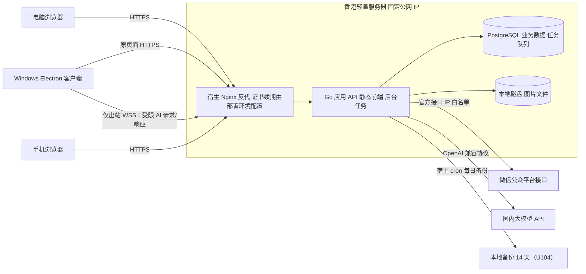
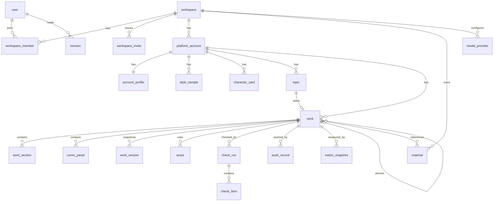
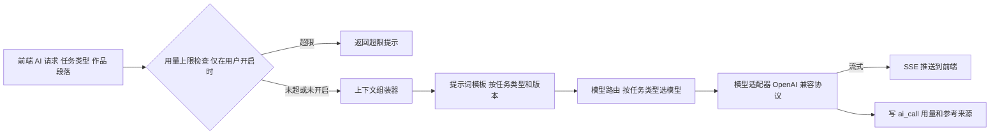

# 06 阶段六：数据与技术架构

> 2026-10-21 D-133 架构设计：`platform_account_snapshot/platform_work_mirror/platform_sync_operation`、账号同步与指标刷新接口、复用执行器与设备证明契约见 [20 §21.7～21.14](20-平台登录与作品数据自动回填设计.md#platform-account-sync-redesign)。当前代码已包含账号同步请求/操作查询的服务端与桌面签名调用路径；2026-10-23 D-147 接通桌面同步按钮固定 intent，D-148 接通指标刷新与继续同步的固定 intent。平台字段、覆盖范围、风险门槛和 AS-T01～64 全量验收仍未关闭；不能因入口或路由存在就宣称 D-133 完成。

> 2026-10-22 D-134 Electron 设置呈现：同一业务窗口保留线上 WebContents，并以独立 `ops-settings` Session 的 `WebContentsView` 承载四个本机面板；业务 preload 只订阅主进程发起的设置菜单与 `{ dirty, busy }` 状态事件。D-147 仅为同步按钮增加固定账号 intent 和最小单向回执，D-148 同构补上指标刷新与继续同步两条 intent；均不开放通用 IPC、设备私钥或新的业务 API/数据库迁移/ACL；具体 sender/URL/生命周期和布局契约见 [17 §10.7](17-Electron客户端改造方案.md#electron-settings-center-local-settings-embedding-d134)。

> 2026-10-19 文档增量：第 17 节记录 D-122 v0.5 复审及已批准的 CL-01/02/03/04核心/06 实施边界；相关实现与定向验收已完成，完整回归状态见 08 和 checkpoint。旧 v0.3 扩张机制不作为默认方案；暂缓项保持关闭。

> - 状态：已确认（2026-10-09）。Q-27 至 Q-29 的结论见第 11 节和 D-027。设计补充（D-033）新增第 5.8、5.9、7.1、13 节，并修改了第 4.2、5.1、5.3、5.4、6、7 节
> - 最后更新：2026-10-09
> - 依赖：[04-需求与功能分级](04-需求与功能分级.md)、[05-业务流程与交互](05-业务流程与交互.md)、[90-决策与变更记录](90-决策与变更记录.md)、[91-事实核验台账](91-事实核验台账.md)

---

## 1. 本阶段要回答的问题

1. 系统由哪些部分组成，各自负责什么？
2. 数据怎么存？
3. AI 怎么调用、上下文怎么组装、模型怎么选？
4. 凭证、登录和数据怎么保证安全？
5. 用什么技术、部署在哪里？

已确认的前置决策：

- **D-025（Q-25）**：部署在香港轻量云服务器。免 ICP 备案，有固定公网 IP（满足 F-003 的白名单要求），手机可以通过 HTTPS 访问（D-023）。
- **D-026（Q-26）**：前端 React，后端 Go，数据库 PostgreSQL；其余技术由本文档选定。
- D-024：真实公众号验证实验推迟到开发阶段；本文档中依赖实测的部分标注"待验证"。

---

## 2. 架构总览

### 2.1 形态：模块化单体

采用**一个 Go 服务 + 一个 PostgreSQL 数据库**的模块化单体（D-036 起为多租户行级隔离，非微服务）：

- 一个进程同时提供 API、托管前端静态文件、运行后台任务；
- 内部按业务模块划分包，模块之间只通过接口调用；
- 后台任务队列也放在 PostgreSQL 里，不引入 Redis、消息队列等额外组件；
- 租户隔离靠共享库内的 `workspace_id`（及会话上的 `current_workspace_id`），不按租户拆库或拆 Schema。

不选微服务 / 每租户一库的理由：体量与运维成本不匹配；模块边界清晰后若真有需要再拆。

### 2.2 部署拓扑

当前小红书发布链路生成发布包供用户下载（D-007、D-009）；采集由 `crawl` 模块承载（D-047，见第 15 节）。发布链路与采集链路分别描述，采集与逆向的文档技术口径见 D-127。

D-119（见 [17-Electron客户端改造方案](17-Electron客户端改造方案.md)）确认新增 Windows x64 Electron 客户端。客户端业务窗口加载同一线上 Web，业务身份、提示词、工具权限、结果校验与持久化仍由线上 Go 后端负责；选择“此客户端 AI”时，客户端通过出站 WSS 受限中转模型请求，本机模型密钥只保存在客户端。本地推理不代表离线业务或数据不经过线上后端，且不增加公网入站端口。

### 2.3 后端模块划分

| 模块 | 职责 | 对应功能 |
| --- | --- | --- |
| `auth` | 登录、会话、登录限流与锁定、登录记录 | FR-M1-01 |
| `account` | 工作区、平台账号、凭证加密存储、连通性检测 | FR-M1-02 至 05 |
| `memory` | 账号定位档案、风格样本、素材库、角色设定卡 | M2、FR-M8-01 |
| `topic` | 选题池、去重 | M3 |
| `work` | 作品、段落块、漫画分格、版本、派生关系、状态机 | M4、M5、M8 |
| `asset` | 图片上传、格式转换、压缩、裁剪、存储 | M7 |
| `check` | 发布前检查：格式校验、敏感词、事实核查、AI 声明、相似度 | M9 |
| `publish/wechat` | 微信适配层：token、图片上传、封面素材、草稿增改查 | FR-M10-01 至 03、06 |
| `publish/xhs` | 小红书发布包生成（文本整理、图片编号打包） | FR-M10-04 |
| `publish` | 推送次数上限、发布状态回填、推送记录 | FR-M10-05、07 |
| `review` | 数据录入、看板查询、AI 复盘、导入 | M11 |
| `ai` | 模型适配层、上下文组装、提示词模板、用量统计与上限 | FR-M2-04、M12 |
| `audit` | 操作日志 | FR-M12-03 |
| `jobs` | 后台任务：token 预刷新、草稿状态同步、备份、复盘提醒；V4 起驱动采集循环与每日生成 | 多处 |
| `crawl`（V4） | 采集客户端 `crawlClient`（限速、熔断、每日上限、敏感平台节流）、来源适配器、热点去重与话题簇 | FR-M3-05、FR-M3-10、FR-M3-11 |
| `strategy`（V4） | 账号运营方案、内容大纲、热点匹配、每日推荐、对标参考 | FR-M3-06 至 09、FR-M3-11 |
| `agent`（D-117） | 系统智能体：对话与运行循环、静态工具目录、进程内分发器（经完整中间件链调用既有路由）、操作卡片、内容来源校验、脱敏、附件；位于 `app` 包内，文件前缀 `agent_` | M13（16 文档） |
| `desktop`（D-119） | 桌面设备、工作区策略、客户端模型元数据、设备证明与受限 WSS 通道；不接管提示词、工具执行或业务写入；Go 接口位于 `app` 包内，文件前缀 `desktop_` | Electron 客户端方案（17 文档） |

平台适配层（NFR-09）：`publish/wechat` 和 `publish/xhs` 实现同一个"发布目标"接口，`work` 和 `check` 只依赖接口。将来接入小红书分享 SDK 或其他平台时，只需新增一个实现。

---

## 3. 技术选型

| 层 | 选择 | 许可证 | 选择理由 |
| --- | --- | --- | --- |
| 前端框架 | React + TypeScript + Vite | MIT | 用户指定 React；Vite 构建快、配置少 |
| 前端路由与数据 | React Router、TanStack Query | MIT | 主流组合；TanStack Query 管理服务端数据缓存 |
| UI 组件 | shadcn/ui + Tailwind CSS | MIT | 组件源码复制进项目，可自由修改；移动端适配方便（发布包页面） |
| 编辑器 | Tiptap + `@tiptap/markdown` | MIT | 每个段落块一个 Tiptap 实例，所见即所得，内容以 Markdown 存取（D-022）。Markdown 扩展为早期版本，需在开发初期验证常用语法的往返转换 |
| 公众号 HTML 渲染 | 前端 TypeScript 渲染模块：marked 解析 + 内联样式；主题和转换规则参考 doocs/md | marked：MIT；doocs/md：WTFPL | 预览和推送用同一份渲染代码，保证所见即所得；doocs/md 是成熟的 Markdown 转公众号实现。CSS 兼容性待真实号实测（D-024） |
| 后端语言与 HTTP | Go 标准库 `net/http` + chi 路由 | BSD / MIT | 标准库为主，依赖少 |
| 数据库访问 | pgx + sqlc | MIT | sqlc 从 SQL 生成类型安全的 Go 代码，SQL 可读、易审查 |
| 数据库迁移 | goose | MIT | 版本化迁移脚本 |
| 后台任务 | River（Postgres 任务队列） | MPL-2.0 | 任务与业务数据同库，事务内入队；不引入额外中间件。只使用不修改其源码 |
| 图片处理 | libvips（经 govips 调用） | libvips：LGPL-2.1；govips：MIT | 支持 jpg、png、webp、heic 转换与压缩，速度快、内存小；以动态链接方式在容器中使用 |
| HTML 安全过滤 | bluemonday | BSD-3 | 推送前在服务端二次过滤，确保无脚本（F-012） |
| 文本相似度 | PostgreSQL `pg_trgm` 扩展 | PostgreSQL 许可证 | 选题去重、同质化提示（P1）用三元组相似度即可，MVP 不需要向量数据库 |
| 敏感词匹配 | Go 实现的 Aho-Corasick 多模式匹配 | 自研 | 词库规模小，自研简单可控 |
| 反向代理 | 宿主 Nginx | BSD-2-Clause | 沿用现有站点反代，证书申请/续期由宿主配置；公网 HTTPS 需实地验证（D-049 补验） |
| 部署 | Docker Compose | Apache-2.0 | 应用与 PostgreSQL 两容器，接现有宿主 Nginx；Compose 一条命令启动 |
| 日志 | Go 标准库 `log/slog` 结构化日志 | BSD | 无额外依赖 |

许可证来源：BlockNote、Tiptap、doocs/md、River 的许可证已于 2026-10-09 在其官方仓库或 npm 页面核实。未选 BlockNote 的原因：核心为 MPL-2.0 可用，但导出等高级包为 GPL-3.0 或商业许可，且其内部数据结构与 Markdown 之间转换有损，不如 Tiptap 的 Markdown 扩展直接。其余为常用开源组件，开发阶段引入依赖时再逐一复核许可证。

---

## 4. 数据模型

### 4.1 实体关系总览

### 4.2 核心表

所有表都有 `id`（UUID）、`created_at`、`updated_at`，下文省略。`enc` 后缀表示加密存储的字段。

**工作区与账号**（D-036）

| 表 | 关键字段 | 说明 |
| --- | --- | --- |
| `app_user`（文档称 user） | username（全局唯一）、password_hash、failed_logins、locked_until、prev_login_at、prev_login_ip、is_system_admin、disabled_at | 登录主体；永久超管固定账号 `skyeder`（D-044）；禁用后不可登录 |
| `workspace` | name、created_by_user_id | 租户；注册时自动创建 |
| `workspace_member` | workspace_id、user_id、role（owner / editor / viewer）、status（active / disabled） | `(workspace_id, user_id)` 唯一；一人可属多工作区；viewer 只读（D-038） |
| `workspace_invite` | workspace_id、code、role、max_uses、used_count、expires_at、created_by_user_id、revoked_at | 邀请码；仅 owner 管理；可邮件发送（SMTP 存 app_setting） |
| `session` | user_id、current_workspace_id、token_hash、expires_at、user_agent、last_seen_at、reauth_until、admin_override | 登录后固定 7 天；用户显式输入密码调用 `/auth/renew` 后从当前时间重新计 7 天并更新 Cookie；不自动滑动续期；`admin_override` 为超管进入他人工作区（D-044、D-100、D-146） |
| `system_setting` | key、value | 全站开关：`registration_open`、`maintenance_mode`（D-044） |
| `platform_account` | workspace_id、platform（wechat_mp / xhs / toutiao）、name、content_format（账号类型，创建时从预设清单选定后固定，更新接口拒绝修改；见 04 文档第 3.1 节）、type_note（类型补充说明，可选，只影响 AI 提示词与定位文案）、status（active / disabled）、daily_push_limit（默认 3） | D-008、D-020、D-048、D-128 |
| `wechat_credential` | account_id、app_id、app_secret_enc、key_version、last_check_at、last_check_result | 凭证单独成表，便于权限控制和审计 |
| `wechat_token` | account_id、access_token_enc、expires_at | token 缓存（F-003、F-011） |

**平台连接与采集**（D-129，迁移 00048～00050；设计细节见 20 文档）

| 表 | 关键字段 | 说明 |
| --- | --- | --- |
| `platform_connection` | account_id、workspace_id、platform、state（active/revoked…）、availability（ready/verifying/login_required…）、external_account_key、capabilities（JSONB 能力快照）、auto_collect、auto_adopt、failure_count、platform_consent_version、authorization_revision、adoption_revision、last_verified_at、last_seen_at | 一台设备上一条连接；`external_account_key` 是平台稳定身份（`xhs_user_id:*` / `wechat_biz:*`）；`auto_adopt` 默认关闭 |
| `platform_sync_run` | connection_id、workspace_id、account_id、trigger、task_kind、status、attempt、adapter_version、mapping_version、binding_snapshot（JSONB 冻结本次目标）、batch_receipts（JSONB）、deadline_at | 单连接同时只允许一条未结束 run；`binding_snapshot` 冻结每篇的 `external_id`/`binding_revision`/`publish_revision`，提交时逐项比对 |
| `platform_metric_observation` | run_id、external_id、external_account_key、source（`xhs_browser`/`wechat_browser`）、quality_state、temporal_kind、observed_at、as_of_at、values（JSONB）、field_paths、payload_hash | 观测**只存原始读数**，不自动写 `metric_snapshot`；`values` 每项带 `value/precision/unit`，`unit=unknown` 的字段不投影正式 `reads`/`shares` |

D-131 的业务账号详情页只发出严格匹配账号 UUID 与平台枚举的 `ops-desktop://ui/platform-login/...` intent；桌面主进程验证后打开本机设置窗并定位该账号。登录阶段使用受限 IPC 的固定动作，不把 URL、脚本或浏览器路径交给远程页面。Toutiao 账号可以打开官方登录页，但服务端身份能力未验证前不建立 `platform_connection`，也不进入采集调度。

**账号记忆**

| 表 | 关键字段 | 说明 |
| --- | --- | --- |
| `account_profile` | account_id、positioning_tags（数组）、target_audience、persona_tone、banned_words（数组）、style_summary、default_theme、wechat_defaults（JSONB：author、open_comment、fans_only_comment、source_url） | 与账号一对一；`wechat_defaults` 仅公众号使用（FR-M10-10） |
| `style_sample` | account_id、title、content_md、char_count | 建议 3–10 篇 |
| `material` | workspace_id、account_id（为空表示工作区共享）、kind（experience / opinion / case / data）、content、source、tags | D-008 的共享规则 |
| `character_card` | account_id、name、appearance、personality、catchphrase、ref_asset_id | 仅漫画账号 |

**选题与作品**

| 表 | 关键字段 | 说明 |
| --- | --- | --- |
| `topic` | account_id、title、angle、source（manual / ai / review）、status（pending / adopted / dropped）、review_report_id | 复盘来源可追溯 |
| `work` | account_id、topic_id、source_work_id（派生来源）、content_format（作品形态快照，创建时取账号类型；历史作品按自身快照执行编辑、AI、检查、漫画接口与打包，不随账号类型变化，D-048）、status（见 05 文档第 4 节）、title、summary、viewpoint、outline_confirmed_at、theme、cover_asset_id、cover_crops（JSONB：2.35_1 和 1_1 两组相对坐标）、wechat_fields（JSONB：author、open_comment、fans_only_comment、source_url）、topics（数组，小红书话题）、tags（数组，自由作品标签，默认空；OPT-36）、wechat_draft_media_id、wechat_draft_hash、published_url、published_at、locked | 状态机由 `work` 模块统一管理；`wechat_draft_hash` 是最近一次写入后读回的草稿正文哈希，用于后台修改检测（D-033） |
| `work_section` | work_id、position、heading、content_md、ai_raw_md、origin（ai / human / mixed）、source_section_id | 分段块（D-022）；`ai_raw_md` 保存最近一次 AI 原始输出，用于计算人工修改比例（P1）；`source_section_id` 用于对照改写的段落对齐 |
| `comic_panel` | work_id、position、scene、character_ids（数组）、action、shot、narration、dialogue、image_prompt、asset_id | 漫画分格（P1） |
| `work_card` | work_id、section_id、position、image_asset_id | D-048 图文卡片：卡片 = 作品段落（标题与正文）+ 逐卡 AI 配图；打包与公众号图片消息按卡片图取材 |
| `work_version` | work_id、version_no、snapshot（JSONB；新版本为 `schema_version=2`，保存本作品标题/摘要/观点/大纲、段落、卡片、漫画分格/气泡、图片引用与顺序、主题标识、封面引用/裁剪、话题/标签）、reason（auto / ai / manual / check / publish / restore） | 版本预览与受限恢复；图片二进制及账号级配置不进入快照 |
| `work_material` | work_id、material_id | 本作品引用的素材 |
| `asset` | workspace_id、account_id、work_id、storage_path、mime、width、height、bytes、sha256、position、alt_text（默认空） | 图片文件存本地磁盘，表中只存路径；图片库维护替代文字（D-108） |

**检查、发布与复盘**

| 表 | 关键字段 | 说明 |
| --- | --- | --- |
| `check_run` | work_id、version_no、target_platform、completed_at | 每次提交检查或修改后重跑生成一条 |
| `check_item` | check_run_id、category（format / sensitive / fact / ai_disclosure / similarity / ad_law）、fingerprint、matched_text、location、message、resolution（modified / kept / verified / acknowledged）、resolved_at | `fingerprint` = 类别 + 命中文字及其所在句子的哈希。重跑时指纹相同且已确认的项继承确认结果，实现 D-023 的部分失效；format 类不继承 |
| `push_record` | work_id、account_id、action（add / update / newspic）、status、failed_step、error_code、error_message、draft_media_id | 当日推送次数按此表统计（FR-M10-07） |
| `wechat_media_cache` | account_id、sha256、kind（content_image / thumb）、wechat_url、media_id | 同一图片不重复上传（05 文档 E-04） |
| `metric_snapshot` | work_id、captured_at、reads、likes、wows、favorites、comments、shares、follows_gained、note | 字段见 D-020；按平台只用适用字段 |
| `review_report` | account_id、work_ids（数组）、content、ai_call_id | AI 复盘结果 |

**系统**

| 表 | 关键字段 | 说明 |
| --- | --- | --- |
| `model_provider` | workspace_id、name、base_url、api_key_enc、key_version、models（数组）、status、last_test_at、last_test_result | 模型供应商（FR-M12-07）；按工作区隔离（D-036） |
| `model_route` | workspace_id、task_type（工作区内唯一，含 `default`）、provider_id、model | 任务类型到模型的路由；按工作区隔离 |
| `ai_call` | account_id、task_type、provider、model、template_version、context_refs（JSONB）、prompt_tokens、completion_tokens、latency_ms、status | 用量统计和"本次参考了什么"（FR-M2-04）都来自这里 |
| `prompt_template` | task_type、version、content、active | 提示词版本化 |
| `sensitive_word` | workspace_id、word、category、source（base / custom） | 账号禁用词存在 `account_profile` 中 |
| `audit_log` | workspace_id、actor_id、action、target_type、target_id、result、detail（JSONB） | 只追加，不修改；workspace_id 按当前身份写入，历史归属不明的记录为 NULL（DEV-AG12） |
| `app_setting` | workspace_id、key、value | AI 每日上限等；按工作区隔离（D-036）。D-117 新增键 `agent.settings`（`enabled`、`viewer_enabled`、`allow_model_pick`） |

**系统智能体（D-117）**：完整 DDL 见 16 文档第 10 节；`model_capability` 由 `00037_agent_model_capability.sql` 创建，对话等五张表由 `00038_agent.sql` 创建；审计日志隔离字段由 `00039_audit_log_workspace.sql` 创建。

| 表 | 关键字段 | 说明 |
| --- | --- | --- |
| `agent_conversation` | workspace_id、user_id、title、title_source、pinned_at、model_provider_id、model、account_id、loaded_domains、summary、summary_upto_seq、next_seq、auto_continue_count、last_message_at | 对话；按用户 × 工作区私有，他人访问一律 404 |
| `agent_run` | conversation_id、workspace_id、user_id、session_id、trigger、status、stage、rounds、read_calls、generate_calls、actions_proposed、tokens、external_read、reason、error_code | 一次运行；同一对话同时最多 1 个 `queued`/`running`（部分唯一索引） |
| `agent_message` | conversation_id、seq、run_id、role（user / assistant / tool / action_result / system_note）、content、tool_calls、tool_call_id、tool_name、attachment_ids、ai_call_id | 消息；`seq` 由对话的 `next_seq` 在事务内分配；工具结果落库前已脱敏 |
| `agent_action` | conversation_id、run_id、batch_id、tool_name、kind（W / H / X）、gate、body_class、target_type、target_id、target_key、work_id、status、params、preview、editable_fields、blank_fields、fingerprint、need、result、error、decided_by、reported_at、expires_at | 操作卡片；同一用户、工具、目标最多 1 张未结束卡片（部分唯一索引） |
| `agent_attachment` | workspace_id、user_id、conversation_id、kind（image / text）、mime、bytes、width、height、sha256、storage_path、text_content、referenced | 附件；文件存 `DataDir/agent/…`；未引用 24 小时后清理 |
| `model_capability` | provider_id、model、workspace_id、tools_ok、vision_ok、detail、tested_at | 能力自检结果，主键 `(provider_id, model)`；修改供应商地址或密钥时清空 |

**软删除（FR-M12-08、D-033）**：`topic`、`work`、`material`、`style_sample`、`character_card` 增加 `deleted_at` 字段。删除只写 `deleted_at`，所有查询默认过滤已删除记录；回收站查询 `deleted_at` 不为空的记录。后台任务每天彻底删除 `deleted_at` 超过 30 天的记录，连同其下的段落、版本、检查记录、图片文件（`asset` 记录和磁盘文件）。`platform_account` 只有停用，没有删除。`ai_call`、`audit_log`、`push_record` 不随作品删除，保留统计和审计价值，作品被彻底删除后其引用显示为"已删除"。

**长期数据保留（D-111、OPT-11）**：每日清理 `ai_call` 180 天前明细，并在同一批事务中按月、工作区、账号、任务类型、供应商、模型及评测标记累加到永久保留的 `ai_call_monthly_summary`；汇总仅包含调用数、成功/失败数、输入/输出 token 和总延迟，不保留上下文引用或正文。`audit_log` 和 `ai_disclosure` 检查项保留 365 天。每篇作品保留最近 50 个 `work_version`，并额外保留全部 `check`、`publish` 节点版本；手动确认已发布或粘贴导入为已发布时创建 `publish` 快照。删除均按最多 5000 行一批执行。

**候选反馈样例（D-115、OPT-48）**：迁移 `00036_opt48_feedback_samples.sql` 为 `ai_feedback` 增加 `sample_text`；该字段保存用户采纳或明确拒绝的标题/选题原文，最多 500 字；生成标题和常规选题时分别读取近 60 天、每种结果最近 5 条，并与拒绝原因一同作为不可信数据块传给模型。它不写入 `account_memory`，不绕过候选选择、选题逐条入库或记忆确认。

**索引（D-060，OPT-12，迁移 00032）**：hot_item.title_norm 使用 GIN trigram 索引，热点查簇用 `%`，事务局部设置相似度阈值 0.6，仍按相似度选择最优簇并隔离私有来源；事务结束不影响其他查重阈值。作品动态使用 audit_log(target_id, created_at DESC)；未删除作品使用 (account_id, updated_at DESC)，未删除选题按实际星标优先排序使用 (account_id, pinned_at DESC NULLS LAST, created_at DESC)。排序、软删除、工作区隔离与采集上限不变。

**衍生作品计数索引（D-101、OPT-29，迁移 00045）**：作品列表通过 `work.source_work_id` 统计衍生作品；使用部分索引 `(source_work_id) WHERE source_work_id IS NOT NULL AND deleted_at IS NULL`，使 300 项列表的逐作品计数不再重复顺序扫描整张 `work` 表。列表字段、数量、排序和软删除规则不变。

### 4.3 数据隔离规则（落实 D-008、D-036）

- **工作区隔离**：所有租户数据读写以会话的 `current_workspace_id` 为准；跨工作区用 ID 直访返回 404，不泄露是否存在。
- 所有账号级表都带 `account_id`，后端查询统一经过"当前账号"过滤，且账号必须属于当前工作区。
- `material.account_id` 为空表示工作区共享，查询条件为"属于当前账号或为空"。
- 跨账号关联只有一种：`work.source_work_id`（派生）。派生仅允许跨平台（D-023），且源/目标账号须同属当前工作区。
- **成员与角色（D-036）**：`user` 与 `workspace_member` 分离；角色权限见 D-036 矩阵；凭证与模型配置仅 owner。
- **当前账号设置呈现（D-132，主路径已实施）**：桌面账号设置绑定已验证的当前账号，不再独立选择编辑对象；当前选择偏好按服务/用户/工作区归属，异步结果绑定请求发起上下文。D-132 专项 30/30、相关设置回归 40/40，T-132 全矩阵仍有待验项；详细证据见 [17 §10.6](17-Electron客户端改造方案.md#current-account-settings-plan)。本次没有新表/业务 API/账号级 ACL；单账号 UI 不代替后端工作区/资源/角色校验，平台连接分权仍以 20 §4.3 为准。
- **迁移**：原单行 `member` 拆为 `user` + `workspace_member(owner)`；原全局 `model_provider` / `model_route` / `app_setting` 归属该工作区。

---

## 5. 关键流程的技术设计

### 5.1 AI 调用与上下文组装

**上下文组装顺序**（从固定到具体）：

1. 系统规则：平台格式约束、合规要求（如"不编造数据，不确定的事实用标记标出""不模仿他人可识别的作品"）。
2. 账号定位档案：定位标签、目标读者、人设语气、禁用词。
3. 风格参考：优先使用风格摘要；没有摘要时截取风格样本片段，总量受预算控制。
4. 用户选中的素材和核心观点（D-014 的源头真实性）。
5. 当前作品上下文：大纲、相邻段落（分段起稿时）、源作品（派生改写时）。
6. 任务指令。

**预算控制**：每类任务设定输入长度预算；超出时按"风格样本 → 相邻段落"的顺序裁剪，账号档案、观点和用户选中的素材不裁剪。

OPT-42（D-074）：素材槽完整保留选中条目，不受原 4000 字限制；作品槽 3000 字为软预算，超出时先去掉系列相邻作品，再将非当前段的大纲项压缩为小标题，当前段条目和观点始终完整。受保护内容超软预算仍保留，段落邻文只使用剩余空间。未配置型号上下文容量时不猜测上限；含素材的请求被供应商以 context_length_exceeded 或 HTTP 413 拒绝时，明确提示“选中素材过长，请减少”，不静默丢弃。

结构化纠错（D-076、OPT-44/45）：解析或业务校验失败时，最多重试一次，在用户消息末尾附具体错误原因并要求仅输出修正 JSON。截断 JSON 只补未闭合对象/数组括号，再做正常解析与业务校验；不补造字段/值或未闭合字符串。第二次仍无效返回既有 ai_output_invalid，不叠加任务层重试。

外部资料隔离（D-081、OPT-50）：素材、粘贴资讯、热点资料和对标原文等放入带类型/id 的数据块，块内 JSON 编码；共享系统规则声明仅作资料，其中任何指令不执行，作者任务指令留在块外。采集入库清理 Unicode 格式/控制字符（保留换行/制表符），工作区访问权限和运行预算保持。该约束降低注入风险，mock 验收不能证明真实模型绝对免疫。

任务与记忆映射（D-077、OPT-46，均只读当前账号 active 记忆，仍受记忆槽预算约束）：

| 任务 | 读取范围 |
| --- | --- |
| title | all + title |
| topic_suggest、topic_hot_suggest、topic_score、inbox_triage、daily_recommend | all + topic |
| section_draft、section_edit、section_rewrite、section_continue、hook_suggest、copilot_chat、fix_suggest、organize_notes、outline、outline_review、summary、rewrite_plan | all + draft |
| fact_flag | 仅 kind=fact，含各已有范围，不读取措辞/风格等其他类型 |
| 其他任务 | all |

**任务类型与模型路由**（初始配置，盲测后调整）：

| 任务类型 | 说明 | 模型档位 |
| --- | --- | --- |
| topic_suggest、outline、review_analysis | 选题、大纲、复盘 | 主力模型 |
| section_draft、comic_storyboard | 分段起稿、分镜 | 主力模型 |
| rewrite_plan、section_rewrite | 派生改写的两步（见第 5.8 节） | 主力模型 |
| section_edit（改写、扩写、缩写）、title、summary、image_suggest、comic_panel_text、comic_rewrite、organize_notes | 局部编辑和短文本 | 经济模型 |
| fact_flag | 事实核查标注 | 主力模型（准确性优先） |
| style_summary | 风格摘要 | 主力模型 |
| agent_chat、agent_summary（D-117） | 智能体对话的每一轮、对话摘要压缩 | `agent_chat` 只能路由到通过“工具调用”自检的模型；档位覆盖不作用于 `agent_chat` |

**适配层设计**：统一接口为"消息列表 + 参数 → 流式文本 + 用量"。国内主流模型服务普遍提供 OpenAI 兼容的对话接口，MVP 只实现这一种协议（D-011）。具体兼容细节在开发接入时以各家官方文档为准。

D-117 扩展：`Request` 增加 `Tools`、`ToolChoice`，`Message` 增加 `ToolCalls`、`ToolCallID`、`Name`，流式解析按 `index` 累积 `delta.tool_calls`，`ai.Stream` 返回 `ToolCalls` 与 `FinishReason`；只使用 OpenAI 兼容的原生工具调用，不用文本协议模拟。不发送 `tools` 的既有调用行为不变。能力自检新增“工具调用”“看图”两项，结果存 `model_capability`。细节见 16 文档第 7 节。智能体的采样温度：`agent_chat` 0.3、`agent_summary` 0.2，工作区 `ai_sampling` 覆盖同样生效。

采样参数（D-080、OPT-51）：标题/选题/钩子 0.9，段落起草/编辑/续写、副驾驶和整理 0.7，事实核查及其他 JSON 任务 0.2，其余文本 0.3；正常文本请求发送 temperature。主/备用模型使用同一参数。GET/PUT /settings 增加 ai_sampling={temperature:number|null}，owner 可在 0–2 内统一覆盖，null 恢复任务默认；工作区隔离存于既有 app_setting。直连能力自检/图片/联网不变。实际效果取决于供应商参数支持，不保证思考模型生效。

提示词回归快照记录当次温度，比较旧/新模板使用同一参数；旧快照没有该字段时仍保留原先不发送温度的行为。

**供应商熔断（D-069、OPT-19）**：正常文本任务按供应商 ID 在本进程维护失败滑窗；网络、5xx、429 或首字超时在 1 分钟内连续 3 次失败后熔断 60 秒，成功清空窗口，用户取消/输入或密钥错误不计入供应商故障。熔断期间不请求该供应商，沿用一次备用模型切换；无可用备用时返回 503/ai_provider_unavailable、“供应商暂不可用，约 N 秒后恢复”。60 秒后下一次用户调用自动进行单次恢复探测，并发探测快速拒绝，成功关闭、失败再熔断 60 秒；已在途旧调用不能清除新熔断窗口。不发起独立定时 AI 请求，不改变任务输入或人工门槛，手动连通/能力自检保留原约定。状态仅在内存，重启清空；供应商按工作区隔离。GET /model-providers 附 circuit_state（closed/open/half_open）及 retry_after_seconds，模型配置页展示当前状态。

**模型配置存放位置（D-033）**：供应商的地址、API 密钥、模型名和任务路由都存在数据库（`model_provider`、`model_route` 表），在模型配置页（05 文档 P-22）中维护，密钥用主密钥加密。这样更换模型或密钥不需要改 `.env` 和重启服务，盲测时也能在界面上快速切换。`.env` 只放主密钥、数据库密码、域名等启动必需的配置，不放任何业务密钥（第 7 节）。

**数据外发说明**：AI 请求会把作品内容、素材和风格样本发给模型供应商。供应商的准入条件是服务条款明确"API 数据不用于训练"（D-028）。

### 5.2 模型盲测方案（落实 D-011）

| 项目 | 内容 |
| --- | --- |
| 候选 | 满足准入条件（服务条款明确 API 数据不用于训练，D-028）的已备案国内模型：阿里云百炼按量付费 API 上的模型（如通义千问）、火山方舟上的模型（如豆包），各取 1–2 个主力型号，以测试时的最新型号为准；DeepSeek、Kimi 取得书面确认后再加入 |
| 样本 | 用户的 10–20 个真实选题，覆盖长图文和图文笔记两种形态 |
| 测试任务 | 分段起稿（带风格样本和素材）、公众号改写为小红书、事实核查标注 |
| 盲评方式 | 同一输入的各模型输出打乱顺序、隐去模型名，由用户评分 |
| 评分维度 | 风格贴合度、内容真实性（是否编造）、表达自然度、平台适配度，各 1–5 分；另记录成本和响应速度 |
| 结论 | 选出主力模型和经济模型各一个，写入决策记录 |

执行时间见 Q-27：开发阶段 M0 的 SP-04（D-032）。

### 5.3 公众号推送

流程见 05 文档第 6.9 节的时序图，技术要点：

1. **渲染位置**：公众号 HTML 由前端渲染模块生成（与预览同一份代码），推送时连同作品版本号一起提交给后端。
2. **后端校验**：确认作品状态为"可发布"且版本号与检查时一致；用 bluemonday 过滤；校验字符数少于 2 万、大小小于 1MB（F-012）；校验标题不超过 32 字、作者不超过 16 字、摘要不超过 120 字、阅读原文链接不超过 1KB（F-013）；校验已设置封面；校验当日推送次数。
3. **图片替换**：HTML 中的图片引用本系统的资源 ID；后端逐张压缩，按 sha256 查 `wechat_media_cache`，未上传的调用 `uploadimg`（F-007），然后把引用替换为微信返回的 URL。
4. **封面**：调用 `add_material`（image 类型）上传封面原图，得到永久素材 ID 作为 `thumb_media_id`（同样缓存）；裁剪不在服务端做，把 `work.cover_crops` 中的两组相对坐标填入 `cover_info.crop_percent_list`（ratio 为 `2.35_1` 和 `1_1`，F-013）。image 类型的 media_id 能否用作封面待 V-015 验证；不能时改用 thumb 类型，并在上传前把封面压缩到 64KB 以内。
5. **后台修改检测**（作品已有草稿时）：调用 `draft/get` 读取当前草稿，计算正文哈希并与 `work.wechat_draft_hash` 比较；不一致、没有基准或读取失败时，返回"需要用户选择"，由前端让用户选择覆盖或另存为新草稿（05 文档 6.9 节、E-18）。
6. **写入草稿**：作品没有草稿或用户选择另存时调用 `draft/add`，否则调用 `draft/update`；`draft/update` 返回草稿不存在时，按 05 文档 E-06 处理。请求中带上 `author`、`need_open_comment`、`only_fans_can_comment`、`content_source_url`（取作品的 `wechat_fields`）。写入成功后再调用一次 `draft/get`，把读回的正文哈希存入 `work.wechat_draft_hash`。
7. **进度**：推送在请求内同步执行（单篇、图片少，耗时可控），通过 SSE 把步骤进度推给前端。每一步写入 `push_record`，失败时记录失败步骤和错误码。

**单篇并发（D-061，OPT-06）**：长文、漫画和图文卡片共用写入登记事务：锁定未删除作品行，发现 10 分钟内已有 running 记录即返回 409/wechat_push_running、“正在写入，请稍候”，不启动 SSE 或微信调用；事务内复核状态/修订号、读取当前草稿 ID 并校验每日次数及超限人工确认，再登记 running、提交。微信网络调用在事务外执行；失败/需要选择后的记录处理保持不变，超时旧记录不阻塞新尝试。前端沿用请求期间禁用写入按钮和手动重试，H-04/H-05/H-06/H-09 不变。

**草稿状态同步（OPT-75）**：复用既有 `POST /works/{id}/wechat/sync-draft`；前端请求期间显示加载并禁用当前按钮，避免同页重复请求。该操作只检查单篇草稿状态，不自动改变作品状态。

**图片消息（newspic，P1）**：图片列表使用 `image_media_id`，每张图都必须用 `add_material` 上传为永久素材（F-013），会占用账号的永久素材额度；同一图片按 sha256 复用缓存。图片消息的正文只支持纯文本，使用与小红书相同的纯文本转换规则（第 5.4 节）。

**access_token 管理**：每个公众号的 token 加密缓存在 `wechat_token` 表；过期前 10 分钟由后台任务预刷新；获取时加数据库行锁，防止并发重复获取（F-011 每日 2000 次）。

### 5.4 小红书发布包

- 文本：标题、正文、话题分别输出；正文保留换行和表情符号。
- 图片：按 `asset.position` 排序，统一转为 jpg，按 `01.jpg`、`02.jpg` 命名；下载时实时打包 zip，不在服务器上长期保存 zip 文件。
- 手机端：发布包页面单列布局，图片可单张预览并长按保存（D-023）。
- 字数和图片数量校验以 V-012 的结果为准，结果出来前只校验图片数量 1–18 张（F-102）。

**Markdown 转小红书纯文本规则（D-033）**：小红书正文是纯文本，不渲染 Markdown 标记。小红书作品的编辑器本身只提供段落、列表和表情（05 文档 6.4 节），下面的规则是兜底，用于派生改写和粘贴进来的内容：

| Markdown 元素 | 转换结果 | 说明 |
| --- | --- | --- |
| 段落 | 原文，段与段之间空一行 | 小红书中空行是主要的分段手段 |
| 小标题（`##`、`###`） | 单独一行的纯文字，前后各空一行 | 不加 `#`，避免被识别为话题 |
| 加粗、斜体 | 去掉标记，保留文字 | — |
| 无序列表 | 每项一行，以"· "开头 | — |
| 有序列表 | 每项一行，以"1. "开头 | — |
| 引用 | 去掉 `>`，用「」括起 | — |
| 链接 | 只保留链接文字，去掉网址 | 小红书正文中的外部链接不可点击，且可能被判定为导流 |
| 图片 | 从正文中去掉 | 图片进入发布包的图片列表，按顺序编号 |
| 代码、表格、分隔线 | 代码保留为纯文字；表格逐行转为"列1：值1，列2：值2"；分隔线去掉 | 小红书作品中极少出现 |
| 行内的 `#话题` | 保留原样，并在转换后提示"正文中含话题标记" | 话题建议放在单独复制的话题栏 |
| 表情符号 | 保留 | — |

转换在前端完成（与预览共用），输出结果同时用于发布包的"复制正文"、字数统计和发布前检查。

### 5.5 发布前检查

| 检查类别 | 实现 | 是否调用 AI |
| --- | --- | --- |
| 格式校验 | 规则代码：标题、作者、摘要长度，公众号 HTML 字符数少于 20000 且字节数小于 1 MiB，图片格式和大小，图片数量，是否已设置封面，正文中是否残留"【待核实】"标记（第 5.8 节） | 否 |
| 敏感词 | Aho-Corasick 匹配：基础词库 + 用户自定义词库 + 账号禁用词 | 否 |
| 事实核查标注 | AI 标出数据、引用、绝对化断言；按关联素材出处分组显示 | 是 |
| AI 声明 | 固定检查项 | 否 |
| 同质化（P1） | `pg_trgm` 与本账号历史作品比对 | 否 |
| 广告法极限词（P1） | 词表匹配 | 否 |

检查项的定位主体由原生按钮承载，以支持 Tab 聚焦和 Enter 选择；具体确认和处理仍逐项进行（D-098、OPT-75）。

公众号编辑器可直达发布前检查；检查与推送页面提供可选排版预览入口，格式拦截和逐项确认保持不变（D-116、OPT-55）。

**基础敏感词库的说明**：没有官方公开的权威词库，公开的开源词库质量参差、容易误报。MVP 的基础词库保持精简，以用户自定义词库为主，并且所有命中都只是提示，由人决定修改还是保留。接入云厂商内容安全接口作为 V2 选项，在阶段 7 评估。

**部分失效**（D-023）：内容变更后重新生成 `check_run`；对每个新检查项计算 `fingerprint`，若上一次检查中存在相同指纹且已确认，则继承确认结果；format 类每次重新判定，不继承。

### 5.6 自动保存与版本

编辑器渲染隔离（D-068、OPT-08）：段落组件 memo，仅接收自身段落与起草所需的作品字段；段落成员分组缓存，移动/删除按段落 ID 使用稳定回调。选区保存在 ref 并由侧栏订阅，保存指示由独立组件订阅，待核实标记按段落正文缓存。保存队列、修订冲突、人工确认和 AI 输入输出契约保持原有约定；20 段选区/自动保存以 React Profiler 验证仅当前段更新、单次提交 <16ms。

**修订与队列（D-062，OPT-63/07/26）**：同段保存按完整 heading/content_md 快照串行合并，成功响应的 section.revision 作为下一次 base_revision；flush 等待在途和待保存快照，等待期间新增修改也先保存，失败/冲突不继续 AI。手动段落保存与历史恢复在段落行锁内比较修订，作品标题/摘要在作品行锁内比较；大纲与排序按固定顺序先锁段落、再锁作品以比较作品修订。恢复/排序/大纲/标题摘要请求带 base_revision；旧请求未传时用入口读取修订并在写入事务再次比较。过期基准返回 409/version_conflict 和 detail.server。起草/派生改写用开始时段落修订，冲突 SSE error 返回 version_conflict、“这段在生成期间被修改过”及 detail 的 server、candidate、ai_call_id、refs；起草有机械修正时附 self_check，替换后仍显示自检修正并可还原原文。前端人工替换经现有 PATCH 段落接口再次比较；派生 source_revisions 不在正文成功前更新。无新接口、表或 AI 输入变化。

- 前端在内容变化后 3 秒内防抖保存，最长间隔 10 秒（05 文档 6.4 节）；保存接口带"基准版本号"，与服务器版本不一致时返回冲突，前端展示差异让用户选择（05 文档 E-13）。
- 图文卡片标题/正文失焦保存使用段落 id，不依赖配图记录；遇到 version_conflict 时复用段落对比对话框，采用对方更新内容与修订，保留本地以响应 server.revision 再次保存，再次冲突继续对比，不自动覆盖（D-071、OPT-66）。
- 每次 AI 生成落地、手动"保存版本"、提交检查时写一条 `work_version`；普通自动保存只更新当前内容，每 10 分钟最多额外留一个自动快照，避免版本表膨胀。
- 网络断开时前端把未保存内容暂存到浏览器本地存储，恢复后同步（05 文档 E-12）。
- 文字编辑位置（D-072、OPT-54）：localStorage 的 ops.editor.position.{workId} 保存 sectionId/tab，按作品隔离，仅在聚焦段落或页签变化时更新；地址锚点优先于位置恢复，批注提及优先于已存页签。记录不含正文、仅在本机生效，缺失/无效记录及已删除段落不触发定位。
- 段落恢复改写前（D-073、OPT-71）：成功 AI 写回后在段落组件内存保留 before/after/aiCall 快照，按钮和原十秒撤销提示使用同一恢复函数。手动正文/标题修改清除快照，后续 AI 写回替换快照，过期提示不恢复旧快照。恢复经原编辑器与保存队列写回，内容已变化时不覆盖；不新增持久化或跨段撤销栈，刷新后的恢复沿用段落历史。

### 5.7 后台任务

**数据库连接与超时（D-053，OPT-03/35）**：业务池默认最大 20 条连接（`OPS_DB_MAX_CONNS` 可设正整数）、空闲回收 5 分钟、连接寿命 1 小时；启动日志记录这些参数但不含连接串。会话 `statement_timeout=30s`、`idle_in_transaction_session_timeout=60s`、`timezone=Asia/Shanghai`。超时约束单条 SQL，迁移沿用独立连接；确需更长 SQL 的后台任务仅在自己的短事务中 `SET LOCAL statement_timeout` 放宽，不污染共享连接。素材过期标记与筛选传入应用上海日期 `s.today()`，有效期当天仍有效。

**流式并发（D-054，OPT-04）**：持久流式与临时续写共用后台任务的工作区 `OPS_AI_WORKERS` 信号量。持久任务先 queued，获准后 running；等待发送 `stage=queued`，前端显示“排队中”，最长 60 秒后返回 `ai_queue_timeout`。排队不调用模型、不消耗 token、不启动首字超时；取消与终止释放槽位。断开页面仍继续持久任务，临时续写随请求取消。

**每日整理补跑（D-103，OPT-31）**：后台任务启动及每 10 分钟调度时，在上海时间 03:00 后检查前一天的 `daily-housekeeping:{date}` 标记；缺失时按前一天日期补跑一次记忆提炼、收件箱建议、周报/复盘草稿和每日简报，再执行当天任务。各任务继续使用已有日期级 `job_marker` 幂等；收件箱只生成逐条建议，不自动转为素材或选题，复盘建议仍需逐条采纳。不补跑发布或其他不可逆操作。

| 任务 | 频率 | 作用 |
| --- | --- | --- |
| token 预刷新 | 每 5 分钟检查 | 过期前 10 分钟刷新 |
| 草稿状态同步（P1） | 每 2 小时，仅针对"已进草稿箱"的作品 | 按 `media_id` 调用 `draft/get`；草稿消失时标记"可能已发表或已删除"（FR-M10-06），不改状态 |
| 复盘提醒 | 每天 | 生成工作台"发布满 1 天 / 7 天未录入"的提醒 |
| 数据库与图片备份 | 每天凌晨 | 见第 7 节 |
| 过期会话清理 | 每天 | 删除过期 `session` |
| 回收站清理 | 每天 | 彻底删除进入回收站超过 30 天的记录和图片文件（第 4.2 节软删除） |

### 5.8 AI 任务契约（D-033）

本节规定每类 AI 任务的输入、输出格式和失败处理。提示词的具体措辞在开发时编写并通过盲测调整，但输入输出契约以本节为准，前后端都按它实现。

**提示词结构**：每个任务的提示词分为两条消息。

- 系统消息：第 5.1 节上下文组装顺序中的第 1 至 3 项（系统规则、账号档案、风格参考）。
- 用户消息：第 4 至 6 项（素材和观点、作品上下文、任务指令），最后附上输出格式要求。

模板使用 Go `text/template`，按 `task_type` + `version` 存在 `prompt_template` 表中；初始模板随代码放在 `server/internal/ai/prompts/` 下，首次启动时写入数据库。提示词模板的界面编辑（FR-M12-05，P1）只允许修改任务指令部分，系统规则不可编辑。

**系统规则**（所有任务共用，不可编辑）：

1. 不编造数据、案例、引语、人物和机构；需要具体数据而素材中没有时，写成"【待核实：需要的内容】"占位，由人补充。
2. 只使用用户提供的素材作为事实来源，不虚构亲身经历。
3. 不模仿可识别的他人作品或作者风格；只模仿本账号的风格样本。
4. 不使用账号禁用词；不使用"最、第一、绝对"等绝对化表达，除非素材中有依据。
5. 按指定的输出格式输出，不加额外说明。

正文中残留的"【待核实】"标记会在发布前检查的格式校验中拦截（第 5.5 节），必须由人补充或删除后才能通过。

**输出方式**：

- **流式 Markdown**：长文本任务。前端逐字显示，完成后整段落入段落块。
- **JSON**：结构化任务。优先使用供应商的 JSON 输出模式；不支持时在提示词中要求只输出 JSON。后端按下表的结构校验，校验失败自动重试 1 次，仍失败按 05 文档 E-09 处理（提示"生成失败，重试"，不覆盖原内容）。

**任务清单**：

正文取样（D-079、OPT-52）：标题请求沿用 1500 字、摘要请求沿用 3000 字输入预算。bodyDigest 保留全部小标题，剩余正文预算按段平均分配，每段取开头及结尾；短段完整保留。标题本身超过预算时仍保留所有标题，正文预算归零。其他既有 bodyDigest 调用共用此概况取样。

| 任务类型 | 主要输入 | 输出方式 | 输出结构 | 约束 |
| --- | --- | --- | --- | --- |
| topic_suggest | 账号档案、方向关键词（可选）、最近 20 个选题和作品标题（用于避开重复） | JSON | `{"topics":[{"title","angle","reason"}]}` | 不少于 5 条（FR-M3-01） |
| outline | 观点、选中素材、选题 | JSON | `{"items":[{"heading","key_point","material_ids":[]}]}` | 4–8 项；`material_ids` 只能引用输入中给出的素材 |
| section_draft | 大纲全文、本段大纲项、前后相邻段落、本段引用的素材 | 流式 Markdown | 段落正文 | 不含本段小标题（小标题来自大纲）；长度按账号形态给出建议范围 |
| section_edit | 选中文字或整段、模式（rewrite 改写 / expand 扩写 / shorten 缩写）、本段关联素材（无绑定时作品选中素材）、核心观点与各段小标题、用户补充要求（可选） | 流式 Markdown | 替换后的文字 | 只返回替换内容，不改动未选中部分；扩写只用素材中的事实展开（D-075、OPT-43） |
| title | 正文摘要、平台、风格摘要（无摘要不读完整样本）、近 20 篇其他作品标题、高表现标题特征（D-076） | JSON | `{"titles":[{"text","style"}]}` | 不少于 5 个（再改写为 3 个）；过滤超生成长度目标/禁用词候选，不足时带原因重试一次；公众号目标 32 字、小红书沿用原目标 20 字，真实平台上限仍待 V-012 |
| summary | 正文摘要 | JSON | `{"summary"}` | 不超过 120 字，超出时后端截断并提示（FR-M4-06） |
| fact_flag | 全文（按段落带编号）、作品级选中素材及段落绑定素材（去重） | JSON | `{"items":[{"section_id","quote","claim_type","reason","support_status","material_id?","material_quote?"}]}` | 见下方说明 |
| rewrite_plan | 源作品全部段落（带编号）、目标账号档案、目标形态 | JSON | `{"title","sections":[{"source_section_ids":[],"key_point"}],"topics":[]}` | 派生改写第一步：规划目标段落及其与源段落的对应关系；小红书话题 3–8 个 |
| section_rewrite | 规划中的一项、对应的源段落、目标账号风格 | 流式 Markdown（小红书为纯文本） | 目标段落正文 | 派生改写第二步，逐段执行；"重新改写本段"也调用它 |
| image_suggest（P1） | 段落正文 | JSON | `{"suggestions":[{"description","prompt"}]}` | 提示词为中文 |
| image_alt（P2） | 一张当前工作区图片的视觉内容 | 流式 Markdown | 简短中文替代文字 | 仅路由到已配置的 `metric_screenshot` 视觉模型，不回退到默认文本模型；结果只填入编辑框，保存由用户确认（D-108） |
| style_summary（P1） | 风格样本（最多 10 篇，超出预算时截取） | 流式 Markdown | 风格摘要 | 300–600 字，描述语气、句式、结构、常用表达 |
| organize_notes（P1） | 用户粘贴的要点 | 流式 Markdown | 带小标题的初稿 | 只整理和组织，不扩充用户未提供的事实 |
| comic_storyboard（P1） | 观点、选题、所选角色卡、格数 | JSON | `{"panels":[{"scene","character_ids":[],"action","shot","narration","dialogue"}]}` | 格数等于用户指定值；对白长度不超过气泡上限 |
| comic_panel_text（P1） | 已确认的分格、角色卡 | JSON | `{"narration","dialogue","image_prompt"}` | `image_prompt` 自动拼入角色外貌描述（FR-M8-04） |
| comic_rewrite（P1） | 源分格旁白/对白、目标平台 | JSON | `{"title","panels":[{"source_panel_id","narration","dialogue"}]}` | 漫画跨平台派生（D-042）：复用分格与图片，只改写旁白对白 |
| review_analysis | 作品列表及各时间点指标、账号档案 | JSON | `{"conclusions":[],"topic_suggestions":[{"title","angle","reason"}]}` | 建议不少于 3 条（FR-M11-03） |

**fact_flag 的定位与素材支撑**：模型返回正文原句 `quote`，后端在段落中做精确或去空白后的子串匹配；仍匹配不到时显示为“未能定位”，照常需要人工确认。模型同时返回 `support_status`（`supported` / `unverified`）；支撑项必须给出输入素材中的 `material_id` 和原文 `material_quote`，后端复核引句确实存在于关联素材，否则降为待核实。页面将两类分开显示并展示素材引句。该状态仅表示作者素材与正文存在出处对应，不代表系统验证了事实真实性；两类项目均保留逐项人工确认（H-04）。`claim_type` 取值：`data`（数据）、`quote`（引语）、`absolute`（绝对化断言）、`time`（时间）、`entity`（人物或机构）。

**派生改写分两步的原因**：一次性让模型输出整篇 JSON，等待时间长，且无法逐段重做。先用 `rewrite_plan` 得到段落对应关系（落入 `work_section.source_section_id`），再逐段流式生成，既能对照显示（05 文档 6.6 节），也能单段重新改写。

### 5.9 密码重置命令（FR-M1-08）

- 应用二进制提供子命令，在服务器上执行：`docker compose exec app ops reset-password <username>`（D-036：按用户名）。
- 交互式输入两次新密码，密码不出现在命令行参数和 shell 历史中；校验不少于 12 位。
- 执行后：更新 `user.password_hash`，删除该用户全部 `session`，清除登录锁定，写一条 `audit_log`（action 为 `password_reset_cli`）。
- 同一个二进制还提供 `ops migrate`（手动执行迁移）和 `ops version`，方便运维；不提供任何绕过登录的命令。

---

## 6. 安全设计

| 项目 | 设计 | 依据 |
| --- | --- | --- |
| 传输 | 公网要求全站 HTTPS、HSTS；`deploy/nginx-ops-https.conf` 提供 TLS 反代模板，`deploy/https-setup.md` 记录 Certbot、301、短期到长期 HSTS、Secure Cookie、续期与回滚步骤；证书/续期与公网验收由实际部署环境完成，本地 HTTP mock 不作此项证据 | D-023 |
| 登录 | 密码至少 12 位，使用 argon2id 哈希；登录失败 5 次锁定 15 分钟；登录成功和失败都写入操作日志，工作台显示最近登录时间和 IP；不启用二次验证（Q-28），TOTP 字段预留 | NFR-01 |
| 会话 | 随机令牌放在 HttpOnly、Secure、SameSite=Lax 的 Cookie 中，数据库只存哈希；登录后有效期 7 天，只有通过当前密码显式调用 `/auth/renew` 才重置当前会话期限与 Cookie；修改密码后其他会话全部失效 | D-023、D-146 |
| 跨站请求 | 修改类接口校验 CSRF 令牌 | — |
| 凭证加密 | AppSecret、access_token、TOTP 密钥、模型 API 密钥都存在数据库中，使用 AES-256-GCM 加密；主密钥是唯一放在环境变量中的密钥，不进代码仓库、不进数据库、不进备份；`key_version` 字段支持密钥轮换 | NFR-01、D-012、D-033 |
| 敏感操作 | 修改公众号凭证、修改模型密钥、修改密码、导出数据需要再次输入密码；提交中忽略重复回车；彻底删除需要二次确认；全部写入 `audit_log` | FR-M12-03、D-098 |
| 密码重置 | 只能在服务器上用命令重置，见第 5.9 节 | FR-M1-08 |
| 日志脱敏 | 日志中不记录密钥、token、密码；AI 请求日志只记元数据（任务类型、长度、用量），不记全文 | NFR-01 |
| 服务器 | 只开放 80、443 和 SSH；SSH 只允许密钥登录；PostgreSQL 不对外暴露端口 | — |
| 依赖安全 | 开发阶段使用 `govulncheck` 和 `npm audit` 检查依赖漏洞 | — |
| 智能体执行身份（D-117） | 工具与卡片经进程内分发器调用既有路由，走完整中间件链；身份按会话 ID 加载且不切换工作区，工作区不一致即停止；`ReauthOK` 强制为 false，需要再次输入密码的接口一律只给链接；只允许调用目录内的条目 | 16 文档第 2.3 节 |
| 智能体写入确认（D-117） | 模型只能提出卡片，写入由用户逐张执行；门槛字段与二次确认只能来自用户操作；没有批量执行接口；不可逆操作二次确认 | H-01 至 H-09、HC-26 至 HC-28 |
| 智能体密钥与隐私（D-117） | 密钥、AppSecret、密码不进入对话、模型请求和卡片；工具结果按键名与值双重脱敏；一次性值（临时密码、邀请码、预览链接）只在执行 SSE 中返回一次且不落库；疑似密钥的消息拒绝保存；对话按用户私有；服务端日志只记 ID、工具名、状态、耗时 | NFR-01、HC-30、HC-31 |
| 智能体注入隔离（D-117） | 工具结果、附件、外部资料一律放入数据块并声明只作资料；读取过外部来源的运行在卡片上提示核对；写入仍需用户确认 | D-081、16 文档第 6.3 节 |

---

## 7. 部署与运维

**E2E CI（D-070、D-113、OPT-17）**：main 推送与面向 main 的 PR 在独立 Ubuntu job 启动本地 PostgreSQL ops/ops_e2e、Go 1.26 与 Node 22，安装 Chromium 后运行完整 Playwright；ops-e2e 仅使用本地模拟微信/模型，不连接真实平台或部署。失败上传 test-results 的 trace/截图及 Playwright 报告。仓库以 `web/pnpm-lock.yaml` 为唯一锁文件并固定 pnpm 10.14.0；CI 前端与 E2E job 使用冻结安装，Playwright 用 pnpm 启动同一个 Vite 脚本。

**响应压缩与缓存（D-056，OPT-05）**：宿主 Nginx 对 HTML、JS、CSS、JSON、SVG 启用 gzip，最小长度 1024；Go 使用既有 chi 压缩中间件作为直连兜底。`/assets/` 中存在的构建资源响应为 `public, max-age=31536000, immutable`，入口 HTML 与 SPA 回退为 `no-cache`；资源缺失响应不长期缓存。缓存头由 Go 文件处理统一生成并穿过 Nginx，避免重复。普通响应启用代理缓冲，SSE 沿用 `X-Accel-Buffering: no` 单独禁用缓冲且不压缩；不改变事件格式、逐段起草或人工确认。

| 项目 | 方案 |
| --- | --- |
| 服务器 | 香港轻量云服务器，建议 2 核 4GB 内存、50GB 以上磁盘、固定公网 IP（D-025） |
| 域名 | 需要一个域名用于 HTTPS 证书；域名解析到香港服务器不需要 ICP 备案 |
| 容器 | Docker Compose：`app`（Go 二进制 + 前端静态文件，纯 Go 图片处理，D-034）、`postgres`；反代沿用宿主 Nginx（D-049 补验） |
| 容器资源（D-057，OPT-16） | `app`、`postgres` 各限制 1 CPU、1GiB 内存，按 2 核 4GB 服务器预留宿主与反代内存；两者使用 `json-file`，`max-size=10m`、`max-file=3`。仓库配置与本地 Docker 验收，线上变更由用户执行 |
| 配置 | 启动配置通过 `.env` 文件注入：主密钥、数据库密码、域名、数据目录。文件权限仅 root 可读，不进代码仓库。公众号凭证和模型密钥不放在 `.env`，在界面中录入后加密存入数据库（D-033） |
| 微信白名单 | 服务器公网 IP 加入公众号后台 IP 白名单（F-003）；系统设置页显示该 IP |
| 备份 | U104 已交付宿主 cron 每日 `pg_dump` + `/data` 归档、本地保留 14 天；归档加密/异地上传尚未内置，需宿主按原容灾目标配置并实地验证。主密钥另行离线保存，不随备份上传 |
| 恢复演练 | 使用 `deploy/restore.sh` 在临时 Compose 项目中恢复最新成对备份，每月执行并记录耗时；上线前做一次完整恢复演练并写入阶段 8 的上线检查表 |
| 监控 | 应用提供健康检查接口；使用免费的外部可用性监控定时探测；磁盘使用超过 80% 时在工作台提示 |
| 更新 | 本地构建镜像后推送到服务器，`docker compose up -d` 滚动更新；数据库迁移随应用启动执行，执行前自动备份 |

### 7.1 运行成本估算（D-033）

以下为量级估算，价格以购买或开通时官网为准；模型单价在开发阶段 SP-04 盲测时核实后更新。

| 项目 | 估算 | 依据与说明 |
| --- | --- | --- |
| 香港轻量云服务器 | 约 50–150 元 / 月 | 2 核 4GB、固定 IP 的公开价格区间；按年购买通常更便宜 |
| 域名 | 约 60–100 元 / 年 | 常见 .com 域名续费价格区间 |
| 对象存储（备份） | 每月几元以内 | 备份总量预计在几 GB 以内 |
| 模型调用 | 每篇约 0.2–1 元；每月 30 篇约 10–30 元 | 见下方单篇估算 |
| **合计** | **约每月 70–200 元** | 服务器是主要成本，模型调用占比较小 |

**单篇公众号长文（约 3000 字，6 段）的模型用量估算**：

| 步骤 | 调用次数 | 输入 token | 输出 token |
| --- | --- | --- | --- |
| 大纲 | 1–2 | 约 1 万 | 约 2 千 |
| 分段起稿（每段带档案、风格、大纲、相邻段落） | 6–8 | 约 6 万 | 约 6 千 |
| 局部改写、扩写、缩写 | 约 10 | 约 3 万 | 约 5 千 |
| 标题、摘要 | 2–3 | 约 1 万 | 约 1 千 |
| 事实核查标注 | 1–2 | 约 1 万 | 约 1 千 |
| 派生小红书笔记 | 约 7 | 约 4 万 | 约 3 千 |
| **合计** | 约 30 次 | **约 16 万** | **约 1.8 万** |

按国内主力模型常见的单价量级（输入每百万 token 约 1–4 元，输出每百万 token 约 2–16 元）计算，单篇约 0.2–1 元；重新生成多的情况按两倍估算仍在 2 元以内。实际单价以 SP-04 时的官网价格为准，结果写入用量页的金额换算。

### 7.2 跨境数据

**跨境数据说明**：服务器在香港，用户的内容数据存储在境外，并且会调用境内大模型 API 和微信接口。自用场景下内容主要是用户本人的创作，不涉及他人的个人信息批量处理；阶段 7 会把"数据跨境"作为一项风险正式评估，将来如果对外提供服务，需要改为境内部署并完成 ICP 备案（F-201）。

---

## 8. 非功能需求的落实

**前端请求期限（D-059，OPT-14）**：普通请求 30 秒、FormData 上传 120 秒，期限覆盖完整响应体及 GET 的一次 502/503/504 重试；普通响应读取原始字节后保留 Response 调用方式，兼容 JSON 与二进制导出。流式等待响应头最多 90 秒，成功 SSE 后由后端生成期限及调用方取消控制。主动取消保留 AbortError；超时/网络不可达显示服务暂不可用，服务端 JSON 错误优先，HTML 413/429/502/503/504 转为明确中文提示。不自动重试写请求，不改变查询层重试策略或人工确认。

FormData 在发送前逐文件核对既有 20MB 上限，超限显示大小提示；后端上传限制继续保留，避免代理转发时大请求被提前关闭而只显示连接错误。

**前端查询状态（D-058，OPT-13）**：工作台、账号档案、AI 用量、质量看板、公众号推送预览使用同一加载/空/错误组件。首次加载无数据时，查询首个 `failureReason` 即显示中文原因和重试入口，自动重试策略保持不变；请求进行中提示正在重试并防重复点击，终态失败允许手动 `refetch`，成功后恢复业务内容。成功但无数据显示空态。

| 需求 | 落实方式 |
| --- | --- |
| NFR-01 凭证安全 | 第 6 节凭证加密、日志脱敏 |
| NFR-02 平台调用 | 微信接口只在服务端调用；固定 IP；token 集中缓存与行锁 |
| NFR-03 推送节制 | `push_record` 统计当日次数，`platform_account.daily_push_limit` 默认 3；接口层不存在批量推送 |
| NFR-04 AI 成本可控 | `ai_call` 统计用量并在用量页和工作台展示；`app_setting` 中的每日上限默认关闭，用户开启后超限返回明确提示（Q-29） |
| NFR-05 模型可替换 | 第 5.1 节适配层与模型路由配置 |
| NFR-06 数据隔离 | 第 4.3 节 |
| NFR-07 数据安全 | 第 5.6 节自动保存与版本；第 7 节备份 |
| NFR-08 性能 | 模型流式输出经 SSE 直接转发；首字时间主要取决于模型，盲测时一并记录 |
| NFR-09 可维护 | 发布目标接口；模块化单体 |
| NFR-11 浏览器 | 前端使用 Tailwind 响应式布局；关键页面（工作台、收件箱、发布包、数据录入、通知）单列适配手机，提供 PWA manifest、service worker（只缓存静态资源，不缓存 `/api`）和 Web Share Target（`/share`） |

---

## 9. 待验证与技术风险

| 编号 | 事项 | 影响 | 处理 |
| --- | --- | --- | --- |
| T-01 | 公众号后台对内联 CSS 的保留范围（V-010） | 排版主题的写法 | 开发时第一个任务做真实号实验（D-024）；主题先只用最基础的样式（字号、颜色、行距、边框、背景色） |
| T-02 | `@tiptap/markdown` 为早期版本 | 段落内容的 Markdown 往返转换可能有边界问题 | 开发初期用常用语法（加粗、列表、引用、链接、图片）做往返测试；不支持的语法在编辑器中不提供 |
| T-03 | 前端渲染的 HTML 与后台最终效果不一致 | 预览不准 | 实验阶段对比预览截图与后台预览，校准主题 |
| T-04 | 模型供应商的 OpenAI 兼容程度不同 | 适配层需要少量特殊处理 | 适配层预留按供应商的参数映射 |
| T-05 | 香港服务器调用境内 API 的网络延迟 | AI 首字时间变长 | 盲测时在香港服务器上实测延迟 |
| T-06 | heic 解码依赖 libheif | 容器镜像体积和构建复杂度 | 镜像中安装 libvips 时包含 heif 支持；如有问题，heic 降级为前端提示"请先转为 jpg" |

---

## 10. 本阶段对前序文档的影响

- 05 文档第 6.4 节"自动保存间隔不超过 10 秒"由第 5.6 节的防抖策略落实，无需修改。
- 04 文档 FR-M7-01 的验收标准包含 heic 格式，由 libvips 实现；若 T-06 出现问题，按降级方案处理并在决策记录中登记。

---

## 11. 待决问题

| 编号 | 问题 | 我的建议 | 影响 |
| --- | --- | --- | --- |
| Q-27 | 模型盲测什么时候做？D-011 原定在阶段 6 定型 | 推迟到开发初期，与模型适配层一起做：盲测本身需要适配层和各家 API 密钥，而且需要你的 10–20 个真实选题。阶段 6 先确定方案和候选范围 | D-011 的执行时间；阶段 8 排期 |
| Q-28 | 登录是否加二次验证（TOTP，用手机验证器 App 生成 6 位码）？ | 加。系统部署在公网，里面有公众号凭证；TOTP 实现成本低，可以设置为"新设备登录时需要" | 登录流程；安全等级 |
| Q-29 | AI 每日用量上限的默认值？ | 先按 token 数设置：每日 200 万 token，超限后 AI 功能暂停、其他功能正常；盲测得出实际单价后再换算成金额上限 | 成本控制 |

**确认结果（2026-10-09）：**

- Q-27：采纳建议，模型盲测推迟到开发初期，与模型适配层一起做（调整 D-011 的执行时间）。
- Q-28：不加二次验证。登录只用密码，采用以下补偿措施：密码至少 12 位；登录失败 5 次锁定 15 分钟；每次登录（成功和失败）记入操作日志，工作台显示"最近登录时间和 IP"。`member.totp_secret_enc` 字段保留为空，将来需要时可直接启用。遗留风险进入阶段 7 风险登记表。
- Q-29：不设默认上限，只显示用量；上限功能保留，用户可在设置中自行开启（FR-M12-02 的"达到上限暂停"只在开启后生效）。

---

## 12. 下一阶段预告：阶段 7 风险与合规评估

产出 `07-风险与合规评估.md`：

1. 风险登记表：平台规则（3.27 判定边界、小红书 AI 治理）、技术（T-01 至 T-06）、安全、数据跨境、供应商（模型 API 数据使用条款）、运营（漂移风险、宣传用语）。
2. 每项风险的等级、对策、负责人和复核时间。
3. 合规清单：发布前、上线前、每个版本发布前需要核对的事项。
4. 事实台账复核计划（平台规则变化时的应对流程）。

---

## 13. 接口清单（设计补充，D-033）

前后端之间的 HTTP 接口。路径、字段名在开发时可微调，但资源划分、状态约束和错误码以本节为准；变更时同步更新本节。

### 13.1 通用约定

**工作台查询（D-064，OPT-09）**：`GET /ai/status` 在既有 ready/vision_route/image_route 外返回当前工作区 `tokens_today`，顶栏使用该轻量接口，路由与用量共用一条查询。工作台保留原响应字段，将计数和就绪/限额合并为一条 CTE，待办独立查询；不触发准备。`GET /accounts/{id}/daily?prepare=false` 只读已有推荐，不登记运营活动或自动准备；默认模式供运营页使用，工作台、紧凑卡与首次路径推荐查询使用只读模式及 daily 查询键后缀。人工生成、逐条采用和用量上限不变。

**请求追踪（D-063，OPT-15）**：chi RequestID 为每次请求提供完整 ID，所有响应带 X-Request-ID，JSON/SSE error 可带 request_id；访问日志仅记录 request_id、method、route（模板）、status、duration_ms、workspace_id，耗时 >1 秒为 WARN，内部 HTTP/SSE/AI 错误带相同 ID。前端显示可复制的最后 12 字符，在完整日志 ID 中检索；无响应不生成假服务器 ID。生产/E2E HTTP 入口请求头期限 10 秒、连接空闲 60 秒；普通/流式/multipart 请求体读取期限分别 30/90/120 秒，按匹配路由设置，处理完清除；不设置截断 SSE 的写入或请求总期限。不记录请求体、查询串、Cookie、凭证头及原始参数路径，保持 NFR-01。

| 项目 | 约定 |
| --- | --- |
| 前缀 | `/api/v1`；下文路径省略前缀 |
| 格式 | 请求和响应都是 JSON；图片上传用 `multipart/form-data` |
| 认证 | 会话 Cookie；除 `POST /auth/login`、`POST /auth/register`、`POST /auth/setup`（无用户时）、`GET /healthz` 外都需要登录；业务接口均在当前工作区上下文中执行（D-036） |
| CSRF | 所有修改类请求带 `X-CSRF-Token` 头，令牌由 `GET /auth/me` 返回 |
| 账号隔离 | 账号级资源的路径带 `{accountId}`，或由资源自身归属的账号判定；后端统一校验（第 4.3 节） |
| 乐观锁 | 作品、段落的修改请求带 `base_version`，与服务器不一致时返回 `version_conflict`（05 文档 E-13） |
| 列表 | 分页参数 `cursor`、`limit`（默认 20，最大 100）；返回 `{"items":[],"next_cursor"}` |
| 时间 | ISO 8601，带时区 |
| 流式接口 | AI 生成和公众号推送使用 SSE。AI 事件：`stage`（`{"stage":"queued"}` / `context` / `generating`，D-054）、`delta`（`{"text"}`）、`done`（`{"ai_call_id","usage","refs"}`）、`error`。推送事件：`step`（`{"name","status","current","total"}`）、`need_choice`（需要用户选择覆盖或另存）、`done`、`error` |

**错误响应**：`{"error":{"code","message","detail","fields","request_id"}}`，`message` 是给用户看的中文说明；`fields` 为可选的字段名到中文原因映射，供表单定位显示；`detail` 保留其他结构化信息；`request_id` 为可选的完整请求 ID（D-063、D-097）。请求 JSON 格式错误统一返回中文提示，解析器原始错误只记入服务端日志（D-097）。

| code | HTTP 状态 | 含义 |
| --- | --- | --- |
| `unauthenticated` | 401 | 未登录或会话过期 |
| `csrf_invalid` | 403 | CSRF 令牌无效 |
| `reauth_required` | 403 | 敏感操作需要再次输入密码 |
| `login_locked` | 429 | 登录失败次数过多，已锁定 |
| `not_found` | 404 | 资源不存在、已删除或不属于当前账号 |
| `validation_failed` | 422 | 校验失败；表单字段错误通过可选 `fields` 返回，其他结构化信息放在 `detail` |
| `request_read_timeout` | 408 | 请求体未在读取期限内完成，中文提示稍后重试（D-063） |
| `version_conflict` | 409 | 基准版本与服务器不一致 |
| `state_invalid` | 409 | 作品状态不允许该操作（如未"可发布"就推送） |
| `human_step_required` | 409 | 缺少人工确认点（如未填观点就生成大纲、未确认大纲就起稿），`detail` 中给出 H 编号 |
| `push_limit_reached` | 409 | 今日推送次数已达上限，需带 `confirm_over_limit=true` 重新提交 |
| `ai_not_configured` | 503 | 未配置模型或任务路由缺失 |
| `ai_upstream_error` | 502 | 模型供应商返回错误或超时 |
| `ai_provider_unavailable` | 503 | 供应商处于 60 秒熔断或恢复探测期；提示约 N 秒后恢复，可用备用模型沿用既有切换 |
| `ai_output_invalid` | 502 | 模型输出不符合 JSON 结构，重试后仍失败 |
| `ai_quota_exceeded` | 429 | 达到用户开启的每日用量上限 |
| `wechat_error` | 502 | 微信接口返回错误，`detail` 带 `errcode`、可读说明和失败步骤 |
| `internal` | 500 | 其他错误 |
| `database_timeout` | 504 | 数据库查询被超时取消，中文提示稍后重试（D-053） |
| `ai_queue_timeout` | 503 | 工作区 AI 队列等待超过 60 秒，可稍后重试（D-054；SSE error 使用此 code） |
| `agent_disabled` | 403 | 工作区关闭了智能体、观察者被关闭使用，或超管代访问中（D-117） |
| `agent_model_unsupported` | 422 | 所选模型未通过工具调用自检或已不可用（D-117） |
| `agent_run_busy` | 409 | 该对话已有运行中的 run，或有卡片正在执行（D-117） |
| `agent_action_state_invalid` | 409 | 卡片不在可执行状态，或不满足重新生成 / 编辑条件（D-117） |
| `agent_gate_ack_required` | 409 | 缺少门槛确认、二次确认、名称输入，或卡片上必须亲自填写的字段为空（D-117） |
| `agent_limit_reached` | 429 | 用户同时运行数、连续续跑次数达到上限（D-117） |
| `agent_attachment_invalid` | 422 | 附件类型、大小、像素、编码不符合要求，或附件不属于本人（D-117） |

### 13.2 接口列表

**认证与系统**

| 方法与路径 | 作用 | 备注 |
| --- | --- | --- |
| `POST /auth/setup` | 首次设置密码 | 只在没有用户时可用；与 register 等价（兼容） |
| `POST /auth/register` | 开放注册 | 创建 user + 个人工作区（owner）+ 会话（D-036） |
| `POST /auth/login`、`POST /auth/logout` | 登录、退出 | 登录后 `current_workspace_id` 取最近使用或唯一工作区 |
| `GET /auth/me` | 当前用户、当前工作区与角色、CSRF 令牌、会话到期时间、最近登录时间和 IP；含 `is_system_admin`、`admin_override` | D-044、D-100 |
| `POST /auth/reauth` | 再次输入密码，获得 5 分钟的敏感操作授权 | 不延长会话期限 |
| `POST /auth/renew` | 再次输入当前密码，将当前会话有效期和 Cookie 重置为 7 天 | 需有效 session 与 CSRF；不轮换 session token；D-146 |
| `PUT /auth/password` | 修改密码 | 需要旧密码；其他会话失效 |
| `GET /system/info` | 服务器出口 IP、版本、磁盘使用率 | 白名单提示用 |
| `GET /healthz` | 健康检查 | 不需要登录 |

**全站超级管理员（D-044）**

| 方法与路径 | 作用 | 备注 |
| --- | --- | --- |
| `GET /admin/users` | 全部用户列表 | 仅超级管理员 |
| `PATCH /admin/users/{id}` | 禁用/启用、授/撤超级管理员 | 至少一个超级管理员保留 |
| `POST /admin/users/{id}/reset-password` | 重置密码并踢会话 | 可指定或生成临时密码 |
| `POST /admin/users/{id}/revoke-sessions` | 踢出会话 | — |
| `GET /admin/workspaces` | 全部工作区列表 | — |
| `POST /admin/workspaces/{id}/enter` | 以 owner 身份进入工作区 | `admin_override`，不写成员表 |
| `POST /admin/workspaces/exit` | 退出 override，回到本人工作区 | — |
| `GET /admin/audit-logs` | 全站操作日志 | — |
| `GET /admin/usage` | 全站 AI 用量汇总 | — |
| `GET/PUT /admin/system-settings` | `registration_open`、`maintenance_mode` | — |

**工作区与成员（D-036）**

| 方法与路径 | 作用 | 备注 |
| --- | --- | --- |
| `GET /workspaces` | 当前用户所属工作区列表 | — |
| `POST /workspaces` | 再创建一个工作区（创建者为 owner） | body 可含 `name`、`switch`（创建后切到新工作区，D-041） |
| `PATCH /workspaces/{id}` | 改名 | 仅 owner |
| `POST /workspaces/{id}/switch` | 将会话当前工作区切换为该工作区 | 须为成员 |
| `GET /workspaces/current/members` | 当前工作区成员列表 | — |
| `PATCH /workspaces/current/members/{userId}` | 改角色 / 移出 | 仅 owner；不能移出或降级唯一 owner |
| `POST /workspaces/current/transfer` | 转让所有者 | 仅 owner；自己变为 editor（D-039） |
| `POST /workspaces/current/invites/{id}/send-email` | 按邮箱发送邀请 | 需配置 SMTP；开发模式可只记日志 |
| `POST /workspaces/current/leave` | 当前用户离开工作区 | 唯一 owner 不可离开 |
| `POST /workspaces/current/invites` | 生成邀请码 | 仅 owner；可指定 role、max_uses、expires_at |
| `GET /workspaces/current/invites` | 列出未撤销邀请码 | 仅 owner |
| `POST /workspaces/current/invites/{id}/revoke` | 撤销邀请码 | 仅 owner |
| `POST /workspaces/join` | 凭邀请码加入工作区 | body: `{ "code": "..." }`；可带 `switch: true` |

**平台账号与凭证**

| 方法与路径 | 作用 | 备注 |
| --- | --- | --- |
| `GET /accounts`、`POST /accounts` | 列表、新增 | — |
| `GET /accounts/{accountId}`、`PATCH /accounts/{accountId}` | 详情、修改 | 同平台内可迁移类型：需 `content_format` + `confirm_type_change=true`，已有作品保持原类型（D-123，设计见 18 文档）；跨平台仍需新建账号；type_note 可改 |
| `POST /accounts/{accountId}/disable`、`/enable` | 停用、启用 | 没有删除接口 |
| `PUT /accounts/{accountId}/wechat-credential` | 保存 AppID、AppSecret | 需要 reauth；响应只含脱敏值 |
| `POST /accounts/{accountId}/wechat-credential/test` | 连通性检测 | 返回可读原因，如 40164 |

**账号记忆**

| 方法与路径 | 作用 | 备注 |
| --- | --- | --- |
| `GET /accounts/{accountId}/profile`、`PUT` | 定位档案和公众号文章默认值 | — |
| `GET /accounts/{accountId}/style-samples`、`POST` | 风格样本列表、新增 | — |
| `PATCH /style-samples/{id}`、`DELETE` | 修改、删除（进回收站） | — |
| `POST /accounts/{accountId}/style-summary` | 生成风格摘要（P1） | SSE |
| `GET /materials?account_id=&scope=`、`POST /materials` | 素材列表（当前账号加共享）、新增 | D-065：列表 content 为前 120 字，shared 标记共享；不重复 account_id，空可选元数据省略，tags 保持数组；新增仍返回完整 Material |
| `GET /materials/{id}` | 单条完整素材 | D-065：当前工作区且未删除，否则 404；查看、编辑、标签建议及插入按需取全文，保持原完整字段 |
| `PATCH /materials/{id}`、`DELETE` | 修改、删除 | — |
| `GET /accounts/{accountId}/characters`、`POST`；`PATCH /characters/{id}`、`DELETE` | 角色卡（P1） | 仅漫画形态 |
| `POST /characters/{id}/ref`、`DELETE /characters/{id}/ref` | 角色参考图（D-040） | 账号级 `asset.work_id` 为空；出图提示词约束跨格一致 |

**选题**

| 方法与路径 | 作用 | 备注 |
| --- | --- | --- |
| `GET /accounts/{accountId}/topics?cursor=&limit=&scores=&sort=`、`POST` | 游标分页列表、手动新增 | 分页请求默认 50、最多 100；响应含 `items`、`status_counts`、`next_cursor`。无分页参数的兼容请求仍返回数组（D-101）；新增时返回相似提醒（P1） |
| `PATCH /topics/{id}`、`DELETE` | 改状态或内容、删除 | — |
| `POST /accounts/{accountId}/topics/suggest` | AI 选题建议 | 只返回建议，不入库（H-01） |
| `POST /topics/{id}/works` | 从选题开始创作 | 既有行为将当前选题设为 adopted 并返回新作品；待定选题的“采用并开始写”复用此接口，观点保持待作者填写（D-082、OPT-56） |

**作品与段落**

| 方法与路径 | 作用 | 备注 |
| --- | --- | --- |
| `GET /accounts/{accountId}/works?status=` | 作品列表 | 含源 / 衍生关系及 tags |
| `POST /accounts/{accountId}/works/import` | 导入一篇公众号旧文 | 仅可写成员、`wechat_mp/long_article` 账号；请求含 `confirm_published=true`、标题、可选 `published_date`、有序段落。用户粘贴并预览后显式确认；事务内创建段落并沿用人工发布状态写入。当前为单篇粘贴入口；无批量导入、推送、发表或指标记录 |
| `GET /works/{id}` | 作品详情（含段落、封面、文章字段、状态） | — |
| `PATCH /works/{id}` | 修改标题、摘要、观点、主题、封面与裁剪、文章字段、话题及自由标签 | 标题/摘要带 `base_revision`，行锁内比较，过期返回 version_conflict 与当前作品（D-062）；内容变更使检查失效；tags 仅修改作品元数据，不使正文检查失效（OPT-36） |
| `DELETE /works/{id}` | 删除（进回收站） | 响应中提示衍生作品数量 |
| `POST /works/{id}/outline/generate` | 生成大纲 | 观点为空返回 `human_step_required`（H-02） |
| `PUT /works/{id}/outline` | 保存并确认大纲 | 带作品 `base_revision`，比较后生成/更新段落块（H-03）；仅保存草稿也递增作品修订（D-062） |
| `POST /works/{id}/sections`、`PATCH /sections/{id}`、`DELETE /sections/{id}` | 新增、修改、删除段落 | 修改带段落 `base_revision`，行锁内比较（D-062）；可选 applied 标记人工采用的 rewrite/continue/draft，draft 可带 ai_call_id/source_revisions，正文成功后同步 AI 原文/来源 |
| `PUT /works/{id}/sections/order` | 段落排序（U111） | 带作品 base_revision；ids 必须包含本作品全部有效段落且无重复；事务同步段落、卡片位置与确认大纲，检查失效；与卡片生图落库共用作品级事务 advisory lock，先锁段落再锁作品比较修订，避免迟到生图回写旧顺序，正文保存保持原锁顺序（D-062） |
| `POST /sections/{id}/draft` | 起草本段 | SSE；可选 body `instruction`（本段临时指令）；大纲未确认返回 `human_step_required`；生成期间修订变化则不落库，error/version_conflict 附当前段落/候选/调用 ID/参考及自检修正信息（D-062） |
| `POST /sections/{id}/edit` | 改写、扩写、缩写选中内容 | SSE；可选 `instruction`（本段临时指令，与 draft 同语义） |
| `POST /works/{id}/titles`、`POST /works/{id}/summary` | 生成标题候选、摘要 | JSON |
| `GET /works/{id}/versions`、`POST /works/{id}/versions` | 版本列表、手动保存版本 | — |
| `GET /sections/{id}/revisions`、`POST /sections/{id}/revisions/{rid}/restore` | 段落历史、单段恢复 | 恢复带段落 base_revision，在段落行锁内比较，过期返回 version_conflict 与当前段落（D-062） |
| `POST /works/{id}/versions/{no}/restore` | 恢复版本 | 恢复本身也生成一个新版本 |
| `POST /works/{id}/derive` | 派生到目标账号 | 校验平台和形态组合（04 文档第 3.1 节）；返回衍生作品 |
| `POST /works/{id}/duplicate` | 单篇复制为同账号独立草稿 | D-067：标题加副本，复制观点/大纲/正文/图片（克隆文件与 ID）；大纲确认、检查/推送/发布/数据和历史不继承；保留审阅要求但清空审批，无派生关系 |
| `POST /works/{id}/rewrite-plan` | 派生改写第一步 | JSON |
| `POST /sections/{id}/rewrite` | 派生改写第二步、重新改写本段 | SSE |
| `POST /works/{id}/unlock` | 已发布作品解锁编辑 | 需带 `confirm=true` |

**图片**

| 方法与路径 | 作用 | 备注 |
| --- | --- | --- |
| `POST /works/{id}/assets` | 上传图片 | `DecodeConfig` 先校验像素数（上限 1600 万），服务端转换格式和压缩后生成 256、512 像素宽缩略图 |
| `PATCH /assets/{id}`、`DELETE /assets/{id}` | 修改顺序、删除 | — |
| `GET /assets/{id}/file?variant=` | 读取图片（原图或缩略图） | 无参数读原图；`variant=256` 或 `512` 读对应宽度；需要登录，不对外公开 |
| `POST /works/{id}/image-suggestions` | 配图建议（P1） | JSON |
| `POST /works/{id}/generate-image` | 长文 AI 出图（V2） | 含水印与 `ai_generated` |
| `POST /panels/{id}/generate-image`、`PUT /panels/{id}/bubbles` | 漫画出图与气泡坐标 | 拼角色外貌与参考图约束 |
| `POST /works/{id}/cards/{sectionId}/generate-image` | 图文卡片逐卡配图（D-048） | 仅 card_post 作品；body 可含 prompt（留空按卡片正文生成）；生成完成后在共享排序事务锁内读取最新段落位置，再更新 work_card 当前图片引用；旧 asset 不删除，相同 hash 去重 |

**发布前检查**

| 方法与路径 | 作用 | 备注 |
| --- | --- | --- |
| `POST /works/{id}/checks` | 发起检查 | 规则类同步返回；事实核查通过 SSE 补充结果 |
| `GET /works/{id}/checks/latest` | 最近一次检查及各项状态 | — |
| `PATCH /check-items/{id}` | 设置处理方式 | 每次只能设置一项，没有批量接口（H-04） |
| `POST /works/{id}/checks/complete` | 完成检查，作品进入"可发布" | 有未确认项返回 `human_step_required` |

**发布**

| 方法与路径 | 作用 | 备注 |
| --- | --- | --- |
| `GET /works/{id}/wechat/push-preview` | 推送前摘要：新建还是覆盖、今日次数、文章字段默认值 | — |
| `POST /works/{id}/wechat/push` | 写入草稿 | SSE；请求含 HTML、版本号、文章字段、`overwrite_choice`（`overwrite` / `new`，首次可空）、`confirm_over_limit`；一次只推一篇（H-05）；同作品 10 分钟内已有写入时在 SSE 前返回 409/wechat_push_running（D-061） |
| `POST /works/{id}/xhs/pack` | 生成发布包 | 作品须为"可发布"；成功后进入"发布包已生成" |
| `GET /works/{id}/xhs/pack` | 发布包内容（标题、纯文本正文、话题、图片列表） | 只读 |
| `GET /works/{id}/xhs/pack.zip` | 下载图片压缩包 | 实时打包 |
| `POST /works/{id}/published` | 回填已发布（链接、时间） | H-07 |

系统中不存在调用 `freepublish`、群发接口的路径，也没有批量推送接口（H-05、H-06）。

D-092（OPT-62）：作品页页头统一承载编辑器、公众号预览、检查、推送或发布包页面的单一阶段主操作；命令面板提供检查、公众号预览、按平台导航到推送/发布包页面及派生选择。所有导航使用当前作品 ID 和既有页面，无新路由、接口、表或 AI 任务；检查页现有启动行为、H-04/H-09 的逐项确认与审阅、H-05 单篇人工写入及小红书发布包人工生成保持不变。

D-093（OPT-67）：共享 Dialog 打开后将焦点置于其内部，Tab/Shift+Tab 仅在可操作控件之间循环；显式自动聚焦项优先。所有关闭方式均恢复此前聚焦且仍连接到文档的元素。只改变前端焦点管理，不改页面操作与业务接口。

D-094（OPT-68）：选题状态 PATCH 成功后用响应中的 topic 替换所有已缓存选题列表项，不触发整表失效；星标按钮本地乐观切换、请求中禁用、失败回滚并在成功后刷新星标列表；热点转换只失效 account-hot 与 topics，刷新/忽略热点继续原有范围。接口与服务端不变。

D-099（OPT-25）：小于 xl 的编辑器视口不显示占位固定侧栏；通过右侧覆盖式 Drawer 按需打开七项助手工具。窄屏抽屉状态独立于桌面侧栏本机偏好且初始关闭；工具按钮打开当前页签，Ctrl/⌘+J 打开或关闭副驾驶，既有标签切换与工具行为不变。只改前端响应式交互，不增路由、接口、表、迁移或依赖。

D-100（OPT-27）：`GET /auth/me` 返回现有会话的 `session_expires_at`；该查询在窗口重新聚焦时始终刷新，并将返回的 CSRF 令牌写回内存。会话剩余不足 24 小时时顶栏提示用户保存并重新登录。固定 7 天、不自动滑动的约定保留；原先「不新增续期接口」由 D-146 替代。

D-101（OPT-29）：作品列表用 `LEFT JOIN LATERAL` 汇总段落、素材和衍生关系，并通过迁移 00045 的活动衍生作品部分索引加速 `source_work_id` 计数。选题列表按置顶、创建时间和 ID 稳定游标分页，默认 50、最多 100 条，并返回状态总数。选题评分对当前页共用一次素材候选读取并在内存批量计算，不调用模型或向量路由；综合评分排序保持全列表排序，分页只限制响应条数。

**复盘**

| 方法与路径 | 作用 | 备注 |
| --- | --- | --- |
| `GET /accounts/{accountId}/board?sort=` | 复盘看板 | — |
| `POST /works/{id}/metrics`、`PATCH /metrics/{id}`、`DELETE /metrics/{id}` | 录入、修改、删除数据点 | — |
| `POST /accounts/{accountId}/reviews` | AI 复盘（单篇或最近 N 篇） | JSON；建议不自动入库 |
| `POST /review-reports/{id}/suggestions/{index}/adopt` | 采纳一条建议到选题池 | H-08 |
| `GET /accounts/{accountId}/dashboard` | 工作台待办 | — |

**设置**

| 方法与路径 | 作用 | 备注 |
| --- | --- | --- |
| `GET /model-providers`、`POST`；`PATCH /model-providers/{id}`、`DELETE` | 模型供应商 | 新增和修改密钥需要 reauth |
| `POST /model-providers/{id}/test` | 测试连通 | — |
| `GET /model-routes`、`PUT /model-routes` | 任务路由 | — |
| `GET /usage?from=&to=&group_by=` | AI 用量统计 | — |
| `GET /settings`、`PUT /settings` | 全局设置（如每日用量上限） | — |
| `GET /sensitive-words`、`POST`、`DELETE /sensitive-words/{id}` | 自定义敏感词 | 基础词库只读 |
| `GET /audit-logs` | 操作日志 | 只读 |
| `GET /trash?type=` | 回收站列表 | — |
| `POST /trash/{type}/{id}/restore`、`DELETE /trash/{type}/{id}` | 恢复、彻底删除 | 彻底删除需带 `confirm=true` |
| `GET /prompt-templates`、`PUT /prompt-templates/{taskType}` | 提示词模板（P1） | 只能修改任务指令部分 |
| `POST /exports` | 数据导出（P1） | 需要 reauth |

## 14. V3 数据与接口增量（D-046）

V3 的设计以 10 文档为准：数据表见其第 6 节，接口见第 7 节，AI 任务契约见第 8 节。本节只记录落地位置，以及实现时在 10 文档之外新增或调整的部分（原因见 90 文档 D-046「实现与 10 文档的差异」）。

**迁移文件**

| 文件 | 内容 |
| --- | --- |
| `00007_v3.sql` | 记忆、反馈、任务、通知、检索向量、收件箱、副驾驶、段落历史、批注、系列、提示词回归等新表；`work` / `topic` / `work_section` / `model_route` / `model_provider` / `app_user` 加列 |
| `00008_v3_fill.sql` | `material.search_tsv`、`topic.pinned_at`、`work.title_favorites`、`work.polish_ignored`、`work.reviewer_id`、`review_report.ignored`、`ai_call.is_eval` |
| `00009_v3_metrics.sql` | `work.first_draft_at`（首稿时间指标）、`work.golden_sentences`；幂等补齐 00008 的列 |
| `00010_title_favorites.sql` | 幂等补齐 `work.title_favorites` |

与 10 文档第 6 节的差别：`content_embedding.embedding` 为 `real[]`（不依赖 pgvector）；段落同步时刻存进 `work_section.source_revisions` 的 `@at` 键；段落历史 `section_revision.origin` 多一个取值 `rewrite`。

**10 文档第 7 节之外新增的接口**（均在 `/api/v1` 下，注册于 `server/internal/app/server.go` 的 `v3Routes`）

| 方法与路径 | 作用 | 备注 |
| --- | --- | --- |
| `POST /accounts/{accountId}/memories/distill` | 从最近修改中提炼记忆 | 进任务中心；结果只是建议（HC-20） |
| `GET /notifications?cursor=` | 通知列表 | 每页 50 条；返回 `items`、`unread`、`active_jobs`、`next_cursor`；保留 `since` 增量参数（D-096） |
| `GET /notifications/stream` | 通知变化推送 | SSE；断开时前端退回轮询，首次立即重连，后续 1、2、4…秒指数退避至 60 秒，实际等待随机缩短最多 20%；浏览器恢复在线时立即重连（D-095）；D-066：隐藏关闭连接/取消重连并暂停轮询，切回立即读取通知和恢复 SSE |
| `GET /inbox?status=&cursor=` | 灵感收件箱 | 每页 50 条；返回当前状态的 `total` 与 `next_cursor`（D-096） |
| `GET /works/{id}/comments?cursor=` | 作品批注 | 每页 50 条，返回 `items`、`open_count`、`next_cursor`；游标为创建时间与记录 ID（D-096） |
| `GET/PUT /me/preferences` | 个人偏好与编辑器设置 | EX-K-02、EX-K-03 |
| `POST /ux-events`、`POST /client-errors` | 埋点（默认关闭）、前端错误上报 | 只记事件名 / 错误摘要 |
| `GET /accounts/{accountId}/rhythm` | 发布节奏统计 | 日历与下一步使用 |
| `GET /accounts/{accountId}/next-actions` | 既有智能下一步 | D-078、D-114：文字正文完成后依次导航标题、封面/图片、排版检查；无小红书衍生作品的已发布公众号长文提示手动派生 |
| `POST /demo`、`DELETE /demo` | 导入、清除示例账号 | EX-A-03 |
| `GET/POST /accounts/{accountId}/series`、`PATCH/DELETE /series/{id}`、`POST /series/{id}/suggest` | 系列选题 | 建议逐条入库 |
| `GET /works/{id}/series-context` | 作品所在系列与前后篇观点 | 不属于系列时返回 `null` |
| `POST /inbox/{id}/triage` | 单条灵感的 AI 归类建议 | 不自动转换 |

| `GET /materials/duplicates`、`POST /materials/merge`、`GET /materials/{id}/usage` | 相似素材、合并、使用追踪 | 合并一次一组 |
| `GET/POST /works/{id}/copilot` | 对话历史 / SSE 副驾驶 | reply + suggestions（rewrite/append/delete、原目标/快照/理由）；只建议，不写正文，详见 A104 补充 |
| `PUT /sections/{id}/materials` | 段落素材绑定 | EX-E-05 |
| `GET /works/{id}/source-diff`、`GET /works/{id}/family` | 段落级源稿差异、一稿多版总览 | EX-F-01、EX-F-04 |
| `GET/PUT /outline-templates` | 大纲模板（内置 + 工作区自定义，最多 30 个） | 存 `prompt_template`（`task_type='outline_template'`） |
| `POST /works/{id}/polish-ignore` | 记住或清空表达体检的忽略项 | 存 `work.polish_ignored`，最多 300 条 |
| `POST /works/{id}/layout-suggest`、`POST /works/{id}/golden-sentences` | 智能排版建议、收藏金句 | EX-G-02 |
| `PUT /works/{id}/title-favorites` | 标题候选收藏 | 最多 20 个 |
| `GET /works/{id}/checks/report` | 检查报告 | JSON，前端打印为 PDF |
| `POST /publish-link/parse` | 发布链接智能回填 | 当前实现解析链接参数并辅助回填 |
| `GET/PUT /accounts/{accountId}/custom-theme`、`GET /assets/{id}/smart-crop` | 主题微调、封面智能裁剪 | — |
| `GET /assets`、`POST /works/{id}/assets/reuse` | 图片库、复用到作品 | EX-G-04 |
| `PATCH /assets/{id}` | 调整作品图片顺序或保存 `alt_text` | 图片属于可写作品；内容变化更新作品修订号（D-108） |
| `POST /assets/{id}/alt-suggestion` | 为单张图片生成替代文字建议 | 需要可写权限；仅回传建议，不保存；只使用已配置的 `metric_screenshot` 视觉路由（D-108） |
| `POST /works/{id}/preview-link` | 为当前公众号作品生成限时预览凭据 | 需要登录；凭据绑定工作区和作品，24 小时有效（D-106） |
| `GET /public-previews/{token}`、`GET /public-previews/{token}/assets/{assetId}` | 手机只读读取公众号排版内容及本作品图片 | 公开只读；签名与有效期逐次校验，图片限定在凭据对应作品（D-106） |
| `POST /review-reports/{id}/insights/{index}/remember`、`/ignore` | 复盘写作结论记为记忆 / 忽略 | 逐条（EX-J-03） |
| `GET /accounts/{accountId}/top-works`、`GET /accounts/{accountId}/digests` | 高表现作品、历史周报 | EX-J-04、EX-B-03 |
| `GET/POST /works/{id}/presence`、`GET /works/{id}/activity` | 协同提示、活动流 | 在线状态只在进程内存；D-066：隐藏停心跳，沿用 30 秒过期，切回立即心跳并刷新批注 |
| `GET/POST /stars`、`DELETE /stars/{type}/{id}` | 收藏 | EX-M-04 |
| `GET /search` | 全局搜索作品、选题、素材、风格样本 | 作品标签参与作品搜索（OPT-36） |
| `GET /quality`、`GET /quality/calls` | 质量看板 | 不含评测调用 |
| `DELETE /prompt-eval/cases/{id}`、`GET /prompt-eval/cases/{id}/runs`、`PATCH /prompt-eval/runs/{id}` | 提示词回归补充 | — |

既有接口的 V3 扩展：`PATCH /topics/{id}` 增加 `pinned`；`PATCH /sections/{id}` 增加 `applied`（`kind` 为 `rewrite` 或 `continue`，段落来源记为 `mixed`）；`POST /works/{id}/outline/generate` 增加 `template`；`POST /accounts/{accountId}/reviews` 与 `POST /works/{id}/generate-image` 增加 `background`。

D-083（OPT-57）：编辑器复用既有单条收件箱转换，勾选关联当前作品时，POST /inbox/{id}/convert 返回素材 id 后读取当前作品，经 PATCH /works/{id} 的 material_ids/base_revision 追加关联；关联失败保留已转换的 id 用于重试，不重复转换。无新接口或转换参数，所有转换仍由作者逐条确认。

D-084（OPT-58）：客户端选题页签使用 tab，素材视图使用 scope/kind/usage/q/tag 地址参数并 replace 更新。默认项省略，tag 缺失为全部、空值为未打标签；后端列表接口与工作区权限不变，客户端类型/标签筛选沿用现有逻辑。

D-085（OPT-59）：既有发布包接口 human_step_required 提供检查导航，非 AI 失败由用户再次触发同一请求；推荐单条 state_invalid 可刷新当前推荐。AI 失败沿用 aiError 的手动重试/模型配置入口，后台和平台权限校验不变。

D-086（OPT-60）：放弃和十秒内人工撤销均复用单条 PATCH /topics/{id} 的 status；仅在放弃请求成功后展示撤销，不引入延迟删除、状态历史表或批量操作。

D-087（OPT-61）：派生段落对照页正文完整后直接导航既有 /works/{id}/check，用户已明确批准公众号的此入口；检查/审阅确认及发布衔接接口保持，编辑器 OPT-55 不在本次批准范围内。

D-088（OPT-53）：漫画派生和漫画对照页的编辑器入口都导航到既有 `/works/{id}` 作品路由，由作品形态渲染漫画编辑器；不新增 `/edit` 子路由或接口。

D-089（OPT-65）：前端所有回车提交及 Ctrl/⌘+Enter 操作先经过统一判断，输入法组字状态或 keyCode 229 时不触发；不改变对应按钮和服务端接口。

D-090（OPT-70）：Sonner 全局默认提示时长为 8 秒；错误提示含操作按钮时使用无限时长，保留关闭按钮。其他显式指定时长的提示按原设置显示。

D-107（OPT-38）：编辑器顶层作品路由的“更多”菜单提供单篇 Markdown 下载，使用既有作品详情与段落顺序，导出标题、段落标题和 Markdown 正文；仅把正文中的本地 `/api/v1/assets/{id}/file` 图片地址改为当前站点绝对地址，沿用受保护资源鉴权。无新接口、数据表或依赖。

D-108（OPT-39）：迁移 `00034_opt39_asset_alt_text.sql` 为图片增加 `alt_text text NOT NULL DEFAULT ''`。图片库可编辑并保存，AI 单图建议使用 `image_alt` 任务，固定走 `metric_screenshot` 视觉路由且不使用默认或备用文本模型；建议只填表单、不写库，须由用户保存。作品图片的替代文字用于公众号 HTML 渲染；公开预览只附带当前作品的资产 ID 与替代文字。替代文字修改更新作品修订并使既有检查失效。小红书文字卡片 1242×1656（3:4）与 3:4 裁剪已有实现，本项保留不改。

## 15. V4 数据与接口增量（D-047）

V4 的设计以 [11 文档](11-账号运营与热点采集规划.md) 为准：数据表见其第 7 节，接口见第 8 节，AI 任务契约见第 9 节，采集参数与硬上限见第 3 节。本节只记录模块落点和与既有设计的衔接；实现时出现差异，先在 90 文档 D-047 下登记。

**模块与落点**

| 模块 | 位置（建议） | 说明 |
| --- | --- | --- |
| 采集客户端与适配器 | `server/internal/crawl/` | 所有出站采集请求只经过 `crawlClient`；适配器不得直接使用 `http.Client`（HC-23） |
| 运营方案、大纲、热点匹配、每日推荐、对标参考 | `server/internal/app/strategy*.go`、`plan.go`、`hot*.go`、`daily*.go`、`reference*.go` | 路由注册在 `server.go` 的 `v4Routes` |
| 采集循环、每日生成 | 挂入 `jobs.go` 现有循环 | 命名不含 `schedule`、`cron`、`timer`（HC-05） |
| mock 热榜与 mock 页面 | `server/internal/mock/`（:8091） | 含登录墙、验证码、429 样例；测试不访问真实网站 |

**迁移**：`00011` 方案/槽位、`00012` 采集/热点、`00013` 热点向量、`00014` 敏感平台状态、`00015` 对标参考、`00016` 每日推荐/活动/幂等、`00017` 排名历史、`00018` 原文元数据/摘要预算、`00019` 多账号参考关联。

**配置**：环境变量 `OPS_CRAWL_MODE`（`off` / `allow`，默认 `off`）；全站参数存 `system_setting`（`crawl.level`、`crawl.limits`、`crawl.summary_fetch`、`crawl.retention_days`）；工作区参数存 `app_setting`（`hot.sources`、`daily.settings`；generate、hour 与数量覆盖统一保存，见 D-047）。

**与既有设计的衔接**

1. `account_profile` 保留；启用运营方案时，人设、读者、禁用词经人确认后同步到档案，`systemPrompt` 仍从档案读取，方案摘要另作为上下文块注入（UX-10 可解释）。
2. `topic.source` 增加 `plan`、`daily`；新增 `hot_item_id`、`strategy_pillar`。
3. 热点匹配与每日推荐走现有 `ai_job` 任务池与用量上限；采纳、放弃写入 `ai_feedback`。
   - D-055（OPT-02）：每日整份生成先在短事务核对账号/日期的版本及手动次数，模型调用在事务外；写回短事务再次核对版本，被抢先则返回已有结果且不增加版本/手动次数。单条“换一个”同样在事务外调用模型，写回行锁内复核该项原文和处理状态，冲突提示刷新重试；不覆盖其他条目的修改。每日最多 3 次手动生成、逐条采用/开写/忽略保持不变。
4. 对标参考正文不进入起草、改写的上下文，`context_refs` 中只出现提炼结果的 id（HC-24）。
5. 微信官方接口调用不经过采集器，不受敏感平台限额影响。

U108 补充接口：`GET /api/v1/admin/crawl/health`（仅超管），返回 sources（key/name/days_7/days_30）与 generated_at、retention_days；每窗口包含 runs/successful/success_rate（无采集时 null）/items/matches/converted/adopted。采用与开写按推荐项去重；转换按匹配创建时间统计，关联热点受保留期影响，只读不采集。

V4 补充接口（均在 `/api/v1` 下）：`GET/PUT /daily-settings`、`GET /accounts/{id}/daily/stats`、`GET /accounts/{id}/hot/trends`、`POST /hot-sources/search`、`PUT /admin/crawl/platforms/{platform}`。`POST /inbox` 与 `POST /materials` 增加 `read_page`（默认 false，需要账号及单篇敏感平台链接）；启用方案时代表作链接入参考队列。

`account_reference` 把去重的工作区参考关联到多个账号；创作上下文与相似度检查按关联查询。`reference_item` 中的 account_id 为提炼/队列的归属账号，删除该账号时保留其他账号仍引用的参考。公开热榜共享，自定义 RSS/搜索条目按来源工作区隔离。当前运营方案以独立 `strategy` 上下文槽注入，记录版本及字符预算；六类 V4 模型任务在路由、提示词编辑和回归用例入口均可选。

A104 补漏：copilot_message.suggestions（00023）保存经校验的最多 3 条建议，每项含 kind（rewrite/append/delete）、target（section/selection/end）、section_id（作者提供的当前段落）、text、reason 和 original（改写/删除快照）。GET 对话与 POST copilot SSE done 返回 suggestions；无目标或非法动作不产生可应用卡片。正文只通过作者确认后的既有段落 PATCH 保存，无副驾驶写入接口；前端不得把旧建议应用到后来的当前段落。
- DEV-A104 审查补充：JSON 改写/删除必须明确 section 或 selection；缺目标不推断。original 即使为空字符串也必须输出，前端只信任服务端 suggestions（空数组表示无动作），不从回复文本重建按钮；旧历史对话仍可读，旧提示词在服务端重新生成并校验后才能应用。

## 16. 系统智能体数据与接口增量（D-117）

系统智能体的设计以 [16 文档](16-系统智能体设计.md) 为准：架构与分发器见其第 2 节，工具目录见第 3 节与附录 A，卡片见第 5 节，运行循环见第 6 节，模型能力见第 7 节，数据表见第 10 节，接口见第 11 节。本节只记录模块落点和与既有设计的衔接；实现时出现差异，先在 90 文档 D-117 下登记。

> D-152实施增量（2026-10-26，DEV-AW01/02已提交，AW03实现与定向验收通过）：[16第15节](16-系统智能体设计.md#agent-workbench)的15.10/15.11/15.12仍是新数据、API/事件和架构迁移的唯一规格。迁移当前到 `00062_agent_conversation_organize.sql`：`00061`建立阶段A会话字段、上下文、产物与请求回执结构；`00062`增加本人分组、归档、消息序号阅读标记基线和全文检索索引；历史会话默认 `execute`，没有伪造事件/产物/新未读。能力由bootstrap返回，部署开关缺省关闭；Electron桌面页按`workbench_ui`启用新布局，Web继续原视觉。会话分组、搜索、归档与未读API均留在既有 `/agent/*` 登录门禁内，并按用户×工作区过滤；这些用户工作台接口登记在16附录B.2，不添加模型工具。A阶段未读基于已持久化消息序号，B阶段启用事件后才迁移为事件游标。后续仍只有一个agent运行循环与业务分发器：B增加私有持久事件/输入队列/问题/计划/目标，C增加受限例行任务/解析。v2发送202＋可恢复GET事件流，旧SSE保留为同一运行的兼容投影；复用notification.user_id定向通知，不广播私有对话；后台principal不能伪造交互session、不能执行W/H/X。逐包状态与测试见08。

**模块与落点**

| 模块 | 位置（建议） | 说明 |
| --- | --- | --- |
| 接口、运行循环、卡片 | `server/internal/app/agent_api.go`、`agent_run.go`、`agent_action.go` | 路由注册在既有会话分组下的 `/agent/*` |
| 工具目录与分发器 | `server/internal/app/agent_catalog*.go`、`agent_dispatch.go` | 目录为静态条目；分发器通过缓存的 `s.Router()` 调用既有路由；启动自检与 HC-28 校验每个条目都对应已注册路由、全部路由已归类 |
| 来源校验、脱敏、附件 | `server/internal/app/agent_provenance.go`、`agent_redact.go`、`agent_attachment.go` | — |
| 适配层扩展 | `server/internal/ai/client.go` | 原生工具调用（第 5.1 节 D-117 扩展） |
| 清理任务 | 挂入 `jobs.go` 现有循环 | 卡片过期、孤立附件、对话保留；命名不含 `schedule`、`cron`、`timer`（HC-05） |
| 模拟模型 | `server/internal/mock/llm.go`（:8091） | 识别 `任务：agent_chat`，按测试指令输出工具调用；测试不访问真实模型 |
| 前端 | `web/src/pages/agent/*`、`web/src/lib/agent-markdown.ts`、`web/src/lib/agent-invalidate.ts`、`web/src/lib/wechat-html.ts` | 路由 `/agent`、`/agent/c/:conversationId`；设置页 `/settings/agent` |

**迁移**：`00037_agent.sql`（6 张表，见第 4.2 节）。

**新增接口**（均在 `/api/v1` 下，完整列表见 16 文档第 11.1 节）：`GET /agent/bootstrap`；`GET/PUT /agent/settings`；对话的列表、创建、详情、修改、删除；`POST /agent/conversations/{id}/messages`（SSE）及续跑、重新生成、编辑；`POST /agent/runs/{id}/cancel`；`POST /agent/actions/{id}/execute`（SSE）、`POST /agent/actions/{id}/reject`；附件上传与读取。

**既有接口的修改**（16 文档第 11.5 节）

1. `POST /model-providers/{id}/selftest` 增加 `tools`、`vision` 探测；`GET /model-providers` 增加 `capabilities`；`PATCH /model-providers/{id}` 修改地址或密钥时清空能力，删除模型或供应商时删除对应能力记录。
2. `model_settings.go` 的 `taskTypes` 增加 `agent_chat`、`agent_summary`（不进入提示词编辑与回归用例入口）。
3. `GET /accounts/{id}/hot`、`GET /accounts/{id}/brief` 增加 `prepare=false` 只读模式，语义与 `GET /accounts/{id}/daily?prepare=false` 一致；页面默认行为不变。
4. `viewerMutateAllowed` 增加 `/agent/*` 中观察者可用的修改类接口：对话增删改、发送消息、续跑、重新生成、编辑消息、停止运行、拒绝卡片、上传与删除附件；卡片执行接口不加入。
5. `UserPrefs` 增加 `agent_privacy_notice_seen`。
6. `requireSession`、`requireCSRF` 识别进程内请求的 `agentPrincipal`；`s.audit` 在其存在时为 `detail` 追加 `via_agent`、`agent_action_id`、`agent_conversation_id`。

**与既有设计的衔接**

1. 智能体的模型调用写 `ai_call`（`task_type=agent_chat`），计入用量与每日上限；AI 并发信号量、熔断、备用模型切换沿用既有实现，备用模型也必须通过工具调用自检。
2. 业务写入全部经既有接口，状态机、修订号、`human_step_required`、推送上限等校验由接口自身执行，智能体不复制业务规则。
3. 数据导出不包含智能体对话；`audit_log` 只记录卡片执行的操作本身，不记录对话文字。
4. `GET /audit-logs` 已按 `audit_log.workspace_id` 限定当前工作区；历史上无法确定工作区的记录不返回给工作区用户，仅超管接口可见。只读工具 `audit__list` 已加入目录（DEV-AG12）。

## 17. 业务闭环技术方案评审修订（D-122，v0.5）

> 状态：v0.5 复审及 CL-01/02/03/04核心/06 实施已完成；定向验收证据与全量回归限制见 [08 第 4.17 节](08-开发与测试计划.md) 和 checkpoint。原 v0.3 的六张新增表、三十三条接口清单项及整包依赖已撤回作为默认实现；以本节及 [15 第 12.7–12.15 节](15-全面优化评估与问题清单.md) 为准。技术门槛未通过的子范围不得标为可发布。

### 17.1 职责、兼容与技术减法

当前稿由 work/section/card/panel/asset 管理；历史内容沿用 work_version；微信执行和次数节制沿用 push_record；表现数据沿用 metric_snapshot；操作追溯沿用 audit_log；统计与通知沿用既有任务。不存在“为了统一而必须合并”的通用交付 owner。

| 原机制 | 当前裁决 |
| --- | --- |
| mutation_receipt + 所有动作统一 operation_id | 不新增；领域自然幂等、修订与原智能体卡片幂等各负其责 |
| push_record 同时承载 xhs_pack | 不采用；不修改其微信额度统计边界 |
| work_version_asset、asset 全局软删除/长期历史留存 | 本期不采用；资源存在性校验与清楚失败先行 |
| publication_event、metric_revision、work_review_round、material_version | 本期不新增；有独立证据后分别评审，不整包迁移 |
| work.render_theme_snapshot | 不新增；恢复主题标识，不创建历史覆盖层 |
| 归档任务/接口及固定容量、24h 清理 | 暂缓，无本期实施契约 |

少建表不是硬约束；若缩减目标仍无法在原 owner 内稳定实现，必须说明无法满足的反例再评审新结构。不能为追求少改而吞错误、漏审计或在事务外半更新。

所有资源继续验证工作区/账号/角色，修改类接口保留 Cookie/CSRF；旧文导入、逐行截图确认和既有 CSV 范围不因本轮扩大。当前导出非一律 owner-only，本轮不改成该限制。

客户端新增表单/智能体预览应传当前基准修订，服务端锁行后复验。原调用未传基准时，可按既有 checkWorkRevision 接收时读取修订的兼容方式保护本次事务竞争；该兼容不能声称识别了旧页面在请求前已过时的输入。强制新字段/改变旧 HC 调用契约须单独升级，不能静默无锁写或直接打破旧调用。

### 17.2 CL-01：内容版本范围与安全恢复

原 work_version.snapshot 的 JSON 增加 schema_version=2 及本作品结构，不新增独立版本中心。无 schema_version 的旧记录按旧文字快照处理；显式不支持的 schema 版本拒绝恢复。旧快照只可按确实保存的文字范围恢复到长文，并且当前作品没有卡片/漫画结构时才允许执行；不把当前卡片/图片/主题值补造成历史事实。保留旧文字恢复分支是为已有持久化版本提供兼容；只有数据库检查确认活跃作品及仍受保留的 check/publish 版本中不再存在旧格式快照时，才可移除该分支。

| 内容 | v2 内容结构范围 | 恢复边界 |
| --- | --- | --- |
| 作品 | content_format、title/summary/viewpoint/outline、主题标识、话题/标签、封面引用与裁剪 | 不写微信文章字段、账号主题配置、发布事实、权限/负责人/计划日 |
| 段落 | ID、顺序、标题、要点、正文、origin、原有素材/派生来源字段 | ID 必须属于本作品；不误删关联批注或级联清空卡片 |
| 卡片 | ID、section_id、顺序、image_asset_id | 同版本恢复段落与卡片，不能只重建其中一类 |
| 漫画 | ID、顺序、场景/动作/镜头、对白/旁白/提示词、角色引用、图片、气泡 | 不回放账号角色库；不可用角色引用只提示，不恢复源访问权 |
| 图片 | 本作品资产 ID 与顺序；卡片、分格和封面中的图片引用 | 不保存图片二进制或历史哈希；恢复时要求引用仍属于本作品且当前文件字节数/SHA-256 与资产表一致，缺失/损坏整体拒绝。快照后新增的图片保留在历史图片之后，不承诺长期保留 |

保存版本在锁定 work 后分配 version_no 并读取一致内容。版本抽屉先保存编辑器待提交段落，再展示快照形态、字段差异、缺失依赖和快照后新增图片数量；恢复请求提交当前 `work.revision`。恢复事务按「作品卡片顺序锁 → 全部现存段落行锁（含软删除段落）→ work 行修订锁」顺序，校验基准修订/可编辑状态/形态/快照完整性/必需依赖后保存当前版本；再在同一事务内更新作品字段、按 ID 更新/复活目标段落并软删除不再使用的段落、恢复卡片/分格/气泡及关系、恢复快照图片顺序并把新图片排在末尾；随后增加修订并按既有规则使检查/审阅失效、保存恢复后版本并提交。新建段落沿用同一作品顺序锁，避免恢复与新建并发时锁顺序交叉。禁止先 DELETE 全部段落再依赖级联重建卡片；版本引用不改变现有文件清理政策。

H-03 仅在大纲业务字段改变时清除：按现有大纲字段及顺序稳定比较，排除纯元数据，不让模型判定“语义是否相同”。H-04/H-09 在内容改变后按原规则失效；不恢复旧确认凭据。

没有结构的旧卡片/漫画版本只读预览；旧长文版本可恢复其明确保存的文字范围。v2 图片依赖在预览中检查当前作品归属及磁盘文件与资产表记录的大小/SHA-256 一致性；不保存历史哈希，因此不能证明快照时使用的二进制内容与当前文件相同。依赖缺失/损坏时预览列出缺项并禁止恢复。结构/大纲/修订冲突等验证失败都不得部分修改当前稿。

### 17.3 CL-02：单次包构建的正确性

不创建交付历史表，不把包写入 push_record。沿原 /works/{id}/xhs/pack 与 pack.zip；响应/页面增加本次 basis_revision，不能把它当长期交付编号。

新 Web/Electron 客户端把当前页面已加载的 work.revision 作为 basis_revision 传给生成和下载请求；服务端收到旧基准须在发送 ZIP 响应头前返回 409。兼容旧客户端不带基准时，服务端以请求开始时读到的当前修订构建并在响应中返回 basis_revision：这保证包内部一致，但不声称它对应旧页面当时展示的版本。

1. 用同一数据库一致性视图读取目标修订、文字、必需图片 ID/顺序，冻结为本次构建输入；不从多次无关查询混合稿件。
2. 在事务外读必需文件、验证大小/哈希并构建临时完整 ZIP。扫描、rows.Err、读图、文件写入、ZIP 关闭均检查；任何失败不得 continue 后返回完整成功。
3. 制品完成后复验当前修订；不一致时丢弃本次制品，提示重新读取。发送成功响应头前完成构建；网络下载中断不冒称本机保存成功。
4. 临时文件按请求完成/失败清理，不引入长期文件副本、全局 GC 引用或新保留期限。本次构建后的后续改稿不改变已构建字节，但不保证下一次请求与本次相同。

微信“外部已写、本地结果不明”单列故障核验：沿原推送链注入回包丢失/本地落库失败，观察 push_record、草稿 ID、重试与额度。不得自动重发；若核验确定需要状态字段或人工核对入口，先给出原 owner 内最小改动并另审，不借本期定义全平台 reconcile 协议。

### 17.4 CL-03：原回填接口内更正与原子重算

保留 POST /works/{id}/published：pushed/packed 为首次回填，published 为更正，不能称现有系统没有再次提交入口。首次回填继续沿旧客户端语义；新增 UI/Action Card 的更正请求须显式给出 mode=correction、base_publish_revision 和 reason，并要求 H-07 人工确认。published_at 未提供时保持旧时间，url 未提供时保持旧链接；显式空 url 按确认后的 UI 语义处理。已发布作品上的旧式请求只能无变化重放，若实际字段将变化则返回 409，要求读取最新发布元数据后用更正契约提交；不能静默沿用“缺省发布时间=现在”造成旧客户端覆盖。未来时间、非法 URL 和链接含凭证等拒绝。

更正预览可作为原接口的 preview=true 模式，纯计算不写业务数据；提交必须重新校验，不能信任客户端预览。已发布更正保留原 status/locked，仅更新明确提交的发布字段及数据依据；不同链接不复用已不匹配的旧 msgid。

事务中按统一锁序锁 work 与受影响指标，比较 base_publish_revision 并一次完成：发布字段、指标节点重算、指标变更审计。发布元数据使用独立的 `work.publish_revision`；仅链接/时间真正改变时推进。`work.revision` 表示正文/结构修订，不因发布时间或链接纠错而推进，也不失效 H-04/H-09。首次回填保留原 H-07 和锁定行为。相同有效值重复请求无变化，不重复制造版本/审计。

- 手工/粘贴/CSV/截图节点按 captured_at 与 published_at 的上海日历日差计算；发布时间未知后的首次回填仍按 DR01 对齐。
- 必须预计算整组目标键，最终同来源同偏移碰撞、负偏移或不完整依据不能半更新。唯一性约束须允许在一个事务中交换无冲突的旧/新键，同时在提交时拒绝重复最终键；不得逐条提交或遇冲突跳过。
- API 数据不能从缺失字段推测原统计日。日期更正要求微信 API 行有可验证的 `external_id`、与当前/拟更正文章相符的 `wechat_msgid`，且现有 `day_offset` 与 `captured_at`、当前发布时间相符；依据不一致时拒绝日期变化并指出记录，仍允许仅改合法链接。不得删除 API 行以规避检查。
- 原子失败保留 work、数据偏移和统计依据原值；不采用事务后逐条更新、冲突跳过。提醒按新的有效节点读回，旧通知仅是历史提示。

不新增误标撤销、平台下架状态和 publication_event；不要求用户删除正确数据。审计沿现有 365 天期限，历史无前后值不补造。

DEV-CL04 已落地：迁移 `00044_cl04_publish_revision.sql` 增加发布元数据修订号及只在链接/时间实际变化时推进的触发器，并把 `(work_id, source, day_offset)` 替换为 `DEFERRABLE INITIALLY IMMEDIATE` 唯一约束。由于 PostgreSQL 的 `ON CONFLICT` 不支持可延迟唯一约束，指标合并路径改为先锁作品、再按节点读取并更新/插入；作品行锁串行化该作品的同节点写入。首次回填与更正均在同一事务锁 work→metric，先计算并验证所有目标，再延迟校验唯一约束、更新节点和写审计；任何冲突或审计失败整体回滚。更正不新增内容版本，不改变 status/locked/work.revision；旧式已发布请求只接受无变化重放。`preview=true` 使用只读 Repeatable Read 快照；提交不会信任预览结果。

日期重算以 `captured_at` 和发布时间的上海日历日计算，拒绝负偏移及最终同源同节点冲突。微信 API 行还校验文章 ID、原日期与已有节点一致；无法验证时拒绝日期更正，但链接未变动日期时可独立更正。URL 变更时 `wechat_msgid` 由新链接解析，无法解析则清空，不保留旧链接对应的 ID。`TestCL04*` 覆盖跨上海午夜、唯一键整体移动、冲突回滚、API 依据拒绝/链接例外、旧客户端无变化重放、无变化更正和过期修订拒绝；隔离 PostgreSQL 最小模型已实测键移动成功及重复最终键失败回滚。DEV-CL10 已执行：HC 与 D-122 定向用例通过，完整 Go 回归中不同轮次分别有 OPT-12/OPT-29 严格性能门槛越界，详见 checkpoint。

### 17.5 CL-04：数据变更、规则偏好和局部报告依据

保留 metric_snapshot 为当前数据权威，保留硬删除及原 DR01 同来源同节点去重合并。`metric_snapshot.revision` 是单行并发基准，数据库在事实字段实际变化时递增；不把该字段解释为历史版本或恢复能力。PATCH 与 DELETE 必须携带读取时的 `base_revision`，服务端在锁定作品和指标行后比较，缺少基准返回 422，过期基准返回 409。NULL 与 0、upsert 的已知字段补充、编辑表单的明确清空保持原语义，不能统一改成一套全量替换规则。

现有 metric_snapshot 写入口共用指标变更审计事务路径：人工新增/合并/编辑/删除、截图确认、CSV/粘贴导入、微信接口同步与发布时间节点重算。创建/合并审计分别使用 `metric_create`/`metric_merge`，人工编辑/删除使用 `metric_update`/`metric_delete`，节点变化使用 `metric_offset_recomputed`；明细包含来源、实际变化字段、前后事实值和前后 revision。重复同值合并及无实际变化的更新不写变更事件。审计通过同一业务事务插入 audit_log，插入失败则业务写入一并回滚；请求者保留 user/workspace/via_agent 身份，调度同步标记 `actor_type=system` 且不伪造用户。不得写截图文件、模型密钥、对话或全文。审计不是可恢复数据存档，不新增 metric_revision/恢复 API，既有 365 天保留期不变。

使用 `platform_account.pref_input_revision` 和 `pref_processed_revision` 表示确定性偏好输入/已处理版本，只有相关样本事实真正变化才推进；幂等/无变化合并不推进。版本覆盖 `perfSamples` 的真实取数口径：指标 reads/interactions 及决定 `work_metric_d7` 选行的来源、节点、采集时间；作品标题、发布时间、topics、软删除/恢复；活动段落正文字符总量；以及最近 500 篇候选的边界变化。候选集合边界上的新增/删除也必须使输入版本变化。重算任务从待处理账号集合出发，覆盖删到零条，不仅从仍有 GROUP BY 行的账号出发。与现有 `minAttributionSamples` 等规则门槛一致，不另发明更低阈值。

`account_data_preference` 增加小型 `basis_meta` JSON：生成时记录 `pref_input_revision`、样本数、样本输入 SHA-256、统计版本/时点和当前适用性，不记录原始样本正文。重算采用读取版本的 CAS：旧版本计算不能覆盖新版本；样本不足保留旧行并标当前不适用，数据充足后重新计算，不能改成直接清空原 DR08 保留契约。生成只读取与当前 `pref_input_revision` 相符且已验证适用的统计偏好；没有当前依据的旧行可以历史展示。

迁移前已存在的偏好行 basis_meta 为空，按未验证处理，不能因新列的默认值误认为与当前版本相符。首次定时/手动重算后才可标为当前适用；样本不足时仍保留旧行但不注入。

DEV-CL06 已按该边界落地：`00043_cl06_preference_input_revision.sql` 在指标、作品和段落的相关字段变化时事务内推进账号输入版本；仅更改 `follows_gained`、备注、同长度正文不推进；发布日期已知时，仅改不参与样本的作品字段也不推进。`perfSamples` 以发布日期后再以 work ID 稳定排序。十分钟调度扫描输入/已处理版本不一致的账号，样本不足也会标记已处理并保留旧行；计算结果与处理版本在同一事务提交，版本竞争时整次旧结果丢弃。`GET /accounts/{accountId}/data-preferences` 返回当前、stale、样本不足或未验证状态；复盘页显示依据和计算时点，生成上下文只加载当前可用项。该后台重算没有模型调用。

所有会改变 perfSamples 样本或分组特征的真实写入口必须在同一业务事务推进账号 pref_input_revision，至少覆盖 metric 写入/删除、发布时间回填、相关作品增删、标题/话题/段落长度变化；不得因与这些字段无关的内容更新全局失效，也不得把每次输入变成付费重跑。DEV-CL06 已按现有 500 样本上限完成查询和 CAS 竞争测量：重复测量 perfSamples、偏好读取，并发旧版本提交与输入变化后确认旧偏好不再注入；数值和本地模拟数据库边界见 checkpoint。该证据不构成生产 SLA。

报告依据追踪不进入当前候选范围。现有 review_report 已记录实际作品 ID，H-08 要求用户逐条决定是否采纳；新增 report data_basis、changed/unknown 状态及 source_stale_ack 会形成额外状态机和重复确认。只有出现具体的过期建议误采纳反馈后，才另评估是否仅提示、是否需要额外确认以及历史报告如何标 unknown。已采纳结果不自动回滚，规则任务不调用模型；daily_recommendation/copilot_message/拆解/长期记忆的统一依赖网络不进入本方案。

### 17.6 CL-06：当前素材依据摘要

DEV-CL08 按最小边界只增加 `check_run.material_basis_hash`；未增加 material_version、work_material.material_revision、evidence_snapshot 或 rebind。摘要输入为该作品整篇和未删除段落引用的素材集合，按 ID 排序，包含相关正文/来源/有效期/可见范围/删除或缺失标记以及检查口径版本，不包含标签/展示排序。

比较的是当前依赖是否变动，不是验证事实真伪。缺失和无权限引用只返回不可用项数量与通用说明，不泄露源全文，也不把旧检查中的素材支撑摘录继续返回；摘要不可作为赋予源访问权的凭证。新检查只在新旧 `material_basis_hash` 一致时继承事实项的逐项确认；依据不同或旧摘要为空时重置事实项确认，其他类别沿用原指纹继承规则。

生成检查时保存摘要；异步事实核查返回前、完成检查、审阅通过、微信写入草稿前及小红书生成包前重算并比较，变化时该检查不得继续授权后续动作。交付门禁还独立比较检查修订号与当前作品修订号，内容过期与素材依据变化返回各自提示。普通写稿不消费已通过的检查凭据，不因素材摘要变化而阻塞起草。valid_until 当天仍有效，上海次日零点后摘要中的过期状态才改变；不直接把每天日期写入摘要导致所有检查每天作废。

引用集合/状态变化与交付并发时沿 work→相关 material 的一致锁序验证；外部微信网络过程中再变更不自动重推，也不把新稿认定为已检查。旧 check_run 摘要缺失时仅要求下一次交付前重检，不篡改已发布事实。

### 17.7 现有接口的最小增量落实

路径省略 /api/v1；下表记录已批准范围内落在既有接口的增量，以及明确未新增的旁路。

| 既有接口 | 已落实的增量 | 不新增的旁路 |
| --- | --- | --- |
| GET/POST /works/{id}/versions | 返回可恢复形态/结构信息，保存 v2 内容结构 | 不建版本中心或长期二进制档案 |
| GET /works/{id}/versions/{no} | 返回范围、缺失资源和差异所需信息 | 不伪造旧字段 |
| POST /works/{id}/versions/{no}/restore | 新客户端传 base_revision，服务端锁后复验/原子恢复 | 不新增通用恢复引擎 |
| POST/GET /works/{id}/xhs/pack 与 GET /works/{id}/xhs/pack.zip | 本次 basis_revision、完整性错误、构建成功后发送 | 不新增 deliveries/history/reconcile |
| POST /works/{id}/published | 新 correction mode 使用 base_publish_revision/reason、可选 preview=true、前后值审计与原子节点重算 | 不新增 publication_event/撤销/下架接口，不复用 work.revision |
| POST /works/{id}/metrics、PATCH/DELETE /metrics/{id} | POST 保留合并语义；PATCH/DELETE 必须带 `base_revision`；指标变更在事务内记审计 | 不新增指标恢复或长期历史接口 |
| GET /accounts/{id}/data-preferences | 返回偏好依据、样本数、计算时间及当前适用状态；按账号工作区权限过滤 | 不暴露样本全文、哈希或跨账号历史 |
| 既有 metrics/import、screenshots/confirm、sync/assign | 内部同一变更记账和刷新路径 | 不扩大批量确认范围或新增全部执行 |
| GET /audit-logs | 可按当前目标过滤所需元信息，保持工作区隔离 | 不向日志复制素材/对话全文 |
| 原检查、review/approve、wechat/push | 重验素材摘要、当前修订/角色/状态；微信原参数 revision 不改名 | 不新建审阅轮次/通用发布执行协议 |

错误沿现有 envelope；版本/状态冲突用 409，字段错误 422，制品缺失/构建失败不返回完整成功。读取历史/目标过滤也要鉴权，不能只靠 UI。

### 17.8 验收技术反例、证据与回退边界

| 技术反例 | 当前证据 | 未满足时边界 |
| --- | --- | --- |
| 日期重算无冲突键交换 | **已通过**：隔离 PostgreSQL 最小模型证明延迟唯一约束允许整组键移动、最终重复键拒绝并回滚；CL-04 集成用例覆盖同事务更新 | 已放行本期已验证的日期更正契约；其他数据库/旧版部署需执行迁移验证 |
| 微信已写但结果落库失败 | **已通过**：`TestCL10WechatWriteSucceededLocalPersistenceFailedRemainsReserved` 在 mock `draft/add` 与 `draft/get` 均成功后注入本地作品状态更新失败；外部新增调用为 1，push record 保持 `running`，作品本地状态不变，立即重试被 `wechat_push_running` 拒绝。覆盖即时防重，不覆盖跨平台 exactly-once 或自动 reconcile | 不自动重推，不宣称跨平台 exactly-once；后续 reconcile 另行评审 |
| 完整结构恢复中的关联完整性 | **DEV-CL02 已通过定向验证**：卡片 ID/段落关系、段落批注保留、漫画分格/气泡/角色、缺失图片原子拒绝、同大纲保留 H-03、改大纲清除 H-03、旧修订冲突拒绝；DEV-CL10 已执行完整 app 回归但未全绿，明细见 checkpoint | v2 结构恢复按已测边界放行；旧的不支持/缺依赖快照仍只读预览或拒绝，不提供二进制长期留存 |
| 偏好验证的查询和竞争成本 | **已通过本地目标环境验证**：`TestCL06RecentFiveHundredSampleBoundaryIsStableAndInvalidated` 在 500 样本窗口测量查询，并发输入变更与偏好 CAS 后验证旧依据 stale 且不注入；完整 app 环境中的测量值见 checkpoint | 不增加每次输入的全局刷新；不把本地测量解释为生产 SLA |

迁移只涉及最终确认的既有字段/JSON结构增量，并已按 goose 顺序编号。旧 snapshot/report/pref 基准分别标旧范围/unknown/未验证，不补造历史 actor。旧读代码可能忽略新安全字段，回退须验证其不会重新允许危险恢复/交付，不能仅因未新增表就认定旧二进制安全。

正式审阅退回、完整归档及复盘报告依据追踪没有本期 schema/API，均为暂缓候选。17.8 中本期适用的隔离数据库、失败注入、关联安全与竞争门槛已取得对应验收证据；完整 Go 回归尚未稳定全绿，且本地 mock/隔离数据库结果不等于生产环境验收。文档复审和当前实现授权均不等于生产部署授权。

## 18. 今日头条接入契约（D-128，本地已实现）

主设计、完整接口与回退边界见 [19 文档](19-今日头条平台接入设计.md) 第 4、7、9 至 12 节。本地实现记录见第 15.2 节；最新测试结果、逐条待补验及真实平台限制见第 15.5 节。

| 表面 | 目标变化 |
| --- | --- |
| 平台与形态 | 新增 toutiao、micro_post，复用 long_article；迁移 00046 扩展平台及平台×形态 CHECK |
| 创建 | 头条账号形态作为默认值，作品快照为实际形态；所有创建入口集中解析，旧平台类型约束不放宽 |
| 包接口 | 新增 POST／GET /works/{id}/toutiao/pack 和 GET /works/{id}/toutiao/pack.zip；basis_revision 必填 |
| 包存储 | 沿 D-122 单次一致性、文件完整性和素材依据；不建长期 ZIP／交付历史表，不写微信 push_record |
| 指标 | 迁移 00047 为 metric_snapshot 增加可空 impressions；修订触发器、扫描、审计与 work_metric_d7 投影同步，ctr 由同一快照派生 |
| 偏好 | 复用 account_data_preference，以 feature 命名空间和 basis_meta.content_format 分形态，账号 CAS 同时发布两种结果 |
| 参数增量 | 头条新建 content_format、派生 target_content_format、导入识别与分形态复盘；不增平台 OAuth／凭证表 |
| 智能体 | 新增 toutiao__create_pack（W）、toutiao__get_pack（R），目录及页面键同步，H 类确认不交给模型 |
| 推荐表现 | `/accounts/{accountId}/daily/stats` 的头条表现按 `content_format` 筛选；数量／采用率保留账号口径，响应回显形态；话题历史均值也只取同形态 |
| 匿名分享 | 复用 `/works/{id}/preview-link` 与已有匿名读取端点；头条请求必须带用户确认的 `basis_revision`，签名绑定该修订，24 小时有效；缺失／无效修订拒绝，改稿并重打包仍返回冲突；正文与图片都复核发布包依赖，只返回发布内容，微头条内部名不公开；公众号原调用兼容 |

迁移序号开发时重新分配，不改历史 SQL；已有头条业务数据时，不能删数据来恢复旧约束或直接回退不认识新枚举的程序。

## 19. 技能系统数据与接口增量（D-151 / 23 文档 v0.3，DEV-SK1 已实施基座）

数据模型与接口的唯一规格是 [23 文档](23-技能系统设计.md)；本节登记实施后的结构事实。

### 19.1 数据表（迁移 00060）

- `skill`：四层归属 `workspace_id / user_id / account_id` 恰一非空（CHECK）；`name/summary/triggers/instructions` 长度 CHECK（1–30 / 1–60 / 1–120 / ≤1200 且非空白）；`task_enabled OR agent_enabled` CHECK；`status`、`revision`、`origin`、`source_key`、`created_by`。层内 `lower(name)` 部分唯一索引。
- `skill_binding`：`account_id + audience_user_id`（NULL=公共分区）；`skill_id / builtin_key` 互斥；内置绑定禁入个人分区（CHECK）；`(account_id, skill_id)` 与 `(account_id, builtin_key)` 部分唯一；`priority 0..999`。
- `audit_log` 增加 `visibility ('workspace'|'personal')` 与 `(actor_id, created_at DESC)` 部分索引；个人技能事件整体私有，工作区与超管查询都过滤 `visibility='workspace'`。
- `ai_call` 增加 `context_owner_user_id`、`private_context_refs jsonb`（DEV-SK2 写入：仅本人技能元数据，绝不含正文）。
- Down 在存在技能 / 私有记录时拒绝（保留 schema 前滚修复）；空库可回退。

### 19.2 统一解析与指纹

- 统一解析器在 `server/internal/app/skills.go`：权限、归属、过滤、排序、原因码唯一实现；任务允许清单 C0（18 项默认）/ C1（7 项显式），不支持任务与路由别名不注入。
- 排序：个人→账号→工作区→内置，同层 priority / 绑定创建时间 / 技能 UUID；入选 ≤20，超出标记 `candidate_limit`。
- 指纹（5.2.1 节）：规范编码 C(v)/H(v) 与 `sk1`（定义内容哈希）、`sb1`（分区绑定清单）、`si1`（影响集合）、`sp1`（公开确认摘要）四个前缀哈希，测试向量已入库（`skills_canon_test.go`）。
- 配额：定义每工作区 50 / 每账号 30 / 每人 50；绑定公共、本人分区各 ≤20；创建在事务中锁配额主体后计数写入。
- 2026-10-25 契约复核修正：内置 UUID 使用第 13.1 节指定命名空间与 UUIDv5（SHA-1 命名 UUID），纠正先前误用的 v3。持久绑定仍以 builtin_key 解析，无新迁移；既有 ai_call 历史 ID 原样返回，不替换为现行 UUID，旧 ID 不别名到新对象，旧操作需重新预览。内置 LEFT JOIN 无 skill 行的列按空值读取后只从注册表取定义，不能使绑定查询/解析报 500；显示名称也由注册表提供。agent 预览返回入选项与带原因的落选项，不模拟实际加载。

### 19.3 接口（/api/v1，全部已注册；路由归类见附录 B.1，DEV-SK3 移入附录 A 的部分另行登记）

`GET/POST /skills`、`GET/PUT/DELETE /skills/{id}`、`GET /skills/{id}/impact`、`GET /skills/{id}/export`、`POST /skills/parse`、`GET/PUT /accounts/{id}/skill-bindings[/{audience}/{skillId}]`、`GET /accounts/{id}/skill-context`、`GET /audit-logs?visibility=personal`。

- 单项绑定 PUT 携带 `enabled + base_revision(sb1)`，幂等不重置 `created_at`，旧修订一律 `stale`；响应含新分区指纹。
- 公共定义创建 / 更新要求 `publish_confirmation{confirmed,digest(sp1)}`；个人目标拒绝该参数。
- viewer 精确豁免仅覆盖 `POST /skills/parse`、`POST /skills`、`PUT/DELETE /skills/{id}` 与单项绑定 PUT；实际写入在服务层校验「仅本人 personal」，公共写与绑定一律 403。
- 成员退出 / 被移出在同一事务删除其在该工作区的本人绑定；个人定义保留。
