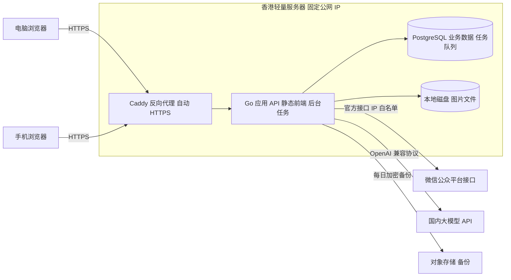
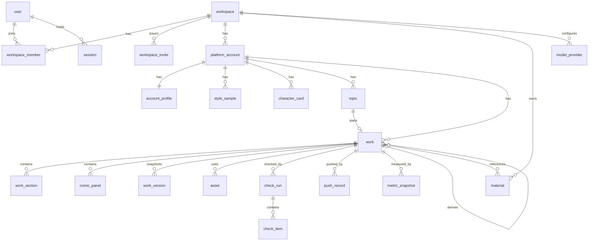
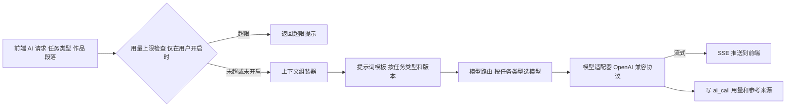

# 06 阶段六：数据与技术架构

> - 状态：已确认（2026-10-09）。Q-27 至 Q-29 的结论见第 11 节和 D-027。设计补充（D-033）新增第 5.8、5.9、7.1、13 节，并修改了第 4.2、5.1、5.3、5.4、6、7 节
> - 最后更新：2026-10-09
> - 依赖：[04-需求与功能分级](04-需求与功能分级.md)、[05-业务流程与交互](05-业务流程与交互.md)、[90-决策与变更记录](90-决策与变更记录.md)、[91-事实核验台账](91-事实核验台账.md)

---

## 1. 本阶段要回答的问题

1. 系统由哪些部分组成，各自负责什么？
2. 数据怎么存？
3. AI 怎么调用、上下文怎么组装、模型怎么选？
4. 凭证、登录和数据怎么保证安全？
5. 用什么技术、部署在哪里？

已确认的前置决策：

- **D-025（Q-25）**：部署在香港轻量云服务器。免 ICP 备案，有固定公网 IP（满足 F-003 的白名单要求），手机可以通过 HTTPS 访问（D-023）。
- **D-026（Q-26）**：前端 React，后端 Go，数据库 PostgreSQL；其余技术由本文档选定。
- D-024：真实公众号验证实验推迟到开发阶段；本文档中依赖实测的部分标注"待验证"。

---

## 2. 架构总览

### 2.1 形态：模块化单体

采用**一个 Go 服务 + 一个 PostgreSQL 数据库**的模块化单体（D-036 起为多租户行级隔离，非微服务）：

- 一个进程同时提供 API、托管前端静态文件、运行后台任务；
- 内部按业务模块划分包，模块之间只通过接口调用；
- 后台任务队列也放在 PostgreSQL 里，不引入 Redis、消息队列等额外组件；
- 租户隔离靠共享库内的 `workspace_id`（及会话上的 `current_workspace_id`），不按租户拆库或拆 Schema。

不选微服务 / 每租户一库的理由：体量与运维成本不匹配；模块边界清晰后若真有需要再拆。

### 2.2 部署拓扑

小红书侧没有任何服务端接口调用（D-007、D-009），只生成发布包供用户下载。V4 起采集器（`crawl` 模块）会按限额读取公开热榜和小红书、公众号的公开单篇页面，只读、不登录（D-047，见第 15 节）。

### 2.3 后端模块划分

| 模块 | 职责 | 对应功能 |
| --- | --- | --- |
| `auth` | 登录、会话、登录限流与锁定、登录记录 | FR-M1-01 |
| `account` | 工作区、平台账号、凭证加密存储、连通性检测 | FR-M1-02 至 05 |
| `memory` | 账号定位档案、风格样本、素材库、角色设定卡 | M2、FR-M8-01 |
| `topic` | 选题池、去重 | M3 |
| `work` | 作品、段落块、漫画分格、版本、派生关系、状态机 | M4、M5、M8 |
| `asset` | 图片上传、格式转换、压缩、裁剪、存储 | M7 |
| `check` | 发布前检查：格式校验、敏感词、事实核查、AI 声明、相似度 | M9 |
| `publish/wechat` | 微信适配层：token、图片上传、封面素材、草稿增改查 | FR-M10-01 至 03、06 |
| `publish/xhs` | 小红书发布包生成（文本整理、图片编号打包） | FR-M10-04 |
| `publish` | 推送次数上限、发布状态回填、推送记录 | FR-M10-05、07 |
| `review` | 数据录入、看板查询、AI 复盘、导入 | M11 |
| `ai` | 模型适配层、上下文组装、提示词模板、用量统计与上限 | FR-M2-04、M12 |
| `audit` | 操作日志 | FR-M12-03 |
| `jobs` | 后台任务：token 预刷新、草稿状态同步、备份、复盘提醒；V4 起驱动采集循环与每日生成 | 多处 |
| `crawl`（V4） | 采集客户端 `crawlClient`（robots、限速、熔断、每日上限、敏感平台节流）、来源适配器、热点去重与话题簇 | FR-M3-05、FR-M3-10、FR-M3-11 |
| `strategy`（V4） | 账号运营方案、内容大纲、热点匹配、每日推荐、对标参考 | FR-M3-06 至 09、FR-M3-11 |

平台适配层（NFR-09）：`publish/wechat` 和 `publish/xhs` 实现同一个"发布目标"接口，`work` 和 `check` 只依赖接口。将来接入小红书分享 SDK 或其他平台时，只需新增一个实现。

---

## 3. 技术选型

| 层 | 选择 | 许可证 | 选择理由 |
| --- | --- | --- | --- |
| 前端框架 | React + TypeScript + Vite | MIT | 用户指定 React；Vite 构建快、配置少 |
| 前端路由与数据 | React Router、TanStack Query | MIT | 主流组合；TanStack Query 管理服务端数据缓存 |
| UI 组件 | shadcn/ui + Tailwind CSS | MIT | 组件源码复制进项目，可自由修改；移动端适配方便（发布包页面） |
| 编辑器 | Tiptap + `@tiptap/markdown` | MIT | 每个段落块一个 Tiptap 实例，所见即所得，内容以 Markdown 存取（D-022）。Markdown 扩展为早期版本，需在开发初期验证常用语法的往返转换 |
| 公众号 HTML 渲染 | 前端 TypeScript 渲染模块：marked 解析 + 内联样式；主题和转换规则参考 doocs/md | marked：MIT；doocs/md：WTFPL | 预览和推送用同一份渲染代码，保证所见即所得；doocs/md 是成熟的 Markdown 转公众号实现。CSS 兼容性待真实号实测（D-024） |
| 后端语言与 HTTP | Go 标准库 `net/http` + chi 路由 | BSD / MIT | 标准库为主，依赖少 |
| 数据库访问 | pgx + sqlc | MIT | sqlc 从 SQL 生成类型安全的 Go 代码，SQL 可读、易审查 |
| 数据库迁移 | goose | MIT | 版本化迁移脚本 |
| 后台任务 | River（Postgres 任务队列） | MPL-2.0 | 任务与业务数据同库，事务内入队；不引入额外中间件。只使用不修改其源码 |
| 图片处理 | libvips（经 govips 调用） | libvips：LGPL-2.1；govips：MIT | 支持 jpg、png、webp、heic 转换与压缩，速度快、内存小；以动态链接方式在容器中使用 |
| HTML 安全过滤 | bluemonday | BSD-3 | 推送前在服务端二次过滤，确保无脚本（F-012） |
| 文本相似度 | PostgreSQL `pg_trgm` 扩展 | PostgreSQL 许可证 | 选题去重、同质化提示（P1）用三元组相似度即可，MVP 不需要向量数据库 |
| 敏感词匹配 | Go 实现的 Aho-Corasick 多模式匹配 | 自研 | 词库规模小，自研简单可控 |
| 反向代理 | Caddy | Apache-2.0 | 自动申请和续期 HTTPS 证书，配置简单 |
| 部署 | Docker Compose | Apache-2.0 | 单机三容器（Caddy、应用、PostgreSQL），一条命令启动 |
| 日志 | Go 标准库 `log/slog` 结构化日志 | BSD | 无额外依赖 |

许可证来源：BlockNote、Tiptap、doocs/md、River 的许可证已于 2026-10-09 在其官方仓库或 npm 页面核实。未选 BlockNote 的原因：核心为 MPL-2.0 可用，但导出等高级包为 GPL-3.0 或商业许可，且其内部数据结构与 Markdown 之间转换有损，不如 Tiptap 的 Markdown 扩展直接。其余为常用开源组件，开发阶段引入依赖时再逐一复核许可证。

---

## 4. 数据模型

### 4.1 实体关系总览

### 4.2 核心表

所有表都有 `id`（UUID）、`created_at`、`updated_at`，下文省略。`enc` 后缀表示加密存储的字段。

**工作区与账号**（D-036）

| 表 | 关键字段 | 说明 |
| --- | --- | --- |
| `app_user`（文档称 user） | username（全局唯一）、password_hash、failed_logins、locked_until、prev_login_at、prev_login_ip、is_system_admin、disabled_at | 登录主体；永久超管固定账号 `skyeder`（D-044）；禁用后不可登录 |
| `workspace` | name、created_by_user_id | 租户；注册时自动创建 |
| `workspace_member` | workspace_id、user_id、role（owner / editor / viewer）、status（active / disabled） | `(workspace_id, user_id)` 唯一；一人可属多工作区；viewer 只读（D-038） |
| `workspace_invite` | workspace_id、code、role、max_uses、used_count、expires_at、created_by_user_id、revoked_at | 邀请码；仅 owner 管理；可邮件发送（SMTP 存 app_setting） |
| `session` | user_id、current_workspace_id、token_hash、expires_at、user_agent、last_seen_at、reauth_until、admin_override | 会话保持 7 天（D-023）；`admin_override` 为超管进入他人工作区（D-044） |
| `system_setting` | key、value | 全站开关：`registration_open`、`maintenance_mode`（D-044） |
| `platform_account` | workspace_id、platform（wechat_mp / xhs）、name、content_format（账号类型，创建时从预设清单选定后固定，更新接口拒绝修改；两平台共 10 类，见 04 文档第 3.1 节）、type_note（类型补充说明，可选，只影响 AI 提示词与定位文案）、status（active / disabled）、daily_push_limit（默认 3） | D-008、D-020、D-048 |
| `wechat_credential` | account_id、app_id、app_secret_enc、key_version、last_check_at、last_check_result | 凭证单独成表，便于权限控制和审计 |
| `wechat_token` | account_id、access_token_enc、expires_at | token 缓存（F-003、F-011） |

**账号记忆**

| 表 | 关键字段 | 说明 |
| --- | --- | --- |
| `account_profile` | account_id、positioning_tags（数组）、target_audience、persona_tone、banned_words（数组）、style_summary、default_theme、wechat_defaults（JSONB：author、open_comment、fans_only_comment、source_url） | 与账号一对一；`wechat_defaults` 仅公众号使用（FR-M10-10） |
| `style_sample` | account_id、title、content_md、char_count | 建议 3–10 篇 |
| `material` | workspace_id、account_id（为空表示工作区共享）、kind（experience / opinion / case / data）、content、source、tags | D-008 的共享规则 |
| `character_card` | account_id、name、appearance、personality、catchphrase、ref_asset_id | 仅漫画账号 |

**选题与作品**

| 表 | 关键字段 | 说明 |
| --- | --- | --- |
| `topic` | account_id、title、angle、source（manual / ai / review）、status（pending / adopted / dropped）、review_report_id | 复盘来源可追溯 |
| `work` | account_id、topic_id、source_work_id（派生来源）、content_format（作品形态快照，创建时取账号类型；历史作品按自身快照执行编辑、AI、检查、漫画接口与打包，不随账号类型变化，D-048）、status（见 05 文档第 4 节）、title、summary、viewpoint、outline_confirmed_at、theme、cover_asset_id、cover_crops（JSONB：2.35_1 和 1_1 两组相对坐标）、wechat_fields（JSONB：author、open_comment、fans_only_comment、source_url）、topics（数组，小红书话题）、wechat_draft_media_id、wechat_draft_hash、published_url、published_at、locked | 状态机由 `work` 模块统一管理；`wechat_draft_hash` 是最近一次写入后读回的草稿正文哈希，用于后台修改检测（D-033） |
| `work_section` | work_id、position、heading、content_md、ai_raw_md、origin（ai / human / mixed）、source_section_id | 分段块（D-022）；`ai_raw_md` 保存最近一次 AI 原始输出，用于计算人工修改比例（P1）；`source_section_id` 用于对照改写的段落对齐 |
| `comic_panel` | work_id、position、scene、character_ids（数组）、action、shot、narration、dialogue、image_prompt、asset_id | 漫画分格（P1） |
| `work_card` | work_id、section_id、position、image_asset_id | D-048 图文卡片：卡片 = 作品段落（标题与正文）+ 逐卡 AI 配图；打包与公众号图片消息按卡片图取材 |
| `work_version` | work_id、version_no、snapshot（JSONB：标题、摘要、段落或分格）、reason（auto / ai / manual） | 版本历史与恢复 |
| `work_material` | work_id、material_id | 本作品引用的素材 |
| `asset` | workspace_id、account_id、work_id、storage_path、mime、width、height、bytes、sha256、position | 图片文件存本地磁盘，表中只存路径 |

**检查、发布与复盘**

| 表 | 关键字段 | 说明 |
| --- | --- | --- |
| `check_run` | work_id、version_no、target_platform、completed_at | 每次提交检查或修改后重跑生成一条 |
| `check_item` | check_run_id、category（format / sensitive / fact / ai_disclosure / similarity / ad_law）、fingerprint、matched_text、location、message、resolution（modified / kept / verified / acknowledged）、resolved_at | `fingerprint` = 类别 + 命中文字及其所在句子的哈希。重跑时指纹相同且已确认的项继承确认结果，实现 D-023 的部分失效；format 类不继承 |
| `push_record` | work_id、account_id、action（add / update / newspic）、status、failed_step、error_code、error_message、draft_media_id | 当日推送次数按此表统计（FR-M10-07） |
| `wechat_media_cache` | account_id、sha256、kind（content_image / thumb）、wechat_url、media_id | 同一图片不重复上传（05 文档 E-04） |
| `metric_snapshot` | work_id、captured_at、reads、likes、wows、favorites、comments、shares、follows_gained、note | 字段见 D-020；按平台只用适用字段 |
| `review_report` | account_id、work_ids（数组）、content、ai_call_id | AI 复盘结果 |

**系统**

| 表 | 关键字段 | 说明 |
| --- | --- | --- |
| `model_provider` | workspace_id、name、base_url、api_key_enc、key_version、models（数组）、status、last_test_at、last_test_result | 模型供应商（FR-M12-07）；按工作区隔离（D-036） |
| `model_route` | workspace_id、task_type（工作区内唯一，含 `default`）、provider_id、model | 任务类型到模型的路由；按工作区隔离 |
| `ai_call` | account_id、task_type、provider、model、template_version、context_refs（JSONB）、prompt_tokens、completion_tokens、latency_ms、status | 用量统计和"本次参考了什么"（FR-M2-04）都来自这里 |
| `prompt_template` | task_type、version、content、active | 提示词版本化 |
| `sensitive_word` | workspace_id、word、category、source（base / custom） | 账号禁用词存在 `account_profile` 中 |
| `audit_log` | actor_id、action、target_type、target_id、result、detail（JSONB） | 只追加，不修改 |
| `app_setting` | workspace_id、key、value | AI 每日上限等；按工作区隔离（D-036） |

**软删除（FR-M12-08、D-033）**：`topic`、`work`、`material`、`style_sample`、`character_card` 增加 `deleted_at` 字段。删除只写 `deleted_at`，所有查询默认过滤已删除记录；回收站查询 `deleted_at` 不为空的记录。后台任务每天彻底删除 `deleted_at` 超过 30 天的记录，连同其下的段落、版本、检查记录、图片文件（`asset` 记录和磁盘文件）。`platform_account` 只有停用，没有删除。`ai_call`、`audit_log`、`push_record` 不随作品删除，保留统计和审计价值，作品被彻底删除后其引用显示为"已删除"。

### 4.3 数据隔离规则（落实 D-008、D-036）

- **工作区隔离**：所有租户数据读写以会话的 `current_workspace_id` 为准；跨工作区用 ID 直访返回 404，不泄露是否存在。
- 所有账号级表都带 `account_id`，后端查询统一经过"当前账号"过滤，且账号必须属于当前工作区。
- `material.account_id` 为空表示工作区共享，查询条件为"属于当前账号或为空"。
- 跨账号关联只有一种：`work.source_work_id`（派生）。派生仅允许跨平台（D-023），且源/目标账号须同属当前工作区。
- **成员与角色（D-036）**：`user` 与 `workspace_member` 分离；角色权限见 D-036 矩阵；凭证与模型配置仅 owner。
- **迁移**：原单行 `member` 拆为 `user` + `workspace_member(owner)`；原全局 `model_provider` / `model_route` / `app_setting` 归属该工作区。

---

## 5. 关键流程的技术设计

### 5.1 AI 调用与上下文组装

**上下文组装顺序**（从固定到具体）：

1. 系统规则：平台格式约束、合规要求（如"不编造数据，不确定的事实用标记标出""不模仿他人可识别的作品"）。
2. 账号定位档案：定位标签、目标读者、人设语气、禁用词。
3. 风格参考：优先使用风格摘要；没有摘要时截取风格样本片段，总量受预算控制。
4. 用户选中的素材和核心观点（D-014 的源头真实性）。
5. 当前作品上下文：大纲、相邻段落（分段起稿时）、源作品（派生改写时）。
6. 任务指令。

**预算控制**：每类任务设定输入长度预算；超出时按"风格样本 → 相邻段落"的顺序裁剪，账号档案、观点和用户选中的素材不裁剪。

**任务类型与模型路由**（初始配置，盲测后调整）：

| 任务类型 | 说明 | 模型档位 |
| --- | --- | --- |
| topic_suggest、outline、review_analysis | 选题、大纲、复盘 | 主力模型 |
| section_draft、comic_storyboard | 分段起稿、分镜 | 主力模型 |
| rewrite_plan、section_rewrite | 派生改写的两步（见第 5.8 节） | 主力模型 |
| section_edit（改写、扩写、缩写）、title、summary、image_suggest、comic_panel_text、comic_rewrite、organize_notes | 局部编辑和短文本 | 经济模型 |
| fact_flag | 事实核查标注 | 主力模型（准确性优先） |
| style_summary | 风格摘要 | 主力模型 |

**适配层设计**：统一接口为"消息列表 + 参数 → 流式文本 + 用量"。国内主流模型服务普遍提供 OpenAI 兼容的对话接口，MVP 只实现这一种协议（D-011）。具体兼容细节在开发接入时以各家官方文档为准。

**模型配置存放位置（D-033）**：供应商的地址、API 密钥、模型名和任务路由都存在数据库（`model_provider`、`model_route` 表），在模型配置页（05 文档 P-22）中维护，密钥用主密钥加密。这样更换模型或密钥不需要改 `.env` 和重启服务，盲测时也能在界面上快速切换。`.env` 只放主密钥、数据库密码、域名等启动必需的配置，不放任何业务密钥（第 7 节）。

**数据外发说明**：AI 请求会把作品内容、素材和风格样本发给模型供应商。供应商的准入条件是服务条款明确"API 数据不用于训练"（D-028）。

### 5.2 模型盲测方案（落实 D-011）

| 项目 | 内容 |
| --- | --- |
| 候选 | 满足准入条件（服务条款明确 API 数据不用于训练，D-028）的已备案国内模型：阿里云百炼按量付费 API 上的模型（如通义千问）、火山方舟上的模型（如豆包），各取 1–2 个主力型号，以测试时的最新型号为准；DeepSeek、Kimi 取得书面确认后再加入 |
| 样本 | 用户的 10–20 个真实选题，覆盖长图文和图文笔记两种形态 |
| 测试任务 | 分段起稿（带风格样本和素材）、公众号改写为小红书、事实核查标注 |
| 盲评方式 | 同一输入的各模型输出打乱顺序、隐去模型名，由用户评分 |
| 评分维度 | 风格贴合度、内容真实性（是否编造）、表达自然度、平台适配度，各 1–5 分；另记录成本和响应速度 |
| 结论 | 选出主力模型和经济模型各一个，写入决策记录 |

执行时间见 Q-27：开发阶段 M0 的 SP-04（D-032）。

### 5.3 公众号推送

流程见 05 文档第 6.9 节的时序图，技术要点：

1. **渲染位置**：公众号 HTML 由前端渲染模块生成（与预览同一份代码），推送时连同作品版本号一起提交给后端。
2. **后端校验**：确认作品状态为"可发布"且版本号与检查时一致；用 bluemonday 过滤；校验字符数少于 2 万、大小小于 1MB（F-012）；校验标题不超过 32 字、作者不超过 16 字、摘要不超过 120 字、阅读原文链接不超过 1KB（F-013）；校验已设置封面；校验当日推送次数。
3. **图片替换**：HTML 中的图片引用本系统的资源 ID；后端逐张压缩，按 sha256 查 `wechat_media_cache`，未上传的调用 `uploadimg`（F-007），然后把引用替换为微信返回的 URL。
4. **封面**：调用 `add_material`（image 类型）上传封面原图，得到永久素材 ID 作为 `thumb_media_id`（同样缓存）；裁剪不在服务端做，把 `work.cover_crops` 中的两组相对坐标填入 `cover_info.crop_percent_list`（ratio 为 `2.35_1` 和 `1_1`，F-013）。image 类型的 media_id 能否用作封面待 V-015 验证；不能时改用 thumb 类型，并在上传前把封面压缩到 64KB 以内。
5. **后台修改检测**（作品已有草稿时）：调用 `draft/get` 读取当前草稿，计算正文哈希并与 `work.wechat_draft_hash` 比较；不一致、没有基准或读取失败时，返回"需要用户选择"，由前端让用户选择覆盖或另存为新草稿（05 文档 6.9 节、E-18）。
6. **写入草稿**：作品没有草稿或用户选择另存时调用 `draft/add`，否则调用 `draft/update`；`draft/update` 返回草稿不存在时，按 05 文档 E-06 处理。请求中带上 `author`、`need_open_comment`、`only_fans_can_comment`、`content_source_url`（取作品的 `wechat_fields`）。写入成功后再调用一次 `draft/get`，把读回的正文哈希存入 `work.wechat_draft_hash`。
7. **进度**：推送在请求内同步执行（单篇、图片少，耗时可控），通过 SSE 把步骤进度推给前端。每一步写入 `push_record`，失败时记录失败步骤和错误码。

**图片消息（newspic，P1）**：图片列表使用 `image_media_id`，每张图都必须用 `add_material` 上传为永久素材（F-013），会占用账号的永久素材额度；同一图片按 sha256 复用缓存。图片消息的正文只支持纯文本，使用与小红书相同的纯文本转换规则（第 5.4 节）。

**access_token 管理**：每个公众号的 token 加密缓存在 `wechat_token` 表；过期前 10 分钟由后台任务预刷新；获取时加数据库行锁，防止并发重复获取（F-011 每日 2000 次）。

### 5.4 小红书发布包

- 文本：标题、正文、话题分别输出；正文保留换行和表情符号。
- 图片：按 `asset.position` 排序，统一转为 jpg，按 `01.jpg`、`02.jpg` 命名；下载时实时打包 zip，不在服务器上长期保存 zip 文件。
- 手机端：发布包页面单列布局，图片可单张预览并长按保存（D-023）。
- 字数和图片数量校验以 V-012 的结果为准，结果出来前只校验图片数量 1–18 张（F-102）。

**Markdown 转小红书纯文本规则（D-033）**：小红书正文是纯文本，不渲染 Markdown 标记。小红书作品的编辑器本身只提供段落、列表和表情（05 文档 6.4 节），下面的规则是兜底，用于派生改写和粘贴进来的内容：

| Markdown 元素 | 转换结果 | 说明 |
| --- | --- | --- |
| 段落 | 原文，段与段之间空一行 | 小红书中空行是主要的分段手段 |
| 小标题（`##`、`###`） | 单独一行的纯文字，前后各空一行 | 不加 `#`，避免被识别为话题 |
| 加粗、斜体 | 去掉标记，保留文字 | — |
| 无序列表 | 每项一行，以"· "开头 | — |
| 有序列表 | 每项一行，以"1. "开头 | — |
| 引用 | 去掉 `>`，用「」括起 | — |
| 链接 | 只保留链接文字，去掉网址 | 小红书正文中的外部链接不可点击，且可能被判定为导流 |
| 图片 | 从正文中去掉 | 图片进入发布包的图片列表，按顺序编号 |
| 代码、表格、分隔线 | 代码保留为纯文字；表格逐行转为"列1：值1，列2：值2"；分隔线去掉 | 小红书作品中极少出现 |
| 行内的 `#话题` | 保留原样，并在转换后提示"正文中含话题标记" | 话题建议放在单独复制的话题栏 |
| 表情符号 | 保留 | — |

转换在前端完成（与预览共用），输出结果同时用于发布包的"复制正文"、字数统计和发布前检查。

### 5.5 发布前检查

| 检查类别 | 实现 | 是否调用 AI |
| --- | --- | --- |
| 格式校验 | 规则代码：标题、作者、摘要长度，HTML 大小，图片格式和大小，图片数量，是否已设置封面，正文中是否残留"【待核实】"标记（第 5.8 节） | 否 |
| 敏感词 | Aho-Corasick 匹配：基础词库 + 用户自定义词库 + 账号禁用词 | 否 |
| 事实核查标注 | AI 标出数据、引用、绝对化断言，返回句子位置 | 是 |
| AI 声明 | 固定检查项 | 否 |
| 同质化（P1） | `pg_trgm` 与本账号历史作品比对 | 否 |
| 广告法极限词（P1） | 词表匹配 | 否 |

**基础敏感词库的说明**：没有官方公开的权威词库，公开的开源词库质量参差、容易误报。MVP 的基础词库保持精简，以用户自定义词库为主，并且所有命中都只是提示，由人决定修改还是保留。接入云厂商内容安全接口作为 V2 选项，在阶段 7 评估。

**部分失效**（D-023）：内容变更后重新生成 `check_run`；对每个新检查项计算 `fingerprint`，若上一次检查中存在相同指纹且已确认，则继承确认结果；format 类每次重新判定，不继承。

### 5.6 自动保存与版本

- 前端在内容变化后 3 秒内防抖保存，最长间隔 10 秒（05 文档 6.4 节）；保存接口带"基准版本号"，与服务器版本不一致时返回冲突，前端展示差异让用户选择（05 文档 E-13）。
- 每次 AI 生成落地、手动"保存版本"、提交检查时写一条 `work_version`；普通自动保存只更新当前内容，每 10 分钟最多额外留一个自动快照，避免版本表膨胀。
- 网络断开时前端把未保存内容暂存到浏览器本地存储，恢复后同步（05 文档 E-12）。

### 5.7 后台任务

| 任务 | 频率 | 作用 |
| --- | --- | --- |
| token 预刷新 | 每 5 分钟检查 | 过期前 10 分钟刷新 |
| 草稿状态同步（P1） | 每 2 小时，仅针对"已进草稿箱"的作品 | 调用 `draft/batchget` 判断草稿是否消失，标记"可能已发表"（FR-M10-06），不改状态 |
| 复盘提醒 | 每天 | 生成工作台"发布满 1 天 / 7 天未录入"的提醒 |
| 数据库与图片备份 | 每天凌晨 | 见第 7 节 |
| 过期会话清理 | 每天 | 删除过期 `session` |
| 回收站清理 | 每天 | 彻底删除进入回收站超过 30 天的记录和图片文件（第 4.2 节软删除） |

### 5.8 AI 任务契约（D-033）

本节规定每类 AI 任务的输入、输出格式和失败处理。提示词的具体措辞在开发时编写并通过盲测调整，但输入输出契约以本节为准，前后端都按它实现。

**提示词结构**：每个任务的提示词分为两条消息。

- 系统消息：第 5.1 节上下文组装顺序中的第 1 至 3 项（系统规则、账号档案、风格参考）。
- 用户消息：第 4 至 6 项（素材和观点、作品上下文、任务指令），最后附上输出格式要求。

模板使用 Go `text/template`，按 `task_type` + `version` 存在 `prompt_template` 表中；初始模板随代码放在 `server/internal/ai/prompts/` 下，首次启动时写入数据库。提示词模板的界面编辑（FR-M12-05，P1）只允许修改任务指令部分，系统规则不可编辑。

**系统规则**（所有任务共用，不可编辑）：

1. 不编造数据、案例、引语、人物和机构；需要具体数据而素材中没有时，写成"【待核实：需要的内容】"占位，由人补充。
2. 只使用用户提供的素材作为事实来源，不虚构亲身经历。
3. 不模仿可识别的他人作品或作者风格；只模仿本账号的风格样本。
4. 不使用账号禁用词；不使用"最、第一、绝对"等绝对化表达，除非素材中有依据。
5. 按指定的输出格式输出，不加额外说明。

正文中残留的"【待核实】"标记会在发布前检查的格式校验中拦截（第 5.5 节），必须由人补充或删除后才能通过。

**输出方式**：

- **流式 Markdown**：长文本任务。前端逐字显示，完成后整段落入段落块。
- **JSON**：结构化任务。优先使用供应商的 JSON 输出模式；不支持时在提示词中要求只输出 JSON。后端按下表的结构校验，校验失败自动重试 1 次，仍失败按 05 文档 E-09 处理（提示"生成失败，重试"，不覆盖原内容）。

**任务清单**：

| 任务类型 | 主要输入 | 输出方式 | 输出结构 | 约束 |
| --- | --- | --- | --- | --- |
| topic_suggest | 账号档案、方向关键词（可选）、最近 20 个选题和作品标题（用于避开重复） | JSON | `{"topics":[{"title","angle","reason"}]}` | 不少于 5 条（FR-M3-01） |
| outline | 观点、选中素材、选题 | JSON | `{"items":[{"heading","key_point","material_ids":[]}]}` | 4–8 项；`material_ids` 只能引用输入中给出的素材 |
| section_draft | 大纲全文、本段大纲项、前后相邻段落、本段引用的素材 | 流式 Markdown | 段落正文 | 不含本段小标题（小标题来自大纲）；长度按账号形态给出建议范围 |
| section_edit | 选中文字或整段、模式（rewrite 改写 / expand 扩写 / shorten 缩写）、用户补充要求（可选） | 流式 Markdown | 替换后的文字 | 只返回替换内容，不改动未选中部分 |
| title | 正文摘要（前 1500 字和各段小标题）、平台 | JSON | `{"titles":[{"text","style"}]}` | 不少于 5 个；公众号不超过 32 字；不使用标题党表达 |
| summary | 正文摘要 | JSON | `{"summary"}` | 不超过 120 字，超出时后端截断并提示（FR-M4-06） |
| fact_flag | 全文（按段落带编号） | JSON | `{"items":[{"section_id","quote","claim_type","reason"}]}` | 见下方说明 |
| rewrite_plan | 源作品全部段落（带编号）、目标账号档案、目标形态 | JSON | `{"title","sections":[{"source_section_ids":[],"key_point"}],"topics":[]}` | 派生改写第一步：规划目标段落及其与源段落的对应关系；小红书话题 3–8 个 |
| section_rewrite | 规划中的一项、对应的源段落、目标账号风格 | 流式 Markdown（小红书为纯文本） | 目标段落正文 | 派生改写第二步，逐段执行；"重新改写本段"也调用它 |
| image_suggest（P1） | 段落正文 | JSON | `{"suggestions":[{"description","prompt"}]}` | 提示词为中文 |
| style_summary（P1） | 风格样本（最多 10 篇，超出预算时截取） | 流式 Markdown | 风格摘要 | 300–600 字，描述语气、句式、结构、常用表达 |
| organize_notes（P1） | 用户粘贴的要点 | 流式 Markdown | 带小标题的初稿 | 只整理和组织，不扩充用户未提供的事实 |
| comic_storyboard（P1） | 观点、选题、所选角色卡、格数 | JSON | `{"panels":[{"scene","character_ids":[],"action","shot","narration","dialogue"}]}` | 格数等于用户指定值；对白长度不超过气泡上限 |
| comic_panel_text（P1） | 已确认的分格、角色卡 | JSON | `{"narration","dialogue","image_prompt"}` | `image_prompt` 自动拼入角色外貌描述（FR-M8-04） |
| comic_rewrite（P1） | 源分格旁白/对白、目标平台 | JSON | `{"title","panels":[{"source_panel_id","narration","dialogue"}]}` | 漫画跨平台派生（D-042）：复用分格与图片，只改写旁白对白 |
| review_analysis | 作品列表及各时间点指标、账号档案 | JSON | `{"conclusions":[],"topic_suggestions":[{"title","angle","reason"}]}` | 建议不少于 3 条（FR-M11-03） |

**fact_flag 的定位方式**：模型给出的字符位置不可靠，所以不让模型返回位置，而是让它返回原文中逐字摘录的句子（`quote`）。后端在对应段落中做精确子串匹配来定位；匹配不到时做去空白后的匹配；仍匹配不到的条目显示为"未能定位"，照常需要人工确认。`claim_type` 取值：`data`（数据）、`quote`（引语）、`absolute`（绝对化断言）、`time`（时间）、`entity`（人物或机构）。

**派生改写分两步的原因**：一次性让模型输出整篇 JSON，等待时间长，且无法逐段重做。先用 `rewrite_plan` 得到段落对应关系（落入 `work_section.source_section_id`），再逐段流式生成，既能对照显示（05 文档 6.6 节），也能单段重新改写。

### 5.9 密码重置命令（FR-M1-08）

- 应用二进制提供子命令，在服务器上执行：`docker compose exec app ops reset-password <username>`（D-036：按用户名）。
- 交互式输入两次新密码，密码不出现在命令行参数和 shell 历史中；校验不少于 12 位。
- 执行后：更新 `user.password_hash`，删除该用户全部 `session`，清除登录锁定，写一条 `audit_log`（action 为 `password_reset_cli`）。
- 同一个二进制还提供 `ops migrate`（手动执行迁移）和 `ops version`，方便运维；不提供任何绕过登录的命令。

---

## 6. 安全设计

| 项目 | 设计 | 依据 |
| --- | --- | --- |
| 传输 | 全站 HTTPS（Caddy 自动证书）；开启 HSTS | D-023 |
| 登录 | 密码至少 12 位，使用 argon2id 哈希；登录失败 5 次锁定 15 分钟；登录成功和失败都写入操作日志，工作台显示最近登录时间和 IP；不启用二次验证（Q-28），TOTP 字段预留 | NFR-01 |
| 会话 | 随机令牌放在 HttpOnly、Secure、SameSite=Lax 的 Cookie 中，数据库只存哈希；有效期 7 天；修改密码后其他会话全部失效 | D-023 |
| 跨站请求 | 修改类接口校验 CSRF 令牌 | — |
| 凭证加密 | AppSecret、access_token、TOTP 密钥、模型 API 密钥都存在数据库中，使用 AES-256-GCM 加密；主密钥是唯一放在环境变量中的密钥，不进代码仓库、不进数据库、不进备份；`key_version` 字段支持密钥轮换 | NFR-01、D-012、D-033 |
| 敏感操作 | 修改公众号凭证、修改模型密钥、修改密码、导出数据需要再次输入密码；彻底删除需要二次确认；全部写入 `audit_log` | FR-M12-03 |
| 密码重置 | 只能在服务器上用命令重置，见第 5.9 节 | FR-M1-08 |
| 日志脱敏 | 日志中不记录密钥、token、密码；AI 请求日志只记元数据（任务类型、长度、用量），不记全文 | NFR-01 |
| 服务器 | 只开放 80、443 和 SSH；SSH 只允许密钥登录；PostgreSQL 不对外暴露端口 | — |
| 依赖安全 | 开发阶段使用 `govulncheck` 和 `npm audit` 检查依赖漏洞 | — |

---

## 7. 部署与运维

| 项目 | 方案 |
| --- | --- |
| 服务器 | 香港轻量云服务器，建议 2 核 4GB 内存、50GB 以上磁盘、固定公网 IP（D-025） |
| 域名 | 需要一个域名用于 HTTPS 证书；域名解析到香港服务器不需要 ICP 备案 |
| 容器 | Docker Compose：`caddy`、`app`（Go 二进制 + 前端静态文件 + libvips）、`postgres` |
| 配置 | 启动配置通过 `.env` 文件注入：主密钥、数据库密码、域名、数据目录。文件权限仅 root 可读，不进代码仓库。公众号凭证和模型密钥不放在 `.env`，在界面中录入后加密存入数据库（D-033） |
| 微信白名单 | 服务器公网 IP 加入公众号后台 IP 白名单（F-003）；系统设置页显示该 IP |
| 备份 | 每天凌晨 `pg_dump` 加图片目录打包，加密后上传到对象存储；保留最近 7 份日备份和 4 份周备份。主密钥另行离线保存，不随备份上传 |
| 恢复演练 | 上线前做一次完整恢复演练，并写入阶段 8 的上线检查表 |
| 监控 | 应用提供健康检查接口；使用免费的外部可用性监控定时探测；磁盘使用超过 80% 时在工作台提示 |
| 更新 | 本地构建镜像后推送到服务器，`docker compose up -d` 滚动更新；数据库迁移随应用启动执行，执行前自动备份 |

### 7.1 运行成本估算（D-033）

以下为量级估算，价格以购买或开通时官网为准；模型单价在开发阶段 SP-04 盲测时核实后更新。

| 项目 | 估算 | 依据与说明 |
| --- | --- | --- |
| 香港轻量云服务器 | 约 50–150 元 / 月 | 2 核 4GB、固定 IP 的公开价格区间；按年购买通常更便宜 |
| 域名 | 约 60–100 元 / 年 | 常见 .com 域名续费价格区间 |
| 对象存储（备份） | 每月几元以内 | 备份总量预计在几 GB 以内 |
| 模型调用 | 每篇约 0.2–1 元；每月 30 篇约 10–30 元 | 见下方单篇估算 |
| **合计** | **约每月 70–200 元** | 服务器是主要成本，模型调用占比较小 |

**单篇公众号长文（约 3000 字，6 段）的模型用量估算**：

| 步骤 | 调用次数 | 输入 token | 输出 token |
| --- | --- | --- | --- |
| 大纲 | 1–2 | 约 1 万 | 约 2 千 |
| 分段起稿（每段带档案、风格、大纲、相邻段落） | 6–8 | 约 6 万 | 约 6 千 |
| 局部改写、扩写、缩写 | 约 10 | 约 3 万 | 约 5 千 |
| 标题、摘要 | 2–3 | 约 1 万 | 约 1 千 |
| 事实核查标注 | 1–2 | 约 1 万 | 约 1 千 |
| 派生小红书笔记 | 约 7 | 约 4 万 | 约 3 千 |
| **合计** | 约 30 次 | **约 16 万** | **约 1.8 万** |

按国内主力模型常见的单价量级（输入每百万 token 约 1–4 元，输出每百万 token 约 2–16 元）计算，单篇约 0.2–1 元；重新生成多的情况按两倍估算仍在 2 元以内。实际单价以 SP-04 时的官网价格为准，结果写入用量页的金额换算。

### 7.2 跨境数据

**跨境数据说明**：服务器在香港，用户的内容数据存储在境外，并且会调用境内大模型 API 和微信接口。自用场景下内容主要是用户本人的创作，不涉及他人的个人信息批量处理；阶段 7 会把"数据跨境"作为一项风险正式评估，将来如果对外提供服务，需要改为境内部署并完成 ICP 备案（F-201）。

---

## 8. 非功能需求的落实

| 需求 | 落实方式 |
| --- | --- |
| NFR-01 凭证安全 | 第 6 节凭证加密、日志脱敏 |
| NFR-02 平台调用 | 微信接口只在服务端调用；固定 IP；token 集中缓存与行锁 |
| NFR-03 推送节制 | `push_record` 统计当日次数，`platform_account.daily_push_limit` 默认 3；接口层不存在批量推送 |
| NFR-04 AI 成本可控 | `ai_call` 统计用量并在用量页和工作台展示；`app_setting` 中的每日上限默认关闭，用户开启后超限返回明确提示（Q-29） |
| NFR-05 模型可替换 | 第 5.1 节适配层与模型路由配置 |
| NFR-06 数据隔离 | 第 4.3 节 |
| NFR-07 数据安全 | 第 5.6 节自动保存与版本；第 7 节备份 |
| NFR-08 性能 | 模型流式输出经 SSE 直接转发；首字时间主要取决于模型，盲测时一并记录 |
| NFR-09 可维护 | 发布目标接口；模块化单体 |
| NFR-11 浏览器 | 前端使用 Tailwind 响应式布局；关键页面（工作台、收件箱、发布包、数据录入、通知）单列适配手机，提供 PWA manifest、service worker（只缓存静态资源，不缓存 `/api`）和 Web Share Target（`/share`） |

---

## 9. 待验证与技术风险

| 编号 | 事项 | 影响 | 处理 |
| --- | --- | --- | --- |
| T-01 | 公众号后台对内联 CSS 的保留范围（V-010） | 排版主题的写法 | 开发时第一个任务做真实号实验（D-024）；主题先只用最基础的样式（字号、颜色、行距、边框、背景色） |
| T-02 | `@tiptap/markdown` 为早期版本 | 段落内容的 Markdown 往返转换可能有边界问题 | 开发初期用常用语法（加粗、列表、引用、链接、图片）做往返测试；不支持的语法在编辑器中不提供 |
| T-03 | 前端渲染的 HTML 与后台最终效果不一致 | 预览不准 | 实验阶段对比预览截图与后台预览，校准主题 |
| T-04 | 模型供应商的 OpenAI 兼容程度不同 | 适配层需要少量特殊处理 | 适配层预留按供应商的参数映射 |
| T-05 | 香港服务器调用境内 API 的网络延迟 | AI 首字时间变长 | 盲测时在香港服务器上实测延迟 |
| T-06 | heic 解码依赖 libheif | 容器镜像体积和构建复杂度 | 镜像中安装 libvips 时包含 heif 支持；如有问题，heic 降级为前端提示"请先转为 jpg" |

---

## 10. 本阶段对前序文档的影响

- 05 文档第 6.4 节"自动保存间隔不超过 10 秒"由第 5.6 节的防抖策略落实，无需修改。
- 04 文档 FR-M7-01 的验收标准包含 heic 格式，由 libvips 实现；若 T-06 出现问题，按降级方案处理并在决策记录中登记。

---

## 11. 待决问题

| 编号 | 问题 | 我的建议 | 影响 |
| --- | --- | --- | --- |
| Q-27 | 模型盲测什么时候做？D-011 原定在阶段 6 定型 | 推迟到开发初期，与模型适配层一起做：盲测本身需要适配层和各家 API 密钥，而且需要你的 10–20 个真实选题。阶段 6 先确定方案和候选范围 | D-011 的执行时间；阶段 8 排期 |
| Q-28 | 登录是否加二次验证（TOTP，用手机验证器 App 生成 6 位码）？ | 加。系统部署在公网，里面有公众号凭证；TOTP 实现成本低，可以设置为"新设备登录时需要" | 登录流程；安全等级 |
| Q-29 | AI 每日用量上限的默认值？ | 先按 token 数设置：每日 200 万 token，超限后 AI 功能暂停、其他功能正常；盲测得出实际单价后再换算成金额上限 | 成本控制 |

**确认结果（2026-10-09）：**

- Q-27：采纳建议，模型盲测推迟到开发初期，与模型适配层一起做（调整 D-011 的执行时间）。
- Q-28：不加二次验证。登录只用密码，采用以下补偿措施：密码至少 12 位；登录失败 5 次锁定 15 分钟；每次登录（成功和失败）记入操作日志，工作台显示"最近登录时间和 IP"。`member.totp_secret_enc` 字段保留为空，将来需要时可直接启用。遗留风险进入阶段 7 风险登记表。
- Q-29：不设默认上限，只显示用量；上限功能保留，用户可在设置中自行开启（FR-M12-02 的"达到上限暂停"只在开启后生效）。

---

## 12. 下一阶段预告：阶段 7 风险与合规评估

产出 `07-风险与合规评估.md`：

1. 风险登记表：平台规则（3.27 判定边界、小红书 AI 治理）、技术（T-01 至 T-06）、安全、数据跨境、供应商（模型 API 数据使用条款）、运营（漂移风险、宣传用语）。
2. 每项风险的等级、对策、负责人和复核时间。
3. 合规清单：发布前、上线前、每个版本发布前需要核对的事项。
4. 事实台账复核计划（平台规则变化时的应对流程）。

---

## 13. 接口清单（设计补充，D-033）

前后端之间的 HTTP 接口。路径、字段名在开发时可微调，但资源划分、状态约束和错误码以本节为准；变更时同步更新本节。

### 13.1 通用约定

| 项目 | 约定 |
| --- | --- |
| 前缀 | `/api/v1`；下文路径省略前缀 |
| 格式 | 请求和响应都是 JSON；图片上传用 `multipart/form-data` |
| 认证 | 会话 Cookie；除 `POST /auth/login`、`POST /auth/register`、`POST /auth/setup`（无用户时）、`GET /healthz` 外都需要登录；业务接口均在当前工作区上下文中执行（D-036） |
| CSRF | 所有修改类请求带 `X-CSRF-Token` 头，令牌由 `GET /auth/me` 返回 |
| 账号隔离 | 账号级资源的路径带 `{accountId}`，或由资源自身归属的账号判定；后端统一校验（第 4.3 节） |
| 乐观锁 | 作品、段落的修改请求带 `base_version`，与服务器不一致时返回 `version_conflict`（05 文档 E-13） |
| 列表 | 分页参数 `cursor`、`limit`（默认 20，最大 100）；返回 `{"items":[],"next_cursor"}` |
| 时间 | ISO 8601，带时区 |
| 流式接口 | AI 生成和公众号推送使用 SSE。AI 事件：`delta`（`{"text"}`）、`done`（`{"ai_call_id","usage","refs"}`）、`error`。推送事件：`step`（`{"name","status","current","total"}`）、`need_choice`（需要用户选择覆盖或另存）、`done`、`error` |

**错误响应**：`{"error":{"code","message","detail"}}`，`message` 是给用户看的中文说明。

| code | HTTP 状态 | 含义 |
| --- | --- | --- |
| `unauthenticated` | 401 | 未登录或会话过期 |
| `csrf_invalid` | 403 | CSRF 令牌无效 |
| `reauth_required` | 403 | 敏感操作需要再次输入密码 |
| `login_locked` | 429 | 登录失败次数过多，已锁定 |
| `not_found` | 404 | 资源不存在、已删除或不属于当前账号 |
| `validation_failed` | 422 | 字段校验失败，`detail` 中列出字段和原因 |
| `version_conflict` | 409 | 基准版本与服务器不一致 |
| `state_invalid` | 409 | 作品状态不允许该操作（如未"可发布"就推送） |
| `human_step_required` | 409 | 缺少人工确认点（如未填观点就生成大纲、未确认大纲就起稿），`detail` 中给出 H 编号 |
| `push_limit_reached` | 409 | 今日推送次数已达上限，需带 `confirm_over_limit=true` 重新提交 |
| `ai_not_configured` | 503 | 未配置模型或任务路由缺失 |
| `ai_upstream_error` | 502 | 模型供应商返回错误或超时 |
| `ai_output_invalid` | 502 | 模型输出不符合 JSON 结构，重试后仍失败 |
| `ai_quota_exceeded` | 429 | 达到用户开启的每日用量上限 |
| `wechat_error` | 502 | 微信接口返回错误，`detail` 带 `errcode`、可读说明和失败步骤 |
| `internal` | 500 | 其他错误 |

### 13.2 接口列表

**认证与系统**

| 方法与路径 | 作用 | 备注 |
| --- | --- | --- |
| `POST /auth/setup` | 首次设置密码 | 只在没有用户时可用；与 register 等价（兼容） |
| `POST /auth/register` | 开放注册 | 创建 user + 个人工作区（owner）+ 会话（D-036） |
| `POST /auth/login`、`POST /auth/logout` | 登录、退出 | 登录后 `current_workspace_id` 取最近使用或唯一工作区 |
| `GET /auth/me` | 当前用户、当前工作区与角色、CSRF 令牌、最近登录时间和 IP；含 `is_system_admin`、`admin_override` | D-044 |
| `POST /auth/reauth` | 再次输入密码，获得 5 分钟的敏感操作授权 | — |
| `PUT /auth/password` | 修改密码 | 需要旧密码；其他会话失效 |
| `GET /system/info` | 服务器出口 IP、版本、磁盘使用率 | 白名单提示用 |
| `GET /healthz` | 健康检查 | 不需要登录 |

**全站超级管理员（D-044）**

| 方法与路径 | 作用 | 备注 |
| --- | --- | --- |
| `GET /admin/users` | 全部用户列表 | 仅超级管理员 |
| `PATCH /admin/users/{id}` | 禁用/启用、授/撤超级管理员 | 至少一个超级管理员保留 |
| `POST /admin/users/{id}/reset-password` | 重置密码并踢会话 | 可指定或生成临时密码 |
| `POST /admin/users/{id}/revoke-sessions` | 踢出会话 | — |
| `GET /admin/workspaces` | 全部工作区列表 | — |
| `POST /admin/workspaces/{id}/enter` | 以 owner 身份进入工作区 | `admin_override`，不写成员表 |
| `POST /admin/workspaces/exit` | 退出 override，回到本人工作区 | — |
| `GET /admin/audit-logs` | 全站操作日志 | — |
| `GET /admin/usage` | 全站 AI 用量汇总 | — |
| `GET/PUT /admin/system-settings` | `registration_open`、`maintenance_mode` | — |

**工作区与成员（D-036）**

| 方法与路径 | 作用 | 备注 |
| --- | --- | --- |
| `GET /workspaces` | 当前用户所属工作区列表 | — |
| `POST /workspaces` | 再创建一个工作区（创建者为 owner） | body 可含 `name`、`switch`（创建后切到新工作区，D-041） |
| `PATCH /workspaces/{id}` | 改名 | 仅 owner |
| `POST /workspaces/{id}/switch` | 将会话当前工作区切换为该工作区 | 须为成员 |
| `GET /workspaces/current/members` | 当前工作区成员列表 | — |
| `PATCH /workspaces/current/members/{userId}` | 改角色 / 移出 | 仅 owner；不能移出或降级唯一 owner |
| `POST /workspaces/current/transfer` | 转让所有者 | 仅 owner；自己变为 editor（D-039） |
| `POST /workspaces/current/invites/{id}/send-email` | 按邮箱发送邀请 | 需配置 SMTP；开发模式可只记日志 |
| `POST /workspaces/current/leave` | 当前用户离开工作区 | 唯一 owner 不可离开 |
| `POST /workspaces/current/invites` | 生成邀请码 | 仅 owner；可指定 role、max_uses、expires_at |
| `GET /workspaces/current/invites` | 列出未撤销邀请码 | 仅 owner |
| `POST /workspaces/current/invites/{id}/revoke` | 撤销邀请码 | 仅 owner |
| `POST /workspaces/join` | 凭邀请码加入工作区 | body: `{ "code": "..." }`；可带 `switch: true` |

**平台账号与凭证**

| 方法与路径 | 作用 | 备注 |
| --- | --- | --- |
| `GET /accounts`、`POST /accounts` | 列表、新增 | — |
| `GET /accounts/{accountId}`、`PATCH /accounts/{accountId}` | 详情、修改 | 账号类型创建后固定：PATCH 修改 content_format 一律拒绝（含 `confirm=true`，D-048）；同值兼容；type_note 可改 |
| `POST /accounts/{accountId}/disable`、`/enable` | 停用、启用 | 没有删除接口 |
| `PUT /accounts/{accountId}/wechat-credential` | 保存 AppID、AppSecret | 需要 reauth；响应只含脱敏值 |
| `POST /accounts/{accountId}/wechat-credential/test` | 连通性检测 | 返回可读原因，如 40164 |

**账号记忆**

| 方法与路径 | 作用 | 备注 |
| --- | --- | --- |
| `GET /accounts/{accountId}/profile`、`PUT` | 定位档案和公众号文章默认值 | — |
| `GET /accounts/{accountId}/style-samples`、`POST` | 风格样本列表、新增 | — |
| `PATCH /style-samples/{id}`、`DELETE` | 修改、删除（进回收站） | — |
| `POST /accounts/{accountId}/style-summary` | 生成风格摘要（P1） | SSE |
| `GET /materials?account_id=&scope=`、`POST /materials` | 素材列表（当前账号加共享）、新增 | — |
| `PATCH /materials/{id}`、`DELETE` | 修改、删除 | — |
| `GET /accounts/{accountId}/characters`、`POST`；`PATCH /characters/{id}`、`DELETE` | 角色卡（P1） | 仅漫画形态 |
| `POST /characters/{id}/ref`、`DELETE /characters/{id}/ref` | 角色参考图（D-040） | 账号级 `asset.work_id` 为空；出图提示词约束跨格一致 |

**选题**

| 方法与路径 | 作用 | 备注 |
| --- | --- | --- |
| `GET /accounts/{accountId}/topics?status=`、`POST` | 列表、手动新增 | 新增时返回相似提醒（P1） |
| `PATCH /topics/{id}`、`DELETE` | 改状态或内容、删除 | — |
| `POST /accounts/{accountId}/topics/suggest` | AI 选题建议 | 只返回建议，不入库（H-01） |
| `POST /topics/{id}/works` | 从选题开始创作 | 返回新作品 |

**作品与段落**

| 方法与路径 | 作用 | 备注 |
| --- | --- | --- |
| `GET /accounts/{accountId}/works?status=` | 作品列表 | 含源 / 衍生关系 |
| `GET /works/{id}` | 作品详情（含段落、封面、文章字段、状态） | — |
| `PATCH /works/{id}` | 修改标题、摘要、观点、主题、封面与裁剪、文章字段、话题 | 带 `base_version`；内容变更使检查失效 |
| `DELETE /works/{id}` | 删除（进回收站） | 响应中提示衍生作品数量 |
| `POST /works/{id}/outline/generate` | 生成大纲 | 观点为空返回 `human_step_required`（H-02） |
| `PUT /works/{id}/outline` | 保存并确认大纲 | 生成对应段落块（H-03） |
| `POST /works/{id}/sections`、`PATCH /sections/{id}`、`DELETE /sections/{id}` | 新增、修改、删除段落 | 修改带 `base_version` |
| `PUT /works/{id}/sections/order` | 段落排序 | — |
| `POST /sections/{id}/draft` | 起草本段 | SSE；可选 body `instruction`（本段临时指令）；大纲未确认返回 `human_step_required` |
| `POST /sections/{id}/edit` | 改写、扩写、缩写选中内容 | SSE；可选 `instruction`（本段临时指令，与 draft 同语义） |
| `POST /works/{id}/titles`、`POST /works/{id}/summary` | 生成标题候选、摘要 | JSON |
| `GET /works/{id}/versions`、`POST /works/{id}/versions` | 版本列表、手动保存版本 | — |
| `POST /works/{id}/versions/{no}/restore` | 恢复版本 | 恢复本身也生成一个新版本 |
| `POST /works/{id}/derive` | 派生到目标账号 | 校验平台和形态组合（04 文档第 3.1 节）；返回衍生作品 |
| `POST /works/{id}/rewrite-plan` | 派生改写第一步 | JSON |
| `POST /sections/{id}/rewrite` | 派生改写第二步、重新改写本段 | SSE |
| `POST /works/{id}/unlock` | 已发布作品解锁编辑 | 需带 `confirm=true` |

**图片**

| 方法与路径 | 作用 | 备注 |
| --- | --- | --- |
| `POST /works/{id}/assets` | 上传图片 | 服务端转换格式和压缩 |
| `PATCH /assets/{id}`、`DELETE /assets/{id}` | 修改顺序、删除 | — |
| `GET /assets/{id}/file?variant=` | 读取图片（原图或缩略图） | 需要登录，不对外公开 |
| `POST /works/{id}/image-suggestions` | 配图建议（P1） | JSON |
| `POST /works/{id}/generate-image` | 长文 AI 出图（V2） | 含水印与 `ai_generated` |
| `POST /panels/{id}/generate-image`、`PUT /panels/{id}/bubbles` | 漫画出图与气泡坐标 | 拼角色外貌与参考图约束 |
| `POST /works/{id}/cards/{sectionId}/generate-image` | 图文卡片逐卡配图（D-048） | 仅 card_post 作品；写入 `work_card`，按卡片正文生成插画提示词 |

**发布前检查**

| 方法与路径 | 作用 | 备注 |
| --- | --- | --- |
| `POST /works/{id}/checks` | 发起检查 | 规则类同步返回；事实核查通过 SSE 补充结果 |
| `GET /works/{id}/checks/latest` | 最近一次检查及各项状态 | — |
| `PATCH /check-items/{id}` | 设置处理方式 | 每次只能设置一项，没有批量接口（H-04） |
| `POST /works/{id}/checks/complete` | 完成检查，作品进入"可发布" | 有未确认项返回 `human_step_required` |

**发布**

| 方法与路径 | 作用 | 备注 |
| --- | --- | --- |
| `GET /works/{id}/wechat/push-preview` | 推送前摘要：新建还是覆盖、今日次数、文章字段默认值 | — |
| `POST /works/{id}/wechat/push` | 写入草稿 | SSE；请求含 HTML、版本号、文章字段、`overwrite_choice`（`overwrite` / `new`，首次可空）、`confirm_over_limit`；一次只推一篇（H-05） |
| `POST /works/{id}/xhs/pack` | 生成发布包 | 作品须为"可发布"；成功后进入"发布包已生成" |
| `GET /works/{id}/xhs/pack` | 发布包内容（标题、纯文本正文、话题、图片列表） | 只读 |
| `GET /works/{id}/xhs/pack.zip` | 下载图片压缩包 | 实时打包 |
| `POST /works/{id}/published` | 回填已发布（链接、时间） | H-07 |

系统中不存在调用 `freepublish`、群发接口的路径，也没有批量推送接口（H-05、H-06）。

**复盘**

| 方法与路径 | 作用 | 备注 |
| --- | --- | --- |
| `GET /accounts/{accountId}/board?sort=` | 复盘看板 | — |
| `POST /works/{id}/metrics`、`PATCH /metrics/{id}`、`DELETE /metrics/{id}` | 录入、修改、删除数据点 | — |
| `POST /accounts/{accountId}/reviews` | AI 复盘（单篇或最近 N 篇） | JSON；建议不自动入库 |
| `POST /review-reports/{id}/suggestions/{index}/adopt` | 采纳一条建议到选题池 | H-08 |
| `GET /accounts/{accountId}/dashboard` | 工作台待办 | — |

**设置**

| 方法与路径 | 作用 | 备注 |
| --- | --- | --- |
| `GET /model-providers`、`POST`；`PATCH /model-providers/{id}`、`DELETE` | 模型供应商 | 新增和修改密钥需要 reauth |
| `POST /model-providers/{id}/test` | 测试连通 | — |
| `GET /model-routes`、`PUT /model-routes` | 任务路由 | — |
| `GET /usage?from=&to=&group_by=` | AI 用量统计 | — |
| `GET /settings`、`PUT /settings` | 全局设置（如每日用量上限） | — |
| `GET /sensitive-words`、`POST`、`DELETE /sensitive-words/{id}` | 自定义敏感词 | 基础词库只读 |
| `GET /audit-logs` | 操作日志 | 只读 |
| `GET /trash?type=` | 回收站列表 | — |
| `POST /trash/{type}/{id}/restore`、`DELETE /trash/{type}/{id}` | 恢复、彻底删除 | 彻底删除需带 `confirm=true` |
| `GET /prompt-templates`、`PUT /prompt-templates/{taskType}` | 提示词模板（P1） | 只能修改任务指令部分 |
| `POST /exports` | 数据导出（P1） | 需要 reauth |

## 14. V3 数据与接口增量（D-046）

V3 的设计以 10 文档为准：数据表见其第 6 节，接口见第 7 节，AI 任务契约见第 8 节。本节只记录落地位置，以及实现时在 10 文档之外新增或调整的部分（原因见 90 文档 D-046「实现与 10 文档的差异」）。

**迁移文件**

| 文件 | 内容 |
| --- | --- |
| `00007_v3.sql` | 记忆、反馈、任务、通知、检索向量、收件箱、副驾驶、段落历史、批注、系列、提示词回归等新表；`work` / `topic` / `work_section` / `model_route` / `model_provider` / `app_user` 加列 |
| `00008_v3_fill.sql` | `material.search_tsv`、`topic.pinned_at`、`work.title_favorites`、`work.polish_ignored`、`work.reviewer_id`、`review_report.ignored`、`ai_call.is_eval` |
| `00009_v3_metrics.sql` | `work.first_draft_at`（首稿时间指标）、`work.golden_sentences`；幂等补齐 00008 的列 |
| `00010_title_favorites.sql` | 幂等补齐 `work.title_favorites` |

与 10 文档第 6 节的差别：`content_embedding.embedding` 为 `real[]`（不依赖 pgvector）；段落同步时刻存进 `work_section.source_revisions` 的 `@at` 键；段落历史 `section_revision.origin` 多一个取值 `rewrite`。

**10 文档第 7 节之外新增的接口**（均在 `/api/v1` 下，注册于 `server/internal/app/server.go` 的 `v3Routes`）

| 方法与路径 | 作用 | 备注 |
| --- | --- | --- |
| `POST /accounts/{accountId}/memories/distill` | 从最近修改中提炼记忆 | 进任务中心；结果只是建议（HC-20） |
| `GET /notifications/stream` | 通知变化推送 | SSE；断开时前端退回轮询 |
| `GET/PUT /me/preferences` | 个人偏好与编辑器设置 | EX-K-02、EX-K-03 |
| `POST /ux-events`、`POST /client-errors` | 埋点（默认关闭）、前端错误上报 | 只记事件名 / 错误摘要 |
| `GET /accounts/{accountId}/rhythm` | 发布节奏统计 | 日历与下一步使用 |
| `POST /demo`、`DELETE /demo` | 导入、清除示例账号 | EX-A-03 |
| `GET/POST /accounts/{accountId}/series`、`PATCH/DELETE /series/{id}`、`POST /series/{id}/suggest` | 系列选题 | 建议逐条入库 |
| `GET /works/{id}/series-context` | 作品所在系列与前后篇观点 | 不属于系列时返回 `null` |
| `POST /inbox/{id}/triage` | 单条灵感的 AI 归类建议 | 不自动转换 |
| `GET /materials/duplicates`、`POST /materials/merge`、`GET /materials/{id}/usage` | 相似素材、合并、使用追踪 | 合并一次一组 |
| `PUT /sections/{id}/materials` | 段落素材绑定 | EX-E-05 |
| `GET /works/{id}/source-diff`、`GET /works/{id}/family` | 段落级源稿差异、一稿多版总览 | EX-F-01、EX-F-04 |
| `GET/PUT /outline-templates` | 大纲模板（内置 + 工作区自定义，最多 30 个） | 存 `prompt_template`（`task_type='outline_template'`） |
| `POST /works/{id}/polish-ignore` | 记住或清空表达体检的忽略项 | 存 `work.polish_ignored`，最多 300 条 |
| `POST /works/{id}/layout-suggest`、`POST /works/{id}/golden-sentences` | 智能排版建议、收藏金句 | EX-G-02 |
| `PUT /works/{id}/title-favorites` | 标题候选收藏 | 最多 20 个 |
| `GET /works/{id}/checks/report` | 检查报告 | JSON，前端打印为 PDF |
| `POST /publish-link/parse` | 发布链接智能回填 | 只解析链接，不抓取平台数据 |
| `GET/PUT /accounts/{accountId}/custom-theme`、`GET /assets/{id}/smart-crop` | 主题微调、封面智能裁剪 | — |
| `GET /assets`、`POST /works/{id}/assets/reuse` | 图片库、复用到作品 | EX-G-04 |
| `POST /review-reports/{id}/insights/{index}/remember`、`/ignore` | 复盘写作结论记为记忆 / 忽略 | 逐条（EX-J-03） |
| `GET /accounts/{accountId}/top-works`、`GET /accounts/{accountId}/digests` | 高表现作品、历史周报 | EX-J-04、EX-B-03 |
| `GET/POST /works/{id}/presence`、`GET /works/{id}/activity` | 协同提示、活动流 | 在线状态只在进程内存 |
| `GET/POST /stars`、`DELETE /stars/{type}/{id}` | 收藏 | EX-M-04 |
| `GET /quality`、`GET /quality/calls` | 质量看板 | 不含评测调用 |
| `DELETE /prompt-eval/cases/{id}`、`GET /prompt-eval/cases/{id}/runs`、`PATCH /prompt-eval/runs/{id}` | 提示词回归补充 | — |

既有接口的 V3 扩展：`PATCH /topics/{id}` 增加 `pinned`；`PATCH /sections/{id}` 增加 `applied`（`kind` 为 `rewrite` 或 `continue`，段落来源记为 `mixed`）；`POST /works/{id}/outline/generate` 增加 `template`；`POST /accounts/{accountId}/reviews` 与 `POST /works/{id}/generate-image` 增加 `background`。

## 15. V4 数据与接口增量（D-047）

V4 的设计以 [11 文档](11-账号运营与热点采集规划.md) 为准：数据表见其第 7 节，接口见第 8 节，AI 任务契约见第 9 节，采集参数与硬上限见第 3 节。本节只记录模块落点和与既有设计的衔接；实现时出现差异，先在 90 文档 D-047 下登记。

**模块与落点**

| 模块 | 位置（建议） | 说明 |
| --- | --- | --- |
| 采集客户端与适配器 | `server/internal/crawl/` | 所有出站采集请求只经过 `crawlClient`；适配器不得直接使用 `http.Client`（HC-23） |
| 运营方案、大纲、热点匹配、每日推荐、对标参考 | `server/internal/app/strategy*.go`、`plan.go`、`hot*.go`、`daily*.go`、`reference*.go` | 路由注册在 `server.go` 的 `v4Routes` |
| 采集循环、每日生成 | 挂入 `jobs.go` 现有循环 | 命名不含 `schedule`、`cron`、`timer`（HC-05） |
| mock 热榜与 mock 页面 | `server/internal/mock/`（:8091） | 含登录墙、验证码、429 样例；测试不访问真实网站 |

**迁移**：`00011` 方案/槽位、`00012` 采集/热点、`00013` 热点向量、`00014` 敏感平台状态、`00015` 对标参考、`00016` 每日推荐/活动/幂等、`00017` 排名历史、`00018` 原文元数据/摘要预算、`00019` 多账号参考关联。

**配置**：环境变量 `OPS_CRAWL_MODE`（`off` / `allow`，默认 `off`）；全站参数存 `system_setting`（`crawl.level`、`crawl.limits`、`crawl.summary_fetch`、`crawl.retention_days`）；工作区参数存 `app_setting`（`hot.sources`、`daily.settings`；generate、hour 与数量覆盖统一保存，见 D-047）。

**与既有设计的衔接**

1. `account_profile` 保留；启用运营方案时，人设、读者、禁用词经人确认后同步到档案，`systemPrompt` 仍从档案读取，方案摘要另作为上下文块注入（UX-10 可解释）。
2. `topic.source` 增加 `plan`、`daily`；新增 `hot_item_id`、`strategy_pillar`。
3. 热点匹配与每日推荐走现有 `ai_job` 任务池与用量上限；采纳、放弃写入 `ai_feedback`。
4. 对标参考正文不进入起草、改写的上下文，`context_refs` 中只出现提炼结果的 id（HC-24）。
5. 微信官方接口调用不经过采集器，不受敏感平台限额影响。

V4 补充接口（均在 `/api/v1` 下）：`GET/PUT /daily-settings`、`GET /accounts/{id}/daily/stats`、`GET /accounts/{id}/hot/trends`、`POST /hot-sources/search`、`PUT /admin/crawl/platforms/{platform}`。`POST /inbox` 与 `POST /materials` 增加 `read_page`（默认 false，需要账号及单篇敏感平台链接）；启用方案时代表作链接入参考队列。

`account_reference` 把去重的工作区参考关联到多个账号；创作上下文与相似度检查按关联查询。`reference_item` 中的 account_id 为提炼/队列的归属账号，删除该账号时保留其他账号仍引用的参考。公开热榜共享，自定义 RSS/搜索条目按来源工作区隔离。当前运营方案以独立 `strategy` 上下文槽注入，记录版本及字符预算；六类 V4 模型任务在路由、提示词编辑和回归用例入口均可选。
