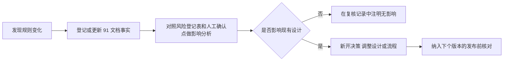

# 07 阶段七：风险与合规评估

> - 状态：已确认（2026-10-09）。Q-30 至 Q-32 的结论见第 8 节和 D-028
> - 最后更新：2026-10-09
> - 依赖：[01](01-定位与可行性.md) 至 [06](06-数据与技术架构.md) 各阶段文档、[90-决策与变更记录](90-决策与变更记录.md)、[91-事实核验台账](91-事实核验台账.md)

---

## 1. 本阶段要回答的问题

1. 项目有哪些风险？每项有多大可能发生、发生了有多严重？
2. 每项风险怎么应对？应对后还剩多少风险？
3. 每篇内容发布前、系统上线前、每个版本发布前分别要核对什么？
4. 真出了问题（账号被处罚、密钥泄露、数据丢失）怎么处理？

本阶段的出口条件（00 文档）：**没有未处理的高风险项**。

---

## 2. 本阶段补充调研结论

调研日期 2026-10-09，详细来源见 91 文档。

| 主题 | 结论 | 事实编号 |
| --- | --- | --- |
| 微信规则 | 3.27 之后没有新的公众号运营规范公告；9–10 月微信的 AI 治理针对视频号"AI 魔改"视频，与本项目无关 | F-004、复核记录 |
| 小红书规则 | 新增两份公告：AI 虚拟人账号必须标识（2026-08）；AI 虚假内容治理（2026-09），重点打击虚构经历、AI 伪造实景、批量同质化，并检测同一图片跨账号重复使用 | F-108、F-109 |
| 数据跨境 | 向香港提供数据属于向境外提供；不含个人信息的数据，以及当年不满 10 万人的非敏感个人信息，免予申报。另外，自然人处理个人或家庭事务不适用《个人信息保护法》。自用场景不构成需要申报的数据出境 | F-204 |
| 模型数据条款 | 阿里云百炼（按量付费 API）、火山方舟明确不用 API 数据训练；DeepSeek 条款允许去标识化后用于训练，且没有 API 退出开关；Kimi 官方说法互相矛盾 | F-205 至 F-207、V-013 |

**对既有设计的影响：**

1. 模型盲测的候选范围收窄：DeepSeek 和 Kimi 在取得书面"不训练"确认之前，不进入候选（见 Q-31）。
2. F-109 支持 D-023 的"禁止同平台派生"，并且提示素材库要强调"真实来源"，产品不能引导用户编造经历。
3. F-108 对 V2 的漫画 AI 角色有潜在影响，登记为 V-014，在 V2 设计时复核。

---

## 3. 评估方法

| 等级 | 可能性 | 影响 |
| --- | --- | --- |
| 高 | 一年内大概率发生，或已有同类案例 | 账号被封禁或长期限流、数据永久丢失、凭证被滥用、违法 |
| 中 | 可能发生 | 单篇内容被限流或删除、功能中断一天以上、需要返工 |
| 低 | 不太可能发生 | 体验变差、短时中断 |

风险等级 = 可能性和影响的组合：

| 可能性 / 影响 | 低 | 中 | 高 |
| --- | --- | --- | --- |
| **高** | 中 | 高 | 高 |
| **中** | 低 | 中 | 高 |
| **低** | 低 | 低 | 中 |

每项风险记录**固有等级**（不采取措施时）和**残余等级**（措施落实后）。残余等级仍为"高"的项必须由用户明确接受或重新决策。

---

## 4. 风险登记表

编号规则：R-类别-序号。类别：PL 平台规则、LG 法律合规、SC 安全、VD 供应商、TC 技术、CQ 内容质量、OP 运维。

### 4.1 平台规则（PL）

| 编号 | 风险 | 可能性 | 影响 | 固有 | 对策 | 残余 |
| --- | --- | --- | --- | --- | --- | --- |
| R-PL-01 | 公众号被判定为"非真人自动化创作"（3.27），判定边界不公开（V-004） | 中 | 高 | 高 | 人工确认点 H-01 至 H-08 不可关闭；观点先行、分段起稿；每日推送上限 3 次；不提供批量或定时推送；鼓励引用真实素材 | 中 |
| R-PL-02 | 小红书判定为 AI 托管或 AI 低质、同质化内容（F-103、F-104、F-109） | 中 | 高 | 高 | 系统不登录、不操作任何小红书账号（V4 起只低频读取公开页面，D-047），发布完全由人完成；改写按账号风格进行；同质化提示（P1）；禁止同平台派生；发布包提醒勾选 AI 声明 | 中 |
| R-PL-03 | 小红书"AI 虚假内容"：用户在 AI 帮助下写出未亲历的体验（F-109） | 中 | 高 | 高 | 素材库要求填写来源；AI 系统规则禁止虚构第一人称经历和体验；事实核查标注涉及"亲身经历"的句子；生成的体验类内容必须基于用户提供的素材 | 中 |
| R-PL-04 | 平台规则继续收紧，现有设计变得不合规 | 高 | 中 | 高 | 事实台账定期复核（第 7 节）；平台接入做成适配层；新规则发布后按第 7.3 节做影响分析 | 中 |
| R-PL-05 | 人工确认点在后续迭代中被逐步削弱（"越用越像全自动"） | 中 | 高 | 高 | H-01 至 H-08 写入 04 文档，取消任何一项都必须新开决策；每个版本发布前核对（第 5.3 节）；自动化测试覆盖"不存在批量推送和一键成文入口" | 低 |
| R-PL-06 | 微信回收个人号的草稿接口权限（类似 2025 年回收发布接口，F-001） | 低 | 高 | 中 | 保留"复制 HTML 粘贴进后台"的兜底路径（FR-M6-04）；规则复核时关注接口公告 | 低 |
| R-PL-07 | 将来漫画账号的 AI 角色被认定为"AI 虚拟人"账号却未标识（F-108、V-014） | 低 | 中 | 低 | MVP 不出图；V2 设计时复核 | 低 |

### 4.2 法律合规（LG）

| 编号 | 风险 | 可能性 | 影响 | 固有 | 对策 | 残余 |
| --- | --- | --- | --- | --- | --- | --- |
| R-LG-01 | 发布 AI 生成内容未按要求声明（F-202） | 中 | 中 | 中 | 发布前检查必须确认 AI 声明项；发布包和推送成功页再次提醒 | 低 |
| R-LG-02 | 将来对外开放服务，但没有完成生成式 AI 登记、ICP 备案、境内部署（F-201、D-025） | 低 | 高 | 中 | 写入 D-025 的重新评估条件：对外提供服务前必须改为境内部署并完成登记和备案；在此之前不开放注册 | 低 |
| R-LG-03 | 数据跨境不合规（F-204） | 低 | 中 | 低 | 自用场景只存本人创作内容；不导入他人的个人信息（如读者名单）；对外服务前重新评估 | 低 |
| R-LG-04 | 宣传或界面用语被认定为推广"自动化创作服务"（F-004 3.27.3） | 低 | 中 | 低 | NFR-10 禁用词；每个版本发布前检查文案 | 低 |
| R-LG-05 | AI 生成内容侵犯他人著作权或肖像权（F-104） | 低 | 中 | 低 | 系统规则禁止模仿他人可识别的作品和肖像；配图只给提示词，由用户在外部工具出图（MVP） | 低 |
| R-LG-06 | 引用的开源组件许可证不合规（06 文档第 3 节） | 低 | 低 | 低 | 自用不分发，MPL 和 LGPL 义务基本不触发；上线前复核依赖许可证清单 | 低 |

### 4.3 安全（SC）

| 编号 | 风险 | 可能性 | 影响 | 固有 | 对策 | 残余 |
| --- | --- | --- | --- | --- | --- | --- |
| R-SC-01 | **只用密码登录，密码被撞库、泄露或钓鱼后系统被接管**（D-027） | 中 | 高 | 高 | 密码至少 12 位且不与其他网站重复；失败 5 次锁定 15 分钟；登录记录和最近登录 IP 展示；修改凭证需再次输入密码；会话 7 天过期 | **中**（用户已明确接受，D-028） |
| R-SC-02 | 公众号 AppSecret 泄露，他人可以操作公众号 | 低 | 高 | 中 | AES-256-GCM 加密存储，主密钥不进数据库和备份；日志脱敏；IP 白名单使泄露的密钥只能从本服务器使用；泄露应对见第 6.3 节 | 低 |
| R-SC-03 | 服务器被入侵 | 低 | 高 | 中 | 只开放 80、443、SSH；SSH 只允许密钥登录；数据库不对外；系统和依赖定期更新；govulncheck、npm audit | 低 |
| R-SC-04 | 备份文件泄露 | 低 | 中 | 低 | 备份加密后上传；主密钥不随备份；对象存储使用私有桶 | 低 |
| R-SC-05 | 主密钥丢失，加密的凭证无法解密 | 低 | 中 | 低 | 主密钥离线保存两份（如密码管理器加纸质）；丢失时的影响仅为重新录入公众号凭证和模型密钥 | 低 |
| R-SC-06 | 模型 API 密钥泄露被盗刷 | 低 | 中 | 低 | 加密存储；在供应商控制台设置消费上限或预充值额度；AI 用量页可随时查看（用户已选择系统内默认不设上限，D-027） | 低 |
| R-SC-07 | 跨站攻击（XSS、CSRF） | 低 | 中 | 低 | 修改类接口校验 CSRF 令牌；Cookie 设为 HttpOnly 和 SameSite；编辑器内容渲染前过滤 | 低 |

### 4.4 供应商（VD）

| 编号 | 风险 | 可能性 | 影响 | 固有 | 对策 | 残余 |
| --- | --- | --- | --- | --- | --- | --- |
| R-VD-01 | 模型供应商用 API 数据训练模型，导致创作内容和素材外泄（F-207、V-013） | 中 | 中 | 中 | 准入条件：只选条款明确"不用于训练"的供应商（Q-31）；百炼必须用按量付费 API；火山方舟不签数据授权协议 | 低 |
| R-VD-02 | 模型下线、涨价或质量下降 | 中 | 中 | 中 | 模型适配层可切换（D-011）；盲测选出主力和备用各一个 | 低 |
| R-VD-03 | 模型服务临时不可用 | 中 | 低 | 低 | 生成失败不覆盖已有内容（E-09）；可在设置中切换到备用模型 | 低 |
| R-VD-04 | 香港服务器到境内 API 的网络延迟或不稳定（T-05） | 中 | 低 | 低 | 盲测时在服务器上实测；流式输出降低等待感 | 低 |
| R-VD-05 | 云服务器厂商故障或停服 | 低 | 中 | 低 | 每日异地备份；部署全部容器化，可在新服务器上恢复；更换服务器后需更新公众号 IP 白名单 | 低 |

### 4.5 技术（TC）

| 编号 | 风险 | 可能性 | 影响 | 固有 | 对策 | 残余 |
| --- | --- | --- | --- | --- | --- | --- |
| R-TC-01 | 公众号后台不保留部分内联 CSS，排版和预览不一致（T-01、T-03、V-010） | 高 | 低 | 中 | 开发第一个任务做真实号实验（D-024）；主题只用基础样式；实验后校准 | 低 |
| R-TC-02 | Tiptap Markdown 扩展尚在早期，往返转换有问题（T-02） | 中 | 中 | 中 | 开发初期做往返测试；编辑器只开放测试通过的语法 | 低 |
| R-TC-03 | 模型 OpenAI 兼容程度差异（T-04） | 中 | 低 | 低 | 适配层预留按供应商的参数映射 | 低 |
| R-TC-04 | heic 解码依赖问题（T-06） | 低 | 低 | 低 | 降级为提示用户先转 jpg | 低 |
| R-TC-05 | 编辑内容丢失（网络中断、并发编辑） | 中 | 中 | 中 | 自动保存、本地暂存、版本冲突检测（06 文档第 5.6 节） | 低 |

### 4.6 内容质量（CQ）

| 编号 | 风险 | 可能性 | 影响 | 固有 | 对策 | 残余 |
| --- | --- | --- | --- | --- | --- | --- |
| R-CQ-01 | AI 编造数据、引用或事实（F-005） | 高 | 中 | 高 | 系统规则要求不编造、不确定处标出；发布前检查的事实核查项必须逐条确认；数据类素材要求填写来源 | 中（AI 标注不可能百分百发现，最终由人负责） |
| R-CQ-02 | 内容同质化、"AI 味"重导致限流（F-104、F-109） | 高 | 中 | 高 | 账号记忆（风格样本、素材、观点先行）；分段起稿和逐段改写；同质化提示（P1）；人工修改比例自查（P1） | 中 |
| R-CQ-03 | 敏感词库误报或漏报 | 中 | 中 | 中 | 所有命中只做提示，由人决定；以用户自定义词库为主；云厂商内容安全接口作为 V2 选项 | 中（无权威词库，漏报无法完全避免） |

### 4.7 运维（OP）

| 编号 | 风险 | 可能性 | 影响 | 固有 | 对策 | 残余 |
| --- | --- | --- | --- | --- | --- | --- |
| R-OP-01 | 数据丢失（磁盘损坏、误操作） | 低 | 高 | 中 | 每日加密异地备份，保留 7 份日备份和 4 份周备份；上线前做恢复演练；迁移前自动备份；删除先进回收站保留 30 天，平台账号只能停用（D-033） | 低 |
| R-OP-02 | HTTPS 证书过期 | 低 | 中 | 低 | Caddy 自动续期；外部监控探测 | 低 |
| R-OP-03 | 磁盘写满 | 低 | 中 | 低 | 超过 80% 在工作台提示；发布包 zip 不长期保存 | 低 |
| R-OP-04 | 依赖漏洞 | 中 | 低 | 低 | 每个版本发布前运行 govulncheck 和 npm audit | 低 |
| R-OP-05 | 更换服务器或 IP 后公众号推送全部失败 | 低 | 中 | 低 | 设置页显示当前出口 IP；连通性检测给出 40164 的明确提示 | 低 |

### 4.8 汇总

| 类别 | 固有高 | 残余高 | 残余中 |
| --- | --- | --- | --- |
| 平台规则 | 5 | 0 | 4 |
| 法律合规 | 0 | 0 | 0 |
| 安全 | 1 | 0 | 1 |
| 供应商 | 0 | 0 | 0 |
| 技术 | 0 | 0 | 0 |
| 内容质量 | 2 | 0 | 3 |
| 运维 | 0 | 0 | 0 |
| **合计** | **8** | **0** | **8** |

### 4.9 V4 新增：账号运营与受控采集（D-047）

详细对策见 [11 文档](11-账号运营与热点采集规划.md) 第 2.3、3.2、3.5、12 节。

| 编号 | 风险 | 可能性 | 影响 | 固有 | 对策 | 残余 |
| --- | --- | --- | --- | --- | --- | --- |
| R-LG-10 | 采集公开热榜被认定为不正当竞争或违反网站协议 | 中 | 中 | 中 | 默认关闭；三层开关；只采榜单元数据；遵守 robots；低频与每日上限；熔断；不对外提供；来源逐个核验（V-016） | 低–中（**用户已接受，2026-10-10**） |
| R-LG-11 | 读取小红书、公众号页面被认定为违反平台协议或不正当竞争 | 中 | 中 | 中 | 敏感平台独立限额、夜间不请求、风控即停且二次触发自动关闭；只读免登录公开单篇页；不读评论和个人信息；正文 7 天删除；不对外提供 | **中（用户已接受，2026-10-10）** |
| R-LG-12 | 采集手段越界成"绕过技术保护措施"（刑法第 285 条） | 低 | 高 | 中 | 禁止逆向签名、破解验证码、登录态与账号池、代理与指纹轮换、自动化浏览器、App 私有接口；HC-24 静态扫描 | 低 |
| R-PL-08 | "每日推荐"被理解为"全自动运营" | 低 | 中 | 低 | 只出候选卡片，逐条采用；观点人写；文案不用"自动运营" | 低 |
| R-PL-09 | 服务器 IP 被小红书风控 | 低 | 低 | 低 | 系统对小红书没有其他请求；运营账号从不在服务器登录 | 低 |
| R-OP-10 | 服务器 IP 被热榜目标站封禁 | 中 | 低 | 低 | 低频、熔断、不轮换 IP；关注采集日志 | 低 |
| R-TC-10 | 目标站改版导致适配器失效 | 高 | 低 | 中 | 单来源隔离、熔断与通知、mock 解析测试、粘贴与联网搜索兜底 | 低 |
| R-CQ-10 | 推荐引导"蹭热点"导致违规 | 中 | 中 | 中 | 风险标签；高风险不进推荐；起号期降低热点权重；引用热点必须带链接、不补细节 | 低 |
| R-CQ-11 | 同工作区多账号追同一热点导致同质化 | 中 | 中 | 中 | 赛道雷达提示；同工作区已采用热点降权 | 低 |
| R-CQ-12 | 对标内容被 AI 化用成"洗稿" | 中 | 高 | 高 | 正文不进入创作上下文，只用提炼出的方法；提炼校验原文重合；同质化检查对比参考文本 | 低 |
| R-VD-10 | 每日生成的模型费用随账号数增长 | 低 | 低 | 低 | 经济档模型、默认打开时生成、跳过不活跃账号、用量上限 | 低 |

V4 新增固有高风险 1 项（R-CQ-12），措施落实后为低；残余中风险 1 项（R-LG-11），用户已明确接受。

固有高风险 8 项，措施落实后没有残余高风险，满足阶段 7 的出口条件。8 项残余中风险中，R-PL-01 至 R-PL-04 来自平台规则本身的不确定性，R-CQ-01 至 R-CQ-03 来自 AI 的固有局限，只能降低、不能消除；R-SC-01 可以通过启用二次验证降为低（Q-30）。

### 4.10 D-117 新增：系统智能体

详细对策见 [16 文档](16-系统智能体设计.md) 第 2.3、4、5、6、9 节。

| 编号 | 风险 | 可能性 | 影响 | 固有 | 对策 | 残余 |
| --- | --- | --- | --- | --- | --- | --- |
| R-PL-20 | 智能体把人工确认变成“连续点执行”，形成事实上的自动化创作或 AI 托管（3.27、F-103） | 中 | 高 | 高 | 写入一律为卡片，逐张执行，没有“全部执行”和批量接口；一张卡片一个对象；单次最多 5 张；同一作品同时最多 1 张正文类卡片，不能“每段一张起草卡片”；H-01 至 H-09 门槛在卡片上逐项完成；不提供发表、群发、定时工具；连续自动续跑 10 次后须用户发消息；HC-26、HC-27 | 中（逐张点击仍可能流于形式，依赖用户自律；与 R-PL-01 同源） |
| R-CQ-20 | 智能体代写核心观点或把自拟文字写入正文，削弱源头真实性（H-02、D-014） | 中 | 高 | 高 | 内容来源约束：U 类字段只能来自用户原文，G/O 类字段只能来自用户原文或生成工具结果；校验失败时 U 字段清空须用户亲自填写；HC-29 | 低 |
| R-SC-20 | 提示注入：工具读到的热点、对标原文、素材、附件中的指令诱导智能体提出有害卡片 | 中 | 中 | 中 | 外部内容放入数据块并声明只作资料（D-081）；智能体不能自行写入，所有写入需用户在卡片上看到“修改前 → 修改后”后执行；读取过外部来源时卡片提示核对；目录不含发表、凭证、会话切换类接口 | 低（mock 不能证明真实模型免疫，16 文档第 13.5 节） |
| R-SC-21 | 密钥、密码、一次性值经对话或工具结果泄露给模型供应商或写入记录 | 低 | 高 | 中 | 需要密钥或再次输入密码的操作只给链接；`ReauthOK` 恒为 false；键名与值双重脱敏；一次性值只在执行 SSE 中返回一次且不落库；疑似密钥的消息拒绝保存；服务端日志不记参数；HC-30 | 低 |
| R-SC-22 | 越权：智能体绕过角色或工作区隔离，或成员看到他人对话 | 低 | 高 | 中 | 分发器经完整中间件链调用既有路由，身份按会话加载、不切换工作区；只允许目录内条目；观察者只有只读工具；代访问时不可用；对话按用户私有、他人访问 404；HC-28、HC-31 | 低 |
| R-SC-23 | 既有缺陷：`GET /audit-logs` 未按工作区隔离，工作区操作日志可见其他工作区的记录（D-036） | 高 | 中 | 高 | DEV-AG12 已为 `audit_log` 增加 `workspace_id`，安全回填历史记录并按工作区过滤；无法归属的历史记录仅超管可见，HC-28 中加入只读 `audit__list` | 低（修复后） |
| R-TC-20 | 卡片提出后对象被修改，执行时覆盖他人或本人的新改动 | 中 | 中 | 中 | 整体替换类接口开启预览哈希比对，不一致即 `stale` 失败；段落、大纲沿用接口自身的修订号校验；推送沿用 `revision` 与检查状态校验 | 低 |
| R-TC-21 | 真实模型的工具调用不稳定（参数错误、编造工具名、并行调用格式不兼容） | 中 | 低 | 低 | 只允许通过工具调用自检的模型；参数按 JSON Schema 校验；连续 3 次无效调用即停止运行；备用模型也须通过自检 | 低 |
| R-VD-20 | 智能体每轮携带工具定义与上下文，模型费用明显增加 | 中 | 低 | 低 | 每次运行最多 12 轮、3 次生成、300 秒；按需加载领域（单次最多 3 个）；上下文预算与摘要压缩；计入用量与每日上限；用量页单独统计 | 低 |

D-117 新增固有高风险 3 项（R-PL-20、R-CQ-20、R-SC-23）：R-CQ-20 措施落实后为低；R-SC-23 已由 DEV-AG12 修复，残余为低；R-PL-20 残余为中，与 R-PL-01 同源，需要用户在 D-117 确认时一并接受。

---

## 5. 合规清单

### 5.1 每篇内容发布前

| 检查项 | 系统覆盖 | 需要你自己做 |
| --- | --- | --- |
| 观点和素材是自己的、真实的 | 观点先行（H-02）；素材来源字段 | 不使用没有亲身经历的体验、没有来源的数据 |
| 事实与数据已核实 | 事实核查标注，逐条确认（M9） | 对标出的句子逐条核实来源 |
| 敏感词与违规风险 | 敏感词提示 | 判断是否修改 |
| AI 声明 | 检查项确认 + 推送成功页和发布包提醒 | 公众号：在文末或后台声明 AI 辅助；小红书：发布时勾选"笔记含 AI 合成内容" |
| 格式合规 | 摘要、HTML 大小、图片格式和数量自动校验 | — |
| 图片来源合法 | 无 | 不使用他人有版权的图片和可识别肖像；AI 生成的图片需在平台标识 |
| 不与其他账号内容雷同 | 同质化提示（P1）；禁止同平台派生 | 不把同一套图片发到多个小红书账号（F-109） |
| 发布动作由本人完成 | 系统没有发布入口 | 在公众号后台预览后点击发表，在小红书 App 中发布 |

### 5.2 系统上线前

| 类别 | 检查项 |
| --- | --- |
| 服务器 | 系统更新到最新；只开放 80、443、SSH；SSH 禁用密码登录；数据库端口不对外 |
| HTTPS | 证书有效；HSTS 生效；HTTP 自动跳转 HTTPS |
| 密钥 | 主密钥离线保存两份；`.env` 权限仅 root 可读、不在代码仓库；模型供应商控制台设置消费上限 |
| 公众号 | 服务器出口 IP 已加入白名单；连通性检测通过；D-024 的真实号实验已完成且结果写入 91 文档 |
| 模型 | 所选供应商满足"不用于训练"准入条件（Q-31）；百炼使用按量付费 API；火山方舟未签数据授权协议 |
| 备份 | 每日备份任务运行；完成一次完整恢复演练并记录耗时 |
| 登录 | 登录密码至少 12 位且不与其他网站重复；登录锁定生效 |
| 许可证 | 生成依赖许可证清单，确认无 GPL 依赖被修改后分发 |
| 依赖漏洞 | govulncheck、npm audit 无高危漏洞 |
| 人工确认点 | H-01 至 H-08 全部按 05 文档第 9 节实现，且不存在批量推送、一键成文、自动发布入口；启用智能体时，卡片按 05 文档第 9 节“智能体卡片中的落点”实现，不存在“全部执行”（D-117） |
| 文案 | 界面和文档中没有 NFR-10 禁用词 |
| 事实复核 | 91 文档中所有"已验证"事实复核一遍（00 文档要求阶段 8 开工前复核） |

### 5.3 每个版本发布前

1. 复核 91 文档中与本版本相关的"已验证"事实；距离上次全面复核超过 3 个月的，全部复核。
2. 核对 H-01 至 H-08：本版本是否新增了绕过人工确认的入口？是否有功能让多篇内容一次性推送？
3. 检查新增界面文案是否含 NFR-10 禁用词。
4. 运行 govulncheck、npm audit。
5. 新增的 AI 任务类型：系统规则是否包含"不编造""不虚构亲身经历"约束。
6. 数据库迁移前自动备份已生效。
7. 如果本版本涉及对外提供服务、多成员、处理他人个人信息，必须先重新评估 R-LG-02、R-LG-03。
8. 智能体（D-117）：工具目录是否新增了发表、群发、定时、批量类工具，或绕过卡片直接写入的路径？是否出现“全部执行”？新增业务接口是否已在 16 文档附录 A 或附录 B 归类（HC-28）？HC-26 至 HC-31 全部通过。

---

## 6. 事件应对预案

### 6.1 公众号文章被限流、删除，或账号能力受限

1. 在公众号后台查看通知，记录处罚原因、涉及文章和时间。
2. 在系统中暂停该账号的推送（停用账号或把每日上限调为 0），避免继续触发。
3. 对照涉及文章的检查记录、推送记录和人工修改比例，判断原因：内容问题（事实、敏感词）还是"自动化创作"判定。
4. 如果认为是误判，通过公众号后台申诉，说明创作过程（可以引用系统中的版本历史作为人工创作的证据）。
5. 把原因和结论写入 90 文档；如果暴露出流程缺陷，调整人工确认点或推送节奏，并新开决策。

### 6.2 小红书笔记被限流、警告，或被打上 AI 标识

1. 记录通知内容和涉及笔记。
2. 如果是被打上 AI 标识：属于平台的正常处理（F-104）。检查是否漏勾了 AI 声明，之后坚持主动声明。
3. 如果是"AI 低质 / 同质化 / 虚假内容"：检查该笔记是否基于真实素材、是否和其他账号内容雷同。
4. 认为误判时，通过 App 内的申诉通道申诉。
5. 写入 90 文档，必要时调整改写策略或同质化阈值。

### 6.3 AppSecret 泄露或怀疑泄露

1. 立即在公众号后台"设置与开发 → 基本配置"重置 AppSecret（旧密钥立即失效）。
2. 在系统中录入新的 AppSecret，并做连通性检测。
3. 检查公众号后台的草稿箱和已发表内容是否有异常。
4. 查看操作日志和服务器登录记录，判断泄露途径；如果怀疑服务器被入侵，按 6.4 处理。

### 6.4 系统被入侵或怀疑被入侵

1. 立即修改登录密码（所有会话失效），并重置公众号 AppSecret 和模型 API 密钥。
2. 检查操作日志中的异常登录 IP 和敏感操作。
3. 如果服务器本身被入侵：停机，用干净的新服务器从备份恢复，轮换主密钥后重新录入所有凭证，更新公众号 IP 白名单。
4. 写入 90 文档，补充对策（如启用二次验证）。

### 6.5 数据丢失或服务器故障

1. 新开一台服务器，按部署文档启动容器。
2. 从对象存储下载最近一次备份，恢复数据库和图片目录。
3. 用离线保存的主密钥配置 `.env`。
4. 新服务器 IP 加入公众号白名单，做连通性检测。
5. 记录恢复耗时，与上线前的恢复演练对比。

### 6.6 模型服务不可用或质量明显下降

1. 在设置中把相关任务类型切换到备用模型。
2. 关注供应商公告；长期问题时重新运行盲测样本，评估是否更换主力模型，并新开决策。

---

## 7. 事实台账复核机制

### 7.1 复核频率

| 类型 | 频率 |
| --- | --- |
| 平台规则（F-004、F-005、F-103、F-104、F-108、F-109） | 每月一次；平台发布新公告时立即复核 |
| 平台接口能力（F-001 至 F-012、F-101、F-102） | 每个版本发布前；接口调用出现新错误码时立即复核 |
| 法规（F-201 至 F-204） | 每季度一次；有新法规发布时立即复核 |
| 供应商条款（F-205 至 F-207） | 每季度一次；更换模型前必须复核 |

### 7.2 触发信号

- 公众号后台或"微信公众平台"发布运营规范更新通知；
- 小红书 @薯管家 或安全中心规则百科发布新公告；
- 推送时出现新的错误码，或连续失败；
- 网信办发布与生成式 AI、内容标识、数据跨境相关的新规定；
- 模型供应商更新服务协议或隐私政策。

### 7.3 规则变化后的影响分析流程

---

## 8. 待决问题

| 编号 | 问题 | 我的建议 | 影响 |
| --- | --- | --- | --- |
| Q-30 | 看完安全评估后，是否重新考虑二次验证？ | 重新启用：新设备登录时要求 TOTP。只用密码是本项目唯一一项可以低成本从"中"降为"低"的残余风险（R-SC-01）；数据库字段已预留，开发量约半天 | R-SC-01 的残余等级；D-027 |
| Q-31 | 模型供应商的准入条件：条款没有明确"API 数据不用于训练"的，是否直接排除？ | 排除。盲测候选为阿里云百炼（按量付费 API）和火山方舟；DeepSeek 和 Kimi 在取得书面确认后再加入。也可以通过百炼或火山方舟平台上托管的第三方模型（如果平台提供）间接使用 DeepSeek 等模型，此时适用平台的数据条款，接入时核实 | 盲测候选范围；R-VD-01 |
| Q-32 | 是否接受第 4.8 节的风险评估结论（无残余高风险，8 项残余中风险）？ | 接受。残余中风险主要来自平台规则的不确定性和 AI 的固有局限，只能靠持续执行合规清单来控制 | 进入阶段 8 |

**确认结果（2026-10-09）：**

- Q-30：维持不启用二次验证（D-027）。用户明确接受 R-SC-01 的残余中风险；第 5.2 节"登录密码至少 12 位且不与其他网站重复"作为上线前必查项。如果日志中出现异常登录，按第 6.4 节处理，并重新评估二次验证。
- Q-31：采纳建议。模型准入条件为"条款明确 API 数据不用于训练"；盲测候选为阿里云百炼（按量付费 API）和火山方舟；DeepSeek、Kimi 取得书面确认后再加入。
- Q-32：接受风险评估结论，进入阶段 8。

---

## 9. 下一阶段预告：阶段 8 开发与测试计划

产出 `08-开发与测试计划.md`：

1. 里程碑划分：开发前置任务（真实号实验 D-024、模型盲测 D-027、Tiptap 往返测试）、MVP 各迭代、上线。
2. 任务拆分：按模块拆到可以一次开发完成的粒度，标明依赖关系。
3. 测试策略：单元测试、接口测试、端到端测试，以及人工确认点的自动化回归测试。
4. 上线检查表（引用本文档第 5.2 节）。
5. 开发方式：AI 辅助编码时的代码审查和提交规范。
