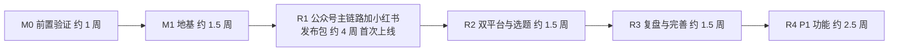

# 08 阶段八：开发与测试计划

> - 状态：已确认（2026-10-09）。Q-35 至 Q-37 的结论见第 10 节和 D-031。设计补充（D-033）新增 DEV-124、DEV-309、E2E-10、E2E-11 和第 9.1 节
> - 最后更新：2026-10-09（本地 R1–R3 实现完成，见下方「本地进度」与 D-034）
> - 依赖：[04-需求与功能分级](04-需求与功能分级.md)（FR、H、NFR）、[05-业务流程与交互](05-业务流程与交互.md)（P、E）、[06-数据与技术架构](06-数据与技术架构.md)、[07-风险与合规评估](07-风险与合规评估.md)（R、合规清单）

---

## 1. 本阶段要回答的问题

1. 先做什么、后做什么？每一批交付什么？
2. 每个开发任务做到什么程度算完成？
3. 怎么测试，尤其是怎么保证人工确认点不会被改坏？
4. 上线前要检查什么？
5. 用 AI 工具开发时，怎么保证代码质量？

已确认的前置决策：

- **D-029（Q-33）**：由用户本人使用 Cursor 等 AI 编码工具开发，投入接近全职（每周 30 小时以上）。
- **D-030（Q-34）**：MVP 分批交付。先做通"账号记忆 + 创作 + 检查 + 公众号草稿"这条最短主链路并部署上线，边用边加功能。

---

## 2. 版本路线



| 里程碑 | 目标 | 完成后你能做什么 |
| --- | --- | --- |
| M0 前置验证 | 消除三项推迟的不确定性（D-024、D-027、T-02），准备服务器 | 知道公众号保留哪些样式、用哪个模型、编辑器能否可靠地存取 Markdown |
| M1 地基 | 项目骨架、登录、账号与凭证、部署流水线 | 在服务器上登录系统，配置公众号并通过连通性检测 |
| R1 公众号主链路 + 小红书发布包 | 账号记忆、分段创作、排版、发布前检查、写入公众号草稿、小红书发布包、回填 | **开始真正用它写公众号和小红书**（两个平台各自单独创作） |
| R2 双平台与选题 | 一稿双平台（派生与对照改写）、选题池、完整工作台 | 一篇内容改写后同时发两个平台 |
| R3 复盘与完善 | 数据录入与 AI 复盘、版本历史、用量页、备份加固 | 形成"选题、创作、发布、复盘"闭环，P0 全部完成 |
| R4 P1 功能 | 漫画文字工作流、配图建议与裁剪、同质化提示等 21 项 P1 | 完整 MVP |

**工期说明**：以上是按每周 30 小时、AI 辅助开发估算的参考值，合计约 12 周（R1 加入小红书发布包后多约 1 周，R2 相应减少约 0.5 周，Q-35）。每个里程碑结束时按实际进度重新估算，不承诺固定日期。工期偏差的主要来源是 M0 的验证结果（例如公众号样式保留得很少，需要重新设计主题）。

---

## 3. 代码仓库结构

单仓库（monorepo），前后端和文档放在一起，方便 AI 编码工具同时读取需求文档和代码。

```text
OPS/
  docs/                 需求与设计文档（本文档集）
  server/               Go 后端
    cmd/app/            程序入口
    internal/           按模块划分：auth、account、memory、topic、work、asset、
                        check、publish、review、ai、audit、jobs（06 文档第 2.3 节）
    migrations/         goose 数据库迁移脚本
    queries/            sqlc 的 SQL 文件
  web/                  React 前端
    src/pages/          页面（对应 05 文档 P-01 至 P-23）
    src/features/       按模块划分的组件和逻辑
    src/render/         公众号 HTML 渲染模块与主题
  deploy/               Docker Compose、Caddy 配置、备份脚本
  spikes/               M0 验证脚本（不属于产品代码，D-012）
  AGENTS.md             AI 编码工具的项目规则（第 8 节）
```

---

## 4. 任务拆分

编号规则：`SP-` 为前置验证，`DEV-` 为开发任务。每个任务的粒度控制在 0.5–2 天，可以在一到几次 AI 编码会话中完成，并且有独立的验收标准。"对应"列引用 04 文档的功能编号。

### 4.1 M0 前置验证

| 编号 | 任务 | 产出 | 依赖 |
| --- | --- | --- | --- |
| SP-01 | 购买香港轻量服务器和域名，基础加固（07 文档第 5.2 节服务器部分），记录公网 IP | 可 SSH 登录的服务器；IP 加入公众号白名单 | 无 |
| SP-02 | 真实公众号实验（D-024）：在服务器上运行一次性脚本，测试 `token`、`uploadimg`、`add_material`、`draft/add`（含作者、评论开关、阅读原文链接、`cover_info` 裁剪坐标）、`draft/get`、`draft/update`、`draft/batchget`、`draft/delete`；验证 V-015（image 类型素材能否作封面、同一草稿两次读取是否一致）；用一份包含标题、段落、引用、列表、加粗、颜色、背景色、边框、图片的测试 HTML 写入草稿，在后台和手机上对比效果；验证完删除测试草稿 | 91 文档更新 V-010、V-015；样式保留清单（哪些 CSS 属性被保留）；真实接口返回样例（用于第 6.3 节的模拟服务器） | SP-01 |
| SP-03 | Tiptap Markdown 往返测试（T-02）：加粗、斜体、链接、有序和无序列表、引用、图片、小标题，测试"Markdown → 编辑器 → Markdown"是否一致 | 编辑器可开放的语法清单 | 无 |
| SP-04 | 模型盲测（D-027、D-028）：用最小脚本调用阿里云百炼（按量付费 API）和火山方舟的候选模型；用你的 10–20 个真实选题跑三类任务（分段起稿、公众号改小红书、事实核查标注）；输出打乱后由你评分；在香港服务器上实测首字延迟（T-05） | 主力模型和经济模型的选型决策（写入 90 文档）；每千 token 实际单价 | SP-01 |

M0 的出口条件：SP-02 至 SP-04 的结论都写入文档。如果 SP-02 发现样式保留很少，先调整 06 文档的主题方案再进入 R1 的排版任务。

### 4.2 M1 地基

| 编号 | 任务 | 对应 | 依赖 |
| --- | --- | --- | --- |
| DEV-001 | 仓库骨架：Go 模块、React + Vite + Tailwind + shadcn/ui、目录结构、`AGENTS.md`、`.gitignore`（排除 `.env`） | — | — |
| DEV-002 | 本地开发环境：Docker Compose 启动 PostgreSQL；goose 迁移；sqlc 生成；前端开发代理 | — | DEV-001 |
| DEV-003 | 持续集成（GitHub Actions，私有仓库）：代码检查（golangci-lint、ESLint）、单元测试、govulncheck、npm audit、构建镜像 | NFR、R-OP-04 | DEV-001 |
| DEV-004 | 加密工具：AES-256-GCM 加解密、主密钥从环境变量读取、`key_version` | NFR-01 | DEV-002 |
| DEV-005 | 数据库基础表：workspace、member、session、platform_account、wechat_credential、wechat_token、audit_log、app_setting | 06 文档第 4.2 节 | DEV-002 |
| DEV-006 | 登录与会话：密码规则（至少 12 位）、argon2id、失败锁定、7 天会话、CSRF、登录记录；首次启动设置密码；`ops reset-password` 命令行重置（06 文档第 5.9 节） | FR-M1-01、FR-M1-08、D-027 | DEV-004、DEV-005 |
| DEV-007 | 操作日志模块（只追加） | FR-M12-03 | DEV-005 |
| DEV-008 | 平台账号管理与账号切换（后端接口 + P-16 页面 + 顶部账号切换器） | FR-M1-02、05 | DEV-006 |
| DEV-009 | 公众号凭证配置与连通性检测：加密保存、脱敏显示、修改需再次输入密码、显示服务器出口 IP、40164 的明确提示 | FR-M1-03、04 | DEV-004、DEV-008 |
| DEV-010 | 前端框架：路由、布局（顶部栏 + 左侧导航，D-021）、TanStack Query、登录页、首次使用引导骨架（P-02） | 05 文档第 3 节 | DEV-006 |
| DEV-011 | 部署流水线：生产镜像（含 libvips）、Caddy、`.env` 模板、一键更新脚本、迁移前自动备份 | 06 文档第 7 节 | DEV-003、SP-01 |

M1 的出口条件：在服务器上通过 HTTPS 登录，配置公众号并通过连通性检测。

### 4.3 R1 公众号主链路 + 小红书发布包（首次上线）

| 编号 | 任务 | 对应 | 依赖 |
| --- | --- | --- | --- |
| DEV-101 | 账号定位档案：表结构、接口、P-15"定位"标签页；首次引导的必填项（D-023） | FR-M2-01 | DEV-008 |
| DEV-102 | 风格样本：增删查、字数统计、P-15"风格样本"标签页 | FR-M2-02 | DEV-101 |
| DEV-103 | 素材库：表结构（含来源字段）、账号归属与共享、P-13 页面 | FR-M2-03 | DEV-101 |
| DEV-104 | AI 模型适配层：OpenAI 兼容协议、流式输出、按任务类型路由、`ai_call` 记录；`model_provider`、`model_route` 表与 P-22 模型配置页（密钥加密、测试连通、默认模型） | FR-M12-01、07 | SP-04、DEV-005 |
| DEV-105 | 上下文组装器与提示词模板：按 06 文档第 5.1 节的顺序组装；长度预算与裁剪；按 06 文档第 5.8 节的任务契约实现系统规则（含"【待核实】"占位）、JSON 输出校验与重试；返回"本次参考了什么" | FR-M2-04、R-PL-03 | DEV-104、DEV-102、DEV-103 |
| DEV-106 | SSE 推送通道与前端流式渲染组件 | NFR-08 | DEV-104 |
| DEV-107 | 作品与段落块数据模型：work、work_section、work_version、work_material；作品状态机（05 文档第 4 节）；需要软删除的表从建表起就带 `deleted_at`，查询默认过滤 | 06 文档第 4.2 节 | DEV-005 |
| DEV-108 | 创作编辑器第一部分：核心观点（H-02 不可跳过）、选素材、AI 大纲、确认大纲（H-03） | FR-M4-01、02 | DEV-105、DEV-107 |
| DEV-109 | 创作编辑器第二部分：分段块编辑器（每块一个 Tiptap 实例，只开放 SP-03 通过的语法）；单段起草、重新生成、改写、扩写、缩写；不提供"全部起草" | FR-M4-03、04 | DEV-108、SP-03 |
| DEV-110 | 自动保存、版本快照、冲突检测、离线暂存 | FR-M4-04、E-12、E-13 | DEV-109 |
| DEV-111 | 标题候选与摘要（公众号标题 32 字、摘要 120 字限制） | FR-M4-05、06 | DEV-109 |
| DEV-112 | 图片上传与处理：asset 表、本地存储、libvips 转换压缩、段落内插图、排序 | FR-M7-01、02 | DEV-107 |
| DEV-124 | 公众号封面：从作品图片选择或单独上传；2.35:1 和 1:1 两个裁剪框，保存相对坐标；两种效果预览；未设封面时阻止推送 | FR-M7-07 | DEV-112 |
| DEV-113 | 公众号渲染模块：Markdown 转 HTML、内联样式、3 套主题（按 SP-02 的样式保留清单编写）、字符数与大小统计；P-09 预览页；复制 HTML | FR-M6-01 至 04 | SP-02、DEV-109 |
| DEV-114 | 发布前检查引擎：check_run、check_item、指纹与部分失效（D-023）；格式校验规则 | FR-M9-04、05 | DEV-107 |
| DEV-115 | 敏感词：Aho-Corasick 匹配、基础词库、自定义词库（P-17）、账号禁用词 | FR-M9-01 | DEV-114 |
| DEV-116 | 事实核查标注（AI）与 AI 声明检查项 | FR-M9-02、03 | DEV-114、DEV-105 |
| DEV-117 | P-10 发布前检查页面：逐项确认、没有"全部确认"、在页内修改后自动重跑 | FR-M9-05、H-04 | DEV-115、DEV-116 |
| DEV-118 | 微信适配层：token 缓存与行锁、`uploadimg`、`add_material`、`draft/add`、`draft/get`、`draft/update`（含文章字段和 `cover_info`）、图片缓存（`wechat_media_cache`）、错误码映射 | FR-M10-01、02 | DEV-009、SP-02 |
| DEV-119 | 推送流程与 P-11 页面：预检、每日上限与二次确认（默认 3 次）、文章字段（账号默认值加逐篇修改）、后台修改检测与"覆盖或另存"选择、步骤进度、失败兜底、成功页的后台待办清单（原创声明、AI 声明）；只能单篇推送 | FR-M10-01、02、07、10、H-05 | DEV-118、DEV-113、DEV-117、DEV-124 |
| DEV-120 | 发布回填：标记已发布、链接与时间；已发布作品只读与"解锁编辑" | FR-M10-05、H-07 | DEV-119 |
| DEV-121 | 作品列表（P-05）与简版工作台（待回填、进行中） | P-03、P-05 | DEV-120 |
| DEV-122 | 后台任务基础：River 接入、token 预刷新、过期会话清理、每日备份到对象存储 | 06 文档第 5.7 节 | DEV-118、DEV-011 |
| DEV-206 | 小红书作品支持：在小红书账号下新建作品时使用图文笔记形态（无摘要、增加话题标签输入、精简编辑器工具栏）；Markdown 转纯文本模块（06 文档第 5.4 节）；小红书检查规则：图片 1–18 张，字数规则按 V-012 结果配置 | FR-M9-04 | DEV-111、DEV-114 |
| DEV-207 | 小红书发布包与 P-12 页面：标题、正文、话题分别复制；图片编号打包下载；手机单列布局；AI 声明提醒；回填入口 | FR-M10-04、05 | DEV-206、DEV-117、DEV-120 |
| DEV-123 | R1 上线：执行第 7 节上线检查表，完成一次恢复演练 | 07 文档第 5.2 节 | 以上全部 |

R1 的范围说明（Q-35）：

- 不包含选题池：作品直接新建（手动填写选题），人工选定选题的原则（H-01）依然成立。
- 包含小红书发布包（DEV-206、DEV-207 从 R2 提前），但不包含派生和对照改写：R1 中公众号作品和小红书作品分别单独创作，一稿双平台在 R2 提供。

### 4.4 R2 双平台与选题

| 编号 | 任务 | 对应 | 依赖 |
| --- | --- | --- | --- |
| DEV-201 | 选题池：表结构、状态流转、P-04 页面、"开始创作" | FR-M3-01、03 | R1 |
| DEV-202 | AI 选题建议：右侧抽屉、逐条入库（H-01） | FR-M3-02 | DEV-201 |
| DEV-203 | 派生：源 / 衍生关系，只允许跨平台（D-023） | FR-M5-01 | R1 |
| DEV-204 | 双向改写任务：公众号改小红书、小红书扩写公众号；按 06 文档第 5.8 节分两步（`rewrite_plan` 得到段落对应关系，`section_rewrite` 逐段生成）；派生前校验平台和形态组合（04 文档第 3.1 节） | FR-M5-02、03 | DEV-203 |
| DEV-205 | P-08 对照改写页面：左右对齐、单段重新改写、话题标签 | FR-M5-04 | DEV-204 |
| DEV-208 | 完整工作台：可发布、待补充、今日概况卡片 | P-03 | R1 |
| DEV-209 | 漫画账号入口分流占位（R2 当时）。**已由 DEV-401 / M8 取代**，漫画账号进入完整漫画编辑器 | E-16 | DEV-201 |

### 4.5 R3 复盘与完善

| 编号 | 任务 | 对应 | 依赖 |
| --- | --- | --- | --- |
| DEV-301 | 数据录入：metric_snapshot、多时间点、按平台显示字段 | FR-M11-01 | R2 |
| DEV-302 | 复盘看板（P-14） | FR-M11-02 | DEV-301 |
| DEV-303 | AI 复盘与采纳到选题池（H-08） | FR-M11-03 | DEV-302、DEV-201 |
| DEV-304 | 复盘提醒后台任务 | 06 文档第 5.7 节 | DEV-301 |
| DEV-305 | 版本历史界面：查看与恢复 | FR-M4-04 | R1 |
| DEV-306 | AI 用量页（P-18）与可选的每日上限（默认关闭，D-027） | FR-M12-02 | R1 |
| DEV-307 | 操作日志页（P-19）与工作台的最近登录信息 | FR-M12-03、D-027 | R1 |
| DEV-308 | 备份加固：保留策略（7 日 + 4 周）、磁盘使用提示、外部可用性监控 | R-OP-01、03 | DEV-122 |
| DEV-309 | 删除与回收站：各对象的删除接口、P-23 回收站页面、恢复与彻底删除、30 天自动清理任务（含图片文件） | FR-M12-08 | DEV-122 |

R1、R2 中的删除操作只做软删除（写 `deleted_at`），没有回收站页面；DEV-309 补齐恢复和清理。

R3 的出口条件：P0 共 50 项全部完成，按 04 文档的验收标准逐项验收。

**本地进度（2026-10-09）**：在开发机（Docker Postgres + Vite + `ops serve` + 微信/LLM mock）上，R1–R3 对应的 P0 页面与接口已实现；HC-01..HC-10 与 `go test ./...` 通过；浏览器主链路（公众号草稿 + 小红书发布包 + 复盘采纳）已跑通。实现差异见 D-034。正式满足 R3「上线出口」还需完成 SP / V 真实核验与部署（用户已有服务器与域名，待 MVP 确认后上线）。

### 4.6 R4 P1 功能

按 04 文档第 9.1 节的砍除顺序倒序排期，最有价值的先做：

| 编号 | 任务 | 对应 |
| --- | --- | --- |
| DEV-401 | 漫画文字工作流：角色设定卡、分镜脚本（确认分镜）、逐格文案、绘图提示词、逐格回传图片（P-07）。**本地已实现（2026-10-10）**；公众号 `newspic` 见 DEV-402 | FR-M8-01 至 04 |
| DEV-402 | 公众号图片消息草稿（`newspic`）：每张图用 `add_material` 上传为永久素材，正文走纯文本转换（06 文档第 5.3 节）。**本地已实现（2026-10-10）** | FR-M10-03 |
| DEV-403 | 配图建议与提示词；平台尺寸裁剪（段落配图建议、3:4 另存）。**本地已实现（2026-10-10）** | FR-M7-03、04 |
| DEV-404 | 人工修改比例（相对 `ai_raw_md`，作品顶栏展示）。**本地已实现（2026-10-10）** | FR-M4-07 |
| DEV-405 | 风格摘要（从样本流式生成，可编辑保存）。**本地已实现（2026-10-10）** | FR-M2-05 |
| DEV-406 | 小红书分页文案建议；源稿更新提醒。**本地已实现（2026-10-10）** | FR-M5-05、06 |
| DEV-407 | 同质化提示与选题去重（pg_trgm）。**本地已实现（2026-10-10）** | FR-M3-04、FR-M9-06 |
| DEV-408 | 账号默认主题（档案排版页；新作品继承）。**本地已实现（2026-10-10）** | FR-M6-05 |
| DEV-409 | 导入平台导出文件（CSV 预览匹配 + 人工指定；字段覆盖常见导出列）。**本地已实现（2026-10-10）**；实账导出格式仍依赖 V-006、V-011 | FR-M11-04 |
| DEV-410 | 草稿状态同步（`draft/batchget` + 顶栏提示，不自动改状态）。**本地已实现（2026-10-10）** | FR-M10-06 |
| DEV-411 | 口述或要点扩写（整理流式 + 写入正文）。**本地已实现（2026-10-10）** | FR-M4-08 |
| DEV-412 | 素材快速收集（任意页 Ctrl+Shift+M / 浮动按钮）。**本地已实现（2026-10-10）** | FR-M2-06 |
| DEV-413 | 广告法极限词（检查项 + 人工确认）。**本地已实现（2026-10-10）** | FR-M9-07 |
| DEV-414 | 提示词模板管理页面；数据导出。**本地已实现（2026-10-10）** | FR-M12-05、06 |

本地人手验收勾选表见 [验收清单-R4-P1.md](验收清单-R4-P1.md)（对照 04 文档各 FR 验收标准）。

### 4.7 V2 首批（D-038，推荐顺序）

| 编号 | 任务 | 对应 |
| --- | --- | --- |
| DEV-V201 | viewer 只读角色 + HC-13 | 扩展 FR-M1-06 |
| DEV-V202 | SMTP 配置 + 邀请邮件 | 扩展 FR-M1-11 |
| DEV-V203 | 热点选题 hot-suggest（禁爬热榜） | FR-M3-05 |
| DEV-V204 | AI 出图、水印、漫画一致性与气泡坐标 | FR-M7-05/06、FR-M8-05/06 |
| DEV-V205 | 小红书分享伴侣（Expo）+ Web 系统分享 | FR-M10-08（官方 SDK 待资质） |
| DEV-V206 | 公众号 datacube 同步指标 | FR-M11-05 |
| DEV-V207 | 转让所有者（HC-14）；长文 AI 出图入口；漫画气泡叠加 | D-036、D-039、FR-M7-05、FR-M8-06 |
| DEV-V208 | 角色卡参考图上传；出图提示词约束跨格外貌 | FR-M8-01、FR-M8-05、D-040 |
| DEV-V209 | 再创建工作区 UI（可切换）；伴侣深链 ops-xhs:// | FR-M1-10、FR-M10-08、D-041 |
| DEV-V210 | 漫画→漫画跨平台派生（复用分格/图片，改写旁白对白） | 04 §3.1、D-042 |
| DEV-V211 | 提示词模板注入 AI；漫画检查/事实核查；观察者只读 UI | FR-M12-05、FR-M9、FR-M1-06、D-043 |

DEV-V201–V211：**本地已实现（2026-10-10）**；仍阻塞：FR-M1-07 微信第三方平台、官方小红书分享 SDK（待资质）。

---

## 5. 任务完成标准

每个 DEV 任务满足以下全部条件才算完成：

1. 对应功能在 04 文档中的验收标准全部通过（手动验证或自动化测试）。
2. 新增的后端逻辑有单元测试；新增接口有接口测试。
3. 涉及人工确认点的任务，对应的回归测试（第 6.4 节）通过。
4. 持续集成全部通过：代码检查、测试、依赖漏洞扫描。
5. 代码中没有密钥、token、真实 AppSecret；日志不输出敏感信息。
6. 界面文案没有 NFR-10 禁用词。
7. 如果实现中改变了设计（数据表、接口、流程），同步更新 05 或 06 文档；如果改变了范围或决策，在 90 文档登记。

---

## 6. 测试策略

### 6.1 测试分层

| 层 | 工具 | 覆盖重点 |
| --- | --- | --- |
| 后端单元测试 | Go `testing` | 状态机、检查引擎（指纹与部分失效）、敏感词匹配、上下文组装与裁剪、加密、推送上限 |
| 后端接口测试 | Go `testing` + 测试用 PostgreSQL（Docker） | 接口权限、账号隔离、错误处理 |
| 前端组件测试 | Vitest + Testing Library | 编辑器块操作、检查页按钮状态、发布包复制 |
| 渲染模块测试 | Vitest | Markdown 到公众号 HTML：无脚本、内联样式、字符数统计；快照测试防止主题被意外改动 |
| 端到端测试 | Playwright | 主链路（第 6.5 节） |
| 真实环境验证 | 人工 | 每个版本上线后用真实公众号推送一篇测试草稿并在后台删除 |

### 6.2 覆盖率目标

- 核心模块（`work` 状态机、`check`、`publish`、`ai` 上下文组装、加密）语句覆盖率不低于 80%。
- 其他模块不设硬性指标，但每个接口至少有一条正常路径和一条错误路径测试。

### 6.3 外部依赖的测试替身

| 依赖 | 替身 | 说明 |
| --- | --- | --- |
| 微信接口 | 本地模拟服务器（Go `httptest`） | 返回 SP-02 记录的真实响应样例；可模拟 40164、token 过期、图片超限、草稿不存在等错误（05 文档 E-01 至 E-08） |
| 大模型 | 假模型供应商 | 返回固定文本和固定用量，支持模拟超时和失败（E-09）；测试中绝不调用真实模型 |
| 对象存储 | 本地目录 | 测试备份流程 |

### 6.4 人工确认点回归测试（不可删除）

这组测试防止 R-PL-05 所说的"越迭代越像全自动"。任何一条失败都不允许发布。

| 编号 | 对应 | 测试内容 |
| --- | --- | --- |
| HC-01 | H-01 | AI 选题建议接口不会直接写入选题池；选题池写入只能来自逐条"入库"请求 |
| HC-02 | H-02 | 观点为空时，生成大纲和分镜的接口返回错误 |
| HC-03 | H-03 | 大纲未确认时，分段起稿接口返回错误；不存在一次起草多个段落的接口 |
| HC-04 | H-04 | 检查项未全部确认时，推送接口和生成发布包接口返回错误；不存在批量确认接口 |
| HC-05 | H-05 | 推送接口只接受单个作品；路由表中不存在批量推送或定时推送的接口 |
| HC-06 | H-06 | 代码中不存在对 `freepublish`、`message/mass` 等发表、群发接口的调用（静态扫描） |
| HC-07 | H-07 | 草稿状态同步任务不会把作品改为"已发布" |
| HC-08 | H-08 | AI 复盘接口不会直接写入选题池 |
| HC-09 | D-023 | 派生接口拒绝同平台的目标账号 |
| HC-10 | D-020 | 超过每日推送上限且未二次确认时，推送接口返回错误；上限不能设为"关闭" |

### 6.5 端到端主链路用例

| 编号 | 场景 | 版本 |
| --- | --- | --- |
| E2E-01 | 首次使用：设置密码、添加公众号、配置凭证（模拟服务器）、填写定位档案 | M1、R1 |
| E2E-02 | 公众号主链路：新建作品、填观点、生成并确认大纲、逐段起草和编辑、选标题和摘要、插图、选主题、检查逐项确认、推送草稿、回填已发布 | R1 |
| E2E-03 | 检查失效：可发布状态下修改正文，作品回到创作中；已确认且文字未变的项保留确认 | R1 |
| E2E-04 | 推送失败与重试：模拟第 3 张图片上传失败，重试时只上传剩余图片 | R1 |
| E2E-05 | 一稿双平台：公众号作品派生到小红书、对照改写、检查、生成发布包、下载 zip | R2 |
| E2E-06 | 选题闭环：AI 选题建议、入库、开始创作；复盘、采纳建议回到选题池 | R2、R3 |
| E2E-07 | 账号隔离：在账号 A 创建的作品和专属素材在账号 B 中不可见 | R1 |
| E2E-08 | 手机端：在手机视口下打开发布包，逐项复制 | R1 |
| E2E-09 | 小红书单独创作：在小红书账号下新建作品、编辑、检查、生成发布包、下载 zip、回填 | R1 |
| E2E-10 | 后台修改检测：模拟服务器在第二次推送前返回不同的草稿内容，系统提示后分别走"仍然覆盖"和"另存为新草稿"两条路径 | R1 |
| E2E-11 | 回收站：删除作品、在回收站恢复、内容和图片完整；彻底删除后图片文件被移除 | R3 |

---

## 7. 上线检查表

R1 首次上线时完整执行一次，之后每个版本执行"每个版本"部分。

**首次上线（R1）**：执行 07 文档第 5.2 节全部检查项，另加：

1. SP-02、SP-03、SP-04 的结论已写入 91 和 90 文档。
2. E2E-01 至 E2E-04、E2E-07 至 E2E-10 在生产镜像上通过（使用模拟服务器和假模型）。
3. 在生产环境用真实公众号推送一篇测试草稿，在后台确认效果后删除。
4. 完成恢复演练：用前一天的备份在临时环境恢复，并登录确认数据完整。
5. 主密钥已离线保存两份。

**每个版本**：执行 07 文档第 5.3 节，另加 HC-01 至 HC-10 全部通过、本版本新增的 E2E 用例通过。

---

## 8. AI 辅助开发规范

你主要通过 AI 编码工具开发，以下规则写入仓库根目录的 `AGENTS.md`，让 AI 工具每次都遵守：

1. **先读文档再写代码**：每个任务开始前，让 AI 读取任务对应的 04 文档功能条目和验收标准、05 文档的页面说明、06 文档的相关表和模块。
2. **一次一个任务**：每次会话只做一个 DEV 任务；任务完成后提交一次，提交信息写明任务编号（如 `DEV-109: 分段块编辑器`）。
3. **不可越过的红线**（直接写进 `AGENTS.md`）：
   - 不实现任何发表、群发、定时发布、批量推送功能；
   - 不添加"全部起草""全部确认""全部入库"之类的按钮或接口；
   - 不接入任何小红书非官方接口，不做模拟登录或浏览器自动化；
   - 不在代码、日志、测试数据中写入真实密钥；
   - 不删除或跳过 HC-01 至 HC-10 测试。
4. **你的审查清单**（每次提交前过一遍）：
   - 功能是否满足验收标准（亲手点一遍）？
   - AI 是否改动了与任务无关的文件？
   - 是否新增了依赖？新增的依赖许可证是否可用（避免 GPL 和 AGPL）？
   - 测试是否真的在测功能，而不是只为通过而写？
   - 有没有出现密钥、硬编码的地址或调试代码？
5. **遇到设计问题时停下来**：如果实现中发现文档设计行不通，先记录问题并更新文档或新开决策，再继续写代码，不让 AI 自行"变通"。
6. **定期独立审查**：每个里程碑结束时，开一个新的 AI 会话，让它只做代码审查（安全、账号隔离、人工确认点），不做修改。

---

## 9. 进度风险

| 风险 | 影响 | 对策 |
| --- | --- | --- |
| SP-02 发现公众号样式保留很少 | 主题需要重做，R1 延后 | 主题只用最基础的样式；必要时先只提供 1 套主题上线 |
| SP-04 两个候选模型写作质量都不理想 | AI 体验差 | 扩大候选范围：查找百炼和火山方舟平台上托管的其他模型；或申请 DeepSeek、Kimi 的书面"不训练"确认 |
| Tiptap Markdown 扩展问题多 | 编辑器延期 | 编辑器只开放最基础的语法；必要时改为每段一个 Markdown 文本框加实时预览 |
| AI 生成代码质量不稳定 | 返工 | 任务粒度小；测试先行（核心模块先写测试再写实现）；里程碑结束做独立审查 |
| 范围蔓延 | 迟迟不能上线 | R1 范围冻结；新想法记入 90 文档，排到 R4 之后 |

### 9.1 开发时确定的事项（D-033）

以下事项依赖实测结果或真实使用数据，设计阶段只定原则，具体值在开发时确定并回写到对应文档：

| 事项 | 设计阶段已定的原则 | 何时确定 | 回写位置 |
| --- | --- | --- | --- |
| 排版主题的具体样式 | 3 套，只用基础样式（字号、颜色、行距、边框、背景色） | SP-02 得到样式保留清单后，DEV-113 | 06 文档第 3 节、T-01 |
| 基础敏感词库内容 | 精简，以自定义词库为主；命中只提示 | DEV-115，从可信公开来源整理并人工筛选 | 06 文档第 5.5 节 |
| P1 阈值：人工修改比例的计算方式、同质化相似度阈值 | 只提示不阻止 | DEV-404、DEV-407，用 R1 至 R3 积累的真实作品校准 | 04 文档 FR-M4-07、FR-M9-06 |
| 列表搜索与筛选、视觉规范 | shadcn/ui 默认风格；列表至少能按状态筛选 | DEV-010 和各页面任务 | 05 文档 |
| 分支策略 | 单人开发，主干开发：在 `main` 上小步提交，每个 DEV 任务一次提交，发布时打标签 | DEV-001 | `AGENTS.md` |
| 日志与 `ai_call` 保留期 | 应用日志按大小滚动；`ai_call`、`audit_log` 长期保留（数据量小） | DEV-122，按磁盘占用观察后调整 | 06 文档第 5.7 节 |
| 提示词的具体措辞 | 输入输出契约见 06 文档第 5.8 节 | DEV-105，随 SP-04 盲测调整 | `prompt_template` |
| 模型单价与成本换算 | 量级估算见 06 文档第 7.1 节 | SP-04 | 06 文档第 7.1 节 |

---

## 10. 待决问题

| 编号 | 问题 | 我的建议 | 影响 |
| --- | --- | --- | --- |
| Q-35 | 是否确认 R1 的范围（第 4.3 节，不含选题池和小红书，作品手动新建）？ | 确认。R1 只做公众号这一条主链路，越早上线，越早发现真实使用中的问题 | 首次上线时间 |
| Q-36 | 代码托管在哪里？ | 私有 GitHub 仓库，使用 GitHub Actions 做持续集成；国内访问不稳定时可改用 Gitee 私有仓库 | DEV-003 持续集成的实现方式 |
| Q-37 | 是否需要单独的测试环境（第二台服务器）？ | 不需要。本地开发环境 + 生产环境即可；上线前在本地用生产镜像跑端到端测试，生产环境每次更新前自动备份。自用场景下第二台服务器的成本大于收益 | 服务器成本；上线流程 |

**确认结果（2026-10-09）：**

- Q-35：R1 加入小红书发布包（DEV-206、DEV-207 提前到 R1），R1 约 4 周；派生和对照改写仍在 R2。
- Q-36：私有 GitHub 仓库，GitHub Actions 做持续集成。
- Q-37：不设单独测试环境。

---

## 11. 下一阶段预告：阶段 9 分版本实施

阶段 8 确认后，阶段 1 到 8 的设计工作全部完成。阶段 9 从 M0 开始按本文档执行：

1. 第一步是 SP-01（购买服务器和域名）和 SP-03（Tiptap 往返测试），两者可以并行。
2. 每个里程碑结束时，在 00 文档更新进度，并按实际情况调整后续估算。
3. 开发过程中，事实台账和风险登记表按 07 文档第 7 节的机制持续维护。
