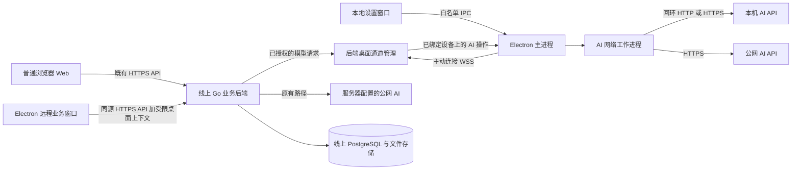
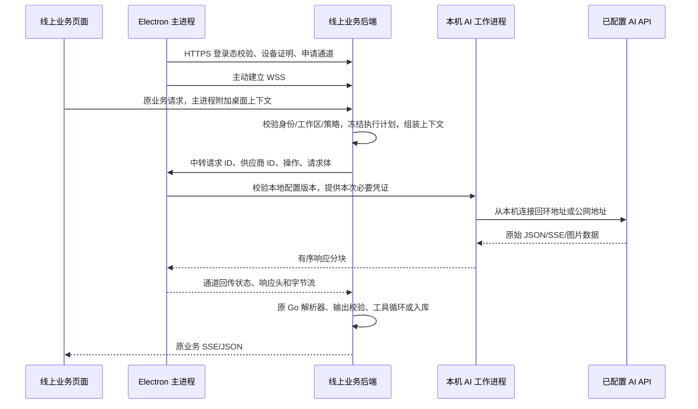

# 17 Electron 客户端改造方案

> - 状态：实施基线；用户于 2026-10-16 明确授权按本方案开始完整改造。
> - 日期：2026-10-16。
> - 复核版本：v0.3；2026-10-16 用户授权实施后更新状态与 DC01 依赖锁定；复核记录见第 18.3 节。
> - 调研基线：仓库提交 `5a4feb2`；依据现有源码及文档编写，未实施客户端或后端改造。
> - 用户要求：新增 Electron 本地客户端；浏览器 Web 默认外观与行为不改；不破坏现有功能；业务使用已部署的线上后端；AI 既可能是公网 API，也可能是用户电脑上 `127.0.0.1` 的 API。2026-10-16 用户另行批准 Electron 专属 UI 呈现分支，详见第 10.4 节。
> - 默认交付假设：首版面向 Windows 10/11 x64；具体受支持系统版本以实施时选定的 Electron 稳定版及安装验收为准。macOS、Linux、ARM64 不纳入首版承诺。
> - 依赖：[04 需求](04-需求与功能分级.md)、[05 交互](05-业务流程与交互.md)、[06 架构](06-数据与技术架构.md)、[08 开发与测试](08-开发与测试计划.md)、[16 系统智能体](16-系统智能体设计.md)、[D-119 提议](90-决策与变更记录.md#d-119-electron-客户端复用线上业务与受限-ai-中转提议)。
> - 平台登录 UI 增量（2026-10-21，D-131）：用户确认兼容性优先，允许由 OPS 打开专用标准 Chrome／Edge 窗口；客户端管理进度和账号核对，完整官方页承载扫码／验证。详细真源为 [20 §20](20-平台登录与作品数据自动回填设计.md#20-三平台客户端登录-ui-与逻辑方案)，本轮仅设计，未改产品代码；不改变受限 AI 中转的权限边界。
> - 当前账号设置增量（2026-10-22，D-132）：用户确认顶部负责账号切换，桌面账号设置只展示当前账号；按 [§10.6](#current-account-settings-plan) 已实施主要 UI/逻辑。D-132 专项 30/30、相关设置回归 41/41；27 项验收矩阵尚未全部完成，实测边界与待验证项见 §10.6.15～§10.6.16；普通 Web 账号总览回归通过。

## 0. 阅读顺序与实施前提

### 0.1 核心结论

推荐采用 **Electron 加载现有线上页面 + 本地独立设置窗口 + 线上后端主导业务 + 客户端受限 AI 中转**。

普通业务请求仍走线上后端。后端仍负责提示词、模型协议解析、智能体循环、工具权限、人工确认、数据库和文件存储。需要本机 AI 时，由客户端主动连接线上后端，接收后端已授权的模型请求，再从本机调用配置好的 AI 地址，流式返回响应。

这能保持 `web/` 的源码、构建配置、依赖锁文件和页面交互不变，但**需要对线上 Go 后端做向后兼容的增量改造**。仅在 Electron 中修改 API 地址，无法让当前服务器上的模型请求到达用户电脑。若后续要求连后端也完全不能改，则只能交付使用现有云端 AI 的桌面壳，无法完成本文的本机 AI 接入目标。

**兼容边界：不改 Web 就必须保留现有前端等待上限。** 当前普通 JSON 请求为 30 秒、上传请求为 120 秒、SSE 建立为 90 秒；已有后台 Job 和已经建立的 SSE 可使用更长的模型预算，但卡片/漫画出图、图片替代文字等同步入口不能统一承诺等待慢模型 60～120 秒。第 8.3 节要求逐入口验证、预热及在原预算内失败；若实际模型无法满足同步入口的预算，“所有原入口均支持该慢模型”不能通过验收，须在 DC01 回到范围评审，不能靠改响应类型、静默转云或拦截前端计时器补救。

### 0.2 必须保持的架构约束

| 编号 | 约束 | 实施判定 |
| --- | --- | --- |
| INV-01 | 业务权威只有线上后端 | 客户端不运行本地 Go 业务服务器、数据库或第二套智能体工具执行器 |
| INV-02 | 浏览器默认体验不改 | 允许 `web/` 存在 Electron User-Agent 专属的呈现分支；普通浏览器不进入该分支，默认 UI、交互、API、路由与数据行为保持原样；Electron 分支不得改写权限或业务行为，且不得通过主进程脚本注入远程 DOM |
| INV-03 | 客户端中转只执行 AI 请求 | 不支持任意 URL、任意 HTTP 方法、任意请求头、Shell、文件读取或业务 API 转发 |
| INV-04 | 旧 Web 请求保留原行为 | 无桌面上下文的请求只使用服务器模型；旧接口响应字段、错误格式及权限不变 |
| INV-05 | 本机密钥留在本机 | 客户端模型密钥不上传线上后端，不进入远程页面、消息、工具参数、日志或数据库 |
| INV-06 | 写入仍须既有人工确认 | HC-01～HC-31 和 D-117 逐张执行规则不变；桌面端没有批量执行卡片能力 |
| INV-07 | 路由失效不得改变数据去向 | 已选择本机执行后，掉线、超时或无权限均不自动改用服务器或公网模型 |
| INV-08 | 本地推理不等于离线产品 | 作品、素材、附件、对话、结果仍存在线上；完整提示词会经线上后端到达本机 |

### 0.3 本次与后续的边界

本次实施按第 15 节 DEV-DC01 至 DEV-DC09 分阶段完成，按第 16 节验收。用户已明确批准方案 C 及本文列出的首版边界。生产真实 AI、TLS/WSS、签名和安装升级验收仍需相应现场条件；缺少这些证据时只可标记为待验证，不得宣称正式发布完成。

客户端创作空间视觉重设计另以 DEV-DC10 验收；它依赖已有业务壳与接口，不替代 DC01 至 DC09 的业务、安全或发布门槛。

首版必交付：线上业务完整可用；服务器 AI 模式；客户端调用公网 OpenAI 兼容 API；客户端调用回环地址的 OpenAI 兼容 API；文本、JSON、原生工具调用、识图及图片生成按能力开放；本机模型能力自检；会话、权限、断线、取消、下载、安装与升级验证。

首版明确不承诺：离线业务、本地业务数据库、局域网任意主机 AI、本地模型安装与进程托管、原生 Anthropic/Gemini/Ollama 协议、任意插件/MCP、本机工具执行、自动发布、本地 embedding、把现有供应商原生联网搜索迁到本机。最后两项的理由与保留路径见第 6.5 节。首版完成不得只以“安装包能打开网页”判定。

## 1. 已核实的现状与设计影响

以下为源码证据与设计推论的对应关系；后续开发先复核这些入口，文件位置变化时同步更新本节。

| 证据 | 源码事实 | 发现与实施路径 |
| --- | --- | --- |
| E-DC01 | `web/src/lib/api.ts` 固定请求同源 `/api/v1`，修改请求带 CSRF，流式响应使用 Fetch SSE | 加载线上页面可保留现有请求、自动保存与流式显示；不能只替换页面中的模型 URL |
| E-DC02 | `server/internal/app/auth.go` 使用 `ops_session`、HttpOnly、SameSite=Lax；`/auth/me` 返回 CSRF；修改请求统一校验 | 业务窗口使用独立 Electron Session 原样登录；涉及身份/配置的新增桌面接口保持会话和 CSRF 校验，公开版本预检与 WSS 票据入口按第 7 节限定 |
| E-DC03 | `aicore.go` 的 `resolveRouteTier`、`buildContext`、`runAI` 在服务器执行 | 将 AI 传输接缝放在后端适配层，客户端不重写业务上下文 |
| E-DC04 | `agent_run.go`、`agent_dispatch.go` 在服务器进行模型循环、进程内业务分发、权限和卡片处理 | 工具 JSON 必须回服务器解析；客户端收到工具调用不能直接执行 |
| E-DC05 | `server/internal/ai/client.go` 实现 Chat Completions、SSE、JSON 降级、工具分片累积；`images.go` 实现图片生成及 URL 下载 | 复用 Go 端解析器，仅抽取最小传输接口；图片 URL 下载也是接入范围 |
| E-DC06 | `agent_conversation.model_provider_id` 外键指向 `model_provider`；`model_capability` 主键为供应商和模型 | 复用供应商 UUID 和能力表，不能返回数据库里不存在的“虚拟 provider_id” |
| E-DC07 | `aijobs.go/startBackgroundJob` 用 `context.Background()` 重建上下文；`agent_dispatch.go` 也只复制指定值；其他路径用 `WithoutCancel` | 桌面执行计划必须显式传递，不能认为给入口加一个 Header 后所有子任务自然继承 |
| E-DC08 | `retrieve.go/embeddingRoute` 另查模型路由；`content_embedding` 唯一键为对象类型、对象 ID、分块号 | 不能把本机 embedding 混进现有缓存；首版保留现有服务器检索路径 |
| E-DC09 | `model_settings.go/aiStatus`、`agent.go/agentModels` 直接查询服务器路由和能力 | 需要统一有效模型解析，并在桌面请求中返回现有形状的就绪信息，否则本机模型正常但页面仍被禁用 |
| E-DC10 | `agent_continue.go/agentSummarize` 当前按对话模型直接调用 `ai.Stream`，并非完全经过普通任务 `runAI` | 摘要同样要选择正确传输；不能只改普通写作调用与 agent 主循环 |
| E-DC11 | `Server.aiHTTP` 当前总超时 5 分钟，普通与 agent 首内容超时默认 15 秒 | 本地模型冷启动要单独定时，且不能被旧 15 秒计时器提前取消 |
| E-DC12 | 现有 Nginx 模板把 `Connection` 清空，未为新增通道配置 WebSocket Upgrade；生产 Compose 的 Secure Cookie 默认值仍为 0 | 需新增精确通道路由，发布前实测 HTTPS/WSS 与 Secure Cookie，不能只以 HTTP 健康检查通过作为发布依据 |
| E-DC13 | `web/src/main.tsx` 在生产注册 `/sw.js`；`web/public/sw.js` 缓存应用壳和静态资源，但排除 `/api/`，不接管非 GET | 首版可沿用现有 Worker；仍须验证请求来源归属、持久缓存升级和断网时不能误显示可用业务 |
| E-DC14 | `web/src/lib/api.ts/fetchResponse` 在读取完整非 SSE 响应前保留 30/120 秒计时；SSE 成功建立后清除 90 秒计时；`CardEditor.tsx`、`ComicEditor.tsx` 的出图调用是普通 `post` | 冷启动预算须区分同步 JSON、上传、SSE 和后台 Job，不能只调整后端首内容超时 |
| E-DC15 | `auth.go` 的 `requireOwner` 允许超管代访问；viewer 写限制不会自动放行新桌面接口；`/auth/reauth` 只更新原会话 | 桌面策略须额外拒绝代访问；个人撤销不受工作区 AI 开关影响；本地设置须明确复用重新认证的交互 |
| E-DC16 | `server/cmd/ops/main.go/serve` 先执行 `db.Migrate` 再启动服务；`deploy/update.sh` 使用 Compose 重建启动 | 迁移属于新后端启动过程，不能先按新 schema 提供服务，再在后一步补迁移 |

证据来自提交 `5a4feb2` 的源码阅读；本节不是线上运行状态证明。原需求与人工确认约束来自 04/05/06/16 文档，客户端专属增量以本文为唯一详细规格。

## 2. 方案比较与推荐理由

| 方案 | Web 源码影响 | 本机 API | 维护与结构风险 | 结论 |
| --- | --- | --- | --- | --- |
| A. Electron 直接加载线上页面，仅保留既有后端 AI | 无 | 不支持，服务器仍访问自己的回环地址 | 最简单，但缺少核心目标 | 可作为第一步壳验证，不是最终交付 |
| B. 打包另一套前端，在本机重建提示词、模型循环和结果写回 | 通常需复制或改造页面 | 支持 | 两套业务规则、权限和确认语义容易分叉；接口及缓存适配工作大 | 不采用 |
| C. 加载线上页面，本地设置与 AI 执行独立，服务器保留全部业务 | 无；只增加 `desktop/` 和后端增量 | 支持 | 需要受限中转和设备绑定，但权威边界清楚 | **推荐** |

不采用端口映射、把本机服务暴露公网或通用内网穿透作为产品前提。客户端只发起出站 HTTPS/WSS，用户的模型服务可以继续仅监听本机回环地址。

不把“将完整 AI 提示词下发前端后由前端直接保存模型结果”作为捷径：这会新增第二个任务执行者，绕开现有结构化校验、用量、工具来源约束和版本控制。

## 3. 总体架构与信任边界

### 3.1 组件及职责



| 组件 | 负责 | 不拥有的权限 |
| --- | --- | --- |
| 远程业务窗口 | 加载发布站点，运行原 React 页面；沿用编辑、对话、上传、确认与发布包流程 | 无 Node、无 preload、无 IPC、无本机密钥和任意本地网络访问 |
| 本地设置窗口 | 管理“此客户端 AI”、能力自检、执行模式、连接状态、设备撤销与诊断 | 不拿 Cookie、不直接联网调业务或 AI、不读取任意文件 |
| 主进程 | 窗口、Session、白名单 Header、设备证明、通道、密钥库、下载及进程生命周期 | 不解释工具调用、不修改作品、不拼业务提示词 |
| AI 网络工作进程 | 按本地已保存配置执行受限模型请求，按序回传原始响应流 | 不持有业务 Cookie、数据库凭证，不执行工具/脚本；不是通用代理 |
| 后端桌面模块 | 设备/会话绑定、请求授权、中转配额、取消与审计 | 不接收客户端 AI 密钥，不主动连接客户端监听端口 |
| 现有业务与 AI 模块 | 身份、上下文、路由、解析、校验、卡片、任务、入库与用量 | 不因请求来自 Electron 降低人工确认与角色限制 |

AI 网络工作进程使用 `utilityProcess` 等独立进程机制隔离崩溃和阻塞。**进程隔离不等于操作系统沙箱**；其网络能力仍须由操作白名单、目标校验和最小数据传递约束。[Electron utilityProcess](https://www.electronjs.org/docs/latest/api/utility-process)

创建工作进程时显式提供最小环境变量、固定包内入口和受控输出；不沿用默认的整份 `process.env`、继承标准输出或业务 Session，不通过命令行/环境传密钥，不允许环境中的调试/注入选项改变执行入口。它只接收本次供应商必要凭证与请求，不接收设备私钥或通道票据。该要求限制正常程序的数据传播，不声称能防御同一系统用户已获得的任意代码执行。

### 3.2 两类窗口必须分开

远程业务窗口不配置 preload。只有安装包内的 `ops-desktop://settings/` 等本地页面拥有窄化的 `contextBridge`。本地页面用独立 Session，不能加载远程脚本、远程 iframe 或业务站点内容。

本地协议使用 `protocol.handle`，注册在实际窗口使用的 Session；资源路径经规范化并限制在打包资源根目录，拒绝路径穿越。只开启所需的标准/安全协议能力，不启用绕过 CSP。它不是 API 代理，也不接管 `https:` 协议。[Electron 自定义协议](https://www.electronjs.org/docs/latest/api/protocol)

## 4. 三条调用链与数据去向

### 4.1 服务器 AI 模式

1. 用户在原业务页面发起任务。
2. 页面向线上业务后端提交原有请求。
3. 后端读取工作区服务器模型与密钥，调用公网 AI。
4. 后端校验、记录、入库，通过原 JSON/SSE 返回页面。

该模式不依赖桌面中转通道，普通浏览器和客户端均保持现有能力。客户端不下载或读取服务器保存的供应商密钥。

### 4.2 此客户端 AI 模式



普通对话文本、结构化任务、工具参数仍经过线上后端。工具调用由服务器现有目录与分发器处理，写入仍只生成操作卡片，等用户逐张点击。

### 4.3 本机与公网的含义

| 配置 | 真正发起网络连接的位置 | 密钥位置 | 断开客户端后的能力 |
| --- | --- | --- | --- |
| 服务器供应商，例如公网 HTTPS API | 线上服务器 | 服务器现有加密存储 | 沿用现有后台任务机制 |
| 此客户端供应商，公网域名/API | 用户电脑 | 本机系统保护的密钥库 | 对应任务不能继续调用该供应商 |
| 此客户端供应商，`http://127.0.0.1:端口/v1` | 用户电脑 | 本机；服务无鉴权时不发送 Authorization | 对应任务不能继续调用该供应商 |

“公网”是网络地址属性，“此客户端”是执行位置属性，二者不能合并成一个含糊的“本地/远程”开关。本机 API 也可能是用户自建的公网模型代理；客户端不能据回环地址推断模型在本地计算或内容不会离开电脑。

本方案不提供完全本地的数据隐私承诺。附件仍先上传线上，后端使用已有图片清洗、缩放与授权规则，再把允许用于模型的图片内容送到客户端。

## 5. 登录、设备与桌面请求上下文

### 5.1 原业务会话不另造认证系统

打包版业务窗口固定加载发布配置允许的 HTTPS Origin，当前为 `https://ops.88813888.xyz`；正式发布前须实测。当前部署尚未启用 TLS，因此本地未打包开发运行默认使用 `http://ops.88813888.xyz` 联调；该明文开发例外不得进入打包版或作为正式环境验收结果。HTTP 会明文传输登录会话与桌面通道数据，只能在开发联调环境使用。使用专属持久 Session 分区，例如 `persist:ops-production`，与开发环境、本地设置窗口及普通浏览器隔离。

登录、退出、重新认证、密码重置与工作区切换继续调用原接口。保留 HttpOnly、SameSite 和 CSRF 校验。主进程如需访问桌面管理接口，使用该业务 Session 的请求能力取得 `/auth/me` 与 CSRF；不能假定 Node `fetch` 自带 Chromium Cookie，也不能把 Cookie/CSRF 转发给 AI API。[Electron Session](https://www.electronjs.org/docs/latest/api/session)、[Cookie API](https://www.electronjs.org/docs/latest/api/cookies)

不保存用户密码，不复制系统浏览器 Cookie，不新增长期免登录 Token。设备签名只证明设备，不替代用户登录与工作区权限。

主进程收到 `reauth_required` 时，在包内设置窗口显示独立的重新认证表单，经命名 IPC 用原业务 Session 调用既有 `/auth/reauth`；密码只用于这一次请求，不持久化、不记录、不用于模型鉴权。成功后重新核对 `/auth/me` 与当前工作区，再申请新挑战；不假设 Web 的 `rawRequest` 弹窗会替主进程自动处理，也不重放已经消费的设备证明。没有工作区成员资格时的本人设备回收使用第 7.1 节的受限处理，不依赖 `/auth/reauth` 成功。登录仍在原线上登录页完成。

### 5.2 设备绑定

1. 首次启用此客户端 AI 时，本机为“服务 Origin + 用户”生成设备 UUID 和 Ed25519 密钥对；私钥用本机密钥库保护。
2. 用户在客户端本地窗口明确启用，服务器按当前登录用户注册设备公钥。首次注册与撤销设备要求既有重新认证；设备 UUID/名称不是凭证。
3. 每次建通道先向服务器申请短期随机挑战；签名绑定挑战、设备、公钥身份、当前会话、工作区及过期时间。挑战 60 秒过期、单次消费。
4. 验证成功后服务器签发 60 秒、一次性的通道票据，主进程仅保存在内存。
5. 使用 WSS 连接，票据放在握手 `Authorization` 中；不得放 URL、日志或远程页面。票据仍绑定有效会话、用户、设备、工作区。
6. 通道建立后返回连接 ID 和 generation；一组“会话 + 工作区 + 设备”最多一条当前连接，替换连接会使旧 generation 失效。

这里的设备注册不是可信硬件证明，也不能防御已控制当前操作系统账号的恶意程序。设备私钥与用户会话缺一不可，避免只靠伪造 User-Agent 或设备 ID 调度真实设备。

模型登记、自检、路由修改和建通道也要提供当前设备持有证明，不能认为“请求写着主进程”就天然可信。复用同一挑战机制：挑战绑定操作名、HTTP 方法/规范路径、请求体 SHA-256、设备、会话、工作区和期限，主进程核对这些字段后签名服务器返回的原始待签名字节，服务端验证后原子消费。首次注册对待登记公钥做持有验证，其他上述操作验证已登记公钥；不得自行发明加密算法或把 Cookie 当设备证明。申请挑战本身只需会话、CSRF和限频，不递归要求另一个挑战。本人撤销丢失设备只需会话和重新认证，不能要求找回已丢失设备私钥；工作区策略修改仍由 owner 和重新认证控制。

### 5.3 不改 Web 代码时如何选中执行位置

主进程在业务 Session 注册唯一的 `webRequest.onBeforeSendHeaders` 处理器。仅对**来源可确认是受信业务窗口主 frame、目标精确属于线上 Origin 的 `/api/v1/` 请求**，附加：

| Header | 内容 | 权限意义 |
| --- | --- | --- |
| `X-OPS-Desktop-Device` | 当前用户绑定的设备 UUID | 执行位置声明，不是身份凭证 |
| `X-OPS-Desktop-Connection` | 当前连接 ID/generation | 绑定本次请求应使用的在线通道 |
| `X-OPS-Desktop-Policy` | 已同步的执行配置版本 | 防止旧配置与新任务混用 |

启用服务器 AI 模式时不附加这些 Header。桌面管理请求由主进程显式带身份与 CSRF，不依赖拦截器偷偷补齐。覆盖用户页面伪造的同名头，外域请求一律清除；重定向、子 frame、非业务窗口、下载与 WebSocket 均不得意外携带它们。

**通道断线时仍保留已选择“此客户端”的声明**，不能因暂时没有在线连接而省略 Header，导致任务静默回到服务器模型。服务端只对 AI 解析返回“客户端未连接”；普通业务保存、读取、上传、确认和非 AI 发布流程仍按原权限执行。

此机制只增加请求元数据，不拦截/改写响应体，不修改请求 URL、方法、业务 JSON、SSE、Origin、Referer、Cookie 或 CSRF。桌面 Header 不授予角色与资源权限。服务端必须再次匹配当前会话、用户、工作区、设备、公钥绑定和有效策略。

Electron 同一 `webRequest` 事件只使用最后注册的监听器；请求标记、外域清理和诊断须由同一所有者统一分发，禁止模块互相覆盖。[Electron WebRequest](https://www.electronjs.org/docs/latest/api/web-request)

`details.frame`、`webContentsId` 等来源信息可能缺失；不能只看 `resourceType === 'xhr'`、Referer 或目标域名就认定主 frame。当前生产 Service Worker 不转发 `/api/`，首版保持它的源码和行为；DC01 必须用真实生产构建验证 Fetch、SSE、EventSource、刷新、重定向及受 Worker 控制后的来源。此客户端模式下，可能触发 AI 但来源无法确认的请求由同一网络策略所有者在 `onBeforeRequest` 拒绝，不能清掉桌面头后放行成服务器调用。主进程的认证/桌面管理请求单独按固定接口和第 5.2 节证明处理，不冒充页面请求；未来若 Worker 接管 API，先重审此契约，不能自动给所有 Worker 加头。

### 5.4 会话与工作区变动

主进程结合 Cookie 变动、业务导航和周期性 `/auth/me` 核对识别身份变化；不能把 Cookie 变动等同于工作区一定变化。服务端每次 AI 调度均核对会话当前归属，并在通道心跳复核有效性。

退出、用户切换、会话过期、撤销设备、移出工作区、超管代访问与工作区策略关闭，都停止新中转并撤销已有绑定。旧连接不能继续服务新工作区；旧模型列表、Header 版本和任务执行计划不得复用。切换过程中的新 AI 请求应明确失败或等待重建，不自动落到另一条模型路径。

第一版只允许一个共享此业务 Session 的业务窗口，并使用单实例锁；设置窗口不计入业务窗口。身份/工作区切换完成前暂停新 AI 调度，主进程重新取得 `/auth/me` 后建立对应绑定。不能仅靠定时轮询覆盖切换窗口：后端须在每次调用与提交时核对真实会话归属，旧工作区请求与新会话不匹配即拒绝。多业务窗口/不同工作区同时使用，须另行设计独立 Session，首版不隐含支持。

## 6. 模型配置、权限与有效路由

### 6.1 两套配置作用域，共用模型身份

服务器模型沿用现有设置页与 `model_route`，仍由工作区所有者管理。此客户端模型由本地设置窗口管理，作用域为“线上 Origin + 用户 + 工作区 + 设备”，不会改动共享服务器默认模型。

复用 `model_provider` 的 UUID 作为模型引用权威，并增加区分执行位置所需的字段与约束，详见第 11 节。客户端配置登记到服务器的只有模型名、设备归属、能力、配置版本等必要元数据；实际 URL、代理配置、API Key 留在本机。客户端模型不能通过旧供应商接口被列出、测试、修改、删除或被共享服务器路由引用。

客户端本地记录包括：服务器颁发/确认的供应商 UUID、本地配置 ID、显示名称、Base URL、模型名称列表、密钥引用、协议类型、回环/公网分类、图片下载允许域名、超时和配置版本。不自动扫描端口或读取其他软件的密钥文件。

### 6.2 工作区策略与角色

新增工作区级 `desktop_ai_policy`，默认 `enabled=false`、`allow_member_endpoints=false`。由 owner 在本地设置窗口调用线上新接口管理，仍可用服务器 AI 完成原工作流。

| 身份/策略 | 注册自己的设备 | 配置/使用此客户端模型 | 业务能力 |
| --- | --- | --- | --- |
| owner，策略开启 | 允许，首次需重新认证 | 允许管理自己的当前设备模型 | 沿用现有 owner 权限 |
| editor，允许成员端点 | 允许，首次需重新认证 | 只允许自己的当前设备模型 | 沿用现有 editor 权限与人工确认 |
| editor，不允许成员端点 | 可使用桌面壳 | 不允许通过此客户端端点带出工作区上下文 | 仍可使用原服务器 AI |
| viewer | 可使用桌面壳 | 首版不开放此客户端模型 | 原只读范围、原 agent 观察者设置保持 |
| 超管代访问 | 不得为被代访问工作区建立中转 | 不允许 | 原代访问限制保持 |

策略开启明确提示：工作区 AI 上下文会发往成员配置的端点；回环地址不等于推理完全本地。owner 关闭策略后立即阻止新调度并取消未结束的客户端模型调用；已成功入库的结果保留。

新增接口不能只复用 `requireOwner` 就认定已拒绝超管代访问；桌面模型、通道、路由和工作区策略写入均先显式检查 `admin_override=false`。个人设备列举/撤销只按真实登录用户授权，不借用被代访问者身份；撤销不要求当前工作区策略开启，也不因本人角色变成 viewer 而失效。

`agent.settings.enabled`、`viewer_enabled`、`allow_model_pick` 不因桌面端绕过。首版在 `allow_model_pick=false` 时不开放此客户端 `agent_chat` 覆盖；原服务器默认 agent 仍可使用，客户端设置中须明确显示限制。若用户保持此客户端模式发起该任务，返回权限错误，不暗中用服务器模型。

### 6.3 有效模型解析顺序

业务入口先形成不可变执行计划，包含会话/工作区/设备、模式、策略版本及本次各任务的主备模型快照。有效模型解析是所有调用与就绪判断的共同所有者，不能每个页面各自拼条件。

1. 无桌面上下文：只读服务器路由；过滤客户端供应商；保持原优先级和错误。
2. 有桌面上下文：先核对身份、策略及连接。客户端覆盖任务使用该设备的任务配置，不修改共享 `model_route`。
3. 客户端文本任务优先级沿用既有“档位 → 任务 → default”；`agent_chat` 不受档位覆盖，必须通过原生工具能力自检。
4. `image_alt` 只使用 `metric_screenshot` 视觉路由；`image_gen` 必须配置经过测试的图片生成路由，不能用文本 default 冒充；其他受能力约束任务同理。
5. 显式配置为服务器执行的任务仍可使用服务器路由，但必须在本地设置的任务映射中显示并获用户保存；“没有配置”不等于“允许回到服务器”。
6. 工作区没有任何服务器模型时，只要本机模型、策略和能力有效，核心写作与 agent 可以工作，不要求上传虚假云端密钥或建立占位供应商。
7. 执行开始后不读取后来修改的路由作为同一任务的新目标；配置/授权失效时取消或报错，不能改变数据去向。

对话显式选中的模型必须属于当前可用执行位置。新对话默认来自当前模式的有效模型；已有对话若选的是服务器模型而当前已切到客户端模式，或选的是另一设备模型，先提示在原“对话设置”中明确选择当前可用模型，不暗中改写会话模型或继续用旧服务器模型。原有选择器与模型引用 JSON 形状保持。

摘要在服务器模式保留当前按对话模型执行的行为；客户端模式默认随该对话的有效客户端模型，只有用户显式配置且满足数据去向约束时才使用专门的摘要路由。不能因文档里存在 `agent_summary` 任务名就假定当前源码已统一走该路由。

客户端模型未配置、离线或过期时，桌面 `/ai/status` 与 `/agent/bootstrap` 按有效路由返回原有字段形状；普通 Web 响应不改变。有效的本机模型须能通过现有页面门槛。模型名称用真实模型名，供应商显示名称可带“此客户端”，不得把本地模型伪装成服务器配置的型号。

依赖桌面上下文的模型/就绪响应及新桌面管理响应使用 `Cache-Control: no-store`；后端若缓存有效路由，键必须包含用户、会话/工作区、设备及策略/config revision，不能只按工作区共享。HTTP 缓存策略不能替代第 10.1 节对页面内 React Query 缓存的处理。

### 6.4 备用模型与错误重试

保留“一次主模型 + 至多一次备用”的业务规则；结构化输出纠错仍由后端原逻辑控制，中转层不重放生成请求。

客户端主备自动切换只允许**相同执行位置且相同数据去向类别**：回环可备回环，客户端公网可备客户端公网。回环与公网、客户端与服务器之间不自动切换。用户可停止后手工选择新配置，形成新的任务。

权限、策略、配置版本、设备离线、取消和协议错误不可被通用 `retryable` 当作供应商网络故障。已返回文字或工具分片后不自动重试；认证失败不轮流尝试密钥；不在断线重连时恢复未知执行状态的请求。

### 6.5 AI 能力覆盖与明确限制

| 能力 | 服务器路径 | 首版客户端路径 | 必要验证 |
| --- | --- | --- | --- |
| 文本与 JSON 任务 | 原实现 | Chat Completions 兼容协议 | 流式文本、结构化校验、原一次纠错 |
| agent 主循环 | 原实现 | 后端解析原生 `tool_calls` | tools 自检通过；分片/并行索引/空 content/finish_reason 正常 |
| agent 摘要与由任务派生的记忆等 | 原实现 | 必须继承发起任务的数据去向 | 不能遗失上下文后改走服务器默认；保留原摘要失败策略 |
| 识图与图片替代文字 | 原实现 | 兼容多模态消息的模型 | vision 自检通过；沿用图片清洗及授权 |
| 图片生成 | 原实现 | 兼容 `/images/generations` | 真实生成能力及 base64/URL 两种回包验证 |
| embedding/向量缓存 | 原服务器配置；无配置时沿用现有词法检索 | **首版禁用客户端 embedding 绑定** | 不触碰现有向量空间、缓存唯一键和后台索引 |
| 原生联网搜索 | `hot_search.go` 已有供应商专用契约 | **首版保留服务器路径** | 页面清楚区分搜索来源；不能把无来源聊天当搜索证据 |

embedding 不能仅因模型名相同就共享向量；未来如需本机 embedding，须另行批准“提供商/实际型号/模型修订/维度/预处理共同标识向量空间”的缓存迁移方案，并使查询向量与候选向量来自同一空间。该工作不混入首版，接口须拒绝保存客户端 `embedding` 路由。

客户端设置列出“文本、识图、出图、联网搜索、向量检索”等真实执行位置。选择“此客户端默认”只覆盖受支持的文本任务，不能让用户误以为服务器搜索或检索也已迁移；这些服务器辅助能力可逐项选择“沿用现有服务器路径”或“此客户端任务中禁用”。若禁用，保持既有词法检索/手工资料路径，并在生效前明确展示影响，不暗中调用服务器模型。普通 Web 的配置与能力不变。

原生 Ollama `/api/chat`、Anthropic Messages、Gemini 原生接口不是 OpenAI 兼容接口；本机服务必须启用相应兼容入口。仅支持 Responses 的型号不能按 Chat Completions 通过验收。首版不增加第二套厂商协议适配器。

## 7. 新增线上接口契约

下列接口均为**拟新增**，前缀 `/api/v1`。请求/响应仍用现有 JSON 错误封装、Request ID、分页和时间约定。字段细化可在对应开发任务中补充，但不得改变本节的身份、作用域和生命周期。

### 7.1 接口表

| 方法与路径 | 调用方 | 职责与关键限制 |
| --- | --- | --- |
| `GET /desktop/capabilities` | 主进程 | 允许未登录的版本预检，只返回公开的协议版本、兼容范围及静态限制；不含用户/设备/工作区策略，实际启用权限登录后再查 |
| `GET /desktop/policy` | 本地设置经主进程 | 读取当前工作区策略 |
| `PUT /desktop/policy` | owner 经主进程 | 修改策略，需 CSRF/重新认证，审计并使旧授权失效 |
| `GET /desktop/devices` | 主进程 | 账户级列举本人设备，不依赖桌面 AI 开关；不返回票据、密钥或已失去权限的工作区详情 |
| `POST /desktop/devices` | 主进程 | 注册设备公钥/平台/版本，需 CSRF/重新认证；同设备 ID 不得更换公钥冒充 |
| `DELETE /desktop/devices/{id}` | 主进程 | 账户级撤销本人设备，需 CSRF/重新认证；即使策略关闭或已失去工作区成员资格仍可撤销，终止相应连接与调用，软停用相关模型 |
| `POST /desktop/challenges` | 主进程 | 申请绑定当前会话、工作区和设备的单次挑战，需 CSRF、限频 |
| `POST /desktop/connections` | 主进程 | 校验签名并消费挑战，返回短期票据、连接 ID、generation、过期时间；需 CSRF |
| `GET /desktop/channel` | 主进程 WSS | 校验票据后升级；票据失效/复用/不匹配均拒绝，不接受 URL 中的票据 |
| `GET /desktop/models` | 主进程 | 本人当前工作区/设备的客户端模型元数据及自检状态 |
| `POST /desktop/models` | 主进程 | 创建本人当前设备的模型元数据并由服务端生成真实 `model_provider` UUID；**拒绝 api_key、base_url、原始代理凭证字段** |
| `PUT /desktop/models/{id}` | 主进程 | 更新已登记模型元数据、配置版本；所有权按本人/当前设备/工作区校验；**拒绝 api_key、base_url、原始代理凭证字段** |
| `DELETE /desktop/models/{id}` | 主进程 | 停用本人当前设备模型、清理绑定，保留历史引用 |
| `POST /desktop/models/{id}/test` | 主进程 | 后端经通道发起自检 Job，立即返回测试 ID，由本地窗口查询进度；服务器验证响应并写能力，不相信客户端直接上报 true |
| `GET /desktop/model-tests/{id}` | 主进程 | 查询本人当前设备、工作区、配置 revision 的自检终态；不返回原始提示词/响应 |
| `GET /desktop/routes` | 主进程 | 读取本人/设备/工作区的任务映射与辅助能力选择 |
| `PUT /desktop/routes` | 主进程 | 原子保存完整映射，需 CSRF、策略权限与版本校验；拒绝非法主备组合 |

仅声明公钥和 UUID 不获得工作区数据。模型、自检和路由资源按“本人 + 设备 + 当前工作区”查询，设备列举/撤销按“真实登录用户 + 本人设备”查询；越权按现有 404 语义处理，owner 不能读取成员的本机密钥。账户级接口复用原登录会话与 CSRF 校验，在工作区成员门槛之外处理本人设备回收；只对该精确撤销接口补充 viewer 写白名单，不放开整个 `/desktop/*`，也不改变原 Web 的角色权限。

本人设备回收的账户级校验须拆分复用原会话有效期、用户状态和密码验证，不能直接调用会自动选工作区的 `loadIdentity`：当前源码在用户没有任何成员资格时会拒绝它，连原 `/auth/reauth` 也无法到达。新 `GET /desktop/devices` 响应同时提供本会话 CSRF 与重新认证状态；该回收场景若需重新认证，由本地表单在 `DELETE /desktop/devices/{id}` 的请求体提交一次性密码，复用既有密码校验、重新认证时限、限频和审计，再执行撤销。不新发登录 Token、不放宽原 `/auth/me` 或业务接口；会话本身已过期/用户已停用则仍拒绝。此模式只允许管理本人设备回收，不加载工作区数据、不启用 AI。

表中的模型写入/删除/自检、路由修改、设备注册和建通道执行第 5.2 节的持有证明；只读接口、挑战申请、本人撤销及 owner 策略管理分别遵循该节说明，不混为一种认证。除公开的 `/desktop/capabilities` 外，HTTP 管理接口均要求原会话认证。`GET /desktop/channel` 使用专用票据认证入口，从票据还原并实时验证原会话，不要求把 Cookie 再交给 AI 工作进程；这一例外只限精确的升级入口，不能放开整个 `/desktop/*` 的会话认证。握手还须执行维护状态、角色和桌面策略检查，不能因绕开 Cookie 中间件而跳过；未升级成功不建立可调度连接。

### 7.2 元数据和版本

每个客户端供应商使用稳定 UUID；记录 `config_revision` 单调递增。URL、型号集合、鉴权方式、密钥或代理发生有效变化，客户端先使当前配置不可调度，再登记新 revision，并重新自检。同步提交失败时保持旧配置的真实快照或停止启用，不能“服务器以为旧配置、客户端已换地址”。

能力记录绑定供应商 UUID、模型及该供应商 `config_revision`。服务端配置提交和本地落盘不是同一数据库事务，使用“本地待生效版本 → 服务器确认 → 本地原子切换 → 通道宣告 ready”的握手；进程重启先对账，不凭本地最后一次保存结果直接启用。

必须分开“配置已就绪”和“模型能力已通过”：配置版本对账完成后可进入**仅自检**状态，通道允许后端发起该供应商的受限测试，业务解析器仍不将其列为可用模型。否则“先通过能力自检才能 ready、先 ready 才能自检”会互相等待。测试 Job 绑定用户/工作区/设备/revision，使用后端固定的小型合成输入与虚拟工具声明，不能读取真实作品、执行工具或生成操作卡片；用户明确发起，说明可能计费。按文本、JSON、tools、vision、出图分别记录结果和失败原因；测试结束前配置变化、权限失效或断线，旧结果不得写到新 revision。只有对应能力通过后才允许保存相应业务绑定和切换模式；自检不要求预先存在业务路由。

自检进度使用桌面模块的短期内存状态，不创建普通业务 `ai_job` 或工作区任务通知；进程重启后尚未完成的测试视为失效，查询不到进度时明确提示重新测试。已持久化且 revision 仍匹配的能力不因单纯重启失效。最终能力结果只以对应 revision 的 `model_capability` 为权威，不增加第二套模型能力来源。

任务映射使用单独的 `policy_revision` 并支持 `If-Match`/等价版本条件。更新时校验任务类型、供应商归属、能力、自检 revision、回环/公网分类及备用模型，不允许模型通过工具调用修改此设置或把它加入 agent 工具目录。

`policy_revision` 指本人/设备的任务映射版本，对应 `X-OPS-Desktop-Policy`；工作区授权策略使用独立 `authorization_revision`，不能混用。任务映射更新后，新请求必须使用最新版本；已开始任务按原快照继续，只要其供应商版本和当前授权仍有效。工作区关闭桌面 AI、限制成员端点或其他授权收紧则使旧授权立即失效，不能借“快照不可变”继续。路由编辑的未应用草稿留在本地，用户确认应用时才原子提交线上映射，不额外创建线上草稿路由表。

## 8. 中转协议、传输接缝与性能边界

### 8.1 Go 适配层接缝

在 `server/internal/ai` 内抽取“已序列化的模型请求 → 上游状态/允许响应头/可关闭字节流”的最小传输接口。保留现有调用方的默认服务器实现，客户端实现只替换网络执行位置。

服务器传输负责真实 HTTP URL 和服务器密钥；客户端传输只持有供应商 UUID、设备、配置 revision、模型、操作与连接绑定。**不能把客户端目标降级为默认 `http.Client`、不能构造假 HTTP 地址后期待恰好被拦截、不能修改全局 Transport 影响微信/采集。**

Go 端继续负责 Chat Completions/JSON/工具调用的请求编码与响应解析、用量、结构校验及纠错。客户端只确认请求符合本地白名单，并转发响应。客户端为图片下载校验来源时可以检查必要的图片 URL 元数据，但不拥有通用模型输出解析或业务判断。

调用入口必须覆盖：普通 `runAI`、agent 每轮与摘要、模型连通/能力自检、图片生成、识图，以及由这些任务产生的后续 AI。embedding 与原生联网搜索明确走第 6.5 节规定的独立路径。

### 8.2 协议操作与消息

`desktop-ai-v1` 使用成熟 WebSocket 库及 WSS；不自行实现 WebSocket 帧、掩码、握手或 TLS。首版关闭 WebSocket 压缩，避免图片/文本大消息的解压资源问题。

| 消息 | 方向 | 内容 |
| --- | --- | --- |
| `channel.hello` / `channel.ready` / `channel.ready_ack` | 服务端→客户端；客户端→服务端；服务端→客户端 | 协议版本、generation、route revision 及供应商 config revision；不带密钥/URL |
| `channel.heartbeat` / `channel.heartbeat_ack` | 双向 | 存活确认；不重放任务 |
| `request.open` | 服务端→客户端 | 唯一 request ID、供应商、型号、操作、purpose、配置 revision、截止时间、请求体长度；图片 URL 下载另带父生成 request ID |
| 二进制请求块 / `request.end` | 服务端→客户端 | 二进制帧为 16 字节 UUID、4 字节大端序号和最多 64 KiB payload；结束消息携带下一序号 |
| `credit(direction=request)` | 客户端→服务端 | 授予该请求上行字节额度；额度按最多 64 KiB 一块计，不可超出窗口 |
| `upstream.headers` | 客户端→服务端 | 上游 HTTP 状态和允许的 Content-Type、经校验的 Retry-After；不含 Cookie/Authorization |
| `response.credit(direction=response)` | 服务端→客户端 | 归还该请求下行响应额度，按实际 payload 字节计 |
| 二进制响应块 / `upstream.end` | 客户端→服务端 | 与请求块相同的二进制帧格式；正常结束只在响应完整时发送 |
| `request.error` | 客户端→服务端 | 仅允许上游响应头发出前终结请求；只传分层错误码，不含原始错误或凭证 |
| `upstream.error` | 客户端→服务端 | 仅允许响应头发出后、正常结束前终结响应；`error_code` 仅为 `credential_echo` 或 `upstream_stream_failed`，Go 端以读取错误结束响应，不能把部分 JSON/SSE 当成成功 |
| `request.cancel` | 服务端→客户端 | 取消指定请求；客户端停止该次上游请求并清理缓冲，不发送完成确认、不重放 |

AI 操作白名单只有 `chat_completions`、`image_generations` 和受限的 `generated_image_fetch`。前两者映射到已配置 Base URL 下的固定 POST 路径；`GET /models` 如用于本地填充列表，只能由本地设置操作发起，不开放为服务器任意请求。`generated_image_fetch` 固定为 `POST ops-desktop://local/generated_image_fetch`，请求体为 `{"url":"<原始图片 URL>"}`，`request.open.parent_request_id` 指向刚完成的 `image_generations` 请求。工作进程只暂存该父响应 JSON 中实际出现的 URL，要求 URL 精确匹配、同设备/连接 generation/provider/config revision、同业务截止时间且仅消费一次；目标还须为当前模型 API 同源或用户在本地保存的精确 HTTPS CDN 域名。下载不带 API Key、不跟随重定向，必须返回 200、图片 MIME、解码后不超过 12 MiB 且像素数不超过限制。父 ID 或 URL 失效时明确失败；该操作不是通用请求，首版无通用 `fetch` 操作。

`request ID + connection generation` 唯一关联一条响应；每方向分块有递增序号。未知 ID、重复 open、超长体、乱序/重复块、结束后继续发送和旧 generation 一律拒绝并结束相关请求。唯一例外是服务端可能在客户端发出 `upstream.end` 后才消费完已缓冲响应块、返还最后的 `response.credit`：客户端按连接保留最多 64 个最近结束的 request ID，仅忽略这些已知 ID 上格式/额度有效的迟到响应额度；超出该集合的未知 ID 仍按协议错误关闭通道。断开连接时清空该集合。UTF-8/SSE 可能跨块，Go 端按字节重组，不能逐块当完整 JSON 或完整字符解析。

客户端不伪造 provider 的 `usage`、finish_reason、tool_calls 或 `[DONE]`。缺失用量在桌面调用的 `ai_call.context_refs` 增加 `usage_reported=false` 并在客户端诊断标识；现有整数计数字段为 0 不代表已确认零用量/零成本，也不能据此承诺费用。供应商有报告时沿用原计数；此元数据不改变旧 Web 响应字段。自检通过也不等于对任意模型输出的质量保证。

`request.open` 还必须标明 `purpose=business|self_test`；该标记只区分准入，不增加操作种类，不允许客户端自行把业务请求改成测试。自检也服从设备并发、大小和超时预算。连接用一个有界写入调度器优先处理 cancel、credit 和心跳，控制消息不消耗数据额度；任一请求缓存满时只暂停该请求，不能阻塞整条连接导致取消/心跳永久等待。客户端和服务端分别按方向限制控制帧速率为每秒 2,048 条、突发上限 4,096 条，单帧不超过 16 KiB，不能用控制优先级绕过资源上限。

调用期限由服务器掌握，`request.open` 同时携带剩余预算毫秒数；客户端用单调时钟限制本次执行，不能要求 Windows 墙上时钟与服务器精确同步。网络传输不会延长服务器原截止时间，主进程和后端均保留独立取消看门机制。

### 8.3 首版限制

| 项目 | 设计值 | 处理 |
| --- | --- | --- |
| 单条控制消息 | 最大 16 KiB；单方向每秒 2,048 条、突发上限 4,096 条 | 超出大小或速率时关闭通道 |
| 单个数据块 | 二进制帧头 20 字节（16 字节 UUID、4 字节大端序号），payload 最大 64 KiB；完整帧最大 64 KiB + 20 字节 | 不使用 base64 包装；流控额度按 payload 实际字节计 |
| 单次模型请求体 | 最大 32 MiB | 事前校验，过大明确失败，不截断素材 |
| 文本响应总量 | 最大 16 MiB；现有解析器更小的单行限制仍生效 | 超限取消，不把半截结果当完成 |
| 图片响应 | `images/generations` JSON 最大 18 MiB；解码后或下载的单张图片最大 12 MiB | 为 base64 的约 4/3 膨胀及 JSON 留空间；不套用文本响应 16 MiB 限额；首版沿用每次取一张 |
| 流控 | 每请求每方向初始 credit 256 KiB；待发缓存最大 1 MiB | 消费后归还额度；没有额度不继续读取/发送 |
| 并发 | 每设备最多 2 次上游调用，且服从现有工作区并发与队列上限 | 不新开无限队列；准入/释放顺序固定，失败释放所有额度 |
| 建连 | HTTPS/WSS 握手 10 秒；心跳 15 秒，45 秒无响应判离线 | 显式断开即时取消；半开连接最迟随心跳到期取消 |
| 回环 AI 连接 | 默认连接 10 秒，首有效内容 60 秒，可设 15～120 秒 | 收到工具调用有效分片也计首内容；单纯保活不计 |
| 总调用与空闲 | 默认总 300 秒；收到首有效内容后连续无有效上游数据 60 秒 | 首内容之前只按该操作的首内容/总预算，不让空闲 60 秒误杀已允许的 120 秒冷启动；服务器路径默认值不变 |

这些值是待压测的首版资源预算，不是现网性能结论。服务器与客户端双方实施相同上限；任何一侧不能靠增大发送块绕过。上线前用最大附件、慢消费者及并发用例验证与当前容器内存预算兼容。

后端 Electron AI 首内容等待默认 60 秒，可通过环境变量 `OPS_DESKTOP_FIRST_CONTENT_TIMEOUT` 设置为 `15s` 至 `120s`；超出范围或格式错误时后端拒绝启动。该值只作用于桌面模型请求，不改变服务器模型路径原有的 15 秒首内容超时。首内容后的空闲预算固定为 60 秒。

生效截止时间取“本次上游预算、所属业务任务/卡片超时、agent 总运行期限”的最小值；不能用 300 秒单次调用预算扩大既有 agent/卡片限额。首内容计时从上游真正发起时开始，不含工作区排队；协议 ready/HTTP headers/心跳均不算模型首有效内容。`images/generations` 非流式响应使用对应操作的总预算，不套用文本首字规则。超过上级剩余预算时先拒绝新一轮，而不是开始后无限延长。

**前端预算须另行取最小值。** DC01 必须根据实际调用方式建立入口清单，至少覆盖下表；不能只按 AI task_type 判断是否可慢启动。

| 原入口形式与现有例子 | 无 Web 改动时的约束 |
| --- | --- |
| 普通 JSON `post`：卡片/漫画同步出图、图片替代文字 | 浏览器从发请求起 30 秒内读取完整响应；桌面专用后端执行预算至多 25 秒，且还须扣除已耗时与传输余量。本地设置允许用户主动预热，但不保证模型永远驻留；仍须实际完成相应入口验收 |
| FormData 上传并同步识别：复盘截图 | 原上传与整个 JSON 响应合计 120 秒；上传/清洗/排队均计入，不能在上传结束后重置为新的 120 秒 |
| Fetch SSE：普通流式生成、agent | 后端沿用原协议尽早发送并 Flush 合法的 job/run/stage 事件，让现有 90 秒建流计时结束；之后按业务/模型总预算。若原入口为 ephemeral，保持原断线取消规则 |
| 已有 `background: true` 出图与后台 Job | 立即返回原 `job_id`，后续沿用线上任务查询/通知；模型预算不受初次 JSON 的 30 秒限制，不能把同步调用偷偷改成此响应形状 |

同步入口必须在上限内返回原形状的结果或明确超时错误；请求取消后停止模型及未提交写入，结果已提交但响应丢失时按第 13.2 节查询，不自动重复生成。服务器 AI 模式的原行为保持，此客户端调用公网或回环模型均受对应页面预算约束，不能通过延长 Electron 网络超时消除页面自身的 AbortController。若某同步功能不能在实际预算内成功，记录为该模型/入口未通过，不宣称完整支持；若产品要求它也能等待数分钟，须先批准对应 Web 交互变更或另立客户端专属业务交互方案，本方案不擅自选取其中任何一个。

首有效内容和“已经出流”须由 **Go 协议解析器**识别真实 content 或有效 tool_calls 分片，并向桌面调用者提供活动通知；现有仅在文本 delta 回调置位的逻辑不足以覆盖纯工具响应。不能由客户端把 HTTP 字节、保活或未解析 JSON 计为模型内容，也不能在收到工具分片后继续自动备用。该接缝只为桌面分支启用新的计时/重试判定，保留 server 分支原行为。

图片限制在读取/解压后的字节、base64 解码前后及解码尺寸上分别校验；用 limit+1/等价方式检测超限，不能静默截断。当前 `GenerateImage` 的 JSON 与 URL 下载都使用 `LimitReader(12 MiB)`，且 URL 分支未校验 HTTP 成功状态，不能直接当成满足本文的新路径。桌面图片下载须校验状态码与 MIME，先读图片头检查像素/尺寸，再完整解码，防止压缩图片在 `image.Decode` 时耗尽内存；服务器路径的兼容性单独回归。

### 8.4 图片 URL 的特殊处理

现有 `GenerateImage` 既支持 `b64_json`，也支持 `data[].url`。如果 URL 指向 `127.0.0.1`，必须在客户端下载，不能交给线上服务器请求。

服务器解析出图片 URL 后，仅能在**同一次已授权图片生成请求**内发起 `generated_image_fetch`。客户端验证该 URL 确实出现在对应上游图片响应的图片字段，且目标属于当前供应商同源图片路径，或本地设置中用户明确保存的 HTTPS CDN 允许域名。服务器临时下发的域名不算授权。

下载请求通过 `request.open.parent_request_id` 携带父生成 request ID，并绑定原连接 generation、供应商/revision、工作区和业务截止时间。客户端只暂存该次完整 `image_generations` JSON 中出现的 URL；生成响应的 `upstream.end` 不等于整个业务图片流程结束，暂存项保留到下载完成、业务结束、取消、截止或连接失效中的最早时刻。该窗口内只允许下载原响应选中的图片，不能复用已结束任务授权；图片下载与生成共享原总预算，不再新起一个 300 秒窗口。

下载默认不附带 API Key；确需同源鉴权的供应商通过固定适配选项处理，凭证不得带到 CDN。禁止自动跨域重定向；若响应需要不同下载域名，先明确失败并提示在本地设置授权，不能开放任意下载代理。下载结果作为字节流交服务器，仍由现有文件处理流程校验、保存并返回业务资产 URL；页面不得拿本地文件路径或回环图片 URL 作为最终作品资源。

## 9. 本机端点、密钥与 Electron 安全约束

### 9.1 URL、TLS 与代理

本地设置先解析并归一化 Base URL。默认填 `/v1` 兼容入口，明确输入的是基础路径；不盲目对已含 `/v1` 的地址再拼一次，也不对完整 `/chat/completions` 猜测重写。无效字段就地提示。

| 目标类型 | 首版规则 |
| --- | --- |
| `http://127.0.0.1:端口/基础路径`、`http://[::1]:端口/基础路径` | 允许明文回环 HTTP；仅 AI 工作进程访问 |
| `localhost` | 仅在实际解析及连接都确认回环时允许；优先指导使用回环 IP 字面量，处理 IPv4/IPv6 差异 |
| 公网域名、公网 IP | 只允许有效 HTTPS；IP 证书须覆盖该 IP；自建域名同样校验证书链和名称 |
| `0.0.0.0`、私网/链路本地/云元数据地址、非标准 IP 写法 | 首版拒绝；`0.0.0.0` 是监听地址，不当作客户端目标 |
| URL 内含 userinfo、fragment、敏感 query | 拒绝；密钥只填密钥字段 |
| HTTP/HTTPS 以外的协议 | 拒绝，包括 file、data、ftp、unix socket 等 |

公网 DNS 解析与实际连接均须拒绝回环、私网、链路本地、多播、保留地址及 IPv4 映射变体，避免重绑定；HTTPS 保留正确 SNI 与主机校验。不能仅保存时校验一次，再由另一层重新解析成不同地址。回环直连不走系统代理；公网可选“系统代理 / 手动代理 / 直连”，后端 HTTPS/WSS 与供应商网络配置分别管理，代理认证也存本机密钥库。

公网经过代理时，须先在本机解析并校验 AI 域名，再让已保存的代理连接通过校验的目标 IP，并保留原域名的 SNI、Host 与证书验证。代理自身允许是用户明确配置的本机代理地址，不因而放开 AI 目标的私网限制；代理认证与 AI 鉴权分开。只支持无法校验目标的远端 DNS 模式、或不能按该方式连接的代理，首版拒绝该组合并解释原因，不能声称已实施相同的目标校验。代理本身属于用户信任的网络基础设施，并不获得本地设置 IPC 权限。公司 VPN/内网模型不以临时放开所有私网来兼容，后续另行评审精确主机策略。

**所有 AI 操作默认不跟随 HTTP 重定向**，包括自检、模型列表、Chat Completions、图片生成和下载；3xx 返回明确错误，由用户核对并保存正确端点。不能只校验初始 URL 再让 HTTP 库自动访问 Location，尤其不能将 Authorization 或请求体带到新目标。请求头由工作进程按固定清单生成；后端不得传入 Host、Cookie、Proxy-Authorization 或任意自定义头。只转发必要响应头，不回传 Set-Cookie、Location、鉴权头或未校验的原始错误头。

三类网络栈分别落实：业务窗口与桌面 HTTP 管理请求使用原业务 Chromium Session；主进程 WSS 使用支持握手 Authorization 的固定 WebSocket 客户端；AI 工作进程采用可控制解析/拨号的 Node HTTP(S) 客户端和显式代理 Agent，不共享业务 Cookie。Chromium 的系统/PAC 代理结果不会自动成为 Node/WSS 的代理，主进程须解析选定代理并交给对应客户端；无法满足目标 IP 校验、TLS 和认证约束的代理组合明确不支持，不能静默直连。DC01 须验证实际库与系统代理组合，不能把支持某个 API 当成网络栈天然一致。[Electron Session](https://www.electronjs.org/docs/latest/api/session)、[Node HTTP](https://nodejs.org/api/http.html)、[Node HTTPS](https://nodejs.org/api/https.html)

不得关闭 `webSecurity`、忽略证书错误、设置全局 `NODE_TLS_REJECT_UNAUTHORIZED=0`、放开所有 CORS，或让远程页面直接访问回环端口。本机服务位于 WSL/Docker 时，用户须先确认 Windows 主机可用所配置的回环地址访问；不能承诺所有虚拟网络环境的 `127.0.0.1` 都自动相通。

### 9.2 密钥存储与脱敏

API Key、代理凭证与设备私钥使用 Electron `safeStorage` 的系统保护机制，落盘仅存密文与引用；实现时选定并锁定 Electron 稳定版本，使用该版本支持的 API，不混用不同大版本文档。加密不可用时只允许会话内临时使用，不降级明文持久化。图片 CDN 允许域名不是密钥，仍只保存在本机配置；仅接受用户明确输入的精确域名，不得由服务端、模型响应或重定向自动加入。[Electron safeStorage](https://www.electronjs.org/docs/latest/api/safe-storage)

Windows 系统保护可隔离其他系统用户，**不能抵御同一系统用户下有足够权限的恶意程序**。本机模型密钥不是跨设备可同步配置，不复制到云备份或日志包。

本地设置输入密钥后只返回 `has_key` 与掩码，不支持读取原文。主进程只给工作进程本次供应商所需的短期内存副本；任务结束释放引用，不声称 JavaScript 能保证内存物理清零。请求中不发送 `Bearer undefined` 或空 Bearer；无鉴权回环服务可以完全不带 Authorization。

日志/诊断只用脱敏摘要；禁止记录完整请求/响应体、提示词、票据或代理认证。正常 JSON/SSE 按原字节转发，**不能对协议流做字符串替换式脱敏**，否则可能破坏工具参数、转义或长度。对已知凭证明文回显使用有界的跨块检测并保留必要的未发送尾部；命中时中止该响应，回传固定脱敏错误，不把原文上传。覆盖常见 JSON 转义形式并说明检测范围，不承诺能识别恶意供应商任意编码/变形的秘密回显；端点仍是用户选择并信任的服务。客户端凭证只用于本次必要的鉴权头，不进入模型请求体和系统提示词。服务端现有 `agentSecretValues` 对客户端供应商跳过空密文，不尝试解密不存在的密钥。

### 9.3 窗口、IPC 与本地权限

远程和本地窗口都显式设置 `nodeIntegration=false`、`contextIsolation=true`、`sandbox=true`、`webSecurity=true`。远程窗口无 preload；生产关闭远程调试入口。对远程内容限制导航/新窗口，外链仅允许用户动作触发的 http/https，通过系统浏览器打开；禁止执行未知 scheme。[Electron 安全建议](https://www.electronjs.org/docs/latest/tutorial/security)

本地设置 CSP 只允许包内脚本/样式，不使用 eval 或远程 CDN。preload 只公开命名业务方法，例如读取脱敏设置、保存端点、测试连接、启停通道、读取诊断、选择下载目录；每个方法独立验证参数和调用窗口/frame URL。不导出整个 `ipcRenderer`，不提供 `exec`、任意 URL 请求或任意路径读写。[Electron IPC](https://www.electronjs.org/docs/latest/tutorial/ipc)

同时设置权限检查与请求处理。远程页面默认拒绝摄像头、麦克风、屏幕采集、USB、串口、本地网络/回环访问等不必要权限；剪贴板写入、用户选文件上传、下载与现有图片编辑按真实流程最小放行，不能统一拒绝导致旧功能受损。

## 10. 客户端专属界面与既有功能兼容

### 10.1 本地设置入口

使用 Electron 原生菜单“客户端 → AI 连接设置”，并在原生窗口标题/菜单状态中显示当前工作区和模式。经用户批准，业务页新增 Electron 专属呈现分支；该分支可在一体化标题区显示菜单意图与客户端设置入口，但不通过主进程脚本注入远程 DOM。

本地设置窗口包含：当前线上服务与连接状态、服务器 AI/此客户端 AI 模式、端点列表、Base URL/密钥/模型、能力自检、任务映射、备用模型、辅助能力去向、工作区策略（权限允许时）、设备撤销、下载及诊断。连通性测试与需要计费的模型测试分开说明，不能每打开窗口自动调用公网付费接口。

首次使用默认服务器 AI 模式；恢复已保存的此客户端模式遵循第 10.3 节。切换到此客户端模式前，必须保存并验证至少一项有效路由，展示数据流说明及哪些辅助任务仍在服务器。模式切换只影响之后创建的任务；已有任务按快照继续，若用户要求断开通道则按第 13 节终止。

原 Web 的“模型配置”页面始终管理服务器模型。客户端帮助须写清两者关系；不劫持该路由、不篡改表单。**模式或有效路由的切换以用户确认后重新加载业务页为生效边界**，不能只改 Header 再等待 React Query 缓存偶然刷新。路由草稿保存后先显示待应用及数据去向；用户保存编辑并确认刷新后，主进程完成预检/绑定、提交线上映射、切换窗口执行上下文，再重新加载，新页面重新取得 aiStatus/bootstrap。应用过程中暂停新的 AI 请求，提交/绑定失败则维持原可用快照或明确停用，不能落到服务器模式。用户暂不刷新时保持原已应用模式与映射；若另行保存供应商地址/密钥/revision 而旧版本已失效，暂停相关新 AI 并明确提示，不冒用新配置。不能注入 JS 清缓存，也不能把尚未应用的目标模式显示为已生效。

当前 Web 源码未发现统一的 `beforeunload` 未保存状态保护；无 preload 的主进程也无法可靠读取编辑器脏状态。刷新、模式应用、关闭及升级重启前使用原生提示让用户先保存，并告知当前本机任务数量；不宣称已自动检测或保存未提交编辑。以后 Web 自带该保护时尊重其取消结果。应用模式不主动断开仍服务旧任务的有效通道，除非授权、配置版本或连接本身失效。

### 10.2 兼容项目清单

| 项目 | 处理要求 |
| --- | --- |
| 编辑、自动保存、撤销/重做、输入法 | 使用原线上页面；菜单快捷键不吞掉编辑器/IME 组合输入 |
| 上传 | 原 File/multipart 流程；不新增任意本机路径接口，附件仍由服务器授权与清洗 |
| Fetch SSE 与通知 EventSource | 不代理响应体；保持同源 Cookie、断线语义和流式逐步显示 |
| 图片编辑、截图识别、图片库 | 原接口与资产 URL；图片不能因本机模型输出回环 URL 而在其他设备失效 |
| 导出 HTML/Markdown/ZIP、发布包 | 支持带 Cookie 的站点下载、Content-Disposition、Blob 下载、保存失败及重复文件名；主进程不能将下载执行为程序 |
| 复制公众号 HTML/富文本、图片 | 用实际编辑器/剪贴板流程验收，保留格式；不赋予远程页面无限读取剪贴板权限 |
| 公开预览、分享链接与二维码 | 原业务能力保留；外部浏览器无桌面上下文，不能访问本机供应商 |
| 微信后台等外链 | 系统默认浏览器打开；不在带特权的本地设置窗口加载 |
| 页面动画与滚动 | 普通浏览器沿用当前 Web 实现；Electron 页面按第 10.4 节使用短淡入/展开反馈并尊重减少动态效果偏好；本地设置与故障页使用同一组令牌 |
| 窗口关闭与未保存内容 | 第 10.1 节的原生确认和已有任务提示；不假设已能识别编辑器未保存状态，不自动重发写请求 |
| Service Worker 与应用壳缓存 | 原 `/api/` 网络路径保持；覆盖安装/更新后首次加载及热缓存；在线版本预检失败不得由缓存页面继续发起 AI |

首版不默认开机自启、不隐藏到托盘继续占用模型。最小化或业务页刷新时，主进程和通道保持，已开始的任务可继续；真正退出则明确停止客户端 AI。

### 10.3 离线与版本不兼容

业务站点不可达时展示包内故障页，提供重试、诊断和本地设置；不把已有页面缓存当作可靠离线编辑器。未能确认线上登录/权限时，即使本地模型可用也不运行新业务 AI。

服务端未支持或关闭桌面协议时，壳仍可使用服务器 AI 模式；只有用户明确选择该模式才移除客户端执行声明。已经启用的此客户端模式不得因升级协商失败静默退回服务器。

启用此客户端模式或恢复上次保存的该模式前，主进程必须先完成版本/能力预检。启动顺序为“公开协议预检 → 必要时原线上登录 → `/auth/me` 核对用户/工作区 → 已授权配置对账与通道 ready → 放行相应业务 AI”。未登录时允许原登录页及其必要认证/系统读取请求，不要求先取得只能在登录后获得的通道；业务 AI 在门槛完成前由主进程阻止，不能形成“必须先登录才能预检、必须先预检才能登录”的互锁。

版本预检失败时保留包内连接页及明确选择服务器 AI 的入口；未经用户选择不以无桌面 Header 的方式加载可发起 AI 的缓存业务页。**桌面 Header 对完全未改造的旧服务器没有阻断能力**，所以兼容后端是必备前置，不能只靠未知 Header 实现失败保护。运行期间的后端部署须遵守第 14.4 节最低兼容版本门槛；预检失败后不通过“忽略错误继续浏览并保留本机模式”放行。

### 10.4 Windows 客户端创作空间界面（2026-10-16 用户批准）

Windows Electron 业务页采用已批准的“活力创意空间”视觉方案，主题为手动浅/深切换，默认浅色；通过 Electron 默认 User-Agent 为 React 根文档标记客户端呈现身份。普通浏览器不会进入此分支，原 Web 外观与交互保持原样。标记只用于 CSS/组件呈现，不作为认证、权限或 API 身份证明。

新样式覆盖 `web/src/App.tsx` 中所有既有业务路由、共用弹层与工作流，不另造业务数据或动作；原 React 页面、API、会话、角色、人工确认和键盘语义继续为唯一功能来源。既有长文、漫画、卡片、运营、设置、公开预览、登录注册、智能体、搜索、图片与发布页均纳入对照。无独立方案 B 例图的页面保留其原信息/控件语义并应用统一设计令牌。

Windows 业务窗口使用原生 title bar overlay 与 Windows 最小化/最大化/关闭控件。一体化标题区的菜单入口只可唤起已存在的客户端/编辑/视图原生菜单；主题入口只可改变当前窗口覆盖层配色；主进程仅接受精确、固定参数的 UI 意图，不暴露通用 IPC 或业务命令。工作区保持 960×640 最小尺寸；窄视口的筛选、侧栏、编辑器工具改为可展开/滚动区域，任何原有入口仍可达。

主题只影响呈现，持久化在各自应用来源；切换时不得卸载编辑器或丢失输入、流式请求和草稿。系统及用户减少动态效果均取消非必要位移/缩放，不延迟交互与保存。方案、完整功能路由、关键流程和测试场景以 [验收基线](design/desktop-creative/功能与关键流程验收基线.md) 及 [界面实施规格](superpowers/specs/2026-10-16-electron-creative-ui-design.md) 为准。

### 10.5 统一设置窗与工具分流（D-126，2026-10-19 用户确认）

目标：Electron 的设置不再使用头像菜单中的长“高级设置”列表。打开配置时保留当前创作页面和滚动位置，使用左侧分类、右侧表单的大尺寸设置窗；报表、编辑器和管理工作台保留独立业务视图。此节是 DEV-DC11 的实施与验收基线，优先于 10.4 中设置页面沿用整页导航的旧呈现。

历史实现说明（D-126）：本节记录 DEV-DC11 的原验收基线。2026-10-22 起，D-134 取代其中“本机设置使用独立 BrowserWindow”的呈现决定；新实现与信任边界以 §10.7 为准，原验收记录仅作为历史证据。

2026-10-21 D-132 实施增量：历史验收基线曾覆盖设置内的全账号管理；当前桌面端已改为“当前账号”作用域，账号切换/创建/停用恢复由顶部入口承担。下表历史验收不代表 D-132 全矩阵通过；本轮证据及未覆盖项见 §10.6.16。

#### 功能归属

| 分类 | 设置窗内内容 | 独立视图或特殊边界 |
| --- | --- | --- |
| 个人 / 偏好设置 | 写作行为、AI 档位、体验记录、快捷键入口 | 既有个人偏好 API 与保存语义不变 |
| 个人 / 登录与安全 | 修改密码、上次登录信息 | 原有密码验证与会话失效规则不变 |
| 工作区 / 平台账号与凭证 | 搜索、筛选、账号编辑、添加、凭证 | 类型迁移、停用/删除和重新认证仍使用既有确认流程 |
| 工作区 / 成员与邀请 | 成员、邀请码、工作区名称与加入/创建操作 | 切换、离开、转让仍显式确认并沿用原会话切换 |
| 工作区 / 服务器模型 | 供应商、任务路由、采样与后台复盘配置 | 本机模型密钥不进入此面板 |
| 工作区 / 智能体 | 原有三个使用权限开关 | owner 写权限、viewer 只读保持 |
| 工作区 / AI 用量与成本 | 今日用量摘要、每日 token 上限 | 完整按日/任务/模型/账号报表仍在 `/settings/usage` |
| 工作区 / 敏感词库 | 通用只读词、自定义词搜索与维护 | 账号专属禁用词仍在账号档案 |
| 工作区 / 热点来源 | 来源勾选、RSS、搜索来源配置 | 全站采集策略/运行日志仍为独立管理员工具 |
| 工作区 / 每日推荐 | 生成方式、时间、主推/备选数量 | 原有后台执行范围与 AI 限额不变 |
| 工作区 / 邀请邮件 | SMTP 配置 | 从个人安全中分出，仅 owner 可写 |
| 数据 / 导出 | 类型、账号范围、导出操作 | 继续原重新认证与 Electron 保存对话框 |
| 此电脑 / 客户端连接与模型 | 说明作用范围并提供明确入口 | 历史实现使用受信任 `ops-desktop://settings/` 独立窗口；现行嵌入方式与信任边界见 §10.7，不新增通用 IPC |
| 关于 | 已有服务版本、运行模式、数据占用 | 不新增未经实现的启动、锁屏或休眠设置 |

AI 质量看板、提示词模板与测试集、完整用量报表、操作日志、回收站、系统管理、热点采集与日志统一列为“独立工具”，明确标注在主窗口打开；系统管理及全站采集工具只对原有超管身份显示。

#### 交互、状态与兼容

1. 左侧分类按个人、工作区、数据、此电脑分组，并提供设置项名称搜索；右侧只呈现当前面板的说明和控件，移除重复页面标题及业务导航。窗口随可用区域缩放，左右内容分别滚动，960×640/740×640 不出现页面级横向溢出，浅深主题均可用。
2. 头像菜单中 Electron 只显示“设置…”与退出登录；侧栏设置打开同一设置窗。工作区选择器的添加账号、业务中的设置链接及已有深链均进入对应面板；Web 既有菜单与独立路由行为不变。
3. Electron 使用背景路由呈现设置窗，后台原页面保持挂载；关闭返回打开前的完整路径（含查询与 hash），不卸载编辑器。直接访问设置深链无背景页面时显示空业务壳，关闭返回首页。
4. 分类切换、关闭或离开设置窗前，对面板明确登记的未保存草稿确认丢弃；保存进行中禁止离开并给出提示。即时保存开关不产生未保存草稿；失败显示错误，保留可修正输入。真实刷新/关闭应用沿用原退出约束并补充未保存提示。
5. Escape/Tab/Shift+Tab 只由最上层弹窗处理。账号添加、迁移、模型编辑及密码验证等必要子弹窗保持既有交互，不因父设置窗抢焦点或提前关闭；关闭设置窗恢复触发控件焦点。
6. 所有业务数据仍走既有线上同源 API 与 CSRF/重新认证；没有新接口、数据库迁移、密钥传输路径或权限放宽。服务版本信息不误写为客户端安装版本。本机设置仍是独立信任边界，统一导航不代表合并密钥存储。

#### 实施顺序与验证

- TDD Route：`off / skipped`；没有严格测试先行要求。先实现最小呈现变更，再做行为回归；不改变业务 API。
- 步骤一：在 App 路由层建立 Electron 设置呈现边界、分类元数据和焦点/离开保护；Shell 收敛头像菜单。验证打开/分类/关闭、背景编辑器与 Web 菜单。
- 步骤二：复用现有表单控件，拆分个人密码、工作区 SMTP、关于与用量摘要；在显式保存面板登记草稿/保存状态，按面板作用域控制写权限。验证保存、错误/重试、丢弃、账号添加/迁移子弹窗和独立工具。
- 步骤三：定向 Playwright 覆盖全部分类、owner/editor/viewer、工具权限、设置深链、表单保存、嵌套弹窗、背景恢复、未保存/保存中离开、窄窗口及主题；真实 Electron 窗口抽验，Web 回归、typecheck/build 通过后记录实际证据。旧路由为 Web 与独立工具继续保留，不删除后端逻辑。

#### 实现落点与验收结论（2026-10-19）

- `layout/DesktopSettingsHost.tsx` 拥有 Electron 背景路由、设置窗、分类搜索、焦点和离开保护；`lib/desktop-settings.tsx` 定义分类与表单状态登记；`layout/DesktopSettingsContent.tsx` 按当前分类复用原设置表单。业务数据、权限与保存请求仍由原表单/API 拥有。
- 原表单通过 `useSettingsDraft` 声明显式草稿和保存状态；普通 Web 缺少此上下文时不启用统一窗保护。搜索、筛选不算未保存业务配置；账号、模型等子窗取消仍按原取消语义，保存期间阻止用户关闭。即时保存开关沿用原保存反馈。
- 新的 `/settings/budget`、`/settings/mail`、`/settings/local`、`/settings/about` 是 Electron 呈现层分类地址；`/settings` 在 Electron 进入偏好。Web 继续既有设置路由与入口，不新增另一套 Web 设置导航。原独立工具地址继续按主窗口路由工作。
- 密码/SMTP 按个人与工作区分别呈现；每日限额在 Electron 从服务器模型移到用量面板，Web 原模型页限额卡保留；本机模型入口移到“客户端连接与模型”，打开原受信任窗口。两端保留差异是呈现兼容边界，不创建新的配置存储或保存接口。
- 最终 13 条回归全部通过，包含两条真实 Electron 用例、14 面板 × 3 种尺寸、浅深主题与表单/焦点/权限/背景恢复；类型检查、生产构建通过。完整实测与复现命令见 08 文档 DEV-DC11。验证覆盖本地模拟环境；真实外部服务与生产发布另验。

#### 平台登录与本机采集（D-129，交叉引用）

桌面客户端还承载「平台登录与作品数据自动回填」能力，设计与验收以 [20 文档](20-平台登录与作品数据自动回填设计.md) 为准，本节只记录与本方案相关的客户端约束：

- **浏览器驱动**：用用户本机已安装的正式 Chromium 系浏览器，以 `--remote-debugging-pipe` 启动独立 profile；不用 Playwright 驱动库、不开调试端口、不打包内核、不自动下载。探测顺序 Chrome → Edge → Brave → Vivaldi → Opera → Chromium → 本机 Playwright Chromium。
- **与本方案的分界**：桌面 AI 走服务器中转模型调用；本机采集走"本机浏览器只读 + 设备签名提交"，**平台会话不出本机**，服务器只收观测数据，不收 Cookie/token/签名。
- **设置页入口**：`ops-desktop://settings` 的「在本机连接平台账号」卡片，选择 OPS 账号与平台后由用户本人扫码；扫码等待最长 3 分钟，期间不重复拉起二维码。
- **IPC 与超时**：`open-login` 与 `request-collect` 属长任务，分别给 210 秒与 180 秒；其余命令仍 5 秒，避免本机操作挂住页面。
- **能力快照**：含 `sessionTtlObserved`（会话实测有效期，未实测为 `null`），与桌面 AI 的模型能力快照分开保存。

<a id="current-account-settings-plan"></a>

### 10.6 当前账号设置与唯一账号切换入口改造方案（D-132）

> 2026-10-22；版本 v1.5（实施状态记录）。**交互目标已确认，主要 UI/逻辑已实施；D-132 专项 30/30、相关设置回归 41/41，T-132 全矩阵尚未验收完成。** 本节是改造设计与实施/验收记录，其他文档只登记需求、决策和入口。
>
> 目标：顶部统一入口选择工作区、平台和账号；设置中的“平台账号与凭证”始终展示顶部当前账号。设置正文不列出其他账号、不切换平台、不另选账号。本文对 §10.5 中该面板的账号总览、搜索、筛选和添加入口作定向调整；其他设置面板继续沿用 §10.5。

#### 10.6.1 依据、范围与成功标准

- 用户依据：用户明确批准“图 1 负责切换平台账号；图 2 只展示当前账号基本信息、平台登录及数据回填，不展示其他账号和平台”。最初要求先完成严谨详细文档；随后明确授权依本文开发并验收。
- 基线：04 文档 FR-M1-02/05、05 文档账号优先导航、本文 §10.5、18 文档账号类型迁移、19 文档头条双形态、20 文档 §4.3/§14/§20、D-036/D-123/D-125/D-126/D-128/D-129/D-131。源码核对基于当前共享工作区，HEAD 为 `492cf5d`；工作区含未提交实现，HEAD 本身不代表全部现状。
- 主要对象：Windows Electron 桌面版的业务设置窗、顶部账号切换器、账号创建流程及由当前账号启动的本机登录子流程。
- Web 兼容边界：普通网页端保留原工作区账号管理列表和创建流程；共用表单、API、字段校验和权限继续复用。不得为桌面变更意外移除 Web 的账号管理功能，也不得把这种呈现差异宣称为安全隔离。
- 业务边界：一个工作区仍可拥有多个平台账号；账号、作品、素材、连接和指标的数据归属不迁移。本次不新增平台级或账号级成员 ACL，不变更 owner/editor/viewer 的授权范围。
- 不扩展：不开发头条未验证的数据能力，不新增自动发布、批量确认、批量采用或绕过官方验证的操作；不重写复盘业务或本机浏览器运行时。
- 成功标准：顶部当前账号、设置标题、表单、请求目标、本机登录目标和回填跳转六处一致；仅点选顶部账号或明确创建成功才能改变运营账号；基本能力无遗漏；异常和迟到响应不造成串号；本节全部适用验收用例具有证据。

**方案取舍已锁定：**不采用“继续列全工作区账号，只默认选中当前项”，因为仍有第二套选择器；不采用“设置列同平台账号”，因为仍能在设置中换编辑对象。采用“设置只展示一个当前账号”。工作区所有者仍有既有管理权限，跨账号操作需从顶部明确选择目标。

#### 10.6.2 当前实现与最小改造边界

| 现状与已核对文件 | 本次目标 | 必须保留的能力 |
| --- | --- | --- |
| `pages/settings/Accounts.tsx` 内有独立 `selected/q/filter`，可切换编辑其他账号；默认可能取列表首项 | 桌面正文只接收已验证的当前账号；移除桌面列表与独立选择状态 | Web 列表及通用详情业务继续可用 |
| `AccountDetail` 的名称、补充说明、草稿上限失焦保存；账号对象刷新会重置本地输入 | 桌面基本资料改为显式保存；同账号后台刷新不覆盖未保存输入 | 原校验、错误反馈、类型迁移和权限 |
| `DesktopSettingsHost.tsx` 当前只按面板路径判断是否离开 | 离开判断增加账号身份，覆盖同路径不同目标、历史记录及登录身份/工作区变化 | 原背景编辑器保活、滚动、焦点及子弹窗规则 |
| `lib/desktop-settings.tsx` 把账号配置标记为工作区作用域 | 增加“当前账号”分组和账号作用域，仅该面板移入 | 成员、模型、用量等工作区设置的作用域 |
| `Shell.tsx` 顶部已支持三平台 Tab，但账号创建跳到 `settings/accounts?new=1`；停用账号不在切换列表 | 顶部拥有切换、添加与停用账号的选择入口；创建不借账号设置总览承载 | 无账号、同平台多账号、停用恢复、创建后建档 |
| `session.tsx` 当前账号由路由/未分用户工作区的 `ops.currentAccount` 推导，存在列表首项回退 | 复用并收口当前账号解析；设置不另维护账号 ID，不在目标失效时自动换到其他账号 | 账号路由、作品归属、正常返回与工作区切换 |
| `PlatformConnectionCard` 与本机 D-131 流程接收账号 ID；头条仅打开官方页 | 所有入口固定到当前账号；本机目标模式不提供另一账号选择器；迟到结果不能改写新账号卡片 | 既有可信浏览器、设备证明、权限、风控与头条能力限制 |

**改造必要性与架构约束：**仅改文案无法消除两套账号选择状态，必须调整呈现和上下文绑定。复用既有线上账号 API、类型迁移、凭证、本机登录、连接和指标服务；不新增数据库表、业务 API 或第二套登录/回填服务。允许新增一个小型账号创建 UI 宿主，因为原创建 Dialog 被账号总览页面持有，移除列表后仍需在多个入口创建账号；该宿主只持有创建表单状态，不持有第二份运营账号状态。

#### 10.6.3 页面职责与导航

| 区域 | 职责 | 不承担的职责 |
| --- | --- | --- |
| 顶部工作区与账号统一入口 | 切换工作区；浏览平台 Tab；选择账号；添加账号；选择停用账号进行管理 | 展示 AppSecret、执行扫码、直接填作品指标 |
| 当前账号 / 平台账号与凭证 | 当前账号资料、平台身份/连接、公众号 API 凭证、采集状态、回填入口、停用/删除 | 列其他账号、切平台、添加另一个账号、修改工作区全局策略 |
| 工作区设置 | 成员、邀请码、工作区名称、模型、共享策略等 | 因切换平台而变成平台专属配置 |
| 本机登录子流程 | 显示被启动时固定的账号和平台，官方登录、本人核对、连接回执 | 通过账号下拉重新选其他 OPS 账号 |
| 既有复盘/运营/作品页面 | 当前账号的指标录入、导入、截图确认、粉丝记录、作品发布回填和单篇绑定 | 把所有相关编辑表单复制进设置 |

桌面左侧设置导航新增“当前账号”分组，保留项目名“平台账号与凭证”；从原“工作区”分组移出此项。搜索设置项仍可命中“公众号/小红书/今日头条/登录/凭证/回填”，但搜索结果不列账号名称或其他账号列表。

该面板页头作用域显示 `账号 · 公众号 · 周末读书会（测试）`，辅以小字号工作区名称。顶部当前账号为小红书或头条时，使用相应图标、名称与平台专属文案。一个设置面板只出现一个主标题，正文不再重复 `PageHeader` 标题。

#### 10.6.4 页面布局与视觉规格

正文取消“300px 账号列表 + 详情”的双栏结构，改为一个有清晰阅读顺序的内容列。沿用现有字体、紫色主色、浅/深主题变量、输入框、Card、Dialog、按钮和状态组件；不修改全站视觉体系。内容列充满面板可用宽度，最大 960px、靠左；宽屏由卡片内部字段分栏，避免移除列表后出现大片无用途留白。

```text
设置导航                      账号 · 公众号 · 周末读书会（测试）       ×
个人                          平台账号与凭证
  偏好 / 登录与安全           工作区名称
当前账号                      ┌ 当前账号摘要 ───────────────────────┐
  平台账号与凭证              │ 平台图标 账号名称 / 类型 / 使用状态   │
工作区                        │ 此页配置仅作用于当前账号             │
  成员与邀请 / 模型…          └─────────────────────────────────────┘
                              ┌ 基本信息 ───────────────────────────┐
                              │ 名称  / 类型（独立修改流程）         │
                              │ 补充说明      [取消修改] [保存信息]   │
                              └─────────────────────────────────────┘
                              ┌ 平台登录与连接 ─────────────────────┐
                              │ 身份、状态、能力、本人登录入口       │
                              └─────────────────────────────────────┘
                              ┌ 公众号开发者凭证（仅公众号）────────┐
                              │ 脱敏值 / 保存检测 / 原预检功能       │
                              └─────────────────────────────────────┘
                              ┌ 数据回填 ───────────────────────────┐
                              │ 自动读取与采用状态 / 同步            │
                              │ 最近观测 / 逐条确认                  │
                              │ [打开当前账号的数据回填]             │
                              └─────────────────────────────────────┘
                              ┌ 账号操作（危险操作折叠）────────────┐
                              │ 停用 / 重新启用 / 删除当前账号       │
                              └─────────────────────────────────────┘
```

| 元素 | 规定 |
| --- | --- |
| 间距 | 桌面正文横向内边距 24–28px；窄面板 16px；卡片间距 16–20px；卡片内边距 20px，窄面板 16px；使用项目既有间距档位 |
| 字号与层级 | 沿用设置页主标题；卡片标题 15–16px，字段 13–14px，辅助说明 12–13px；状态用文字配图标/徽标，不只靠颜色 |
| 摘要 | 只显示一个账号的名称、平台、类型、状态；不显示全工作区账号计数、平台 Tab、其他平台账号占位和“添加账号”按钮 |
| 字段布局 | 按设置内容容器宽度判断：≥640px 时名称/类型可两列；不足 640px 时单列；说明字段可跨整行。禁止仅按整个视口断点让窄卡片错误地保持两列 |
| 操作区 | 每张卡拥有自己的按钮；主按钮至多一个。凭证检测、读取、基本信息保存不得合并成一个“全部保存” |
| 长文本 | 账号摘要/页头名称可省略并提供完整可访问名称；字段实际值可编辑且不截断；稳定平台编号、错误信息、导入摘要允许断行，不能撑破卡片 |
| 滚动 | 保留导航与正文两个独立滚动区；卡片不额外嵌套长滚动面板。页头/关闭控件不被正文遮住；卡片操作正常随正文滚动可达，不漂浮压住下一卡 |
| 危险操作 | 移到正文底部，默认折叠；owner 展开后单独操作并确认账号名；普通“保存”附近不放红色删除按钮 |
| 可访问性 | 字段有 label，错误关联到字段；状态区 `aria-live=polite`，危险错误合理报警；键盘焦点可见；Tab/Escape 仍由最上层弹窗处理 |

设置面板具体宽高沿用 §10.5 及现有 CSS，不因本次账号面板任意放大整个设置窗。必须检查 1440×900、960×640、740×640 三种业务窗尺寸；真实 Electron 以实际最小窗口限制为准，740×640 仍作为窄布局压力测试。浏览器缩放/DPI 会改变实际可用 CSS 宽度，布局以容器尺寸重排；不以隐藏按钮或去掉字段处理溢出。

#### 10.6.5 组件内容与三平台差异

**A. 当前账号摘要。** 数据来自服务端账号对象；显示的是 OPS 内部账号名称，不冒充真实平台主体。只有连接验证成功才在登录卡显示已验证主体，不能凭系统名称相同认定已绑定。摘要保持只读，名称修改统一在基本信息卡完成。

**B. 基本信息。** owner 可编辑名称、类型补充说明；平台只读且不能跨平台修改。字段以显式“保存信息/取消修改”提交或还原，失焦不再发出这些字段的写请求。名称去除首尾空白后不能为空；补充说明最多 200 字，前后端沿用现有字段口径；公众号草稿上限必须是 1–20 的整数，空值/小数/越界就地提示。只提交本卡有权修改的字段，不捎带自动采集/自动采用/开发者凭证。

类型迁移继续使用现有 `ChangeTypeDialog` 与影响说明，提交前先处理本卡未保存字段，避免两次写请求相互覆盖。公众号/小红书修改后，新作品使用新类型、已有作品保持原类型；角色卡与计划槽位提示沿用 D-123。头条字段叫“默认创作形态”，明确“一篇作品仍可选择文章或微头条，修改默认值不影响已有作品”，不把系统账号拆成两个。类型修改成功只刷新当前账号相关信息，不改变当前账号 ID。

**C. 平台登录与连接。** 未连接时提供单一明确登录入口；已连接时展示真实主体摘要、状态、最近验证与设备在线信息，必要时提供重新登录。真实身份、数据能力、自动采集、自动采用分别显示，不能合并成一个“已开通”状态。连接撤销/重新验证沿 D-129/D-131 的权限和身份校验；当前基本资料更名不能改变外部主体绑定。

**D. 公众号开发者凭证。** 仅当前公众号显示，保留 AppID、AppSecret 脱敏、保存并检测、单独检测、既有链路预检/IP 白名单错误说明。扫码后台会话与官方 API 凭证明确分成两块，各自说明用途；扫码不覆盖 AppID/AppSecret，保存凭证不伪造“后台已登录”。凭证变更沿既有重新认证；输入密钥不进入 URL、账号摘要、持久草稿、截图/测试日志。

**E. 数据回填。** 放置当前账号可用的读取状态/开关、最近观测及逐条确认、既有公众号每日接口同步，以及去既有业务页面完成回填的入口。连接与观测各保留一份查询状态，不因拆卡重复请求各自接口，也不要求新增聚合 API；没有可靠汇总字段时不新增“已回填 N 篇/成功率”统计或把未知写成 0。

| 平台 | 基本信息差异 | 登录/凭证 | 数据回填差异 |
| --- | --- | --- | --- |
| 公众号 | 账号类型、每日写入草稿上限 | 后台扫码会话 + 独立 AppID/AppSecret 卡 | 官方数据接口权限/每日同步与本机后台采集分开；无统计接口权限时仍可手动/粘贴/CSV/截图回填 |
| 小红书 | 现有合法账号类型 | 本机官方创作后台登录；不出现公众号凭证字段 | 连接可用时按现有策略读取；正式指标仍逐条确认；缺少能力时保留人工路径 |
| 今日头条 | 默认文章/微头条，两种作品共用账号 | 仅打开官方登录页；身份/服务端连接仍待验证时如实说明 | 不调用尚未开放的头条连接/自动采集接口；人工数据回填按文章/微头条区分；展现与阅读分列；不新增收益/粉丝日报能力 |

**F. 危险操作。** 停用、启用和删除仍针对当前账号；确认框同时标明平台与账号名称，删除说明既有数据删除范围与不可恢复性。连接撤销与账号删除是不同动作，不能通过含糊的“退出登录”按钮混在一起。此卡不包含工作区成员/工作区删除等跨账号动作。

#### 10.6.6 当前账号来源与路由契约

**唯一业务来源：**既有会话/路由中的“当前账号”，由 `session.tsx` 中的公共解析和顶部选择流程共同维护；设置没有独立 `selectedAccountId`，组件内部只保存当前账号的字段草稿。平台从验证后的账号对象读取，不信任独立传入的平台字符串。

1. 正常业务页 `/a/:accountId/...` 的有效账号 ID 优先；作品页以已成功加载并校验归属的 `work.account_id` 对齐当前账号，不能在作品尚未加载时使用上一个账号启动登录。
2. 打开桌面设置前，入口公共函数捕获当前账号及工作区，进入 `/settings/accounts?id=<当前账号UUID>`；设置窗的背景业务路由保留。`id` 是目标一致性断言，不能由页面内部把当前账号改成另一项。
3. 切换其他设置分类再返回此面板，仍使用原已确认的当前账号；设置 Host 的当前账号捕获不因分类卸载丢失。所有生成的入口使用同一个 helper，不能各自拼接并猜账号。
4. 刷新/直接进入不带 `id` 的设置地址，只能恢复当前登录用户/工作区内已验证的选择；若没有有效选择，显示“请先在顶部选择账号”。不得在设置页默认为账号列表第一项。
5. 直接进入 `?id=B` 但当前选中 A，显示“链接目标与当前账号不同，请在顶部选择账号后打开设置”；不显示 B 的资料，不后台切成 B。面板提供“返回并选择账号”，关闭后聚焦/打开顶部选择器。由顶部账号行菜单进入 B 设置时，先经过同一明确切换管线，再打开设置。
6. 当前账号已删除、不属于当前工作区或列表尚未取得时，不显示上个账号的数据或回退其他账号。分别进入无效、无权访问/404、加载状态；只在完成服务端校验后启用操作。显式无效目标不能被有效历史偏好覆盖。
7. `rememberAccount` 只保存选择偏好，不构成授权。偏好按服务 Origin、登录用户 ID、工作区 ID 命名空间保存：使用当前业务 Origin 自带隔离的 localStorage，键为 `ops.currentAccount.v2:<userId>:<workspaceId>`；不同用户/工作区分别读取。旧 `ops.currentAccount` 没有用户归属，升级后停止将它作为当前选择来源，不猜测迁移；已有明确且验证通过的账号业务路由可直接初始化新键，否则引导顶部选择。旧键是否留存不影响新解析，不能把它当成新用户/工作区的当前账号。改造在原 session 所有者内完成，不另建账号选择数据库或平行全局 Store。
8. 当前账号变动必须可响应刷新，不能只写 localStorage 后等待其他组件碰巧重渲染。同工作区多窗口行为沿当前窗口选择；跨窗口存储变化不强制切换另一个正编辑的窗口，但会话失效/工作区失效必须重新校验。

上述设置路由严格匹配、无选择不取首项等呈现规则限定在 Electron 分支；普通 Web 的原账号列表和 Home 初始化不因共用 helper 被意外改变。用户/工作区偏好归属及请求验证是共用的数据边界改进，迁移后须回归 Web 的原有正常选择流程。

| 入口/历史地址 | 桌面处理 | 兼容要求 |
| --- | --- | --- |
| 顶部/侧栏/头像的设置、工作台“连接公众号”、账号档案等 | 绑定当前有效账号再打开账号面板 | 标题、基本信息、连接目标一致 |
| 命令面板“平台账号与凭证”、通知/复盘设置链接 | 进入当前账号设置；目标不一致遵循上面的显式选择规则 | 不重新出现账号列表或隐式切换 |
| `/settings/accounts?id=A` | 目标 A 与当前选择核对；一致才渲染 A | 跨工作区目标 404，不泄露名称 |
| `/settings/accounts?new=1&platform=p` | 挂载账号详情前转交顶部共用创建宿主；校验 p，清掉已消费参数，恢复有效背景路由或中性业务壳；不把总览页垫在创建窗后 | 只打开一次，后退/刷新不重复创建；Web 保持原行为 |
| `/settings/accounts?q=1` | 结束账号设置，聚焦顶部选择器；不保留已移除的正文搜索 | 清理旧参数，避免循环导航 |
| 本机 UI intent | 仍为既有固定格式 `ops-desktop://ui/platform-login/<UUID>/<platform>` | 主进程再次校验账号/平台/工作区，不能传任意 URL/脚本 |

#### 10.6.7 顶部切换器、创建与停用恢复

顶部保留三平台 Tab；浏览 Tab 只改变弹层内容，不改变当前运营账号。点击有效账号行才切换，关闭弹层后顶部显示该账号，并通过既有路由规则打开业务页；设置正文不增加平台切换按钮。

**新增账号：**顶部的“+”、平台空态及“添加同平台账号”统一调用小型共用创建 Dialog。Dialog 平台由发起 Tab/账号确定，显示为只读摘要；想创建其他平台需取消并返回对应平台 Tab。不显示另一套三平台选择卡。字段与校验复用 `AccountCreateForm`，仍先创建 OPS 内部账号，不把创建等同于已登录平台。

历史创建链接不带 `platform` 时，可使用当前有效账号的平台；没有当前账号则打开顶部选择器先选平台，不默认建立公众号账号。非法平台值显示参数错误并引导回顶部；不得静默改成其他平台。仅浏览空平台 Tab 不触发创建请求。

创建 Dialog 在业务 Shell/创建宿主层打开，不依赖加载账号管理列表，也不需要新业务 API或新公开路由。保留背景编辑器与位置，取消后原当前账号/原平台 Tab 不变；提交中防重复点击、Escape 和遮罩关闭受保存中约束。成功以服务端返回的新账号为准，经同一明确选择管线切换并进入 `/a/<newId>/profile?wizard=1`；这是用户创建操作的明确结果，不是设置页自动选择。

因为创建成功会进入新账号，顶部创建入口应先通过原业务编辑器的离开保护：能自动保存则等待保存完成；需要人工处理时按原保存/丢弃确认，取消则不打开创建也不发请求。不得先创建成功才发现背景未保存而强制卸载，或在用户取消导航后自动重试创建。该前置保护不改变创建 Dialog 取消时保留背景页面的规则。

创建成功的 API 回执可能晚于会话变化：只有服务 Origin/用户/工作区仍与发起时一致才更新当前界面；否则不切换、不重试创建，在原上下文重新打开后刷新账号列表核对已有结果。后台已创建成功但刷新失败时，不把创建按钮当成“重试刷新”重复提交。

**停用恢复：**账号列表移出设置后，owner 在顶部当前平台 Tab 下可展开“已停用 N”。停用行不冒充可运营账号，点击进入该账号的设置管理状态并明显标记“已停用”，不打开创作工作台。其他角色沿原权限不获得恢复操作。停用账号不计入 Tab 的使用中数量；重新启用成功后恢复到使用中列表，不默认开启原来关闭的采集/采用。

无有效账号/没有选择/最后一个账号删除后，业务壳仍可访问顶部选择器；显示中性引导，由 owner 从顶部添加或选择停用账号恢复，其他成员联系 owner。不得形成 `Home → settings?new=1 → Home` 的循环或强制无法关闭的创建 Dialog。

Electron 的 Home 必须区分“有有效历史选择”与“需要明确选择”，后者不自动取第一项；删除后的无当前账号状态一直保留到用户从顶部选择或创建成功。普通 Web Home 继续原初始化规则。

账号选择器新增的恢复入口不放置全平台凭证编辑、批量启停或批量删除。桌面已有账号行/平台右键菜单调整为同样职责，不能继续绕过设置的单账号限制。Web 菜单继续其兼容路径。

#### 10.6.8 保存、离开与异步结果

定义页面上下文 `C = (serviceOrigin, userId, workspaceId, accountId, platform)`；发起操作时冻结 C，再附本次 operation/request 标识。提交 URL/body 中账号 ID 来自冻结目标，不能在 Promise 返回后读取“最新当前账号”再完成写入。

- 账号基础信息、凭证输入分别登记 dirty/busy，显示各自保存状态。点击取消基本信息只还原这一卡；不清除其他卡输入，不主动保存。
- 同账号后台刷新：无草稿时更新字段基线；有草稿时保留输入，不让 `useEffect([account])` 覆盖。保存成功更新对应基线；字段失败保持草稿并可修正重试。沿用现有服务端并发写语义，本次不新增跨客户端修订锁，也不承诺多窗口编辑具有版本 CAS。
- 离开身份键至少为 `面板路径 + workspaceId + accountId`，不能只按 pathname。关闭、切分类、历史前进后退、同路径 ID 改变、去回填页面、顶部显式切换均走同一离开保护。
- dirty 时显示已有丢弃确认；取消就完整保留旧上下文/表单/路由；确认放弃才转到新上下文。busy 时阻止用户发起离开并提示等待，不依赖仅禁用一个按钮。凭证保存与后续检测全链路都算 busy，避免保存成功、检测尚在执行时卸载。
- 切换工作区/退出用户的写动作必须先通过前端离开保护，再提交会话变更，不能先修改服务端当前工作区再询问丢弃。外部造成的角色撤销、退出或会话失效不受本地草稿挟持：停止发起请求，失效数据并进入认证/无权状态；敏感输入仅在当前内存存活，不持久化。
- 账号组件与连接视图按工作区/账号 key 卸载；请求取消/请求序号防止 A 的迟到响应进入 B。查询缓存至少按工作区和账号隔离；`['accounts']` 前缀失效兼容保留，工作区切换仍清相关缓存。B 首次加载不复用 A 的连接或观测作为 placeholder。
- 已发出的写请求不能仅凭 `AbortController.abort()` 宣称已撤销。返回成功仍只属于原目标；组件卸载后不得更新新目标字段。网络中断状态未知时先刷新原对象核对，再由用户决定是否重试；不自动重放创建/删除/确认观测等写操作。
- 同类写操作 busy 串行化；多卡可以分别保存，但危险操作和账号切换等待当前账号的写操作结束。403/404 后立即使当前可操作状态失效，不继续显示可点击的旧 owner 控件。

#### 10.6.9 停用/删除后的上下文

停用当前账号成功后，设置仍固定显示该账号及“已停用”，可重新启用/删除并保留原 API 允许的基本资料管理能力；登录、创建新的读取任务等针对停用账号的操作不可发起，不能自动切到另一个使用中账号。关闭设置后进入该账号的停用提示状态，选择其他账号仍从顶部完成；不把停用对象恢复为可运营界面。

删除前完成当前账号草稿/忙碌检查，确认框标明目标与既有删除范围。删除成功后清除此账号的当前选择、查询缓存和相关 UI 操作状态，关闭已失效的设置详情，进入无当前账号的业务引导；不得自动选列表第一个账号继续显示它的凭证。其他账号数据不受影响。

删除/停用对连接租约、队列和本机会话的生命周期继续按 20 文档 §5.4 执行；本次 UI 变更不能仅删除一张卡而漏掉既有生命周期联动。历史返回到被删 ID 显示失效状态，不能重放危险动作；如果危险操作失败/结果未知，保留原上下文并核对服务端结果。

#### 10.6.10 本机登录目标与并发

主账号设置启动本机流程前验证 C 和账号 active；远程业务页仍只发固定 UI intent，不新增可读本机文件/Cookie 的桥。可信本机窗从当前服务、用户和工作区取得账号信息后核对 intent 中的平台，而非把客户端字符串当授权。

本机账号登录采用“固定目标模式”：打开后只展示被指定账号、平台、浏览器及 D-131 三步流程；隐藏本机平台登录区的其他账号下拉/平台切换。单独打开本机工具且没有有效目标时，该登录区域提示“请在主窗口选择账号后，从账号设置发起登录”，其模型/设备诊断功能照常可用；不回退到账号列表第一项。

一个登录控制器同时只有一个未结束操作：重复打开同一目标置前现有流程，不重新拉起二维码；新目标与未结束目标不同，拒绝覆盖并提示先完成或取消已有登录，可置前原流程。不得把 A 的浏览器/probe/confirm 结果重新解释为 B。

主业务窗关闭账号设置或从顶部切到 B，不自动把已明确启动的 A 登录操作改成 B。A 的独立本机流程仍显示 A，结束回执只更新 A 的连接；B 的设置不展示 A 的主体/状态。再次为 B 发起登录时执行上一条并发规则。退出用户/切工作区/撤销权限则使旧登录操作失效，取消后续确认与探测并按既有生命周期清理；服务端不能仅凭旧签名接受已失效归属。

回到业务窗口时，当前账号的连接/能力摘要必须重新验证，避免本机已连接而业务卡永久停留“未连接”。复用页面可见/窗口聚焦的按需刷新并合并重复触发，不靠固定短间隔轮询猜测；本机成功信号若用于提示也只作刷新触发，以服务端读取结果为准。A 登录结束而业务已在 B 时，只刷新/显示 B 的当前视图，A 的结果留在 A 的查询归属，不能使界面跳回 A。

头条保持“官方页可打开”和“OPS 身份能力待验证”的区别；不因本次布局变更返回假成功。公众号多主体仍须核对当前公众号的稳定标识，不能把扫码人、账号列表第一项或 AppID 文本直接当成稳定主体。

#### 10.6.11 数据回填与权限

必须区分三种动作：①作品已发布状态/链接回填；②作品指标录入/导入；③账号粉丝等既有账号级记录。设置卡只组织状态与导航，不把这些动作合成“同步全部数据”。

- 主入口“打开当前账号的数据回填”转到 `/a/<当前id>/review`，由原复盘页承载手动录入、粘贴/CSV、截图识别与逐行确认。没有现成导入意图参数时不得拼一个未实现的 `?action=...` 冒充直达；首版只提供可靠的复盘入口并说明可用方式。
- 作品已发布状态与平台作品绑定仍在当前账号作品详情完成，设置提供“打开当前账号作品”至 `/a/<当前id>/works`；不从所有账号作品中选一篇回填。
- 既有粉丝记录仍在当前账号的复盘/运营页面；头条尚未交付的账号日报能力不得借该入口变成承诺。
- 头条复盘按既有文章/微头条筛选，两个形态共享账号连接但不混指标口径；展现/阅读、未知/0、观测/正式指标继续遵守 19/20 文档。
- 数据卡将公众号官方接口每日同步移到这里展示，权限不足明确显示原因与人工路径。只在真实权限与配置成立时执行；后台扫码状态不代替 datacube 权限。
- 自动采集、自动采用及最近观测共用现有连接数据所有者，拆成多个视觉卡不能发重复请求/创建第二份独立状态。自动采用沿正式验收门槛保持不可开启；用户每次只确认当前账号的一条观测，不能添加“全部确认”。
- “请求一次采集”收到成功回执只显示“已建立待办/等待本机领取”，不能立即改成“采集成功/数据已回填”。任务和观测结果按实际状态刷新；本机离线/风控暂停不触发不断补建任务。
- 去复盘/作品页前执行草稿保护，成功导航后设置关闭；未离开时不后台切换账号。需重新认证的操作保留原重新认证，并在回执时复核账号/用户/工作区。

| 能力 | 权限/条件 |
| --- | --- |
| 查看账号基本信息、已授权指标 | 沿工作区既有读权限；viewer 只读 |
| 新增、修改基本信息/类型、公众号凭证、停用/启用/删除 | owner；后端继续校验，敏感操作仍按既有重新认证 |
| 本机登录、手动采集 | 20 文档 §4.3：owner 或策略允许的本人连接保管人，并满足主设备等条件；不能只检查 `role === owner` 就误拒合法成员，也不能给 owner 远程驱动别人浏览器的按钮 |
| 开自动采集/自动采用/修改策略 | 沿 20 文档的 owner、重新认证、许可与正式验收门槛；本次不放宽 |
| 暂停/撤销与清理 | 按连接保管人/owner/角色降级回收的既有分权；仅减权回收不等于开放其他写权限 |
| 手工指标录入、导入及作品绑定 | 沿各业务接口写权限；viewer 不提供写入按钮 |
| 超管代访问 | 业务只读/原权限按既有规则；新平台登录、连接或采集操作禁止；本机本人回收依既有独立规则 |

前端按钮按角色、连接保管人、设备和能力共同判断，并接受服务端最终拒绝。UI 没显示其他账号不构成新的安全隔离；后端继续按工作区与资源归属校验，跨工作区直访按既有 404，不新增账号 ACL 或强行全站 owner-only。

#### 10.6.12 加载、错误与空态

| 场景 | 页面与恢复 |
| --- | --- |
| 会话/账号加载中 | 对应骨架，无旧账号内容，无可点击写按钮 |
| 全工作区无账号 | 中性空态；“选择/添加账号”打开顶部入口，owner 可创建，其他成员联系 owner |
| 有账号但未选中/历史选择失效 | “请先选择账号”，打开顶部选择器；设置不列候选账号 |
| 未选账号且从无业务背景的地址打开设置 | 关闭设置进入图片库中性页，避免 `/` 再重定向回账号设置；有业务背景时关闭仍返回原页面 |
| 账号接口 404/跨工作区/已删除 | 当前目标已不可用，清理旧详情；不显示其存在性/名称，不自动换账号 |
| 网络失败/500 | 卡片内失败和“重试”，保留本账号草稿；不是“未连接”或“没有数据” |
| 凭证检测不通过/缺权限 | 账号维持当前对象，显示原服务端错误和对应处理；登录卡不被置成功 |
| 平台风控/验证码/身份不符 | 显示 D-131 明确状态并停止相关读取/确认；本人在官方窗处理，不后台循环重试 |
| 客户端离线/浏览器未装/版本不支持 | 原因、重新检测/升级引导及人工回填入口；不混成账号密码错误 |
| 连接不存在 | 只有请求成功并明确返回 null 才显示“尚未连接” |
| 数据为空/无已发布作品 | 明确无记录或尚未发布；提供当前账号作品入口，不造 0 指标或假同步时间 |
| 403/角色变动/退出 | 禁用并失效原写权限，必要时退出设置；不能继续沿旧角色提交 |
| 同路径改变账号参数/登录迟到 | 执行上下文和结果归属规则；不显示/更新其他账号内容 |

错误反馈以可见的当前卡片说明为主，可辅以 Toast；不能只一闪而过，也不把原始堆栈、密钥或 Cookie 展示出来。

#### 10.6.13 实施文件映射、兼容与退役

| 文件/所有者 | 计划修改与边界 |
| --- | --- |
| `web/src/lib/session.tsx` | 收口响应式当前账号解析、用户/工作区偏好命名空间、失效目标不自动回退；继续作为现有业务调用入口 |
| `web/src/lib/desktop-settings.tsx` | 增加账号作用域、当前账号设置链接 helper、表单 dirty/busy 约定 |
| `web/src/layout/DesktopSettingsHost.tsx` | 捕获/核对当前账号、离开身份、草稿保护、页头作用域、背景恢复 |
| `web/src/layout/DesktopSettingsContent.tsx` | 传递验证后的上下文/组件 key；不得再默认挑账号 |
| `web/src/pages/settings/Accounts.tsx` | 桌面单账号卡片、保存语义与生命周期；普通 Web 原总览分支保留；复用详情逻辑 |
| `web/src/components/account-forms.tsx` | 复用创建与凭证表单；桌面平台固定模式、凭证草稿/保存状态登记；不删除 Web 选择平台能力 |
| `web/src/layout/AccountCreateHost.tsx`（新增，小型 UI 宿主） | 复用 Dialog 和创建表单，承接顶部/空态/历史创建链接；仅拥有创建状态；不重复账号/权限服务 |
| `web/src/layout/Shell.tsx`、`web/src/App.tsx` | 顶部唯一切换、已停用入口、无账号引导、创建宿主与旧链接消费；保护业务编辑草稿 |
| `web/src/components/platform-connection.tsx` | 当前账号绑定、加载/错误区分、请求取消/归属、登录与回填视觉分区；复用单份数据读取 |
| `web/src/styles/desktop-settings.css` | 定向单账号布局、容器断点、长文案与危险操作样式；不全站覆写 |
| `Dashboard.tsx`、`Profile.tsx`、`Review.tsx`、命令面板、账号上下文菜单及搜索到的其他 `/settings/accounts` 调用点 | 按统一 helper 对齐当前账号；只修改受影响入口，不重构相邻业务 |
| `desktop/public/settings/platform-login-ui.js`、相关 HTML/样式、`desktop/src/main.ts` | 固定目标、无目标引导、已有操作置前/拒绝替换；保持命名 IPC 和信任边界 |
| 后端既有 account/platform/metric handlers | 默认不新增接口/schema；若发现既有归属校验缺口，先写可复现用例并在原 handler 最小修复，不顺带开放新能力 |

**退役轨道：**只退役桌面账号设置列表、独立 selected/search/filter、桌面设置中的添加入口和本机登录的目标重选入口。历史 query 在统一入口归一化，不能维护第二个桌面全账号管理页面作为回退。Web 原管理分支因明确兼容边界继续保留；共享业务实现不能复制成两套。

共享工作区存在其他 AI/任务修改时，实施前读取最新文件并记录实际基线；不清理、不回滚、不删除他人代码，不覆盖整个文件。若文件职责相撞先核对改动，按最小补丁协同。源码层删除仅限用户已授权移除的相关桌面 UI/本次孤儿代码；不删除后端功能、数据或无关代码。

#### 10.6.14 开发任务与验证顺序

技术栈沿现有 React/TypeScript/React Router/TanStack Query、Electron/Node 受限本机命令、Go 同源 API。用户已明确授权按本节实施，本轮按当前工作区顺序完成主要改造，并为路由竞态、草稿保护、账号归属与权限边界补充端到端回归。TDD Route：`按缺陷复现用例驱动修复`；27 项矩阵仍有需真实平台、设备和混布环境的验收，未以本地 mock 代替。

| 任务 | 依赖 | 交付与最小文件边界 | 验证证据 | 当前状态 |
| --- | --- | --- | --- | --- |
| DEV-CA01 当前账号契约与入口 | 无 | session、设置 metadata/Host/Content、入口 helper；明确无效/直接链接行为 | T-132-01/02/04/05/06/16 | 主要路径已实施并回归：单账号详情、显式切换、无效/跨工作区目标隔离、失效连接显示及作品深链加载时不回退历史账号已测；深链作品读取收敛为一次、迟到连接响应切号隔离已回归；真实工作区切换和完整迟到读写矩阵仍待补 |
| DEV-CA02 顶部创建、恢复与兼容 | CA01 | Shell/App、小型创建宿主、AccountCreateForm 固定平台模式 | T-132-03/07/08/09/10/17 | 主要路径已实施并回归：三平台创建、首账号创建、创建取消/校验/网络失败后重试去重、列表刷新失败回执缓存、受控会话变化时不切换、旧 `new`/`q` 链接、仅停用账号恢复、删除后中性态和无当前账号关闭设置的安全去向已测；真实工作区切换仍待补 |
| DEV-CA03 单账号 UI 与保存 | CA01/02 | Accounts、局部 CSS、凭证草稿；三平台差异、显式保存及危险操作 | T-132-11/12/13/14/15/18/23/24/25 | 主要路径已实施并回归：资料显式保存/取消/校验、账号列表刷新时保留草稿、保存中离开保护、观察者与编辑者只读且账号写接口拒绝、公众号信息/回填区和普通 Web 兼容已测；小红书图文笔记与漫画、头条文章与微头条往返迁移、已有作品快照保护、迁移影响读取失败闭锁/重试及窄窗提示已测；公众号各类型迁移、真实凭证写入和全平台网络审计待补 |
| DEV-CA04 登录与回填衔接 | CA01/03 | PlatformConnectionCard、本机固定目标、既有 review/works 入口和权限状态 | T-132-19/20/21/22/26 | 主要路径已实施并回归：头条不请求未支持的连接/采集端点，当前账号复盘与作品入口可达；真实平台身份、设备并发和官方登录需现场验证 |
| DEV-CA05 综合验收与文档回写 | CA01～04 | 定向 E2E、真实 Electron、版本混布、相关运行时回归、文档状态 | 全矩阵（含 T-132-27）、构建/类型检查、证据与缺陷闭环 | 最新 D-132 专项 30/30、相关设置回归 41/41；Web 类型检查、单元测试 22/22、生产构建通过；此前桌面单测记录为 172/173，唯一失败是共享工作区 `daily_stats.go` 度量单位断言；27 项完整矩阵、客户端混布及外部环境验收仍未完成 |

每项任务都检查其他账号的前后数据不变，修复当项失败后再进入下一依赖项。计划不把“截图看起来正确”代替请求目标/数据对照，也不以编译成功代替真实 UI 交互。

#### 10.6.15 功能验收矩阵

使用隔离测试工作区 W1/W2、owner/editor/viewer，W1 至少包含公众号 A/C、小红书 B、头条 D、一条停用账号 E；名称故意包含重名、超长中文和不同平台同名。所有平台主体/凭证使用虚构值或本地 mock；真实扫码验收另记，禁止自动填入真实密钥。

| 编号 | 操作/反例 | 通过条件 |
| --- | --- | --- |
| T-132-01 | A 工作台打开设置并切其他设置分类再回来 | 摘要/字段/请求只属于 A，只有一个标题，无其他账号列表、计数、搜索、平台 Tab 或添加按钮 |
| T-132-02 | 顶部从 A 切 B，再打开设置；只浏览头条 Tab 后关闭 | 前者设置完整切 B；后者仍为 B，无切换平台 Tab 导致的隐式账号切换 |
| T-132-03 | 同平台 A/C 切换；右键进入指定账号设置 | 只能经顶部明确选择切换；设置本身无第二选择器；普通操作入口不跳错对象 |
| T-132-04 | 作品 B 直达但历史偏好 A，加载中点登录入口 | 加载中不可启动；有效作品归属对齐后目标为 B，无 A 闪现/请求 |
| T-132-05 | 直接/刷新 settings、id 匹配、不匹配、无效 UUID、跨 W2 ID | 按 §10.6.6；不匹配不展示目标详情，不越权，不回退第一项；有效当前账号可恢复 |
| T-132-06 | W1→W2、退出后另一用户、同路径后退/前进 | 无上个用户/工作区偏好和数据残留；守卫不循环导航；显式目标失效安全呈现 |
| T-132-07 | 顶部各平台新增，取消/提交/验证失败/网络失败 | 平台固定；取消不切换；成功仅选择返回的新账号并建档；单次提交；无设置总览垫底 |
| T-132-08 | 历史 new/platform/q 参数、刷新/后退 | 只消费一次；创建不丢背景；搜索转顶部；无无效参数或不断重开弹窗 |
| T-132-09 | 无账号、未选账号、只有停用账号、恢复 E | 顶部始终可达；owner 能恢复/创建；其他角色无写入；关闭无背景设置进入中性页，不陷入强制创建或设置循环 |
| T-132-10 | 停用当前 A、启用 A、删除最后一个账号、历史返回 | 保持原目标/正确中性态；不自动展示 B 凭证；恢复入口有效；其他账号数据不变 |
| T-132-11 | 基本信息编辑失焦、取消、保存、空名/非法上限/说明超长 | 失焦不写；取消只还原本卡；合法保存一次；非法输入不提交并定位字段 |
| T-132-12 | 表单 dirty 时同 ID 列表刷新、连接刷新 | 输入保留，未保存提示不丢；无无意保存/错误 dirty 清零 |
| T-132-13 | dirty/busy 时关闭、切分类、id 改变、去回填、切账号/工作区/退出 | dirty 可取消并完整保留；busy 阻止；会话变更动作顺序正确；最上层弹窗独占键盘 |
| T-132-14 | 类型修改 A/C、漫画转入/出、头条默认形态 | 原类型迁移影响提示/作品不变；当前账号不变；头条双形态仍可新建 |
| T-132-15 | A 凭证保存/检测/IP白名单/缺 datacube 权限/预检 | 请求只指 A；保存→检测全程 busy；敏感输入不外泄；不覆盖扫码连接，不修改 B |
| T-132-16 | 延迟 A 读/写后切 B、乱序响应、500、403、404 | B 不闪 A、无旧主体/观测；错误不当 null/0；失权控件失效；写回执归原账号 |
| T-132-17 | 创建成功回执前强制会话切换；成功后列表刷新失败 | 不选择跨上下文账号、不重放创建；能核对原结果；不新增重复账号 |
| T-132-18 | owner/editor/viewer/超管代访问，直接 HTTP 越权 | 权限按实际接口矩阵；只读不发写请求；后端拒绝仍成立，UI 隐藏不是唯一保护 |
| T-132-19 | A 启动登录、同目标重开、业务切 B、新目标申请 | 同目标置前不重复开；A 流程不被 B 覆盖；新目标按并发规则拒绝；完成 A 不改变 B |
| T-132-20 | 本机没有目标/过期目标/平台篡改、工作区切换、身份不符 | 无账号下拉或首项回退；无效目标拒绝；失效操作不能确认；既有连接不被覆盖 |
| T-132-21 | 头条登录及数据区 | 只开官方页，无假已连接/假扫码；无未支持连接 API 请求；人工回填可达 |
| T-132-22 | 数据卡去当前复盘/作品，A/B/D，脏表单取消离开 | 路径/数据只属当前账号；原表单能力都可达；取消仍在原输入；无批量采用 |
| T-132-23 | 拆卡后观察网络、状态和失效刷新 | 每份连接/观测单一数据源；无重复采集任务、重复保存、刷新风暴 |
| T-132-24 | 普通 Web 同账号列表、新增/类型/凭证/停用恢复 | 保留原呈现/业务能力；桌面样式不污染 Web；无新的本机权限暴露 |
| T-132-25 | 设置从编辑器打开关闭、主界面保存中、嵌套迁移/认证/创建窗 | 原稿/滚动/完整返回路径保留；焦点恢复；Escape 不关闭错误层级；创作草稿保护不绕过 |
| T-132-26 | 逐条观测确认、他人保管连接、离线、自动采用未开放 | 只确认当前一条；不能远程驱动他人浏览器；离线和门槛状态真实；官方 API 与后台会话开关独立 |
| T-132-27 | 新前端 + 新/旧客户端、版本/协议检查缺失或失败 | 支持组合正常固定目标；不支持组合明确升级/阻止登录，不回退其他账号选择；人工回填仍可用；不能判定支持则阻止混布发布 |

#### 10.6.16 UI 实测矩阵与交付证据

以下记录当前实现和本轮实测。仅下表明确列出的操作计为已测；测试没有覆盖到的条件仍为待验收。

| 验收编号 | 当前结果 | 本轮证据与限制 |
| --- | --- | --- |
| T-132-01 | 已覆盖主要路径 | 桌面设置只显示所选账号；无跨账号列表、搜索、筛选和添加入口；验证资料保存、取消、失焦不自动写入，并在 1440×900、960×640、740×640 检查边界和横向溢出 |
| T-132-02 | 已覆盖主要路径 | 平台 Tab 只浏览且不改变当前路由；明确选择另一平台账号后才切换，设置目标与当前选择不符时不会隐式切换 |
| T-132-03 | 部分覆盖 | 已有同平台两个小红书账号从顶部入口切换、设置只显示所选账号已测；右键指定设置、更多同平台账号和普通操作深链全组合待测 |
| T-132-04 | 已覆盖主要路径 | 受控延迟作品读取时预置历史偏好 A；加载期间切换器不展示 A、无 A 的账号接口/登录入口请求，作品归属账号 B 对齐后编辑页显示 B；同一深链归属 GET 为 1 次 |
| T-132-05 | 部分覆盖 | 同工作区目标不匹配、无效 ID 和跨工作区 ID 均不展示目标名称/资料/凭证；无效链接硬刷新后仍只显示冲突提示，不泄露目标名称或账号资料。账号删除后历史链接组合仍有待测 |
| T-132-06 | 部分覆盖 | 跨工作区账号 ID 的拒绝路径已测；真实工作区切换、退出后另一用户复用路径和会话撤权仍待测 |
| T-132-07 | 部分覆盖 | 小红书/公众号/头条固定平台创建、空名 422、取消不落库、成功后进入新账号和建档向导、网络失败后保留表单并重试只创建一个账号、创建成功但列表刷新失败仍凭回执选中且只创建一条均已测；创建回执期间模拟用户/工作区上下文变化后不切换账号、不写入新偏好已测；快速重复点击和真实工作区切换仍待测 |
| T-132-08 | 部分覆盖 | 旧 `new=1&platform=xhs`、`q=1` 均已测；q 入口等待顶部选择器就绪后打开，重复运行 5/5 通过。刷新/后退及非法参数全组合待测 |
| T-132-09 | 部分覆盖 | 无账号时中性状态、无当前账号关闭设置后进入图片库、所有者从顶部创建首账号、观察者无创建入口、只有停用账号时通过中性态入口恢复已测；非 owner 恢复矩阵未完整覆盖 |
| T-132-10 | 部分覆盖 | 停用当前账号不自动切换且可恢复；删除当前账号以及删除最后一个账号后均进入中性态，不自动展示其他账号已测；删除后浏览器后退至旧账号路由显示“当前账号不可用”，不泄露仍存在的其他账号。历史前进和刷新组合待测 |
| T-132-11 | 部分覆盖 | 显式保存/取消、失焦不写、空名与公众号越界上限阻止提交、补充说明 maxlength 已测；超长值接口反例和所有平台字段边界待补 |
| T-132-12 | 部分覆盖 | dirty 时停用/恢复触发账号列表查询刷新，输入仍保留且取消恢复原值已测；连接读取失败后点击重试会保留未保存账号名称草稿，随后取消可恢复原值已测；成功连接状态刷新和完整卡片组合待测 |
| T-132-13 | 部分覆盖 | 保存中阻止关闭、取消丢弃对话框保留输入、切账号前确认草稿已测；分类/工作区/退出及复杂嵌套弹窗全组合待测 |
| T-132-14 | 部分覆盖 | 图文笔记→漫画→图文笔记往返迁移、原作品保持 `image_note` 快照、角色卡列表 500 时禁止确认并重试，以及作品列表读取失败保护已测；头条文章↔微头条默认形态往返、新旧作品类型快照不变且当前账号不变已测；公众号各类型和角色卡保留全组合待测 |
| T-132-15 | 部分覆盖 | 公众号凭证区当前账号隔离及错误状态已测；真实凭证保存、检测、缺少权限/IP 白名单待测 |
| T-132-16 | 部分覆盖 | 连接读取 500 错误不伪装正常状态已测；延迟 A 连接响应后切到 B 并打开 B 设置，A 的连接主体不会写入 B 卡片；延迟写入、乱序响应、403/404 及完整失权后端矩阵待测 |
| T-132-17 | 部分覆盖 | 创建响应前受控模拟用户/工作区上下文变化，确认不切换当前账号、不写入新偏好且只创建一条；账号列表刷新失败时使用创建回执保持当前账号且不重发创建请求已测；真实工作区切换仍待测 |
| T-132-18 | 部分覆盖 | 观察者和编辑者均看不到账号资料保存/类型修改/停用/删除入口；editor/viewer 直接调用账号 PATCH、停用、启用、删除、公众号凭证写入/检测及新增账号接口均返回 403，现有账号未变化且未新增账号；超管代访问和其他角色/接口矩阵仍待补 |
| T-132-19 | 部分覆盖 | `platform-login-flow.test.cjs` 13/13 覆盖启动中取消、第二目标被拒绝、迟到状态/身份隔离、OPS 上下文变化与回执恢复；D-131 入口 E2E 确认固定账号/平台 intent。重复 intent 的 Electron UI 置前、账号切换时 A 登录回执与 B 设置隔离仍待实机覆盖 |
| T-132-20 | 部分覆盖 | 无头条连接/采集请求及当前账号状态提示已测；真实目标过期、平台篡改、身份与工作区不符待实机验证 |
| T-132-21 | 部分覆盖 | 头条设置仅展示官方登录入口及人工发布/回填状态，不触发未支持连接或采集接口；官方页面登录需真实头条号验证 |
| T-132-22 | 部分覆盖 | 头条当前账号的复盘/数据回填及作品入口分别导航到 `/a/{当前账号ID}/review`、`/a/{当前账号ID}/works`，切换器保持当前账号且账号 API 未混入其他账号已测；脏表单导航取消后仍停留设置并保留草稿、确认放弃后按当前账号跳转已测；公众号完整数据归属组合待测 |
| T-132-23 | 部分覆盖 | 受控网络审计确认连接卡初次加载后请求数稳定；无连接时不读取观测、不发起采集或连接写入。开发 E2E 的 React StrictMode 初始挂载会产生 1–2 次连接 GET，之后 2.4 秒观测窗内无新增请求；这不替代生产构建、已连接后单条采集/确认和全页面请求审计 |
| T-132-24 | 已覆盖主要回归 | 普通 Web 保留原账号总览和整页设置；D-126 Web 回归通过，凭证/类型/停用完整矩阵仍沿原专项回归 |
| T-132-25 | 部分覆盖 | 实际 Electron 1440×900、960×640、740×640 设置截图复核通过；模拟 Electron UA 的 Chromium 740×640 类型迁移读取错误截图与边界测量确认错误提示、重试按钮完整可见且无横向溢出；该截图不替代迁移弹窗真实 Electron 验收，编辑器输入/滚动、嵌套迁移/认证与焦点全组合待补 |
| T-132-26 | 部分覆盖 | 当前账号数据回填入口、逐条观测既有单测约束已验证；他人设备、离线、共享连接保管与自动采用现场条件待测 |
| T-132-27 | 待测 | 新前端与不同 Electron 客户端版本/协议组合尚无版本混布环境，不计通过 |

此前自动化记录（2026-10-22）：新增受控作品深链并发加载、账号切换后旧连接迟到响应、编辑者只读及后端拒绝、连接读取稳定性审计、连接失败重试保留草稿和当前账号复盘/作品入口归属。深链测试先将当前偏好设为 A，延迟作品 B 的读取，确认加载期间不展示/请求 A，释放后归属 B，只发一条作品读取。连接竞态测试延迟 A 的连接响应，等待切换器同步显示 B 后进入 B 设置，再释放响应，确认 B 设置仍显示未连接且无 A 主体。开发环境 React StrictMode 初次挂载观察到 1–2 次连接 GET，2.4 秒稳定观察窗无后续请求；已连接动作和生产构建下的网络次数仍待实测。数据回填和作品入口分别跳转至当前账号 ID 对应路径，切换器不变且请求不包含其他账号；脏资料离开时取消保留草稿、确认放弃才离开；连接读取失败后的重试保留未保存名称，再次取消后恢复原值。`currentWorkQueryKey` 让账号守卫与作品编辑页共用按作品 ID、用户和工作区隔离的 React Query 键，设置 30 秒新鲜期，并保留按 `['work', id]` 的前缀失效语义；复现的深链重复读取已从 2 次降到 1 次。此前桌面单测记录为 173 项通过 172 项，唯一失败是共享工作区 `desktop/test/server-metric-unit-contract.test.cjs` 对 `daily_stats.go` 的 SQL 源码形状断言；本次未修改该度量逻辑。

最新复验记录（2026-10-22）：`d132-current-account-settings.spec.ts` 30/30 通过；与 `d126-unified-settings.spec.ts`、`d126-settings-electron.spec.ts`、`d131-platform-login-entry.spec.ts` 合并运行 41/41 通过（Playwright CI 模式启动隔离的本地前后端，`--trace=off`）。另外复测了无效/跨工作区链接硬刷新，以及删除当前账号后浏览器后退；两项均未泄露其他账号信息。复验修正了过时的 D-126/D-131 测试标题与提示文案断言，以及三个依赖账号切换初始化的测试等待条件；这些是测试预期/启动时序问题，未发现对应产品 UI 或业务逻辑缺陷。合并运行时还发现一项 D-126 设置保存测试在采样设置仍处于 busy 时立即切换分类；导航保护按设计拒绝离开。用例现等待保存按钮恢复可用并确认目标分类已显示，单项及最终 41 项合并重跑通过。权限回归新增 editor/viewer 对账号资料修改、停用、启用、删除、公众号凭证写入与检测、账号创建等直接 API 写请求的 403 验收，并确认账号数据不变。`platform-login-flow.test.cjs` 13/13 通过，覆盖启动中取消、第二目标拒绝、迟到状态/身份隔离、OPS 上下文变化与回执恢复；真实浏览器置前和业务切换中的 A/B 隔离仍待实机验收。Web 类型检查与生产构建均通过；构建仅有既有 CSS `::highlight` 及 `dialog.tsx` 导入拆分提示。实际 Electron 740×640 和公众号 740×640 截图复核通过：单一当前账号信息可读，卡片/按钮无重叠，纵向滚动可达且无横向溢出。截图见下方路径。

真实 Electron 的设置窗口截图保存于 `output/playwright/d132-electron-account-1440x900.png`、`output/playwright/d132-electron-account-960x640.png`、`output/playwright/d132-electron-account-740x640.png`。公众号桌面呈现浏览器截图保存于 `web/test-results/d132-current-account-settings-D-132-公众号只显示当前号凭证与回填，窄窗下内容不溢出-chromium/`；小红书对应截图位于 `web/test-results/d132-current-account-settings-D-132-设置只显示当前账号，资料显式保存且窄窗不横向溢出-chromium/`；模拟 Electron UA 的 Chromium 类型迁移失败提示窄窗截图保存于 `output/playwright/d132-migration-impact-error-narrow.png`。人工复核 Electron 三种宽度以及公众号/小红书页面：设置边界在窗口内，内容纵向滚动，无横向溢出，卡片/按钮未重叠；窄窗说明文字可换行，关闭按钮可达。迁移失败截图确认错误提示和重试按钮完全露出于底栏上方，内容区纵向滚动。新增账号成功后还实际点击了建档向导的“跳过，手动填写”，验证成功提示不会遮挡最上层 Dialog 的操作按钮。

最终焦点回归还覆盖了旧 `?new=1&platform=xhs` 深链在账号列表加载期间的创建宿主竞态。原实现会过早发出一次性事件；现改为等顶部创建宿主确认就绪后再消费请求，并以引用状态保证同一请求只派发一次。实际平台登录、公众号权限、头条账号身份、Windows DPI/系统缩放和新旧客户端混布不由 mock E2E 代替；这些条目仍需相应现场条件后才能验收。

| 维度 | 必测组合/检查 |
| --- | --- |
| 三平台常规 | 1440×900 浅/深主题，三平台各一组，逐卡截图及实际点击保存/登录/回填，不只截首屏 |
| 窄窗口 | 960×640、740×640，三平台；摘要、长错误、身份编号、凭证按钮、危险操作展开、全部字段；`scrollWidth <= clientWidth + 1`，控件边界落在各自容器内 |
| DPI/缩放 | 真实 Windows Electron 100%/125%/150% DPI；业务缩放 80%/100%/125% 的代表性可用/最窄组合，记录实际 CSS viewport，验证重排、输入、按钮与关闭可达 |
| 长内容 | 长中文/无空格 ID/同名账号/错误描述/多观测；不遮挡、不重叠、不被省略掉关键状态；操作标签可换行或合理堆叠 |
| 键盘与层级 | 账号选择器 Tab/方向键；设置/创建/迁移/重新认证最上层焦点循环，Escape 分层关闭，取消/关闭后焦点回原控件 |
| 状态截图 | 加载、无账号、停用、无效目标、网络错误、凭证缺权限、本机离线、头条待验证；不显示上一账号残影 |
| 真实窗口 | 验证 Electron 设置覆盖层、原生标题栏、底栏、Chrome/Edge 子流程目标与置前；模拟 Electron UA 的浏览器截图只算 Web 呈现验证，不能替代实机 |

本轮已在既有 `web/e2e/` 新增 D-132 账号设置专项并更新 D-126/D-131 断言，加入真实 Electron 设置窗口验收。仍需按上表补齐跨工作区、延迟响应、凭证权限、DPI/缩放和版本混布等未覆盖项；选择器/URL/延迟响应使用真实页面和受控接口验证，不能只检查源码字符串。

开发后的基础命令（在仓库根目录执行；PowerShell 各命令分别执行）：

```powershell
pnpm --dir web typecheck
pnpm --dir web build
pnpm --dir web exec playwright test e2e/d132-current-account-settings.spec.ts
$env:OPS_E2E_DESKTOP_AI_ENABLED='1'
pnpm --dir web exec playwright test e2e/d126-unified-settings.spec.ts e2e/d126-settings-electron.spec.ts e2e/d131-platform-login-entry.spec.ts
pnpm --dir desktop test
git diff --check
```

如修改后端归属校验，另运行其复现/修复专项及 `go test ./internal/app -run '^(TestPlatform|TestDesktop|TestHC)' -count=1`（工作目录 `server`），保留 HC-01～31；没有后端改动时不为纯 UI 重排重复全量 Go。测试实际依赖和 Electron 启动配置沿现有 Playwright 配置，实施时在证据中记录；不得用不存在的测试文件或未运行命令声称通过。

每个 T-132 编号登记：平台/角色/环境、操作、实际结果、关联测试名、必要请求与数据前后对照、截图路径、缺陷和修复后重跑记录。UI 由截图人工复核并结合边界测量，功能由交互和真实请求/状态验证。skip/未配置实机环境算未执行，不得计入通过；未覆盖项明确标为未测/待真实账号，不能通过单元测试推断实账登录或长期采集验收。

#### 10.6.17 发布、回退与评审结论

本改造不迁移数据、不新增服务接口，客户端和线上前端发布必须核对同一批桌面呈现/本机固定目标变更，避免前端按钮要求的新 UI 行为与旧客户端不匹配。本机固定目标与并发保护必须由主进程再次执行；客户端按既有 `minimum_client_version`/协议兼容机制执行升级约束，兼容检查无法证明支持时不能声称新链路可用。发布前必须验证“新前端 + 旧客户端”的实际组合：不支持时给出升级引导、保留人工回填，不静默降级到可重选其他账号的旧登录流程。若现有兼容链路无法落实该约束，则阻止混布发布，先修复原版本检查接缝，不新增另一套权限桥。

出现错误账号写入、草稿丢失、越权、无法恢复停用账号或无法退出的路由循环时，阻止发布并修复。回退只回退本次对应前端/客户端产物，不回滚账号、连接或指标数据；不因恢复 UI 重新开启采集/采用。真实账号登录与平台许可的验收仍按 20 文档另行记录。

文档自检要求：唯一切换入口、当前账号六处一致性、无账号/停用/删除恢复、创建入口迁移、旧深链、草稿/异步隔离、角色与设备权限、三平台差异、UI 尺寸/主题/键盘、Web 兼容及证据全部有章节和用例。后续实施若要扩大到 Web 单账号呈现、增加账号 ACL、改变头条能力或加入批量操作，须先更新对应需求/决策，不由开发自行扩展。

## 11. 数据设计与历史兼容

### 11.1 线上数据增量

以下为逻辑字段和约束，实施阶段按当时最新迁移序号创建迁移，禁止修改已执行历史迁移。

| 实体 | 增量 | 强约束 |
| --- | --- | --- |
| `desktop_device` 新表 | 用户、UUID、公钥、显示名、平台/版本、状态、创建/撤销时间 | 设备归属不可跨用户更改；撤销即时失效；公钥变更按重新注册处理 |
| `model_provider` 扩展 | `execution_location=server/desktop`，`owner_user_id`、`desktop_device_id`、`config_revision`、端点分类 | 老行默认 server；desktop 归属用户和设备；本机 URL/密钥不上云 |
| `model_capability` 扩展 | 增加自检对应的 config revision、JSON/图像生成等需验证能力 | 旧 tools/vision 字段语义保持；revision 不一致即不可当已通过 |
| `desktop_model_route` 新表 | 工作区、用户、设备、任务类型、主备供应商/型号、执行位置和策略 revision | 复用供应商 UUID；唯一作用域；服务器目标只能引用本工作区 server 行 |
| `desktop_ai_policy` | 工作区设置中的独立键，含 enabled、allow_member_endpoints 和 authorization_revision | 与 `agent.settings` 及设备任务映射的 policy_revision 分开；授权变化递增版本，不改变原字段默认值 |
| `ai_job`、`agent_run` | 可空的 `execution_snapshot` 与结构化失败信息 | 只存 ID/版本/任务映射，不存 Cookie、Key、URL、票据或完整 Prompt；旧行按 server 解释 |
| `ai_call.context_refs` | execution_location、设备/供应商/配置 revision、传输 request ID 等元数据 | 沿用原逐次计费与审计；不新增另一套成功结果权威表 |

`model_provider` 现有 `base_url`、`api_key_enc` 为 NOT NULL。必须用迁移建立区分约束：server 行继续满足原字段要求且客户端归属字段为 NULL；desktop 行的 `base_url`、`api_key_enc` 为 NULL、归属字段非空。`key_version` 对 desktop 不承担密钥解密语义。不能塞假 URL、伪造密钥或让扫描函数把 NULL 当成正常服务器配置。

旧 server 供应商的 config revision 与已存在的 tools/vision 自检应在迁移时一致回填，保持原通过状态；不能因为新增版本字段而让旧 Web 的所有 agent 突然失效。新增的 JSON/出图能力门槛只针对新客户端绑定，既有服务器任务保持原契约。新 desktop 模型初始能力均为未知，必须通过该配置版本的自检才可用于相应任务。

桌面模型和设备撤销采用软停用，保留历史模型显示和对话外键。物理清理按原数据保留规则单独评审，不因卸载客户端删除线上作品或会话。数据库层与业务层共同保证设备用户、供应商 owner 和工作区路由一致；不能只验证 UUID 格式。

通道、票据、挑战、未完成流分块均为短期内存状态，不建持久 Prompt 队列。首版部署以当前单业务实例为前提；增加多实例前必须另行实现连接归属与请求路由，不能假设任意实例都能找到内存里的通道。

### 11.2 旧接口及查询隔离

必须盘点所有读取 `model_provider`/`model_capability` 的路径，包括普通路由、模型设置、自检、agent 默认/选模、密钥脱敏、embedding、原生联网搜索、盲测、种子模型、统计和导出。

旧配置查询和定时任务只允许 server 行；客户端模型只能由桌面上下文有效解析器访问。旧写接口即使拿到客户端供应商 UUID 也不能测试、修改、删除或写入 `model_route`。新增表不意味着旧代码天然知道过滤。

`agent_conversation` 继续引用真实 `model_provider.id`。普通 Web 打开使用过客户端模型的会话时可查看历史，但不能因为同一个用户的电脑在线就调用它。用户可在原选模界面明确改选可用服务器模型后继续；保持 `allow_model_pick` 等原限制。跨客户端不得自动把相同模型名映射为另一台设备。

### 11.3 本机数据

客户端自行维护的配置目录只存窗口设置、脱敏配置、设备公钥/加密私钥、加密密钥、供应商 UUID 映射和受限诊断。按服务 Origin/用户/工作区/设备分命名空间，切换账号不显示上一个账号的配置。Electron 持久业务 Session 另外包含正常的 Cookie、HTTP/Service Worker 缓存及站点存储；这些是浏览器运行数据，不能宣称用户目录完全没有业务页面缓存，也不把它们当成本地业务数据库或离线同步机制。

不新增本地业务数据库、完整提示词缓存、消息同步库或失败后自动补发队列。退出登录停止加载对应密钥；“清除此账号本机数据”显式删除对应配置命名空间，若当前业务 Session 属于该账号，还要退出并清理其 Cookie、站点存储与缓存后重建，不误删其他账号配置和线上数据。卸载前告知系统可能保留用户目录；设备撤销与本机清理为两个明确操作。

## 12. 后端接入位置与上下文传递

| 位置 | 必要改造 | 不能遗漏的结果 |
| --- | --- | --- |
| `server/internal/ai/client.go`、`images.go` | 在序列化后、网络发送前接入 transport；保留旧默认实现 | JSON 纠错、工具分片、取消、图片 URL 下载仍由明确所有者处理 |
| `aicore.go` | 有效路由、传输目标、分层重试、客户端首内容计时 | 无桌面上下文时原行为不变 |
| `agent.go`、`agent_run.go`、`agent_continue.go` | 真实模型 ID、有效能力、每轮传输、摘要接入 | 本机 model-only 工作区可用；tools/vision 与 revision 对应 |
| `agent_dispatch.go` | 在干净内部上下文中显式传递已验证的执行快照 | 保留不复制外层 chi 路由上下文的现有规则；不复制未验证 Header |
| `aijobs.go`、`streamAIJob`、后续任务创建 | 复制并保存发起任务的执行计划；出队前复核 | `context.Background()` 不导致私有内容改发服务器模型 |
| `model_settings.go/aiStatus`、bootstrap 等 | 统一有效模型就绪判断，旧供应商接口隔离 | 页面门槛正确；服务器设置页不暴露客户端供应商 |
| `imagegen.go`、视觉入口 | 复用图片和识图有效路由 | 不把未验证模型用于识图，不泄漏本地图片 URL |
| `retrieve.go`、`hot_search.go`、`daily_jobs.go` 等 | 明确 server-only 或按本次辅助能力策略跳过 | 定时任务不调个人设备，不改变现有向量空间 |
| `agent_redact.go`、用量与熔断 | 空密文处理、当前执行元数据、错误分类 | 设备断线不熔断无关服务器供应商；客户端不同设备不共用故障状态 |
| 新 `desktop_*` 模块 | 设备认证、策略、registry、连接、transport 生命周期 | 不增加业务工具或新的业务写入后门 |

执行快照按“最小显式字段”传递，不把整个 HTTP Context 或所有 Header 扔进异步任务。已验证的快照是执行位置约束，不是永不过期的授权；每次新上游调用、工具分发或业务提交仍使用现有身份与资源规则，桌面策略/设备状态也须复核。

桌面任务新增的复核必须重新读取有效会话、用户状态、当前工作区成员资格/角色、代访问状态和设备/策略状态，不能只反复检查入口处缓存的 `ident(ctx)`。结果写入在原事务内结合资源版本及相应授权状态校验，保证撤销与提交的先后可判定；发现失效后只做必要的终态/用量审计，不再写入新的模型业务结果或分发工具。停止通道不能撤回已经完成的数据库提交或外部操作。server 路径不因该桌面复核改变原契约。

HTTP/SSE 与客户端通道的生命周期分开：已有 ai_job 和 agent run 的页面 SSE 断开按原规则继续；同步请求和 ephemeral SSE 仍受原请求取消约束，不因为桌面中转自动脱离 HTTP 生命周期。主进程通道还活着只是可继续任务的必要条件。通道失效不等于仅页面掉线，不得套用“浏览器断开仍继续”来假装本机模型仍可达。

## 13. 失败、取消与恢复

### 13.1 状态与错误

连接状态为 `未登录 → 可注册/待授权 → 连接中 → 已连接`；失败可进入“离线/需重新认证/不兼容/被撤销”。状态展示在本地窗口，不往原业务页面塞新布局。

| 场景 | 新请求 | 已开始的调用 | 业务结果 |
| --- | --- | --- | --- |
| 仅刷新/关闭业务页，主进程仍在 | 按当前配置 | 已有 job/run 可按原规则继续；同步/ephemeral 请求按原规则取消 | 用户回来读取线上状态，不重发生成 |
| 最小化窗口 | 不变 | 可继续 | 本地设置显示运行数 |
| 退出应用、工作进程崩溃、WSS 断开 | 本机 AI 明确不可用；普通业务正常 | 关闭响应流，取消对应上游，标记失败 | 保留已完成内容；不把半截输出当成功 |
| 电脑休眠、网络半开 | 重建绑定后才允许 | 最迟心跳超时结束；恢复不重放 | 用户手工重试新任务 |
| 本机端口未开、连接被拒绝 | 返回连接错误及本地设置指引 | 相同 | 不改走云端 |
| 本地 API 401/403、能力不支持、响应非法 | 分别报告鉴权/能力/输出错误 | 不当成可恢复通道故障 | 保留原人工编辑内容 |
| 用户停止 | 原取消接口 | cancel 经服务器传到工作进程，连通时目标 2 秒内发出中止 | 已产生用量可能计费，不承诺供应商撤销费用 |
| 会话/权限/策略失效 | 拒绝新调用 | 取消客户端调用、禁止后续工具分发与写回 | 已发生的外部业务操作按原审计保留，不能声称回滚 |
| 上游已成功、结果回传时断线 | 不自动重试 | 标记无法确认完成，拒绝迟到数据写入 | 可能已产生模型费用，但不产生重复业务写入 |

拟新增错误码：`desktop_ai_offline`、`desktop_ai_forbidden`、`desktop_ai_config_stale`、`desktop_ai_protocol_unsupported`、`desktop_ai_upstream_unreachable`、`desktop_ai_response_too_large`。普通 JSON 用现有封装，已开始的 SSE 用现有 error 事件。具体 HTTP 分别采用 503、403、409、409、502、502，保留易懂中文说明及 Request ID。

### 13.2 任务结果与幂等

每个中转请求只有一个终态，服务端拒绝终态后的分块和迟到响应。业务入库仍以原 job/run/revision 和事务规则控制，中转 ACK 不表示业务已保存。

如果某张操作卡片执行中调用本机 AI，通道失败时沿用该业务原有的失败/重试规则；不得把有部分外部副作用的整张卡片无条件重置后重放。对“模型完成但保存状态未知”先查线上任务，不自动再执行卡片。

摘要失败保留既有摘要；已入库的前序 agent 消息和已确认操作保留。客户端恢复后只能重新申请连接，不能续传上次未知是否完成的模型请求。未执行的 pending 卡片仍存在线上，用户逐张处理。

### 13.3 自动后台任务

定时日推荐、预计算、全局索引及其他无当前用户请求的自动任务只能使用 server 模型。它们不能因为某用户电脑恰好在线，就借用其本机端点和密钥。

用户主动触发的后台 AI Job 可以使用客户端，但必须绑定发起时的用户、工作区、设备和计划；客户端需保持运行。由该任务派生的模型调用继承相同数据去向；未配置时跳过可选增强或明确失败，不重新解析为共享 server 默认。任务页面“离开仍继续”的已有含义在桌面端须由客户端帮助解释为“主进程与本机模型仍运行时继续”。

## 14. 目录、发布与回滚

### 14.1 文件边界

| 目录/文件 | 后续允许的改动 |
| --- | --- |
| 新 `desktop/` | 独立 package、锁文件、主进程、preload、本地设置、工作进程、测试、打包配置 |
| `web/` | **零改动**；不把桌面依赖加进 Web package 或锁文件 |
| `server/internal/ai/` | 最小 transport 接缝及对应回归 |
| `server/internal/app/` | 第 12 节列出的接入及桌面模块 |
| `server/internal/db/migrations/` | 新增增量迁移，不改历史迁移 |
| `deploy/` | WSS 精确反代、配置开关、发布与回退说明 |
| 新独立桌面 CI | 例如 `.github/workflows/desktop.yml`；客户端标签触发打包 |
| `docs/` | 本文、任务完成记录及已批准的 D-119 状态 |

不改变 Web 的构建命令和现有部署产物。业务站点仍由现有线上部署发布；Electron 壳版本独立。当前 Deploy 在 main push 时触发，后续实施需明确哪些提交会触发现网部署，不能把“新增文档/桌面代码”当成不会触发流水线。

### 14.2 打包与升级

首版建议 Electron Forge + Windows Squirrel 安装包，配套使用其兼容的更新机制；实施时核实当前维护状态，锁定所有版本及完整性，不使用浮动 latest。稳定版安装包应代码签名，签名凭据只进发布机密配置。[Forge Squirrel](https://www.electronforge.io/config/makers/squirrel.windows)、[Electron 签名](https://www.electronjs.org/docs/latest/tutorial/code-signing)

更新源限定 HTTPS 和产品发布源。下载前检查发布元数据、版本和平台，下载后验证实际制品的完整性、签名及允许的发布者，再安装；不能声称在拿到制品前已完成其代码签名验证。首版默认采用已验签安装包的人工覆盖升级，先完成成功/失败回退验收，自动更新保持关闭。后续若开放 Squirrel 自动更新，必须单独验证所选更新器对更新包/安装程序的信任链、发布者和防降级处理，不能把“安装包签过名”或 `update-downloaded` 事件当作已验证更新包可信。[Electron 更新机制](https://www.electronjs.org/docs/latest/tutorial/updates)、[autoUpdater](https://www.electronjs.org/docs/latest/api/auto-updater)

重启/覆盖安装前停止接收新任务，等待运行中的本机任务结束或由用户明确停止；同时执行第 10.1 节的保存提示。若后续启用 `quitAndInstall`，退出清理必须覆盖 `before-quit-for-update`，不能只监听普通 `before-quit`；不在用户编辑或模型执行中静默重启。更新链尚未验证时，保持人工安装路径，不宣称自动更新可用。

安装包不含服务器主密钥、业务数据库密码、AI Key 或生产 SSH 凭据；不含本地 Go/PostgreSQL 服务。不默认请求管理员权限、安装防火墙规则或开放端口。

### 14.3 上线顺序与开关

1. 在隔离环境用旧数据库备份演练增量迁移、新后端启动及旧 Web 回归；核实生产 HTTPS、证书链和 Secure Cookie 所需配置，准备精确的 WSS 反代配置。
2. 生产更新前备份数据库与文件，构建包含迁移和 server/desktop 隔离能力的新镜像，确认所有桌面开关默认关闭；在不能识别 desktop 行的旧实例退出前，禁止登记 desktop 供应商。
3. 启动新后端：沿用现有 `serve` 先运行 `db.Migrate`、成功后再监听的顺序，回填旧供应商为 server；迁移失败不得放业务流量。不能按“新代码先接请求，再补 schema”发布，也不重复手工执行已自动完成的迁移。
4. 验证旧 Web，并为通道精确路径增加 Nginx WebSocket Upgrade/Connection、读写超时和无缓冲配置；保留原 API/SSE/上传 location 行为。此时检查反代配置，完整鉴权 WSS 握手在下一步开启测试策略后验证，不要求尚未上线的通道先通过连接验收。
5. 启用服务端全局 `OPS_DESKTOP_AI_ENABLED`，仅测试工作区开启策略；使用签名候选安装包完成真实 HTTPS/WSS、Secure Cookie 及第 16 节验收，未通过不得发正式客户端。
6. 灰度结束后再允许更多工作区开启。桌面协议版本与业务前端版本独立协商，旧客户端不兼容时仅禁用此客户端 AI，提示升级。

首版只支持当前单业务实例的连接内存所有权。协议版本不兼容、通道找不到归属、反代中断等均明确报错，不通过随机重试其他实例来补救。

### 14.4 回退

紧急回退优先关闭全局开关/工作区策略，取消所有客户端中转，保持**已具备模型隔离能力的后端版本**继续提供原 Web。客户端提示用户手动切换服务器 AI；不自动转换任务。

**不能直接回退到不知道 execution_location 的旧二进制**：它可能把 desktop 供应商当作 server 读取，或解密 NULL。若必须退旧版本，先停写、备份/导出桌面元数据、停用并移除桌面路由与供应商引用，按专用数据兼容脚本处理会话模型引用，再验证旧版查询；该过程不是常规开关回退，必须单独审核和演练。迁移 Down 不得删除作品/对话历史。

## 15. 开发拆分、依赖与完成证据

所有任务以 `DEV-DCxx` 编号；用户已授权实施。公共数据和接口由同一所有者维护，壳与后端可在契约冻结后分工，不在共享文件并行更改接口语义。

DC01 依赖锁定基线：Electron `44.8.0`（Electron 官方 release 页面显示为 2026-10-15 stable）、Electron Forge `8.0.1`、Windows Squirrel maker `8.0.1`、客户端 WebSocket 包 `ws 8.22.0`；Go WebSocket 适配候选为 `github.com/coder/websocket v1.8.15`。锁版本只代表可复现构建的候选基线，DC01 仍须用实际运行原型验证请求归属、Cookie、下载和代理行为。Node 开发机版本不替代 Electron 内置运行时版本。

| 任务 | 交付 | 前置 | 完成证据 |
| --- | --- | --- | --- |
| DEV-DC01 方案确认与接缝验证 | 固定受支持 Electron/Forge/WS 版本；验证含 Service Worker 的 Header 来源、Cookie/SSE/下载、代理库与 TLS 条件，列出同步/上传/SSE/Job 的实际超时预算 | 用户批准本文 | 关键假设及目标模型逐入口记录；同步慢模型不满足原预算时先回评审，不放开安全设置或改 Web 偷过 |
| DEV-DC02 独立客户端壳 | `desktop/`、窗口隔离、本地故障页、导航/权限/下载、原生设置入口 | DC01 | 线上登录与业务链路可用；`web/` 零差异；不宣称本机 AI 已完成 |
| DEV-DC03 线上设备与模型作用域 | 新增迁移、设备公钥/挑战/票据、策略、供应商区分、旧查询隔离、账户级撤销 | DC01 | 旧 Web 契约与历史数据回归；无云供应商可登记元数据；关策略/角色变化仍可撤销本人设备 |
| DEV-DC04 本机配置与密钥库 | 本地设置、safeStorage、端点/代理校验、配置版本握手、自检入口及待应用状态；通道自检闭环在 DC05 完成 | DC02、DC03 | URL/私网/密钥泄漏测试；配置变更不复用旧能力；不提前宣称通道测试已通过 |
| DEV-DC05 受限中转与 Go transport | WSS、分块、控制优先流控、取消、工作进程、解析活动通知、文本/JSON 自检闭环、Nginx 精确路由 | DC03、DC04 | 无业务路由也能完成自检；回环/公网端到端响应与纯工具分片计时正确；慢流可取消且内存有界 |
| DEV-DC06 有效路由与后台上下文 | 主备模型、任务映射、aiStatus/bootstrap、job 快照、内部工具分发与后续任务继承、刷新后的模式应用 | DC05 | 不漏转、不跨边界回退；同步预算、冷启动、异步任务、切换/撤权前后均可验 |
| DEV-DC07 agent 与多模态 | 主循环、摘要、tools/vision 自检、识图、图片生成/URL下载；保持逐张卡片 | DC06 | 本机-only 配置完整跑通对话/写作/图片流程；HC不退化 |
| DEV-DC08 故障与权限回归 | 多用户/设备/工作区、撤销、重连、不重放、旧Web完整回归 | DC07 | 第16节证据齐全，真实 API 与 mock 结果分开记录 |
| DEV-DC09 安装、签名与发布 | Windows 安装包、覆盖升级、更新/回退验证、灰度说明与用户帮助 | DC08 | 干净 Windows 安装及升级成功；TLS/WSS/签名门槛通过 |
| DEV-DC10 创作空间 UI 与交互适配 | 以 04/05 功能、现有 React 路由和已批准方案 B 为基线；Electron 专属视觉分支、窗口标题栏/主题、全部业务页和本地窗适配、完整回归、双轮独立分析及优化 | DC02 与方案 B 用户批准 | 验收基线所有入口有对照；正常/异常/权限/数据一致性/窗口尺寸与减少动态效果有实际结果；普通浏览器回归和 HC 不弱化；分析问题修复后关键流程无阻断 |

DC03 修改 `model_provider`/路由/能力约束，DC05 修改统一适配接缝，DC06 修改执行上下文；后续若并行开发，这三处先由后端负责人冻结契约，其他任务只实现其调用方，禁止各造一个兜底解析器。

## 16. 验收矩阵与发布门槛

### 16.1 必测场景

| 编号 | 场景 | 通过条件 |
| --- | --- | --- |
| DC-E01 | 普通浏览器访问，桌面全局开关关闭/开启各一次 | 原登录、工作区、写作、AI、对话、卡片、上传、推送与导出行为一致；响应形状不变 |
| DC-E02 | 客户端服务器 AI 模式 | 与原 Web 同一后端、同一工作区数据；未建立中转也可使用原服务器模型 |
| DC-E03 | 本机 `127.0.0.1` 无鉴权服务 | 线上服务器不能直连该端口仍可完成任务；不发送空 Bearer；不开放公网入站端口 |
| DC-E04 | 本机 `127.0.0.1` 有鉴权服务及凭证回显 | 鉴权正确；401 清楚提示；跨块/常见转义的已知凭证回显被中止，不上传密钥、不改坏原 JSON/SSE |
| DC-E05 | 公网 HTTPS、重定向及代理 | 合法证书成功、错误证书拒绝；所有 AI 操作的 3xx 不自动跟随；DNS/拨号和代理目标校验有效，Cookie/密钥/桌面头不外泄 |
| DC-E06 | 工作区没有服务器模型，仅本机文本模型 | aiStatus/bootstrap 正确，普通写作和 agent（tools通过）可用；不要求伪造云配置 |
| DC-E07 | JSON、Unicode、跨块 SSE、纯工具分片、usage | Go 解析语义一致；真实工具分片计首内容且禁止随后备用；乱序/超限/截断失败，Worker 控制前后的 Fetch/SSE 来源均正确 |
| DC-E08 | 无自检配置、失败能力与版本变化 | 未配置业务路由也能经仅自检通道运行测试；不支持 tools/vision 不允许绑定；更新地址/Key/revision 后迟到自检结果无效 |
| DC-E09 | 图片附件、截图识别、图片生成两种响应 | 图片在线可持久访问；JSON/base64/下载/像素限额分别生效；父生成结束后的合法下载可完成，过期/跨域授权不复用，不泄漏 Key |
| DC-E10 | 普通 AI、agent、摘要、工具内AI、后续记忆任务 | 同一执行计划覆盖所有预期调用；没有遗失桌面上下文后调用默认云模型 |
| DC-E11 | 冷启动 30～120 秒、同步入口、排队与慢消费者 | SSE/Job 可按预算等待；普通 JSON 在原 30 秒内完成或明确失败，上传合计不超原 120 秒；空闲计时不抢先误杀冷启动；缓存满仍可取消/心跳；未成功的同步入口不计支持 |
| DC-E12 | SSE、同步请求与 WSS 分别断开 | 页面断开仅原 job/run 可继续；同步/ephemeral 保持原取消；通道断开失败，重连不重复请求与写入 |
| DC-E13 | 停止、退出、崩溃、休眠、断网、升级 | 不静默改云、不重放；已有结果与pending卡片保留；费用可能发生的情况可解释 |
| DC-E14 | 两用户、两设备、两工作区、失去成员资格及切换 | 不能借用其他作用域模型/票据/能力/旧连接；本人设备可在关策略或失去成员资格后撤销；多业务窗口被首版明确阻止 |
| DC-E15 | viewer、editor、owner、代访问、运行中撤权 | 第6.2节权限成立；拒绝 requireOwner 原代访问例外；入口身份快照不能越过新撤销状态；伪造 Header 不提权 |
| DC-E16 | 主备与“本机不可达”错误 | 回环不自动发往公网/服务器；已经出流不自动重试；线上原备用行为保留 |
| DC-E17 | UI/Worker 缓存、模式应用、首次登录与历史跨端 | 未刷新不假装新模式已生效；确认刷新后数据去向/模型一致；恢复此客户端模式仍可登录，预检失败不静默用云；历史可读但不自动换设备 |
| DC-E18 | 文件选择、富文本剪贴板、Blob/ZIP下载、外链 | 与现有核心操作等价；保存失败可见；不打开有特权的远程新窗口 |
| DC-E19 | 首版不支持的 embedding/原生搜索绑定 | 保存时明确拒绝或标为server-only；不污染向量缓存；辅助能力选择实际生效 |
| DC-E20 | 自动迁移、回退、签名升级与旧协议客户端 | 新 schema 在接流量前完成，失败不放行；旧数据/Web正常；旧二进制回退受限；下载后验签；首版自动更新关闭，若后续开放须有更新包信任链及退出清理证据 |

### 16.2 检查层次

1. **静态与契约**：前端类型检查/构建；分别验证普通浏览器不带客户端标记且维持既有 UI、Electron User-Agent 进入客户端呈现分支；桌面 Header/IPC/模型查询隔离；协议字段、大小、乱序、票据复用及错误码测试。
2. **服务端回归**：既有 Go 测试与 HC-01～HC-31 全部保留并通过，尤其检查、来源、逐张执行、跨工作区及代访问；在单独测试数据库顺序运行，避免与其他会话互相重置。
3. **Web 回归**：现有 Playwright 核心链路及 agent 用例使用普通浏览器运行，证明兼容；不得为适配桌面而削弱旧断言。
4. **Electron E2E**：测试真实打包运行的主进程、无 preload 业务窗口、本地设置、工作进程和回环 mock，不能仅用普通 Chromium 测页面代替。
5. **真实环境**：至少一次用户授权的公网 API 和一次真实本机兼容 API，覆盖文本/tools与所宣称的多模态能力；记录模型/服务版本、协议、数据去向及限制，不在测试数据写真实 Key。
6. **发布验收**：干净 Windows 环境安装、升级、卸载、保留数据说明；有效HTTPS/WSS、签名、代理、重连与开关回退。mock不能证明真实模型质量或所有代理兼容。

### 16.3 不得降级放行的项目

以下任一项失败，不能发布“支持本机 AI”的正式客户端：Web源码被修改；服务器误读客户端供应商；密钥上传；工具在本机执行；确认点绕过；本机失败静默转公网；认证/跨工作区串线；没有完整取消与流控；HTTPS/WSS或真实回环链路未验证。

## 17. 假设、风险与待验证项

| 项目 | 当前状态 | 处理与阻断点 |
| --- | --- | --- |
| 线上 HTTPS/WSS、证书与 Secure Cookie | 本方案只核对仓库配置，未进行新的现场认证 | DC01复核，正式发布前必须通过；不因曾经HTTP健康检查成功推断TLS正常 |
| 用户实际AI服务的协议/型号 | 未提供具体产品、端口与型号 | 用兼容协议矩阵设计；DC04按实际地址测试，未通过的能力不启用 |
| Windows平台范围 | 假设首版Windows x64 | DC01锁定受支持系统与Electron版本；不能由此声称已兼容其他系统 |
| 公司代理、WSL/Docker网络 | 尚未现场验证 | 单独测试直连/代理/回环；不能关闭证书或扩大私网访问绕过 |
| 慢模型与原同步入口 | 已确认前端存在 30 秒完整响应限制，尚无目标模型性能证据 | DC01 按入口验证；预热仍不达标则该模型/入口不算支持，完整支持需另行批准交互调整，不能虚假验收 |
| Service Worker、来源归属与模式缓存 | 已确认生产 Worker 存在且不接管 API，Electron 行为待实测 | DC01 用生产构建验证；无法归属的 AI 请求阻断，模式切换以确认刷新为界 |
| 远程页面更新与客户端版本节奏 | 线上页面实时更新，客户端壳独立 | 新后端保留已支持协议；页面升级后持续跑桌面核心回归，不依赖私有DOM结构 |
| 云端参与本地AI数据链 | 用户要求线上业务后端，架构因此成立 | 设置启用时明确说明；如要求完整离线/上下文不上云，必须另立项目架构 |
| 设备进程与密钥安全 | 采用系统保护与权限分离，不能抵御主机被控 | 不作超出OS能力的安全承诺；远程窗口不获本机特权 |
| 代码签名和更新发布源 | 尚未提供发布凭据/最终域名 | DC09落实；凭据缺失不伪称完成签名/自动更新 |
| 多实例部署 | 当前方案按单业务实例 | 扩容前先设计通道归属；不能直接负载均衡后期待内存连接互通 |

已授权的产品范围为：首版 Windows x64；采用方案 C 并实施必要的线上后端增量；客户端模型策略默认关闭；本机 embedding 和原生搜索不纳入首版；本地推理仍使用线上业务与存储。真实模型地址/凭证、生产 TLS/WSS 条件和代码签名凭据仍是现场验收输入；不把“待验证”当成可以跳过验收的授权。

## 18. 外部技术依据与文档自检

### 18.1 官方依据

查阅日期：2026-10-16。以下为滚动官方文档，开发锁定依赖时须按所选版本复核，不把 latest 文档当作固定版本契约。

| 依据 | 支撑本文的事项 |
| --- | --- |
| [Electron 安全建议](https://www.electronjs.org/docs/latest/tutorial/security) | 远程内容无Node、上下文隔离、沙箱、导航限制及IPC来源校验 |
| [Electron IPC](https://www.electronjs.org/docs/latest/tutorial/ipc) | 本地preload只暴露命名接口，不开放底层IPC对象 |
| [Electron protocol](https://www.electronjs.org/docs/latest/api/protocol) | 本地资源协议与Session归属 |
| [Electron WebRequest](https://www.electronjs.org/docs/latest/api/web-request) | 主进程精确补请求头，单事件监听器所有权 |
| [Electron Session](https://www.electronjs.org/docs/latest/api/session) / [Cookies](https://www.electronjs.org/docs/latest/api/cookies) | 原登录态、Session请求栈、权限检查与请求处理 |
| [Electron safeStorage](https://www.electronjs.org/docs/latest/api/safe-storage) | 密钥系统保护、平台能力边界、API按锁定版本选用 |
| [Electron utilityProcess](https://www.electronjs.org/docs/latest/api/utility-process) | AI网络进程与主窗口生命周期隔离 |
| [Node HTTP](https://nodejs.org/api/http.html) / [HTTPS](https://nodejs.org/api/https.html) | 工作进程的显式网络栈、受控拨号/代理、TLS 与重定向策略须由实现落实 |
| [Electron autoUpdater](https://www.electronjs.org/docs/latest/api/auto-updater) | 自动下载的实际时序、安装退出事件，以及不能仅凭下载事件推断更新可信 |
| [Electron 签名](https://www.electronjs.org/docs/latest/tutorial/code-signing) / [更新](https://www.electronjs.org/docs/latest/tutorial/updates) / [Forge Squirrel](https://www.electronforge.io/config/makers/squirrel.windows) | Windows分发、签名、升级兼容与实施验证 |

### 18.2 本方案的自检结论

- [x] 将用户已明确要求、设计建议与现场待验证项分开，未把方案稿登记为已批准实现。
- [x] 检查现有同源API、Cookie/CSRF、模型路由、agent、异步任务、图片和检索源码后确定接缝。
- [x] 明确服务器与用户电脑的回环地址区别，并覆盖客户端调用公网API的情况。
- [x] 复用真实模型UUID和既有外键，说明NULL迁移、旧查询隔离及旧二进制回退风险。
- [x] 覆盖自检、就绪门槛、摘要/后续AI、内部工具分发及后台上下文继承。
- [x] 区分页面SSE断线和客户端WSS断线，定义终态、取消、未知完成与不重放。
- [x] 明确回环/公网/服务器备用边界、密钥存储、图片下载目标及端点授权。
- [x] 对不纳入首版的embedding/原生搜索写明原因、保留路径和禁止误用的验收。
- [x] 提供开发顺序、公共所有权、旧Web回归与真实客户端发布门槛；未声称已经运行实施验收。

### 18.3 v0.2 针对性复核记录

结论：保留方案 C 的职责划分和 Web 零源码改动约束，修正下列衔接问题。此表记录文档修正，不代表 Electron 原型、真实模型或线上环境已通过验收。

| 编号 | 复核发现与依据 | 修正位置与后续判定 |
| --- | --- | --- |
| DC-R01 | 生产实际注册 Service Worker，且 Electron 请求来源字段可能缺失；仅靠“主 frame 请求”一句话不足以防止漏标后走服务器模型 | 第 1、5.3、10.2、16 节：生产 Worker 场景实测，来源不明的 AI 请求阻断，不扩大 Header 授予范围 |
| DC-R02 | 原前端非流式请求等待完整响应只有 30/120 秒；后端冷启动预算不能解除浏览器计时 | 第 0.1、8.3、15～17 节：区分同步/上传/SSE/Job；目标慢模型逐入口验证，不隐改协议或承诺所有入口均可久等 |
| DC-R03 | 首内容 120 秒和从开始就计空闲 60 秒冲突；现有文本回调不识别纯工具首分片 | 第 8.2～8.3 节：首内容后才计流式空闲，Go 解析器提供工具活动通知，控制消息不能被满缓存阻塞 |
| DC-R04 | 配置 ready、自检、业务路由若互为前置会阻止第一个模型启用 | 第 7、15 节：配置就绪后仅自检，异步测试 ID 可查询，能力通过后才能业务绑定；测试无真实业务工具副作用 |
| DC-R05 | 无 preload 的主进程无法自动触发 Web 重新认证或读取脏状态；只改 Header 会与页面缓存分离 | 第 5.1、10.1 节：本地表单复用既有 reauth；模式待应用、原生保存提示与用户确认刷新，避免伪称自动保存 |
| DC-R06 | 登录后才可预检而预检前不许登录会互锁；个人设备回收又不能依赖已失去的工作区权限 | 第 6.2、7、10.3 节：公开非敏感版本预检、受限登录阶段、账户级本人设备撤销；显式拒绝代访问例外 |
| DC-R07 | 仅初始 URL 校验未约束库自动重定向；Chromium 与 Node/WSS 代理栈不自动一致 | 第 9.1、16 节：所有 AI 操作不跟随 3xx，网络栈与代理 Agent 明确分工，不支持的代理组合不静默直连 |
| DC-R08 | 原始字节透传与替换文本密钥可能冲突并破坏 JSON/SSE | 第 9.2 节：诊断用摘要；已知凭证回显检测后中止，不改写协议流，不作任意编码秘密检测承诺 |
| DC-R09 | 12 MiB 图片 base64 回包超过 16 MiB；现有 LimitReader 不是超限检测，URL 分支也未检查 HTTP 成功 | 第 8.3～8.4 节：分清 JSON/解码/下载/像素预算，先检查尺寸，下载绑定父请求生命周期且共用总期限 |
| DC-R10 | 脱离 HTTP 的任务不能只用入口身份快照；普通同步/ephemeral 不能一概套用“页面断开仍继续” | 第 5.4、11.3、12～13、16 节：单业务窗口、实时授权复核、原取消语义、浏览器缓存与客户端配置存储分开说明 |
| DC-R11 | 现有 serve 自动先迁移后监听，与原发布步骤先部署后迁移不一致；签名不能在下载制品前验证 | 第 14～16 节：备份/自动迁移/接流量顺序明确，首版签名包人工升级，自动更新需另过信任链与退出清理验收 |

文档层面已处理本次发现的问题；剩余未知以第 17 节及 DC01 的实际验证为准。特别是“保持 Web 完全不改”与“慢模型在所有同步入口等待数分钟”不能同时作为既定承诺；若后者成为必需条件，必须先修订范围再实施。

### 18.4 实施契约冻结记录

| 编号 | 发现 | 处理 |
| --- | --- | --- |
| DC-I01 | §6.1 要求客户端模型复用服务端 `model_provider` UUID，但原 §7.1 只定义客户端传入 ID 的 `PUT`，没有确定模型主键的分配者 | 增加 `POST /desktop/models`，服务端分配真实 UUID；`PUT /desktop/models/{id}` 只更新本人当前设备已有的模型。密钥、Base URL 与代理凭证仍留在本机 |

<a id="electron-settings-center-local-settings-embedding-d134"></a>

### 10.7 Electron 统一设置中心与本机配置嵌入（D-134，DEV-DC12）

> 2026-10-22；用户已确认并授权实施。完整设计与逐项验收基线见 [统一设置中心与本机配置嵌入设计](superpowers/specs/2026-10-22-electron-unified-settings-design.md)；DEV-DC12 实施及实测结果同步记录在 08 文档。

#### 目标与范围

Electron 的统一设置宿主在登录、注册、首次设置和认证后的业务路由上均可打开；设置入口、导航、当前身份上下文、草稿保护只保留一套。当前五类导航继续使用“个人、当前账号、工作区、数据与工具、本机与系统”。本机配置并入“本机与系统”，固定为 `connection`、`ai`、`account-device`、`diagnostics` 四个面板。普通 Web 路由、权限、外观与保存行为不变；不增加业务 API、数据表、角色 ACL 或平台采集能力。

工作区桌面 AI 策略归入工作区设置，使用已有 `/desktop/policy` 契约并由服务端执行 owner、代访问与重新认证校验。平台账号连接及类型迁移归当前账号设置，目标固定为顶部选中的当前账号；删除本机面板里的跨账号类型选择入口。个人设备、密钥和本机模型只属于当前 OPS 登录用户与设备，owner 不得读取成员本机秘密。

#### 窗口与信任边界

在线时保留当前业务 `BrowserWindow` 和业务 WebContents；本机设置用 `ops-settings` Session 创建唯一 `WebContentsView`，附着在同一可见窗口的统一设置内容区。关闭统一设置、身份或工作区变化、父窗口销毁和退出时，先通过统一 dirty/busy 离开保护，再销毁本机 WebContents。离线或远程页面未加载时复用当前可见故障窗口，不新增设置 `BrowserWindow`。

主进程只按四个面板 ID 构造嵌入 URL；本机 IPC 校验已注册的精确 WebContents、`ops-desktop://settings` origin、白名单路径与主 frame。业务窗口 preload 只公开主进程发起的 `onOpenSettings(listener)`、`onLocalSettingsState(listener)`（仅 `{ dirty, busy }`）、`onClientHealth(listener)` 与统一的 `onPlatformIntentResult(listener)`——均为单向订阅、只读、无发送能力。`PlatformIntentResult` 用 `kind` 区分账号同步、指标刷新和继续同步，三类意图统一使用 `desktop-ui:platform-intent-result` 回执通道。业务页面只允许通过三条固定意图发起平台读取：账号同步 `ops-desktop://ui/platform-account-sync/{accountId}/{mode}/{connectionRevision}/{requestId}`、指标刷新 `ops-desktop://ui/platform-metrics-refresh/{accountId}/{connectionRevision}/{requestId}`（单篇刷新时在 `requestId` 前多一段 `platformWorkId`）、继续同步 `ops-desktop://ui/platform-sync-resume/{accountId}/{operationId}/{expectedOperationRevision}/{requestId}`。主进程仅在业务主窗口、业务 origin 仍有效时处理，复用设备证明与服务端授权并回传最小状态；`isBusinessWindowOnlyIntent(intent)` 统一标识这三条意图，本机设置视图及其他本机窗口一律 deny／忽略。业务页不能发送通用 IPC、调用 `opsDesktopSettings` 或取得设备私钥；原有本机 API、结构化参数校验、`safeStorage`、设备身份与平台会话存储规则不变。

#### 本机面板、离开保护与布局

嵌入页面按白名单面板只显示对应正文，隐藏原七标签、重复页标题和重复关于页脚。切换面板复用本机 WebContents；切换到线上分类时先 detach 并保留当前状态，关闭整个设置宿主时才销毁。未登录时原生菜单仍能打开本机连接设置，账号/工作区写表单维持认证门控。

统一内容视口使用 38px 顶部标题栏、26px 底部状态区及 16px 外边距；对话框最大 1120×800，导航宽 220px，右侧标题高 96px、页脚高 38px。CSS 与主进程 bounds 遵循同一固定契约；960×640 的本机 pane bounds 为 `{x:237,y:151,width:706,height:408}`，1440×900 为 `{x:381,y:153,width:898,height:664}`。窗口缩放、最大化与恢复时重算 bounds，不查询远程 DOM。

React 草稿状态与本机布尔状态共同决定是否可离开：busy 时拒绝切换；dirty 时询问是否丢弃；取消时保留面板、输入和焦点，确认丢弃后才允许切换或销毁。平台登录意图固定到当前账号，身份切换时旧目标和角色快照必须先清理。本机视图不存在时，线上业务页可继续交互，背景路由、草稿与滚动位置保持。

#### 实施与验收

DEV-DC12 分为决策同步、Electron 本机子视图、React 统一宿主与权限归属、嵌入模式与真实 Electron 验收四个阶段。测试覆盖精确 URL/sender、固定 bounds、事件早到缓存与订阅清理、未登录菜单、dirty/busy、owner/editor/viewer、平台固定目标、无额外顶层窗口、同身份清理、Web 原行为、typecheck/build 和 HC-01～HC-31 保留。只有实际执行的窗口尺寸、DPI、权限和平台场景记录为通过；真实平台与未运行的 Windows 缩放场景标为待验。

## 技能（Skill）系统跨端边界（D-151 / 23 文档第 12 节，DEV-SK5 登记）

桌面首版不提供技能库 / 账号技能区块管理入口：`settings-registry.ts` 中写作技能条目标记 `desktopHidden`，桌面设置窗导航不显示（Web 用户菜单与命令面板正常）；桌面端的 AI 生成与智能体对话走服务端同一解析 / 注入 / 目录规则，行为与 Web 完全一致，无需客户端增量。已授权的智能体单张技能管理卡片（skills__* 工具）在桌面聊天中沿用；用户需直接填写或导入 `.md` 时，打开 Web 的 `/settings/skills` 页面完成。
