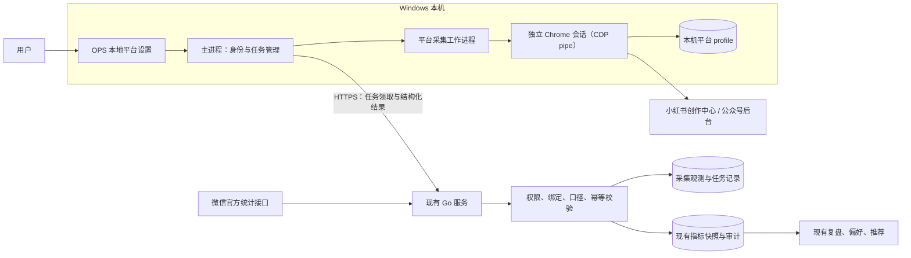
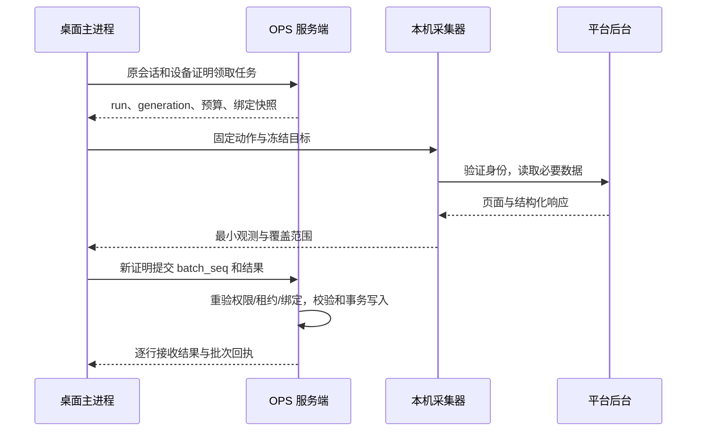
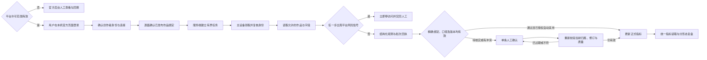
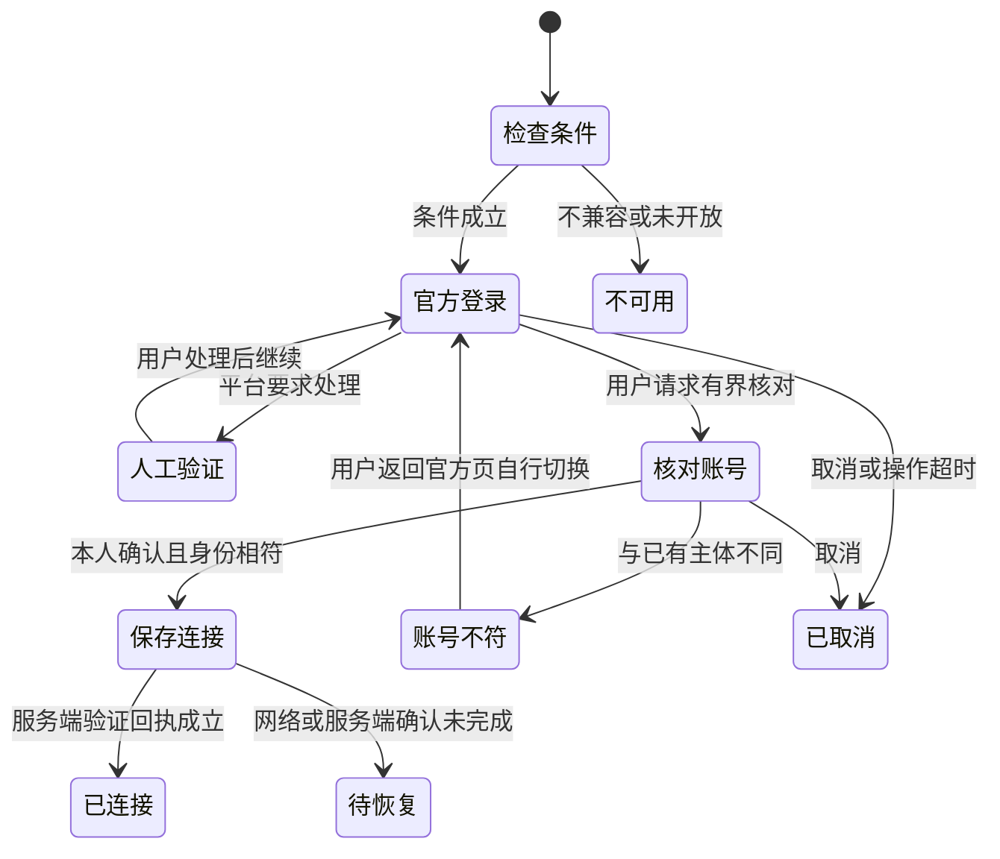

# 20 平台登录与作品数据自动回填设计

- 日期：2026-10-21；版本：v0.10（三平台正式版客户端内嵌登录设计）。
- 最新正式版呈现目标：按用户本次明确要求，三平台登录在 OPS 客户端内完成，不要求安装、启动或切换外部浏览器。具体 UI、运行时、会话迁移与验收以 §20 为准；§5、§18～19 中系统 Chrome／CDP／目录归档是既有方案或历史证据，不能继续作为正式版登录的默认实现。
- 状态：小红书、微信公众号已有部分实现及真实账号可行性记录，具体证据见 §18.3；不再用“整项未实现”概括当前代码。正式验收（每平台 10 篇以上逐字段对照、会话长期有效期）尚未完成，自动采用仍关闭。**今日头条 §19 是本轮按用户要求形成的设计建议，未实施、未做头条真实账号验证，也不表示现有两平台已打通无人值守采集全链路。**
- 范围：小红书、微信公众号的账号连接、本人作品数据读取、作品绑定、自动回填、故障恢复与数据质量；今日头条文章／微头条的增量设计集中在 §19。§0～18 中“两平台”的历史范围不自动改写为三平台已交付。
- 技术栈：现有 Go + PostgreSQL + React；Windows x64 Electron 客户端新增 Node/TypeScript 平台采集工作进程，通过 Chrome DevTools Protocol（经 `--remote-debugging-pipe`）直接控制用户电脑上已安装的正式 Chromium 浏览器（Chrome → Edge → Brave → Vivaldi → Opera → Chromium → 本机已安装的 Playwright Chromium）；不使用 Playwright 的驱动库，也不下载或打包浏览器内核（D-129 v0.5）。
- 决策入口：D-129（既有两平台）；D-130（头条扩展设计建议，待实施授权与实账核验）。本文统一维护本能力的详细契约，不另建同主题实施方案；14 文档继续维护已有数据回收与分析业务。
- D-131 记录本次内嵌登录目标与技术建议；仅形成文档和交互原型，没有改造产品运行时。内嵌兼容、平台许可与真实账号验证仍为前置，不能把外部 Chrome 实测直接用于证明 Electron 内嵌可用。
- 阅读顺序：产品与开发先读第 0～4 节；后端重点读第 7～12 节；桌面端重点读第 5～6、10～11 节；测试按第 15～17 节执行。头条开发另须完整阅读 §19，不能只增加平台枚举。
- v0.9 变更：头条读取改为许可依据成立后的条件方案；登录不沿用高频身份请求，收紧主体合并预算、平台风险即停与显式恢复、数据出站范围。规则并入 §19.3～19.5／19.8，原任务与验收原位扩充；不把低频或实测成功当平台许可／免风控证明。本轮仍只修改文档。
- v0.8 变更：将首次手动发现入口、同主体重连、发布时间对照和预算计数补入原章节，修正登录重试措辞；复用原 8 个任务、46 条验收，不新增附录或接口体系。
- v0.7 变更：补齐服务端绑定依据、异步取消与认证失效、浏览器品牌固定、能力状态、改绑后的统计隔离、调度公平性、字段级采用、CDP 防护落点及候选保留。新增 §19.14～19.15，验收扩展为 TT-PS01～46。
- v0.6 变更：新增 §19 的两平台源码对照、头条登录与作品绑定方案、采集／投影链路、数据口径、兼容迁移、开发任务与实账／UI 验收；纠正文首“未实现”和导出能力待验证的过时概括。仅更新文档，不修改产品代码或开启采集。
- v0.2 变更：补齐唯一指标读取入口与质量过滤、口径单位、映射注册表、设备在线心跳、任务生成与去重、run 级失败上报、字段级投影、存量绑定来源、成员/工作区生命周期、用户同意与合规复核、域名/代理防护、浏览器版本策略、灰度与 kill switch；同步新增 PS-T41～PS-T50 与 SP-PS06。首版范围不变。
- v0.4 变更：写入两平台可行性实测结论（§6.2、§6.3、§17.1.1）；公众号文章编号确定为 `appmsgid_itemidx`；平台浏览器驱动改为标准 Chrome + CDP（pipe），不用 Playwright，Edge 不再作为首选；SP-PS02/03 拆成“可行性（已完成）”与“正式验收（待做）”两段。
- v0.5 变更：按用户要求把浏览器选择改为多品牌链（Chrome → Edge → Brave → Vivaldi → Opera → Chromium → 本机已安装的 Playwright Chromium），并把“发现→启动→CDP 握手”真正接通、在设置页显示检测结论；修正 CDP pipe 帧格式（JSON + NUL，非长度前缀）与跨品牌产品串解析；新增错误码 `platform_browser_launch_failed`。仍不使用 Playwright 驱动库、不下载或打包浏览器内核、不开放调试端口。
- v0.3 变更：对齐仓库现状（00047 已有 `impressions bigint` 与修订函数最新定义、`review.go` 已有 CTR 派生、00043 偏好输入列有意不含展现）；统一可用性枚举（`ready`）、run 过期与重派语义、手动采集只由连接保管人发起；定义 `row_no/payload_hash`；首版不采集账号区间汇总；补公众号会话有效期、平台数据延迟与节点可领时间、首选采集时段、同设备多连接领取顺序、跨工作区同一外部账号、客户端人工升级下的熔断恢复、错误码动作列与缺失错误码、运营诊断可见位置；统一节点读取入口由 `metric_d7_public` 更名为 `metric_node_public`；新增 §8.5 字段变更总表与 PS-T51～PS-T54。首版范围不变。

## 0. 结论、目标与实施边界

### 0.1 推荐方案

采用“**本机登录与保管网页会话 → 本机低频读取本人后台 → 服务端核验账号与作品绑定 → 校验后写入现有指标快照 → 既有复盘与推荐消费**”。具有实际统计接口权限的公众号继续优先使用服务端官方 API。

本机连接器应能自动读取和持续回填已绑定作品的数据，不把截图识别作为唯一方案。截图、粘贴与手动录入保留，用于平台不可用、历史无法查询或需人工核对的场景。

导出能力以事实台账为准：V-006、V-011 已记录 2026-10-11 用户在两平台未找到“导出数据”按钮，因此不能把平台原生导出写成现成能力或验收前提。保留现有通用 CSV／`file` 导入；当前逐字段对照使用同一作品、同一窗口、尽量同一时点的后台页面与截图。将来具体账号确实提供原生导出时，再把文件加入对照证据；本方案不依赖它。

“自动回填”指按明确授权的账号和作品绑定更新表现数据，不包括自动认定已发布、自动发表、群发、评论、点赞、修改后台内容，也不包括智能体批量执行操作卡片。

### 0.2 成功标准

| 编号 | 可验证目标 | 成功证据 |
| --- | --- | --- |
| PS-G01 | 两个平台均可在本机完成扫码连接，重启后尝试复用会话 | 真实账号登录、重启复用、到期重新认证记录 |
| PS-G02 | 每条正式指标都能追溯到正确工作区、平台账号、外部作品、统计时点与来源 | 绑定、观测记录、指标及审计串联查询 |
| PS-G03 | 已绑定作品在客户端在线且平台能力可用时自动补数 | 无需逐次手填的连续运行记录；逐字段对照后台 |
| PS-G04 | 同名作品、账号切换、重复回传、迟到响应不会串数或倒灌 | 第 16 节对应故障与并发用例 |
| PS-G05 | 真实 0、未知、估算、人数、次数、累计与区间被明确区分 | 字段映射测试、真实后台对照、报表口径检查 |
| PS-G06 | 平台会话不上传业务服务器或模型服务 | 网络与日志检查；服务器持久化字段检查 |
| PS-G07 | 下线、撤销设备、退出、移出工作区后不再接受新结果 | 领取、执行、回传与提交各阶段撤销测试 |
| PS-G08 | 已有人工回填、微信 API、截图、复盘、D7 样本及 Web 功能保持兼容 | 定向回归、HC-01 至 HC-31、相关前后端测试 |

真实接口字段覆盖和风控频率不能由源码或 mock 证明。平台没有历史数据时，不能补造历史节点；客户端退出或电脑休眠时，本机采集暂停。

### 0.3 首版范围与后置项

| 首版必须交付 | 后续再做 |
| --- | --- |
| Windows 本机可见浏览器登录，独立 profile 与身份复核 | macOS/Linux、手机本机连接器 |
| 一个 OPS 平台账号指定一台主采集设备，支持人工转移 | 多设备自动接管、无人工确认的会话迁移 |
| 当前工作区、有效 OPS 会话下的后台采集 | 独立 Windows 服务、退出后常驻、无人登录全天运行 |
| 能力检测、作品绑定、逐篇指标、日常与节点采集 | 私有接口签名直连、特殊浏览器内核等独立技术路线 |
| 严格结构化数据自动采用，其他情况待逐条确认 | OCR 自动入库、模型自行判断作品归属 |
| 复用现有指标、审计、通知与账号粉丝表 | 通用爬虫平台、任意脚本执行、第三方账号数据产品 |

当前不为尚未取得的微信第三方平台资质预建授权平台。以后获得正式合作接口时，通过相同观测与指标契约接入。

仓库的 `platform_account` 约束已经包含 `toutiao`（迁移 00046），但本能力首版只支持 `wechat_mp` 与 `xhs`。连接创建、能力检测、任务领取对第三平台一律返回 `platform_not_supported`，不静默降级，也不把头条作品当作可绑定对象；头条接入另按 19 文档立项。

## 1. 依据、现状与 Easel 可复用经验

### 1.1 基线与兼容约束

| 依据 | 本文如何承接 |
| --- | --- |
| [04 需求](04-需求与功能分级.md)、[05 交互](05-业务流程与交互.md) | 账号、作品、人工发布回填、逐条采用仍是原业务入口 |
| [06 架构](06-数据与技术架构.md) | 保持一个 Go 服务、一个 PostgreSQL，不引入 Redis 或独立云采集服务 |
| [08 开发与测试](08-开发与测试计划.md) | 本文新增 DEV-PS 任务；正式实施再同步模块条目，不把计划写成已完成 |
| [14 数据回收](14-数据回收闭环规划.md) | 保留既有来源、节点、官方同步与分析；增加网页后台数据通路 |
| [16 系统智能体](16-系统智能体设计.md)、D-117 | 不增批量执行；连接/解除/模糊绑定不能由模型自行确认 |
| [17 Electron](17-Electron客户端改造方案.md)、D-119/D-126 | 复用业务 Session、设备身份与本地设置；平台读取是独立能力，不混入 AI 中转 |
| D-122 | 保持指标修订、审计、发布更正及并发检查 |
| D-123/D-124、[18 账号类型与模板](18-账号类型迁移与创作模板设计.md) | 平台连接身份与创作类型分离；同平台类型迁移不更换平台登录身份 |
| D-127 | 采集与逆向没有项目级技术禁令；租户隔离、凭据保护、人工发布和有效 HC 覆盖保持 |
| [19 今日头条](19-今日头条平台接入设计.md) | D-128 首版仍是人工发布与回填；2026-10-21 用户要求补充登录与作品数据回填方案，增量设计见本文 §19，本轮不实施第三平台适配器 |

本文描述新增能力的目标契约，不能据此宣称旧代码已满足。实施造成既有契约变化时，应先按第 17 节同步对应基线。

本文的“新增字段”不等于只改新表。`metric_snapshot` 的修订入口、偏好输入触发器、offset 触发器、来源排序、`work_metric_d7` 以及至少 12 个非测试文件中的 31 处直接指标查询，都属于必须同步改造的范围，完整清单与现状只在 §8.5 维护；只加列不更新这些位置，会出现“数字变了但修订/审计/偏好/报表没变”的假一致。

今日头条接入（D-128、19 文档）已经改过同一批对象：00047 新增 `metric_snapshot.impressions bigint`，重建 `work_metric_d7` 并输出 `impressions`，`metric_snapshot_bump_revision()` 的最新定义也在 00047；`review.go` 已按同一快照 `reads/impressions` 派生 CTR。本能力在此基础上扩展，不重复新增 `impressions`，也不另定一套展现口径。

### 1.2 当前实现与缺口

| 现有所有者 | 已有能力 | 本次最小扩展 |
| --- | --- | --- |
| `server/internal/app/datacube.go` | 微信统计权限检测、近 7 天同步、`wechat_msgid` 匹配、待匹配与每日同步 | 新通路共用写入与授权规则；替换新功能的标题自动绑定行为 |
| `server/internal/app/metric_quality.go`、`review.go` | 来源、天数、去重、修订与审计；D7 选择及指标 CRUD | 增加观测关联、口径与质量状态、迟到保护；所有消费者统一读取 |
| `metric_unmatched` | 微信未匹配记录，逐条指定/忽略 | 扩展为通用未匹配观测，不再建一套待匹配系统 |
| `account_metrics.go`、`account_metric_daily` | 微信 API/人工每日粉丝记录 | 扩展网页来源及实际统计时点；账号区间汇总不冒充每日数据 |
| `desktop_device`、`desktop_proof.go` | 设备密钥、挑战签名、撤销 | 复用设备身份；拆开共用证明与 AI 专属策略检查 |
| `desktop/src/main.ts`、`desktop-client.ts` | 线上业务窗口、包内设置、设备管理 | 增加受限平台工作进程管理，不把平台权限交给线上渲染页面 |

现有 `matchArticle` 会在“标题规范化相同、日期相差不超过一天、只有一条候选”时自动写入微信编号；现有快照写入也不会自动拒绝旧时点覆盖新时点。**新增后台来源不能直接调用这些行为作为完整质量保障。**

### 1.3 Easel 证据、发现与调用路径

以下为 2026-10-20 源码观察和离线验证，编号仅在本文内使用；没有通过真实账号证明运行可用性。

| 证据 | 文件/函数 | 发现 | 对本方案的影响 |
| --- | --- | --- | --- |
| E-PS01 | [xhs_publish.py](../Reference_Projects/Easel/skills/shared/scripts/xhs_publish.py)，`cmd_login`、`_launch` | Playwright 扫码、持久 profile、登录状态及互斥 | 复用交互思想；增加租户/账号隔离，避免只按平台建目录 |
| E-PS02 | [account_stats.py](../Reference_Projects/Easel/skills/shared/scripts/account_stats.py)，`_scrape_xhs`、`_scrape_notes` | 账号近 7 日汇总与笔记列表分开；笔记返回 `stat` 为空 | F-PS01：主数据中心不是完整逐篇回填；本方案必须单独验证作品详情数据 |
| E-PS03 | [weixin_mp_stats.py](../Reference_Projects/Easel/skills/shared/scripts/weixin_mp_stats.py)，`cmd_stats`、`_parse_analytics` | 监听后台响应；单篇统计按 `by_title` 合并 | F-PS02：同名文章串数；改为账号身份与外部作品编号 |
| E-PS04 | 同文件，`_parse_analytics`、`_tendency_metrics` | `or` 混用真实 0 与缺失，`share_uv` 被标为次数 | F-PS03：0 值及统计口径错误；必须有类型化映射 |
| E-PS05 | [web/app.py](../Reference_Projects/Easel/web/app.py)，`local_write_guard`、`_fetch_analytics` | 本地防护不是多用户鉴权；抓取由接口请求触发 | 不沿用为 OPS 公网登录/多租户/任务系统 |
| E-PS06 | [skill-data-tracker](../Reference_Projects/Easel/skills/builtin/skill-data-tracker/SKILL.md) | 支持时序存储，但数据需要输入，不是完整采集器 | 不把“能保存快照”误认成“已自动获取” |

F-PS01/02/03 均有源码依据；F-PS02/03 已用虚构数据直接调用解析函数重现，风险等级为数据正确性高风险。P-PS01 调用路径为：用户扫码（E-PS01）→ 复用 profile → 页面/API 读取（E-PS02/03）→ JSON 解析与匹配（E-PS03/04）→ 展示/文件快照（E-PS05/06）。改进集中在身份、单篇采集、匹配与入库，不假定替换浏览器即可修复整条链路。

复核方法：在仓库根目录以 `rg -n 'def cmd_login|def _scrape_xhs|def _scrape_notes|by_title|read =|share_uv' Reference_Projects/Easel/skills/shared/scripts` 定位上述函数；离线输入两篇同名文章，检查是否同得最后一条统计；再输入 `total_read_uv=0, read_num=12` 检查是否误取 12。此验证不启动浏览器、不访问平台、不使用真实凭据。

## 2. 术语、身份与安全边界

### 2.1 五种身份不能混用

| 身份 | 含义 | 能证明什么 |
| --- | --- | --- |
| OPS 用户/会话 | 当前登录人及有效线上 Session | 当前业务访问身份 |
| 工作区与角色 | owner/editor/viewer | 能操作哪些业务资源 |
| 本机设备 | 已登记设备公钥 | 请求来自持有该私钥的设备，不证明平台数据一定真实 |
| 平台账号身份 | 小红书用户 ID；公众号可稳定验证的原始 ID/biz 等 | 当前网页会话对应哪个账号 |
| 外部作品身份 | 小红书 `note_id`；公众号文章编号及位置 | 数据对应哪篇平台作品 |

小红书 OAuth 的 `open_id` 不自动等于网页后台用户 ID，公众号 AppID、原始 ID、biz 也不能在没有验证映射时互换。昵称、头像、公众号后台 URL 的登录 `token` 不能充当稳定账号 ID。

### 2.2 数据去向

- 平台 Cookie、localStorage、浏览器 profile、登录二维码和验证码只在本机平台浏览器使用，不进入服务器、业务页面 localStorage、AI 提示词或普通日志。
- 平台账号稳定标识、作品编号、必要标题/发布时间、结构化指标和脱敏诊断可上传 OPS。作品正文、粉丝列表、评论人身份等不属于此次采集范围。
- 官方 API 的既有 AppSecret 留在原服务端加密体系；不要为“全本地”而迁移既有官方凭据。
- 设备签名证明设备与请求绑定，不是平台背书或数据真实性证明。服务器仍需做语义、时点、归属和异常检查。
- 首次连接前必须展示并记录平台数据读取说明：读取字段、上传范围、需要客户端在线、可能触发平台验证、可随时暂停。用户确认后写 `platform_consent_version/consented_at`；说明文本有版本，未确认不建立连接，换版本需重新确认。版本升级后旧连接自动暂停采集/采用，重新确认前不建新任务，手动单次也先补确认。
- 共享电脑必须提供“退出时清除本机会话”选项，并在连接页提示浏览器 profile 对其他 OS 用户可读；默认不清除，但用户可显式开启，开启后退出即停进程并清理该用户命名空间。

## 3. 总体架构与职责



| 组件 | 唯一职责 | 不承担 |
| --- | --- | --- |
| React 业务页面 | 展示连接摘要、作品绑定、待确认、指标来源与故障 | 读取 Cookie、本机文件、接收任意执行权限 |
| Electron 主进程 | 复用 OPS 会话，核对工作区，申请设备证明，控制子进程与上传 | 任意远程脚本执行、平台正文解析 |
| 平台工作进程 | 固定适配器、浏览器互斥、身份验证、读取与结构化解析 | 选择目标工作区、决定 OPS 已发布状态、直接写数据库 |
| Go 平台接入模块 | 连接授权、任务租约、观测校验、作品匹配、正式入库 | 保管网页平台会话、代理任意平台请求 |
| 现有指标模块 | 唯一正式指标写入、修订、来源选择与审计 | 运行浏览器、重复保存另一套业务指标 |

首版使用出站 HTTPS 领取任务，不新增公网入站端口，不新增 WSS 通道，也不把平台命令塞进现有 AI WSS。三张新表分别承载“连接授权、执行任务、外部观测”，作品绑定直接扩展既有 `work`；详见第 8 节。

## 4. 用户流程与权限

### 4.1 首次连接

1. owner 开启工作区“本机平台数据读取”；默认关闭。若允许 editor 使用自己的设备，由 owner 单独开启成员连接权限。
2. 用户在账号设置中选定一个现有 OPS 平台账号，点击“在本机连接”。Web 用户得到桌面端入口说明，不能假装当前浏览器已具备本机采集能力。
3. 本地设置说明读取哪些指标、上传哪些数据、需要客户端在线及可随时暂停；用户确认后记录同意版本，再打开独立官方平台页面。
4. 用户扫码并在平台 App/微信中确认；验证码、滑块或账号选择在平台原页面处理，不回传到 OPS 表单。
5. 连接器读取稳定身份并展示“将连接的真实账号”；用户确认对应关系。已有连接身份不一致时进入身份冲突，不能静默替换。
6. 完成能力检测，显示可读字段与限制；连接成功不自动开启持续回填。
7. owner 为该账号分别开启两个独立开关：`auto_collect`（自动领取并读取）与 `auto_adopt`（把通过校验的观测自动写入正式指标）。`auto_adopt` 只能在 `auto_collect` 开启且能力满足时开启；绑定条件在每条观测提交时校验，不要求开启前已有作品。两者默认关闭，可单独关闭。`auto_collect`、暂停/撤销递增 `authorization_revision`；`auto_adopt` 是采用策略，使用独立的 `adoption_revision`，不进入冻结的采集授权版本，开关变化不取消已领采集，提交时按最新值决定是否采用（关闭则只落观测）。手动单次采集不受 `auto_collect` 限制，但仍受工作区策略、成员连接权限和预算约束。

官方 `metrics_wechat_auto` 继续只管官方 API 通路。两个开关都开时，正式指标优先官方 API；浏览器通路只在官方不可用、缺少节点或用户明确选择时补位，不能重复写同一节点，也不能用两个“自动”入口互相兜底。

### 4.2 绑定作品与日常使用

用户通过现有 H-07 完成发布回填，粘贴平台链接；连接器核对平台账号与外部作品归属，能精确验证时建议建立绑定。首次不能验证归属或只能按标题找到候选时，由人对单篇作品确认。

已确认绑定、已发布、未删除、授权有效的作品可自动补数。新发现的平台作品不自动创建 OPS 作品、不自动修改现有作品状态。用户可以逐篇关联或忽略；不提供“全部绑定”“全部确认入库”等入口。

作品页显示最近成功读取时间、数据实际截止时间、来源、真实天数、缺失字段及异常。旧数据保留显示，但明确“数据未更新”，不因刷新失败清空成 0。

### 4.3 权限矩阵

| 操作 | owner | editor | viewer | 超管代访问 |
| --- | --- | --- | --- | --- |
| 查看有权访问的正式指标 | 允许 | 允许 | 允许 | 沿既有业务查看边界 |
| 改工作区策略/开启账号自动采集与自动采用/指定主设备 | 允许，重新认证 | 禁止 | 禁止 | 禁止 |
| 本机连接、手动采集本人持有的连接 | 允许 | 仅 owner 允许成员连接时 | 禁止 | 禁止 |
| 请求在他人保管的连接上采集 | 禁止 | 禁止 | 禁止 | 禁止 |
| 单篇绑定、解除绑定、确认指标冲突 | 允许 | 沿现有作品写权限，并满足成员连接策略 | 禁止 | 新平台操作禁止 |
| 暂停/解除自己持有的连接 | 允许 | 允许，不以策略仍开启为前提 | 角色降级后仍可回收本人连接 | 仅回收真实本人持有的连接 |
| 撤销本人设备/清本机数据 | 允许 | 允许 | 允许 | 按真实登录用户处理 |

手动采集只能由连接当前保管人（`platform_connection.user_id`）在其主设备上发起；owner 和其他成员只能看到状态，或通过开关、暂停、撤销影响该连接，不能借“请求一次采集”远程驱动别人的浏览器。跨工作区资源按既有 404 语义拒绝。回收入口只允许减权，不借此开放 viewer 的其他 `/desktop/*` 或平台写接口。owner 能停止工作区连接，但不能读取其他成员的本机 Cookie 或远程操纵其浏览器。

成员被移出、降级为 viewer、工作区删除或账号删除时，按 §5.4 执行连接撤销、租约取消和本机清理。owner 不能把连接主设备改到“无法登录该平台账号”的成员设备上；主设备变更必须由新设备重新扫码验证身份，不能复制 profile 或 Cookie。

## 5. 本机登录、会话保存与生命周期

### 5.1 浏览器与存储

本节保留既有运行时依据。正式版登录不再采用外部浏览器路径，须执行 §20 的 WebContentsView 与持久 Session；不能把旧 Chrome profile 复制成 Electron Session，也不能在内嵌失败时自动回退到外部浏览器。

- 使用 Node/TypeScript 直接实现最小 CDP 客户端，控制用户电脑上已安装的正式 Chromium 浏览器；客户端不下载、不打包浏览器内核。发现顺序固定为 Google Chrome → Microsoft Edge → Brave → Vivaldi → Opera → Chromium → 本机已安装的 Playwright Chromium（D-129 v0.5）：前六种按注册表 `App Paths` 与标准安装路径发现，最后一档只扫描 Playwright 已下载到本机的 `chromium-<构建号>` 目录（`PLAYWRIGHT_BROWSERS_PATH` 可覆盖），**不触发任何下载**。CDP 只用 `Page/Network/Runtime` 的必要能力：导航、读取允许域名的响应体、页面内只读求值。2026-10-20 可行性实测组合为 Chrome 155.0.8059.85；正式支持范围在 SP-PS01 锁定。一个都找不到时返回 `platform_browser_unsupported` 并提示安装；找到了但起不来（进程立即退出、被安全软件或企业策略拦截、调试通道无响应）返回 `platform_browser_launch_failed`，两者不混用，因为用户要做的事不同。
- 只用浏览器可执行文件，不使用 Playwright/Puppeteer 的驱动库：工作进程自己实现 CDP 握手，启动参数固定，不调用 Playwright 的 API、不加载它的 `user-data-dir` 约定、不复用它的 profile。
- **CDP pipe 的传输格式是「JSON + NUL 分隔」，不是长度前缀**：每条消息是一段 UTF-8 JSON，后跟一个 `\0`。2026-10-20 用本机 Chrome 155 实测确认，按长度前缀写会被回 `{"error":{"code":-32700,"message":"JSON: no input at position 0"}}`。单条消息上限 8 MiB，超出按 `platform_schema_changed` 拒绝，避免异常流把工作进程缓冲撑爆。
- 浏览器自报版本来自 `Browser.getVersion` 的 `product`，不同品牌格式不同（Chrome 报 `Chrome/155.0.8059.85`，Edge 报 `Edg/155.0.4283.62`），解析必须按 `品牌/版本` 通用处理，不能只认 `Chrome/`。
- 每个连接使用一个独立且**持久**的 `userDataDir`：同一连接重启复用，不做“每次启动新建目录”；不同连接、不同工作区、不同账号之间不复用。绝不连接日常浏览器默认 profile、导入系统浏览器 Cookie，或复用 OPS 业务 Session。
- 首版先验收可见浏览器登录和读取；隐藏/无头运行只有在同账号复用与真实平台验收通过后才能作为可选运行方式，不能静默切换内核或清空会话。
- 显式启用 Chromium 沙箱，不添加 `--no-sandbox`、关闭证书校验、关闭站点安全等参数。浏览器策略不兼容时明确失败；不能用降低隔离来自动修复。
- 目录命名空间为 `platform-profiles/accounts/<OPS 登录用户 UUID>/<platform>/<connection UUID>/profile`；第一段是登录用户，不是平台账号或工作区 ID。同目录 `meta.json` 记录服务 Origin、登录用户、工作区、设备、平台、连接 ID、外部账号键和创建时间，启动时校验。同一登录用户的微信与小红书连接不能共用一个 profile；跨成员转移后新用户使用自己的命名空间，旧目录按撤销清理。Origin/工作区变化不靠移动目录解决；重装或换机会留下无主目录，启动时扫描并提示清理，默认每登录用户 2 GiB、全应用 10 GiB，超限先停新采集并提示清理。
- 应用自己的敏感元数据使用 OS 安全存储；浏览器 profile 使用 Chromium 自身保护、当前用户 ACL 与磁盘安全措施。`safeStorage` 不会自动加密整个目录，也不能抵御同一系统用户下的恶意程序。
- 不开放 CDP 调试端口：以 `--remote-debugging-pipe` 启动浏览器，CDP 只经工作进程持有的管道传输，本机其他程序无法借端口接管会话（实测原型用 `--remote-debugging-port` 仅作调试，产品不得沿用）；主进程与子进程使用私有 IPC。可执行文件来自受支持浏览器发现或已验证安装，不接受服务器下发任意路径。
- 工作进程启动时上报浏览器名称/版本；`/desktop/capabilities` 返回已验证的 `min/max` 范围。浏览器自动升级超出范围时，先以只读身份检查探测该版本；探测失败则拒绝启动该适配器并提示等待客户端更新，不静默降级、不重建 profile、不关闭沙箱硬跑。
- 平台工作进程沿用系统/Electron 的代理配置，不允许任务或页面为单次采集指定任意代理。代理认证失败、证书被替换或企业 MITM 导致页面不可验证时，按 `platform_proxy_intercepted` 停止并提示，不关闭 TLS 校验、不绕过代理。
- `SingletonLock` 残留时先检查锁内 PID/进程是否仍存活；只有确认无存活进程才把 profile 重命名为 `.corrupt-<时间>` 后重建，删除前保留诊断元数据，绝不无条件删锁。

旧 Electron 的 `OPS_DESKTOP_NO_SANDBOX` 逃生配置不会自动传给平台浏览器；在无法保证平台窗口隔离的兼容模式下，应拒绝启用本能力并显示原因，不改变原 AI 功能的规则。

### 5.2 状态与检测

连接的控制状态与实时可用性分开。控制状态为 `active / paused / revoked`；可用性为 `unknown / login_required / verifying / ready / challenge_required / restricted / identity_mismatch / degraded / unsupported`。全文“可用”均指 `availability='ready'`，不另设 `available`；某项能力缺失记录在能力快照（§6.4），不作为连接可用性取值。

设备在线必须由平台采集自己的心跳判定：`platform_connection.last_seen_at` 由 `POST /desktop/platform/presence`、claim 与 heartbeat 刷新，TTL 90 秒；超过 TTL 显示“客户端离线”。客户端在平台开关开启且当前工作区有效时每 30 秒发送一次 presence，即使没有任务也要发，否则空闲连接永远等不到新任务。不能复用 `desktop_device.last_seen_at`（后者只表示 AI WSS 连接）。run 租约与设备 presence 是两件事：run 结束不清除 presence，presence 过期也不延长 run。

每次领取任务后、读取数据前都校验实际平台身份；不能只相信历史“登录成功”文件、Cookie 文件存在或昵称相同。

成功条件是稳定平台身份和对应后台查询均可验证。网络超时为 `degraded`，明确出现登录要求为 `login_required`；平台明确返回账号受限、安全验证或登录设备冲突时为 `restricted` 或 `challenge_required`，立即暂停自动采集并通知 owner，不自动重试、不轮换代理、不尝试绕过。未知不能当退出，也不能直接当成功。

采集会话可能使用户日常浏览器会话失效。连接页必须提前说明，并提供“仅手动采集/暂停自动采集”的选项；平台以任何形式提示账号异常时，以用户账号安全优先，停止采集。

### 5.3 暂停、退出、切换与清理

| 事件 | 本机动作 | 服务端动作 |
| --- | --- | --- |
| 暂停账号同步 | 停止领取，关闭/取消当前采集 | 授权版本递增，拒绝旧任务结果 |
| OPS 退出/会话过期 | 停止子进程，锁定该用户命名空间 | 校验会话失败；不接收后台补传 |
| 切换工作区/用户/服务地址 | 取消旧上下文，重新取得 `/auth/me` | 旧工作区任务不能以新会话回传 |
| 平台内切换了账号 | 停止读取、关闭浏览器并清理该连接会话，提示身份不符 | 不迁移旧作品与绑定，不自动覆盖连接身份 |
| 本人/owner 撤销连接或设备 | 收到状态时取消、关闭浏览器并自动清理该连接 profile 与诊断 | 立即停止新租约，旧结果拒绝提交 |
| 用户选择清本机平台数据 | 停进程后删除精确命名空间、缓存与诊断 | 记录清理确认；不删除线上正式指标 |
| 成员被移出/降级为 viewer | 移出：停止领取并清理 profile；降级：停止领取，保留 profile 到用户确认 | 移出：撤销连接并取消租约；降级：只暂停自动采集 |
| 工作区/账号删除 | 上线后自动清理对应命名空间，不等待确认 | 撤销连接，按外键顺序清理观测/任务；正式指标沿既有删除策略 |
| 主设备变更 | 旧设备停止领取并关闭浏览器；新设备重新扫码 | 取消旧租约、递增授权版本；不复制 profile/Cookie |
| 关闭应用窗口 | 明确暂停采集并提示 | 租约自然到期；不假装后台仍在运行 |

离线设备不能被保证远程擦除，界面必须显示“服务端已撤销，本机清理待设备上线”。清本机 profile 不代表平台全部会话已失效；需要时引导用户到平台管理登录设备或授权。

清理失败保持待清理状态和路径归属记录，不在仍有浏览器进程使用目录时强删，也不通过删除整个应用用户目录处理单账号故障。

首版不承诺关闭窗口后继续采集：关闭=暂停并提示，最小化才继续。共享电脑开启“退出时清除本机会话”后，退出即停进程并清理该用户命名空间；未开启时至少锁定命名空间，不能静默复用上一个用户的会话。

### 5.4 成员、角色与工作区生命周期

| 事件 | 连接与任务 | 本机数据 | 通知与审计 |
| --- | --- | --- | --- |
| 成员被移出工作区 | 立即撤销该用户当前保管的连接，取消 queued/leased/running 任务，递增 generation | 下次启动检测无工作区权限，清理该连接的 profile 与诊断 | 通知 owner；保留撤销审计，不保留可恢复授权 |
| 成员降级为 viewer | 自动采集暂停；本人仍可回收自己的连接 | 保留 profile 到用户确认清理 | 告知“角色已降级，自动采集停止” |
| 工作区删除 | 撤销全部连接与任务 | 上线后自动清理所有相关命名空间；未上线设备显示待清理 | 按既有工作区删除审计记录，不额外保留凭据 |
| OPS 账号删除 | 撤销该账号全部连接 | 删除账号命名空间；未上线设备显示待清理 | 正式指标沿既有作品/账号删除策略，不单独保留观测 |
| 主设备变更 | 旧设备任务取消，新设备重新扫码并升授权版本 | 旧设备上线后清理旧 profile；不迁移、不复制 | owner 发起、新保管人确认；记录旧设备、新设备、保管人与时间 |
| 成员重新加入 | 不复用旧连接或旧授权版本 | 旧 profile 视为无主，重新登录才可用 | 新连接必须重新同意与验证身份 |

主设备只能在同一工作区内“能够登录该平台账号”的成员设备之间转移。owner 不能仅凭管理权限把主设备指派给无法完成平台登录的设备；转移失败保持暂停，不降级为无人值守轮询，也不自动恢复旧设备继续采集。跨成员转移同时把 `platform_connection.user_id` 改为新保管人并切换 `device_id`，新保管人须对该账号有写权限；转移期间连接保持暂停，新保管人必须重新同意、扫码并通过身份校验后才恢复；旧保管人随即失去 `mine/revoke` 与该 profile 的使用权。不能只换设备不换归属，也不能继承旧 profile。

## 6. 两个已调查平台的适配器（头条扩展见 §19）

### 6.1 适配器契约

每个平台只实现固定动作：`login`、`verify_identity`、`probe_capabilities`、`discover_works`、`collect_metrics`、`disconnect_local`。任务参数只包含账号、外部作品 ID、允许日期窗口与预算。

服务端不得下发任意 JavaScript、浏览器启动参数、URL、选择器或 Cookie。适配器代码随客户端版本发布；修复结构变化时升级适配器并携带 `adapter_version`、`mapping_version`，不使用服务器热下发脚本。

响应解析优先级是：已核实的页面原生结构化响应 → 已核实的页面状态对象 → 明确标签下的 DOM。只捕获允许的官方后台域名、路径、响应类型和大小，不监听后保存全部网络响应。

“只读”按业务动作判断，不能简单要求所有请求都是 GET：数据查询可能使用 POST，页面也有正常登录与遥测。连接器不暴露发布、删除、评论等命令；采集阶段对已知内容写端点额外阻断。不能修改平台 CSP、关闭 TLS 校验或把平台浏览器当通用网络代理。

### 6.2 小红书

入口为 `creator.xiaohongshu.com`。身份与主站登录态、创作中心登录态分别检测；主站可用但创作中心不可用时，只报告可读范围，不填造作品表现。

采集分三部分：本人账号概览、本人已发布笔记列表、指定笔记的详情/数据分析。草稿、审核中、隐藏、删除等状态单独识别；列表缺少一条不等于它已删除。

绑定链接必须支持用户从 App 复制的分享文本：先提取 `xhslink.com` 短链或完整 URL，只在允许域名内做有限跳转（最多 3 次、仅 HTTPS），解析出 `note_id` 后再校验作者；解析失败给出手工输入 `note_id` 的兜底，不得按标题猜测。短链本身不持久化为作品身份，对外展示链接清除会话参数。

图文与视频的字段集合不同：图文优先 `view_times/impressions/like_count/favorite_count/comment_count/share_*`，视频的播放/观看字段需在 SP-PS02 单独确认；未确认的字段只存观测，不投影正式 `reads`/`impressions`。同一作品的内容类型变化时，以平台当前类型重新检测能力，不沿用旧字段映射。

已在 Easel 观察到的 `/api/galaxy/user/info`、`/api/galaxy/creator/home/personal_info`、`/api/galaxy/v2/creator/datacenter/account/base` 只是调查起点，不是本方案承诺长期稳定的开放 API。单篇阅读、曝光与转粉的真实来源必须在 SP-PS02 实测取得，不能用账号近 7 日汇总代替。

2026-10-20 可行性实测（用户本人小号、1 篇已发布图文，详见 §17.1.1）确定首版数据来源如下：

| 用途 | 接口（只读） | 已确认字段 | 首版处理 |
| --- | --- | --- | --- |
| 账号身份 | `/api/galaxy/user/info` | `data.userId`、`data.redId` | `external_account_key = xhs_user_id:<userId>`；`redId` 仅展示 |
| 逐篇列表与指标 | `/api/galaxy/v2/creator/note/user/posted` | `id`（即 `note_id`）、`display_title`、`time`、`type`、`tab_status`、`view_count`、`likes`、`collected_count`、`comments_count`、`shared_count` | 首版自动回填来源；与笔记管理页数字逐项一致（177/2/5/1/0）；`xsec_token/xsec_source` 不持久化 |
| 账号粉丝 | `/api/galaxy/creator/home/personal_info` | `fans_count`、`follow_count`、`faved_count` | `followers_total` 当前总数投影 `account_metric_daily.cumulate` |
| 单篇曝光/涨粉 | `/api/galaxy/creator/datacenter/note/analyze/list`（数据看板 → 内容分析） | 页面列出曝光、观看、封面点击率、涨粉、人均观看时长，但该账号返回空 | **首版不承诺**；正式验收时复测，拿到后再加映射版本 |

这推翻了 E-PS02 的担忧（Easel 当时笔记列表 `stat` 为空）：当前创作中心列表接口已直接给出逐篇计数。单位暂定：`likes/collected_count/comments_count/shared_count` 为 `count`；`view_count` 页面标签为“观看”，在正式验收确认是次数还是人数前按 `unknown` 存观测，不投影正式 `reads`。分页：该账号只有 1 篇，接口返回 `page:-1`，多页游标规则在正式验收中确认。登录时平台出现过图形验证码（`redcaptcha`），由用户在本机页面完成，符合 §5.2 交回用户处理的规则。

分页使用平台实际返回的游标/分页规则，按 `note_id` 去重；记录覆盖范围与未完成游标，不能只读取当前可见 `.note-card` 后宣称已同步全部作品。

`xsec_token` 如页面操作临时需要，只在本机任务内使用，不作为作品身份、不持久化到业务发布 URL。对外展示链接清除会话性参数。

### 6.3 微信公众号

入口为 `mp.weixin.qq.com`。平台会话可能拥有管理能力，采集器只能使用后台阅读、发表记录和分析页面。后台 URL 中的登录 `token` 是敏感会话参数，不入库、不写日志。

首先验证公众号稳定身份。若当前页面只能提取昵称而无法验证原始 ID/biz 等稳定身份，最多进入能力调查或人工待确认，不能开启后台自动采用。

公众号后台登录需要管理员或已绑定运营者用微信扫码确认，平台还可能向管理员推送登录提醒；网页会话的实际有效期没有公开承诺，可能远短于小红书。SP-PS03 必须实测“不操作时会话能维持多久、重启后能否复用、多久需要重新扫码”，并据此写入能力快照的 `session_ttl_observed`。会话失效时连接转 `login_required`，同一失效只通知保管人一次（owner 在连接摘要可见），通知说明“需要谁扫码”；不在后台反复拉起二维码。若实测需要每天扫码，公众号网页通路在产品上只能标为“半自动（需定期扫码）”，不能宣传为持续自动回填，有官方统计权限的账号继续优先官方 API。

列表采集需要保留文章在一次多图文中的位置。外部文章主键沿用现有 `wechat_msgid=mid_idx` 格式，并由连接的公众号身份约束；不能只用一次群发/发表编号而丢掉 `idx`。

`mid` 取值规则（2026-10-20 实测确定）：网页通路的 `mid` 必须取文章的 `appmsgid`，`idx` 取 `itemidx`，即 `wechat_msgid = <appmsgid>_<itemidx>`。原因：发表记录接口里“仅发表”记录（`publish_type=101`）的 `msgid` 是 `1000000016` 这类内部序号，与文章无关；只有群发记录（`publish_type=1`）的 `msgid` 才等于 `appmsgid`。文章链接中的 `mid=` 参数、官方 `getarticletotal` 返回的 `msgid`（群发 `msg_data_id` 加序号）都对应 `appmsgid`，三者因此一致。实施时用一篇群发文章核对现有官方同步写入的值与 `<appmsgid>_<itemidx>` 相同（列入 SP-PS03 正式验收）。

2026-10-20 可行性实测（用户本人公众号、16 条发表记录中抓取最近 10 条，详见 §17.1.1）确定首版数据来源：

| 用途 | 接口（只读） | 已确认字段 | 首版处理 |
| --- | --- | --- | --- |
| 账号身份 | `/cgi-bin/switchacct` 的 `biz_list.list[]` | `bizuin`、`username`（原始 ID `gh_…`）、`is_admin` | `external_account_key = wechat_biz:<bizuin>`，同时核对 `username` 与 OPS 账号已登记原始 ID |
| 逐篇列表与指标 | `/cgi-bin/appmsgpublish`（`publish_page.publish_list[].publish_info.appmsg_info[]`） | `appmsgid`、`itemidx`、`title`、`content_url`、`is_deleted`、`read_num`、`like_num`、`old_like_num`、`share_num`、`comment_num`；发送时间在 `sent_info.time` | 首版自动回填来源；“仅发表、未群发”文章同样出现；已删除文章带 `is_deleted=true`，据此排除，不靠“缺失推断删除” |
| 按日趋势 | `/misc/appmsganalysis?action=get_article_stat_tendency_and_source` | `read_uv`、`share_uv`（人数）、`date`、`scene` | 账号级区间数据，首版不上传（§9.1） |
| 单篇明细 | `/misc/appmsganalysis?action=get_article_list` | 结构存在，该账号近 30 天无阅读，返回空 | 正式验收时复测 |

单位与映射：`read_num` 在样本中只有 0/1，无法判断人数还是次数，正式验收用一篇阅读较多的文章与分析页 `read_uv` 对照前按 `unknown` 存观测，不投影正式 `reads`；`like_num` 映射 `likes`；`old_like_num` 是否为“在看”未确认，不映射 `wows`；`share_num` 单位同样待确认。数据延迟：首页标注“数据统计时间：前一日 00:00–24:00”，分析数据为次日更新，`data_latency` 记“次日”；列表计数是否实时在正式验收中确认。会话：登录约 20 分钟后关闭并重启 Chrome，会话仍有效、无需扫码；更长有效期按 §6.3 上文要求继续观察。本次登录未出现验证码。

短链接无法直接解析编号时，在允许的公众号域名内通过正常页面及响应解析；限定跳转次数与目标域名，拒绝跳往内网、其他站点或非 HTTPS。解析不到稳定编号时进入待绑定，不退化成按标题自动入库。

官方统计与后台页面是两条不同数据源。官方接口能否读取“仅发表但未群发”的文章、历史长度、数据延迟、每日额度，继续按 V-020/V-021 和 SP-PS03 验证；认证状态或 AppSecret 可用本身不能证明这些能力。

### 6.4 能力快照

每项能力记录 `supported / denied / unknown / temporarily_unavailable`、检测时间、适配器版本、映射版本、浏览器主版本、可读字段、历史范围、统计时区、数据延迟 `data_latency`（如“次日更新”“约 N 小时”“实时”，来自 SP 实测）、会话实测有效期 `session_ttl_observed` 与失败码。数据延迟决定节点任务的最早可领时间（§10.1.1），不能按“当天就有当天数据”假设。网页和官方通路分别保存，旧 `datacube_state` 继续仅表示官方接口能力。同一连接至少保留最近 5 次能力变更（90 天），用于解释“为什么昨天有、今天没有”。

登录成功、账号汇总成功、作品列表成功、单篇数据成功四件事分别展示。没有单篇数据能力时关闭自动指标采用，不关闭已经确认可用的其他能力，也不声称实现了逐篇回填。

### 6.5 映射注册表与版本协商

服务端维护只读映射注册表（首版为代码常量，不新增数据库表），按 `platform + adapter_version + mapping_version` 冻结：允许的 `scope`、标准键、字段路径、单位、精度、时间语义（累计/区间/当前值）、适用内容类型、是否允许投影正式快照。

观测写入时必须校验：`mapping_version` 在支持列表；每个 `field_paths` 属于该版本；标准键属于该平台/scope；单位、精度与时间语义匹配；`values` 不含未登记字段。客户端不能自定义路径，也不能把未知键映射成 `reads`。

适配器升级必须新增 `mapping_version`，旧版本保留只读。服务端可通过能力接口拒绝低于 min 或高于 max 的版本；注册表变更走代码评审和 PS-T41，不做服务器热下发脚本。

## 7. 作品绑定与变更规则

### 7.1 唯一归属

正式绑定必须同时满足：同一工作区、同一 OPS 平台账号、连接已确认的外部账号身份、稳定外部作品 ID、作品状态已发布、作品未删除。

微信继续以 `work.wechat_msgid` 为唯一持久编号所有者；小红书新增 `work.xhs_note_id`。接口统一返回派生字段 `external_id`，不再新增一份可独立写入的通用编号列或绑定表。

不新增 `platform_identity_key` 通用列：作品归属由 `account_id + connection.external_account_key` 派生，作品身份由 `wechat_msgid/xhs_note_id` 派生；多一个可独立写入的通用键会制造第四种身份，也会与连接换绑后的历史冲突。

`work` 增加绑定的外部账号身份、确认人/时间和 `metric_binding_revision`，并记录 `platform_binding_source`（`user_link/user_confirm/official_exact/legacy_title`）与 `platform_binding_verified_at`。用户回填的精确链接且实际作者/账号可验证时，可在该次单篇回填确认中一起建立绑定；单纯标题/时间/封面相似只能给建议。

迁移时对同账号重复 `wechat_msgid` 或小红书 ID 做显式检查，列出冲突供处理；不能继续用 `ORDER BY ... LIMIT 1` 随机选择，也不删除作品来通过唯一约束。

### 7.2 绑定改变与发布更正

- 建立、解除、改绑需要单篇操作、原绑定版本与现有 `publish_revision`；重复点击幂等，版本变化返回 409。
- 同一平台作品已绑定到另一 OPS 作品时返回 409，并给出“查看已绑定作品/改绑/解除”的逐篇入口，不静默覆盖；同一外部账号在活动连接中重复时同样 409。
- 改绑、发布更正、账号连接身份变化会使旧任务失效。任务同时冻结连接授权版本、绑定版本、发布修订，提交时全部比较。
- 解除绑定停止该作品自动采集；已经采用的指标保留来源。错误绑定修正需展示受影响指标，让人逐项决定保留/排除，不自动把旧数据搬到另一篇作品。
- 作品平台字段是创作时快照，账号类型同平台迁移不改绑定；跨平台仍需新建账号/作品，不能通过改绑把公众号作品变成小红书作品。
- 不从“抓到了平台作品”推断 H-07 已完成；历史作品导入仍走已有单篇人工确认流程。

现有官方微信的“唯一标题候选自动绑定”在本能力启用前收口到同一严格匹配服务；已经精确绑定的官方同步不受影响。历史仅按标题生成的编号标为待核对，在用户确认或真实编号/账号核验前，不作为新通路的自动采用依据。

迁移时把现有无用户确认审计的 `wechat_msgid` 统一标为 `legacy_title`（有精确链接、用户确认或可核验官方审计的分别标 `official_exact/user_link/user_confirm`），没有平台编号的作品保持 `platform_binding_source=NULL`，不能凭空标成已绑定；生成一次性核对清单。`datacube.go` 的 `matchArticle` 标题匹配路径必须同步改造：不能再只凭归一化标题相等且唯一就写 `work.wechat_msgid`，必须写来源/审计或进入待绑定。标记不删除旧编号，也不阻断已工作的官方同步，但新浏览器通路只接受 `user_link/user_confirm/official_exact`。

收口后公众号新文章若只能按标题匹配，进入 `metric_unmatched` 待绑定，不再自动入库。这是有意的安全降级，界面要说明“为什么不再自动匹配”，并给 owner 可关闭的迁移提示；不能用“以前会自动匹配”作为恢复自动写入的理由。

## 8. 数据模型与唯一所有者

本节为新增迁移的字段契约，不是可直接运行的 SQL。迁移编号在实施时按当时仓库最大编号分配，避免与其他工作冲突。

### 8.1 最小新增实体

| 实体 | 必要字段 | 约束与理由 |
| --- | --- | --- |
| `platform_connection` | `id, workspace_id, account_id, platform, user_id, device_id, external_account_key, state, availability, authorization_revision, adoption_revision, capabilities, last_verified_at, last_seen_at, auto_collect, auto_adopt, next_due_at, failure_count, cooldown_until, platform_consent_version, consented_at, created_at, updated_at` | 网页通路的授权与设备归属；`user_id` 为当前保管人，转移时一并变更。每个账号最多一条未撤销主连接；`CHECK (NOT auto_adopt OR auto_collect)`；历史撤销记录保留 |
| `platform_sync_run` | `id, connection_id, workspace_id, account_id, requested_by, trigger, task_kind, status, query_scope, authorization_revision, workspace_authorization_revision, adapter_version, mapping_version, browser_version, lease_generation, lease_expires_at, deadline_at, binding_snapshot, cursor, batch_receipts, counters, stop_reason, error_code, attempt, cancel_requested_at, last_error_at, created_at, started_at, finished_at` | 领取、租约、分页、预算、结果回执与恢复；不存 Cookie 或完整响应。`created_at` 用于排队排序，`attempt` 限制重派，`cancel_requested_at` 让运行中任务可停；版本冻结防止跨版本混写 |
| `platform_metric_observation` | `id, supersedes_id, run_id, batch_seq, row_no, workspace_id, account_id, external_account_key, external_id, scope, source, observed_at, as_of_at, window_start, window_end, temporal_kind, values, field_paths, adapter_version, mapping_version, browser_version, payload_hash, quality_state, match_state, created_at` | 外部最小事实与回溯依据；不是供业务报表直接读取的第二套指标表。更正用 `supersedes_id` 串联新旧观测，不改旧值；`batch_seq/row_no` 用于同 run 去重 |

连接的 `external_account_key` 必须包含身份种类，如 `xhs_user_id:...`、`wechat_biz:...`；无证据不得把不同种类直接比较为相等。服务端独立从 `account_id` 核对平台与工作区，不信任客户端传入的这些归属；`platform_connection`、`platform_sync_run`、`platform_metric_observation` 的 `account_id/workspace_id` 至少用复合外键或同一事务校验账号确属该工作区，不能只靠单列外键再在代码里相信请求体。

`state` 限 `active/paused/revoked`，`availability` 限 §5.2 的枚举，`external_account_key` 非空且带身份种类，均加 CHECK；`platform` 必须与 `account_id` 指向的账号平台一致，不能由客户端另报一个平台。必须增加的部分唯一约束：同工作区同平台的活动连接 `(workspace_id, platform, external_account_key) WHERE state <> 'revoked'`；同账号未撤销主连接 `(account_id)`；同连接同一时刻只允许一条未结束 run `(connection_id) WHERE status IN ('queued','leased','running')`（不区分 trigger），自动任务串行分批，manual 在空闲时另建；活动任务中请求 manual 返回 409，不排队堆积。窗口/目标去重只用于内容，不靠多条 active run 并行。冲突返回 409，不静默替换；`paused` 仍占主连接，换设备必须先转移或撤销，不能靠再建一条绕过。

同一外部账号可以在不同工作区各有一条连接：工作区是独立租户，服务端跨租户检查“该账号是否已在别处连接”会向其他租户泄露存在性，因此不做跨工作区唯一约束或提示。由此带来的重复采集风险用两层控制：同一台设备上，客户端按本机 `meta.json` 的 `external_account_key` 检测重复，第二个工作区的连接拒绝创建并提示“本机已有其他工作区连接该平台账号”，不在本机开第二个 profile；不同设备、不同工作区的重复无法被系统发现，列为 §13.3 残余风险，由连接页说明提醒用户不要在多个工作区重复连接同一平台账号。

观测 `source` 限 `wechat_browser/xhs_browser/file/screenshot/paste/manual`，`scope=account/work`；账号观测可以没有 `external_id`，作品观测必须有。`temporal_kind=cumulative/interval/current_total`；累计必须有 `as_of_at`，区间必须有起止及包含关系。`row_no` 是该观测在本批 `observations` 数组中的下标（从 0 起），由客户端随行显式携带，服务端校验与数组位置一致。`payload_hash` 由服务端对规范化后的 `(scope, external_account_key, external_id, temporal_kind, as_of_at, window_start, window_end, values, mapping_version)` 计算 SHA-256：键排序、时间统一为 UTC 秒、数值按整数/定点规范化；**不含** `observed_at`、`row_no`、`batch_seq` 与客户端版本串，否则同一数据的重复读取永远去不了重。同一 run 的观测以 `(run_id, batch_seq, row_no)` 唯一；不同批次重发同一行时判 duplicate，不新增第二条观测；同一 run 再加 `(run_id, payload_hash, scope, external_id, as_of_at)` 唯一（`external_id` 用 `COALESCE`），防止换 `batch_seq` 重发。无 run 的人工/文件导入用 `payload_hash + scope + external_id + as_of_at` 去重，并以 `WHERE run_id IS NULL` 的部分唯一索引兜底。`quality_state=valid/needs_confirmation/rejected/superseded`；`match_state=not_applicable/bound/unmatched/ignored`，账号观测为 `not_applicable`，被新观测替代的旧观测标 `superseded`。`supersedes_id` 必须同工作区、同账号、同作品/同 scope，且旧记录不能被物理删除后留下悬空引用。

初版不持久化完整 HAR、HTML 或原始响应。只保存必要字段值及来源字段路径；诊断样本另按第 13 节受控保留。观测保存了什么，必须在页面的数据说明中可解释。

### 8.2 扩展现有实体

| 既有实体 | 扩展 | 保持/迁移规则 |
| --- | --- | --- |
| `work` | `xhs_note_id, metric_binding_revision, metric_binding_confirmed_at, metric_binding_confirmed_by, platform_binding_source, platform_binding_verified_at` | 微信仍用 `wechat_msgid`；按账号对未删除且有编号作品建立唯一性，先处理存量冲突；不新增 `platform_identity_key` |
| `metric_snapshot` | `observation_id, corrects_observation_id, observed_at, as_of_at, metric_meta, quality_state, read_unit, share_unit`；来源新增 `wechat_browser/xhs_browser` | 原有字段与来源保留；`impressions bigint` 已由 00047 建立，本能力只接入、不新增；质量默认 `approved` 兼容旧行，新浏览器行经过校验后才 approved；`read_unit/share_unit` 为 `users/times/unknown`，旧行回填 `unknown`。逐列现状见 §8.5 |
| `metric_unmatched` | 可空 `observation_id, ref_date, details`；扩展 `reason`、`as_of_at`、`binding_revision` | 旧路径可读，新增结果走观测；`reason` 至少含 `ambiguous/identity_unverified/no_stable_id/schema_changed/scope_mismatch/legacy_title`；assign/ignore 仍逐条 |
| `account_metric_daily` | 来源扩展 `wechat_browser/xhs_browser`；`observation_id, as_of_at, metric_meta, net_follow, preferred` | 来源 CHECK 为 `wechat_api/wechat_browser/xhs_browser/manual`；只投影实际获得的单日粉丝数/增减；`cumulate` 是当日截止总数，`net_follow` 可替代缺失的 new/cancel；`preferred` 只由用户显式更正设置 |
| 工作区设置 | `platform_collection.enabled/allow_member_connections/authorization_revision/daily_run_limit/daily_work_limit` | 与 `desktop_ai_policy` 分开，默认关闭；预算上限首版每连接 3 个 run、60 篇/日，owner 只能下调。全局 kill switch 不属于工作区 JSON，见 §17.3 |

`metric_snapshot.quality_state=approved/held/superseded`：held 不进入统计；superseded 表示经确认不再采用，保留记录。旧行口径不明标记在 `metric_meta` 中，不能迁移成“已核验的精确值”。`read_unit/share_unit=unknown` 的旧行不得与已知人数/次数相加或平均。

`metric_snapshot` 的全部耦合点、修订入口和每个新列应进入哪个入口，统一在 §8.5 维护，本节不再重复。

### 8.3 事实与业务结果的关系

一条观测先校验，再匹配，最后可以产生现有指标快照；正式指标通过 `observation_id` 回溯观测。报表、偏好、D7 样本与生成上下文仍只消费统一业务投影，不直接查观测 JSON，也不把连接器 JSONL 变成另一权威来源。

`observation_id` 只表示“由该观测派生”；人工更正额外写 `corrects_observation_id`，不能把“来源”和“被更正对象”混在同一列。观测修正采用新记录并设置 `supersedes_id`，不能改写旧数值伪装成原始采集；匹配/质量处理状态可随审核改变并审计。未采用的观测不触发推荐学习。已采用观测在其指标保留期间保留，禁止外键级联删除来源。

外键与清理顺序：`platform_connection.device_id REFERENCES desktop_device(id) ON DELETE RESTRICT`，撤销设备是状态变更并在同事务撤销其连接，不物理删设备；`platform_sync_run.connection_id ON DELETE CASCADE`（仅硬删连接时）；`platform_metric_observation.run_id ON DELETE SET NULL`；`metric_snapshot.observation_id ON DELETE RESTRICT`；`supersedes_id ON DELETE SET NULL`；`metric_snapshot.work_id` 保持既有 `ON DELETE CASCADE`。删除 OPS 账号/用户前必须先撤销连接、解除 `device_id` 引用，再按既有顺序删设备；不能依赖级联顺序碰运气。清理时先删未采用观测/任务，再删指标、最后删已采用观测；已采用观测不得先于指标删除。run/回执 90 天到期只清关联，不删指标；指标自身保留 `source/observed_at/as_of_at` 供 PS-G02 追溯。

`metric_snapshot` 对 `day_offset IS NULL` 增加 `(work_id, source) WHERE day_offset IS NULL` 的部分唯一索引，避免未发布作品重复 NULL 节点；作品未回填 `published_at` 时不能依赖 `(work_id, source, day_offset)` 去重。

`metric_unmatched` 继续按账号与外部作品编号唯一，引用最新待处理观测；同篇其他日期的观测保留在观测表。`no_stable_id` 用 `hash:<payload_hash>` 作为外部键，避免为凑唯一键编造作品 ID。一次 assign/ignore 针对一个外部作品，不顺带处理其他候选；assign 在事务内校验 `updated_at`、`publish_revision`、`metric_binding_revision`，写 `platform_binding_source='user_confirm'`、递增绑定版本并确认当前观测，冲突返回 409。ignored 项目不因每次重新发现而重复通知。

### 8.4 唯一读取入口与消费者契约

正式指标只允许通过统一投影读取，禁止报表/偏好/AI 样本直接查 `platform_metric_observation`。投影必须封装：排除 `held/superseded`，正式消费只读 `approved`；待确认观测不写快照，确需占位时写 `held`；按真实节点与 `node_exact` 选择；输出 `read_unit/share_unit`，单位未知不得与已知值相加/平均；输出 `source, observed_at, as_of_at, precision, missing_fields`。

新增 `metric_node_public`（或同名视图/函数）作为 D1/D3/D7/D30、绩效样本、复盘和导出的唯一入口；它必须按节点参数化，不能只实现 D7 而让其他节点继续各写 SQL。`work_metric_d7` 保留给未迁移旧查询，但必须增加质量过滤、`actual_day_offset/node_exact`、`read_unit/share_unit`；PS08 完成前把旧查询迁走。`metricNodesView`、`metric_quality.go`、`review.go`、`brief.go`、`daily_stats.go`、`daily_candidates.go`、`perf_context.go`、`insights.go`、`smart.go`、`strategy.go`、`writing.go`、`account_metrics.go`、`datacube.go`、`publish_correction.go`、`review_loop.go` 等指标读取/依赖点列入迁移清单；新增静态检查禁止指标模块外直接查 `metric_snapshot`/`work_metric_d7`。

`metricNodeCoverage`、`metricNodeDueSQL` 等覆盖判断只计 `approved`，不能把 held 算作已覆盖。节点提醒在生成前检查平台连接和已批准节点，已自动回填的作品不再催填。

### 8.5 `metric_snapshot` 字段与修订入口总表

本节是 `metric_snapshot` 变更的唯一清单；其他章节只引用本节。“修订”指 `metric_snapshot_bump_revision()`（最早 00042 建、最新定义在 00047，触发器 `metric_snapshot_revision`）；“偏好输入”指 00043 的 `metric_snapshot_pref_input_revision()`，现有列清单为 `work_id, captured_at, reads, likes, wows, favorites, comments, shares, source, day_offset`。

| 列 | 现状 | 本能力动作 | 进入修订 | 进入偏好输入 |
| --- | --- | --- | --- | --- |
| `reads/likes/wows/favorites/comments/shares` | 已有 | 新来源按 §9.1 投影 | 已在 | 已在 |
| `follows_gained/external_id/note` | 已有 | 不变 | 已在 | 不加（现有偏好不使用） |
| `impressions` | 00047 已建，bigint | 只接入新来源 | 已在 | 不加，沿 19 文档“展现不改变偏好输入”的决定 |
| `read_unit/share_unit` | 新增 | 迁移回填 `unknown`；官方路径显式写单位 | 加入 | 加入：单位变化会改变阅读/分享能否参与偏好计算 |
| `quality_state` | 新增 | 默认 `approved` | 加入 | 加入：held/superseded 变化等于样本进出 |
| `observation_id/corrects_observation_id` | 新增 | 外键见 §8.3 | 加入 | 不加（来源指针变化本身不改数值） |
| `observed_at/as_of_at/metric_meta` | 新增 | `captured_at` 规则见 §9.4 | 加入 | 不加；`as_of_at` 若引起 `day_offset` 变化，已由 `day_offset` 覆盖 |

偏好输入只收“会改变偏好计算结果”的列，不追求与修订列一致；新增列是否进入偏好输入按上表固定，变更需登记 90 文档。

同步改造的其他耦合点：`Metric/metricCols/metricDest/scanMetric`、`metricAuditValues`、`metric_snapshot_fill_offset()` 与触发器 `metric_snapshot_offset`（§9.4）、来源排序 `metricSourceOrder`/`work_metric_d7`/`metricNodesView` 收敛为 `metric_source_rank()`（§9.4）、`metricNodeCoverage`/`metricNodeDueSQL`（§8.4）、`review.go` 的 CTR 派生（§9.1）、导出与 `web/src/lib/types.ts`。全部由 PS-T37 覆盖。

## 9. 指标口径与数据质量

### 9.1 标准指标字典

| 标准键 | 含义/单位 | 正式快照投影 |
| --- | --- | --- |
| `read_users` | 阅读人数，用户 | 口径标签为人数时可投影 `reads` |
| `read_times` | 阅读次数，次 | 标签为次数时可投影 `reads`，不得与人数混算 |
| `view_times` | 小红书观看/浏览次数，次 | 字段实测含义确认后投影 `reads`，同时保存原标签 |
| `impressions` | 曝光/展现次数，次 | 投影已有 `impressions`（00047）；不改变原互动率公式，CTR 规则见下文 |
| `like_count/favorite_count/comment_count` | 点赞/收藏/评论数量 | 对应 `likes/favorites/comments` |
| `wow_count` | 微信“在看”数量 | 投影现有 `wows`，不并入 `likes`；旧报表口径不变 |
| `play_count` | 视频播放次数 | 视频内容专用；未实测前只存观测，不投影 `reads` |
| `share_users/share_times` | 分享人数/次数 | 投影 `shares` 时必须同时写 `share_unit` |
| `follows_gained` | 平台明确归因给单篇的新增关注数 | 有此字段才投影；不从账号净增推算 |

`review.go` 已按同一快照 `reads/impressions` 派生 CTR（19 文档）。对新来源，CTR 只在同一快照、同一来源、两者均有值、`impressions>0` 且 `read_unit='times'` 时计算；`read_unit` 为 `users` 或 `unknown` 时 CTR 返回 NULL 并标“口径不可比”，不把人数除以次数。头条既有行为保持不变。

公众号“在看”与“点赞”分别映射，不能合并。账号概览的“获赞与收藏”不是单篇点赞数。旧 `reads` 在官方同步中来自 `int_page_read_user`，不能因为字段同名就与新来源次数混算；官方路径新写入必须显式写 `read_unit='users'`，`shares` 来自 `share_user` 写 `share_unit='users'`、来自 `share_count` 写 `times`，不得留成 `unknown` 让下游猜。

`metric_snapshot` 必须落库 `read_unit/share_unit`（`users/times/unknown`）。同一报表/样本只允许在单位相同或都未知时聚合；`sum`/`avg` 前必须按单位分组，单位未知的结果只能标“口径不明”，不能与人数或次数相加。旧行由迁移回填 `unknown`，不得默认成人数。

账号观测可复用已核实的阅读、曝光等标准键，但 `scope=account`，不能投影到作品。另允许 `followers_total/following_total/posts_total/likes_and_favorites_total/new_follow_users/cancel_follow_users/net_follow_users`；只有实际单日范围且日期明确的新增/取消关注、净增与粉丝总数可投影 `account_metric_daily`，当前截时总数保留 as_of_at，不能冒充全天最终值。近 7 日净增不拆成 7 条，也不当作某篇作品转粉。首版**不上传**账号近 N 日等区间汇总：它既不能投影每日，也没有消费页面，按 §13.2 只会存 30 天后删除。首版账号观测只采集能投影 `account_metric_daily` 的单日数据与当前总数；区间汇总的展示与保留以后另立任务。

`account_metric_daily` 的投影规则：`followers_total → cumulate`；`new_follow_users/cancel_follow_users → new_follow/cancel_follow`；平台只给净增时写 `net_follow`，不反推 new/cancel；同一天多来源读取顺序为 `preferred DESC, source_rank ASC, updated_at DESC`，`source_rank` 为 `wechat_api(0) < wechat_browser/xhs_browser(1) < manual(2)`；用户显式更正把该行 `preferred=true`，不覆盖其他来源行。

每个新来源字段的 `metric_meta` 至少包括标准键、单位、精度 `exact/rounded/estimated/unknown`、原字段路径、统计窗口和 `fields[key].state=observed/missing`，并保留 `adapter_version/mapping_version/browser_version` 供追溯。诸如“1.2 万”只可作为 rounded 展示，不按 12000 精确写入自动统计。

### 9.2 校验规则

1. 缺失、空字符串、“—”、加载占位为未知，不能转成 0。0 必须作为合法值保留，字段回退使用是否存在和类型判断。
2. 观测中的次数/人数只接受安全整数 0～10^12；负数仅允许在明确的账号净增长指标中出现。拒绝 NaN、Infinity、布尔和无法解释的字符串。正式计数字段按列区分上限：`reads/likes/wows/favorites/comments/shares/follows_gained` 为 PostgreSQL int，超过 2147483647 不能投影；`impressions` 为 bigint（00047），按观测上限 10^12 校验。超出目标列范围的观测不投影，该行回执为 `platform_value_out_of_range` 并保留观测；不截断、不写0，也不让数据库溢出成为失败处理。首版不为假设中的超大账号扩大 int 列类型。
3. 同一响应的账号身份、作品身份、统计区间必须完整一致；缺失任一归属信息不得自动采用。
4. `observed_at` 必须在任务租约窗口 ±5 分钟内；`as_of_at` 必须落在任务冻结的 `query_scope.allowed_as_of` 和平台可提供范围内。节点任务只接受目标 Dn 的截止值（允许当天内切点），当前值任务只接受 run 开始前 24 小时内的截止值；客户端不能在任务外自选历史时点来伪造 D7。未来时点最多 5 分钟设备时钟偏差。
5. 同口径比较键为 `(source_family, scope, node, as_of 所在精度桶)`。同键同源数值差超过精度：同 `as_of` 直接进入待确认；更晚 `as_of` 且字段为累计时，数值下降超过 `max(1, 前值 1%)` 进入待确认，未超阈值可更新。不同来源同节点差异超过 `max(10, 20%)` 标记“跨来源冲突”，不自动取最大值，也不静默丢掉修正。
6. 部分字段有效可保存观测；正式入库只采用已核实字段。正式投影是“整节点快照”，本观测未出现的字段写 NULL 并标记 `missing`，不在指标行保留昨天值；观测历史保留，UI 可另显示“最近一次已知值”并标时间，但不计入本期。
7. 平台汇总去重必须按平台实际聚合层级；每日 UV 相加只能叫“每日人数之和”，不能叫期间去重人数。分场景行与合计行不能重复相加。

### 9.3 自动采用条件与冲突处理

自动采用要求：工作区与账号同步授权有效；主设备有效；真实平台身份相符；作品已发布且精确绑定；任务冻结的绑定/发布修订未变；字段 exact；时点和窗口可信；无待处理异常。

不满足条件的观测保留为 `needs_confirmation`（结构/归属硬错误为 `rejected`），不能写 approved 指标。人工确认仅作用于当前一条观测/作品，不能顺带确认列表其他项。

人工已修正同节点数据且新观测不同、不同来源同口径不一致时，显示前后值、来源、时点与原因；用户选择后更新正式采用状态并写审计，其他候选保留为 held/superseded。不因后台又跑一次而恢复用户已排除的候选。

平台来源快照不能通过原指标编辑接口原地改成另一组“平台原值”。人工更正创建或更新同节点的 manual 快照，写 `corrects_observation_id`（不是 `observation_id`），将被排除的自动候选设为 held，并保留原观测；既有人工作品指标编辑方式保持。确认采用与更正都要检查当前指标 revision，不能覆盖期间发生的人工修改。

对自动来源的“删除”在交互上应明确为“排除本条平台数据”，保留观测与审计并记住排除决定，避免下一次读取又自动恢复。旧人工来源的删除语义保持；不得用连接解除或排除指标删除平台作品。

### 9.4 去重、迟到、替换与修订

保留 `(work_id, source, day_offset)` 的现有去重策略。并发写入仍先锁 work，再核对任务、连接、绑定、发布修订和同源当前记录。`day_offset` 为空时由 §8.3 的部分唯一索引兜底。

若同源同节点的新观测 `as_of_at` 早于已采用值，只保存为迟到观测，不更新快照；完全相同的规范化值和元数据不递增业务 revision。同一统计时点但数值不同视为平台修正或冲突，进入待确认，不靠客户端递增序号强行覆盖。

新浏览器来源按同一观测整体替换该来源节点的指标投影：本观测未出现的字段写 NULL，并在 `metric_meta` 标 `missing`；不能沿用当前 `coalesce` 合并，把昨天的收藏量与今天的阅读量拼成一条“今天完整数据”。由现有指标服务增加 `replaceAutoMetric` 路径，旧人工补录仍走合并语义，不由平台模块另写一套指标 SQL。

`metric_snapshot_offset` 触发器目前是 `BEFORE INSERT OR UPDATE OF captured_at`，非 `wechat_api` 的 UPDATE 会按 `captured_at` 重算 `day_offset`。新来源必须二选一并在迁移/测试中固定：要么强制 `captured_at=as_of_at` 并信任显式 `day_offset`，要么扩展触发器对 `wechat_browser/xhs_browser` 信任显式 offset；不能一边写 D7 一边让触发器改成 D10。

`recomputeMetricOffsets` 只重算人工/文件/截图/粘贴来源，不重算 `wechat_browser/xhs_browser`；浏览器节点由平台历史或重新采集得到，发布更正不能把历史 D7 行按新 `captured_at` 批量改成 D10。旧 `upsertMetric` 的 `coalesce` 语义不能复用于自动来源。

既有 helper 把未知 source 降级为 manual 的行为，不能用于新采集入口。新入口严格拒绝未知来源；只有受支持的平台适配器和经过校验的官方导入可以生成对应 source。来源顺序必须收敛为一个 `metric_source_rank()` 函数/数组，`metricSourceOrder`、`work_metric_d7`、`metricNodesView` 共用；新增 source 的迁移必须同时更新所有位置，未登记的 source 不能参与正式排序（`array_position` 返回 NULL 会排到最后）。

### 9.5 D1/D3/D7/D30 与历史缺口

沿既有 Asia/Shanghai 日历天口径，发布日期为 D0，次日为 D1；不混用满 24/72/168 小时。区间型数据不能当累计节点。

新观测保存实际 `observed_at` 和统计截止 `as_of_at`。新来源投影的 `captured_at` 使用明确的统计有效时点以兼容 day_offset；UI 分别显示实际读取与统计截止，旧人工来源字段不被静默重解释。

同一 Dn 内不同时刻读到的累计值不同（09:00 与 20:00 可能差很多），“允许当天内切点”会让作品间的 Dn 不可直接比较。规则：平台能给出“截至 Dn 日终”的历史值时优先取它，`as_of_at` 记 Dn 23:59:59（Asia/Shanghai）；只能读当前累计时，节点任务排在日常窗口的后段（首版初值 18:00 起优先领取节点目标），并保留真实 `as_of_at`。跨作品比较与精确样本只用 `as_of_at` 为日终值的记录，或同为当前累计且 `as_of_at` 时刻差不超过 3 小时的记录；其余标“同节点时点不一致”。

第 10 天读到的当前累计只能记 D10，不能指定成 D7。平台能明确提供 D7 历史截止值时才补 D7。仅有“近 7 日”区间数据不能冒充“作品发布后 7 天累计”。

现有 `metric_node` 存在桶归类，`work_metric_d7` 也有邻近节点回退，且视图只输出一个 `reads`、没有质量/精确性/单位。新增 `metric_node_public` 必须输出 `actual_day_offset, node_exact, read_unit/share_unit, as_of_at, missing_fields`；`work_metric_d7` 保留时也要补 quality 过滤与这些标志。新 UI 的“精确节点已采齐”只认可 `node_exact=true`（实际日数吻合）；沿用回退值的旧报表必须标实际 Dn 和口径，不把 D10 显示为精确 D7。

`node_exact` 只表示“统计日数吻合”，不表示“节点已定稿”：平台仍可能修正累计值，样本必须带 `as_of_at`；后续修订要使缓存/训练样本失效并重算。首版不引入 `node_settled_at` 作为自动采用前提，避免把“已结算”误当成“永不再变”。

`perf_context.go`、`insights.go` 等高表现/提醒样本只取 `node_exact=true` 且单位已知的记录；旧报表可显示较晚数据但不得进入精确 D7 训练。模型高表现样本不得将不同平台或人数/次数不兼容的读数直接排序。

新浏览器来源进入复盘/偏好前，统一投影与所有消费者必须具备口径校验；开发中可以先只存观测，不能先加 source 再指望下游以后修。

### 9.6 正式来源选择与统计消费

选择顺序固定为：先排除 held/superseded 和不适用的区间数据，再按真实节点选择，最后比较同节点统计截止时间与来源质量。相同口径、相同统计时点时，来源顺序为 `wechat_api → wechat_browser/xhs_browser → file → screenshot → paste → manual`；手工已经明确选择的候选通过采用状态生效，不再被这个默认顺序盖回。顺序由 `metric_source_rank()` 统一生成，且每个允许 source 必须在数组内；未登记 source 在正式读取中直接拒绝，不能靠 `array_position` 的 NULL 排序。

D7 读取优先真实 D7，再取最接近且早于 D7 的记录并标实际日数；保留现有更晚节点展示回退时必须标明“较晚数据”，不能作为精确 D7 训练/绩效样本。`metric_node_public` 的精确模式只返回 `node_exact=true`；旧口径视图可以回退，但字段名必须体现 `actual_day_offset`。

跨作品比较至少按平台、标准指标键、`read_unit/share_unit`、累计/区间和实际节点划分可比组。历史口径未知的旧指标仍可按原入口查看，但不与新已核实值组成严格对照组；数据不足时给出不足提示，不悄悄扩大比较范围。

不能把人数与次数相加称“互动次数”，也不能用曝光作原有互动率的分母；CTR 仅按 §9.1 的条件计算。报告和 AI 上下文携带来源、单位、实际节点与缺失说明；仅同口径且字段足够时计算比率。`impressions` 必须进入 `metric_node_public`、指标读取和导出，但不因字段新增自动改变旧报表公式。

`metricRemindersJob` 与 `metricNodeDueSQL` 必须跳过“平台连接已覆盖且已批准”的节点；覆盖判断只计 `approved`。否则用户会被要求手填已经自动回填的数据。

## 10. 任务、调度与恢复

### 10.1 任务类型与初始预算

任务类型为 `probe/discover/collect`；触发来源为 `manual/daily/node/reconnect`。连接器登录属于用户本机交互，不由服务器后台静默发起。`discover` 只把平台作品写成候选/未匹配观测，不创建 OPS 作品、不修改发布状态、不自动绑定；`collect` 只面向已冻结绑定的作品。

| 参数 | 首版初值 | 说明 |
| --- | --- | --- |
| 待办领取 | 客户端在线且当前工作区有效时每 60 秒一次 | 查询 OPS，不是每分钟刷新平台 |
| 自动平台读取 | 每账号每日一个日常窗口，窗口内串行分批；优先到期节点 | 同一时刻最多一个未结束自动 run；同日同作品重复目标合并，不为日常/节点分别全量抓 |
| 浏览器并发 | 每设备 1；每 profile 1 | 登录、身份检查、采集共用互斥 |
| 发现范围 | 每次最多 3 页、每页不超过 20 条 | 只用平台允许的实际分页大小，保存未完成游标 |
| 作品详情 | 每 run 最多 20 篇 | 按节点到期、最近发布优先，其他分后续 run |
| 单次 run | 最长 5 分钟、最多 100 个数据查询 | 页面静态资源另有限制，不把查询预算理解成安全频次 |
| 任务租约 | 60 秒；每 20 秒续租，不能超过硬截止 | 任务 generation 是服务端租约版本 |
| 结果上传 | 每批最多 25 行、512 KiB；每 run 最多 100 行、2 MiB | 全链路同时限制解压后大小，拒绝超限 |
| 普通网络失败 | 冷却 5 分钟后至多重试 1 次 | 仍失败等下个日常窗口/用户处理 |
| 验证、风险提示、身份不符 | 立即暂停 | 不轮换代理、不断扫码或自动解验证码 |

这些数值是工程预算，不是平台公布的许可额度或免风控频率。平台实际限制更严时采用更严限制。大量历史作品通过多次有界任务渐进读取，不能移除预算做“首次同步例外”。

首轮历史发现默认查看最近 90 天；平台只提供更短范围时以实测为准。更老作品由用户单篇指定，首版不承诺完整历史抓取。分页游标必须绑定账号、查询范围与适配器版本，失效时重新分页去重，不盲目沿用到另一账号。

### 10.1.1 任务生成、到期与去重

平台任务由 `jobs.go` 的服务端调度器生成，不由客户端按页面或轮询自行创建。调度器每 10 分钟执行一次：

1. 读取 `platform_connection` 中 `state='active'`、`availability='ready'`、`auto_collect=true`、presence 未过期、`cooldown_until <= now()`、未超过失败上限且 `next_due_at <= now()` 的连接；`login_required/challenge_required/restricted/identity_mismatch/unsupported` 只能由用户重验恢复，不自动派采集；单篇数据能力为 `denied/unknown` 时只派 `probe/discover`，不派 `collect`；
2. 按 `connection_id` 查活动 run（不区分窗口与 trigger）；已有 queued/leased/running 则本轮不新建，现有 run 为 queued/leased 且 trigger 为 daily/node 时并入目标（并入后仍不超过 20 篇），running 不追加、等下一轮，manual 不接收调度目标；
3. 生成 `daily/node/reconnect` 自动 run，冻结授权版本与绑定快照；`manual` 由用户在接口请求后单独建，不经过自动调度，且只在该连接无未结束 run 时创建。日常窗口默认 09:00–21:00 Asia/Shanghai；自动与手动合计同一时刻最多一个未结束 run，窗口内按 20 篇/run 串行分批，每日自动 run 数与目标数按预算配置（首版初值 3 个/60 篇），超出转次日并标 late；节点任务的最早可领时间为“Dn 当天 18:00”与“Dn 数据按能力快照 `data_latency` 可得的时间”中的较晚者（例如次日更新的平台，D7 节点在 D8 09:00 起领取并只接受 D7 日终截止值），与日常窗口合并目标；
4. `next_due_at` 取“下一个日常窗口”和“下一个节点到期”的较早者；仍有未完成目标且未超日预算时取 `now()+5分钟`，否则取下一个窗口；任务结束（成功、partial 或 failed）后按结果更新，成功清零 `failure_count/cooldown_until`，失败按冷却时间顺延并累计失败次数，不把失败当成功。

节点到期复用已绑定作品的现有节点计划（`metricNodeDueSQL`/`metric_node` 口径），不另建节点表；建 run 时按到期优先、最近发布次之选择目标，最多 20 篇，剩余目标进入下一个自动 run。客户端不能自行扩大目标集或把未绑定作品塞进 `collect`。因日预算未读完的节点必须标 late/missing，不能假称准时或悄悄延到下个节点。

连续失败达到阈值（首版初值 5 次）时自动暂停该连接并通知 owner，不能让 `next_due_at` 每 5 分钟无限重试。错过日常窗口不补造历史任务；节点任务允许在下一个窗口补一次，仍失败标 missing。`platform_sync_run` 的 `created_at/attempt/cancel_requested_at/last_error_at` 与部分唯一索引是调度的一部分，不能只靠客户端重试。租约过期的处理：`expired` 是 run 的终态，不把同一条 run 改回 `queued`。服务重启或扫描发现租约过期时，在同一事务内把原 run 标 `expired`，若其 `attempt < 2` 且连接仍满足第 1 步条件，则新建一条 run，复制目标与冻结版本、`attempt = 原值 + 1`，并按“普通网络失败”冷却 5 分钟后才可领取；已提交批次在新 run 中按 `payload_hash` 去重。`attempt` 首版最多 2（首次 + 1 次重派），达到上限不再新建，连接 `failure_count` 加一并等待下个窗口或用户处理，不无限重领。部分唯一索引只看 `queued/leased/running`，因此“先标 expired、再建新 run”在同一事务内不会冲突。

同一台设备保管多个连接时，`claim` 一次只返回一条 run（每设备浏览器并发 1）。选择顺序：manual 优先；其次按 run 的 `created_at` 最早；同时创建的按该连接上次完成时间最早（轮转）。单条 run 最长 5 分钟，因此任一连接最多让同设备其他连接等待一个 run 的时长；排队超过 30 分钟未被领取的自动 run 标 `expired`（不计 `attempt`），由下一轮调度按需重建，避免队列堆积。

### 10.2 任务生命周期

`queued → leased → running → succeeded/partial/failed/canceled/expired`；`queued` 排队超时与 `leased/running` 租约过期都直接进入 `expired`，重派按 §10.1.1 新建 run。同账号/目的/日期范围/目标作品版本的待办合并，不为每次点击启动新浏览器。

领取时校验用户 Session、角色、当前工作区、设备、主连接与同步开关，冻结工作区策略版本、连接授权版本、`adapter_version/mapping_version/browser_version` 及每篇作品的绑定/发布修订；`auto_adopt` 不冻结，提交时读最新 `adoption_revision`。结果中的版本必须与 run 冻结值一致，客户端升级后不能续交旧 run 的新解析。续租与结果提交重新读取有效权限，不能只信入口缓存 identity。策略曾关闭后再开启也不能恢复旧版本任务。

单账号使用数据库租约与行锁；设备崩溃或失联后租约到期。新领取增加 generation，旧进程恢复后提交旧 generation 被拒绝。仅因租约过期不能无视平台冷却而立即不断重试。

暂停、撤销、成员移除或策略关闭时，服务端把 queued/leased 置 canceled、running 写 `cancel_requested_at` 并递增 generation；heartbeat 返回取消状态，客户端在下一个检查点停止，不再提交结果。已产生的观测按 quality 保留/排除，不能因取消删除审计。

### 10.3 结果提交与幂等



批次幂等键为 `(run_id, lease_generation, batch_seq)`；服务端计算请求体哈希。相同键相同内容返回原回执；同键不同内容返回 409。丢失响应后查询回执或用新挑战重发同内容，不能复用已消费的设备证明。不同 `batch_seq` 重发同一观测时，由 `(run_id, batch_seq, row_no)` 与 `payload_hash` 双重去重，回执标 duplicate，不能再写一条观测或再触发一次修订。

每批的观测、正式指标、审计与回执在同一事务中提交；结构/归属错误整批拒绝，不留下半批未知状态。单行业务异常可以记录为 needs_confirmation，其结果在回执逐行说明。

服务端按 run 累计已接收行数与解压后字节数，超过 100 行或 2 MiB 后拒绝后续批次并置 `partial/failed`，不能只按单批限制而被多批绕过。平台结果接口使用独立 body 上限，不复用 AI 的 32 MiB 上限。

任务完成结果必须返回账号概览、列表、逐篇指标各自覆盖数、失败数、待确认数、是否还有分页；部分成功不能标成“所有作品已同步”。

### 10.4 离线、休眠与断线

首版只在桌面应用进程运行且 OPS 会话有效时采集。最小化窗口可以继续，关闭窗口=暂停采集并提示；退出应用、休眠、锁定上下文或网络失效停止；默认不增加托盘常驻/开机服务。

恢复后先验证线上身份与连接，再领取新租约；可以补读平台明确提供的历史，不能把现在值回写到漏掉的日子。待上传结果首版只保留于内存，关闭后丢弃并重采，不新增长期离线上传队列。

一个客户端同一时刻只服务当前工作区。切换到另一个工作区会取消旧任务并暂停旧工作区连接；界面必须显示“其他工作区未在当前客户端运行”，不能假装它的自动采集仍在继续。首版不为多工作区并行采集增加第二套浏览器/队列。

## 11. API 与本机协议

### 11.1 身份、能力与设备证明复用

所有线上 API 继承 `/api/v1`、原 Cookie Session、CSRF、维护状态和角色检查。除已有公开 capabilities 外，不新增匿名连接或采集接口。

扩展 `/desktop/capabilities` 返回独立的 `platform_collection` 能力及协议版本、支持平台和限额；旧服务器没有该字段时客户端明确“不支持”，不尝试调用未知端点。

共用 `desktop_device` 与挑战签名，但当前 `desktopReadAndVerifyProof`/注册路径会进入 AI 专属策略。DEV-PS02 必须先抽出“有效会话/设备/签名”的共享校验，再按操作分派 AI 策略或平台采集策略：旧 AI 操作仍受原全局开关、工作区策略与成员端点条件约束。

命名必须分开：现有 `/api/v1/desktop/connections` 是 AI 模型连接，平台连接一律走 `/desktop/platform/connections`；代码实体 `desktop_connection` 与新增 `platform_connection` 不复用，挑战 operation `connection.create`（AI）与 `platform.connection.create`（平台）也不得混淆。旧白名单中的 `connection.create` 保持原语义，不因新增平台能力扩大。

现有 `/desktop/challenges` 扩展固定 operation 白名单；首次设备登记增加明确的 `platform.device.register` 操作和 `purpose=platform_collection`，仍写同一 `desktop_device`。旧 `device.register` 默认行为不变，不因注册平台采集设备而授予 AI 权限。

新持有证明操作必须逐个列出，至少包括 `platform.connection.create/verify`、`platform.connection.mine.list/revoke`、`platform.run.claim/heartbeat/result/receipt`、`platform.presence`；每个操作精确绑定 HTTP 方法、规范路径、请求体哈希、Session、工作区、设备和短有效期。不得用 `/desktop/platform/*` 通配符授权任意请求；`mine`/`receipt` 至少校验有效本人会话与设备归属，避免退出工作区后无法回收。

平台采集使用独立挑战配额（每设备 60 次/分钟，按操作分桶），不复用 AI 设置的 12 次/分钟。挑战单次消费、内存态，服务重启后客户端重新申请；`claim` 的频率仍受日常窗口和 60 秒轮询约束，不能借更高配额刷平台。

平台端点也不能复用 AI 证明的 32 MiB 请求体上限：`claim/heartbeat/presence/receipt` 在验证签名前按 64 KiB 拒绝，`results` 按 512 KiB/批拒绝，避免大 body 先占用解析与签名资源。超限按 HTTP 413 拒绝，不把 body 写入日志。

### 11.2 服务端接口清单

下表是设计目标契约，部分接口已实现，进度与证据见 §18.3；不能再概括为“当前尚不存在”，也不能由单个接口存在推定全链路完成。路径前缀统一为 `/api/v1`，不是 Easel 的 `/api`。头条增量以 §19 为准。

| 方法与路径 | 用途 | 关键约束 |
| --- | --- | --- |
| `GET /platform-collection/policy` | 读取工作区采集策略 | 有效工作区会话 |
| `PUT /platform-collection/policy` | owner 修改策略 | CSRF、重新认证、拒绝代访问、版本比较 |
| `GET /accounts/{accountId}/platform-connection` | 连接摘要与能力 | 当前工作区；不返回凭据或本机路径 |
| `POST /desktop/platform/connections` | 当前设备创建待验证连接 | 持有证明；一次一个 OPS 账号 |
| `POST /desktop/platform/connections/{id}/verify` | 绑定真实平台身份及能力 | 持有证明；用户确认该身份；身份冲突不覆盖 |
| `PATCH /accounts/{accountId}/platform-connection` | 暂停、自动采集/采用、主设备变更 | owner 控制增权项；切换 auto_adopt 用 `adoption_revision`，其余用 `authorization_revision`；暂停允许本人 |
| `DELETE /accounts/{accountId}/platform-connection` | 工作区撤销连接 | owner 或本人；可离线撤销，不能保证远程清盘 |
| `GET /desktop/platform/connections/mine` | 本人连接回收清单 | 账户级仅本人，不因失去工作区而不可回收 |
| `DELETE /desktop/platform/connections/{id}` | 本人连接回收 | 账户级、CSRF、必要时重新认证；只减权 |
| `POST /accounts/{accountId}/platform-sync` | 请求一次有界读取 | 仅连接当前保管人（owner 或成员连接策略开启、对该账号有写权限的 editor）；需其主设备在线与 `availability=ready`；仅建待办，不代替 owner 开自动采用 |
| `POST /desktop/platform/presence` | 刷新设备在线状态 | 持有证明；TTL 90 秒；只更新本人连接，不能伪造其他设备在线；body 仅连接 ID 与版本/能力摘要，不信任客户端上报的用户/账号归属 |
| `GET /accounts/{accountId}/platform-sync-runs` | 查询任务与覆盖结果 | 有权查看账号；分页与有限字段 |
| `POST /desktop/platform/runs/claim` | 本机领取当前工作区任务 | 持有证明；设备与主连接相符 |
| `POST /desktop/platform/runs/{id}/heartbeat` | 续租、读取取消状态 | 持有证明；generation 及硬截止 |
| `POST /desktop/platform/runs/{id}/results` | 提交结构化批次 | 持有证明、批次幂等、严格 schema |
| `GET /desktop/platform/runs/{id}/receipts/{seq}` | 网络失败后查询批次回执 | 有效本人会话/当前工作区/设备归属，不延长租约 |
| `PUT /works/{id}/platform-binding` | 单篇确认/修改绑定 | 原绑定和 publish revision、归属核验、逐篇确认 |
| `DELETE /works/{id}/platform-binding` | 单篇解除绑定 | 版本校验；不删历史指标 |
| `GET /accounts/{accountId}/metrics/observations` | 查看最小观测、异常及采用状态 | 分页，不返回原始网络数据 |
| `POST /metrics/observations/{id}/confirm` | 确认当前一条异常/冲突指标 | 写权限、版本与绑定校验；不联动其他行 |

既有 `/accounts/{accountId}/metrics/unmatched`、`/metrics/unmatched/{id}/assign`、`ignore` 扩展支持观测，不另造批量匹配接口。正式指标 CRUD 继续使用现有接口；“确认观测”内部复用唯一指标服务。

同一通用 PATCH 不接受任意字段：按动作列出允许键，增权、暂停与设备变更分别检查权限。变更主设备必须取消旧租约、递增授权版本，新的设备重新登录，不复制旧 profile。

连接创建、绑定建立/改绑、主设备变更在遇到“同一外部账号已有活动连接”或“同一作品已绑定”时返回 409，并返回冲突对象摘要（账号/作品标题/当前绑定 ID），供页面逐条处理；不能用 `ORDER BY ... LIMIT 1` 静默选一条。非 `wechat_mp/xhs` 平台返回 `platform_not_supported`，客户端版本不支持返回 `platform_protocol_unsupported`。

### 11.3 结果格式

以下为完全虚构的单篇小红书结果示例，不包含真实凭据。`authorization_revision` 与作品两个 revision 均来自服务器冻结的任务，不能由采集器自行升级。

```json
{
  "protocol_version": 1,
  "lease_generation": 3,
  "authorization_revision": 2,
  "batch_seq": 0,
  "final_batch": true,
  "run_status": "succeeded",
  "stop_reason": null,
  "error_code": null,
  "coverage": {"pages_read": 1, "has_more": false, "details_attempted": 1},
  "observations": [
    {
      "row_no": 0,
      "scope": "work",
      "external_account_key": "xhs_user_id:fixture-self",
      "external_id": "6f0000000000000000000001",
      "binding_revision": 1,
      "publish_revision": 1,
      "source": "xhs_browser",
      "temporal_kind": "cumulative",
      "observed_at": "2026-10-20T10:05:00+08:00",
      "as_of_at": "2026-10-20T10:04:00+08:00",
      "window_start": null,
      "window_end": null,
      "adapter_version": "xhs-fixture-1",
      "mapping_version": 1,
      "values": {
        "view_times": {"value": 320, "precision": "exact", "unit": "times"},
        "like_count": {"value": 0, "precision": "exact", "unit": "count"}
      },
      "field_paths": {"view_times": "fixture.note.view_count", "like_count": "fixture.note.like_count"}
    }
  ]
}
```

`run_status` 取 `succeeded/partial/failed/canceled`，`stop_reason` 取 `budget/login_required/challenge_required/schema_changed/network/identity_mismatch/canceled`，`error_code` 使用第 12 节枚举。失败终批可以带 0 条观测；服务端必须据此把 run 置 failed/canceled 并执行第 12 节的暂停/熔断动作，不能等租约过期再猜原因。`partial` 必须同时给出覆盖范围，不能标成“全部同步”。

`field_paths` 只接受当前映射版本登记的路径，不能接收任意 HTML/脚本或私有字段。`values` 每项必须带 `unit`（`users/times/count/unknown`），不能只靠映射隐式决定；单位未知存 `unknown`，投影前拒绝与已知单位聚合。真实路径和单位在 SP 样本确认后进入适配器注册表；示例不是小红书真实响应声明。

服务端回执包含 `batch_seq, receipt_id, accepted, pending, rejected, duplicate, run_status` 及逐行原因。异常响应沿用现有 API 错误封装，错误码见第 12 节。

### 11.4 本机 IPC

本地设置只可发送命名命令：打开指定账号登录、读取连接状态、请求一次采集、暂停、清指定账号本机数据。主进程验证 sender frame URL/origin、服务 Origin、当前用户/工作区及结构化参数。

IPC 统一为 `{v,id,cmd,payload}`：`v` 不匹配直接拒绝，`id` 保证幂等，5 秒超时，单条 64 KiB，同一命令单飞；命令白名单固定，错误结构只含稳定错误码和安全文案，不回传路径、堆栈或原始平台响应。

采集工作进程不接收 OPS Cookie、密码、设备私钥、任意服务器 URL；主进程代办与 OPS 的认证请求和上传。平台响应不直接发给线上页面，只返回经 schema 过滤的数据和错误码。

适配器不能读取 AI 密钥目录，AI 工作进程也不能读取平台 profile。进程隔离不等于 OS 账号隔离，仍需限制目录与诊断导出范围。

## 12. 错误码、退避与可用性

“HTTP”列为服务端接口返回的状态；标“本机”的错误由客户端检测，经 run 终批的 `error_code` 或本机 IPC 返回，不对应服务端 HTTP 状态；标“行级”的只出现在批次回执的逐行原因里，整批仍为 200。“自动重试”指系统是否会在冷却后自行重试，不含用户手动重试。

| 错误码 | 页面说明 | 系统动作 | HTTP | 自动重试 | 暂停连接 | 作用域 |
| --- | --- | --- | --- | --- | --- | --- |
| `platform_client_required` | 需要受支持桌面客户端 | 不尝试服务端代登 | 409 | 否 | 否 | 请求 |
| `platform_protocol_unsupported` | 客户端与服务端能力不兼容 | 不领取任务，提示人工升级（§17.3） | 426 | 否 | 否 | 设备 |
| `platform_collection_disabled` | 全局开关或工作区策略已关闭 | 拒绝 claim 与自动采用，已领任务取消 | 403 | 否 | 否（策略层停止） | 全局/工作区 |
| `platform_consent_required` | 数据读取说明已更新，需重新确认 | 停新任务与采用，确认后恢复 | 409 | 否 | 是 | 连接 |
| `platform_not_holder` | 只有连接保管人可在本机发起采集 | 拒绝，不建待办 | 403 | 否 | 否 | 请求 |
| `platform_device_revoked` | 本设备已被撤销 | 停止全部平台任务，本机清理待办 | 403 | 否 | 是（撤销） | 设备 |
| `platform_login_required` | 平台会话已失效 | 暂停该连接，通知保管人重新登录 | 本机 | 否 | 是 | 连接 |
| `platform_challenge_required` | 平台要求验证 | 停止自动请求，交回原页面处理 | 本机 | 否 | 是 | 连接 |
| `platform_identity_mismatch` | 当前平台账号与已连接账号不同 | 拒绝采集/采用，不覆盖身份 | 本机/409 | 否 | 是 | 连接 |
| `platform_capability_denied` | 当前账号无此数据权限 | 保留其他能力，该能力不派 collect、不自动采用 | 本机 | 否 | 否 | 连接+能力 |
| `platform_schema_changed` | 页面或响应结构已变化 | 停止该解析器正式入库，保留上次数据 | 本机 | 否 | 否（版本熔断） | 平台+适配器版本 |
| `platform_network_unavailable` | 网络不可用 | 有界重试与冷却 | 本机 | 是（1 次） | 否 | 连接 |
| `platform_profile_busy` | 登录或另一任务正在使用该会话 | 合并待办/稍后重试，不删锁文件硬开 | 本机 | 是 | 否 | 连接 |
| `platform_storage_quota_exceeded` | 本机平台数据超出空间上限 | 停新采集，提示清理（§5.1 配额） | 本机 | 否 | 否 | 设备 |
| `platform_duplicate_local_connection` | 本机已有其他工作区连接该平台账号 | 拒绝创建第二个本机连接（§8.1） | 本机 | 否 | 否 | 设备 |
| `platform_budget_exhausted` | 本次读取达到预算 | partial，保存有效游标，不称全量完成 | 本机 | 下一 run | 否 | run |
| `platform_lease_stale` | 任务已过期或由新执行替代 | 丢弃迟到提交，不更新指标 | 409 | 否 | 否 | run |
| `platform_authorization_changed` | 权限、连接或绑定已变化 | 取消，须新任务重新校验 | 409 | 否 | 否 | run |
| `platform_result_conflict` | 回传内容、指标或修订冲突 | 不覆盖，返回具体原因或待确认 | 409/行级 | 否 | 否 | 批次/行 |
| `platform_value_out_of_range` | 数值超出当前字段范围 | 保留观测，不投影（§9.2） | 行级 | 否 | 否 | 行 |
| `platform_historical_unavailable` | 平台不提供所需历史日期 | 标缺失，提供人工补数入口 | 本机/行级 | 否 | 否 | 作品节点 |
| `platform_account_restricted` | 平台提示账号受限/安全验证 | 立即暂停该连接并通知 owner，并关闭 `auto_collect` | 本机 | 否 | 是 | 连接 |
| `platform_proxy_intercepted` | 企业代理/证书拦截导致无法验证平台 | 停止，提示检查代理；不关闭 TLS 校验 | 本机 | 否 | 是 | 设备 |
| `platform_browser_unsupported` | 一个受支持的浏览器都没找到，或版本/策略不在已验证范围 | 拒绝启动该适配器，提示安装或切换已验证组合 | 本机 | 否 | 否 | 设备 |
| `platform_browser_launch_failed` | 找到了浏览器但起不来：进程立即退出、被安全软件/企业策略拦截、调试通道无响应 | 拒绝该次运行并提示先手动打开浏览器确认；不降级到其它品牌、不关沙箱硬跑、不重建 profile | 本机 | 是（下次运行重试） | 否 | 设备 |
| `platform_mapping_unsupported` | 映射/适配器版本过旧或不在支持范围 | 拒绝入库，提示升级客户端；不降级成旧映射 | 422 | 否 | 否 | 平台+映射版本 |
| `platform_not_supported` | 当前平台尚未支持（如头条） | 不建连接、不领任务，指向对应平台设计 | 422 | 否 | 否 | 请求 |
| `platform_presence_stale` | 设备心跳过期 | 显示离线，不派新任务；已领任务按租约到期 | 409 | 否 | 否 | 连接 |

上表 HTTP 状态和“自动重试/暂停”是初值，实施时用一张服务端表固化，页面只读该表，不能在各页面各写一套动作；“暂停连接”分两种：`login_required/challenge_required/identity_mismatch/proxy_intercepted` 只改 `availability`，调度按 §10.1.1 自动停止派发，用户重新登录或验证通过后恢复 `ready` 即可继续，不需要再手动开启；`account_restricted/consent_required` 写 `state=paused` 并递增 `authorization_revision`，必须由用户显式恢复；`device_revoked` 写 `revoked`。两种暂停期间都不产生新的自动采用。

`platform_schema_changed` 默认对该 `adapter_version + platform` 全局熔断，不只停单连接；恢复必须发布新 `mapping_version` 并重新实测。`platform_login_required`、`platform_challenge_required`、`platform_account_restricted` 暂停单连接；`platform_mapping_unsupported` 拒绝该版本全部任务。

对用户显示可行动原因，不回显完整 URL、token、请求头、上游 HTML 或浏览器异常堆栈。一次失败合并为一条通知；状态未变不反复打扰，恢复成功可以更新原通知/连接摘要。

## 13. 安全、审计、保留与风险

### 13.1 强制防护

- 持久化工作区与账号关联，所有读取、任务、观测、回执均按真实身份校验，不按客户端声称的 workspace_id 授权。
- 领取与提交都校验有效 Session、成员资格、角色、设备及连接/工作区策略版本。提交短事务内对相关用户、Session、成员、设备及策略行取得能阻止状态变更的共享锁，再按连接→任务→作品固定顺序取得必要写锁；撤销更新同一权威行，并取消租约。实施时核对现有撤销/退出路径的锁顺序，使撤销与提交先后可判定，不能只在 HTTP 入口查一次，也不在平台网络读取期间持数据库锁。
- 本机平台只访问内置允许域名和必要 CDN。直接 CDP 驱动在导航前建立页面／相关 target 的请求防护，覆盖主文档、子资源、重定向及必要 Service Worker 处理；不能再把 Playwright 的 `serviceWorkers: 'block'` 参数当作自实现 CDP 已具有的能力，具体落点与验收见 §19.14／F-413。拒绝 `file:`、`ftp:`、未允许的 `ws:` 以及 loopback、RFC1918、link-local、`169.254.169.254` 等私网目标；重定向最多 3 次且每次目标仍须在允许表内；DNS 私网解析／重绑定也须实测，不能把 URL 字符串检查当网络隔离证明。新域名通过适配器版本更新，不接受任务下发放行域名。下载、文件选择/上传、通知、权限请求和自动剪贴板读取默认关闭；登录必需弹窗由主进程受控打开，非必要自弹窗取消并提示，不自动读取本机剪贴板。
- 企业代理/MITM 造成证书错误时返回 `platform_proxy_intercepted`，提示用户检查代理；不关闭 TLS 校验、不静默继续，也不把平台浏览器变成通用代理。上述规则必须在 SP-PS01 的网络矩阵中逐项验证（含 Service Worker、重定向、私网、代理）。
- 无任意请求代理、远程执行、明文 Cookie 导入/导出、后台发布命令。调试模式也不把这些能力对业务页面开放。
- 不用验证码破解、连续扫码、代理轮换等手段作为自动恢复策略。技术路线变化另作范围明确的评估，不将“可绕过”视为稳定性保障。
- 工作进程异常时主进程回收自己的进程树；只按本连接 `user-data-dir` 与自己启动的进程树回收，不能通过结束所有 Chrome 进程影响用户正常浏览器。

### 13.2 审计与保留

审计至少包括策略/连接增减权、身份确认、设备接管、单篇绑定/改绑、任务终态、观测确认、指标新增/合并/排除。记录操作者或后台授权来源、工作区、账号、设备、任务、观测、修订与脱敏错误码，不写凭据。

| 数据 | 初始保留策略 | 删除/清理条件 |
| --- | --- | --- |
| 本机 profile | 连接使用期间保留 | 用户可显式清理；服务器撤销、成员移除或工作区/账号删除后，下次上线自动清理对应命名空间 |
| 本机普通诊断 | 脱敏错误与计数，7 天，合计不超过 10 MiB | 到期与清账号数据时清理 |
| 本机截图/响应样本 | 默认不采集；用户开启单次诊断后脱敏，最长 24 小时 | 自动到期/导出后用户清理；不自动上传 |
| 未采用观测 | 30 天 | 到期删除最小化载荷，留下必要终态/审计引用；有 `supersedes` 链时整链一起判断 |
| 已采用观测 | 与引用指标同寿命 | 不先于正式指标删除；保留可追溯关系 |
| 能力快照历史 | 最近 5 次/90 天 | 只保留能力状态与版本，不保留页面/响应原文 |
| 任务明细/批次回执 | 90 天 | 活动租约与有未决冲突的记录不清理；审计沿既有保留策略 |
| 正式指标 | 沿原业务数据策略 | 不因解除连接、卸载客户端或停功能自动删除 |

以上为本能力的初始设计值，实施时接入既有清理任务；不能另起无限保留的日志系统。观测/任务清理必须遵循外键关系，不能误级联删除正式指标。

首版不新增“自动上传诊断”接口。需要排障时只允许用户显式导出脱敏诊断包（字段映射、错误码、版本、计数），由用户自行提供；若未来增加上传，必须另立任务并重新做隐私评估，不能借“诊断”扩大采集范围。

### 13.3 残余风险与承诺范围

| 风险 | 初始判断 | 缓解后仍存在的限制 |
| --- | --- | --- |
| 平台验证/访问限制 | 小红书中到高，公众号中；无可靠处罚概率 | 低频、本人数据、可见登录也不能保证不验证 |
| 私有后台改版 | 高 | 分版本解析器与熔断能减少错数，不能免维护 |
| 本机会话泄露 | 后果高 | 不集中上云降低集中泄露面，但本机被入侵仍有风险 |
| 数据误配与统计污染 | 高 | 稳定 ID、校验、待确认和审计降低风险，实账仍需对照 |
| 平台协议/商业化边界 | 需按实际服务与规则评估 | 用户同意读取不自动等于平台许可，工程措施不能替代 |
| 多成员/共享设备/他人个人信息 | 需合规复核 | 按 07 文档的对外/多成员复核条件，涉及多成员、成员自带设备或处理他人个人信息时，上线前必须重新评估 R-LG-02/R-LG-03；未完成前只允许本人设备、单成员试点，不开放成员连接 |
| 平台会话影响用户日常登录 | 中 | 可能触发安全验证或挤掉日常会话；只能提示、暂停和让用户选择，不能承诺无感 |
| 同一平台账号在多个工作区被不同设备重复连接 | 中 | 同设备由本机检测拒绝；跨设备跨工作区为保护租户隔离不做服务端检测，采集频率可能叠加，只能靠连接页说明提醒 |
| 公众号网页会话有效期短 | 中到高，待 SP-PS03 | 若需频繁扫码，网页通路只能算半自动；不能以后台反复弹码弥补 |

本人数据、公开可见数据与平台授权是不同问题。本文不是“永久免扫码”“永不风控”“两个平台所有指标均能获取”的承诺，也不把“用户同意”当成平台条款或个人信息合规的替代。

## 14. 前端交互与可观测性

账号设置在既有账号详情中增加“平台数据连接”：真实平台账号摘要、同意版本、当前主设备、在线/心跳时间、登录可用性、可读能力、`auto_collect`/`auto_adopt` 两个独立开关、最近成功时间、下一次计划与故障处理入口。Electron 沿 D-126 进入同一设置窗；Web 展示线上状态与适合 Web 的绑定/指标操作，本机登录按钮说明需客户端。

作品回填区增加单篇平台链接核验/绑定；指标区分“平台读取时间”和“数据截止时间”，显示来源、实际 Dn、`read_unit/share_unit`、缺失字段及“最近一次已知值（不计入本期）”。待匹配、异常与冲突沿现有复盘/指标抽屉扩展，不新增独立运营控制台。

界面必须显式呈现：关闭窗口=暂停、其他工作区未在当前客户端运行、共享电脑清理选项、平台受限/验证提示、浏览器不支持、代理拦截、409 绑定冲突入口。连接页提前说明采集可能触发平台验证或影响日常登录。采集窗口不强制置顶，用户切到其他窗口不取消任务；只有关闭窗口、退出应用或显式暂停才停止。

任务结果显示“读取 20 篇，采用 16 篇，待确认 2 篇，失败 2 篇，仍有下一页”，并显示 `run_status/stop_reason`；不能只显示绿色成功。无能力、未登录、客户端离线、取数失败与没有作品分别呈现。已经自动回填的节点不再显示“请手填”提醒；若显示，必须给出未自动完成的具体原因。

运营诊断只收集计数、时延、错误码：连接可用率、任务成功/partial、需验证次数、字段缺失率、待匹配/冲突率、采集耗时、正式采用率。无真实长期样本前，不给“99.9% 可用”“封号概率低于某值”等承诺。

诊断的可见位置分两层：owner 在本工作区的“平台数据连接”摘要中查看本工作区各连接的上述计数（近 7 天）；超管在既有系统管理页面（00005）查看按平台、`adapter_version/mapping_version` 聚合的全局计数，不含工作区名称、作品标题或任何业务内容，用于判断 §17.3 的灰度阈值与熔断。阈值触发的自动降级同时在超管页面留记录。不新增独立运营控制台。

不新增智能体自动管理连接工具。智能体可沿原只读权限解释已入库指标；连接、授权、绑定和冲突操作先只提供页面链接，未来接入工具目录时仍逐张卡片执行。

## 15. 实施任务与文件所有者

本轮交付为 DEV-PS00（本文和入口）；以下是未来开发任务，不表示本轮已获执行或真实平台操作授权。架构评审应重点检查设备策略分离、指标语义与撤销并发，不能仅凭文档格式通过就开始自动正式入库。

测试策略：本次仅文档，跳过业务测试；后续按风险验证。权限、绑定、幂等、指标映射和修订必须有能复现错误的定向测试；浏览器布局等低影响调整用定向 UI 验证，不为每个实现细节堆镜像测试。本文不要求一律严格 test-first。

| 任务 | 修改所有者/目标文件 | 最小交付与依赖 | 验证证据 |
| --- | --- | --- | --- |
| DEV-PS01 能力实验与契约冻结 | 新建受限原型及 `docs/20` 验证记录；不写业务库 | 可行性已于 2026-10-20 完成（§17.1.1）；剩余为 SP-PS01～06 的正式验收：锁 Chrome 版本范围、`view_count/read_num` 单位、单篇曝光/涨粉、分页、会话有效期、导出基线。正式验收与 PS02/03/08 可并行，但两适配器的自动采用前必须完成 | 脱敏样本、真实对照表、已验证/未知能力清单 |
| DEV-PS02 设备证明与采集策略 | `server/internal/app/desktop_proof.go`、`desktop_auth.go`、`desktop_state.go`、`server.go`；`desktop/src/desktop-client.ts` | 共享密码学与设备注册，AI/平台策略明确分派；依赖 PS01 的能力边界 | AI 关闭时平台可独立用；平台关闭时 AI 不受影响；旧设备及撤销回归 |
| DEV-PS03 存储与绑定 | `server/internal/db/migrations/` 新增下一号；`accounts.go`、`datacube.go`；新增 `platform_connection.go`、`platform_binding.go`、`platform_observation.go` | 三张必要新表、work 绑定/绑定来源、活动连接与作品唯一约束、`metric_unmatched`/`account_metric_daily` 迁移；存量重复ID与 `legacy_title` 分类；依赖 PS02 | 旧库迁移、重复ID、同名、改绑CAS、跨租户；`legacy_title` 可查询；观测暂不自动投影 |
| DEV-PS04 本机运行管理 | 新增 `desktop/src/platform-client.ts`、`platform-worker.ts`、`platform-profile.ts`；小范围接入 `main.ts/preload.ts/power-lifecycle.ts` | 固定 IPC 信封、独立持久 profile、元数据校验、孤儿/配额、浏览器版本、锁恢复、清理、身份切换取消；依赖 PS02 | 重启复用、双开互斥、崩溃锁恢复、退出/休眠/清理、非受信页面 IPC 拒绝 |
| DEV-PS05 小红书适配器 | 新增 `desktop/src/platforms/xhs.ts` 及解析fixture测试 | 身份、能力、分页、短链/分享文本、图文/视频字段、单篇指标；只实现 PS01 已验证字段；依赖 PS04 | 真实作品逐字段对照、草稿排除、缺字段、短链失败、结构变化、分页不遗漏 |
| DEV-PS06 公众号适配器 | 新增 `desktop/src/platforms/wechat-mp.ts` 及解析fixture测试 | 身份、文章位置、列表/详情、短链接核验、标题只作候选；依赖 PS04 | 多图文idx、同名不串、0值、人数/次数、仅发表覆盖、新文章不再自动按标题入库 |
| DEV-PS07 任务与幂等入站 | 新增 `server/internal/app/platform_sync.go`；接 `jobs.go/server.go`；本机 `platform-client.ts` | 调度器、`next_due_at`、去重、presence、HTTPS 领取、租约、预算、run 级失败上报、批次回执、覆盖记录；依赖 PS03/05/06 | 断线重传、租约替换、服务重启、错过窗口、设备离线、部分成功、取消与提交竞争 |
| DEV-PS08 指标投影与分析兼容 | `metric_quality.go/review.go/datacube.go/account_metrics.go`；指标迁移/视图；§8.5 所列修订与偏好输入入口；`brief.go/daily_stats.go/daily_candidates.go/publish_correction.go/review_loop.go/smart.go/strategy.go/writing.go/insights.go/perf_context.go` 及真实引用处 | 映射注册表、唯一读取入口、单位、质量过滤、字段级投影、迟到保护、D7 exact、提醒抑制、修订与偏好；依赖 PS03/07；此前保持 auto_adopt 关闭 | 自动指标与历史来源共存；不混人数次数、不假补D7、held 不泄漏；审计/修订/偏好/提醒回归 |
| DEV-PS09 界面与错误恢复 | `web/src/pages/settings/Accounts.tsx`、`components/backfill.tsx`、复盘相关页面、`lib/types.ts`；`desktop/src/ui-intents.ts`及本地设置资源 | 连接、能力、同意、双开关、单篇绑定/冲突 409、来源/单位/覆盖/离线、成员生命周期、关闭=暂停、其他工作区提示；依赖 PS07/08 | Web/Electron、owner/editor/viewer、重试/撤销、共享电脑、无批量采用入口 |
| DEV-PS10 集成、灰度与文档收口 | 定向 Go/桌面/Playwright 用例，08/14/17/20/90/91 | 完成测试矩阵、合规复核结论、至少 7 天小范围观察、灰度阈值与 kill switch、导出基线对照；依赖全部前项 | HC及全量回归、实账记录、撤回演练、合规复核、残余风险与版本记录 |

新增文件路径为模块归属建议，不将现有大型 `main.ts`、`server.go` 继续堆成平台实现；其只承担生命周期/路由接缝。`crawl` 的参考采集不是作品表现所有者，不将持有本人会话的采集器混入公共热点抓取。

## 16. 验收测试矩阵

下列是最低行为覆盖，可合并实现为参数化测试；不要求机械地一行一文件。

| 编号 | 场景 | 必须结果 |
| --- | --- | --- |
| PS-T01 | 两平台首次扫码及平台App确认 | 对应真实身份成功，未确认/取消不判成功 |
| PS-T02 | 关闭重启后复用；会话真正过期 | 可用则复用；失效提示重连，不仅查文件 |
| PS-T03 | 主站登录但创作中心未登录 | 能力分别显示，不输出假单篇数据 |
| PS-T04 | 同昵称不同账号、平台内换号 | 稳定ID不符即暂停，旧绑定不变 |
| PS-T05 | 同平台不同OPS账号/工作区/用户 | profile、任务、指标和前端缓存均隔离 |
| PS-T06 | owner/editor/viewer/代访问 | 严格按第4.3节，无通配写白名单 |
| PS-T07 | 桌面AI与平台开关四种组合 | 互不越权，旧AI策略测试仍通过 |
| PS-T08 | 挑战重放、改body/路径、过期、换会话 | 拒绝；失败证明也不可重放 |
| PS-T09 | 移出工作区/降级/工作区删除后回收本人连接 | 能减权，不能读工作区业务或领任务；连接撤销、租约取消、清理待办可见 |
| PS-T10 | 登录与采集争用profile；崩溃残留SingletonLock | 排队/明确忙；只有无存活进程才重建，不破坏其他会话 |
| PS-T11 | 作品同名、改标题、标点变化 | 不按标题自动误配；稳定ID绑定不受改名影响 |
| PS-T12 | 微信多图文同mid不同idx | 每篇独立，不能相互覆盖 |
| PS-T13 | 长链接、小红书短链/分享文本、跨域/内网跳转、代理拦截 | 正常核验；异常跳转/私网/代理证书错误拒绝，无任意请求代理 |
| PS-T14 | 未发布、草稿、审核中、隐藏/删除 | 不自动改OPS发布状态；缺列表不推断删除 |
| PS-T15 | 0、缺失、“—”、空串、加载占位 | 0保留，未知NULL，不回退错字段 |
| PS-T16 | “1.2万”、浮点、NaN、负数、超限整数 | 精度/类型校验；不得精确自动采用 |
| PS-T17 | UV/PV、分享人数/次数、点赞/在看、来源顺序及互动率 | 字典与UI一致；`read_unit/share_unit` 必须落库，同口径才聚合；人工采用不被默认优先级盖回 |
| PS-T18 | 账号近7日与单篇累计混入 | 观测可分存；不投影成单篇节点；7日汇总不默认投影每日 |
| PS-T19 | 分场景与合计行；每日UV相加 | 无重复计数，不称期间去重人数 |
| PS-T20 | 数据缺1字段或结构变更；昨日有收藏、今日响应缺失 | 不编造；新来源整节点替换、未观测字段NULL+missing，不拼旧值；未知schema不进入正式统计 |
| PS-T21 | 仅当前累计、漏D7、第10天恢复 | 记真实D10，D7缺失或带 `node_exact=false/actual_day_offset` 标识 |
| PS-T22 | 明确平台历史D7及延迟更新 | 用真实截止日，读取日单独记录；伪造过去 as_of 被拒 |
| PS-T23 | 同结果重复、并发、响应丢失后重试 | 同批回执一致；快照/审计无重复业务变更 |
| PS-T24 | 同幂等键不同结果、未知source、source数组漏登记 | 409或校验拒绝，不变成manual；新source不会因array_position NULL排到最后 |
| PS-T25 | 旧时点晚到、同截止数字变化、累计下降 | 不倒灌；修正/冲突待确认并留证 |
| PS-T26 | 手工修正后自动任务再次回传 | 不偷偷恢复已排除值；冲突逐条处理 |
| PS-T27 | 运行中解除绑定/发布更正/切工作区 | 旧版本结果拒绝；不写新上下文 |
| PS-T28 | 设备撤销/策略关闭与事务提交并发；策略关闭后重开 | 提交与撤销先后可判定，旧策略版本不复活，无撤销后新增业务结果 |
| PS-T29 | 两设备接管、旧进程恢复、租约过期 | 单主设备，旧generation拒绝 |
| PS-T30 | 崩溃、服务重启、休眠、断网 | 有界恢复，不持续刷平台、不假称补全历史 |
| PS-T31 | 超时、页数/查询/结果大小预算 | 终止或partial，覆盖范围准确 |
| PS-T32 | 多页有重复、游标过期、列表变动 | 去重、标覆盖，不漏读后误称全量完成 |
| PS-T33 | Cookie/token/二维码/异常/诊断导出 | 不进入业务服务器、模型或普通日志 |
| PS-T34 | 恶意线上页面发IPC、任意脚本/路径命令 | 拒绝，不能访问profile或设备私钥 |
| PS-T35 | 清理单账号、浏览器仍占用、离线撤销 | 不误删其他目录；清理状态如实呈现 |
| PS-T36 | 旧库迁移、重复外部ID、活动连接/作品重复、旧来源读取 | 无静默删数据；迁移失败不放业务流量；409 可定位冲突对象 |
| PS-T37 | 新来源revision/quality/meta变化 | 按 §8.5 总表逐列验证修订与偏好输入；审计与下游依据同步；只改 `impressions` 不推进偏好输入 |
| PS-T38 | D7、偏好、复盘、绩效样本、导出 | 只走统一投影；held/superseded 排除；来源/单位/实际节点一致；旧功能可用 |
| PS-T39 | 页面与平台原后台逐篇对照 | 账号/作品/窗口/截止时点对齐后，所声称支持的精确字段在**约定样本量**内逐字段一致；四舍五入仅按其精度展示，无法验证项标未知；不能用3篇样本宣称100% |
| PS-T40 | 功能关闭、适配器回退、旧版本客户端 | 停采保数，无错误降级到其他执行位置；旧客户端不领任务 |
| PS-T41 | 映射注册表：未知字段路径、跨版本映射、单位/时间语义不符 | 拒绝入库，不把未知键写成 reads；旧 mapping_version 只读 |
| PS-T42 | 调度器：到期、错过窗口、并发建单、服务重启、manual 冲突 | 自动与手动合计同一时刻最多一个未结束 run；daily/node 合并目标并串行分批，manual 仅在空闲时建、冲突 409；节点可补一次；超日预算标 late；唯一索引生效，不重复建单 |
| PS-T43 | presence：心跳刷新、90秒过期、run租约与在线状态分离 | 离线不派新任务；租约结束不删 presence；presence 过期不延长租约 |
| PS-T44 | 单位混用：人数/次数/unknown 聚合、跨作品比较、导出 | 同单位才聚合；unknown 不参与均值/求和；报表标明口径 |
| PS-T45 | 字段级投影：部分字段、缺失字段、次日更新、人工修正 | 整节点替换不拼旧值；missing 可见；人工更正走 corrects_observation_id 且不被覆盖 |
| PS-T46 | 成员移除/降级、工作区/账号删除、主设备转移 | 连接撤销、租约取消、清理待办；主设备不能转给无法登录的成员 |
| PS-T47 | 同一外部账号重复连接、同一作品重复绑定 | 409 返回冲突对象；逐条处理，无批量覆盖 |
| PS-T48 | 存量 title 绑定迁移、公众号新文章只按标题匹配 | 标 legacy_title；新文章进入 unmatched，不再自动入库；已精确绑定不受影响 |
| PS-T49 | kill switch、旧客户端、浏览器版本超范围、代理拦截 | 停止新领取/采用；旧版本收到明确错误；不降级成不安全运行 |
| PS-T50 | 导出文件与浏览器逐字段对照（平台支持导出时） | 同一窗口/截止对齐；差异逐项解释；导出不可用才用截图基线 |
| PS-T51 | 同设备两个工作区连接同一平台账号；不同设备不同工作区连接同一账号 | 同设备拒绝并返回 `platform_duplicate_local_connection`；跨设备不做服务端检测，不泄露其他工作区存在 |
| PS-T52 | 同设备 3 个连接同时有待办；某连接 run 超时；manual 插队；队列超过 30 分钟 | 每次只领 1 条，manual 优先、其余按创建时间与轮转；无连接被饿死；超时排队标 expired 不计 attempt |
| PS-T53 | 租约过期重派、重派后再过期、旧 run 迟到提交 | 原 run 为 expired、新 run `attempt+1` 并冷却；达到上限不再建；迟到提交 `platform_lease_stale`；已收观测按 `payload_hash` 去重 |
| PS-T54 | 次日更新平台的 D7、同日不同时刻读数、CTR 在人数/次数下的计算、非保管人请求手动采集 | D7 在可得时间后领取并取日终值；时点差超阈值标不一致；`read_unit≠times` 时 CTR 为 NULL；非保管人 403 `platform_not_holder` |

HC-01 至 HC-31 不删、不跳过。HC-06/07/25 保留无平台内容写入与人工发布边界；D-127 已撤技术禁令所涉及的旧字符串断言，应逐条分析并改为仍有效的行为覆盖，不能直接移除整个测试。

后续实施使用的回归命令（从仓库根目录）：

```powershell
Push-Location server
go test ./internal/app -run 'TestHC|TestDR|TestDesktop|TestCL05|TestPlatform' -count=1
go test ./...
go vet ./...
Pop-Location
Push-Location desktop
pnpm typecheck
pnpm test
pnpm run test:e2e
Pop-Location
Push-Location web
pnpm typecheck
pnpm build
pnpm run test:unit
pnpm exec playwright test e2e/platform-collection.spec.ts
Pop-Location
```

最后一个 E2E 文件为 DEV-PS09/10 要创建的目标文件，当前不能当作已有测试执行。Go 名称过滤同样只覆盖匹配用例，应核对实际收集数量；最终全量测试不可用过滤命令代替。真实平台验收与 mock 回归分开记录。

## 17. 实账实验、兼容迁移与灰度

### 17.1 先完成的验证实验

| 实验 | 输入与动作 | 必须留下的证据/失败处理 |
| --- | --- | --- |
| SP-PS01 浏览器组合 | Windows目标机、标准 Chrome、CDP pipe、独立profile、可见窗口、重启复用 | Chrome 版本范围、pipe 模式下导航与响应读取、沙箱配置、企业策略影响；不兼容则停该版本 |
| SP-PS02 小红书 | 本人账号至少10篇已发布笔记，跨至少3个发布日；覆盖0值、缺失、删除/隐藏、图文与视频、带短链分享文本的样本 | 稳定身份、分页、短链解析、逐篇字段/单位/截止时间及真实截图或导出对照；每字段至少10个有效对照，未覆盖字段明确列出；数据延迟与能否取得“日终”历史值；会话实测有效期；拿不到详情就不承诺自动逐篇 |
| SP-PS03 公众号 | 当前个人未认证号至少10篇，跨至少3个发布日；尽量覆盖多图文、仅发表、同名和零数据 | 原始ID/biz验证、mid/idx、多篇同名区分、阅读/分享口径、窗口与历史能力、数据延迟（是否次日更新）；会话有效期：至少记录 3 次“扫码到失效”的实际时长、重启复用结果、扫码人身份（管理员/运营者）与登录提醒；逐字段对照不用3篇样本冒充100%；若会话不足一天，结论写明“网页通路为半自动” |
| SP-PS04 官方接口 | 若能提供有权限的真实公众号，读取不写入 | V-020/021及“仅发表”覆盖；没有资源则该项保持未验证，不阻止可独立验证的网页路径 |
| SP-PS05 持续运行 | 每平台至少7天、低预算、客户端正常开关/网络变化 | 成功/partial、验证次数、数据延迟与需人工介入；不把样本成功当免风控概率 |
| SP-PS06 导出基线 | 平台后台若支持导出，保留同一窗口、同一截止时点的文件；与浏览器数字逐字段比对 | 导出文件/解析版本/字段映射；导出不可用才用截图；导出与浏览器不一致时先查口径，不直接判浏览器错误 |

真实账号输入只能在用户授权的运行环境操作，不能为完成文档擅自登录、收费、改安全设置或发文。

SP-PS02、SP-PS03 分两段：**可行性**只需 1～3 篇作品，回答“登录、稳定身份、逐篇数据、延迟、会话复用”是否成立，已于 2026-10-20 完成；**正式验收**按上表样本量（每平台 10 篇以上、跨 3 个发布日、每字段 10 个有效对照）执行，是开启 `auto_adopt` 的前提，不是开始开发的前提。

#### 17.1.1 2026-10-20 可行性实测记录

环境：用户 Windows 电脑、Google Chrome 155.0.8059.85、每平台独立 `user-data-dir`（位于 `%LOCALAPPDATA%\OPS-platform-probe`，不在仓库内）、原型通过 CDP 只读监听与页面内只读求值；用户本人扫码授权；全程未点击任何发布、删除、修改操作；保存的样本已去除 Cookie、token、`xsec_token` 等会话参数，原型结束后调试 Chrome 已关闭。本次实测的原型用 Playwright 的驱动库连本机 Chrome（v0.5 起产品改用自实现 CDP 客户端，不依赖该库）。

| 检查项 | 小红书（1 篇已发布图文） | 公众号（16 条发表记录，抓取 10 条） |
| --- | --- | --- |
| 扫码登录 | 成功；出现一次图形验证码，用户在本机完成 | 成功；未出现验证码 |
| 稳定账号身份 | `userId`、`redId` | `bizuin`、原始 ID `gh_…` |
| 逐篇编号 | `note_id` | `appmsgid` + `itemidx`（不是发表 `msgid`） |
| 逐篇指标 | 观看、点赞、收藏、评论、分享；与页面一致 | 阅读、点赞、`old_like_num`、分享、留言；含仅发表与已删除文章 |
| 单位 | 计数类为 `count`；`view_count` 待定 | `read_num`、`share_num` 待定；分析页 `read_uv/share_uv` 为人数 |
| 单篇曝光/涨粉 | 内容分析页有列，但该账号返回空 | 单篇明细近 30 天无数据 |
| 数据延迟 | 未测 | 分析数据次日更新 |
| 会话复用 | 未测重启 | 约 20 分钟后重启 Chrome 仍有效 |

结论：两平台“本机登录 → 读本人后台 → 按稳定编号逐篇回填”均成立，方案无需改变方向。首版自动回填字段以本记录“逐篇指标”为准，单位待定字段先只存观测。尚未验证、留给正式验收：两平台 10 篇以上逐字段对照、`view_count/read_num/share_num` 单位、`old_like_num` 含义、单篇曝光/涨粉、多页分页、小红书数据延迟与重启复用、两平台多日会话有效期、`<appmsgid>_<itemidx>` 与现有官方同步写入值一致。

### 17.2 迁移顺序与退役

1. 先增加 capabilities、独立平台策略和设备证明分派，默认关闭；旧 Web、AI、设备撤销回归。
2. 增量迁移连接/任务/观测及绑定字段；处理存量重复ID，按 `platform_binding_source` 分类旧绑定并标 `legacy_title`；建活动连接、作品绑定与单连接单活动 run 的唯一约束；不删除历史指标。
3. 适配器和任务先以“只写观测、不自动采用”模式运行，完成两平台身份及逐篇数据实账对照。
4. 升级指标来源约束、metadata、单位、revision、质量过滤、统一读取入口、D7 exact、提醒抑制、报表/偏好/样本消费者；按 §8.5 同步修订函数、偏好输入触发器和所有直接查询。这一步未完成不能开 auto_adopt。
5. 收口官方与网页的匹配服务：精确绑定自动、标题仅候选。只有实测口径/覆盖相同的官方与网页通路才可按能力选用，不混合不同截止/单位；新文章只按标题匹配时进入 unmatched 而非自动入库。
6. 小范围工作区先开手动单次采集，再开已绑定作品自动采用；每个连接独立开关，逐项查看冲突与节点缺口。
7. 验证稳定后扩大；旧手动/截图/官方来源保留，原因分别是历史补数、平台故障和正式接口能力，不是三个自动采集器互相盲目兜底。
8. 多成员/成员自带设备上线前完成 07 文档 R-LG-02/R-LG-03 复核；未通过只允许本人设备、单成员试点。灰度阈值、kill switch 与导出基线按 §17.3 执行。

退役对象只有被替代的内部行为：新通路标题自动绑定、未知source降manual、旧时点无条件覆盖、无口径的新来源报表入口；在相应PS任务验证通过后移除。历史来源和人工入口有独立使用场景，不按“清理重复”删除。

### 17.3 回退与版本兼容

回退首先关闭账号自动采用/采集和工作区策略，取消租约；保留已采用指标、观测与审计。适配器结构变化时只禁用该平台/映射版本，不因此切换为未经验证的另一采集路径。

灰度按工作区/账号逐层放大，门槛至少观察 7 天且每平台不少于 10 篇：自动采用率、待确认/冲突率、字段缺失率、任务失败率、`login_required`/`challenge_required` 率、人工回退率。冲突率超过 5%、`schema_changed` 每日超过 2 次或登录要求超过每日任务的 20% 时，自动降级为“只写观测、关闭 auto_adopt”，先修适配器/映射。阈值是初始工程值，实施时按实账校准并记录。

服务端必须有全局 `platform_collection.kill_switch`（系统配置，不由工作区 JSON 覆盖）：关闭后拒绝 claim 和自动采用，已领任务按取消处理；按 `adapter_version/mapping_version` 可单独熔断；`/desktop/capabilities` 返回最低/最高客户端协议与浏览器范围。旧客户端收到 `platform_protocol_unsupported` 后不领任务、不自动降级。

适配器随客户端发布，而 17 文档规定首版自动更新保持关闭、只做已验签安装包的人工覆盖升级。因此平台改版后的恢复链路是：熔断该 `adapter_version/mapping_version` → 发布新客户端 → 用户手动安装 → 新版本重新实测通过后解除熔断。恢复时间取决于用户何时升级，期间该平台只能手动或截图回填。客户端收到 `platform_protocol_unsupported` 或 `platform_mapping_unsupported` 时，在本地设置与连接摘要显示“需要升级客户端”和产品发布页入口，不自动下载或安装；连接摘要同时显示最近一次成功采集时间，避免用户以为仍在自动回填。若以后启用自动更新，按 17 文档另行验证更新信任链，不因本能力提前开启。

新增source、视图、字段进入正式库后，不能直接回滚到不认识这些数据的旧服务端二进制。优先保持兼容的新服务端、关闭功能并修复适配器；只有确认旧版本读写约束兼容并完成备份演练，才选择二进制/数据库回退。Down迁移不得通过删除新来源数据“解决”不兼容。

后续实施应同步：04增加能力与验收引用；05连接/绑定/故障交互；06 schema/API/模块；07风险；08任务与HC覆盖；14新数据通路；17平台工作进程与独立设备策略；90状态；91仅写实际验证事实。本文不提前把这些目标契约写成当前系统已实现。

## 18. 设计自检、外部依据与后续记录

### 18.1 设计自检

| 检查点 | 本版处理 |
| --- | --- |
| 是否仍能真正自动补数 | 已明确预授权、精确绑定后的自动采集/采用；没有退回仅截图方案 |
| 是否新增第二套正式指标 | 没有；观测是输入证据，`metric_snapshot`仍是正式消费入口 |
| 是否只增加必要实体 | 三张表分别承载连接、任务、观测；绑定复用work，待匹配/粉丝/通知/审计复用原所有者 |
| 是否误放宽AI设备权限 | 需要先拆分证明与策略，旧AI分支不变；列入PS-T07 |
| 是否偷偷自动发布或批量采用 | 没有；平台内容写入不在命令内，模糊归属/冲突逐条确认 |
| 是否夸大平台能力 | 稳定身份、逐篇字段、历史与权限均有SP实账项；未知不标已支持 |
| 是否处理断线/撤销/晚到 | 有租约generation、授权/绑定/发布版本、事务复核与批次回执；presence 与租约分离 |
| 是否兼容旧数据 | 原来源保留，旧口径不伪造；`legacy_title` 可追溯；新来源正式消费以PS08为前置 |
| 是否有唯一指标读取入口 | 有；`metric_node_public`/统一投影排除 held/superseded、带单位与精确节点；直接查询列入迁移清单 |
| 是否说得清“为什么没更新” | 有 presence、run_status/stop_reason、错误动作表、能力历史与 UI 状态矩阵 |
| 是否处理成员/合规生命周期 | 有 §5.4 与 07 复核门槛；未完成前不开放成员连接 |
| 是否可灰度与止损 | 有调度去重、灰度阈值、全局 kill switch、旧客户端拒绝；列入 PS-T42/49 |
| 是否与已落地的头条改动一致 | v0.3 已对齐 00047 的 `impressions bigint`、修订函数最新定义与 CTR 派生；偏好输入列按 §8.5 决定 |
| 当前能否声称功能完成 | 不能；此轮仅形成开发文档，已完成两平台可行性实测，正式验收与代码测试尚未执行；v0.4 仍为未实现设计 |

### 18.2 外部依据与查询边界

资料查询日期：2026-10-20。下列链接用于说明技术能力/约束，不代表平台批准本应用采集。

- [小红书授权范围](https://openaccount.xiaohongshu.com/docs/scope)：当前基础登录授权与笔记数据能力分离，不能用登录成功推导创作统计权限。
- [小红书API参考](https://openaccount.xiaohongshu.com/docs/api-reference)：公开账号授权接口目录不构成后台私有数据接口的开放承诺。
- [Chrome DevTools Protocol](https://chromedevtools.github.io/devtools-protocol/)：`Page/Network/Runtime` 域与 `--remote-debugging-pipe` 启动方式；具体 Chrome 版本兼容仍需实测。
- [Chrome 用户数据目录](https://chromium.googlesource.com/chromium/src/+/main/docs/user_data_dir.md)：独立 `user-data-dir` 隔离登录状态；目录内会话属于可冒用身份的敏感材料，应隔离与保护。
- [Electron安全](https://www.electronjs.org/docs/latest/tutorial/security)：远程内容权限隔离、沙箱与IPC验证。
- [Electron Session](https://www.electronjs.org/docs/latest/api/session)、[safeStorage](https://www.electronjs.org/docs/latest/api/safe-storage)：Session与系统安全存储是不同能力，不能据此宣称整个profile已加密。
- [微信图文群发总数据文档](https://developers.weixin.qq.com/doc/subscription/api/wedata/news/api_getarticletotal.html)：本次网页访问未成功，接口当前资格/窗口/覆盖沿仓库事实台账并等待SP-PS04，不以其他博客转述充当已重新核实。

### 18.3 本轮文档交付与未来补证

本轮范围为写入本文并补充00/14/90入口，不修改业务代码、数据库迁移、HC测试或生产设置。文档校验只证明结构、链接、示例及交叉引用符合本轮要求，不替代功能、真实账号或安全验收。

2026-10-20 v0.2 文档检查：在 v0.1 的 19 个一级编号章节基础上只增加 5.4、6.5、8.4、10.1.1 等子节，一级章节仍连续；14 个本地链接有效；JSON 示例含新增 `run_status/stop_reason/error_code` 后可解析；表格列数与代码围栏检查通过；DEV-PS00 至 10、PS-T01 至 50、SP-PS01 至 06 声明完整且无重复。两张 Mermaid 图保留可编辑源码并完成结构核对，未声称已经渲染成图像。00/14/90 与修改前逐项比对，本轮仅追加入口/决策段落，既有内容保持；文件内制表符与尾随空白检查通过。本轮未运行产品业务测试或真实平台实验。

2026-10-20 v0.3 修订：对照仓库现状核对 00042/00043/00047 迁移与 `review.go` 的 CTR 派生后修正 §1.1、§8.2、§9.1、§9.2，新增 §8.5 字段总表；统一可用性枚举、run 过期重派、手动采集保管人限制、`row_no/payload_hash` 定义；补公众号会话有效期、数据延迟与节点领取时间、同日时点可比性、同设备多连接领取、跨工作区同一账号、客户端人工升级下的恢复、错误码动作列与 7 个新错误码、诊断可见位置；首版不采集账号区间汇总；新增 PS-T51 至 T54。本轮仍只改文档，未运行业务测试或真实平台实验。

2026-10-20 v0.4 修订：按用户授权完成两平台可行性实测（§17.1.1），写入 §6.2、§6.3 的已确认接口与字段；公众号编号确定为 `<appmsgid>_<itemidx>`；按用户要求把平台浏览器驱动改为标准 Chrome + CDP pipe，不用 Playwright；SP-PS02/03 拆成可行性与正式验收两段。原型脚本与样本只在本机 `%LOCALAPPDATA%\OPS-platform-probe`，不入仓库。仍未改业务代码。

未来每项DEV-PS任务在本节追加：完成日期、提交、实现文件、实际命令与结果、对应PS-T/SP、未覆盖项、残余风险。真实样本仅保存脱敏字段映射与必要截图，不把会话凭据随文档提交。

#### DEV-PS02 设备证明与采集策略（2026-10-20 完成）

- 实现文件：`server/internal/app/desktop_proof.go`（固定 operation 注册表与逐条方法/路径匹配、共享校验入口 `desktopReadAndVerifyProof`、按操作分派 AI/平台策略、按操作固定的请求体上限、`platform.device.register` 与 `purpose=platform_collection`）、`desktop_auth.go`（`/desktop/capabilities` 新增独立 `platform_collection` 段；`platformCollectionPolicy` 与 `desktopRequirePlatformCollectionAccess`；`GET/PUT /platform-collection/policy`）、`desktop_state.go`（平台挑战配额运行时状态与 60 次/分钟、64 KiB、512 KiB 常量）、`server.go`（`POST /desktop/platform/devices` 与两条策略路由）；`server/internal/config/config.go`（`OPS_DESKTOP_PLATFORM_ENABLED`，默认 false）；新增迁移 `server/internal/db/migrations/00048_platform_collection_policy.sql`（默认关闭、预算上限 3 run/60 篇、有策略行时拒绝回退）；`desktop/src/platform-capability.ts`（新增，能力解析与操作白名单）、`desktop/src/desktop-client.ts`（读取能力、平台设备登记、挑战支持 `purpose`）；测试 `server/internal/app/platform_proof_test.go`、`desktop/test/platform-capability.test.cjs`。口径与文档未写明处的处理见 D-129 的「DEV-PS02 实施口径」。
- 实际命令与结果：`cd server; go test ./internal/app -run 'TestPlatform' -count=1` → 通过（10 个 `TestPlatform*` 测试函数）；`go test ./internal/app -run 'TestHC|TestPlatform|TestDesktop' -count=1` → 通过；`go test ./internal/db -count=1` → 通过；`go vet ./...` → 通过；`cd desktop; pnpm typecheck` → 通过；`pnpm test` → 38/38 通过；`cd web; pnpm typecheck` → 通过、`pnpm build` → 通过（3 条既有 CSS `::highlight` 优化告警）、`pnpm run test:unit` → 10/10 通过。
- 未全绿项（既有、与本次无关）：`go test ./...` 中 `server/internal/app` 的 `TestToutiaoReadModelsUseWorkShapeSnapshots`（`calendar lost works: {Items:[]}`）与全量运行时的 `TestSearchFilters`（单独运行通过）失败。已用对照验证：临时移除本次新增的三条路由后，两者依旧以相同方式失败；`planning.go`/`search.go`/`publish.go` 及其测试文件仍是工作区中他人未提交的改动，本次未改动也未修复。
- 覆盖的 PS-T：PS-T06（平台采集部分：owner/editor/viewer/超管代访问与 `/platform-collection/policy` 写权限）、PS-T07（桌面 AI 与平台开关、策略四种组合互不越权）、PS-T08（平台挑战重放、改 body/路径、过期、换会话、错误签名、验签后复核撤销与策略）、PS-T24 相关（可执行 source/操作白名单：通配路径、方法与路径错配、占位符类型、未知操作均拒绝）、PS-T40 相关（旧服务器无 `platform_collection` 字段时客户端明确不支持、不调用未知端点）。此外覆盖 §11.1 的配额（60/分钟按设备与操作分桶，AI 仍 12/分钟）与请求体上限（64 KiB / 512 KiB，AI 仍 32 MiB）。五项保护做了变异验证：改小配额、改大上限、去掉全局开关判断、去掉 `purpose` 校验、白名单退化为前缀通配，对应测试均失败。
- 未覆盖项：平台业务端点（`connections/verify/mine`、`presence`、`run.claim/heartbeat/result/receipt`）本身属 PS07，本次只落白名单、配额、上限与策略分派，没有端到端 HTTP 端点；任务/连接存储属 PS03；客户端运行管理（profile、CDP、工作进程）属 PS04；UI 属 PS09；真实平台账号与两平台正式验收（SP-PS02/03）未做。
- 残余风险：（1）新增 `platform_request_too_large` 错误码与 `POST /desktop/platform/devices` 路径为文档未定义处的新增，已登记 D-129，需在随后的文档同步中写入 §12 与 §11.2；（2）全局关闭目前是进程配置而非 §17.3 的 DB 级系统配置，部署时需确保 `OPS_DESKTOP_PLATFORM_ENABLED` 未误开，PS10 再收敛为系统配置 kill switch；（3）`platform_collection_policy` 表已存在但尚无调度与连接消费方，策略值暂时只是准入判断的依据；（4）账户级回收操作不要求工作区策略，属有意的“只减权”，其端点实现必须在 PS07 中继续只做减权。

#### DEV-PS03 存储与绑定（2026-10-20 完成）

- 实现文件：新增迁移 `server/internal/db/migrations/00049_platform_storage.sql`（`platform_connection`/`platform_sync_run`/`platform_metric_observation` 三张表与 §8.1 全部 CHECK、部分唯一索引；`platform_account` 补 `(id, workspace_id, platform)` 与 `(id, workspace_id)` 复合唯一键供复合外键使用；`work` 新增 6 列并按账号建 `wechat_msgid`/`xhs_note_id` 部分唯一索引；存量编号统一标 `legacy_title`；`metric_unmatched` 与 `account_metric_daily` 按 §8.2 扩展；存在数据时拒绝回退）；新增 `server/internal/app/platform_connection.go`、`platform_binding.go`、`platform_observation.go`；改造 `datacube.go`（标题匹配收口）、`works.go`（派生 `external_id` 与绑定版本），`server.go` 新增 6 条路由。口径见 D-129 的「DEV-PS03 实施口径」。
- 实际命令与结果：`go test ./internal/app -run 'TestHC|TestPlatform' -count=1` → 通过（HC 35 个未减少，`TestPlatform*` 18 个）；`go test ./internal/db -count=1` → 通过（含迁移版本断言更新到 00049、回退保护）；`go vet ./...` → 通过；`desktop: pnpm typecheck`/`pnpm test` → 通过/38 通过；`web: pnpm typecheck`/`pnpm build`/`pnpm run test:unit` → 通过/通过/10 通过。
- 未全绿项（既有、与本次无关）：`go test ./...` 中 `TestToutiaoReadModelsUseWorkShapeSnapshots`（`calendar lost works`）与全量运行时的 `TestSearchFilters` 仍失败，与 PS02 记录一致，本次未修复也未改动相关文件。
- 覆盖的 PS-T：PS-T11（同名/改标题/标点变化不自动绑定；已确认编号不受改名影响）、PS-T12（同 mid 不同 idx 独立，缺 idx 被拒，重复绑定 409 并带冲突对象）、PS-T36（重复编号、连接平台/工作区复合外键、身份种类、单连接单活动 run、跨租户绑定按 404 拒绝）、PS-T47（重复连接与重复绑定 409）、PS-T48（标题匹配进 `metric_unmatched` 且标 `legacy_title`；`wechat_msgid` 保持 NULL）、PS-T23 的存储部分（`payload_hash` 忽略易变字段、同 run 与换批次重发均去重、观测不写入正式指标）。三项保护做了变异验证：恢复标题自动绑定、去掉绑定冲突检查、去掉绑定版本 CAS，对应测试均失败。
- 未覆盖项：连接创建/验证的 HTTP 端点（`POST /desktop/platform/connections` 与 `verify`）需本机设备证明与任务上下文，按 §15 归 PS07，本次只落存储层函数；任务调度、presence、租约与回执属 PS07；`metric_snapshot` 新列与 `wechat_browser/xhs_browser` 来源枚举按 D-129 留到 PS08；界面属 PS09。
- 残余风险：（1）`metric_unmatched.source` 列已建但尚未由观测路径写入，等 PS07 入站时补；（2）迁移把存量编号统一标 `legacy_title`，升级后会有一批作品需要用户逐条核对，属有意的安全降级，界面提示在 PS09；（3）观测表的 `payload_hash` 去重依赖服务端规范化，客户端规范化差异会表现为 duplicate 误判，PS07 入站需先统一序列化；（4）`platform_connection` 已建但尚无调度消费方，`auto_collect/auto_adopt` 目前只能由后续任务写入，且 `auto_adopt` 仍应保持默认关闭。

#### DEV-PS07 任务与幂等入站（2026-10-20 完成）

- 实现文件：新增 `server/internal/app/platform_sync.go`（调度器、租约、重派、presence、manifest 触发、批次幂等入站、run 级失败动作）与 `platform_sync_http.go`（7 个平台端点的处理器）；`server.go` 注册连接/验证/presence/claim/heartbeat/results/receipts 与 `POST /accounts/{accountId}/platform-sync`；`jobs.go` 接入每 10 分钟调度；`desktop_proof.go` 验签后把设备归属写入上下文（`withDesktopVerifiedDevice`），处理器不再解析请求头取设备；`httpx.go` 增加 `pathInt`。本机新增 `desktop/src/platform-client.ts`（claim/heartbeat/submit/receipt/presence 与终批失败形状）与 `desktop/test/platform-client.test.cjs`。口径见 D-129 的「DEV-PS07 实施口径」。
- 实际命令与结果：`go test ./internal/app -run 'TestHC|TestPlatform' -count=1` → 通过（HC 35 个未减少，`TestPlatform*` 28 个）；`go test ./internal/db -count=1` → 通过；`go vet ./...` → 通过；`desktop: pnpm typecheck` → 通过、`pnpm test` → 46/46 通过（新增 8 条 platform-client 用例）；`web: pnpm typecheck`/`pnpm build`/`pnpm run test:unit` → 通过/通过/10 通过。
- 未全绿项（既有、与本次无关）：`go test ./...` 中 `TestToutiaoReadModelsUseWorkShapeSnapshots` 与全量运行时的 `TestSearchFilters` 仍失败，与 PS02/PS03 记录一致。
- 覆盖的 PS-T：PS-T23（同批重发返回同一回执、同批不同内容 409、换批重发判 duplicate 且不新增观测）、T28（撤销后以撤销前授权版本提交被拒，且刻意让 run 仍为 leased 以免被“已取消”检查掩盖）、T29/T53（旧 generation、被替代 generation、租约过期置 expired 并新建 attempt+1、达到上限累计失败）、T31（单批超限整批拒绝且不写半批）、T42（manual 只建一条、非保管人 403 `platform_not_holder`、单连接单未结束 run）、T43（presence 不延长租约、离线不派任务）。四项保护做了变异验证：去掉 generation 校验、去掉连接有效性复查、去掉批内行数上限、去掉重派上限分支，对应测试均失败（其中重派上限另有数据库 `attempt BETWEEN 1 AND 2` 约束兜底）。
- 未覆盖项：小红书/公众号适配器（PS05/06）未实现，本轮只用伪造身份与虚构编号验证协议；真实平台账号连接与采集未做（需用户扫码，属 SP 正式验收）；本机浏览器/profile 运行管理属 PS04；`metric_snapshot` 投影与统一读取入口属 PS08（因此本轮观测只落 `platform_metric_observation`，不写正式指标）；界面属 PS09；`metric_unmatched.source` 仍未写入。
- 残余风险：（1）调度目前只生成 `daily` 的 `probe/collect`，`node` 目标复用既有节点计划的接入未做，节点提醒抑制要等 PS08；（2）`expirePlatformRuns` 采用“先过期再重派”的两步事务，单实例下安全，多实例部署需要额外的分布式锁或 advisory lock；（3）`platform_sync_run.batch_receipts` 以 JSONB 数组累积回执，单 run 上限 100 行尚可，但长 run 的更新成本会随批次增长；（4）本机 `platform-client.ts` 的终批重试只按“同内容”重发一次，若两次都失败需要重新 claim，期间的租约到期由服务端过期重派兜底。

#### DEV-PS04 本机运行管理（2026-10-20 完成）

- 实现文件：新增 `desktop/src/platform-profile.ts`（profile 命名空间 `platform-profiles/accounts/<用户UUID>/<platform>/<连接UUID>/profile`、`meta.json` 逐项校验、`SingletonLock` 解析与恢复判定、配额统计、按连接精确清理、无主目录扫描）、`desktop/src/platform-worker.ts`（标准 Chrome 路径发现、固定启动参数与 `--remote-debugging-pipe`、危险参数复查、版本判定、允许域名与私网目标校验、重定向链校验、CDP pipe 帧编解码与进程启动）、`desktop/src/platform-ipc.ts`（`{v,id,cmd,payload}` 信封、固定命令白名单、64 KiB 上限、5 秒超时、同一命令同时只执行一个、错误压成稳定码）；`desktop/src/main.ts` 只新增 `settings:platform-command` 信道与命令执行器（不动既有窗口/菜单/托盘），`desktop/src/preload.ts` 暴露 `platformCommand`。测试新增 `desktop/test/platform-profile.test.cjs`、`platform-worker.test.cjs`、`platform-ipc.test.cjs`。口径见 D-129 的「DEV-PS04 实施口径」。
- 实际命令与结果：`desktop: pnpm typecheck` → 通过；`pnpm test` → 67/67 通过（新增 21 条，全部 `node --test`）；`server: go test ./internal/app -run 'TestHC|TestPlatform' -count=1` → 通过；`go vet ./...` → 通过；`web: pnpm typecheck`/`pnpm build`/`pnpm run test:unit` → 通过/通过/10 通过。
- 未全绿项（既有、与本次无关）：`TestToutiaoReadModelsUseWorkShapeSnapshots` 与全量下的 `TestSearchFilters` 仍失败，与 PS02/PS03/PS07 记录一致。
- 覆盖的 PS-T：PS-T10（`SingletonLock`：进程存活/无法解析/另一主机一律 busy，只有本机且进程已死才允许改名重建）、T13 的本机部分（只允许官方 HTTPS 域名、拒绝 file/ftp/私网/RFC1918/link-local/云元数据/带凭据地址、重定向上限 3 且逐跳校验）、T34（IPC 信封版本/标识/白名单/体积/参数形状校验、同一命令同时只执行一个、错误不回传路径与堆栈）、T35（清理只删本连接目录，其他连接与平台目录保留；无主目录只给候选不自动删）。五项保护做了变异验证：锁存活即重建、meta 不比对工作区、启动参数混入调试端口、私网校验放宽、IPC 去掉单飞，对应测试均失败。
- 未覆盖项：不启动真实 Chrome（按 D-129 约定），因此浏览器发现后的真实启动、导航与响应读取、`platform_browser_unsupported` 的实机触发均未验证，留待 SP-PS01/PS05；本机 IPC 的 `open-login`/`request-collect`/`pause`/`clear-account-data` 目前返回稳定错误码 `platform_client_required`，实际业务接线要等 PS05/06 适配器与连接生命周期；`platform-profile.ts` 的配额超限尚未接入调度（PS10 灰度时接）。
- 残余风险：（1）`platform-worker.ts` 只做了发现与启动参数构造，CDP 会话的完整生命周期（导航、响应体读取、Service Worker 拦截、下载拦截）要到适配器实现时补全，本轮的“网络规则”校验目前是纯函数层面的防御；（2）`--enable-features=NetworkServiceSandbox` 等参数在部分企业策略下可能被拒绝，届时按 §5.1 明确失败而不是降级，需要实机确认；（3）profile 目录的 OS 级 ACL 未单独设置，依赖 Chromium 自身保护与当前用户 ACL，与 §5.1 的判断一致但仍属残余风险；（4）IPC 信道只做参数形状校验，真正的身份与工作区校验在主进程持有的会话中完成，PS09 接线时需确保不把 `accountId` 直接当授权依据。

#### DEV-PS05 小红书适配器（2026-10-20 完成）

- 实现文件：新增 `desktop/src/platforms/xhs.ts`（固定动作 `verifyIdentity`/`probeCapabilities`/`discoverWorks`/`collectMetrics`/分享链接解析/`verifyNoteAuthor`；`parseCount` 严格数值规范化、`mapNoteStatus`/`mapNoteType` 状态映射、`parsePostedNotesPage` 列表解析、`collectPostedNotes` 跨页去重与覆盖报告、`noteToObservation` 观测映射、`extractShareURL`/`noteIDFromURL`/`stripSessionParams`/`resolveShareLink` 分享与短链处理）；测试 `desktop/test/platform-xhs.test.cjs`（10 条 fixture 用例，全部虚构编号与标题）。口径见 D-129 的「DEV-PS05 实施口径」。
- 实际命令与结果：`desktop: pnpm typecheck` → 通过；`pnpm test` → 77/77 通过（新增 10 条）；`server: go test ./internal/app -run 'TestHC|TestPlatform' -count=1` → 通过；`go vet ./...` → 通过；`web: pnpm typecheck`/`pnpm build`/`pnpm run test:unit` → 通过/通过/10 通过。
- 未全绿项（既有、与本次无关）：`TestToutiaoReadModelsUseWorkShapeSnapshots` 与全量下的 `TestSearchFilters` 仍失败，与 PS02～PS07 记录一致。
- 覆盖的 PS-T：PS-T03（主站登录但创作中心未登录时只报可读范围，不声称能读作品或单篇指标）、T11（作者不符的编号不当作本人作品）、T14（草稿/审核中/隐藏/删除不生成观测，也不改 OPS 发布状态）、T15/T16（0 保留；缺失、空串、“—”、加载占位、NaN、负数、浮点、布尔与超限整数一律为未知，不回退成 0；“1.2万”只按 rounded）、T32（按 `note_id` 跨页去重、页数预算与未完成游标如实报告、游标停滞停止）。四项保护做了变异验证：`view_count` 改成 times、草稿也生成观测、缺失值回退成 0、分页去掉去重，对应测试均失败。另修复两处自查发现的问题：数字形式超限整数未校验、整页解析失败未按结构变化拒绝。
- 未覆盖项：不接真实网络（按 D-129 约定），`ReadOnlyResponseSource` 由后续 CDP 会话实现，真实小红书登录与逐字段对照属 SP-PS02 正式验收，需要用户扫码；`xsec_token` 只在本机任务内使用且不持久化，本轮未涉及实际会话处理；单篇曝光/涨粉按文档首版不承诺，能力标 `unknown`；视频专属播放字段未实测，仍不映射 `reads`；多页游标形态在真实账号上未验证。
- 残余风险：（1）状态映射依据的是实测样本中的 `tab_status` 取值，平台改版出现新值时只会落到 `unknown` 而不是误判，但会导致该笔记不生成观测；（2）`collectPostedNotes` 的上限固定为 3 页，与 §10.1 的“发现每次最多 3 页”一致，更多历史需要多次 run；（3）分享短链解析依赖注入的跳转实现，本轮只验证了有界跳转与域名校验，真实 `xhslink.com` 的重定向链未实测；（4）`view_count` 单位未确认，因此在 PS08 完成前这些观测不会投影成正式 `reads`，用户看到的是“已采集但未计入本期”。

#### DEV-PS06 公众号适配器（2026-10-20 完成）

- 实现文件：新增 `desktop/src/platforms/wechat-mp.ts`（`verifyIdentity`/`probeCapabilities`/`discoverWorks`/`collectMetrics`/`parseArticleLink`；`buildExternalID`/`parseExternalID` 的 `<appmsgid>_<itemidx>` 编号规则、`parsePublishPage` 发表记录解析、`collectPublishedArticles` 跨页去重与覆盖报告、`articleToObservation` 观测映射、`extractArticleURL`/`articleIDFromURL`/`stripSessionParams`/`resolveArticleLink`/`verifyArticleOwner` 链接与归属核验）；测试 `desktop/test/platform-wechat-mp.test.cjs`（11 条 fixture 用例，bizuin 与 appmsgid 均为虚构值）。口径见 D-129 的「DEV-PS06 实施口径」。
- 实际命令与结果：`desktop: pnpm typecheck` → 通过；`pnpm test` → 88/88 通过（新增 11 条）；`server: go test ./internal/app -run 'TestHC|TestPlatform' -count=1` → 通过；`go vet ./...` → 通过；`web: pnpm typecheck`/`pnpm build`/`pnpm run test:unit` → 通过/通过/10 通过。
- 未全绿项（既有、与本次无关）：`TestToutiaoReadModelsUseWorkShapeSnapshots` 与全量下的 `TestSearchFilters` 仍失败，与 PS02～PS07 记录一致。
- 覆盖的 PS-T：PS-T12（同一 `appmsgid` 下不同 `itemidx` 逐篇独立，`idx` 缺失/0/负数/超范围整条拒绝且计入无效行，绝不默认成 1）、T14（`is_deleted=true` 据此排除；列表缺失不推断删除）、T15/T16（0 保留，缺失与“—”为未知；`read_num`/`share_num` 单位未确认按 `unknown`，`old_like_num` 不映射 `wows`）、T32（跨页按稳定编号去重、页数预算与未完成覆盖如实报告）、T48（结构缺失与无 `appmsg_info` 时明确报错或计无效行，不退化按标题匹配）。四项保护做了变异验证：`itemidx` 缺失默认成 1、已删除文章也生成观测、`read_num` 单位改成 count、`old_like_num` 映射成 `wows`，对应测试均失败。
- 未覆盖项：不接真实网络（同 PS05），真实公众号扫码登录与逐字段对照属 SP-PS03 正式验收，需要用户扫码；`publish_type=101` 与群发的实际字段差异只在文档记录层面确认，未在真实响应上复测；多图文分页的 `total_count` 语义未实测；按日趋势与单篇明细按文档首版不上传/不承诺。
- 残余风险：（1）`hasMore` 依据 `total_count` 与本页条数比较推断，若平台不返回该字段则始终判无更多页，真实账号上需复测；（2）`publish_type` 只识别 101 与其它值，未确认的取值一律按群发处理并仍要求 `itemidx` 合法，因此不会误合并但可能把未知形态当普通文章；（3）与 PS05 相同，`read_num`/`share_num` 单位未确认，PS08 前不投影正式 `reads`/`shares`；（4）`__biz` 与连接 `bizuin` 的核对依赖链接带 `__biz` 参数，短链解析失败时按文档要求进入待绑定而不是自动入库。

#### DEV-PS08 指标投影与分析兼容（2026-10-20 完成）

- 实现文件：新增迁移 `server/internal/db/migrations/00050_metric_units_quality.sql`（`metric_snapshot` 增 `read_unit/share_unit/quality_state/observation_id/corrects_observation_id/observed_at/as_of_at/metric_meta`；来源枚举加 `wechat_browser/xhs_browser`；`(work_id, source) WHERE day_offset IS NULL` 部分唯一索引；`metric_source_rank()`/`metric_source_supported()` 收敛来源排序；`metric_node_public()` 唯一读取入口；`work_metric_d7` 补质量过滤与单位/精确性；重定义修订、偏好输入与节点偏移三个触发器；存在新来源或非默认口径时拒绝回退）；新增 `server/internal/app/metric_projection.go`（映射注册表、观测字段校验、字段级投影与整节点替换、`metric_node_public` 读取、观测逐条确认与列表）；改造 `review.go`（`Metric` 增口径字段、`metricCTR` 按来源区分）、`metric_quality.go`（`metricWrite` 增单位、来源表加新来源、来源排序改用函数、节点覆盖只计 `approved`）、`datacube.go`（官方同步显式写 `users` 单位）、`server.go`（两条观测路由）、`agent_catalog_test.go`（路由归类）；`web/src/lib/types.ts`（`MetricUnit`、`MetricSource` 新来源与口径字段）与 `web/src/pages/Review.tsx`（来源文案）。测试新增 `server/internal/app/metric_projection_test.go`（9 条）。
- 实际命令与结果：`go test ./internal/app -run 'TestHC|TestPlatform|TestMetric|TestDR|TestCL05' -count=1` → 通过（HC 35 个未减少，`TestPlatform*` 28 个，`TestMetric*` 9 个）；`go test ./internal/db -count=1` → 通过（迁移版本到 00050，升级与回退保护均通过）；`go vet ./...` → 通过；`desktop: pnpm test` → 88/88 通过；`web: pnpm typecheck`/`pnpm build`/`pnpm run test:unit` → 通过/通过/10 通过。
- 未全绿项（既有、与本次无关）：`TestToutiaoReadModelsUseWorkShapeSnapshots` 与全量下的 `TestSearchFilters` 仍失败，与 PS02～PS07 记录一致。本轮另修好三处由本次改动引起的头条回归（`TestToutiaoT37NullableZeroAndSnapshotLocalCTR`、`T40InvalidImpressions`、`ImpressionsRemainSeparate`）：初版把 CTR 的 `read_unit='times'` 条件套到了全部来源，而 19 文档规定头条按同快照 `reads/impressions` 派生；改为只对浏览器新来源生效后恢复。
- 覆盖的 PS-T：PS-T17（单位落库；人数口径不计算 CTR 并标 `read_unit_not_times`；次数口径正常计算）、T20/T45（整节点替换、未观测字段 NULL 并在 `metric_meta` 标 `missing`、同来源同节点只有一行）、T24/T41（未登记字段、未知映射版本、单位不符、缺来源路径均拒绝）、T38（held/superseded 不进统一读取入口、不算节点覆盖；`metric_node_public` 输出单位、实际日数与 `node_exact`）、§9.2 的超限拒绝（超出 int 列范围不投影且保留观测）。五项保护做了变异验证：CTR 不检查单位、投影改回 coalesce 合并、读取入口不过滤质量、映射注册表不校验单位、超限不拒绝，对应测试均失败。
- 未覆盖项：§8.4 列出的其余消费者（`brief.go`/`daily_stats.go`/`daily_candidates.go`/`insights.go`/`smart.go`/`strategy.go`/`writing.go`/`perf_context.go`/`review_loop.go`/`export`）本轮未改业务语义，仍读旧视图；`metric_node_public` 目前由 Go 侧以 `metric_snapshot` 查询实现读取（SQL 函数已建但未全部替换旧调用点）；`auto_adopt` 仍默认关闭，自动投影路径已可用但只经人工确认走通；账号观测投影到 `account_metric_daily` 未实现。
- 残余风险：（1）`metricCTR` 按来源分支，未来若新增浏览器类来源必须同时加入 `isBrowserMetricSource`，否则会退回旧口径；（2）`metric_node_public` 的 SQL 函数与 Go 侧 `metricNodePublic` 目前是两套读取实现，需在后续任务收敛为一处，否则容易出现口径漂移；（3）整节点替换依赖 `(work_id, source, day_offset)` 定位，若同一节点存在多条同来源历史行（迁移前数据）只会更新其中一条，需在正式验收时用真实库检查；（4）旧行 `read_unit='unknown'` 在报表里会显示“口径不明”，需要 PS09 在界面上明确呈现，否则用户可能误以为数据缺失。

#### DEV-PS09 界面与错误恢复（2026-10-20 完成）

- 实现文件：新增 `web/src/components/platform-connection.tsx`（连接摘要、可用性/在线状态、同意版本、双开关、最近验证与下次计划、连续失败提示、最近观测与逐条确认）；`web/src/components/backfill.tsx` 增加 `PlatformBinding`（单篇编号绑定/解除、409 冲突带冲突作品跳转）；`web/src/pages/settings/Accounts.tsx` 接入连接卡片（仅公众号与小红书）；`web/src/pages/work/Pack.tsx` 与 `Push.tsx` 接入绑定组件；`web/src/pages/Review.tsx` 增加 `unitHint` 口径提示与两个新来源文案；`web/src/lib/types.ts` 增加 `PlatformConnection`/`PlatformObservation`/`PlatformAvailability`/`MetricUnit` 与作品绑定字段；服务端 `platform_connection.go` 增加 `PATCH /accounts/{accountId}/platform-connection`（固定键、增权项要求 owner + 重新认证、暂停允许保管人本人、`auto_adopt` 一律拒绝、暂停时取消未结束任务）。测试新增 `web/tests/platform-ui.test.mjs`（9 条静态与逻辑校验）与 `server/internal/app/platform_connection_ui_test.go`。
- 实际命令与结果：`web: pnpm typecheck` → 通过；`pnpm run test:unit` → 19/19 通过（新增 9 条）；`pnpm build` → 通过；`server: go test ./internal/app -run 'TestHC|TestPlatform|TestMetric' -count=1` → 通过；`go vet ./...` → 通过；`desktop: pnpm test` → 88/88 通过。
- 未全绿项（既有、与本次无关）：全量 `go test ./internal/app` 中 `TestSearchFilters` 仍失败（单独运行通过），与 PS02～PS08 记录一致。
- 覆盖的 PS-T 与红线：PS-T06 的界面部分（owner 可开关自动采集、editor 被拒、暂停允许保管人本人且不要求重新认证）、PS-T40（`auto_adopt` 在正式验收前不可开启，界面禁用并注明原因）、§14 的展示要求（可用性、在线/离线/未知、同意版本、下次计划、失败计数、最近观测与逐条确认）。红线校验：界面不存在“全部确认/全部采用/全部入库/全部绑定”按钮或批量接口（`web/tests/platform-ui.test.mjs` 直接扫描源码），确认观测只按单条 id 调用。两项保护做了变异验证：加入一个“全部确认”按钮、把 `auto_adopt` 改成可操作，对应测试均失败。
- 未覆盖项：未做 Playwright 真实页面交互验收（按 D-129 约定用单测与静态校验）；主设备变更界面未做（需新设备重新扫码，属 PS10）；成员生命周期（移出/降级）的界面提示未做；共享电脑“退出时清除本机会话”的本地设置项未接入；`desktop/src/ui-intents.ts` 未改动。
- 残余风险：（1）`PATCH` 只支持暂停，恢复必须重新验证身份，界面上没有提供恢复入口，用户需在客户端重新登录后由服务端置回 `active`；（2）连接卡片依赖 `GET .../platform-connection` 与观测列表两个请求，连接不存在时仍会请求观测列表，多一次 404；（3）`auto_adopt` 的禁用是前后端双重限制，但服务端拒绝理由用的是 `platform_consent_required`，语义上是“需重新确认”，与“待正式验收”略有偏差，PS10 收口时统一；（4）静态红线校验基于正则，未来若用变量拼接按钮文案会漏检，需在 PS10 补一条更结构化的检查。

#### DEV-PS10 集成、灰度与文档收口（2026-10-20 完成）

- 实现文件：新增 `server/internal/app/platform_gray.go`（DB 级 kill switch、近 7 天运营诊断、§17.3 阈值判定与自动降级、超管聚合计数）与 `platform_gray_test.go`；`desktop_auth.go` 把准入判断改为 `platformCollectionGloballyEnabled`（进程配置与 DB 开关叠加），能力接口与策略接口如实回报；`platform_sync.go` 的调度与 claim 同样受该开关约束；`jobs.go` 接入阈值检查；`admin.go` 在系统设置里暴露 `platform_kill_switch` 并写审计；`server.go` 新增 `GET /platform-collection/diagnostics`；`metric_projection.go` 的 `metricNodePublic` 改为调用数据库函数 `metric_node_public()`（收敛两套读取实现）；`web/src/pages/settings/Admin.tsx` 增加“平台数据采集总开关”，`web/src/lib/types.ts` 增加对应字段。口径见 D-129 的「DEV-PS10 实施口径」。
- 实际命令与结果：`go test ./internal/app -run 'TestHC|TestPlatform|TestMetric' -count=1` → 通过（HC 35 个未减少，`TestPlatform*` 35 个，`TestMetric*` 9 个）；`go test ./internal/db -count=1` → 通过；`go vet ./...` → 通过；`desktop: pnpm typecheck`/`pnpm test` → 通过/88 通过；`web: pnpm typecheck`/`pnpm build`/`pnpm run test:unit` → 通过/通过/19 通过。
- 未全绿项（既有、与本次无关）：全量 `go test ./internal/app` 中 `TestSearchFilters` 仍失败（单独运行通过），`TestToutiaoReadModelsUseWorkShapeSnapshots` 在部分运行顺序下失败；两者与 PS02～PS09 记录一致，本轮未修复也未改动相关文件。
- 覆盖的 PS-T：PS-T49（DB 级 kill switch 关闭后准入、调度、claim 三处都停止，能力接口如实回报；进程配置关闭同样停止）、PS-T40（功能关闭时停采保数）、§14 的诊断可见性（owner 只读本工作区近 7 天计数，editor 被拒）、§17.3 的阈值与降级（冲突率超 5% 判降级；降级只关闭 `auto_adopt`、不停自动采集；未超阈值不降级；降级写审计）。四项保护做了变异验证：忽略 DB 开关、阈值不触发降级、降级顺带停采集、诊断接口不限 owner，对应测试均失败。
- 未完成项（如实记录）：§17.3 要求的“至少 7 天小范围观察”**未做**；SP-PS06 的导出基线逐字段对照**未做**；SP-PS02/SP-PS03 的正式验收（每平台 10 篇以上、跨 3 个发布日、每字段 10 个有效对照）**未做**，因此 `auto_adopt` 仍保持关闭；07 文档 R-LG-02/R-LG-03 的多成员合规复核**未做**，成员连接仍不开放；真实平台登录、真实 Chrome 启动与导航未验证。
- 残余风险：（1）阈值是 §17.3 的初始工程值，未经实账校准，真实运行后可能过松或过紧；（2）诊断计数按 `platform_sync_run.created_at` 窗口统计，跨窗口边界的 run 只计入创建时所在窗口；（3）降级只作用于工作区维度，`adapter_version` 级的熔断（§12 的 `platform_schema_changed` 全局熔断）仍未实现，当前只有 `schema_changed` 计数与阈值判断；（4）`metricNodePublic` 改为调用 SQL 函数后，返回的 `missing_fields` 通过 `metric_meta` 合并传出，若后续新增函数返回列需同步更新 Go 侧的列清单。

#### DEV-PS11 本机浏览器发现与 CDP 握手接通（2026-10-20 完成）

- 背景：PS04 只做到“发现 Chrome 路径 + 构造启动参数”，从未启动过真实浏览器；PS05/06 只做解析层；`main.ts` 的 `open-login` 至今返回 `platform_client_required`。用户要求改为直接使用本机标准 Chrome 并多品牌匹配，因此本轮把“发现 → 启动 → CDP 握手”真正接通。
- 实现文件：`desktop/src/platform-worker.ts`（品牌发现链 `PLATFORM_BROWSER_FAMILIES`/`standardBrowserPaths`/`registryAppPathKeys`/`parseRegistryAppPath`/`playwrightBrowsersDir`/`playwrightChromiumCandidates`/`discoverPlatformBrowser`/`findPlatformBrowser`；最小 CDP 客户端 `createCDPClient`；真实探测 `probePlatformBrowser` 与跨品牌产品串解析 `parseBrowserProduct`；`launchPlatformBrowser` 增加 `failure()` 并把 `spawn` 的 `error`/`exit` 压成 `platform_browser_launch_failed`）；`desktop/src/main.ts`（引入探测、`readPlatformBrowserStatus` 单飞缓存、`settings:platform-browser` 通道、`read-status` 附带浏览器结论）；`desktop/src/preload.ts` 暴露 `platformBrowser`；`desktop/src/settings-types.d.ts` 增加 `DesktopPlatformBrowserStatus`；`desktop/public/settings/index.html` 与 `settings.js` 在「账号与设备」面板增加浏览器检测卡片。口径见 D-129 的「DEV-PS11 实施口径」。
- 实测发现并修正的两个真实缺陷（单测原本覆盖不到，因为从未跑过真实浏览器）：
  1. **CDP pipe 帧格式写错了**。原实现按 `"\0<长度>\0<JSON>"` 长度前缀发送，真实 Chrome 155 回 `{"error":{"code":-32700,"message":"JSON: no input at position 0"}}`。正确格式是「JSON + NUL 分隔」。已改为 NUL 结尾，并补 8 MiB 单条上限与“半个 JSON 继续等”的语义。
  2. **跨品牌版本串解析写死了 `Chrome/`**。Edge 的 `Browser.getVersion` 报 `Edg/155.0.4283.62`，原正则不匹配，导致 Edge 被误判成“无法识别浏览器版本”。已改为通用 `品牌/版本` 解析。
- 实机验证（2026-10-20，用户本机）：`discoverPlatformBrowser` 发现 9 个候选（Chrome 经注册表、Edge 经注册表、7 个 Playwright Chromium），三个品牌族的真实握手结果：
  | 品牌 | 结果 | 版本 |
  | --- | --- | --- |
  | Google Chrome | 握手成功 | 155.0.8059.85 |
  | Microsoft Edge | 握手成功 | 155.0.4283.62 |
  | Playwright Chromium（chromium-1248） | 握手成功 | 156.0.8078.4 |
  探测使用一次性临时 profile，探测结束即删除；未登录任何平台账号，未访问任何平台页面。
- 实际命令与结果：`desktop: pnpm typecheck` → 通过；`pnpm test` → 95/95 通过（新增 7 条：品牌路径、注册表解析、Playwright 目录扫描、优先级与去重、全空报错、产品串解析、CDP 客户端配对/超时/失败转换、启动失败与不支持两个错误码）；`web: pnpm typecheck`/`pnpm build`/`pnpm run test:unit` → 通过/通过/19 通过；`server: go test ./internal/app -run 'TestHC|TestPlatform|TestMetric'` → 通过；`go vet ./...` → 通过。
- 未覆盖项：真实平台登录页导航仍未做（`open-login` 仍返回 `platform_client_required`，属 PS05/06 适配器接线）；Brave/Vivaldi/Opera/Chromium 在本机未安装，只做了路径与注册表键的构造测试，未做实机启动；浏览器版本范围的正式锁定仍待 SP-PS01；探测结论只在主进程内存缓存，应用重启后重新探测。
- 残余风险：（1）Playwright 兜底依赖用户机器上恰好装过 Playwright 的浏览器，多数普通用户没有，实际会落到 `platform_browser_unsupported`；（2）Edge/Opera 等品牌的策略限制（企业 `RemoteDebuggingAllowed=false`）可能让握手失败，目前统一报 `platform_browser_launch_failed`，没有细分到“被策略禁用”；（3）注册表查询用 `reg.exe` 子进程，被安全软件拦截时静默回退到标准路径，不会报错也不会提示；（4）探测会在用户屏幕上短暂拉起一个浏览器窗口（`windowsHide: false`，与后续可见登录一致），用户可能觉得突兀。

#### DEV-PS12 客户端设置页两处既有故障（2026-10-21 完成）

- 背景：用户在本机点「检测本机浏览器」时，日志暴露两条既有报错（`settings:get-routes` 与 `settings:get-devices`），要求先处理。逐项查证后确认：**一条是环境问题不是代码问题，一条是有意设计不是 bug**；本轮不推翻任何安全约束，只修真正的前端缺陷并改善引导。
- 故障 1（`get-devices` → `HTTP 404`）定性为**线上服务版本旧**，不改代码逻辑：`GET /api/v1/desktop/devices` 是 DEV-PS02 才加入 `server.go` 的路由（`git log -S` 确认该路由在 PS02 提交 72e4637 才出现），生产环境尚未部署该版本。实证：用当前代码在本地起服务端（`OPS_DEV=1`，dev 库），同一路由返回 **401 未登录**而非 404，证明路由在当前代码中存在。处理方式仅在界面把 404 与网络故障分开提示为“当前线上服务版本较旧”，**不做客户端兼容降级**——旧服务端会拿到它不认识的响应形状。
- 故障 2（`get-routes` → 需重新认证）定性为**有意设计**，不改安全约束：服务端 `reauthWindow` 只有 5 分钟（`auth.go:22`），且 `listDesktopRoutes` 要先 `ensureDevice` 拿到已注册设备，`ensureDevice` 在 `!auth.reauth_ok` 时本地直接拒绝、根本不发请求。因此打开设置页时必然报错。延长窗口或跳过校验都会削弱增权操作的安全边界，本轮不采纳。处理方式是把这条错误当**常态引导**：识别两种文案来源（服务端 `reauth_required`「这是敏感操作，请先输入登录密码确认」，与客户端 `ensureDevice` 本地拦截「请先在本窗口完成密码重新认证」），在任务映射页就地显示原因与「去重新认证」按钮，点击后切到账号页并聚焦密码框。
- 顺带修正的两处真实前端缺陷（与上述同源）：（1）`reauth` 成功后原实现只调用 `loadInfo()`，未刷新 `loadDevices()`/`loadRoutes()`，导致认证明明成功、任务映射与设备列表仍停在“需要重新认证”；（2）`loadDevices` 把重新认证提示写进了 `policyStatus`（工作区策略页的元素），在「账号与设备」页根本看不到，等于提示丢失；改为写入设备卡片自己的 `device-status` 行。`reauth` 另对空密码先提示并聚焦，不发起请求。
- 实现文件：`desktop/public/settings/settings.js`（`REAUTH_HINTS` 双来源识别、`isReauthRequired`、`isEndpointMissing`、`guideToReauth`；`loadRoutes` 与 `loadDevices` 各自增加过期分支并放在通用失败分支之前；`reauth` 成功后刷新三处视图）；`desktop/public/settings/index.html`（任务映射页新增 `routes-reauth` 按钮，设备卡片新增 `device-status` 行）；`desktop/test/desktop-settings-ui.test.cjs` 新增 4 条断言。口径见 D-129 的「DEV-PS12」记录。
- 实际命令与结果：`desktop: pnpm typecheck` → 通过；`pnpm test` → 100/100 通过（新增 4 条）；`node --check settings.js` → 通过；元素 id 交叉校验 60/60 一致；`web: pnpm typecheck`/`pnpm run test:unit` → 通过/19 通过；`server: go vet ./...` → 通过；`go test ./internal/app -run 'TestHC|TestPlatform|TestMetric'` → 通过（HC 35 未减少）。
- 变异验证（4 项全部被捕获）：重新认证成功后只刷新 `loadInfo`（还原原缺陷）、设备提示写回 `policyStatus`（还原原缺陷）、删除 404 分支、过期分支不露出按钮，各自导致 1 条测试失败。
- 未覆盖项（如实记录）：**未能在真实界面上完成端到端视觉验证**。原因是本轮 UI 自动化受阻：设置窗口需要经原生菜单或业务页 `ops-desktop://ui/settings` 协议打开，多屏（副屏坐标为负）环境下 `SetForegroundWindow` 与鼠标坐标换算多次被其他应用抢占前台，未能稳定复现。因此本轮结论建立在：单测 + 静态校验 + 日志实证 + 本地服务端 401/404 对照，**没有截图证明修复后的文案真的渲染出来了**。此外生产服务端仍为旧版本，404 在真实环境下会持续存在直到服务端部署。
- 残余风险：（1）404 的提示依赖客户端字符串匹配 `HTTP 404`，若未来 `apiErrorMessage` 改变措辞（例如加上 request_id 前缀）会失效；（2）重新认证文案匹配同样是字符串包含匹配，服务端改文案需同步改客户端；（3）5 分钟窗口对“打开设置页再慢慢操作”的用户仍然偏短，是否延长属产品决策，本轮未改；（4）`routes-reauth` 按钮只在 `loadRoutes` 失败时出现，若用户直接切到任务映射页而未触发加载，按钮不会预先显示。

#### DEV-PS13 本机登录页接线（2026-10-21 完成）

- 背景：PS11 把「发现 → 启动 → CDP 握手」接通后，`open-login` 仍返回 `platform_client_required`，本机连接无法真正建立。本轮把这条链路接通：启动本机浏览器 → 打开官方后台 → 用户本人扫码 → 页面内固定只读请求读回身份 → 建连接并验证 → 关浏览器。
- 实现文件：新增 `desktop/src/platform-login.ts`（固定登录页常量 `PLATFORM_LOGIN_URLS`、固定只读脚本 `PLATFORM_IDENTITY_SCRIPTS`、脚本复查 `assertReadOnlyScript`、求值结果解析 `parseEvaluateResponse`、页面附着 `attachLoginPage`、导航 `openLoginPage`、身份探测 `probeIdentity`、轮询 `waitForLogin`）；`desktop/src/platform-worker.ts`（`createCDPClient` 增加 `attachToPage`/`detach` 与 sessionId 透传、错误信息带上浏览器原始错误码）；`desktop/src/desktop-client.ts`（`getAuthContext`、`createPlatformConnection`、`verifyPlatformConnection`、`platformSignedRequest`、`stableUuid`）；`desktop/src/main.ts`（`openPlatformLogin` 编排、`PLATFORM_CONSENT_VERSION`、单会话互斥）；`desktop/src/platform-ipc.ts`（`open-login` 必须同时带 `accountId` 与 `platform`，平台只接受 `xhs`/`wechat_mp`）；`desktop/public/settings/index.html` 与 `settings.js`（「在本机连接平台账号」卡片：账号下拉、连接按钮、错误码文案映射）。口径见 D-129 的「DEV-PS13」记录。
- 实测发现并修正的第三个真实缺陷（前两轮都没暴露）：**`--remote-debugging-pipe` 是 Browser 级会话，`Page`/`Runtime` 域在 Browser 端点不存在**。直接发 `Page.enable` 被回 `{"code":-32601,"message":"'Page.enable' wasn't found"}`。PS04/PS11 从未 attach 过 page target，所以那些 CDP 调用在真实浏览器上根本不可能成功。修正为先 `Target.getTargets` → `Target.attachToTarget({flatten:true})` → 后续域调用自动带 `sessionId`。同时把浏览器错误码与原始 message 带进错误信息：原来统一压成“无法识别的调试响应”，把 -32601 和真正的参数错误混在一起，这正是该缺陷被掩盖两轮的原因。
- 实机验证（2026-10-21，用户本机 Chrome 155.0.8059.85，一次性临时 profile，验证后删除）：
  | 步骤 | 结果 |
  | --- | --- |
  | 发现并启动浏览器 | 成功（chrome） |
  | attach 到 page target | 成功 |
  | `Page.navigate` 到登录页 | 成功，平台自行重定向到 `/login?redirectReason=401`（未登录，预期行为） |
  | 未扫码时身份探测 | `loggedIn=false`，不误判 |
  | 轮询 25 秒（每 3 秒） | 9 次尝试后超时，如实返回 `timedOut=true`，不抛异常 |
  未登录任何真实账号、未访问任何平台数据接口、未执行任何写操作。
- 实际命令与结果：`desktop: pnpm typecheck` → 通过；`pnpm test` → 109/109 通过（新增 9 条：登录页常量与域名、只读脚本固定与禁用调用、脚本替换拒绝、求值结果解析、attach 先于 Page.*、身份探测、等待登录成功与超时、轮询参数、非法平台拒绝导航）；`node --check settings.js` + 元素 id 交叉校验 63/63；`web: pnpm typecheck`/`test:unit` → 通过/19 通过；`server: go vet ./...` → 通过；`go test ./internal/app -run 'TestHC|TestPlatform|TestMetric'` → 通过（HC 35 未减少）。
- 变异验证（3 项全部被捕获）：去掉脚本常量校验、把未登录当成功（`ok:false` 也放行）、删除登录页域名校验，各导致 1 条测试失败。首轮 M2/M3 未被捕获，说明初版测试有漏洞，已补“`ok:false` 但带 body”与“非法平台必须拒绝且不发任何 CDP 请求”两条后重新验证通过。
- 未完成项（如实记录）：**没有完成真实扫码验证**——本轮只验证到“导航成功、未登录时正确判定、轮询超时正确返回”，**没有验证扫码后能否真的读到身份、能否建连接、`/api/galaxy/user/info` 在真实登录态下返回什么**。这一步需要用户本人扫码，属 SP-PS02 正式验收。公众号链路（`switchacct` 脚本、`mp.weixin.qq.com` 登录页）只写入常量，完全未验证。另外业务页面入口未做（业务窗口无 preload，属另一个安全评审范围）。

#### DEV-PS13 真实账号扫码验证（2026-10-21 补充完成）

用户本人扫码两次，均成功。这是本能力第一次在真实账号上跑通完整链路。

| 检查项 | 结果 |
| --- | --- |
| 启动本机 Chrome 并 attach 到 page | 成功（Chrome 155.0.8059.85） |
| 打开创作中心 | 未登录时正确重定向到 `/login?redirectReason=401` |
| 扫码后读到身份 | 成功；第 16 次轮询（约 46 秒）读到 `loggedIn=true` |
| 身份字段 | `userId`、`redId` 均存在；`parseIdentity` 产出 `xhs_user_id:*` 键 |
| 第二次扫码 | 第 6 次轮询（约 15 秒）成功 |
| 优雅关闭后复用会话 | 重启直接进入 `/new/note-manager`，`loggedIn=true`，**无需重新扫码** |

期间发现并修正**第四个真实缺陷（会话复用）**：`close()` 原来用 `child.kill()` 强杀浏览器，Chromium 来不及把刚建立的登录会话刷盘，同一 profile 重启后必须重新扫码。实测对照——强杀后重启落在 `/login?redirectReason=401`；改用 CDP `Browser.close` 优雅关闭后，重启直接进入创作中心且已登录。这与 §17.1.1 记录的“约 20 分钟后重启 Chrome 仍有效”一致，**之前测不出来是关闭方式不对，不是平台限制**。修正为：先发 `Browser.close` 等 8 秒，仅在超时后才 `child.kill()` 兜底。等待用的定时器不能 `unref`（unref 的定时器不保持事件循环，`await` 会永久挂起）。

隐私核对：日志只记录结构键名与布尔值，**未写入任何真实账号标识**；profile 持久化在 `%LOCALAPPDATA%\OPS-platform-probe`，不在仓库内。

补充命令与结果：`desktop: pnpm test` → 110/110 通过（新增“关闭必须先发 Browser.close、kill 只能兜底”一条）。变异验证：把 `close()` 改回直接 `child.kill()`，对应测试失败。

仍未完成：**没有走完“建连接 + 验证连接”这一步**——扫码与身份读取已实证，但 `createPlatformConnection`/`verifyPlatformConnection` 只在单测与本地服务端路由层验证过，**没有在真实登录态下提交过**（本轮验证脚本停在身份解析，未调用服务端建连接）。公众号链路仍未验证。
- 残余风险：（1）`/api/galaxy/user/info` 的响应形状依赖 §17.1.1 的一次实测，平台改版会让 `parseIdentity` 失效，表现为 `platform_identity_mismatch`；（2）登录成功后 profile 里留下真实会话，若用户在别处撤销连接，本机 profile 不会自动清理，需依赖 §5.4 的清理流程（本轮未接入）；（3）`stableUuid` 派生的 profile 命名空间在换设备后会隔离，但旧设备目录不会自动清理，会积累成无主目录；（4）轮询期间浏览器窗口始终可见且不置顶，用户可能关掉窗口导致 CDP 通道断开，当前会报 `platform_browser_launch_failed` 而不是更明确的“窗口已关闭”；（5）登录页域名若被平台改成新域名，`isAllowedPlatformUrl` 会拒绝，需随适配器版本升级常量。

#### DEV-PS15 本机采集接线与真实采集验证（2026-10-21 完成）

- 背景：登录链路接通后 `request-collect` 仍是占位错误码。本轮把采集链路接完：claim → 心跳（含取消检查）→ 读页面 → 适配器解析 → 批量提交 → 终批，并在真实账号上跑通到观测入库。**这是本能力第一次从登录一路走到观测落库。**
- 实现文件：`desktop/src/platform-login.ts`（`requiresPlatformSignature`、`SIGNED_PATH_TRIGGERS`、`createPageResponseSource.fetchSigned`、`parseRawEnvelope`、`assertReadOnlyPath`）；`desktop/src/platform-worker.ts`（`CDPPageClient.collectResponses`/`onEvent`，Network 域事件分发与 `Network.getResponseBody`）；`desktop/src/main.ts`（`runPlatformCollect`、`resolveRunAccountKey`、`parseRunTargets`、`platformCommandTimeout`）；`desktop/src/desktop-client.ts`（`getPlatformConnectionSummary`、`platformSignedCall`、GET 不带 body、路径前缀归一）；`desktop/src/platforms/xhs.ts`（`XHS_TAB_STATUS_NUMBERS`、`ReadOnlyResponseSource.fetchSigned`）。测试新增 `desktop/test/platform-collect.test.cjs`（4 条）。
- 七个缺陷与修法见 D-129 的「DEV-PS15」记录。其中两个只有真实账号才暴露：**签名接口 406**（必须改为响应监听，不能自己造签名）与 **`tab_status` 数字形态**（已发布作品被判 unknown，导致观测为 0 条）。
- 真实验证结果：`run_status=succeeded`、`accepted=1`、`rejected=0`；`platform_metric_observation` 落库 1 条，`source=xhs_browser`、`quality_state=valid`、`temporal_kind=cumulative`，字段 `view_times=177(unknown)`、`like_count=5`、`favorite_count=1`、`comment_count=2`、`share_times=0`。`view_times` 单位保持 `unknown`、不投影正式 `reads`；真实 0 未被当成缺失。
- 实际命令与结果：`desktop: pnpm typecheck` → 通过；`pnpm test` → 114/114 通过；`web: pnpm typecheck`/`test:unit` → 通过/19 通过；`server: go vet ./...` → 通过；`go test ./internal/app -run 'TestHC|TestPlatform|TestMetric'` → 通过（HC 35 未减少）。
- 未完成项：公众号采集链路未接线（`runPlatformCollect` 对非 xhs 明确回 `platform_not_supported`，不伪装成功）；多页采集（`maxPages=3`）只验证了单页实际数据，游标分页未在真实账号上跑过；`metric_unmatched` 的 `source` 仍未写入；观测转正式指标（`auto_adopt`）保持关闭，本轮只到 `platform_metric_observation`。
- 残余风险：（1）响应监听依赖页面自身触发请求，若平台改成 SPA 内按需加载，导航方式可能抓不到，需要为每个签名接口登记触发页面；（2）`SIGNED_PATH_TRIGGERS` 只登记了笔记列表一个接口，新增接口必须随适配器版本一起加，否则回 `platform_capability_denied`；（3）`tab_status` 其它数值仍为 unknown，需要在正式验收时用草稿/审核中样本补全映射；（4）采集与登录共用同一 profile，并发时靠 `activeLogin` 互斥，但采集本身没有再加锁，两次采集并发会争用同一 profile；（5）本轮验证用本地 dev 服务端与 dev 库，生产环境版本仍旧，`/desktop/devices` 等路由缺失。

#### DEV-PS16 多页采集验证（2026-10-21 完成）

- 背景：用户要求验证多页采集。但**小红书账号平台自报 `tags.notes_count=1`，确实只有 1 篇**，且用户无法发布新笔记，真实数据无法验证分页。改用**公众号账号的真实 16 条发表记录**（`total_count=16`）验证跨页——公众号适配器已具备 `collectPublishedArticles`。
- 验证中发现并修正三个真实缺口（前两个只有真实账号才暴露）：
  | # | 缺口 | 现象与修法 |
  | --- | --- | --- |
  | 1 | 公众号接口缺页面 `token` | 回 `{"ret":200040,"err_msg":"invalid csrf token"}`；改为页面内脚本从 `location.search` 取 token 后拼接，不硬编码、不接受调用方传值 |
  | 2 | `publish_page`/`publish_info` 是嵌套 JSON 字符串 | 原实现按对象读，永远解析不出文章；两种形态都接受，无法解析时按 `platform_schema_changed` 报错 |
  | 3 | 分页收口只看本页 | 第 2 页（6 条、total=16）单看本页得 `hasMore=true`；收口改由 `collectPublishedArticles` 按“已收集数量 vs `total_count`”判定 |
  小红书侧加固：`page:-1` 原本已正确停止（实测确认只读 1 页），另加“整页无新编号即停”兜底，防止平台忽略 `page` 参数时重复请求到页数上限，原因记为 `page_repeated`。
- 真实多页验证结果（公众号，本地 dev，原型期 `wechat-mp` profile 会话仍有效）：
  | 请求 | 条数 | total | hasMore |
  | --- | --- | --- | --- |
  | `begin=0` | 10 | 16 | true |
  | `begin=10` | **6** | 16 | true |
  | `begin=20` | 0 | 16 | false |
  跨页采集：`articles=16`、`pagesRead=2`、`duplicates=0`、`invalidRows=0`、`hasMore=false`，与平台 `total_count=16` 一致。
- 实现文件：`desktop/src/platforms/wechat-mp.ts`（`parsePublishPage` 二次解析与 `base_resp.ret` 校验、`collectPublishedArticles` 按总量收口、`coverage.total_count`）；`desktop/src/platform-login.ts`（`PATH_TOKEN_PLATFORMS`、`withPagePathToken`、`buildTokenAwareFetchScript`、`fetchJSON` 按平台选脚本）；`desktop/src/platforms/xhs.ts`（`page_repeated` 兜底）。测试新增 3 条。
- 实际命令与结果：`desktop: pnpm typecheck` → 通过；`pnpm test` → 117/117 通过；`web: pnpm typecheck`/`test:unit` → 通过/19 通过；`server: go vet ./...` → 通过；`go test ./internal/app -run 'TestHC|TestPlatform|TestMetric'` → 通过（HC 35 未减少）。
- 变异验证（4 项全部被捕获）：去掉嵌套 JSON 解析、去掉 `total_count` 收口、去掉 `base_resp.ret` 校验、去掉小红书 `page_repeated` 兜底，各导致 1 条测试失败。
- 未完成项：**公众号采集尚未接进 `runPlatformCollect`**（仍只支持 xhs，非 xhs 明确回 `platform_not_supported`），本轮只验证适配器层跨页解析与去重，没走完整 claim→提交→入库；小红书多页仍无真实数据，只有虚构样本覆盖。
- 残余风险：（1）公众号 token 会随会话变化，每次都要从页面取，若页面 URL 不带 token（如某些深链）会回 csrf 错误；（2）`total_count` 与实际可读条数可能不一致（已删除文章计入总量），收口按“已收集 ≥ total”判断，差异会被 `invalidRows` 吸收但不会报错；（3）小红书 `page_repeated` 只在整页全重复时触发，若平台每页只重复一半会退化为页数上限；（4）`SIGNED_PATH_TRIGGERS` 与 `PATH_TOKEN_PLATFORMS` 都是按平台硬编码，新增平台必须同步两处。

#### DEV-PS17 公众号采集接线（2026-10-21 完成）

- 背景：DEV-PS16 只验证了公众号适配器层的跨页解析，`runPlatformCollect` 对非 xhs 仍明确回 `platform_not_supported`。本轮把公众号接进采集主流程，并在真实账号上跑通到观测入库。
- 实现文件：`desktop/src/main.ts`（`runPlatformCollect` 按平台分派、`waitForWechatIdentity`、`finishWechatLogin`、`isLoggedInLanding`、`WECHAT_IDENTITY_PATH`）；`desktop/src/platform-login.ts`（`openLoginPage` 增加 `captureBeforeNavigate` 与 `captured` 返回值、`SIGNED_PATH_TRIGGERS` 增加 `resetViaBlank` 开关）。
- 发现并修正的真实缺口：**公众号身份接口 `switchacct` 无法构造请求**——参数含时效性签名，直接请求恒回 `{"ret":200009,"err_msg":"not found"}`；页面已进后台后再导航也不会重发。按 §13.1“不向服务器导出签名／会话”，改为**导航之前就注册 Network 监听**，让页面自己发、我们只监听。新 profile 先停在扫码页，监听仍然有效，扫码进后台的瞬间才捕获到，因此另加轮询等待（最长 3 分钟）。取不到身份时明确报 `platform_identity_mismatch`，不退回“只有 token 没有身份”的半可信状态。
- 真实验证（本地 dev，客户端连接命名空间下的**全新 profile**，用户本人扫码）：连接 `active/ready`、`external_account_key=wechat_biz:3690233761`、能力 `backendLogin/publishedList/perArticleMetrics=supported`；采集 `run_status=succeeded`、`accepted=7`、`rejected=0`；`platform_metric_observation` 落库 **7 条** `wechat_browser`，全部 `quality_state=valid`。该账号 16 篇发表记录中 **7 篇已发布、9 篇已删除**，已删除的不生成观测，因此 7 条观测与 7 篇已绑定作品一一对应、`unmatched=9`。
- 实际命令与结果：`desktop: pnpm typecheck` → 通过；`pnpm test` → 119/119 通过；`web: pnpm typecheck`/`test:unit` → 通过/19 通过；`server: go vet ./...` → 通过；`go test ./internal/app -run 'TestHC|TestPlatform|TestMetric'` → 通过（HC 35 未减少）。
- 未完成项：公众号**单篇正文指标**（`articleDetail`/`accountTrend`）仍为 `unknown`，本轮只取发表记录里的列表计数；小红书多页仍无真实数据可验；观测仍未转正式指标（`auto_adopt` 保持关闭）。
- 残余风险：（1）`switchacct` 只在“从根进入后台”时触发，若平台改成 SPA 内按需加载，捕获会失效，需要重新登记触发方式；（2）轮询等待期间浏览器窗口可见，用户关窗会报 `platform_browser_launch_failed` 而不是更明确的“窗口已关闭”；（3）公众号连接建立依赖扫码，首版无法离线复用他人 profile；（4）本地 dev 库手工插入 `platform_account` 必须同时有 `account_profile` 行，否则 `createWork` 表现为 404，这是环境问题不是产品缺陷，但容易误判。

## 19. 今日头条登录与作品数据回填方案

2026-10-21；D-130 **设计建议**。用户本轮授权分析并写文档，尚未授权本轮代码实施；本文也没有使用头条账号登录、抓取或发布。§0～18 是共用设计与两平台历史记录；本节说明头条如何接入、哪些旧缺口必须先补齐，以及何时才能称为可用。

### 19.1 推荐结论、方案比较与交付边界

头条生产默认继续人工查看官方后台、手工／粘贴／截图回填。**平台允许该访问与数据使用方式的依据成立后**，再复用 D-129 的“本机正式浏览器登录并保管会话 → 固定适配器低频读取本人后台 → 按稳定账号及作品编号校验 → 保存观测 → 经质量门槛投影既有指标 → 既有复盘消费”。一个头条连接同时服务文章和微头条，不按体裁重复登录、不再建一套采集服务或头条指标库。可见浏览器和用户点一次按钮，仍可能涉及自动访问，不能代替平台许可。

| 候选方案 | 适用前提／代价 | 裁决 |
| --- | --- | --- |
| 官方文章／微头条数据 API | 必须取得对应体裁、当前账号的有效权限；公开资料目前明确的是视频接入，不能类推图文 | 不作为当前交付依赖；以后权限成立再接入既有来源体系 |
| 本机浏览器会话＋专用只读适配器 | 需核实平台允许的访问／使用范围；本人登录、电脑及客户端在线；后台改版需维护 | **条件成立后的技术主路径**；未取得依据前不开放生产浏览器读取，沿用人工回填 |
| 服务器保管 Cookie 或统一云浏览器 | 凭据离开用户电脑，登录环境迁移、多人隔离和运维成本明显增加 | 本方案不采用；不引入 Cookie 上传、云会话或凭据粘贴入口 |

以下三步均以前述许可范围为前置；没有依据时只交付人工回填与隔离测试，不能把第一步完成当作第三步完成：

1. **连接可用**：用户在官方页面完成登录，服务端连接验证成功，正确 profile 能在重启后复用；界面如实显示当前可读体裁与字段。
2. **辅助回填可用**：用户逐篇确认作品绑定；本机读取数据生成可追溯观测；用户逐条核对采用。平台暂不可读时仍能使用现有手动、粘贴／CSV、截图入口。
3. **自动回填可用**：正式实账验收及灰度通过后，owner 在已明确授权采集的基础上另行开启 `auto_adopt`；只有精确绑定、口径已核实、无冲突的字段可以自动更新。观察期可先授权 `auto_collect` 只读成观测，不提前采用。登录到期、验证码和异常数据仍交回用户。

本方案中的“自动回填”仅处理作品表现数据。发布 URL／时间仍由用户回填确认；不能因发现外部作品、读取到列表、解析出编号或采集成功，把 OPS 草稿改成 `published`。不增加自动发布、自动注册、自动实名认证、收益采集、账号粉丝日报、历史作品自动导入或批量确认。新号即使没有作品，也应能完成连接与空态检测；没有样本时不能通过数据回填的实账验收。

### 19.2 小红书、微信公众号实际怎么做

以下为 2026-10-21 的源码定向复核，结合 §17.1.1、§18.3 已有运行记录；“有代码”“历史可行性实测”“完整产品链路通过”分别表述。本轮没有重新登录两平台。

| 环节 | 小红书现状 | 微信公众号现状 | 头条应复用／区别处理 |
| --- | --- | --- | --- |
| 登录入口 | `platform-login.ts` 打开创作中心，固定同源脚本读取身份；PS13 记录本人扫码与优雅关闭后的会话复用成功 | 同模块已有公众号入口与身份脚本；早期原型读到真实后台数据，PS13 产品链路尚未单独真实验收 | 复用本机浏览器编排；登录方式按头条官方页面，不承诺统一扫码 |
| 接口授权 | 主站登录不等于创作中心可读；用创作中心稳定身份判断 | `datacube.go` 单独探测官方统计权限，`no_permission/unknown/ok` 与网页登录分开 | OPS 登录、头条网页登录、作品数据权限分别判断 |
| 外部账号 | `xhs_user_id:<userId>`；红书号用于展示 | `wechat_biz:<bizuin>`，并核对公众号原始 ID | 必须取得头条创作者主体的稳定 ID，昵称／手机号不能作主键 |
| 作品主键 | `note_id`，分享链接只是解析入口 | `appmsgid_itemidx`；同组多图文必须保留序号，“仅发表”的内部 `msgid` 不能代替文章 ID | 文章／微头条分别验证平台编号，再形成带体裁的内部规范键 |
| 作品数据 | `platforms/xhs.ts` 已有笔记列表、计数、分页和观测转换 | `platforms/wechat-mp.ts` 已有发表记录、文章计数及观测转换；有权限时官方 API 继续优先 | 新增 `platforms/toutiao.ts`；不复用任一平台的私有路径或字段名 |
| 单位保护 | `view_count` 含义待正式确认，只存未知口径观测，不直接投影阅读 | 网页 `read_num/share_num` 单位待确认；官方路径 `int_page_read_user` 明确写人数 | 头条官方说明阅读／展现为次数，但实际响应字段仍须逐一对照后注册 |
| 服务端存储 | 两平台共用连接、任务、观测、绑定与正式快照 | 同左；另保留 `wechat_api` 来源 | 复用同一组实体，仅加 `toutiao` 和 `toutiao_browser` 的受控支持 |
| 自动采用 | 前端入口禁用，正式实账前服务端拒绝开启 | 同左 | 头条同样先观测、逐条采用，正式验收后再显式开放 |

Evidence → Finding → Path：

| 证据与位置 | 发现 | 对头条开发的直接约束 |
| --- | --- | --- |
| `desktop/src/main.ts:executePlatformCommand/runPlatformCollect`；`platform-client.ts`；实际适配器调用 | v0.6 复核时请求采集仍占位；v0.7 复审工作树已出现小红书手动领取→浏览器→提交接线，但这不等于持续调度或实际验收；pause／clear-account-data 仍占位。公众号网络读取及头条尚未接线 | DEV-TPS01 检查最新代码后增量补齐，保留已有正确实现，验证完整运行链路，不重复新增另一套采集器 |
| `main.ts:openPlatformLogin`、`desktop-client.ts:getAuthContext` | 登录前使用用户＋设备派生目录；建连接后的 profile 接管未见完整收口；同用户同设备同平台的多个账号存在复用同一目录的风险 | 按 §19.4 的连接级目录完成迁移、元数据校验与多账号验收 |
| `main.ts:openPlatformLogin` 调用两平台 `probeCapabilities` | 身份读取成功后将列表可读等参数直接置为 true，不是对应数据能力的实际探测证据 | 头条禁止照搬；真实只读探测成功才能报告该能力 supported |
| §18.3 DEV-PS13 最后记录 | 扫码／身份读取实证没有覆盖真实登录态下的服务端“建连接＋验证连接” | 三平台产品闭环必须覆盖真实确认、服务端回执与重启复用，不能用原型成功替代 |
| `platform_binding.go`、`platform_sync.go:platformTargetsSnapshot` | 外部字段选择以微信为默认，小红书为特例；绑定入口仅认两平台 | 改成显式三平台分流，头条不能落入微信列或默认来源 |
| `platform_sync.go:submitPlatformResults`、`metric_projection.go`、`platform-connection.tsx` | 结果接收目前落观测；已有人工投影与自动采用门槛，不能把 accepted 回执等同于正式指标已更新 | DEV-TPS05 必须验证观测→采用→统一读取→复盘的端到端链路 |

上述是方案设计需处理的缺口，不表示本轮已修复。工作区存在同步开发，表中“已出现接线”仅是本轮读取时的源码事实，不自动升级为完整实现或运行通过；开工前应再确认调用链。D-129 历史完成记录保留，最新完整性判断以实际调用链和实账证据为准。

### 19.3 官方能力与真实账号核验边界

| 已知事实 | 本方案含义 | 依据 |
| --- | --- | --- |
| 电脑端提供手机号验证码、账号密码及已有第三方登录方式 | 按钮命名“登录头条号／重新登录”；用户自行在官方页面操作，不能保证“扫码即可” | F-409，官方账号登录帮助 |
| 官方说明当前设备／浏览器在一定条件下会触发额外安全校验 | 不把安全校验周期等同 Cookie 寿命，不承诺固定免登录天数；到期让用户处理 | F-409 |
| 官方作品数据入口包含图文和微头条，区分展现、阅读、点击率 | 设计有数据来源依据；不能因此推定每个账号都能读到每个响应字段、完整历史或实时值 | F-405；V-027、V-032、V-033 |
| 公开头条接入方案与 `toutiao.video.data` 明确面向视频 | 不申请一个视频权限后声称文章／微头条自动回填已获授权；本方案当前不依赖开放 API | F-410；V-024 继续保留 |
| 官方 MCN 帮助提到母账号内容／数据 Excel 导出 | 不能把 MCN 母账号功能当普通个人号能力，也不能把子账号汇总归到当前登录作者 | F-411；V-034 |
| 通用用户协议对第三方工具、数据访问及向第三方提供统计数据设有约束 | 自有账号、只读、低频均不能单独证明本方案已获许可；适用的头条号条款及接入依据待核 | F-414；V-037 |
| 隐私政策披露设备／网络与使用日志可用于安全判断 | 环境稳定是工程考虑，不能据此推断 PC 后台采用的指纹算法、阈值或处罚概率 | F-415 |

**先核许可，再验证技术。** V-037 须明确适用账号／角色、文章与微头条、允许的访问方式／频次、数据保存、OPS 团队可见及模型供应商使用范围，并留可复核的官方依据或书面许可。通用协议可取得，但本轮未取得当前头条号独立协议正文及该接入许可；不以旧转载版本推断已允许。该项未关闭前，头条生产浏览器读取保持关闭，只做隔离测试与现有人工回填；人工导入同样遵循有权使用的数据范围，不承诺任意转发／共享。

许可依据沿 §19.8 的服务端受控白名单维护引用、范围与有效性，不新增审批系统，也不接受客户端或用户勾选“我同意”作为平台许可。许可到期／撤回／范围不涵盖当前用途时停止对应访问及新采用；历史数据按原许可的保留条件处理。未核实允许对外提供前，头条浏览器数据不进入匿名分享、公开报表或外部 AI 服务；内部统计计算与向模型供应商发送是不同动作。工程隔离、平台许可、实账与 owner 开关是独立条件，任何一项不能替代其他项。

实施先完成 DEV-TPS00 的许可核验，再以允许的方式对本人后台做真实能力实验，记录**实际路径、HTTP 方法、稳定主体 ID、两体裁主键及别名关系、分页、字段原路径、单位、统计窗口与延迟**及脱敏样本。不得凭教程硬写 `/api/...` 路径，或把 `user_id/media_id`、`item_id/group_id/article_id` 直接当作互相等价。真实结论登记 V-030～V-035 后冻结适配器版本；不为探测风控阈值故意高频请求或反复触发验证。

无头条号／无已发布样本时，可以完成设计、mock、连接空态与隔离测试；不能关闭实账门槛，不能默认开启自动采用。后续头条数据方案没有通过实账，不影响现有人工发布包和手工回填继续使用。

### 19.4 本机登录、账号确认与会话保管

正式版的页面承载、会话存储和迁移按 §20 替换下列系统浏览器／目录归档步骤；身份确认、取消、权限及风控约束继续适用。内嵌不表示头条必有扫码方式，也不豁免 §19.3 的许可前置。

登录只由用户在**客户端设置 → 账号与设备 → 平台连接**发起；业务 Web 仅显示连接状态与“去客户端设置登录”指引，继续保持业务窗口没有通用 preload／本机权限的边界。普通浏览器 Web 不尝试启动本机浏览器、读取磁盘或使用平台 Cookie。

1. 检查当前 OPS 用户／工作区／角色、服务端能力及本机浏览器；先判断 `toutiao` 读取能力与许可范围是否开放，未开放则显示人工回填入口；旧服务器不支持时提示升级，不向不存在的路由重试导致 404。
2. 用户选择一个 OPS 头条账号，确认“本机保管会话、读取本人作品数据、可随时暂停与解除”的授权；新用途更新同意版本，旧同意不默默扩展到头条。
3. 已有连接则使用该连接目录重新登录。新连接先使用**当前用户＋工作区＋设备＋OPS 账号＋随机草案 ID**唯一关联的临时目录，不能只按用户＋设备生成同平台公共目录。
4. 复用本机浏览器发现链及 CDP pipe，启动非默认 `user-data-dir`，先 attach page target，再打开 `https://mp.toutiao.com/`；平台后续登录跳转以核验后的客户端固定允许列表为准。不能用用户日常 Chrome 默认目录或导入其现有 Cookie。
5. 用户在可见官方页面输入手机号、密码、验证码或完成平台提供的其他登录；OPS 不代理表单、不保存密码、不代取短信、不自动点注册／实名认证／授权确认。遇到验证先暂停采集，让用户处理，不无限轮询风控页。
6. 登录探测只读取稳定创作者身份；显示脱敏身份摘要及当前 OPS 目标账号，用户明确确认一次。昵称变更不改身份；读不到稳定身份就不能完成绑定。已有连接重登录必须是相同主体，切到另一个头条号时拒绝覆盖。
7. 创建待验证连接并取得服务端 ID；优雅 `Browser.close`，等进程退出及目录锁释放后，把草案目录安全归入 `platform-profiles/accounts/<OPS用户UUID>/toutiao/<连接UUID>/profile`，原子写入元数据，再从最终目录重启复核身份。仅移动受控目录，失败不覆盖别的 profile，保留可重试草案。
8. 在最终目录复核身份并完成服务端 verify；能力只使用本次已经证实的响应，需额外请求的探测另走有预算的 probe。服务端回执成立、目录可复用才展示“已连接”。账号身份成功但某体裁数据不可读时显示“已登录，部分数据不可读”，对应能力保持 unknown／denied；不得将该体裁标为已就绪。
9. 重复点击连接走“查看已有连接／重新登录”，不重复建连接；创建成功而归档／verify 失败时保留 verifying 状态，重试原连接。客户端崩溃重启按受控草案元数据恢复，不把草案目录分配给另一个账号。

撤销后重新建连接、重装或换设备时，服务端仍须对照该 OPS 账号的旧绑定及候选决策所冻结的主体，不能因为旧连接已 revoked 就接受另一作者并继承旧数据。同主体新连接重新验证及同意后可沿用原作品绑定；采集／自动采用开关默认关闭，旧租约不恢复。主体不符沿 `platform_identity_mismatch` 拒绝，改用新的 OPS 平台账号；不批量解除旧作品或改写历史证明。

头条不照搬两平台“每 3 秒请求身份”的登录轮询。优先消费官方页面自然产生的已允许响应；需要主动核对时由用户点“核对登录”触发，每个 operation 最多主动读取身份 2 次（登录后、最终目录复核），其余进度观察只在本地进行。尚在登录页／安全校验页时不轮询后台接口，不刷新页面保活，不重复请求短信；能力 probe 不藏在登录重试里。登录超时／网络失败后重试也遵守 §19.8 的分类与冷却，不因新 operation_id 重置。180 秒等待预算是界面上限，不是允许连续请求 180 秒。

目录元数据必须绑定业务 origin、用户、工作区、设备、平台、连接 ID、外部主体；每次采集前校验。新号未开通创作后台时提示用户到官方页面完成开通，不能把普通头条主站登录当作头条号已就绪。MCN／多角色后台必须确认当前正在读取的作者主体，而不是账号切换列表中的第一项。

关闭策略复用 PS13 实证：先 `Browser.close` 等待退出，8 秒超时才结束**本次启动的子进程**；不结束用户日常浏览器。成功、取消、超时、窗口被用户关闭分别返回明确结果。沿现有 3 分钟登录等待预算；到时停止探测并返回“本次等待超时”，界面允许按 §19.14 启动新操作重试或关闭，不延长旧操作，不能返回 connected；保留未完成草案的清理入口。

会话有效期只报告实测，不后台无限保活。暂停停止后续任务但保留目录；解除在服务器立即撤销授权并取消租约，本机在线时停止采集、关闭受控浏览器并清理该连接目录；离线时显示“服务器已撤销，本机清理待设备上线”。更换主设备必须在新设备重新登录，不跨设备复制 profile。目录权限、配额、退出 OPS、成员移除和工作区删除沿 §5、§13；不能仅因使用浏览器或 safeStorage 就声称整个目录已加密。

### 19.5 头条适配器、真实能力与读取策略

新增 `desktop/src/platforms/toutiao.ts`，沿 §6.1 固定职责，不复制浏览器、租约或指标 SQL。平台身份、作品列表、两体裁数据分别解析，注册 `toutiao-1` 与独立 `mapping_version`；版本号是本项目标识，不是平台 API 版本。

| 探测能力 | 成立条件 | 失败时表现 |
| --- | --- | --- |
| 创作者主体身份 | 当前后台可读取稳定主体，且与绑定相同 | 暂停；提示重新登录／身份不符 |
| 文章列表／数据 | 实际读到文章列表与可解释响应；空列表也有合法结构及覆盖范围 | 文章未就绪，不影响可用的微头条能力 |
| 微头条列表／数据 | 单独读取、确认体裁与数据结构 | 微头条未就绪，不把文章字段套用过去 |
| 单字段可读 | 当前体裁该字段有已核验来源、单位和窗口 | 本字段留空，说明未知／无权限／不支持 |
| 历史截止查询 | 平台实际提供指定截至日累计值，验证与页面一致 | 只读当前累计；不补造历史 D7 |
| 分页与历史范围 | 实际验证游标／页码及结束条件 | 返回 partial、已覆盖范围与后续游标 |

读取优先级沿 §6.1：核验过的页面原生结构化响应 → 已核验页面状态 → 有明确标签的 DOM。主路径选定后固定在适配器内；不能每次失败就用任意选择器／猜测字段静默补值。DOM 只能作为单独验收的受控映射，数值缩写、歧义、缺少时点时仅作观测，不自动采用。

同源只读查询优先使用客户端固定脚本；需要平台签名时让正常后台页面按原有方式发起数据查询，监听白名单响应，不向服务器导出签名／会话，也不自己复制整套鉴权到云端。数据接口如果实际使用 POST，必须在适配器内登记确切只读路径、方法和查询参数 schema 后单独审查；现有身份脚本的 GET 约束继续保留，不能为此开放任意 POST 或服务端下发脚本。

主请求、重定向及响应都检查允许 origin／path／类型／大小。登录页必要的官方跳转与静态资源按实测登记，避免用 `*.toutiao.com` 通配一切；遇新认证域名停止并提示升级适配器。上传限于归一化身份、作品编号、计数、统计时间、字段路径和版本，以及 §19.9 明确限长的本人已发布作品候选摘要；不上传 Cookie、登录 token、原始响应、全页 HTML、浏览历史、私信、粉丝名单或未发布正文。诊断样本须用户单独同意并脱敏，普通运行不录 HAR 或登录截图。

每次 run 都先复核当前主体；运行中发生换号、页面切到其他作者、外部编号与体裁不符时整条拒绝。列表空白、返回 200 的登录 HTML、验证码页、接口字段改名分别识别，不能把它们当作“已同步、数据为 0”。详情查询失败只影响该作品／字段，任务记 partial，不删除旧观测、不生成虚假零值。

只读取创作者后台数据；不自动刷新本人公开文章／微头条详情做身份验证、保活或测试阅读是否增长。后台候选可核对时不额外打开公开作品，短链解析也不扩成批量预览。读取方式换成 DOM、隐藏浏览器或页面原生请求，都不改变 §19.3 的许可与风控前置；不通过屏蔽平台安全脚本、伪造浏览器指纹／UA、代理轮换或验证码代答维持可用。

### 19.6 发布回填、作品绑定与身份模型

**发布记录回填与指标回填是两件事。** 仍先按 19 文档 §7.4，由用户确认发布链接、时间并进入 published；随后才建立自动采集绑定。外部发现只生成候选，既不代替人工发布确认，也不创建历史 OPS 作品。

| 身份对象 | 规范与所有者 |
| --- | --- |
| 平台账号 | `platform='toutiao'`；同一个 account_id 下文章／微头条共用连接 |
| 外部主体 | 内部规范键 `toutiao_creator:<稳定创作者主体ID>`；具体 ID 来源由 DEV-TPS00 确认，不能用昵称、手机号或抖音登录身份代替 |
| 外部作品 | 新增唯一权威字段 `work.toutiao_work_id`；值为 `<content_format>:<平台规范作品ID>`，形态只允许 long_article／micro_post |
| 接口通用编号 | `external_id` 由上述字段派生，不再新增可独立编辑的通用绑定表；原微信／小红书字段不迁移 |
| 归属与唯一性 | 按当前工作区、OPS 账号、外部主体、规范编号、作品实际形态共同校验；未删除作品在同账号下 `(account_id,toutiao_work_id)` 唯一 |

带体裁的内部键用来消除命名空间歧义，不意味着平台文章 ID 和微头条 ID 必然会重复。平台实际 ID 类型及别名仍需实测。`item_id/group_id/article_id` 只有存在经验证的同一作品关联才归一，不能删除前缀／截断数字强行相等。头像、昵称、发布时间、正文摘要只能帮助用户选择候选，不能构成自动写入的身份依据。

头条作品 ID 可能是超过 JavaScript 安全整数范围的十进制编号，整条链路统一存字符串。若原响应以 JSON number 输出，必须在首次解析时无损保存原始数值词法，不能先 `JSON.parse` 成 Number 再 `String()` 补救。测试使用虚构大整数 `9000000000000000001` 验证浏览器响应→适配器→接口→数据库→回执逐字一致，不把该示例当真实头条编号。

绑定流程：作品页粘贴分享文本／完整 URL → 本机按已核验规则有限解析 → 到当前登录作者的后台列表／详情核对归属、体裁、发布状态 → 展示候选 → 用户**逐篇确认** → 复用 `PUT /works/{id}/platform-binding`，带 `publish_revision` 与 `metric_binding_revision`。微头条展示发布时间与限长正文开头作为候选摘要，不要求存在外部标题，更不能把 OPS 内部名称匹配成平台标题。跨 Web／客户端展示候选所需的摘要由 §19.9 的受控发现数据承载，不把文字塞进计数 values。

短链仅在本机、HTTPS、固定允许域名和最多 3 次跳转内解析，拒绝内网／本机地址、非官方跳转及凭据参数；解析不出时从本人作品列表选择，或输入经验证的规范编号。仅保存去会话参数的公开 URL，后台登录地址及敏感查询参数不进入 published_url。普通 Web 可以先保存合法发布链接，等客户端完成验证，不能因无法联网解析阻断人工发布回填。

已绑定相同作品再次确认返回相同绑定；冲突返回 409 并展示冲突作品。改绑／解除必须递增绑定修订、取消旧目标任务；旧观测保留，旧绑定派生的浏览器快照原子置 held、标明历史原因并退出当前统计，不迁移到新作品。发布更正触发重新核验；采用时仍须校验旧观测的冻结修订，详 §19.14。存量头条 URL 只生成绑定候选，不批量回填为已确认编号。变更账号默认体裁不改变已绑定作品形态或连接身份。

### 19.7 指标字段、时间与来源口径

来源固定 `toutiao_browser`，不能降级成 `manual`、`xhs_browser` 或 `wechat_browser`。标准键沿 §9.1，平台原字段名由 DEV-TPS00／正式验收填入服务端映射注册表；不能仅凭某字段叫 `read_count` 就判断它的单位。

| 归一键 → 正式字段 | 单位／采用条件 | 缺失或不成立时 |
| --- | --- | --- |
| `impressions` → impressions | 展现次数，exact，同一作品／窗口／截止时点 | NULL，不能从阅读反推 |
| `read_times` → reads | 阅读次数，`read_unit='times'`；已对照当前体裁后台 | 未核实时只存观测，read_unit=unknown |
| `like_count` → likes | 当前作品点赞数，count | NULL |
| `comment_count` → comments | 当前作品评论数，count；不把评论列表长度当总数 | NULL |
| `favorite_count` → favorites | 平台明确给出该作品收藏计数 | NULL，不用账号总收藏代替 |
| `share_times/share_users` → shares | 次数／人数按已核验口径分别写 share_unit | unknown 不投影 shares，不以“转发”字样自行判单位 |
| `follows_gained` → follows_gained | 明确归因当前作品的新增关注人数 | NULL，不能拆账号净增 |

文章和微头条各有字段能力；文章可读收藏不代表微头条一定可读。头条不出现微信 wows，不采集视频播放量充当阅读。缺失、“—”、尚未更新与真实 0 分别处理；“1.2万／10万+”标近似，不当 exact 自动投影。计数值与数据库上限沿 §9.2，作品／主体编号不走计数转换。

保留 `observed_at`（本机实际读取时间）、`as_of_at`（平台统计有效截止）、`window_start/end`、`temporal_kind`。当前累计／某日增量／近 7 日区间不能混用。平台明确给出历史截止时按其值记录；只给“当前累计”时以当次读取时间记录为非日终值并标明近似截止；页面注明昨日截止时按昨日口径记录；无法辨认累计还是区间、无法确定统计有效日期时仅观测待确认，不自动采用。

节点计算前另核对**平台发布时间与 OPS 人工回填日期**。候选证明及 metric_meta 保留平台原发布时间、时区／精度与对应 publish_revision；秒／毫秒按已核验字段契约转换，不按位数猜，不能把最后编辑时间当首次发布时间。统一转为 Asia/Shanghai 后，两者发布日期一致才可按该 D0 投影节点；跨日不符或平台日期不明时，绑定可保留，但仅展示观测与差异，不能生成带错误 offset 的正式快照。用户通过既有单篇“发布更正”核对后重新冻结／采集，不静默覆盖 published_at，也不复制一列平台发布日期作为另一套节点基准；同日不同分钟保留精度说明，不强制修改与日历节点无关的时间差。

**不承诺补全过去节点**：发布后 D10 首次连接，读到累计 1200 只能显示 D10 的当前值，不能写成 D7=1200；无历史查询能力时提示 D7 缺口，可由用户提供该节点真实截图等材料补录。D1／D3／D7／D30 沿 Asia/Shanghai 日历天定义，保留真实 day_offset、node_exact 与时点精度；近似节点不冒充精确节点进入偏好样本。

最新值继续由唯一指标读取入口 `metric_node_public(work_id,NULL)` 提供，目标节点传对应 Dn；不再建头条专用视图。当前值只按实际有效时点计算 offset，不把日常任务结果硬写成 D7。两种体裁的复盘和高表现样本沿 19 文档分别取样，共用账号不等于混算写作偏好。

CTR 仅在同一观测、同一作品、同一统计窗口内，阅读／展现均为 exact、read_unit=times、展现大于 0 时派生。不能从不同来源拼分子分母，也不能拿平台百分比反推缺失计数。比例大于 100% 或累计下降保留原始观测并软提示核对，不截断、不擅改数；新浏览器来源沿 §9.2 的冲突规则停止自动采用。平台展示 CTR 如含其他过滤维度，保留口径差异说明，不强行与本地派生值混称一致。

### 19.8 调度、采用与故障恢复

**头条当前不能评为“低风险自动接入”。** 许可边界与长期真实样本尚未闭合；低日总量仍可能叠加登录轮询、页面自动刷新、多连接或短时突发。以下是减少系统自身额外访问、及时止损的工程约束，不是对平台检测算法或免处罚阈值的判断。

1. **先人工，再小范围读取。** V-037 未关闭前不启动生产受控登录／身份轮询／采集；允许范围成立后，先交付用户主动发起的辅助回填。试点初值每个头条主体每天最多 1 个读取 run、1～3 次详情尝试，probe／discover 同占 run；后续提高还要有许可范围及实账依据。3 run／60 次只是 §19.14 的最高工程预算，不能默认用满或称为“官方安全额度”。
2. **减少环境变化。** 复用常用主设备、原品牌及最终 profile；不每天重建目录、复制会话或自动换浏览器。已知设备／浏览器不兼容或系统代理／网络配置变化时终止当次读取，交回保管人核对；不另查公网 IP、采集指纹或承诺能感知所有出口变化。用户日常登录被挤掉、反复验证也是停止信号，不能为了数据完整性继续重登。
3. **控制实际请求而非只数 run。** 同一设备与同一头条主体均串行；主动数据请求完成并检查风险结果后才安排下一个，主动请求间隔初值至少 5 秒，更严格的平台要求优先；该间隔不是免风控阈值。页面原生数据请求、身份读取、分页、详情、重试都记入访问计数；不能一边监听页面响应一边补发同一 fetch。关停非必要自动刷新、预取和页面重载；正常页面无法在既定边界内运行时停止适配，不屏蔽安全脚本凑成功。OPS 心跳／界面刷新不能触发平台保活；重复点击先展示在途任务或已有观测与截止时间。
4. **同主体合并控制。** 头条在同一 OPS 服务内按 `platform + external_account_key` 合并活动读取、日预算与风险冷却，覆盖不同 OPS 账号／工作区／设备；只复用既有连接／run 记录与锁，不另建队列。此处收紧 §13.3 原先“跨工作区只提醒”的头条范围；不返回其他租户的连接、成员或业务摘要。不同 OPS 服务和用户日常浏览的访问不可见，内部计数不能代表平台看到的全部访问量。



继续使用 `probe/discover/collect` 三种任务及 §10 的租约、硬截止、幂等与撤销流程：

- `probe` 核验身份及真实能力，不能写正式指标；`discover` 只发现本人作品候选与覆盖范围，不自动绑定、不采集与当前任务无关的历史正文；`collect` 只读任务冻结的精确绑定目标。
- 客户端登录 OPS、当前工作区会话有效、主设备在线、用户授权有效、平台连接可用且浏览器空闲时才执行；电脑锁屏／休眠、网络中断或退出客户端不保证采集，离线任务等待恢复。恢复后重新校验租约和授权，不上传失效租约下的旧结果。
- 复用每 60 秒领取 OPS 待办的节奏，设备在线心跳保持在 90 秒 TTL 内；这不代表每分钟访问平台。自动平台读取每天一个日常窗口，优先到期节点；相同作品的重复目标合并。用户点“采集一次”仍经过同一任务、预算和冷却，不能绕过权限直接抓全账号。
- 每设备／profile 并发 1；每次发现至多 3 页、每页至多 20 条、每 run 至多 20 次详情读取（含重试）；run 至多 5 分钟和 100 次数据查询。分页大小不能超过实际后台支持值；首次发现沿最近 90 天上限与平台实际可查范围的较小者，记录未完成游标。该预算是工程初值，不是平台许可额度。
- 结果每批至多 25 行、512 KiB，每 run 至多 100 行、2 MiB；沿 60 秒租约／20 秒续租，不重复使用设备挑战。最终批次网络失败先查回执，确认未接收后按既有预算重传，不新建另一份正式指标。
- 通用采集编排要在前台设置窗口关闭后仍由主进程／受限 worker 执行；受控浏览器不抢焦点，不触发发布类操作。退出应用则停止，本版不增加系统服务或电脑离线的云端代采集。

采用顺序固定为：接收观测 → 校验当前工作区／设备／连接授权与修订 → 校验外部主体、作品绑定、体裁与发布修订 → 验证映射、单位、精度、有效时点、数值范围 → 冲突检测 → 原子投影或待确认 → 回执区分各状态。`accepted` 只表示观测已接收；页面必须另报“已采用／待确认／拒绝／重复”，不能把 accepted 计数显示成“成功更新 N 篇”。

开启 `auto_adopt` 需同时满足：正式验收记录已由服务端受控方式登记、平台＋体裁＋适配器／映射版本在可采用白名单、owner 重新认证并明确开启、本次观测通过全部门槛。首版验收清单随服务端代码版本发布，逐项记录体裁、适配器／映射版本、允许采用字段、验收记录引用和核验日期，不另建审批系统；全局／体裁／版本停用使用现有受控设置能力扩展。不能靠前端解禁开关、客户端声称验收通过或仅新增布尔字段来绕过。实账只通过文章时可以只开放文章，微头条继续辅助回填，不能全平台一起解禁。

上述白名单还须包含 §19.3 的许可依据及当前用途范围；只有“数据数值验对了”仍不能开启浏览器读取或自动采用。恢复已暂停读取不等于恢复数据外发权限，模型／分享／导出消费方须在各自出站入口执行范围检查，不能只靠页面隐藏按钮。

同一来源同一有效时点重复观测幂等；更旧时点仅保留历史；同一时点数值不同进入待确认。新自动快照按本次观测整体替换，本次缺失字段为 NULL，不用昨天的收藏拼今天阅读。显式人工更正／排除决定必须保持，后续采集不得自动覆盖；冲突沿 §9.3 逐条处理。观测、采用、修改与回执的数据库写入保留现有事务与 work 锁顺序。

| 故障 | 服务端／本机动作 | 用户看到的处理入口 |
| --- | --- | --- |
| 旧服务端不认识头条 | 能力协商即停止，不调用未知路由 | 升级服务端／客户端说明，继续人工回填 |
| 登录到期／需要手机验证 | 停自动访问，取消无效任务，用户仅在官方页面处理；不反复弹窗／轮询 | 准确显示登录／验证要求；常规安全校验不直接称为“封号” |
| 身份不符／切换作者 | 拒绝结果、停止采集，不覆盖原连接 | 当前与目标身份摘要；重新登录原账号 |
| **平台** 429／明确访问频繁或安全限制 | 首次即按下述流程停同主体读取；遵守 Retry-After，缺失或无法解析时初始冷却至少 24 小时，期满也不自动探测 | 原因及最早可人工核对时间；24 小时是工程初值，不是平台恢复保证 |
| **OPS** `platform_budget_exhausted`／429 | 只停止超额度任务，保留游标；不记作头条账号异常，不通过新任务绕过 | 本日／本次额度已用完及 Retry-After |
| 未登记的 403、200 验证 HTML／登录循环或不明拦截 | 先停访问，待分类；不能当字段无权限后继续扫其他作品，更不能换 DOM／接口重试 | “平台响应需人工核对”，不武断显示已封禁；已核验的单字段权限拒绝仍按 capability_denied 处理 |
| 普通超时／临时网络失败 | **确认没有上述信号**后才按 5 分钟冷却、至多一次重试；仍失败等下个窗口 | 本次失败、最后成功时间及手动回填入口 |
| 字段／页面结构变化 | `platform_schema_changed`；停用受影响体裁／映射的自动采用，必要时停止该映射采集 | “平台页面已变化，等待适配更新”；原指标仍可查 |
| 一篇读取失败／权限不足 | 单篇 partial；有效观测保留，失败项不补零 | 已覆盖与失败作品及原因，单篇重试 |
| 绑定／发布／授权在采集中变化 | 409／取消，拒绝旧修订投影 | 刷新并重新核对，不自动覆盖 |
| 磁盘不足／profile 正被占用 | 不另起同目录浏览器，不删其他账号会话 | 关闭对应受控窗口／清理当前连接空间 |

通知按同一连接、同一故障合并，避免登录失效后每天刷多条；owner 可见故障，但登录动作仍需要该连接保管人在主设备完成。

**风险停止须跨重启有效。** 本机先取消平台请求、停止新导航／分页和登录探测，再上传下述签名停止意图；网络断开时本机也不能继续。服务端先处理停止，同主体相关连接使用既有 `state=paused`、对应 availability、cooldown_until、错误码及审计，关闭两个自动开关、递增授权／采用修订并取消旧 run。未提交批次不再采用，此前有效指标保留来源；不能等累计 5 次失败才停，或以重启、升级、换体裁／工作区／新建连接清除停止或主体冷却。部分成功、晚到成功回执、presence 与重传都不能清除已记录的风险／cooldown。平台 429 沿 `platform_account_restricted` 加固定 reason=`upstream_rate_limited`，OPS 额度的 429 继续用 budget_exhausted。

本机只在既有元数据落盘停止事件 ID、连接、固定错误码／原因与时间，不存页面原文；这不是离线指标队列。统一经已签名 presence 的可选 `risk_stops` 上报，失败则补报、优先于 claim；主体由服务端本人连接推导，禁止指定任意账号。该只减权事务不依赖旧 run 租约，与观测事务分开提交，不能因观测校验失败回滚停止。事件 ID 由既有审计幂等记录及回执确认，最小记录保留到本机确认且停止／恢复未决事项结束，旧事件不覆写已确认恢复。状态未核对前本机不访问平台；服务器未收到事件时，不能保证其他设备已获知停止。

**恢复由保管人主动发起。** 沿原 PATCH 增加固定 `action=resume_check`（带授权／采用修订），仅本人且仍具连接权限时可在冷却已到期后进入 `active + verifying`、两个开关仍为 false；不是任意写 state 或先恢复任务。保管人在官方页面处理后核对同一主体及已允许的最小能力，成功只回到人工模式；失败立即重新停止。之后 owner 才可按许可及验收范围另开自动开关，不恢复旧租约、不补跑停机期间的全量历史，也不顺带恢复其他工作区连接。头条以此收紧 §12“验证后自动继续”的通用口径。正常登录过期／常规验证无一律 24 小时限制；明确平台限频才使用上表冷却。

至少 7 天的真实观察只证明有限样本，不用于估算封号率；记录额外验证、日常登录是否受影响、停止后是否还有平台请求及人工恢复结果。出现访问限制即中止本阶段并分析原因，未解释前不扩大或恢复自动化；故障注入在隔离测试页完成，不向真实头条号故意触发限频。阅读／推荐量下降不能单独证明采集导致限流；内容违规、原创／首发与 AI 声明继续按 19 文档检查，不借采集链路自动发文或刷量。

### 19.9 数据库、接口与兼容改造清单

**只扩展现有所有者**。不新增 `toutiao_connection`、头条任务表、指标库、通用插件平台、消息队列或云浏览器。头条首版不做账号粉丝日报，因此不顺带扩展 `account_metric_daily` 的头条来源。

| 所有者 | 必须修改的内容 | 不允许的捷径 |
| --- | --- | --- |
| 新增迁移 | 扩展 `platform_connection.platform`、连接／观测的主体前缀约束，观测／指标来源约束；新增 `work.toutiao_work_id` 与未删除作品唯一索引；检查同账号同编号冲突 | 不修改 00046／00047／00049／00050 历史 SQL，不删除已有数据来过迁移 |
| `platform_connection.go`、策略／能力返回 | 注册 `toutiao_creator:`，只有真实能力成立才 ready；支持三平台的独立开关及能力交集 | 不以平台账号已存在或登录成功替代数据权限 |
| `platform_binding.go`、`works.go`、`publish.go`、`platform_sync.go` | 显式平台字段映射、格式化规范编号、绑定与发布修订检查；任务冻结 content_format 和 canonical external_id | 不让头条落入默认 `wechat_msgid`，不从标题静默绑定 |
| `platform_observation.go`、`metric_projection.go` | 注册 `toutiao_browser`、`toutiao-1` 与 mapping_version；逐字段登记单位、精度及允许原路径；覆盖 follows_gained 的投影、读取和修订 | 原路径不能只验证非空；不能由客户端自选 source／列名或仅改 source 枚举 |
| `metric_unmatched`、任务结果／待匹配查询 | 接收有界作品发现摘要，复用现有 title／ref_date／details／source，供微头条无标题候选选择；与指标观测分开校验 | 不把正文摘要当指标，不复制完整作品库、不自动创建 OPS 作品 |
| 指标统一读取与修订 | 更新 `metric_source_rank()`、`metric_source_supported()`、`metric_node_public`、`work_metric_d7`、offset 重算／触发器、CTR、审计与必要消费者 | 头条浏览器来源与其他 browser 同层；尊重人工选择；不另造头条来源排序 |
| `desktop/src/platforms/toutiao.ts` | 稳定身份、两体裁编号／分页／状态／计数、能力与脱敏 URL | 不复用小红书／微信私有请求，不猜平台字段 |
| `platform-login/profile/worker/client/ipc.ts`、`main.ts`、`desktop-client.ts` | 三平台白名单、连接目录、真实 probe、任务编排、优雅退出、暂停／清理、撤销与升级协商 | 不只把 `'toutiao'` 加进 union type，不把网页拿到通用本机控制权 |
| `desktop/public/settings/`、`web/src/components/platform-connection.tsx`、`backfill.tsx`、`lib/types.ts` | 连接入口、两体裁能力、单篇绑定／观测／采用、错误与离线呈现、状态和指标类型 | 不添加“全部绑定／采用／执行”，不将手工发布误显示为已开通 API |

现有 `/api/v1` 端点继续复用 §11.2：能力查询、平台连接 create／verify／mine／revoke、工作区策略、`platform-sync`、presence、claim／heartbeat／results／receipt、单篇 `platform-binding`、观测查询与 confirm。不得另造 `/toutiao/login` 上传凭据或头条专用一套同步 API。

**首次无绑定也必须能发现作品。** 先满足 §19.3 的许可范围及 §19.8 的风险状态，再协商 `discovered_works_v1`；`POST /accounts/{accountId}/platform-sync` 可选请求体增加 `task_kind=probe/discover/collect`，省略仍按旧协议 collect；仅 discover 可带规范字符串 `lookup_external_id`，由服务端校验后冻结到 query_scope，不能接受任意 URL／脚本／查询参数。设置页“检测能力”、作品页“查找本人已发布作品”和“采集一次”分别创建对应任务，再按 scoped claim 领取返回的 run_id。manual 是本次只读授权，`auto_collect=false` 不阻止此操作；全局／工作区停用、连接 paused／revoked、非保管人及主设备限制仍有效。probe 允许数据能力 unknown，discover 要求相应列表或已核验单篇查询能力；collect 仅接受精确绑定目标，无目标返回明确空态，不转为全账号发现。这样首次发现不依赖已绑定作品，也不要求先开启持续自动采集。

`external_id` 已包含体裁，`values/field_paths` 沿既有结构，元数据由规范编号与映射推导，**不为了头条增加必填顶层字段或改 AI 通道协议**。平台采集协议 v1 保留；新增的能力声明采用可选字段协商：

1. 新服务端在 platform_collection 能力的可选 `features` 字符串数组中声明 `adapter_declarations_v1`、`discovered_works_v1`、`verified_bindings_v1`、`scoped_claim_v1`、`risk_controls_v1`；头条须这些特性与平台能力均成立。旧服务端未声明时，新客户端只按旧能力工作，不发送未知字段。特性含义与受控增量字段见 §19.14，不依赖中文展示名判断协议。
2. 新客户端经设备签名的 presence 和每次 claim 声明 `supported_adapters`（平台、适配器版本、映射版本）；服务端只允许领取“连接平台＋服务端白名单＋本次 claim 声明”交集内的任务。旧客户端无声明时仅保留原两平台能力，绝不能收到头条任务；不能沿用上次新客户端留在连接里的声明替本次旧客户端放行。
3. 设备声明用于减少错误派发，不授予账号权限；服务端仍以当前 Session、工作区、角色、主设备与授权版本为准。客户端不能借声明扩大平台范围或提高预算。
4. `auto_adopt` 白名单和停用开关按平台／体裁／映射版本隔离；头条字段升级不使原微信／小红书映射失效，旧版本观测保留只读。业务仍用 v1，但相关解析器必须显式保留 features 和新可选字段，不能返回时丢失协商结果；双方未协商不发送／不执行扩展。
5. `risk_controls_v1` 单列新停止／恢复契约，避免只有旧绑定能力的客户端仍领取头条。协商后客户端在 presence／每次 claim 增报可选 `supported_features`；服务端对头条强制检查本次含 risk_controls_v1，并冻结到 run。旧声明／缺字段不满足，不能从历史 presence 或客户端版本号推定；已排队任务同样检查，缺新契约的旧租约不接受新采用。声明仅说明兼容性，不扩大权限；原两平台旧调用保持兼容。

作品发现摘要采用结果批次的可选 `discovered_works` 数组，只在协商支持该特性且 `task_kind=discover` 时接收；单条限 `external_account_key`、规范 `external_id`、明确 `published_at`、`title`（最多 200 个 Unicode 字符，可空）、`excerpt`（最多 120 字，仅已发布内容开头，可空）、清理后的 HTTPS `public_url`（最多 2048 字符，可空）。体裁从规范编号解析并复核，source／run／版本由服务端任务绑定，不接收客户端任意归属；禁止全文与图片。数组与 observations 合计仍受每批 25 行／512 KiB、每 run 100 行／2 MiB 限制。

服务端将候选逐条校验后幂等写入当前账号的 `metric_unmatched`：title 保持真实标题或空串，ref_date 取可信发布时间，details 仅保存上述有限元数据与发现来源，source 固定 toutiao_browser；未有计数时允许 observation_id 为空，不制造空计数观测。日期未知的候选暂留本机提示人工核对，不填今天凑数据库非空要求。结果与列表回显候选接收／拒绝及覆盖范围，不能把候选数算作已更新指标数。绑定／忽略继续逐篇；同一候选重复发现不能撤销用户的忽略决定。此增量为 v1 协商后的可选载荷，不改变原两平台的必填 schema。

发布顺序：向前兼容数据库迁移 → 新服务端（头条开关关闭）→ 新客户端 → 实账连接与辅助回填 → 小范围自动采用。回退先关闭头条自动采用和采集、取消任务，保留平台账号、绑定、观测、指标；有头条新来源／绑定数据时不得执行破坏性 Down 或直接回到不认识新枚举的后端。支持三平台能力的旧客户端可继续原平台操作，不要求用户清空数据升级。

### 19.10 用户界面与防错要求

| 位置 | 应展示／允许的操作 | 必须防止的问题 |
| --- | --- | --- |
| 新建头条账号 | 无需 AppID／AppSecret，文章／微头条共用账号；连接是后续独立动作 | 不把未登录显示成凭证错误或阻止创作 |
| 客户端“账号与设备” | 目标 OPS 账号、读取是否开放及原因、登录／重新登录、主体与分体裁能力、浏览器结果 | 许可依据未落实时显示人工入口；不显示单一绿灯隐藏权限失败，不硬写“扫码” |
| Web／Electron 账号设置 | 连接状态、保管人／主设备、最后身份核验、最后成功采集、下一次任务、暂停／解除、授权开关 | 业务 Web 不展示能直接执行本机登录的假按钮；离线不装成同步中 |
| 发布回填 | URL、发布时间、实际体裁和待绑定说明 | 连接成功／外部发现不得自行改变发布状态 |
| 单篇绑定 | 作者、体裁、规范编号、发布时间、候选摘要、当前绑定冲突与逐篇确认 | 微头条无标题仍可选；长编号不能显示截断后用于实际提交 |
| 数据回填／观测 | 原值／候选值、来源、单位、读取与统计时间、精度、缺失字段、采用／待确认／排除 | 观测接收不等于已采用；未知不变 0；人工输入在 409 后保留 |
| 复盘／工作台 | 文章与微头条标签、最新值、精确节点／近似节点、缺口、数据已过期提示 | 不把 D10 显示成 D7，不用刷新时间冒充统计截止 |

本机登录成功但自动采用未开放时，卡片明确写“已连接；数据需逐条确认”，不能写“自动回填已启用”。开关需分别解释 `auto_collect`（读取成观测）和 `auto_adopt`（通过校验后更新正式指标）；点击后的 UI 以服务端真实回执更新，失败保持旧状态。

风险卡片区分“需验证／平台限制访问／OPS 额度用完／页面变化”，展示最后成功与截止时间、最早可人工核对时间、“核对后恢复”及手工回填入口；不提供“强制继续”，不因冷却倒计时结束自动采集，也不未经依据显示“封号”。原有匿名分享只分享已确认的作品预览，不自动附带后台统计；新增数据导出与模型调用执行 §19.3 的出站检查。

UI 验收至少覆盖桌面浏览器 1440×1000、Electron 1280×800／1024×768／900×650、移动 Web 390×844／360×800；Electron 100%／125%／150% 显示缩放及浅／深主题。检查连接弹层高度、底部操作可见、长账号名／长编号换行、错误状态横向溢出、下拉浮层遮挡、提示框挡按钮、加载与禁用态；逐个实际点击登录、取消、暂停、重新登录、单篇确认和冲突恢复。移动 Web 仅验证状态／人工回填与指引，不伪称已运行手机连接器。

### 19.11 分阶段实施任务与退出条件

| 任务 | 工作与文件所有者 | 完成证据／依赖 |
| --- | --- | --- |
| DEV-TPS00 许可与真实头条能力实验 | 本机受限原型，§19.3／91 台账记录 | 先完成 V-037，范围成立后核对身份、编号、真实路径／方法、分页、字段和时窗；从 1～3 篇起，不探测风控阈值；无依据或样本则只做隔离测试、保持生产读取关闭 |
| DEV-TPS01 补共用编排与目录生命周期 | `main.ts`、平台 worker／client／profile／IPC；修复 §19.2 缺口 | 任务领取→读取→回执；profile 固定、取消、CDP 策略、请求节奏及实际计数、风险本机先停与跨重启保持；原两平台协议兼容 |
| DEV-TPS02 服务端增量与版本兼容 | 新迁移、连接／绑定／任务／能力协商 | 三平台分流、版本协商、首次发现、许可与主体合并预算／风险门槛、恢复 CAS、重连主体、候选／唯一性／回执；依赖 TPS00 的身份及许可契约 |
| DEV-TPS03 头条登录与身份确认 | 新适配器身份部分、登录常量、客户端设置 | 官方登录→有界身份核对→建／验连接→最终目录复用；不每 3 秒请求身份、不自动保活；覆盖取消／认证恢复／分体裁能力；依赖 TPS00／01／02 |
| DEV-TPS04 文章／微头条采集与绑定 | `platforms/toutiao.ts`、单篇绑定入口 | 两体裁脱敏 fixture、所有编号无损、分页／单篇历史 lookup、可信候选与归属、JSON 兼容和保留；依赖 TPS00／02／03 |
| DEV-TPS05 指标映射与采用闭环 | 观测、投影、统一视图、CTR、修订／偏好读取 | 分体裁字段映射；人工／自动同一复核投影、CAS、改绑 held、平台发布日期对照、迟到／截止时点与缓存刷新；结果确实进入复盘；依赖 TPS04 |
| DEV-TPS06 UI 与异常流程 | 客户端设置、Web／Electron 连接与回填组件 | 多尺寸／缩放截图及交互；许可／平台限制／本地额度准确分流，人工恢复与出站范围检查；旧两平台回归；依赖 TPS03～05 |
| DEV-TPS07 实账对照与灰度 | 测试记录、91 台账、服务端验收白名单 | 许可范围、两体裁正式样本、至少 7 天额外验证／日常登录影响及停止证据，限制即停；隔离页故障注入及恢复；owner 明确开启；依赖 TPS00～06 |

阶段 A 先核许可，再做真实能力与必要共用收口；依据未取得时停在人工回填及隔离测试。阶段 B 在许可范围内完成 TPS01～06，交付“登录＋单篇绑定＋观测＋人工采用”；阶段 C 完成 TPS07 才可交付“满足全部条件时自动回填”。用户授权开发、技术实验成功或过了 7 天，都不能代替平台许可。实施授权后再将任务状态同步至 08 文档；当前全为计划，不能打完成勾。

### 19.12 自动化、实账与 UI 验收矩阵

除准入拒绝场景外，真实平台动作均以适用许可范围成立为前置；没有依据时先在隔离页验证控制逻辑，真实验收继续待验，不能将其标为通过。

| 编号 | 验收场景 | 必须观察到的结果 |
| --- | --- | --- |
| TT-PS01 | 无头条号／未开通／无作品 | 可以创建 OPS 账号和创作；登录提示对应官方步骤；空列表不报成功同步全部，不生成零指标 |
| TT-PS02 | 手机验证码、密码、第三方登录、长时间停留登录／安全校验页 | 操作留在官方页面；不代答／重复发短信；主动身份读取至多两次，其余本地观察，不每 3 秒发后台请求；未提供扫码仍准确 |
| TT-PS03 | 页面有昵称但无稳定主体，或只有主站登录 | 不完成可信绑定，不开启自动采用，不伪造 supported |
| TT-PS04 | 实际产品登录链路 | 用户确认目标后，服务端 create／verify 回执及连接摘要相符；不是只运行原型身份脚本 |
| TT-PS05 | 正常关闭、重启客户端／受控浏览器 | 使用最终连接目录，身份相同且可复用；若平台会话到期则准确要求登录，不承诺固定天数 |
| TT-PS06 | 两个头条号、同主体跨工作区／设备并发 | profile 不串用；不同主体独立，同主体合并活动读取／预算／冷却；不能换工作区继续已停止的访问，不泄露其他租户摘要 |
| TT-PS07 | 建连接后崩溃、目录归档失败、verify 重试 | 恢复原草案／连接，不重复创建、不覆盖别的目录，未成功前不显示已连接 |
| TT-PS08 | 文章／微头条一方不可读 | 另一方能力准确，失败体裁不进入自动任务、不显示不存在字段 |
| TT-PS09 | 真实解析、分页、重复 ID、部分响应失败 | 去重、保留游标和覆盖范围，partial 明确，空白不视为删除 |
| TT-PS10 | 超过 JS 安全整数的编号 | 虚构大整数从原响应到数据库与回执完全一致；Number 精度丢失版本必须使测试失败 |
| TT-PS11 | 同名文章、微头条无标题、相同正文开头 | 都只展示候选；用户逐篇确认后精确绑定，不能按标题／最新一篇自动写 |
| TT-PS12 | 分享短链、异常跳转、伪域名、内网地址 | 有限可信跳转；归属验证后才能绑定；无结果可从本人列表选择，人工发布链接保存不受影响 |
| TT-PS13 | 同作品重复绑定／已绑定其他 OPS 作品 | 幂等或 409，显示冲突，不静默替换；文章／微头条体裁不能错配 |
| TT-PS14 | 改绑、发布更正、撤销与迟到结果并发 | 旧修订结果不能投影，历史保留且不转移，任务取消可追溯 |
| TT-PS15 | 展现／阅读、人数／次数、单篇／账号数据 | 字段和 scope 明确，不能混填；头条没有微信在看或视频播放映射 |
| TT-PS16 | 0、NULL、“—”、近似值、缺字段 | 0 保留，未知不转 0，近似不自动采用，缺字段不沿用昨日值 |
| TT-PS17 | 已知当前累计、昨日数据、区间数据、未知时窗 | 截止时间准确；区间不当累计；未知只观测，不能伪造 as_of 日终 |
| TT-PS18 | D10 首次登录、D7 缺口、近似节点 | 当前 1200 不回填历史 D7；actual_day_offset/node_exact 真实，精确样本不使用伪节点 |
| TT-PS19 | CTR 缺分母／单位不明／跨来源／超过 100% | 不可比为 NULL；不拼数、不截断原观测；同口径才派生 |
| TT-PS20 | 采集成功→采用→统一视图→复盘 | 可从界面追到同一观测、快照、来源和版本；accepted 与 adopted 分开计数 |
| TT-PS21 | 同批重传、回执丢失、旧时点、同截止数值变化 | 幂等不重复修订；先查回执；迟到不覆盖；同截止冲突待确认 |
| TT-PS22 | 人工更正／排除后再次自动读取 | 保持人工决定，新增候选可见但不自动恢复被排除值 |
| TT-PS23 | 日常／节点／手动／重派、原生请求与重复 fetch、跨午夜及休眠 | 同目标合并，主动请求遵守间隔，实际请求与主体合并额度受限；失败不退已消费额度，回执不重复计数；旧 run 保持预算日，超额不访问平台；互斥／恢复重验有效 |
| TT-PS24 | 200 验证页、不明 403、平台／OPS 429、离线重启与旧事件重传 | 首次即停，实际无后续平台请求；停止事件可补报且幂等，旧事件／成功回执不覆写恢复或清风险；来源分类、Retry-After 与人工恢复有效，不换 DOM／接口绕过 |
| TT-PS25 | 暂停、解除、清本机目录、换设备及撤销后重建连接 | 实际停止、撤销后拒结果；同主体重验后保留绑定、开关关闭，异主体不继承旧绑定／候选决定；仅清受控目标，离线清理明确待执行 |
| TT-PS26 | 无／过期／撤回许可、旧端缺 risk_controls_v1、停用开关 | 读取及采用均受服务端门槛；前端勾选／技术验收不能绕过；缺本次风险契约不领头条、不以历史声明放行；原两平台兼容，缺能力不请求未知端点 |
| TT-PS27 | 权限／跨租户／日志、分享导出及外部模型请求 | 不越权；无 Cookie、密码、token、未发布正文外传；后台统计不得越出许可用途／接收方范围，匿名预览不带统计；签名不代替归属检查 |
| TT-PS28 | §19.10 全部尺寸、主题与缩放 | 无关键按钮裁切、浮层错位、提示遮挡、长编号溢出；错误和空态可操作，有截图与点击证据 |
| TT-PS29 | 正式两体裁实账对照 | 每体裁至少 10 篇、跨至少 3 个发布日；每个拟自动采用字段至少 10 组有效对照，包含非零值及边界；稳定主体／作品归属零错绑 |
| TT-PS30 | 至少 7 天小范围观察、额外验证／日常登录影响、回退 | 有请求与停止证据；平台限制即中止分析，不为凑样本故意触发；故障注入只在隔离页；既有创作／手工回填／HC-01～HC-31 有效，不把 7 天当免风控证明 |
| TT-PS31 | 登录超时／取消、OPS 认证过期、页面换账号后晚到响应 | 原操作不继续 verify／更新新卡片；已提交 create 的不确定结果可查回；平台会话可恢复而非反复登录 |
| TT-PS32 | 原浏览器卸载、品牌优先级变化、版本降级、Windows 目录归档 | 原 profile 不被别的品牌／不支持版本打开；整个 user-data-dir 与元数据正确；ACL／路径检查通过，失败有重登录入口 |
| TT-PS33 | 暂停但仍登录、仅部分能力、冷却内／到期后 resume_check | 状态不互相冒充；冷却内不恢复，到期只由本人带双修订核对，成功仍为人工模式；不恢复自动开关、旧租约或其他工作区连接 |
| TT-PS34 | 绕过 UI 直接提交合法编号、他号候选、过期／被忽略候选 | 头条绑定必须通过服务端候选与双修订校验；合法编号本身不足，未知归属不能强制采用 |
| TT-PS35 | 未开启 auto_collect 且无绑定、旧作品 lookup、候选并发、无权限编辑者 | 本人可手动 discover 后逐篇绑定，不要求先绑定／开自动采集；默认 collect 兼容，非法 task_kind／查询参数拒绝；单篇查询有界，修订／权限／主体／体裁均重验 |
| TT-PS36 | 改绑／解除与复盘／偏好缓存并发 | 旧 browser 投影 held、退出当前样本；历史仍可追溯，人工数据和其他来源不被误清 |
| TT-PS37 | 旧观测在改绑／发布更正后被人工确认、目标快照期间被更正 | 人工确认与自动采用走同一当前状态校验；旧冻结修订或快照基准 409，不覆盖人工改动 |
| TT-PS38 | 两体裁同名字段不同单位、竞争写同列、全部字段不可采用 | 映射按体裁隔离；冲突不靠遍历顺序覆盖；部分采用准确列出字段，全不可用不生成全 NULL 快照 |
| TT-PS39 | 超过 60 篇作品、老作品节点到期、两体裁及失败目标混排 | 在预算内渐进覆盖，老目标不被最新 20 篇饿死；重启后从已确认进度恢复，失败不占满健康目标 |
| TT-PS40 | features 缺失、摘要与观测混合批次、网络重试、撤销后查回执 | 协商后才传扩展；原始 body 幂等，三类计数独立，重复不重投影，旧版回执兼容 |
| TT-PS41 | D7 即时／日终值、设备时差超过 5 分钟、发布时间秒／毫秒、时区及跨日不符 | node_exact 仅表示日数；D0 与平台核对，跨日不符只观测，单篇更正后重验；不误用编辑时间，不改原观测伪造日终，采样继续校验单位与窗口 |
| TT-PS42 | 导航前后 iframe／弹窗／Service Worker／私网目标和诊断异常 | 未防护 target 不执行；必要登录弹窗可用；单纯 bypass 不宣称 worker 全被禁；虚构敏感标记不出日志 |
| TT-PS43 | 30 天清理、ignored 候选再次发现、旧微信 details 读取 | 清摘要不丢最小忽略决定；新旧 JSON 类型兼容；再次发现不复活已忽略项，绑定证据保留 |
| TT-PS44 | 点击账号 A 采集时，账号 B 有更早手动任务 | scoped claim 只领 A 的指定任务；无任务不假报同步；无权账号范围拒绝，后台轮询不受 UI 误导 |
| TT-PS45 | 软删除作品、规范 ID 被重新绑定后恢复，平台列表缺项 | 恢复遵守唯一约束并显示冲突；缺项不判删除；平台明确状态只影响对应采集，不暗改 OPS 发布记录 |
| TT-PS46 | 登录／取消／认证恢复、许可与风险卡片、部分能力／字段采用的 UI | 各尺寸可操作；准确区分需验证、平台限制、本地额度及页面变化，展示人工恢复／回填入口；倒计时不自动开采，不误报封号，旧回执不改错账号 |

实账对照使用同一作品、体裁、来源、窗口和截止时间的页面或截图；如果后台确有原生导出，可补文件，但不把 MCN 的导出能力当个人号前提。实时计数持续变化时记录采集前后页面值与时间，先解释窗口差异；没有可比截止的样本不计入“逐字段一致”的正式样本。字段不能取得足够有效对照则保留辅助回填，不为凑验收填 0 或降低归属要求。

对应自动化至少包括：适配器脱敏 fixture／无损编号测试、服务端 PostgreSQL 集成（唯一性／修订／撤销／幂等／来源与节点）、真实 Electron→CDP→隔离测试页→后端→复盘链路、Web／Electron UI 交互及截图。隔离测试页证明工程链路，真实头条号对照证明平台适配，两者不能互相替代；截图不等于功能点击成功，接口 200 也不等于 UI 无错位。

### 19.13 本轮结论与交付状态

在许可与数据用途已核实的前提下，本机浏览器是可复用的技术选项：项目已有同类两平台框架，头条存在后台及两类作品数据。但有可读页面不等于允许该接入，当前不具备生产准入依据；先保留人工回填，不能因为尚无图文 API 就默认允许私有后台自动采集。

本方案的“成熟可用”标准是**许可／用途有据、登录落到连接、会话可恢复、零错绑、口径可追溯、采用可在复盘验证、风险可停止且不会自行复活、UI 可操作**。它不是私有后台稳定性或免风控保证。设备签名不从密码学上证明数字来自平台，仍依赖受控客户端、固定映射、实账与审计；实施须执行 v0.9 的 46 条验收，不能只按旧的 30 条开通。

本轮只完善公开资料分析与方案／任务／验收，没有改业务代码、部署、登录头条、创建应用或开启采集。待验项为 V-024、V-027、V-028、V-030～V-037；先执行 TPS00 的许可核验及 TPS01 隔离测试，具备范围依据后才做真实后台实验。当前缺许可、真实样本和长期会话证据，不能把文档完成写成接入完成。

### 19.14 复审补齐的执行契约

本节是对前文实现细节的补充与歧义裁决（v0.8 已原位更新），同样是**待实施设计**。保留单个 Go 服务、既有表与共用采集框架；不为下面的问题再建一套任务平台或绑定库。

**1. 连接状态、数据能力与采用资格分开。** `state=active/paused/revoked` 仍表示授权生命周期；`availability` 沿既有枚举，ready 只说明身份与本地目录经验证、可执行已证实能力范围内的任务，不代表两体裁所有字段可读。`capabilities.formats.long_article/micro_post` 分别记录 list、current_metrics、historical_metrics 及字段的 supported／denied／unknown／temporarily_unavailable、checked_at、适配器／映射版本；online 与否仍由 presence 判断。任务必须校验所需体裁的具体能力，字段是否允许自动采用还要再过正式验收白名单。无作品且身份可验证可显示“已连接，暂无作品”；两体裁数据皆不可读显示“已登录，数据能力未就绪”，不得用绿色“同步正常”概括。暂停后原登录可仍有效，恢复须重新探测；撤销不能直接恢复，只能重新连接。增权／停用权限沿 §4.3。

**2. 浏览器选择只对新 profile 自动回退。** 既有连接的本机元数据新增 browser_family、last_successful_browser_version，运行时按已绑定品牌查找本机受信安装路径；不能每次重新按品牌优先链选择，然后让 Edge／另一 Chromium 品牌打开 Chrome 的旧目录。品牌缺失或版本不在实测兼容范围时提示修复原浏览器或“换浏览器并重新登录”；后一动作新建受控目录、清楚展示会话需要重建，不复制 Cookie 或把旧目录交给别的品牌。用户日常浏览器不受影响。跨品牌和降级兼容未验证前均不自动开放；同品牌更新后先做身份／能力复核。服务端只接收品牌与版本摘要，不接收可执行文件路径。目录归档必须包含整个 `user-data-dir`（包括 Local State），不能只移动 Default 子目录；Windows 同时检查实际 ACL、路径实归属及 junction／符号链接，不能把 `mode=0600` 作为 Windows 隔离已成立的证据。

**3. 长操作必须可取消，超时不能只丢弃 Promise。** 本机设置页每次登录生成 operation_id，传递给固定命令和进度事件；新增的 `cancel-operation` 仅接受本人设置窗口、原操作 ID 与固定动作，不接收脚本／URL。主进程、CDP 查询、轮询、后端请求共用取消信号和单一截止；取消／超时后不得继续启动下一步骤、verify 连接或回写旧界面。界面导航／切账号后，旧操作回执不能改变新账号卡片。

登录交互等待上限 180 秒、活动步骤总预算 210 秒、清理至多另用 10 秒；IPC／渲染端等待上限统一 220 秒。子步骤只可使用剩余预算，不能每步重新计 3 分钟。超过预算时若已在官方页面登录，提示“平台已登录，连接确认未完成”，保留可恢复受控目录；用户确认重试启动新 operation_id，不在旧操作后台自行延长。所有退出路径释放互斥、结束本次进程并保留必要草案元数据。

如果 create 请求已经到达服务端而响应丢失，取消不能假装服务器事务回滚；UI 显示“正在核对连接结果”。使用现有连接查询核对同账号、本人、设备、外部主体，完全相符时恢复原 verifying 连接；不符返回冲突，不重建或覆盖。已提交成功但尚未完成的连接保持未开启采集的 verifying 状态，提供继续／解除，不因晚到响应自动报成功。OPS 重新认证过期时保留平台会话，用户只在 OPS 设置窗口重新认证后重试；不延长全局认证窗口、不重新获取平台密码，也不默默改到别的工作区。

**4. 绑定须有服务端可追溯的候选依据。** 对头条的 `PUT /works/{id}/platform-binding`，在现有 external_id、publish_revision、metric_binding_revision 之外，协商 `verified_bindings_v1` 后必须提交 candidate_id 与 candidate_revision。candidate_id 引用从本设备签名的 discover 结果进入 `metric_unmatched` 的记录；candidate_revision 沿该表既有 binding_revision，摘要／归属更新也须递增，不以可改动 title 当并发基准。

服务端在同一短事务核验：当前工作区／作品写权限、作品确已人工确认 published、候选所属同一账号／连接主体、体裁与编号一致、来源 run 及保管人设备有效、连接未撤销、候选未忽略且未过期、双方修订一致。候选核验初始有效期 24 小时，以服务端接收时间计；paused 允许用户人工确认已验证候选，但不因此恢复采集。归属证据来自受控客户端只读核对，设备签名不是平台官方签名，仍受 §19.13 的信任限制。

`toutiao_work_id` 与平台核验时间只能由该绑定事务写入；通用作品 PATCH、发布记录回填、CSV／截图导入和智能体不能直接写成“已验证绑定”。用户暂未登录连接时，发布链接及人工指标依旧可保存，界面明确“尚未建立自动采集绑定”，不出现循环要求“先绑定才能连接／先连接才能发布”。

用户输入的 URL／编号只是查询条件，不能仅用字符串格式合法便设置 platform_binding_verified_at。手输编号、旧于发现窗口的作品，使用 `discover` 的单篇模式 `query_scope.lookup_external_id`，在服务端冻结该账号、体裁与规范编号后进行一次有界本人后台核对；不下发任意 URL，也不为一个旧作品全量遍历历史。无可核验候选时继续允许人工发布／手填指标，自动采集绑定保持未验证。绑定与候选消费／审计在同一事务，重复相同候选和相同绑定可幂等返回；跨账号候选、过期候选或直接伪造请求必须拒绝。既有两平台的绑定协议不被头条必填项破坏。

**5. 每次读取都有主体与来源检查。** 冻结 run 的 external_account_key 只能来自对应连接，不能像当前部分接线那样传空串，或从待采集列表第一行推断。优先逐条核对响应中的真实作者；响应不带作者时，在该次查询前后复核当前作者及页面 target，任一变化则丢弃该次结果并暂停。无法建立查询与作者之间的可信关联时只保留待核对信息，不写 verified 候选或正式指标。正文开头、昵称、发布时间不代替归属。大整数规则同样覆盖主体 ID、游标中的编号、候选、查询参数、规范化哈希和审计；字符串编号保留大小写及前导零，除经实测的规范化规则外不转小写／不转整数。内部规范编号长度初值上限 256 UTF-8 字节，拒绝控制字符，形态前缀固定；平台真实范围在 TPS00 锁定。

**6. 改绑、解除及发布更正必须隔离旧数据。** 改绑／解除事务在固定锁顺序内更新绑定、取消旧目标并把旧绑定派生的 browser 快照置 held，记录原因和原绑定修订；保留原数值、观测与审计。当前统计、D7／偏好样本、生成上下文和相应缓存必须按质量／输入修订刷新，不能只在界面标“历史”却继续喂给推荐。人工／文件／截图来源不因这次绑定动作被整体清空，跨来源修正仍保留用户决定。

新投影在 metric_meta 中冻结连接主体、外部编号、content_format、binding_revision、publish_revision 及观测依据。人工确认与自动采用共用一条服务端核验／投影函数，事务内锁 work 后校验当前修订及已有快照 revision；人工确认也不能采用 superseded／rejected、旧绑定、旧发布修订、旧时点覆盖新值或无归属的观测。硬错误不提供“强制采用”；用户确需人工记录时走原 manual 入口，不能把未核验单位洗成平台 exact 值。发布更正使受影响时间节点退出精确样本，待用户确认或重新读取后恢复；不将历史浏览器 D7 直接重算成新 D10。

协商 `verified_bindings_v1` 后，头条观测 confirm 请求体必须带当前 `metric_binding_revision`、`publish_revision`、`base_metric_id` 和 `base_metric_revision`；后两者同时为 null 表示用户预览时目标正式快照尚不存在，写入时也须仍不存在。已有快照的 ID／revision 必须与预览一致，冲突返回 409 及受限摘要，不自动重试采用。旧两平台调用保持原协议并按原计划渐进收口，不用空请求体假装实现新 CAS。自动采用另在服务端冻结的 query_scope 中记录 adoption_revision，投影时再次比较当前开关／资格／版本；中途关闭或变更只能落观测，之后重新开启也不把旧批次悄悄追认为已采用。

**7. 映射按体裁隔离，字段级采用不能绕过质量门槛。** 服务端映射键为 platform＋content_format＋adapter_version＋mapping_version；体裁由规范 external_id 与被冻结的 work 形态共同确定。不能让同名字段在文章和微头条默认共享单位／权限。一个字段若出现两个不同原路径或同一观测同时带 read_users/read_times 等竞争写入同列的键，必须按注册映射选择唯一合法来源，否则待确认，不按对象遍历先后覆盖。

归属／体裁／修订／时点硬错误拒绝整条；身份正确而个别已登记字段缺失、近似或单位未核实时，可保留字段状态并仅采用该体裁白名单内 exact 且口径成立的字段。所有字段均不可采用则不建全 NULL 的正式快照。非法数值／未登记键保留拒绝原因，不能填 0；实现需明确区分字段异常与整条拒绝，已有投影整节点替换规则仍成立，不把不同时点的值拼接。一次合法整节点投影只计算一次快照／偏好修订；未实际变化的重传不增加 revision。

**8. 历史节点与“精确”再加统计时点约束。** 现有 SQL `node_exact` 的含义只是 actual_day_offset 等于目标天数，不代表日终、单位或所有字段已验真；保持该字段兼容，不扩大其含义。metric_meta 另保存 time_basis=`platform_cutoff/observed_current/unknown`、cutoff_precision=`day_end/instant/unknown` 和实际统计窗口。精确比较／偏好样本同时核对 node_exact、单位、字段 exact、质量 approved、统计窗口及 §9.5 的可比时点，禁止只看一个布尔值。

设备时间与服务端接收时间偏差超过既有 5 分钟容限时提示校时，不自行改写 observed_at 或把未知截止补成日终；受影响数据只保留待确认，不自动采用。人为纠正日期不重写平台原观测。单次读取当前累计即使落在 D7，也必须展示实际截止时刻；无 D7 截止依据的 D10 数据继续不能补历史 D7。

这些筛选必须落到 D7／偏好／生成上下文的实际读取链路，仅在接口返回元数据不算完成。尚不能理解新时点约束的旧消费者，不得把 toutiao_browser 当精确样本使用，也不能回退到未做质量过滤的 SQL；最新表现展示仍可如实显示当前累计。TPS05 按 §8.4～8.5 的消费者清单逐项核对，不另建头条专用统计实现。

**9. 调度要公平，手动采集要命中所选账号。** 复用现有 query_scope／coverage 保存账号、体裁、排序／时间范围、适配器版本及已确认分页进度；游标变化在每批回执成功后确认，不能只留客户端内存。优先逾期节点→当日节点→较久未成功采集的已绑定作品，使用稳定的 `(优先级, 截止, 最近成功时间, work_id)` 顺序；文章／微头条各有到期目标时轮转。不能持续 `ORDER BY published_at DESC LIMIT 20`，让旧作品永远取不到；未成功项目只按退避重排，不能占满其他健康作品名额。

manual 触发时 `scoped_claim_v1` 允许 claim 的可选 account_id／run_id，服务端强制范围属于本人当前工作区及主设备；任务创建成功后领取对应 run，不能点账号 A 却处理账号 B 的队列。后台领取不带手动范围，但仍受平台／适配器／预算交集过滤。没有历史查询能力且已错过的 Dn 标为历史缺口，不反复排不可完成的高优先任务挤占当前采集；提示用户补真实历史材料。界面区分“已排队、设备离线、无任务、跳过、部分完成、已完成”；no_task 不等于作品数据刚已同步。分页过程中新增内容、游标过期时重新建立同范围有界发现并按规范 ID 去重，不能据单轮列表完整推断永久无遗漏。

头条沿 §10.1.1 的初始预算，上限为每账号 Asia/Shanghai 自然日 **3 个已领取 run／60 次作品详情尝试**，同时受 §19.8 的同主体合并额度及更小试点／许可范围约束；manual、自动、probe／discover／collect 及新 run 重派共用，登录交互与 OPS 轮询不计 run，但平台身份请求仍须计数并受冷却控制。列表候选不占详情额度，单篇 lookup 及同篇详情重试各计一次。领取事务从既有 run／query_scope 原子预留额度及预算日，不另建限额服务；未领取取消不占，已领取失败／取消不退 run，未执行详情的预留只在可信终态结算释放，崩溃／失联不推测释放。跨午夜旧 run 保持原预算日；同键结果重传／查回执不重复占额度，也不再次请求平台。额度不足沿 `platform_budget_exhausted` 拒绝领取，HTTP 429／Retry-After 说明下一可用时间，不能拆任务、重派或反复点击绕过。

**10. 批次、候选和正式指标的计数独立。** v1 的 accepted／pending／rejected／duplicate 继续表示观测接收，不能改含义；`discovered_works_v1` 增加可选 `discovery_receipt`，按 row_no 返回候选 ID／revision／状态，并给独立候选计数。观测行和候选行各自在数组内 row_no 唯一，二者合计仍受原行数／字节预算。已协商的采用状态另用可选 adoption_receipt 回显 adopted／needs_confirmation／not_applicable，不能把“观测已接收”当“已回填”。未协商的旧客户端保持旧回执。

| features 固定键 | 授权的可选协议增量 |
| --- | --- |
| adapter_declarations_v1 | presence／claim 的 supported_adapters 及本次领取交集过滤 |
| discovered_works_v1 | platform-sync 的可选 task_kind／lookup_external_id、results 的 discovered_works 及回执的 discovery_receipt |
| verified_bindings_v1 | binding 的 candidate_id／candidate_revision、confirm 修订基准及 adoption_receipt；不因此开启自动采用 |
| scoped_claim_v1 | 手动 claim 的 account_id／run_id 范围；与支持的平台和设备声明共同校验 |
| risk_controls_v1 | presence／claim 的 supported_features；presence 的 risk_stops 幂等停止意图／回执；PATCH 固定 resume_check 双修订动作；缺少声明不派头条 |

不另造一组含义相同的服务端错误码：绑定修订变化沿 `platform_binding_changed`，已有外部作品冲突沿 `platform_binding_conflict`，观测／目标快照冲突沿 `platform_result_conflict`；无可用／过期／被忽略候选以 `platform_result_conflict` 加固定 reason=`candidate_missing/candidate_expired/candidate_ignored`，引导核对或重新发现，不提供强制通过。认证过期沿现有 `reauth_required`，账号不符沿 `platform_identity_mismatch`；跨工作区仍按 404 隐藏资源。已协商的客户端识别这些固定 reason，未知 reason 显示安全通用文案。本机取消／等待超时返回明确操作终态，不伪装网络 404 或登录成功；前端保持输入并给恢复入口。

幂等键继续是 run＋generation＋batch_seq；原始批次序列化一次冻结，重试时 body 逐字一致，不重取时钟／重排字段生成另一个哈希。查到旧回执只读返回，不重新采用；撤销后允许按既有权限读取原回执但不接受新写入。相同键不同内容为 409；语法／授权／租约错误整批拒绝且不得留下部分写入。合法批次内逐行做有效性与候选校验，逐行失败不让其他合法行重复写入，观测、采用、候选和回执在同一事务提交。对于过期租约，旧批次不能因“重传”获得新的副作用。

终态由服务端结合实际回执、覆盖和取消／租约确认，不能照抄客户端 succeeded；有有效行且有拒绝／未完成项为 partial，全为硬错误则 failed，合法空列表可 succeeded，零采用不等于采集失败。头条涉及主体合并控制的领取、停止／恢复与额度结算，先取同一主体事务锁，再将连接按 ID 排序，随后按任务→作品→候选／观测→目标快照的既有顺序；普通单连接路径仍沿 §13.1。网络读取／用户等待在事务外，不能等待人工确认持锁。

**11. 直接 CDP 的防护必须在导航前生效。** §13.1 原有 Playwright 参数口径已修正：复用 worker 为新页面及相关 target 在执行前安装策略，按实际能力使用 `Target.setAutoAttach`、请求暂停／判定（`Fetch.enable` 等）和 `Network.setBypassServiceWorker`；命令存在与具体浏览器组合工作是不同证据（F-413）。setBypassServiceWorker 只表示请求绕过 Service Worker，不等于阻止所有 worker 创建／执行；URL 白名单也不能证明 DNS／私网请求已隔离。

应分别测试 iframe、新标签页、必要第三方登录弹窗、现存／新建 Service Worker、重定向和私网／DNS 重绑定；未防护的 target 不继续执行，策略初始化失败不先打开平台再补拦截。浏览器组合无法满足 §13.1 私网／凭据防护时不列入支持清单，不通过关闭 TLS／沙箱或新增通用代理补洞。必要登录弹窗按固定域名与目标会话关联允许，不能简单禁用所有弹窗造成第三方登录不可用。诊断日志只输出允许的错误码／步骤／版本／计数，不能直接截取原异常首行，因为首行也可能含 URL token；使用虚构敏感标记做泄露断言，不记录真实密钥。

**12. 候选摘要及历史决策需要独立清理。** `metric_unmatched.details` 原为既有微信路径使用的 JSON 容器，头条发现不得随意改成另一类型。保留数组结构，每条头条候选固定一个 `kind='toutiao_discovery_v1'` 元素，内含 §19.9 限长字段、已核验来源 run／连接、服务端 verified_at／expires_at；按 source＋kind 分流，旧微信解析保持不变。不得把摘要混进观测 values 或把完整响应塞入 details。

未采用／未绑定候选摘要最多保留 30 天；已忽略项到期删除摘要、公开链接和标题，但保留最小规范 ID／账号／ignored 决定，直到用户单项取消忽略或账号删除，防止再次发现后“复活”。已绑定候选以现有 work_id／assigned 关联保留最小核验依据（主体、规范 ID、run／候选、版本与修订），有效绑定存在期间不清除；同一事务另写审计，审计不是唯一依据。摘要可按期清除，已采用指标仍从其观测／metric_meta 追溯，不以清摘要消除证据。清理要避开未决事务／有效证明；有效核验依据或供确认的摘要改变时递增候选 revision，单纯计数刷新不得覆盖绑定、assigned 或 ignored 状态。主体／体裁与已绑定证明矛盾时保留原证明并记录冲突、停用相关自动采用，不能原地改写归属后继续使用旧确认。

OPS 作品软删除后停止其任务；恢复时重新检查该规范 ID 是否已被另一未删除作品占用，冲突显示 409，不能删除另一篇或绕唯一约束。平台列表缺失仍不表示删除；平台明确标为删除／受限时停止新自动采用并显示真实状态，保留历史指标供复核，不反向修改 OPS 发布事实。解除连接与清理 profile 不删除正式指标、用户忽略决定或审计。

### 19.15 复审范围与交付状态

v0.7～v0.8 的闭环要求沿原章节保留；v0.9 收紧许可前置、访问节奏、主体合并控制、风险停止／恢复和数据出站。要求、任务与测试分别以 §19.3～19.10／19.14、§19.11、§19.12 为准，不另建风控附录或重复对照表。

当前仍为 **8 个开发任务、46 条计划验收用例**。本轮只完善文档，所有平台相关 V 项与真实账号／UI／持续运行验收继续开放；文档校验通过不表示平台接入完成。

## 20. 三平台客户端内嵌登录 UI 与逻辑方案

2026-10-21；D-131。**用户已明确正式版不应打开外部浏览器扫码；本节是满足该目标的设计建议，尚未实现。** 当前工程使用 Electron 44.8.0、本地设置窗与外部浏览器 worker；目标是改用 Electron 自带的页面承载能力，不额外打包另一套浏览器内核。依据 F-416～F-419；真实平台兼容列 V-038～V-040。

### 20.1 路线与正式版边界

| 方案 | 是否满足目标 | 裁决 |
| --- | --- | --- |
| 本地设置窗内 WebContentsView 显示官方完整登录页 | 无需外部浏览器，可承载扫码、短信及图形验证；平台是否接受 Electron 仍需实测 | **推荐**；一个共用宿主、三平台固定适配，不复制业务连接体系 |
| 外部／隐藏 Chrome 取二维码，再截图贴回项目 | 仍依赖另一浏览器与会话；验证码、过期及确认上下文容易断裂 | 不作为正式版方案，不把隐藏窗口冒充完成内嵌 |
| 官方 OAuth／设备授权二维码 | 有应用资格与对应 scope 时适用；基础身份授权不等于后台会话或作品数据权限 | 保留为独立官方能力；当前不能用它替代全部三平台数据连接 |

范围为 Windows 桌面客户端。普通 Web 不获得本机权限，也不假装可在跨域 iframe 内复用登录会话；其入口显示连接状态与“请在 OPS 客户端连接”。手机扫码和在手机 App 确认是必要用户动作，不属于打开电脑外部浏览器。正式登录流程不得调用系统浏览器发现、进程启动或 shell.openExternal；平台不接受内嵌时显示原因和人工回填入口，不静默外跳、不伪装 UA 或绕过验证。

### 20.2 三平台登录含义与差异

| 平台 | 客户端入口／页内方式 | 登录后核对对象 | 不能混淆 |
| --- | --- | --- | --- |
| 小红书 | “连接小红书”；内嵌创作中心官方页，按页内提示用小红书 App 扫码；其他方式由官方页提供 | 创作者稳定 ID、昵称及已有绑定是否相同 | 主站登录、basic_info 授权和创作中心会话是不同能力；现有扫码证据来自外部 Chrome，不是内嵌验收 |
| 微信公众号 | “连接公众号”；内嵌 `https://mp.weixin.qq.com/` 官方登录页，管理员／有权运营者用微信确认；多公众号在官方页选择后再核对 | **当前公众号**名称、原始 ID、稳定 biz；不是扫码人的微信头像／openid | 网页后台登录、公众号 AppID／AppSecret 配置、微信网站登录和第三方平台授权分别展示，不因扫码覆盖原官方接口凭据 |
| 今日头条 | “连接头条号”；内嵌 `https://mp.toutiao.com/` 官方页；有扫码才显示该方式，否则在同一区域完成官方短信／账密等登录 | 当前创作者主体、角色与原绑定；两体裁共用 | F-409 未证明固定二维码入口；不自行生成“万能头条登录码”，不把抖音身份授权当头条后台已登录 |

小红书入口固定为已验证的创作中心路径；其他跳转按实际官方链路登记。二维码、手机号／密码／验证码输入框及平台勾选项均由官方页呈现，OPS 不重写表单或读取输入。公众号官方接口配置卡继续使用原流程，网页登录卡单独显示“后台会话／数据能力”；取得新的官方授权方案后另按其实际 scope 接入，不扩大当前密钥去向。

### 20.3 界面布局与交互

入口复用“客户端设置 → 账号与设备 → 平台连接”。业务账号页通过既有受限 UI intent 打开该设置页并定位账号；远程业务页不获得登录控制 IPC。选定账号后在同一设置窗进入登录模式，返回时保留原页面位置。已有账号的平台固定，不允许在一次登录途中换平台；交互原型的三平台切换仅用于比较设计。

```text
┌ OPS 设置 · 平台连接                         返回账号列表 ┐
│ 小红书 / 微信公众号 / 今日头条（由目标账号确定）          │
│ 工作区：个人创作空间   系统账号：产品笔记   连接此账号      │
├────────────────┬──────────────────────────────────────┤
│ 连接步骤       │ 当前页面：https://平台官方域名           │
│ 1 官方登录     │                                      │
│ 2 核对账号     │      官方登录页承载区                  │
│ 3 完成连接     │      二维码 / 短信 / 图形验证          │
│                │      页面可滚动、可在窗内放大          │
│ 会话仅存本机   │                                      │
├────────────────┴──────────────────────────────────────┤
│ 登录后仍需核对账号      取消登录     我已完成登录，核对账号│
└───────────────────────────────────────────────────────┘
```

- 外层沿用项目紫色与浅／深主题，平台色仅用于识别。平台官方页保持自身样式，不裁切出二维码、不遮挡平台说明、不注入主题 CSS。固定可信栏由主进程提供当前 HTTPS origin，不显示含 token 的查询串；第三方验证跳转时如实更新域名，不能始终伪称主平台域名。
- 默认设置窗 1080×850，最小 760×640；宽度不足 1000 时把左侧步骤改为顶部短步骤，登录区域优先。顶部目标账号与底部取消操作始终可见，平台页内部独立滚动；“放大登录区域”只折叠外围说明，不新开浏览器。
- 完成官方登录后，先隐藏平台视图，再显示 OPS 的账号核对卡：目标系统账号、真实平台账号摘要、已有绑定比较、可读能力。仅用户点“确认连接此账号”后才 create／verify；已有连接不重复 create。服务端成功后才回列表显示“已连接”。
- 核对结果区分“平台已登录”“OPS 连接已验证”“作品数据可读”“自动采集／采用已开启”。登录成功不自动开启后两项；头条按 §19 的许可、风险及两体裁资格继续限制。
- 过期时指引用户在官方页面刷新二维码；OPS 的“返回平台页”只显示／聚焦原视图，不注入点击脚本或自动重载整页。平台未明确给出扫码／确认／过期信号时只显示“等待完成官方登录”，不靠计时或二维码消失编造已扫码状态。

可点击 [UI 原型](../output/platform-login-design/index.html) 用虚构账号演示布局与状态，不请求真实平台、不收集凭据；演示图形不是可用登录码。原型的纯 DOM 区域不能证明真实原生视图的焦点与层级已正确。

### 20.4 操作状态机与取消



每次操作沿既有 operation_id 冻结 OPS origin／用户／工作区／设备／账号／平台／slot。用户切账号、返回、关闭、注销 OPS、切工作区或主设备撤销时取消；旧异步事件、弹窗、verify 回执不能改新账号卡片。重试使用新 operation_id，但保留原已核实的 slot／待验证连接，不重置风控冷却。

等待本人登录 180 秒，活动步骤总预算 210 秒，停止清理至多另 10 秒、UI／IPC 上限 220 秒，沿 §19.14 单一截止执行；二维码自身有效期只以平台信息为准。到时停止探测并关闭／卸载平台页面，保留受控的待恢复会话与清理入口；不把超时变 connected。创建响应丢失沿原查询核对流程恢复，不重复建连接；取消不谎称已撤销服务器已提交的事务。

状态页只提供继续核对、返回官方页、取消、解除本人连接等固定动作。账号不符不覆盖原主体；“换账号”由本人在官方页完成，不由 OPS 自动退出或代替确认。验证码由用户在官方页处理；平台 429／安全拦截优先进入持久停止，不能把风险恢复伪装成普通登录成功。

### 20.5 会话唯一所有者与落盘

推荐 `session.fromPartition('persist:<不透明命名空间>')`，每个本机会话分配稳定 slot UUID。命名空间由 OPS origin、用户、工作区、设备、平台、slot 组成并作有界编码／哈希，绝不使用默认 Session、OPS 业务 Session 或共用 settings Session。元数据记录 slot、可空的服务端 connection_id、账号、主体、runtime_engine、同意版本和风险停止信息；slot 仅为本机存储定位，不是第二份服务器绑定。

**从草案到连接不迁移 Session。** 首次打开就用可恢复的最终 slot；服务端返回连接 ID 后只原子更新元数据映射，不重命名已加载的 partition、不移动 Cookie 文件、不复制默认 profile。取消／失败保留受控草案并受原配额与清理策略约束；下次只在同一上下文恢复。一个连接仅对应一个活动 slot，同一 slot 互斥，不能在两个官方页面中同时换号。

成功／正常退出时按实际 Electron API 刷新 DOMStorage 与 Cookie 存储并关闭页面，重启后重新核对身份；flush 不等于永不失效。清理先取消所有相关任务、关闭该 slot 的页面及验证页、终止连接，再清该 Session 的全部存储与缓存；不能只清主域 Cookie 而漏掉第三方认证会话。Session API 受版本限制、目录仍占用或无法确认完成时保持待清理，下一次启动在加载该 slot 前精确清理。不得删除整个 Partitions／userData 或其他用户目录；校验 storagePath、元数据及 Windows 路径／ACL／junction 归属。

所有窗口退出、掉线、角色变化、撤销与远程清理限制沿 §5／13。本人普通退出可保留锁定会话；“退出时清本机会话”必须实际清理对应 slot。Electron 持久 Session 不等于整目录加密，也不抵御同一 Windows 用户下的恶意软件。

### 20.6 原生页面隔离与界面层级

平台页用 WebContentsView，挂在现有本地设置窗的 contentView；不把 iframe、弃用的 BrowserView 或开启 webviewTag 作为默认实现。平台 webContents 不带 OPS preload／IPC 桥，显式关闭 Node 集成、开启 contextIsolation／sandbox／webSecurity；不忽略证书错误、不加 no-sandbox。自己的设置页仍保留严格来源校验的有限 IPC，线上业务页维持原边界。

主进程在加载远程页前装好固定导航／请求策略。登录模式允许官方认证所必需且已核验的方法／资源，不能把用户官方登录 POST 当违规拦掉；采集模式只允许固定只读查询。全程不接受服务端下发任意 URL／JS／选择器／磁盘路径，不读取密码、短信或表单，不改写平台安全脚本。下载、文件选择、摄像头／麦克风、通知、外部协议默认拒绝；官方验证确有必要的能力须先单独验证来源、用途及一次性用户批准，不能全域放行。

必要官方认证弹出页仍在客户端内。使用已验证的 setWindowOpenHandler／createWindow 能力建立同 slot 的隔离子 webContents 并嵌入原宿主，保留真实 opener、referrer、POST body 等认证语义；不能简单 deny 后重 loadURL 丢掉上下文。仅允许固定目的地和有限页面栈，关闭子页返回原页；新域、无法保留认证语义、必须跳系统浏览器的方式均显示未兼容，不自动外跳。父操作结束必须关闭所有子 webContents，不能只隐藏视图留下后台登录请求。

WebContentsView 不在 React DOM 内，CSS z-index 不能保证盖住它。局部布局由本地可信页面报告槽位，主进程验证 operation_id、窗口及单调布局序号，将 CSS 坐标统一转换为 Electron 内容区 DIP 并夹在可信头栏／底栏以内；不直接套 devicePixelRatio 重复缩放。ResizeObserver、滚动、窗口尺寸、UI 缩放、DPI 和显示器变化均重算；无合法槽位先隐藏，不允许覆盖取消按钮或标题栏。核对卡、确认对话框或全屏状态显示前先隐藏原生视图，再移动焦点；关闭后仅在同一未取消操作恢复。键盘焦点／Esc 只在该宿主处理，不注册全局抢键、不记录输入。

### 20.7 登录与数据读取共用同一 Session

内嵌登录后，采集也必须在同 slot 的受控 webContents／Session 内进行；不能“Electron 扫码、外部 Chrome 采集”，不能导出 Cookie 给 Node fetch 或服务器。复用现有适配器、ReadOnlyResponseSource、任务／观测／投影，仅替换底层页面与传输实现。优先复用白名单页面响应；经验证确需主动读取时用同源固定只读动作，不能将 Electron 的任意 executeJavaScript 能力交给任务参数。

如使用 session.fetch，只能用该 slot Session 及固定 HTTPS 查询，不用 defaultSession／默认 net.fetch，也不假设它能满足页面签名；需要页面上下文时走该受控页面。登录身份核对有界、无凭据上传，三平台均不继续每 3 秒主动请求身份。读取 budget、持有证明、修订／租约、同主体互斥、风险停止与人工恢复仍沿原所有者，头条执行 §19.8；内嵌不是平台许可或免风控保证。最小化／后台计时可能被节流，不通过隐藏窗口伪造可见状态保活；到期需验证即交回用户。

### 20.8 协议、凭据与迁移

- capability 新增可选 `embedded_login_v1` 及受支持运行时 `electron_embedded`；presence／claim 经协商声明运行时和 Electron／Chromium 实际版本，服务端将其冻结到 query_scope，与结果核对。平台版本、adapter／mapping 与风控特性继续独立；不能把 Electron 伪报为系统 Chrome。旧服务端不认识时显示升级说明，不发未知字段或用旧路由硬试。
- 本机沿现有 open-login／cancel-operation 等固定入口增加运行时实现，不开放通用浏览器控制。业务侧只传已有 account_id 定位设置页，最终权限仍由主进程和服务端重验。服务器只接收结构化身份、能力、运行时摘要和原指标协议；没有二维码图片、页面 HTML、Cookie／token 或扫码人的微信资料上传。
- 原 Chrome 连接迁移：先暂停两开关、取消旧租约并结束旧 worker；在内嵌 slot 重新登录，核对与原稳定主体一致后关联原 connection_id，保留作品绑定、指标和审计。不同主体拒绝；不自动清旧 profile，告知用户单项清理。失败保持暂停，不能自动恢复外部采集。
- 新正式版对平台连接仅启用内嵌运行时。旧 CDP 实现只保留明确标识的开发实验／历史回归用途，待三平台内嵌及迁移验收通过后退役正式入口；不并行维护两套生产主路径。兼容失败或升级回退都不自动改会话引擎，更不让用户删除数据来修复。

### 20.9 状态与恢复文案

| 情况 | 正文／入口 | 数据处理 |
| --- | --- | --- |
| 等待登录 | “请在右侧官方页面完成登录” | 不推断已扫码，不开自动开关 |
| 已有会话 | “已识别平台账号，请核对后连接” | 仍需核对目标；不重复展示无意义二维码 |
| 码过期／等待超时 | “在官方页刷新登录码”／“本次等待已结束” | 区分两种时限，重试沿原 slot 与冷却 |
| 手机确认／图形验证 | “请在手机／官方页面完成确认” | 仅用确实识别到的信号，不代答 |
| 账号不符 | 展示目标与当前脱敏摘要，“返回平台页切换” | 原主体／绑定不变 |
| 平台已登录、保存连接失败 | “平台已登录，OPS 连接尚未确认” | 保留受控 slot，查询恢复原连接 |
| 无数据权限／仅部分体裁 | “已连接，部分数据不可读” | 登录与读取资格分开 |
| 内嵌不兼容／无扫码入口 | “当前方式尚未支持”／“请使用官方页其他方式” | 不外跳、不用虚假二维码冒充支持 |
| 风险限制／设备离线 | 沿既有故障卡说明原因及人工回填入口 | 停止状态跨重启有效，不在关闭面板后继续探测 |

### 20.10 分阶段任务及所有者

| 任务 | 所有者／内容 | 出口证据 |
| --- | --- | --- |
| DEV-IL00 许可与内嵌兼容实验 | 平台适配器及 91 台账；不改业务功能 | 三平台逐项验证官方登录／验证跳转、身份与同 Session 读取；V-038 不成立的能力不宣称支持 |
| DEV-IL01 共用宿主与 Session | desktop main／platform-profile／worker；新增一个 embedded host 模块 | 安全偏好、slot、生命周期、子页、清理及旧连接迁移；不新增连接表 |
| DEV-IL02 三平台登录适配 | platform-login／platforms 与固定 IPC | 有界识别、稳定主体、目标确认、create／verify、取消和晚到回执；真实登录验证 |
| DEV-IL03 设置 UI 与原生布局 | 本地设置页、ui-intents；业务页只做定位链接 | 与原型状态对应，真实 WCV 的尺寸／缩放／层级／焦点通过 |
| DEV-IL04 同会话采集与协议 | 既有 client／adapter／服务端能力及 query_scope | 无 Cookie 搬运；内嵌运行时协商、固定读取与原指标闭环通过 |
| DEV-IL05 安装、风险与回归 | desktop/test、既有服务端／Web 回归及 91 台账 | 无系统浏览器环境的打包版、三平台实账、风险与清理证据；用户验收 |

这是运行时替换任务：IL01／02 取代 PS04／PS13、TPS01／03 中原外部浏览器承载部分，不再重复开发同一能力；原身份字段、绑定、指标、风控和 HC 测试继续由原任务负责。先完成 IL00，再做共用宿主／UI及逐平台接线，最后同会话采集和打包验收；没有真实兼容证据不能直接进入三平台正式交付。

### 20.11 验收矩阵

| 编号 | 场景 | 必须观察到的结果 |
| --- | --- | --- |
| IL-T01 | 打包版电脑无 Chrome／Edge 可执行文件，或默认浏览器不可用 | 三平台可用方式仍在 OPS 内完成；不调用浏览器发现、启动或 openExternal |
| IL-T02 | 小红书扫码／图形验证、重启复用 | 官方页内操作、真实稳定 ID 核对，内嵌 Session 可恢复；外部 Chrome 证据不能替代 |
| IL-T03 | 公众号管理员／运营者、多公众号选择 | 核对当前公众号原始 ID，不把扫码人或列表第一项绑定；AppSecret 配置不被覆盖 |
| IL-T04 | 头条无扫码、有其他官方方式／必要认证子页 | 同面板完成可用方式，能力如实；不伪造二维码或转外部浏览器 |
| IL-T05 | 仅 OAuth 基本身份成功，后台／作品权限不足 | 只报实际授权，不报后台已就绪或全部可采集 |
| IL-T06 | 同用户两账号、两平台、跨工作区／用户／origin | slot 与 OPS 业务／设置 Session 隔离；无串号、Cookie 搬运或默认 Session 回退 |
| IL-T07 | create 回执丢失、verify 失败、崩溃后重试 | 原 slot／连接恢复，不移动 partition、不重复建连接、不把不确定结果标成功 |
| IL-T08 | 取消、超时、关窗、换账号／工作区及晚到事件 | 全部原生子页被关闭，平台请求停止，旧回执不改新卡片 |
| IL-T09 | 必要弹出认证的 opener／POST／回调与异常域名 | 合法流程保留认证语义且仍在应用内；异常域在加载前拒绝，不能简单重 loadURL 冒充兼容 |
| IL-T10 | 远程平台页攻击 IPC、下载／文件权限／外部协议 | 无 OPS preload、无本机任意执行；安全设置有效，凭据／表单／二维码不出本机 |
| IL-T11 | 1080×850／1024×768／900×650／760×640，DPI 与 UI 缩放各 100／125／150% | 标题／取消可见、码不被裁切、无横向错位；跨屏和放大登录区定位一致 |
| IL-T12 | 原生视图之上的核对卡、确认框、提示、键盘焦点及 Esc | 先隐藏视图再显示本地状态，无“网页压住弹框”或误点，焦点可恢复 |
| IL-T13 | Electron 内登录后采集与后台节流／失效 | 同一 Session 读取到原主体；无外部 Chrome／Node Cookie 路径，失效如实交回用户 |
| IL-T14 | 从旧 Chrome 连接迁移、身份不符、迁移失败 | 先暂停并取消旧租约；同主体保留连接／绑定，失败不自动恢复旧 worker，不复制 Cookie |
| IL-T15 | 撤销／退出清理、服务工作线程／第三方认证缓存、目录占用 | 精确清 slot、无遗留后台请求；失败显示待清理，不误清其他账号 |
| IL-T16 | 平台 429／验证 HTML／离线重启／旧成功回执 | 仍执行持久风控停止及人工恢复；内嵌不放宽许可或自动采用门槛 |
| IL-T17 | 新旧端能力协商、运行时版本不匹配 | 缺 embedded_login_v1 时提示升级；冻结运行时与结果一致，原平台官方 API 路径不受破坏 |
| IL-T18 | 普通 Web／移动 Web、主题及原业务回归 | 不暴露假本机登录能力；官方页主题不被强改，原发布包／指标／HC-01～HC-31 保持有效 |

布局原型截图仅验证原型；IL-T09～12 必须在打包 Electron 的真实 WebContentsView 验收。所有真实平台用有权账号本人操作，不绕验证码、不故意触发限频；三平台分别验收，某平台失败不能拿另外两平台通过充数。当前仅交付设计及原型，以上均为计划验收。


