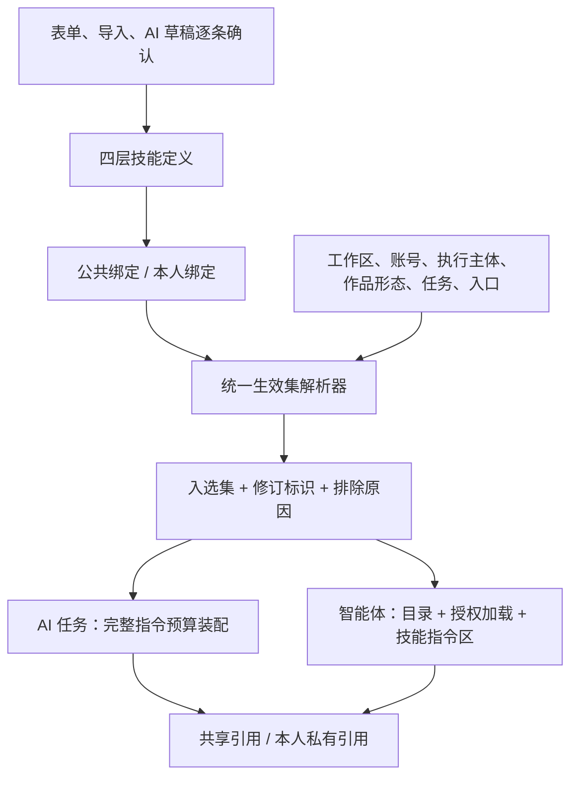

# 23 技能（Skill）系统设计

- 状态：**v0.3 实施基线，主体已实施，2026-10-25 完整性复核发现的功能缺口已补齐；DEV-SK5 发布验收未收口**。本轮修复公开导入确认、编辑/冲突恢复、单项启用、未保存保护、内置另存及续查边界，见 22 的 SK-01..18 与 08 的实际运行证据。用例映射不代表 T-SK-1..39 所有子断言均已证明通过；第 14.3 节真实模型六场景仍**未验**，不能宣布发布验收完成。2026-10-24 用户确认 SK-Q1 至 SK-Q11，并授权完成复审修订。后续仍按本文的接口、权限、状态与验收契约开发，偏离前须更新本文与 D-151。
- 日期：2026-10-24。
- 关联：D-151、D-117（系统智能体）、D-124（创作模板）、D-048/D-123/D-128（平台与作品形态）、FR-M12-05（提示词模板）、A101（账号记忆）、UX-10（上下文透明）。
- 结论摘要：**技能 = 用户配置、可经 AI 辅助起草的可复用创作指令包**。四层定义通过公共 / 本人绑定启用，由同一个解析器判定适用性，再分别进入 AI 任务与智能体。正文完整装入、不按字符截断；个人原文与元数据仅本人可见，生成结果可按既有业务权限共享；无脚本与批量执行能力。
- 本稿替代 v0.2 的冲突及未定条款：个人优先、双入口独立开关、公开确认、目录快照、重试与接口细则以正文为准。第 16 节旧稿记录仅作历史证据；第 14 节列实施与验收。本文是技能增量的唯一规格，04/05/06/08/16 中未涉及技能的既有规则继续有效，相关基线须在对应实施任务中同步。

---

## 0. 术语

| 术语 | 含义 |
| --- | --- |
| 技能（skill） | 名称、用途、触发说明、完整指令正文和适用条件组成的指令包，不是工具、脚本或事实素材 |
| 存放层（scope） | 定义归属：`builtin`、`workspace`、`account`、`personal`；不自动构成继承、覆盖或权限高低 |
| 公共绑定 | 账号启用内置 / 本工作区 / 本账号技能的共享配置 |
| 本人绑定 | 当前用户为账号启用自己的个人技能；其他成员不能查看或修改 |
| 适用候选集 | 公共绑定 + 执行者本人的绑定，经权限、状态、平台、作品形态、任务 / 入口过滤后的集合 |
| 入选集 | 候选集按确定顺序选出的前 20 条；目录、加载与任务装配共用该规则 |
| 实际使用集 | 入选集中本次完整装入指令预算的技能；绑定、入选和实际使用是不同状态 |
| 渐进披露 | 智能体先看到有预算的元数据目录，按需申请加载；服务端将获准正文放入专门的技能指令区 |
| 修订标识 | 数据库技能的 `revision`，或内置技能的版本；结合规范化内容哈希标识本次所用定义，不等于版本历史功能 |
| 执行主体 | 服务端确定的用户触发或系统触发身份；不能由请求体任意指定用户 |

---

## 1. 背景、现状与边界

现有机制能够承载部分写法，但没有统一的、可按账号启用并供智能体发现的指令包管理入口：

| 机制 | 当前职责 | 与技能的边界 |
| --- | --- | --- |
| `prompt_template`（FR-M12-05） | 工作区任务指令、输出契约 | 保留任务本体；技能只叠加方法，不取得系统规则或输出契约的修改权限 |
| `creation_template`（D-124） | 结构、补充要求、段落区间、语气 | 模板结构优先；技能不创建新类型或新工作流 |
| 账号档案 | 定位、人设、禁用词等 | 保留账号约束；技能不替代档案 |
| 账号记忆（A101 / HC-20） | 作者逐条确认的偏好 | 保留记忆的确认与注入链，不把技能自动提炼成记忆 |
| `type_note` | 类型 / 单篇补充说明 | 不扩展真实创作能力，不成为另一套技能配置 |

当前智能体环境块没有技能目录；`agentSystemRules` 将工具结果一律视为资料，R 工具结果又默认进入 O 类来源候选。这两处均需按第 8 节做**受限增量**，不能仅注册 `load_skill` 就宣称完成。

`Reference_Projects/Easel` 提供了指令包与渐进披露的参考形态；本方案不引入其脚本、任意文件读取或自动执行能力。技能的有用性与真实模型遵从程度须另外验收，不能由参考项目或 mock 测试证明。

---

## 2. 用户确认的决策（2026-10-24）

| 编号 | 问题 | 确认结果 |
| --- | --- | --- |
| SK-Q1 | 技能对谁生效 | 同一概念、同一份定义，接入智能体与单次 AI 生成任务；两入口允许有不同装配方式 |
| SK-Q2 | 定义归属 | 四层：系统内置、工作区共享、账号专属、用户个人；个人定义可由本人跨所属工作区携带 |
| SK-Q3 | 智能体使用方式 | 目录 + 按需加载的渐进披露 |
| SK-Q4 | 编写入口 | 表单 + `.md` 导入，落到同一存储结构 |
| SK-Q5 | 个人隐私边界 | 原文与元数据私密，允许生成结果被协作者看到；不能承诺从公开结果中无法推断任何写法 |
| SK-Q6 | 无人值守任务 | 只用账号公共技能，不选择创建人或负责人作为个人技能代理 |
| SK-Q7 | AI 辅助起草 | 允许 AI 起草，用户逐条确认后保存；不自动创建、启用或批量确认 |
| SK-Q8 | 默认任务范围 | 默认仅影响创作任务，其他任务逐项明确开放；不把“任务列表为空”解释为全部 AI 调用 |
| SK-Q9 | 技能之间的顺序 | 个人优先于公共；完整顺序为个人→账号→工作区→内置，仍服从系统规则、任务契约与账号硬约束 |
| SK-Q10 | 个人内容转公共 | 允许本人读取 / 改写后存入公共技能，但须显示公开内容与范围并单独确认，不能随普通保存隐式公开 |
| SK-Q11 | 生效入口 | 支持仅生成、仅智能体、两者；入口开关独立于任务筛选和定义停用 |

3600 字装配预算、C0 的 18 项与 C1 的 7 项、短引用号和前 8 条目录上限沿用第 16.4 节裁决。其余配额、接口和实现顺序是为上述方向补齐并纳入本实施基线的技术契约，不标注为用户逐项亲自选择的产品决策。

---

## 3. 总体架构



### 3.1 四层职责与定义配额

| 层 | 存储与归属 | 维护者 | 可用范围 | 定义上限 |
| --- | --- | --- | --- | --- |
| `builtin` | Go 静态注册表、确定性 UUID，不入 `skill` 表 | 随版本维护 | 全工作区可查看、可另存为 | 首版 ≤ 8 |
| `workspace` | `skill.workspace_id` 非空 | 本工作区 owner / editor | 本工作区账号 | 每工作区 50 |
| `account` | `skill.account_id` 非空 | 该账号所在工作区 owner / editor | 仅该账号 | 每账号 30 |
| `personal` | `skill.user_id` 非空 | 仅本人，包括 viewer | 本人仍有成员身份的工作区中的账号 | 每人 50 |

1. 三个归属字段恰有一个非空；scope 由归属推导。更新不允许迁移 scope 或归属，可另建副本。
2. 个人定义跨工作区携带不等于向其他工作区成员共享。新工作区不自动绑定。
3. 内置默认不绑定；另存为创建独立副本，服务端设置 `origin=copied`、`source_key`，不跟随原版更新。
4. 定义配额包含停用项。库层名称经去首尾空白后，按层内忽略大小写唯一；不因同名或相同 `source_key` 合并不同技能。

### 3.2 绑定分区与数量口径

- `audience_user_id IS NULL` 为公共绑定，只能引用内置 / 本工作区 / 本账号技能。
- `audience_user_id=当前用户` 为本人绑定，只能引用该用户的个人技能；创建人必须也是本人。
- **公共绑定每账号 ≤ 20；本人绑定每“用户 × 账号”≤ 20**，均按绑定行数计算，含停用 / 暂不匹配项。不同用户不共占个人额度。
- 一次用户执行最多合并 40 个绑定，经过滤与排序后入选 ≤ 20，再受实际指令预算限制；系统执行只读公共分区。超出入选上限的条目标记 `candidate_limit`，页面明确展示，不伪装成已注入。
- 这是对初稿“整个账号全部成员共用 20 行”的修正：账号不是单用户配置。配置上限与本次入选上限分别校验。
- 账号层创建默认同时创建公共绑定；两个动作同事务，任一配额不足则全部回滚。
- “对此账号取消启用”删除对应分区的一条绑定；“停用技能”设置定义 `status=disabled`，保留绑定并影响所有引用处。界面必须使用两个不同动作名称。

### 3.3 唯一责任与失败处理

后端新增一个技能解析模块（建议 `server/internal/app/skills.go`），提供等价于 `ResolveSkillSet(context)` 的内部服务。权限判断、归属解析、过滤、排序、修订和排除原因仅在这里实现；contextpack、智能体目录、加载元工具及页面预览调用它，不各写一套。

预算装配与隐私投影复用相同规则，但不把预算当作权限判断。需要解析技能时数据库读取失败，应明确失败，不静默当作“无绑定”；本来不支持技能的任务不查询技能表。

---

## 4. 技能定义与文件契约

### 4.1 字段

“字”统一按 Unicode 字符计，与 Go 的 rune 数和 PostgreSQL `char_length` 对齐；文件 / HTTP 大小另按字节限制。

| 字段 | 限制 | 含义 |
| --- | --- | --- |
| `name` | 1–30 字 | 层内名称 |
| `summary` | 1–60 字 | 用途 |
| `triggers` | 1–120 字 | 什么时候适用；仅供选择，不是授权规则 |
| `instructions` | 非空、≤ 1200 字 Markdown | 两入口共用的完整正文；不允许在注入时截短 |
| `platforms` | 字符串数组 | 空 = 全平台；值来自平台权威枚举 |
| `content_formats` | 字符串数组 | 空 = 全形态；值取 `accounts.go.formatMatrix` 的唯一形态并校验平台组合，当前为 9 个形态、13 个平台组合，含 `micro_post` |
| `task_types` | 字符串数组 | 空 = 第 6.2 节默认创作集合；非空只能来自明确允许的真实任务 |
| `task_enabled` | bool，默认 true | 是否允许普通 AI 任务注入；false 时保留 task_types 配置但不使用 |
| `agent_enabled` | bool，默认 true | 是否允许智能体发现与申请加载；任务过滤只作用于 AI 任务入口 |
| `status` | `active` / `disabled` | 定义级启停 |
| `revision` | 正整数，服务端维护 | 每次编辑递增；内置使用注册表声明的版本 |
| `origin` | `manual` / `imported` / `copied` | 服务端维护；manual 包括用户确认保存的 AI 草稿，不作为安全授权凭据 |
| `source_key` | 可空、服务端维护 | 另存内置来源；不表示持续继承 |

入口组合 `(task_enabled, agent_enabled)` 只允许 `(true,false)`、`(false,true)`、`(true,true)`；两者均 false 拒绝，整体暂停使用 status=disabled，保留原入口组合。元数据按不可信数据编码展示，不因进入目录而获得指令权限。纯空白必填文本、非法平台组合、虚构任务值均拒绝；安全检查的确定范围见第 10.1 节。

### 4.1.1 规范化与匹配

1. UTF-8 必须有效，不接受 NUL；所有文本将 CRLF / CR 统一为 LF，不做 Unicode 兼容归一化。name / summary / triggers 去首尾 Unicode 空白，禁止内嵌换行及控制字符；instructions 保留首尾和内部空白、Markdown 缩进，但 TrimSpace 后不得为空。长度在规范化后按 rune 计算；前端用相同口径，服务端是最终裁判。
2. 三个适用数组只接受合法枚举字符串，去重并按 UTF-8 字节序升序保存；null 不是空数组。创建时缺省为 []，PUT 全量更新必须提交。名称唯一最终以数据库 lower(name) 索引为准，不使用另一套前端大小写折叠算法；冲突返回 name_conflict。
3. 先展开空平台为全部平台、空形态为所选平台的全部合法形态，再取 formatMatrix 中的有效交集。每个显式平台和显式形态都必须至少参与一个有效组合；不要求笛卡尔积全部合法。例如 `[wechat_mp,xhs]` 配 `[long_article,image_note]` 合法，`[xhs]` 配 `[long_article]` 拒绝。实际匹配必须同时满足目标平台和目标形态。
4. task_enabled=false 仍校验 task_types 枚举；agent_enabled=false 不删除任务配置。status、入口和条件按此顺序判断；每项只给首个排除原因，枚举及状态见第 11.2 节。

### 4.2 Markdown 格式

```markdown
---
format_version: 1
name: 小红书开头钩子
summary: 为小红书笔记生成开头
triggers: 起草笔记第一段、改写开头或生成开头钩子时使用
platforms: [xhs]
formats: [image_note]
tasks: [section_draft, section_edit, hook_suggest]
task_enabled: true
agent_enabled: true
---
（完整 instructions，≤ 1200 字）
```

1. 上传 / JSON 请求的原始文件内容 ≤ 64 KiB，在 YAML 解析前检查；UTF-8，允许 BOM 和 CRLF。
2. 只接受单个 frontmatter 映射与后续 Markdown 正文；禁止 YAML 别名、合并键、重复键、自定义标签与额外 YAML 文档，不进行模板求值、联网或引用文件读取。
3. `format_version` 为整数 1；缺省时按 1 并告警，未知版本拒绝。task_enabled / agent_enabled 为 bool，缺省各按 true 并告警；三项适用条件缺省为 []，提供时必须为字符串数组。未知键告警，预览仅显示经安全检查后的键名，绝不回显其原始值。解析前对整个原始文件检查密钥，不能让未知键成为绕过路径。
4. `POST /skills/parse` 仅解析，返回规范化字段、告警及字段级错误；不落库、不记导入成功。超字数直接拒绝，不自动裁掉尾部。
5. 用户确认目标层与完整内容后调用创建接口，以 `import_content` 提交最终 Markdown，服务端重新解析并设置 origin=imported、计算最终告警数。预览中编辑过字段时，由同一导出序列化器生成最终 Markdown；不能依靠“此前 parse 成功”或客户端告警计数跳过校验。
6. 导出包含版本、名称、摘要、触发说明、适用条件、task_enabled / agent_enabled 和全文；往返保留这些行为字段。ID、归属、绑定、status、revision、origin 不在包内；再导入是新定义，默认 active，账号层按既定规则自动绑定。序列化器对文本用 YAML 字符串编码，正文不改写；只有文件开头的 frontmatter 交给 YAML 解析器，关闭分隔行之后的 Markdown（包括 `---` 水平线）不作为额外 YAML 文档解析。
7. 文件不能可靠证明作者身份。不做在线技能市场或跨工作区发布，但不宣称能识别并禁止“别人写的 Markdown”；所有文件同样经过预览与校验。

### 4.3 AI 辅助起草

`POST /skills/draft` 为 G 类受控生成：输入用户需求 brief（1–2000 字）、可选条件 / 两个入口开关及 source_skill_id。提供底稿时须同时传 source_revision，服务端校验可读与修订相符；输出只包含第 11.1 节 DraftFields，不生成 ID、归属、绑定、status 或来源凭据。新任务 skill_draft 走现有模型路由、用量、并发与超时机制，不使用技能注入、不写共享 lastPacks、不经共享 ai_job 保存结果。

使用 SSE 传送 stage 与最终 done / error，**禁止传送正文 delta**：服务端完整缓冲模型输出，完成 JSON、字段、长度、密钥校验后才返回单个草稿。brief、底稿与整个生成原文在进入下一环节前都检查；失败事件不附带生成片段或密钥，ai_call 只记安全错误码和用量。结构失败允许一次纠错，密钥命中直接失败、不把含密钥错误原文送进纠错请求。排队使用既有 worker；请求断开取消等待 / 本次生成，不继续后台保存；工具内部请求仍遵循既有运行取消和超时。单次 HTTP 生成预算 180 秒，排队包含在内，沿用模型首字超时及用量规则。

done 只发送已验证的字段、实际成功 ai_call_id 和用量。读取底稿后到 done 前再核验底稿权限 / revision，变化返回 skill_context_changed。智能体从 done 的 ai_call_id 精确关联本次草稿，不能按工作区时间窗猜“最近一次调用”。事件结构见第 11.4 节。

Web 显示完整可编辑草稿，用户显式保存一条；智能体使用 `skills__draft`，随后提出一张创建 / 编辑卡片，仍由用户执行。生成结果不合字段限制时按既有 AI 任务失败处理，不偷偷截正文或自动发布。viewer 可手写 / 导入个人定义，但首版不开放技能草拟生成和技能写入卡片，不改变既有智能体聊天权限。

实施时为 skill_draft 注册真实任务、模型路由菜单名称“技能草拟”和默认提示词，沿用 task 路由→default 解析及既有用量；mock 必须按该真实任务返回合法 DraftFields。任务使用 Bare=true 且 Account=nil，只传已校验的 brief、底稿与合法枚举 / 条件，避免账号档案或技能自注入。固定任务说明要求“仅输出一个 DraftFields JSON；基于用户需求起草可复用方法；不生成真实密钥、虚构事实、脚本或授权能力；正文最多1200字；不得更改用户显式指定的条件和入口开关”。最终条件 / 开关由服务端按请求及底稿确定并校验，模型只草拟四个文字字段；输出中条件 / 开关与服务端确定值不一致视为格式错误，不能放任模型扩展适用范围。工作区可编辑任务提示词仍不能改变上述固定输出和安全契约。

---

## 5. 数据模型与一致性

迁移建议 `server/internal/db/migrations/00060_skill.sql`，编号以实施时下一个可用编号为准。除两张业务表，还需为审计可见性和调用引用补充最小字段；不能继续声称完全复用现有公开 `context_refs` 即可满足隐私。

```sql
-- +goose Up
CREATE TABLE skill (
  id              uuid PRIMARY KEY DEFAULT gen_random_uuid(),
  workspace_id    uuid REFERENCES workspace(id) ON DELETE CASCADE,
  user_id         uuid REFERENCES app_user(id) ON DELETE CASCADE,
  account_id      uuid REFERENCES platform_account(id) ON DELETE CASCADE,
  name            text NOT NULL CHECK (char_length(name) BETWEEN 1 AND 30),
  summary         text NOT NULL CHECK (char_length(summary) BETWEEN 1 AND 60),
  triggers        text NOT NULL CHECK (char_length(triggers) BETWEEN 1 AND 120),
  instructions    text NOT NULL CHECK (
                    char_length(instructions) BETWEEN 1 AND 1200
                    AND btrim(instructions) <> ''),
  platforms       text[] NOT NULL DEFAULT '{}',
  content_formats text[] NOT NULL DEFAULT '{}',
  task_types      text[] NOT NULL DEFAULT '{}',
  task_enabled    boolean NOT NULL DEFAULT true,
  agent_enabled   boolean NOT NULL DEFAULT true,
  status          text NOT NULL DEFAULT 'active'
                    CHECK (status IN ('active','disabled')),
  revision        bigint NOT NULL DEFAULT 1 CHECK (revision > 0),
  origin          text NOT NULL DEFAULT 'manual'
                    CHECK (origin IN ('manual','imported','copied')),
  source_key      text NOT NULL DEFAULT '',
  created_by      uuid REFERENCES app_user(id) ON DELETE SET NULL,
  created_at      timestamptz NOT NULL DEFAULT now(),
  updated_at      timestamptz NOT NULL DEFAULT now(),
  CHECK (num_nonnulls(workspace_id, user_id, account_id) = 1),
  CHECK (task_enabled OR agent_enabled)
);
CREATE UNIQUE INDEX skill_name_ws
  ON skill (workspace_id, lower(name)) WHERE workspace_id IS NOT NULL;
CREATE UNIQUE INDEX skill_name_user
  ON skill (user_id, lower(name)) WHERE user_id IS NOT NULL;
CREATE UNIQUE INDEX skill_name_account
  ON skill (account_id, lower(name)) WHERE account_id IS NOT NULL;

CREATE TABLE skill_binding (
  id               uuid PRIMARY KEY DEFAULT gen_random_uuid(),
  account_id       uuid NOT NULL REFERENCES platform_account(id) ON DELETE CASCADE,
  audience_user_id uuid REFERENCES app_user(id) ON DELETE CASCADE,
  skill_id         uuid REFERENCES skill(id) ON DELETE CASCADE,
  builtin_key      text NOT NULL DEFAULT '',
  priority         integer NOT NULL DEFAULT 100 CHECK (priority BETWEEN 0 AND 999),
  created_by       uuid REFERENCES app_user(id) ON DELETE SET NULL,
  created_at       timestamptz NOT NULL DEFAULT now(),
  CHECK ((skill_id IS NOT NULL AND builtin_key = '')
      OR (skill_id IS NULL AND builtin_key <> '')),
  CHECK (builtin_key = '' OR audience_user_id IS NULL)
);
CREATE UNIQUE INDEX skill_binding_skill_unique
  ON skill_binding (account_id, skill_id) WHERE skill_id IS NOT NULL;
CREATE UNIQUE INDEX skill_binding_builtin_unique
  ON skill_binding (account_id, builtin_key) WHERE builtin_key <> '';
CREATE INDEX skill_binding_partition
  ON skill_binding (account_id, audience_user_id);

ALTER TABLE audit_log ADD COLUMN visibility text NOT NULL DEFAULT 'workspace'
  CHECK (visibility IN ('workspace','personal'));
CREATE INDEX audit_log_personal_actor
  ON audit_log (actor_id, created_at DESC) WHERE visibility = 'personal';

ALTER TABLE ai_call
  ADD COLUMN context_owner_user_id uuid REFERENCES app_user(id) ON DELETE SET NULL,
  ADD COLUMN private_context_refs jsonb NOT NULL DEFAULT '{}';

-- +goose Down
-- +goose StatementBegin
DO $$
BEGIN
  IF EXISTS (SELECT 1 FROM skill)
     OR EXISTS (SELECT 1 FROM skill_binding)
     OR EXISTS (SELECT 1 FROM audit_log WHERE visibility = 'personal')
     OR EXISTS (SELECT 1 FROM ai_call WHERE private_context_refs <> '{}'::jsonb) THEN
    RAISE EXCEPTION '技能或私有记录仍存在，拒绝回滚；请保留字段并前滚修复';
  END IF;
END;
$$;
-- +goose StatementEnd
ALTER TABLE ai_call DROP COLUMN private_context_refs, DROP COLUMN context_owner_user_id;
DROP INDEX audit_log_personal_actor;
ALTER TABLE audit_log DROP COLUMN visibility;
DROP TABLE skill_binding, skill;
```

### 5.1 数据库与服务端各自保证什么

1. 数据库保证归属互斥、基本长度、修订与状态合法、两类绑定互斥及重复绑定唯一。表级 UNIQUE 不能含初稿中的 `coalesce(...)` 表达式，改为上述部分唯一索引。
2. 跨行归属由统一服务校验：公共技能必须属于账号工作区 / 账号；个人技能必须满足 `skill.user_id=binding.audience_user_id=执行者`；账号与 WorkID 也须属于同一授权范围。仅凭外键存在不代表有权引用。
3. 内置绑定按规范 key 解析；确定性 UUID 使用独立命名空间 + key，全实例一致。key 中的 `builtin:` 只保留一次，不由客户端拼接数据库绑定表达式。
4. 内置注册表启动自检：key / UUID 唯一、版本有效、字段和任务合法、完整正文可装入单技能预算；失败拒绝启动。
5. `private_context_refs` 仅存本人技能的名称、ID、修订、哈希、使用状态等元数据，绝不存正文；第 10.3 节决定读取与持久化边界。
6. 创建时服务端必须写真实 created_by；保留定义的创建者被删除时置空，避免公共技能 / 绑定的外键阻断用户删除。私有归属仍按 user_id / audience_user_id 级联。
7. Down 仅允许空技能且无私有记录时执行；否则保留 schema 前滚修复。不能删除 visibility 后让旧代码把原私有审计当作工作区公共日志；回退旧二进制也须先检查是否仍遵守私有过滤，不能仅以迁移可回退认定安全。

### 5.2 配额、并发与修改传播

- 定义创建在事务中锁对应 workspace / app_user / platform_account 配额主体，再计数并写入。绑定修改锁目标 platform_account，重读分区计数；不能“先在事务外 count，再 insert”。
- 单技能启停、priority 调整均携带该分区的 `base_revision`：对分区规范化绑定清单计算不透明哈希；其他成员的个人分区变化不改变本分区修订，也不出现在响应中。
- 编辑携带技能 `base_revision`，执行 `WHERE revision=base_revision` 的条件更新并递增；失败返回 409 `stale`。不提供不校验的覆盖写入。
- 账号层创建和自动绑定同事务，并验证公共分区配额。变更与审计同事务，日志失败应回滚业务写入。
- 编辑 / 删除前通过影响预览取得 `impact_token`（定义修订 + 受影响绑定集合的指纹），确认时重算；变化则 409，要求重新预览。普通页面与智能体卡片都在写入**之前**展示影响，不能仅在删除响应里告知。
- 涉及多个账号的删除按账号 UUID 顺序加锁，最后锁定技能并重验影响集合；中途出现新增绑定则返回 stale，不按过期影响数硬删。完整锁顺序以第 5.2.1 节为准，不能持有技能锁再补锁新增账号。
- 编辑是修改一个定义，可能影响多个账号的后续生成；卡片明确显示传播范围，不把它伪装为只影响当前账号。已经生成的作品不追溯修改。
- 不做用户版本历史；revision、内容哈希、执行引用与冲突检测仍必须实现。不得用“没有版本功能”豁免执行一致性。

### 5.2.1 指纹与事务口径

规范编码函数 C(v)：UTF-8 紧凑 JSON，无多余空白；对象键递归按 UTF-8 字节序升序；数组保持指定顺序；整数为十进制，无浮点数；字符串只转义双引号、反斜杠、U+0000–001F（控制字符用小写四位 `\u00xx`），不转义中文、`/`、`<>&`、U+2028/2029。H(v) 为 C(v) 的 SHA-256 小写十六进制。前后端均以同一规范及测试向量校验，不能一端使用 Go 默认 HTML 转义、另一端用 JSON.stringify 后直接比较。UUID 小写标准形式，时间固定 UTC RFC3339 六位小数。

| 标识 | 规范输入 |
| --- | --- |
| content_hash | `sk1:` + H(DefinitionFields)；字段为 name、summary、triggers、instructions、三个规范化数组、task_enabled、agent_enabled、status；不含 ID、归属、revision、来源或时间 |
| 定义 base_revision | JSON 正整数，对应数据库 revision；每次成功 PUT 递增，内容未变也递增 |
| 分区 base_revision | `sb1:` + H({account_id,audience_user_id,bindings})；bindings 按 skill UUID 升序，每项含 binding_id、skill_id（内置解析成 UUID）、priority、created_at；不含定义正文 / 修订，不含另一分区 |
| impact_token | `si1:` + H({skill_id,revision,action,bindings})；bindings 按 account_id、binding_id 升序，含绑定 ID、账号、audience_user_id、priority、created_at；action 仅 update / delete |
| 公开确认 digest | `sp1:` + H({operation,skill_id,scope,account_id,fields})；operation=create/update；创建 skill_id=null；非账号层 account_id=null；fields 为最终 DefinitionFields |

指纹不是授权凭证；每次均先检查身份 / 对象权限，再计算比较。影响预览只返回有权看到的账号，个人定义的跨工作区影响总数可见本人；失去成员资格的绑定须按生命周期清理，预览不能泄露已无权访问的账号名称。数据库中的异常归属行使操作失败并记录不含私人标识的内部错误，不纳入公开响应。

规范向量：输入对象 `{"b":"<>&/\n","a":"中😀"}`（b末尾为一个LF），C(v) 必须为 `{"a":"中😀","b":"<>&/\u000a"}`，H(v) 必须为 `32ef59ea492c258f2f5ba065bebbccab8aa775accc46aa804dbe55431e270abf`。该向量固定键序、UTF-8、换行与HTML转义口径。

所有绑定写入都按“账号→技能”加锁后重验归属及状态；内置无技能行锁。定义更新 / 删除与影响预览确认都锁受影响账号（UUID 升序）后锁技能，再重读完整绑定集合。不持锁调用模型。成员退出与绑定写入必须串行化：绑定事务先对真实 membership 行加共享锁并检查 active，退出 / 禁用事务先排他锁该行，再按账号顺序处理；排队读到失效成员即拒绝。涉及配额时整体锁序为 membership→配额主体→账号→技能，重复的同一行只锁一次；系统维护不模拟成员。客户端收到 stale 必须保留编辑内容、重新读取 / 预览并再次确认，服务端不自动刷新守卫重试写入。

### 5.3 生命周期

| 事件 | 处理 |
| --- | --- |
| 取消账号启用 | 仅删除指定分区、指定技能的一条绑定 |
| 定义停用 / 删除 | 停用在编辑预览中确认并由后续解析排除；硬删除级联删除绑定，须预览及二次确认 |
| 成员退出 / 被移出工作区 | 在成员变更事务中删除该用户在该工作区的本人绑定；个人定义保留，重加入不自动恢复 |
| editor 降为 viewer | 本人绑定保留但禁止本人修改绑定；以后若角色允许的智能体读取申请加载，仍须本人且有效；不授予生成 / 写入权限 |
| 成员暂时禁用 / 恢复 | 绑定保留，禁用期间不允许使用或修改；当前运行在下一次请求模型前失败。恢复后新任务重新解析，旧运行 / 卡片不自动执行 |
| 登录用户禁用 / 恢复 | 定义与绑定保留；禁止启动 / 继续用户任务及执行卡片；恢复后需有效会话及成员资格，旧 run 不恢复 |
| 平台账号停用 / 删除 | 停用不执行生成、保留配置；删除级联账号层定义和全部绑定 |
| 个人定义删除 / 用户删除 | 相应绑定失效或级联；私人引用无所属用户时仍不能转为公开 |
| 内置 key 退役 | 发布前列退役清单，部署迁移清理对应绑定并审计公共影响数；解析器拒绝未知 key，不能映射到另一个技能 |
| 技能修订、解绑或权限撤销发生于运行中 | 按第 6.3 / 8.2 节停止后续使用；已发出的模型请求无法追溯撤回 |

---

## 6. 统一生效模型

### 6.1 输入、过滤与输出

内部输入包含 `WorkspaceID / AccountID / ActorKind / ActorUserID / WorkID / TargetFormat / Surface / TaskType / Bare / Preview`。Surface=task/agent；ActorKind=user/system。均由认证身份与真实执行入口组成；不接受客户端指定 ActorKind / ActorUserID / Preview。用户执行须用户未禁用、workspace_member.status=active 且具备入口权限；AdminOverride 不是个人绑定或用户执行的成员资格。系统执行必须来自注册的服务端调度入口，只验证工作区 / 账号有效和任务允许清单，不调用“必须有当前用户”的成员判断，也不带个人 ID。只读预览 handler 设置 Preview=true，允许当前viewer查看自身配置及预算模拟并返回can_execute=false，不赋予生成/加载权限；实际调用路径不得使用Preview模式。

1. 无账号、Bare、不支持技能的任务不注入。停用账号的真实生成 / 加载入口返回 account_disabled（409），不能降级成“不用技能但继续生成”；页面预览可返回 context_status=account_disabled 的空结果。WorkID 必须先做租户与账号校验；有 WorkID 取作品形态，无作品取服务端入口已合法解析的 TargetFormat，否则取账号默认。WorkID 与显式 target_format 不一致返回 422，不能默选其一。不得把头条逐篇形态选择退回账号默认。
2. 检查当前成员身份与入口权限；取公共绑定，用户触发时再取本人绑定，忽略其他人的个人定义与绑定。
3. 展开定义，检查归属、active、内置 key；再按平台与有效作品形态过滤。
4. AI 任务入口先要求 task_enabled=true，再按第 6.2 节任务集合过滤；智能体入口要求 agent_enabled=true，task_types 不控制智能体聊天行为。
5. 确定排序：个人层→账号层→工作区层→内置层；同层 priority 升序→绑定创建时间升序→技能 UUID 升序。该顺序是方法冲突与预算选择规则，不是存放层赋予的安全权限。系统主体没有个人层；priority 不能跨层压过别的层。
6. 按技能 ID 去重后入选前 20；每项返回 scope、修订、内容哈希及使用 / 排除原因。不同 ID 的副本不按名称自动去重。
7. AI 装配器与智能体加载器在各自预算下完整装入；候选、入选、已装入均留痕。

定义过滤按 `builtin_retired`→`disabled`→`task_disabled`/`agent_disabled`→`platform_mismatch`→`format_mismatch`→`task_mismatch`→`candidate_limit` 判断。预算阶段另给 budget_exceeded；智能体未加载为 not_loaded。无权访问的对象按第 11.5 节返回，不通过“未生效原因”泄露他人的个人技能。

### 6.2 任务支持矩阵

`model_settings.taskTypes` 是模型配置菜单，含路由别名且不完整，不能当作技能任务权威枚举。技能模块维护明确的允许清单，并与真实任务入口做契约测试；模型配置菜单仍只负责路由，不另造一套任务执行器。

| 集合 | 首版任务 | 空 task_types 时是否使用 |
| --- | --- | --- |
| 默认创作 C0 | `outline`、`section_draft`、`section_edit`、`title`、`summary`、`rewrite_plan`、`section_rewrite`、`comic_storyboard`、`comic_panel_text`、`comic_rewrite`、`section_continue`、`hook_suggest`、`topic_suggest`、`topic_hot_suggest`、`image_suggest`、`organize_notes`、`daily_recommend`、`strategy_outline` | 是 |
| 可显式选用的辅助 C1 | `tag_suggest`、`outline_review`、`read_through`、`polish_check`、`fix_suggest`、`layout_suggest`、`copilot_chat` | 否，必须逐项选择 |
| 首版不开放 | 事实核查、截图识别、数据分析 / 复盘、记忆提炼、素材 / 收件箱提炼、`daily_brief`、账号建档 / 方案等其他任务 | 否，即使显式提交也拒绝 |
| 独立通道或路由项 | `image_gen`、`embedding`、`default`、`tier_economy`、`tier_quality` | 不支持，不伪装成可选任务 |
| 内部控制任务 | `agent_chat`、`agent_summary`、`skill_draft` | 不走本槽位；智能体仅按第 8 节接入 |

task_types 非空只能取 C0 ∪ C1。后续开放其他任务须逐项说明实际入口、需要的技能内容与验收，再更新清单和 D-151；不能只扩展前端下拉框。除明确无技能语义的路由别名外，真实任务新增必须由契约测试促使开发者决定允许或拒绝。

### 6.3 执行主体、快照与一致性

- 用户同步请求，以及由该请求排队启动的异步生成，使用**触发用户**。异步不等于无人值守；用户 ID 由服务端继承并在真正调用前重新检查成员身份 / 权限。
- 定时调度、每日 / 每周后台任务使用 `ActorKind=system`，只取公共绑定。首版未开放的后台任务不会因此获得技能能力；不能用 owner、创建者或负责人代填 ActorUserID。
- 一个用户动作的技能快照建立在最外层 AI 执行上下文（包括 runAIJSON 的两次校验尝试），用同一只读事务的 REPEATABLE READ 视图读取账号 / 作品、两个可见绑定分区及定义；事务结束即释放，不跨模型请求持有。快照固定身份、目标形态、允许集合版本、绑定 ID / priority / created_at、定义 ID / revision / hash、入选顺序、完整指令区与共享 / 私有引用。
- 网络重试 / 备用模型切换复用相同完整 pack；JSON 格式纠错只可追加任务纠错信息，复用同一技能快照，不重新选技能。每次真正发送前复核身份、账号 / 作品目标，以及快照中所有入选技能的绑定身份、priority、定义修订 / 状态 / 入口资格；变化返回 skill_context_changed，不转备用模型绕过。解绑后重绑会改变 binding_id，视为变化。非入选技能的新增 / 修改留待下一次用户动作，不在重试中插入；本次 refs 始终描述原快照。
- 智能体按第 8.1 节创建运行内目录快照；已发出的目录不重新编号。该目录入选技能的绑定 / 定义或目标形态变化后停止使用该目录，要求新 run；未入选技能变化留待新 run。每轮及同一轮备用模型重试前均复核当前活动技能区，规则见第 8.2 节。
- 服务重启沿用现有中断处理，不恢复旧运行内存中的指令；continue 是新 run，重新解析。修订 / 哈希与排除原因属于执行证据，不是模型事实来源。

账号档案、记忆和业务任务本身的版本规则沿用既有契约，不将技能快照扩展成全系统版本历史。任务结果可在已发送请求之后返回；解绑 / 禁用不能撤回模型已收到的内容，但下一次模型调用和任何后续业务写入均按最新权限检查。

---

## 7. 生效面一：AI 任务注入

### 7.1 完整指令装配

1. contextpack 增加 `skills` 槽，标签“写作技能”，总预算 3600 字（2026-10-24 二次裁决，见 16.4）。预算计算包括声明、技能标题、正文与分隔符，以最终发给模型的槽位字符串为准。
2. 单技能定义正文 ≤ 1200 字，两入口相同；不能截取前 1200 字、自动摘要或删除末尾限制。按排序逐条尝试完整装入；装不下标记 `used=false / reason=budget_exceeded`，可继续尝试后续较短技能。
3. 无实际使用技能时不输出空标题或声明；没有任何绑定的账号，既有提示词逐字节不变。
4. 逻辑顺序仍为规则→账号档案→运营方案→已确认记忆→技能→读者偏好→表现样本→风格。物理顺序不改变第 9 节规定的优先边界。
5. `SkipStyle` 不控制技能槽；无账号、Bare、任务允许清单才决定是否适用。增加预算不能挤掉既有规则和任务输出契约。

声明由代码固定生成，说明技能只指导方法，低于权限、系统规则、输出契约、模板结构及既有账号硬约束；本次明确写法要求优先于技能。声明不能视为防注入保证，硬边界仍由接口权限、来源校验与结果结构校验实现。

### 7.2 引用与回归

- 复用 Slot / SlotItem 的基本语义，按项补充 `revision`、`content_hash`、`reason`；实际使用项记录完整装入字符数。槽位可标记有遗漏，但不存在“正文已截短仍 used=true”的状态。
- 内部 pack 可以持有完整正文；生成返回、ai_call、ai_job、日志和页面引用必须经过第 10.3 节投影，不把内部 pack 直接 JSON 返回或持久化。
- 公共技能提示词快照可以按既有机制保存；含个人技能的调用禁止进入共享 `lastPacks` 与 `prompt_eval_case`。最新调用含私人上下文时，该工作区 / 任务缓存记录应标为不可共享且不保存文本；不能悄悄保存更早的公共调用冒充最新调用。
- 保存含私人上下文的回归用例返回 409 `private_context_not_shareable`；本版不新增个人回归用例系统。共享重放不能重新解析或借用他人的个人技能。
- 不修改或放宽既有 HC 断言；快照更新必须与预期差异对应，不能仅批量接受新快照。

---

## 8. 生效面二：智能体接入（16 文档的技能增量契约）

### 8.1 目录与发现

1. `agentEnvPayload.skills` 为 `{catalog_id,items,omitted}`，items 含 `{ref,name,hint}`。首次发现某个运行 / 账号 / WorkID / 有效形态上下文时，按第 6.1 节排序冻结 ≤20 个 ID / revision / hash / 绑定及顺序，分配 s1…sN 和随机 UUID catalog_id。hint 取 `summary + "；" + triggers` 的前 40 个 rune；只是目录提示，不截正文。无当前账号时不提供目录。
2. 环境块目录**只渲染前 8 条**（`s1`…`s8`），8 条是渲染上限，不是保证装满。目录连同键名、JSON 转义、说明及 omitted 数量按最终序列化字符数 ≤ 600 装入，只保留完整条目；未进入目录渲染的入选技能仍持有引用号，经 `skills__list` 的 effective 视图获得引用号后同样可加载。
3. 整个环境块（含数据块包装）仍 ≤1500 字。先去可选账号列表、领域说明、卡片明细，把非技能核心及包装压到 ≤900；保留身份权限、当前账号、加载上下文和各遗漏数量，再给目录至多600。按最终序列化计算 catalog_id、键名、条目、遗漏计数与发现说明，不能粗截 JSON；必要核心仍超限返回 context_budget_exceeded，不默丢身份字段。无技能时不改变原环境内容，但若原路径也超限，必须同样结构化裁剪 / 明确失败，不能恢复粗截断。
4. 超量注明“还有 N 条，可用 skills__list 的 effective 视图查询”；该 R 工具提供入选集分页 / 搜索，最多 12 条 / 页，投影结果也按真实预算保持完整 JSON，不返回正文。管理库列表可显示未入选原因，但不能借列表绕过加载资格。
5. 指定旧作品 / 头条其他形态时，`skills__list(view=effective, work_id=...)` 使用作品上下文发现；模型随后以相同 WorkID 请求加载。目录不只按账号默认类型永久过滤掉作品可用技能。
6. q、scope、分页只筛选已冻结的入选集，不改变引用号或提升 candidate_limit 项。effective 列表最多 12 条 / 页，模型投影用结构化裁剪控制在既有 6000 字内，裁掉完整尾项并给 next_cursor，不能被通用字符串截断破坏 JSON。

7. 目录属于 agentRunState，不持久化正文或映射。运行发起的 GET /skills?view=effective 通过可信 agentPrincipal.RunID 取得同一运行状态；HTTP 分发只透传服务端内部的运行状态访问器，不能接受客户端 run_id 指定别人的状态，也不新建另一套目录缓存。普通 Web 查询返回相同入选语义但 catalog_id/ref=null，不能作为 load_skill 凭据。查看其他作品可建立该上下文的目录，但不改变当前活动上下文；成功 load 后才切换。
8. 同一 run / 上下文只签发一个目录；已分配的 ref 永不改指向。返回旧作品仍使用其原目录并复核资格。绑定 / 定义变化依第 6.3 节使该目录失效，返回 skill_context_changed，不就地刷新映射；新 run 重建。catalog_id 不属于当前 run、与 WorkID 不符或 ref 不存在，返回 unknown_skill_ref，连续无效计数加一；正文永不通过失败响应返回。

### 8.2 元工具 load_skill 与可信指令区

| 项 | 契约 |
| --- | --- |
| 签名 | `load_skill(skill_ref: string, catalog_id: uuid, work_id?: uuid)`；账号来自对话，skill_ref / catalog_id 来自同一目录。WorkID 缺省明确表示账号默认上下文，不能沿用上一次作品。catalog_id 与 run / 上下文不符不加载任何技能 |
| 权限 | 本地处理仍调用统一解析器，核验真实用户、成员身份、账号、作品归属、绑定、active、agent_enabled、平台 / 形态与入选资格；可查看不等于可加载 |
| 返回 | `role=tool` 只给加载回执（ID、修订、哈希、上下文、状态 / 错误），不把工具消息中的正文直接升级为指令 |
| 指令通道 | 服务端从通过校验的定义取完整正文，由 `agentBuildMessages` 放入专门的“用户已配置技能”system 补充区；固定系统规则明确授权这一受限来源，普通工具结果、目录、附件继续仅作资料 |
| 预算 | 已加载正文连同声明 / 标题总计 ≤ 3600 字；按实际装配长度判断，超额返回 `skill_budget_exceeded`。不依靠 12 轮、4096 输出 token 来约束输入量 |
| 重复 | 同一上下文、同一 ID / 修订重复请求幂等，不重复追加；get_context 列本轮已加载回执 |
| 上下文切换 | 缺省 WorkID 表示账号默认上下文；指定作品须属于对话账号。先校验新请求，成功后原子替换上下文并清空旧集合，失败保持原状态；不混装不同作品技能 |
| 持续性 | 目录与已加载集合属于当前 run；每轮完整重建技能区，历史窗口淘汰回执不会丢失正文。get_context 返回同一活动 catalog_id / WorkID / 已加载 refs，不产生新映射 |
| 失效 | 每轮及备用模型调用前复核活动目录的入选集合快照；修订、解绑 / 重绑、priority、停用、删除、资格或目标形态变化时停止运行并返回 skill_context_changed，提示重新开始，不让旧正文随历史恢复 |
| 新 run / 压缩 | 新 run 重新发现与加载；摘要只可记“曾使用过技能”，不得作为持续有效技能区或恢复正文的来源 |

load_skill 为本地 R 元工具，不计普通 30 次读取；它有上述独立输入预算。管理读取与 effective 列表仍计普通读取上限。对话访问继续本人隔离；已经发出的模型调用不能因随后解绑而保证撤回。

已加载技能每轮按目录冻结的解析顺序装配，不使用工具调用先后作为冲突优先级；新增加载若超预算则拒绝该项，不静默挤掉已经加载的技能。get_context 同时给出当前技能上下文和已加载集合，核心摘要只用 `{catalog_id,work_id,loaded_refs:["s1"],chars,budget}`，不把每项长哈希复制进1500字环境；完整元数据从既有load回执或本人调用引用读取。

智能体转调其他账号 / 作品的生成工具时，该工具以真实目标重新解析自己的 AI 任务技能，不继承聊天中已加载的正文。聊天提示中的技能作用域标签不能替代这一服务端隔离。

### 8.3 管理与生成工具

全部挂 profile 领域，使用固定 Method + Path，不使用同时含创建 / 编辑的动态 `skills__save`。

| 工具 | 类别 | 接口与行为 |
| --- | --- | --- |
| `skills__list` | R | GET /skills；library / effective 两个视图，分页与搜索，不返回正文 |
| `skills__get` | R | GET /skills/{id}；读取单个有权查看的定义，可作为技能编辑 / 另存底稿 |
| `skills__draft` | G | POST /skills/draft；产生一条待确认草稿，不保存 |
| `skills__create` | W | POST /skills；单定义，预览完整字段、归属和账号层自动绑定副作用 |
| `skills__update` | W | PUT /skills/{id}；模型只提交待改字段，按现有整体对象预览 / 合并规则补齐底稿，冻结 base_revision / impact_token |
| `skills__set_binding` | W | PUT /accounts/{id}/skill-bindings/{audience}/{skillId}；单分区、单技能启停或排序，冻结分区修订 |
| `skills__delete` | X | DELETE /skills/{id}；冻结修订与影响集合，二次确认；内置拒绝 |

1. name / summary / triggers / instructions 接受 U / 受控 G / 受限 O：U 为既有用户原文与卡片修改；G **只**接受 skills__draft 成功结果的这四个字段；O **只**接受 skills__get 成功结果的这四个字段。枚举、布尔、ID、priority 为 F，仍做权限、枚举和接口校验；revision / 指纹 / 公开确认不属于模型可填 F 字段。保留字段由冻结底稿带入，不要求用户重写整段。
2. agentSource 增加 purpose（business / skill_definition）和源工具名；按目标工具过滤后才进入既有子串 / 段落匹配。skills__get / skills__draft 只产生 skill_definition 来源，其他 G/O 不可给技能文字字段供源，技能来源也不可给观点 / 正文 / 素材供源；不改通用 U 来源语义。load_skill、skills__list、get_context 的全部结果以及技能回执不进入任何内容来源集合，不能通过嵌套字符串再次被递归收集。技能结果仅白名单提取四个定义文字字段，不采集错误、警告、名称之外的元数据或原始 JSON 全文。
3. agent_chat 自己的回复仍不是 G，不能把闲聊建议直接当作受控草稿写入；用户可在卡片亲自修改，或先调用 skills__draft。技能中的示例也不因此获得事实真实性。
4. 写入工具仅 editor / owner 可见，包括个人技能写卡片；viewer 管理个人定义使用页面入口。生成仍计 3 次 G 额度，不增加运行轮数、时间或卡片数。
5. 预览与执行均按最新身份、来源、修订和影响集合复核。路由分类、目录、链接与静态测试须同步增补；页面专用解析、导出、影响预览、调用引用接口列入附录 B，不遗漏归类。

### 8.4 卡片适配与执行参数

| 工具 | 预览 / 守卫 | target_key |
| --- | --- | --- |
| skills__create | 服务端规范化完整输入，另存内置先读底稿；显示归属、公共范围、账号层自动绑定及配额；公开确认只来自 Human 字段 | `skill_create:` + H({scope,workspace_id,account_id,user_id,name_key})；不适用归属为 null，name_key 取数据库 lower(name) 口径 |
| skills__update | 先 GET 定义取得完整底稿，再 GET impact?action=update；CAS、影响 token、底稿与模型改动分开冻结；底稿保留字段免重做来源匹配，模型改动字段正常校验 | `skill:` + skill UUID |
| skills__delete | GET 定义与 impact?action=delete；冻结修订 / 影响集合，沿用 X 二次确认 | `skill:` + skill UUID |
| skills__set_binding | 专用 ProposePreview 读取 GET /accounts/{id}/skill-bindings 的指定分区，取得 before、分区 base_revision；显示该技能、账号、public/personal、启停 / priority，不调用不存在的单项 GET | `skill_binding:` + account UUID + `:` + audience + `:` + skill UUID |

唯一性仍按既有 `(user_id,tool_name,target_key)`；create 不使用空 ID 作为所有新建的同一目标。上述专用钩子产生 before / changes 后不得被通用父路径 GET 回退覆盖。EnrichExecute 只重验被冻结的守卫，不以最新 revision/token 替换旧值；stale 转为需重新预览的不可直接重试状态。scope、目标账号和技能 ID 在卡片提出后固定；更改目标必须重新提卡。

模型不提供 base_revision、impact_token、publish_confirmation、confirm；预览钩子填守卫，公开确认和删除确认由用户执行请求的 Human 字段填入。用户编辑文字字段仍为 U；编辑内容后重新计算公开确认摘要，确认状态复位。所有保护在 HTTP handler / 服务层同样执行，不能仅依赖卡片界面。

---

## 9. 指令优先边界与机制分工

| 层次 | 规则 |
| --- | --- |
| 权限与不可编辑系统规则 | 技能不能增加工具、执行能力或写入权限，不能跨越人工确认、事实来源与合规红线 |
| 真实任务契约、平台能力、选定模板结构 | 输出 JSON / 字段、有效作品形态及模板结构优先；技能只能在允许空间内改变写法 |
| 既有账号硬约束与已确认记忆 | 维持现有约束；本次请求若要求违反，应提示冲突并要求修改对应配置，不能借技能解除 |
| 本次明确的写法要求 | 优先于技能的软方法与默认语气，前提是不突破以上边界 |
| 技能之间 | 第 6.1 节排在前面的技能优先；后项不得覆盖前项冲突要求。页面提供同层 priority 调整并显示装配结果 |
| 风格 / 表现样本 | 作为写法参考，不覆盖上面约束，不作为事实来源；SkipStyle 不改变技能资格 |

这里不新增“自动理解并消解所有自然语言矛盾”的检测系统。界面展示规则，模型提示明确优先边界，代码验证权限、结构与来源；真实模型测试评估遵从效果，不能把硬编码声明描述成模型绝对不会违背的保证。

---

## 10. 安全、权限与隐私

### 10.1 红线

- 不做脚本、任意文件 / 网络读取、技能递归加载或技能自带工具注册；内置工作流建议只能引用现有工具。
- 不做全部启用、全部导入、跨账号复制启用清单、批量应用或批量执行卡片。单个技能定义的共享引用不等于允许一次执行多个账号动作，传播影响须在预览中说明。
- 保存、导入、AI 草稿返回与卡片预览前复用密钥检测，并覆盖所有文本字段；命中拒绝且不落原文 / 不回显密钥。规则降低风险，不宣称识别所有真实密钥。
- 保持 UX-08 产品文案约束、D-081 外部资料隔离、HC-01 至 HC-31 与每张卡片人工执行。

安全校验分工：① 对用户输入、整个导入文件、brief、生成原文及最终定义调用既有密钥按值 / 模式检测，命中一律 skill_secret_detected；② 字段类型、长度、枚举、入口组合及编码问题一律字段级 validation_failed；③ UX-08 由界面固定文案、系统提示词和文案检查测试约束，不扩成对用户正文的无差别关键词拒绝。用户写“不要使用‘一键爆文’这种说法”可保存；测试密钥样式（仅使用合成测试值）仍须拒绝。首版不声称拥有自然语言合规分类器，不新建关键词审核系统；技能要求绕过权限、事实来源或人工确认时，执行层的既有硬检查继续拒绝相关动作。

### 10.2 权限与 HTTP 中间件

| 操作 | owner / editor | viewer |
| --- | --- | --- |
| 查看内置、当前工作区 / 账号、本人个人库 | 是 | 是 |
| 工作区 / 账号定义增删改 | 是 | 否 |
| 本人个人定义增删改 / 导入 / 另存内置 | 是 | 是 |
| 公共绑定 / 本人绑定单项修改 | 是；本人分区只能自己 | 否 |
| AI 辅助起草、智能体写入卡片 | 是 | 否 |
| 查看他人个人定义 / 绑定 / 私有引用 | 否，owner / 超管代访问也不构成例外 | 否 |

接口保留 requireSession / requireCSRF / blockMaintenance 等会话防护。为 viewer **精确豁免** POST /skills/parse、POST /skills、PUT/DELETE /skills/{uuid} 的方法级拦截；实际写入仍在 handler / 服务层校验“仅本人 personal”。PUT /accounts/{uuid}/skill-bindings/{audience}/{skillUuid} 也仅放行到服务层先校验可见性，再对 viewer 一律403，绝不写绑定；如此保持第 11.5 节的404/403顺序。不得给整个 /skills/* 通配放行，skills/draft 与卡片执行继续由原中间件拒绝；跨租户或他人个人资源仍404。

### 10.3 隐私传播表

共享生成结果允许按作品 / 业务既有权限查看；个人原文与名称、ID、摘要、触发词、修订、哈希等元数据不能跟随结果公开。匿名“个人技能 × N”汇总可以显示，不包含可定位定义的标识。

| 位置 | 公共技能 | 个人技能 |
| --- | --- | --- |
| 定义详情、导出、影响预览 | 当前工作区授权可读 | 仅本人；其他人 404 |
| 模型请求、执行中内存 pack | 按本次资格装配 | 仅用户触发的本次请求；无人值守不携带；不打印完整 pack |
| ai_call.context_refs、通用 ai_job.result / 通知 | 可含公共 ID、名称、修订、使用原因，不存技能正文 | 只含匿名数量；不得把内部 refs 原样放入通用结果 |
| ai_call.private_context_refs | 无需复制公共项 | 仅存本人元数据；context_owner_user_id 为真实触发用户；新引用读取接口仅本人合并，普通返回禁止序列化该列 |
| 共享 lastPacks / prompt_eval_case / 重放 | 可按原权限使用 | 禁止保存或重放；不新增个人回归系统 |
| agent_message / 私人对话摘要 | 按既有本人对话权限 | 允许本人管理读取结果存在对话；摘要与历史不能取得持续指令资格，清理沿用对话保留策略 |
| audit_log | visibility=workspace，工作区可见 | visibility=personal，仅 actor_id=当前用户可读；默认工作区与超管日志必须排除 |
| 日志、错误、遥测、导出文件名 | 不记录正文或敏感值 | 不含名称、ID、摘要、正文；输出文件名使用通用“写作技能.md” |

持久化前将共享 refs 与私有 refs 拆开，不只在 UI 隐藏。本人 UX-10 通过 GET /ai-calls/{id}/skill-context 取得私有元数据；其他工作区成员只能得到公共项与匿名汇总。该接口首先校验调用记录的工作区访问权限，再比较真实用户 ID；不能接受 owner_user_id 参数来代读。

private_context_refs 所属用户删除后即使外键置空也保持私有，读取不得因 owner 为空转为公开。私有引用随 ai_call 的保留 / 清理策略一起处理；私有审计随既有审计保留策略，不因当前切换工作区变成共享记录。应用超管入口遵守同样过滤，部署数据库管理权限不属于本产品成员隔离的承诺范围。

### 10.3.1 公开内容的单独确认

本人可以将个人定义另存为当前工作区 / 账号的独立新定义，也可以用个人底稿改写已有公共定义；原个人对象不迁移、不删除，不向公共对象复制私人 source_key / ID / revision。非内置的这种另存按完整字段创建，origin=manual；不扩展 copy_from_id 的内置专用语义。

为避免依赖不可靠的文本溯源，**所有公共定义的新建 / 更新**统一要求公开确认，覆盖手写、导入、AI 草稿、内置另存及个人派生；不需要猜测文本是否来自私人技能。预览展示最终完整内容、目标工作区 / 账号和所有成员（含 viewer）可见范围；对个人另存再明确说明“公开副本不会改变原个人技能”。用户需单独勾选“我确认将以上技能内容公开给所示范围”，默认不勾选，之后才能保存该条。

请求带 `publish_confirmation:{confirmed:true,digest:"sp1:…"}`，digest 按第 5.2.1 节覆盖最终规范化字段和目标。服务端在权限、字段校验后验证 confirmed 与 digest；未确认返回 public_confirmation_required，摘要不符返回 stale，不写定义 / 绑定 / 成功审计。目标、内容或导入预览改变后清除确认；公开停用等 PUT 同样经过该确认。个人目标不接受此参数，防止界面错误地把“私有保存”做成公开动作。

智能体只在提出卡片时展示公开范围，不能由模型填 confirmed；执行接口从人工字段接收确认并复核最终内容。导入的原始来源及手工剪贴内容无法可靠识别，这套确认适用于所有公共写入，因此不需要对原文推断来源。公共审计只记录最终公共对象及 `public_confirmed=true`；不得记录原个人 ID、名称或派生链。取消确认不落库，也不自动启用。

### 10.4 审计

| 事件 | 对象 | detail（不存正文） |
| --- | --- | --- |
| skill_create / skill_update / skill_delete | skill | scope、名称、origin、修订、受影响绑定数；按定义决定 visibility |
| skill_import | skill | 与成功创建同事务，告警数；解析失败不记成功 |
| skill_binding_update | platform_account | public 或 personal、单项启停 / priority、分区数量；personal 事件整体私有 |

修改公共定义不得顺带写他人个人技能信息。本功能公共审计只保留 via_agent=true，完整 action / conversation 标识留在既有本人 agent_action / run；personal 事件可保留其链路 ID。复用现有链，不补写一套重复审计，也不把完整预览 / result 复制进公共事件。技能路由的访问日志只记路由模板，不记录携带私人 ID / impact_token 的完整 URL、查询串或请求体。

---

## 11. 接口契约

均在 /api/v1 下，真实身份来自会话；字段限制与第 4 节相同。GET 绑定配置不声称知道某次任务的预算结果。

| 方法与路径 | 请求 / 返回要点 | 权限 |
| --- | --- | --- |
| GET /skills | view=library（默认）或 effective；scope、account_id、work_id、q、cursor、limit≤12；effective 要账号，按第 8.1 节返回目录快照条目；普通 Web 的 ref/catalog_id=null；不返回正文 | 当前工作区可见项 + 本人个人项 |
| POST /skills | scope、account_id?；定义输入三选一：完整字段、import_content（重解析）、copy_from_id（只可另存内置，可改新名称）；origin 由服务器确定；账号层同时公共绑定 | 公共定义 editor；personal 仅本人，可 viewer |
| GET /skills/{id} | 单定义、revision、可编辑字段与 scope；内置确定性 UUID 同样可查 | 有权读取者 |
| PUT /skills/{id} | 全量 DefinitionFields、base_revision、impact_token；公共项另带 publish_confirmation；不可变更归属；内置 422 | 同创建；智能体先按底稿合并 |
| GET /skills/{id}/impact | action=update 或 delete；返回 affected_bindings、授权范围内账号摘要、impact_token；内置无删除 / 编辑预览 | 有权修改者 |
| DELETE /skills/{id} | 查询参数 confirm=true、base_revision、impact_token；原子删定义 / 绑定 / 记审计，不依赖 DELETE 请求体 | 同编辑，二次确认 |
| POST /skills/parse | {content} 或单个 multipart .md；仅解析与校验 | 可管理本人库者，含 viewer |
| GET /skills/{id}/export | 第 4.2 节格式，通用文件名 | 有权读取者 |
| POST /skills/draft | brief、可选适用条件 / 入口开关 / source_skill_id+source_revision；仅 SSE stage / done / error，无正文 delta、无共享 job | editor / owner |
| GET /accounts/{id}/skill-bindings | public 与 mine 两个可见分区，各有 base_revision、配置条目和数量；不返回其他人的个人数量或配置 | 全部当前成员 |
| PUT /accounts/{id}/skill-bindings/{audience}/{skillId} | audience=public 或 personal；{enabled, priority?, base_revision}；单项修改，幂等请求不重置 created_at | editor / owner；personal 仅本人 |
| GET /accounts/{id}/skill-context | surface=task 或 agent，task_type?、work_id?、target_format?；验证真实入口支持与形态合法性，返回此上下文的解析 / 预算预览，不作为权限凭据 | 当前成员，按本人主体预览 |
| GET /ai-calls/{id}/skill-context | 已发生调用的技能使用回执；本人合并私有项，他人仅匿名汇总；不返回正文 | 先校验工作区，再校验私有 owner |
| GET /audit-logs?visibility=personal | 既有接口的私有视图，仅当前 actor 的个人技能审计，可跨本人历史工作区；默认仍为当前工作区公共日志 | 本人；禁止通过参数指定其他 actor |

无 PUT 整体替换绑定接口；表单切换一项就保存该项，没有“保存全部”“复制另一账号启用清单”入口。已绑定集合、指定上下文预览、已发生调用回执分别展示，不能互相冒充。

创建的三种输入不能混传，`origin` / `source_key` / `user_id` / `workspace_id` 等服务器字段不接受客户端覆盖。智能体的 skills__create 只暴露字段创建与内置另存，不暴露原始 import_content，以免绕过逐字段来源校验；导入属于用户文件表单入口。

### 11.1 字段与读写对象

HTTP 成功 JSON 直接返回对象，沿用现有 ok，无额外 data 包装。所有请求字段严格校验，JSON 未知字段拒绝；Markdown 未知键按第 4.2 节告警。除文中明确可选项外不得省略，null 与缺省不同；UUID 解析后统一小写。导入原文上限 64 KiB，JSON 请求含包装上限 128 KiB；单个 multipart 文件限 64 KiB，整个请求限 128 KiB，禁止多个文件。所有技能正文展示使用纯文本或既有安全 Markdown 渲染，不执行原始 HTML。

| 对象 | 字段 |
| --- | --- |
| DraftFields | name、summary、triggers、instructions（string）；platforms、content_formats、task_types（string[]）；task_enabled、agent_enabled（bool） |
| DefinitionFields | DraftFields 加 status（active/disabled） |
| SkillDefinition | DefinitionFields 加 id、scope、account_id（可空）、revision（整数）、content_hash、origin、source_key、created_by（可空）、created_at、updated_at；内置 origin=builtin、source_key=注册 key、created_by/时间=null，revision=内置整数版本 |
| SkillSummary | SkillDefinition 去掉 instructions；列表仅投影有权读取的对象，不含他人个人计数 |
| Warning | {code:string,field:string,message:string}；消息不得包含原始敏感值 |

POST /skills 的 scope 必填（workspace/account/personal），account 层 account_id 必填且授权，其他层不得传 account_id；输入三选一：① 顶层 DraftFields 加可选 status（默认 active）；② import_content；③ copy_from_id 加可选 name。两开关在①缺省 true，三个数组缺省 []；其他文字必填。②③默认 active，不能混传行为字段，编辑导入内容须重新序列化文件。公共目标还必须带 publish_confirmation。成功 200 返回 `{skill:SkillDefinition,binding:BindingItem|null,import_warnings:Warning[]}`；账号层 binding 为本次自动创建的公共项，其他层 null。导入两种成功审计是同一事务内的 create 与 import 事件，不重复写另一套 via_agent 日志。

PUT /skills/{id} 顶层必须包含完整 DefinitionFields、base_revision（正整数）、impact_token（si1 前缀），公共对象带公开确认；成功 200 `{skill:SkillDefinition,affected_bindings:int}`。GET 详情直接返回 SkillDefinition。DELETE 成功 200 `{deleted:true,affected_bindings:int}`；POST /skills/parse 成功 200 `{fields:DraftFields,warnings:Warning[]}`，不含保存权限凭据；错误使用第 11.5 节结构。

### 11.2 列表、配置、预览与回执

| 端点 / 对象 | 固定契约 |
| --- | --- |
| library 列表 | `{view:"library",items:SkillSummary[],next_cursor:string或null,total:int}`；scope 缺省为全部可见层，account_id 缺省时不列账号层（不会扫描所有账号）；指定后只列该账号专属项，其他可见层仍可列；work_id 不用于 library，提供则 422 |
| effective 列表 | `{view:"effective",catalog_id:uuid或null,context:SkillContext,items:EffectiveItem[],next_cursor:string或null,total:int,excluded_count:int}`；只列已入选项，候选排除详情去上下文预览；total 为 q/scope 筛选后入选数量，excluded_count 为可见候选中未入选数量 |
| SkillContext | `{account_id,work_id:null或uuid,target_format,surface:"task"或"agent",task_type:null或string,actor_kind:"user"或"system"}`；不对外返回 ActorUserID；effective 固定 surface=agent |
| EffectiveItem | `{id,ref:null或sN,name,hint,scope,revision,content_hash,priority}`；无正文；catalog_id 只在响应顶层提供 |
| BindingItem | `{binding_id,skill_id,scope,name,priority,created_at,definition_status}`；内置 skill_id 为确定性 UUID；配置不声称 selected / used |
| 绑定 GET | `{account_id,public:{base_revision,count,limit:20,items:BindingItem[]},mine:{base_revision,count,limit:20,items:BindingItem[]}}`；各区 items 按解析层顺序、priority、创建时间、技能 ID 排序；空区仍返回有效 sb1 指纹 |
| 上下文预览 | `{context,context_status:"ok"或"account_disabled"或"task_unsupported",can_execute:bool,budget:3600,assembled_chars:int或null,items:SkillUseItem[],personal_used_count:int}`；task 必须有 task_type，agent 不得带 task_type；未知 / 不支持任务返回 task_unsupported 的空列表。viewer可只读模拟但can_execute=false，无账号许可仍404 |
| SkillUseItem | `{id,name,scope,revision,content_hash,selected:bool,used:bool,reason:null或原因码,chars:int}`；chars 为该项实际加入指令区的增量字符数，未使用为0；公共包装计入 assembled_chars，因此不能简单求 items.chars 当总长 |
| 智能体预览 | 不模拟模型选择：入选项 selected=true、used=false、reason=not_loaded，assembled_chars=null；候选排除项 selected=false。不使用任务入口的顺序装满来冒充已加载结果 |
| 历史回执 | `{ai_call_id,context,budget,assembled_chars,items:SkillUseItem[],personal_used_count:int}`；本人合并私有项，其他成员只看公共 items 和个人实际使用数量；不按当前定义重算历史，不返回正文 / catalog_id |

分页 limit 缺省12，范围1..12；q 去首尾空白，最多100字，按数据库 ILIKE 转义后的字面子串搜索 name/summary/triggers。library 固定按 personal/account/workspace/builtin、lower(name)、id 排序；effective 保持目录顺序。cursor 为 base64url 编码规范 JSON `{version:1,query_hash,snapshot_hash,offset}`，不作为权限凭据；服务端重新解析、过滤和核验 fingerprint。query_hash 含视图、筛选和 limit；snapshot_hash 含当前可见结果的 id/revision 顺序（effective 为 catalog_id 或 Web 结果哈希）。筛选或快照改变返回 409 cursor_stale；结构错误422。页尾 next_cursor=null，total 只统计有权查看的匹配项。新增 / 删除 / 改名不会默默造成跨页重复或遗漏。

首个原因按第 6.1 节顺序确定；selected=true 仅表示入选，used=true 仅表示实际发送。任务候选落选或超预算、智能体未加载，均不得在 UI 简写为“已使用”。历史原样保留不因日后删除定义丢失；若 ai_call 已按保留策略清理，引用接口404，页面显示“使用记录已清理”，不能重新生成一份回执。

### 11.3 单项绑定与影响预览

PUT 单项绑定必须带 enabled（bool）和 base_revision（sb1 字符串）；priority 可选0..999。先核验对象可见性与分区归属，再锁账号 / 技能并检查修订：旧修订一律 stale，即使请求结果看起来已达成也不跳过 CAS。enabled=true 时无绑定则新增（priority 缺省100），已有则保持 created_at / binding_id（priority 缺省保留原值）；enabled=false 时删除该行且不得带 priority。不存在的合法绑定取消为无变化成功；对象已删除 / 无权则404。有效修订下的无变化请求不重复审计，返回 changed=false。

响应为 `{audience:"public"或"personal",changed:bool,base_revision:string,count:int,limit:20,item:BindingItem|null}`，删除后 item=null。允许预先绑定停用或暂不匹配的合法定义，返回配置状态但不宣称生效；不能绑定其他账号 / 工作区的定义或他人个人定义。绑定写入不改变定义 revision；所有会改变绑定清单的操作（包括级联）都会改变分区指纹。

GET impact 必须指定 action=update/delete；返回 `{skill_id,base_revision,action,affected_bindings:int,accounts:[{id,name,workspace_name,bindings:int}],impact_token}`，accounts 按账号 UUID 排序，仅含本人当前有成员资格的账号；不含其他用户信息。编辑影响表示该定义全部引用范围，不能由前端根据仅改名称而自行缩小。未绑定时返回0及空数组，仍有 token；内置返回 immutable_skill。

### 11.4 SSE 与请求示例

以下 UUID 为文档示例，必须换成实际授权对象。创建个人、仅智能体技能（完整字段模式）：

```json
{
  "scope": "personal",
  "name": "先核对再操作",
  "summary": "操作前说明目标和影响",
  "triggers": "需要修改账号配置时",
  "instructions": "先核对目标账号和对象，再说明拟修改的字段与影响，提出单张卡片供用户确认。",
  "platforms": [],
  "content_formats": [],
  "task_types": [],
  "task_enabled": false,
  "agent_enabled": true,
  "status": "active"
}
```

公开目标沿用同一字段结构，并按第 10.3.1 节加入 publish_confirmation；其 digest 必须覆盖实际目标及最终 DefinitionFields，不能复制文档示例哈希。一次取消本人绑定的请求（base_revision 需来自刚读到的 mine 分区）：

```json
{"enabled":false,"base_revision":"sb1:0000000000000000000000000000000000000000000000000000000000000000"}
```

草拟 POST 输入为 brief、可选 source_skill_id/source_revision、可选三个数组及两个开关；有底稿时未指定的条件 / 开关沿用底稿，无底稿则数组[]、开关true；最终三种入口组合照常校验。只接受以下事件，事件 data 使用 JSON：

| event | data / 时机 |
| --- | --- |
| stage | `{stage:"queued"或"generating"或"validating"}`，不含正文 |
| done | `{draft:DraftFields,ai_call_id:uuid,usage:{prompt_tokens:int,completion_tokens:int},fallback_used:bool}`，全部校验通过后仅一次；ai_call_id 为产生该有效草稿的实际调用 |
| error | `{error:{code,message,fields?,request_id?}}`，不含输入 / 输出原文；发出后结束；无 done |

SSE 尚未开始前的权限 / 入参错误用普通 HTTP 错误；开始后的错误用 error 事件（HTTP 可能已是200），客户端和工具分发均以事件判成功，不能只看 HTTP 状态。无 done 的断线保留用户原始表单，标记未取得完整草稿，不将部分数据作为成功结果或 G 来源。

### 11.5 错误与校验顺序

先做会话 / CSRF / 维护检查，再做对象租户与本人可见性，再做角色 / 入口权限、字段、安全、确认和事务守卫检查。资源相关 viewer 绑定请求也必须先解析目标可见性再返回403；因此精确方法白名单仅把请求送入服务层，不等于允许写入。未知对象 / 跨租户 / 他人个人对象统一404；已知可见公共对象的 viewer 写入403。身份失效401；角色降权403；已冻结运行中的身份 / 上下文变化统一结束为 skill_context_changed，不重试模型。

| HTTP | code | 行为 |
| --- | --- | --- |
| 422 | validation_failed、name_conflict、skill_limit_reached、immutable_skill | fields 指定问题字段；配额错误给 scope/limit，不给他人个人数量；内置写入用 immutable_skill |
| 422 | skill_secret_detected | 只给字段及安全提示，不回显命中片段 |
| 409 | confirm_required、public_confirmation_required | 删除 / 公开确认缺失，无写入 |
| 409 | stale、cursor_stale | 修订、影响、公开摘要或分页快照过期；重新读取确认，保留本地编辑 |
| 409 | skill_context_changed、private_context_not_shareable、account_disabled | 停止相应运行 / 共享保存 / 生成，不自动降级 |
| 422 | unknown_skill_ref、skill_budget_exceeded、context_budget_exceeded | 元工具 / 上下文构建错误；无效引用计数，预算拒绝保留原加载状态 |
| 413 | request_too_large | 原始文件或请求体过大，沿用现有 HTTP 413 展示 |
| 502 | ai_output_invalid | 草稿结构 / 字段纠错一次后仍无效；不返回片段 |

其余限流、模型不可用、超时与数据库错误沿用既有错误码，不把未知错误转成“没有技能”。错误体沿用 `{error:{code,message,fields?,detail?,request_id}}`；敏感路径 detail 不包含原文、SQL 参数、他人标识。草拟 SSE 的 failed 请求仍记录实际调用用量，不记成功生成 / 保存审计。

---

## 12. 页面与交互

| 位置 | 内容 |
| --- | --- |
| 账号档案 P-15 | “写作技能”分公共与我的个人区；显示已配置 / 当前上下文入选 / 实际使用的区别；单项启停和同层优先级，viewer 不可改绑定 |
| 技能库页 | 内置、工作区、当前账号、我的技能视图；个人仅本人可见；表单、另存内置、单文件解析预览、导出及 AI 起草后完整确认 |
| 编辑 / 删除预览 | 提交前显示影响绑定数、可见账号范围；过期预览 409 后重新读取，不自动覆盖 |
| UX-10 | 公共项逐技能显示版本、使用字符数、未使用原因；个人详情仅本人可查，其他人仅匿名数量；不展示被截短正文 |
| 智能体页 | 目录与加载回执在现有工具呈现中可见；保存 / 修改仍逐张确认，不新增一套批量卡片 UI |
| 设置入口 | 通过 settings-registry.ts 注册，复用角色说明、搜索和命令面板，不再硬编码另一份设置清单 |

桌面首版不提供技能库 / 账号技能区块管理入口；registry 的跨端可见性与实际路由、智能体工具链接一并限制，不能只藏菜单。桌面生成与聊天仍使用服务端同一技能规则，已授权的智能体单张管理卡片可沿用；需直接填写 / 导入时明确打开 Web 对应页面。移动 Web 复用同一表单和权限。

### 12.1 创建、编辑与公开流程

1. 技能库“新建”默认 personal，必须显式选 workspace / account 才公开；从账号“新增账号技能”进入则目标 account 固定并醒目标注保存后同时启用。viewer 只显示 personal；无当前账号不能选择 account，仍可管理个人 / 工作区 / 内置库。新建默认 active、两入口开启、三条件[]、priority=100（有自动绑定时）。
2. 入口选择为三个单选项“仅生成 / 仅智能体 / 两者”，映射两个 bool；选仅智能体时保留但禁用任务筛选控件，并提示其任务配置暂不生效。状态停用另有独立动作。个人优先顺序固定说明，priority 仅调整同层。
3. 导入选单文件→服务端 parse→展示完整字段、告警与选择的保存层→确认保存；非法字段停在预览可修正，未知键明确说明忽略。解析成功不视为已导入。保存层为公共时进入公开确认；为账号时额外显示自动绑定副作用。达到定义或绑定额度时禁用相应保存并提供单项管理链接，不自动删旧项或改存放层。
4. AI 草拟前保留用户输入及当前表单；只显示进度，成功后显示完整可编辑草稿，未保存不替换已有定义。再次生成会替换未保存草稿前必须提示，失败仍保留原表单。断线或无 done 不显示成功、不自动保存；重试由用户发起，原已产生的用量仍可见。
5. 编辑先载入定义及 revision，提交前取得 impact；公开对象或个人另存公共时显示第 10.3.1 节的完整内容和公开范围。用户取消任何一步均无写入。所有确认只针对这一条，保存成功显示定义状态与“已绑定 / 尚未绑定”，不把绑定等同于本次实际使用。
6. 个人另存公共保留原定义，新副本独立；目标为 account 时自动绑定，workspace 不自动绑定。已有公共定义的字段改写同样单独确认公开。技能详情中的导出不显示私人标题文件名。

### 12.2 配置、冲突与异常

- 账号区分 public / mine，其他人的个人配置不出现。开关表示有无绑定，不代表定义 active；停用定义的绑定显示“已配置，技能已停用”。调整一项立即保存；同一区保存中暂禁其他绑定修改，失败恢复服务器值并保留用户拟修改值，不冒充保存成功。收到新的分区 revision 后再允许下一项。
- 上下文预览默认当前账号默认形态，支持选择实际作品 / 任务；明确“任务预算预览”与“智能体可加载目录”。只有历史 ai_call 回执使用“本次已使用”。个人未入选 / 预算不足仅本人可见；协作者只见匿名实际使用数量。
- 409 stale 保留当前编辑值，展示“服务器配置已更新”，允许重新载入服务器值或保留草稿重新预览；后者仍需取得新守卫和再次确认，不自动覆盖。更改公开内容或目标会取消已勾选的公开确认。
- 401 引导登录并保护本地未保存编辑；403 保留只读内容及草稿，说明权限变化；404 显示对象不可用，允许本人把本地内容重新建立为个人草稿，但不自动保存。账号停用时禁用生成 / 加载，配置可按权限查看和维护；恢复后新任务重新解析。
- 切工作区、账号或离开编辑页沿用未保存保护；提交期间固定原目标，切换后到达的响应不能覆盖新页面。未保存正文仅保存在当前页面内存，不写共享缓存 / localStorage。个人标签说明“本人跨工作区携带，需在每个账号分别启用”。
- 系统错误不吞为“暂无技能”；空库、无匹配、未绑定、配额不足、全部落选分别有明确提示。历史记录已清理则按第 11.2 节显示，不拿当前配置冒充过去使用记录。

---

## 13. 内置技能首版清单

首版固定以下 8 个，正文与字段在第 13.1 节给出实施初版，版本均为1，task_enabled=true、agent_enabled=true、status=active，不默认绑定。以后修改正文 / 条件必须递增内置 revision 并更新测试；不再留“实施时自行撰写”占位。

| key | 名称 | 适用范围 |
| --- | --- | --- |
| builtin:hook_opening | 开头钩子写法 | 全平台；section_draft / hook_suggest |
| builtin:title_formulas | 标题公式 | 全平台；title |
| builtin:xhs_note_voice | 小红书笔记语感 | xhs、image_note；默认创作集合 |
| builtin:wechat_argument | 公众号论证展开 | wechat_mp、long_article；outline / section_draft；不覆盖模板结构 |
| builtin:qa_deep_dive | 问答体深答 | qa_article；outline / section_draft |
| builtin:comic_pacing | 漫画分镜节奏 | comic；comic_storyboard / comic_panel_text |
| builtin:factual_honesty | 事实与引用表达 | 默认创作集合；补充写法，系统真实性红线不依赖它启用 |
| builtin:natural_ending | 自然结尾引导 | section_edit / read_through，后者已显式选择，不能用“空=全部任务”代替 |

各项仍受平台 / 形态 / 任务 / 两入口开关与预算约束。“不编造”不能成为可由关闭内置技能解除的系统约束。mock 只检验链路，真实内容质量按第 14.3 节验收。

### 13.1 完整注册内容

确定性 UUID 使用 UUIDv5，命名空间固定为 `5ee2a4a9-9633-4a48-b64c-587acbce98d0`，name 输入为下列完整 UTF-8 key（含一次 builtin:）；不得使用进程随机命名空间。以下字段值即注册值；数组使用规范枚举，[] 语义与第 4 节相同。instructions 为表内全部文字，不附加实施者自拟补充。

| key | summary | triggers | platforms | content_formats | task_types | instructions |
| --- | --- | --- | --- | --- | --- | --- |
| builtin:hook_opening | 用具体问题或已提供的场景展开开头 | 起草第一段或生成开头钩子时 | [] | [] | [section_draft,hook_suggest] | 先辨明目标读者要解决的问题。开头优先使用用户提供的具体场景、明确疑问或有依据的反差，再自然引出核心观点。缺少具体经历时使用中性问题，不编造亲身体验、数据或人物。避免空泛铺垫、夸张保证和与正文无关的悬念；服从任务要求的长度和结构。 |
| builtin:title_formulas | 围绕内容价值生成清楚具体的标题 | 生成标题候选时 | [] | [] | [title] | 先提取正文实际覆盖的对象、问题和价值，再用清楚自然的标题表达。按任务要求给出候选数量，可分别采用问题、方法或有依据的对比角度。数字、效果和结论必须能从输入找到依据；不凭空承诺收益，不杜撰排行榜，不用标题暗示正文没有的内容。保留指定输出字段，不额外输出解释。 |
| builtin:xhs_note_voice | 用具体、易读的笔记表达传递信息 | 起草或修改小红书图文笔记时 | [xhs] | [image_note] | [] | 先交代读者的问题，再按信息点组织笔记。使用自然短句与清楚分段，把抽象建议写成可理解的行动或判断条件。只用输入里真实提供的体验，不假扮亲历者；没有依据时不写购买效果和身份背书。表情、标签和口语化程度服从本次要求及账号设置，不机械堆叠。 |
| builtin:wechat_argument | 让观点、依据与解释形成清楚论证 | 规划或起草公众号长图文时 | [wechat_mp] | [long_article] | [outline,section_draft] | 围绕作者已提供的观点组织论证，区分观点、证据和解释。每段先完成一个论证任务，再用自然过渡连接上下段。案例和数据只取自授权素材；缺证据时明确标出待补内容，不用虚构故事补齐。考虑观点适用条件与可能的反例，但不替作者创造核心立场，不改变选定模板结构。 |
| builtin:qa_deep_dive | 先直接回答，再解释依据与适用条件 | 规划或起草问答体文章时 | [] | [qa_article] | [outline,section_draft] | 针对题目先给与已有观点一致的直接回答，再解释理由、依据和适用边界。复杂问题可按子问题展开，但保持选定问答模板和任务字段。具体事实必须来自输入；缺少判断依据时说明还需要什么信息。避免为了显得完整而添加未提供的经历、引语或专业结论。 |
| builtin:comic_pacing | 让分镜中的信息与动作衔接清楚 | 生成漫画分镜或单格文字时 | [] | [comic] | [comic_storyboard,comic_panel_text] | 先明确每格承担的信息或情绪变化，按已有剧情安排动作、对白与转场。保持人物设定、时间和空间连续，避免一格承载过多事件。对白只表达角色在当前情境下需要说的话，减少旁白重复画面信息。不改变任务规定的格数与字段，不擅自增添与用户设定冲突的情节。 |
| builtin:factual_honesty | 在表达中区分已知事实、推测与待核实内容 | 创作中涉及事实、数字、案例或引用时 | [] | [] | [] | 将输入中的已知事实与作者判断分开表达。数字、引语、人物和机构仅使用有来源的输入，不为流畅而补造细节。推测使用清楚的条件或不确定表述；缺少必要事实时采用任务允许的待核实提示，不编造出处。此写法只补充表达方式，不能替代系统事实检查或作者确认。 |
| builtin:natural_ending | 让结尾回应正文并给出适度下一步 | 修改结尾或通读检查收束段时 | [] | [] | [section_edit,read_through] | 结尾回应开头的问题或正文已经论证的观点，避免加入新的关键事实。需要行动建议时，只提出与正文相关、范围适当的一步；不强行索要关注、制造焦虑或保证效果。任务若只要求检查建议，就说明收束问题与修改方向，不输出未经要求的整篇改写。 |

---

## 14. 实施拆分与验收

### 14.1 顺序与边界

以下为形成 v0.3 时确定的实施拆分，当前代码与验收状态见 08 实际记录。沿用 DEV-SK1 至 SK5，原 5.5–6 天估计不作为承诺工期。实现可拆内部文件，但不能改变统一解析、预算、权限、来源和状态归属；新迁移编号开工前核对。验收断言与运行范围以下列条款为准。

| 任务 | 主要文件 / 责任 | 完成证据 |
| --- | --- | --- |
| DEV-SK1 | 新迁移、skills 模块、server.go、auth.go、settings.go、成员变更入口；双开关、定义、单项绑定、规范编码、文件、配额 / CAS、公开确认、私有审计与引用读取；同时同步04/05/06的技能增量 | 真迁移 / 回滚、权限 / 并发 / 隐私、API示例与规范向量；T-SK-1..7/13..16/24..26/29/33/35..37 |
| DEV-SK2 | contextpack.go、aicore.go、aijobs.go、quality.go、prompt_batch.go；一次动作的快照、两类重试、主体、完整装配、引用拆分与私人快照阻断 | 无绑定逐字节兼容、25任务矩阵、两用户 / 系统主体、缓存 / 重放；T-SK-8/9/18..21/23/27/31 |
| DEV-SK3 | agent_prompt/context/meta/provenance/run/dispatch/propose/preview/execute、模型任务与路由目录；目录快照、skill_draft 缓冲 SSE、可信技能区、专用卡片适配、目的受限来源；同步16正文/附录及D-117技能增量引用 | T-SK-10..12/16/17/21/22/30..34、HC-26..31；运行状态不重复缓存，实际ai_call_id关联 |
| DEV-SK4 | 技能库、账号档案、refs.tsx、settings-registry.ts、链接 / 路由边界；第12节全部表单和异常流程、公开确认与私有 UX-10 | 双用户 / viewer、导入、单项配置与冲突 E2E；T-SK-14/18/24/28/29/33/38 |
| DEV-SK5 | 按第13节注册8个内置；测试与基线收口，08计划和17/19必要跨端增量同步 | T-SK-1..39、相关完整回归、第14.3节真实模型记录；未验项不能标通过 |

SK1→SK2→SK3；SK4 在接口固定后接入；SK5 最后收口。新迁移、权限与来源边界应先有能重现错误契约的测试，再实现通过；不能用只校验提示词里出现了几个字来代替边界验收。

### 14.2 自动化验收矩阵

| 编号 | 断言 |
| --- | --- |
| T-SK-1 | 四层可见性与详情 / 导出 / 影响预览隔离；他人个人技能统一 404，owner / 超管也不能代读 |
| T-SK-2 | 内置不可改删、确定性 UUID 一致；另存独立且不跟随更新 |
| T-SK-3 | UTF-8/BOM/CRLF 合法；超 64 KiB、重复键、别名、非法 YAML / 版本 / 字段与超过 1200 字拒绝，不落库 |
| T-SK-4 | 密钥 / 编码 / 结构检查覆盖手写、导入全部原文（含未知键）、brief、AI 草稿与卡片；拒绝不回显、不留原文；正常否定式话术不被关键词误拒 |
| T-SK-5 | 名称唯一与 50/30/50 定义额度，公共 / 本人各 20；停用仍占配置额度；并发请求不能穿透 |
| T-SK-6 | 单项绑定幂等、不重置排序时间；甲保存不删乙个人绑定，不共占额度；旧分区修订返回 stale |
| T-SK-7 | 平台、作品形态优先、头条本次目标形态、任务和 agent_enabled 过滤一致；WorkID 越权 / 跨账号拒绝 |
| T-SK-8 | 层 / priority / 时间 / UUID 排序稳定；候选超 20 有原因；完整槽位≤3600，正文不截断，逐项 used/reason 可追溯 |
| T-SK-9 | 无绑定账号提示词逐字节不变；全部被过滤时不输出空技能标题 |
| T-SK-10 | 每个 run/作品上下文目录只分配一次 catalog_id 与 s1..sN，切换后不复用不同目录的凭据；前8条上限、真实序列化≤600、环境≤1500；最长字段 / 转义 / 包装预算正确，隐藏条目可分页发现 |
| T-SK-11 | load_skill 只返回回执；未知 / 失效引用号 `unknown_skill_ref` 并计入连续无效；全文来自授权技能区；重复幂等、预算独立、有权限查看但未绑定仍不能加载 |
| T-SK-12 | AI 受控草稿可逐张确认保存；普通聊天输出不能冒充 G；既有定义可作为受限 O 编辑底稿 |
| T-SK-13 | 修改 / 删除前可见影响、执行重验集合，竞态返回 stale；删除级联与审计同事务 |
| T-SK-14 | viewer 可本人 personal CRUD / parse / export，公共定义与绑定 / draft / 写卡片均拒绝；白名单不扩大到其他路由 |
| T-SK-15 | personal 审计仅本人可查，默认工作区与超管查询排除；导入仅在创建成功时记成功；via_agent 不重复 / 不泄露 |
| T-SK-16 | 所有新路由、技能 / 起草工具、页面专用排除项与站内链接都有明确归类；未归类测试失败 |
| T-SK-17 | skills__get / draft 的定义文字不能作为观点 / 正文 / 素材来源；load、目录和回执不进入 G/O；业务示例洗白被拒 |
| T-SK-18 | 私有元数据在持久化前拆分，ai_call 公共 refs、ai_job、通知、错误与遥测均无私有标识；本人引用接口不能被参数代读 |
| T-SK-19 | 私人上下文不进入共享 lastPacks / prompt_eval_case；保存明确拒绝，不复用更早缓存；跨成员重放不使用个人技能 |
| T-SK-20 | 用户排队异步仍用本人，系统调度只用公共；成员已退出 / 降权时重新检查，不借用其他用户身份 |
| T-SK-21 | 运行中解绑 / 停用 / 修订 / 权限撤销在下一轮或重试前停止；旧历史 / 摘要不恢复技能，新 run 重新加载 |
| T-SK-22 | 回执退出历史窗口不丢当前 run 已加载指令；切作品清空旧集合；跨账号生成不继承聊天技能 |
| T-SK-23 | C0 默认、C1 显式、未开放任务与路由别名拒绝；image_gen / embedding 不宣称已接入 |
| T-SK-24 | export→parse 保留全部行为字段（含 task_enabled / agent_enabled）；状态 / 归属 / 绑定不随包迁移，创建端重复校验；正文 Markdown 分隔线与 YAML 文档边界不混淆 |
| T-SK-25 | 定义 CAS、scope 不可迁移、账号层创建 + 绑定 / 审计原子；审计失败和额度失败均无半成品 |
| T-SK-26 | 成员退出、账号 / 用户删除与内置退役按生命周期处理；空私有 owner 不转公开，不留下可用幽灵绑定；有技能 / 私有记录时 Down 拒绝，空库可回退 |
| T-SK-27 | 同一目标两入口使用同一解析与优先声明；任务 / 模板结构校验不被技能解除，原 HC-01..31 保持 |
| T-SK-28 | 无批量入口 / 接口、registry 单一注册；桌面管理入口边界与 Web 链接明确，桌面生成实际获得同一注入 |
| T-SK-29 | 三种入口组合覆盖创建、PUT、SQL CHECK、导入导出、草拟、两种解析入口；双 false 拒绝，status 停用保留组合；个人优先不覆盖系统 / 账号硬约束 |
| T-SK-30 | 原s1=A/s2=B，解绑A后旧s1绝不加载B；跨run/catalog/作品引用拒绝；分页过滤不重排；失败切换不清旧集合，成功切换后返回原作品仍用原映射 |
| T-SK-31 | 备用模型同pack；JSON纠错只增纠错信息、复用技能快照；priority改动、解绑重绑、形态改变、入选技能修订均停止；非入选新增不影响本次重试 |
| T-SK-32 | 草拟 SSE 只 stage/done/error；把合成密钥拆在多个模型分片也不发送任何片段；结构失败、断线、超时无done、无G来源 / 业务写入；费用仍按实际调用记录 |
| T-SK-33 | 个人另存/AI改写/导入/手工公共写入都需独立公开确认；缺确认、取消、内容或目标摘要变化无写入；公开审计不含私人来源标识；账号自动绑定仅在整体事务成功时发生 |
| T-SK-34 | 同账号不同技能 / 同技能不同账号绑定卡片不误合并；create目标稳定；专用预览冻结正确分区；执行不刷新旧守卫；get_context嵌套元数据无O来源；并发草拟按实际done.ai_call_id关联 |
| T-SK-35 | C/H规范向量覆盖键序、中文、emoji、控制转义、HTML字符、LF；数组去重排序，跨平台有效组合交集；名称冲突统一；非规范输入不产生不同指纹 |
| T-SK-36 | 列表分页排序稳定，修改/筛选变化cursor_stale，非法cursor422，跨租户/他人个人404、viewer公共写403；配置/预览/历史状态和匿名数量严格按第11节 |
| T-SK-37 | 暂时禁用/恢复、退出/移出与并发绑定竞争按锁序处理；恢复无自动运行；system无需用户身份但只能公共允许任务；客户端不能伪造system或ActorUserID |
| T-SK-38 | 未保存保护、额度满、草拟失败保留表单、公开确认复位、409保留草稿、切账号迟到响应、历史记录清理提示，分别有前端自动化断言 |
| T-SK-39 | 8个内置完整字段/正文/版本/UUID符合第13节，默认不绑定；快照测试只按实际文档修订更新，不接受模型临时生成正文作为注册值 |

E2E 至少覆盖“新建 / AI 草拟→确认→单账号单项启用→生成→本人 / 协作者分别看引用→修改冲突→取消启用”、viewer 个人管理、个人另存公共的取消 / 确认、仅智能体技能与 `.md` 往返。每个 T-SK 编号在08计划对应至少一个真实用例与运行证据，表内多重断言必须拆子例，不能只用一个成功路径标整项通过。

### 14.3 真实模型与发布验收

首版固定6个场景，每场景至少重复3次，分别走普通任务和智能体可适用入口：①相关技能发现并加载；②不相关 / 未绑定技能不加载；③个人与公共软写法冲突按个人优先；④技能试图改变 JSON / 模板结构时仍保持输出契约；⑤技能包含虚构事实示例时不得将其当成真实依据；⑥请求暴露私人技能时不能通过共享引用、回归快照或公共写入绕过确认。场景⑥的基础设施隔离用自动化断言，生成结果仍按 SK-Q5 的允许共享边界评估，不承诺不可推断写法。

每次保存模型 provider/model、温度与路由、系统提示词 / 技能修订、固定输入、完整模型结果（测试专用无真实私人数据）、通过/失败理由。权限、来源、确认及结构边界反例必须全部通过；相关性 / 冲突遵从每场景至少2/3符合预先写下的预期，失败例逐条登记并修正提示词或正文后重跑同组。未配置真实模型时标“未验”，不能用mock替代，也不能宣布功能发布验收完成。测试模型换版后重新跑该组，不将单次通过当普遍保证。

### 14.4 开发检查与交付

开发时以本仓库真实工具链运行：server 目录执行 `go test ./internal/app -run 'TestSkill|TestHC' -count=1`（新用例统一 TestSkill 前缀，确认实际匹配到用例），再执行相关包 `go test ./...` 与 `go vet ./...`；迁移 / 并发测试使用隔离 PostgreSQL 测试库。web 目录执行 `pnpm typecheck`、`pnpm test:unit`、`pnpm build` 和新增技能 E2E 专项，桌面相关入口按现有 Electron 测试方式补验。命令如因仓库后续变化调整，先更新08计划的实际命令与覆盖映射，不删减 HC 或 T-SK 要求。

交付记录必须包含迁移编号、代码提交、39项验收映射、HC与跨端结果、真实模型记录、未验项。先修权限/来源/隐私再开放界面；部署时先完成迁移及所有读入口私有过滤，再启用技能写入口，不允许新版本写私有记录期间旧版本仍提供不带过滤的读取。停机升级可直接采用此顺序；不为首版另建滚动部署平台。回退遵循第5.1节。

---

## 15. 不做清单

1. 不执行技能脚本、动态工具、任意路径 / URL、递归依赖或技能市场。
2. 不提供工作区间在线发布 / 共享技能库；本人携带个人定义与普通 Markdown 文件导入不属于此能力。
3. 不做用户版本历史 / diff、效果归因 / A/B 或个人提示词回归系统；保留必要的 revision、哈希与私有执行引用。
4. 不做全部启用、全部导入、复制多条启用清单、批量应用到账号或批量执行卡片。
5. AI 只给草稿；不未经逐条确认自动保存 / 启用，不让普通聊天文字绕过来源校验。
6. 首版不开放非允许清单任务、图片生成 / 向量通道、无账号 / Bare 的技能注入。
7. 首版不做桌面技能库管理页面；现有智能体单卡片与生成按第 12 节限定范围接入。
8. 不单独建设技能 token 计费系统；费用沿用 ai_call，字符预算必须真实计算。

---

## 16. 文档同步与修订记录

### 16.1 v0.3 形成时的同步清单（历史；当前实施状态见 08）

| 文档 | 本轮 / 实施时动作 |
| --- | --- |
| 23 本文 | 本轮形成 v0.3 实施基线；DEV-SK依正文开发，契约变更先修本文和D-151；未实现 |
| 90 决策记录 | 本轮修订 D-151 的方向、隐私、范围与实施摘要，保留“未实现” |
| 00 路线图 | 本轮更新索引摘要与修订状态 |
| 04 需求 | 实施时登记写作技能为 FR-M12-09（开工前重查空号），不复用已有“数据导出与备份”FR-M12-06 |
| 06 架构 | 实施时同步两表、ai_call / audit_log 最小字段、单项绑定 / 草拟 / 私有引用契约与统一解析责任 |
| 05 交互 | 实施时同步账号分区、技能库、告警 / 冲突、确认前影响预览及跨端入口异常 |
| 08 计划 | 实施时登记 DEV-SK1..SK5、T-SK-1..39、相关回归 / E2E 与真实模型证据，不能以本文“有测试计划”标成通过 |
| 16 智能体 | SK3 同步系统规则受限技能区、load_skill、工具目录与归类、目的受限来源、生命周期 / 预算；此前仍是当前既有实现基线 |
| 17 / 19 与 22 | 实施时同步必要的跨端 / 作品形态增量；新发现的具体动线问题继续统一记在 22，不在本文另建问题台账 |

### 16.2 v0.2 评审问题闭环

| 初稿问题 | 本稿处理 |
| --- | --- |
| 私有绑定被整体替换误删、额度互相干扰 | 3.2 / 5.2 / 11：分区、独立额度、单项接口与分区 CAS |
| 个人技能进入审计、引用和共享回归快照 | 5 / 7.2 / 10.3：存储前拆分、私有审计、禁止共享快照 |
| 工具结果既是数据又要充当指令、被 R→O 洗白 | 8.2 / 8.3：回执与可信指令区分离、来源按目的限制 |
| 无效 UNIQUE SQL 与并发 / 传播不明确 | 5：部分唯一索引、事务配额、修订、影响集合与锁顺序 |
| 目录预算算不成立、隐藏技能无法发现 | 8.1：短引用号 + 实际序列化预算、完整条目与 effective 分页发现 |
| 历史永久生效、摘要 / 窗口淘汰与停用冲突 | 6.3 / 8.2：运行内集合、新 run 重解析与调用前复核 |
| 正文任意截断、两入口规则不一致 | 4.1 / 7 / 8：统一 1200 字完整正文、3600 字装配预算（16.4 二次裁决） |
| 任务枚举错用、系统任务借用个人身份 | 6.2 / 6.3：真实任务允许清单、默认创作与明确主体 |
| viewer 无法写个人库、单项工具缺少真实接口 | 8.3 / 10.2 / 11：固定接口、精确豁免与资源级权限 |
| AI 不得起草与用户意图相反、既有定义无法编辑 | 2 / 4.3 / 8.3：受控草拟、逐条确认、受限 G/O 底稿 |
| 类型过时、文件往返丢字段、编号 / 跨端入口冲突 | 4 / 11 / 12 / 16：形态权威清单、行为字段往返、FR-M12-09 预留与 registry |

### 16.3 v0.2 历史文档验证（2026-10-24）

- 以下记录针对二次裁决前的v0.2：当时0–16共17节、SK-Q1..8、T-SK-1..28、代码围栏、表格列数、章节引用与摘要一致性通过，C0/C1当时22项有真实入口；不代表当前25项和v0.3已经由这份旧记录验证。T-SK均为待实施验收计划，不代表功能测试已经运行。
- SQL 检查：在 PostgreSQL 16 的独立 schema、单个事务中执行本文完整 Up / Down；9 个唯一性 / CHECK 反例、创建者删除置空、技能 / 私有审计 / 无所属用户私有引用三类 Down 拒绝、空数据 Down 均通过，最终 ROLLBACK，未持久化测试 schema 或业务数据。
- 目录算例（v0.2 原 UUID 条目口径）：12 条最长字段的紧凑 JSON 为 2113 字；按当时规则连同遗漏提示装入 3 条、598 字，完整 JSON 可解析。该算例证明预算规则可满足，不代表未来实现已经通过运行测试；16.4 改短引用号后口径变化，实施时按新规则重算。
- 范围：仅修订本文、00 索引和 D-151；00 其他条目、90 的 D-151 之前内容与修订前一致。技能代码尚未实现，完整 HC / E2E 与真实模型效果未在本轮执行。

### 16.4 二次裁决记录（2026-10-24，同日）

用户对 v0.2 与首轮评审遗留的三处分歧逐项裁决，相关条款已按裁决更新：

| 分歧点 | 裁决 | 受影响条款 |
| --- | --- | --- |
| 装配预算 | 3600 字（AI 任务槽与智能体加载区一致，含包装声明；v0.3纠正算术说明：3条1200字正文已占满3600，没有包装空间，不能保证装下3条满额技能） | 7.1、8.2、T-SK-8 |
| 默认任务范围 | C0 扩为 18 项：新增 `topic_suggest`、`topic_hot_suggest`、`image_suggest`、`organize_notes`、`daily_recommend`、`strategy_outline`（`daily_recommend` 由“首版不开放”移入默认）；C1 保留 7 项显式 | 6.2、13 |
| 目录与加载寻址 | 改短引用号 `s1`…`sN`（N ≤ 20，按入选集顺序分配、运行内稳定）；环境块目录只渲染前 8 条、hint ≤ 40 字；未渲染条目经 skills__list effective 视图获得引用号后可加载；保留 work_id 上下文切换与逐轮复核 | 8.1、8.2、11、T-SK-10/11 |

上述预算、任务范围和短引用号方向继续有效；引用号生命周期按v0.3第8节细化，不再使用每次解析重新编号的解释。

### 16.5 v0.3 实施契约修订（2026-10-24）

用户在复审中确认 SK-Q9 个人优先、SK-Q10 公开内容须单独确认、SK-Q11 三种生效入口，并要求继续完成文档，使后续开发依照本文进行。沿用四层定义、分区绑定和双生效面架构，关闭以下实施歧义：

| 复审问题 | 规范落点 |
| --- | --- |
| 引用重排可能错加载、页面引用与运行混用 | 8.1/8.2：run/上下文目录快照、catalog_id、稳定ref、失效不重映射 |
| 缺仅智能体入口、个人技能被公共挤掉 | 2/4/5/6/12：三种开关组合、SQL CHECK、个人优先、表单与往返 |
| 个人派生公开缺确认 | 10.3.1/11/12：全部公共定义写入统一独立确认，不依赖猜文本来源 |
| SSE先回显后检查、两类重试混写 | 4.3/6.3/11.4：缓冲校验、终态事件、动作级快照与重试边界 |
| 工具预览 / 唯一键 / 来源衔接缺失 | 8.3/8.4：专用钩子、复合目标、冻结守卫、get_context排除与精确调用关联 |
| 过滤、指纹、接口及异常不够详细 | 4.1.1/5.2.1/11/12：规范编码、组合交集、读写DTO、分页、状态、错误及恢复 |
| 生命周期、内置内容与验收占位 | 5.3/13/14：禁用恢复、8个完整内置、39项验收与真实模型标准 |

本轮同步范围为本文、00索引、D-151、AGENTS技能开发约束及.gitignore的单文件例外；不修改业务代码、其他功能基线或既有未提交工作。04/05/06/08/16等在对应DEV-SK提交中同步实际增量；在此之前不得把旧文档的“尚无技能”当成否定本文设计的依据，也不得把设计写成已实现。

版本控制规则：本文解除忽略并作为本任务待提交文件，后续开发提交应包含或引用该基线；契约变动须更新版本、D-151及对应T-SK，实施者不能静默偏离。没有功能实现和第14节证据时保持“未实现 / 未验”，文档结构检查不代替运行验收。

