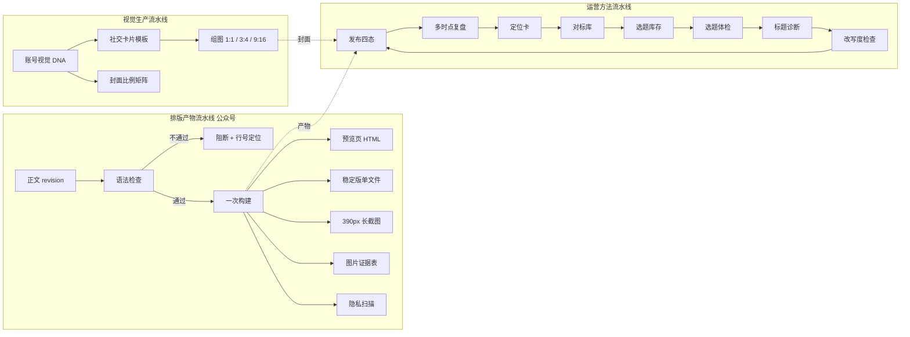
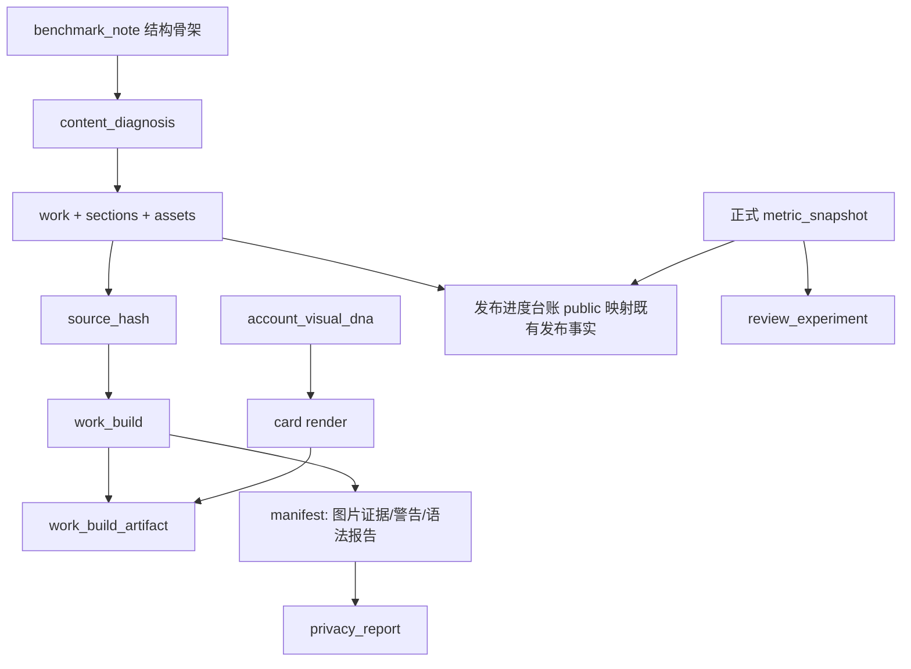

# 24 内容生产流水线与运营方法增强设计（D-156）

| 项    | 值                                                                                                                 |
| ---- | ----------------------------------------------------------------------------------------------------------------- |
| 文档版本 | v0.3.2（本人账号同步保留、AI 流水线增强及账号分析编辑契约）                                                                                                    |
| 编制日期 | 2026-10-30                                                                                                        |
| 状态   | CX 新增能力为设计态；既有同步与 AI 能力保留，新增实施准入见 14.2                                                                                         |
| 决策记录 | `90-决策与变更记录.md` D-156                                                                                             |
| 适用任务 | DEV-CX01 至 DEV-CX14                                                                                               |
| 关联文档 | 04（功能分级）、05（交互，P-04/P-09/P-10/P-12/P-14/P-15）、06（数据与接口）、08（测试）、23（技能系统，D-151）、11（热点采集，D-047）、20（平台采集，D-129/D-131） |

## 0. 怎么读这份文档

这份文档定义以下范围及其开发契约：

1. **新增什么**：24 个功能项，每项都有编号、级别、来源、现状、规则、数据、接口、异常与验收。
2. **强化什么**：17 条既有 FR 的增量，逐条列出「原设计 → 本次增量 → 验收差异」。
3. **来源在哪里**：每一个功能都能回溯到具体来源条目，并标注该来源的证据等级（L1 至 L4，见 2.3）。

这份文档**不是**实施记录。开发完成后的实际状态写进 08；实现与本设计不一致时，先核对既有决策并说明原因；涉及需求或架构变化须确认后同步本文与 D-156，不能仅登记偏差便视为获准。新增能力未注明实施证据时按设计态处理；第 3 章明确列出的既有能力继续可用，不得因 CX 尚未实施而关闭。

### 0.1 本轮审查结论与实施准入

v0.1 有功能清单，但尚不能直接作为开发规格：存在事实遗漏、重复入口、状态与数据契约冲突，以及仅凭客户端声明就判通过的验证漏洞。v0.2 原位修正这些问题，保留 24 个 FR 编号；**修订规格不代表已经实施，也不代表本文新增的所有产品取舍已获得批准**。

| 问题                                     | v0.1 的后果                   | v0.2 处置与定位                            |
| -------------------------------------- | -------------------------- | ------------------------------------- |
| 多 target 请求，数据库却只有单 target             | 幂等键、全成全败无从实现               | 4.6、FR-CX-02、8.1：规范化 target 集合与同一构建事务 |
| 源哈希未覆盖标题、封面、alt、DNA、模板版本等              | 修改实际产物输入后错误复用              | 4.6：输入快照与参数哈希分离，版本与规范向量               |
| 只数 HTML 中 `<img `，信任客户端 manifest/pass  | 可伪造清单、绕过扫描、漏缺图             | 4.7、FR-CX-02/05/06：服务端独立校验，客户端报告非证明   |
| 关闭 strict 仍允许残缺产物成功                    | 违背完整性原则                    | FR-CX-01：交付构建始终严格，编辑预览只提示             |
| `##` 层级和原始 HTML 支持收窄                   | 重现 ED-06/08/12 已修复问题       | 附录 B：保留既有标题归一化与安全标签                   |
| 长截图自动签发公开预览                            | 扩大正文暴露面，且不能固定构建快照          | FR-CX-04：本机隔离渲染，不自动创建公开链接             |
| DOM 模板由 Go 返回，声称渲染仅在前端                 | 两套渲染源头，重回双实现漂移             | FR-CX-08、9.2：API 返回结构化数据，双端各自本地渲染     |
| 工作区查重直接复用其他作品 asset                    | 破坏作品归属、删除语义并泄露其他账号资产       | FR-CX-11：本作品幂等；跨作品沿用显式复用接口            |
| 已有 topic_score 与三维评分被写成没有              | 新建第二个评分入口并静默改排序            | 3.1、FR-CX-12：明确增强报告与既有评分边界            |
| 评分范围、扣分位置、字符索引未定                       | 分数不可复算，emoji 高亮错位          | 4.8、FR-CX-12/13：确定性规则与完整/部分结果分开       |
| 新 AI 接口只登记四条 builtin                   | 绕过任务、预算、主体和数据保留契约          | 4.9、第 7 章：逐任务接入，禁止伪装现有任务              |
| 不存原文，却允许骨架参与完整改写度判断                    | 必然出现不可信的 fail/pass         | FR-CX-14/15：临时正文有界处理，骨架只作结构参考         |
| 新 `carousel/poster` 直接写 content_format | 绕过 D-048/D-123/D-128/D-136 | FR-CX-16：产物形态与作品类型分离，沿用 derive        |
| 自动每周候选入库、评论批量写入                        | 绕过逐条采用/入库红线                | FR-CX-19/22：提醒只读；候选与评论逐条确认            |
| 发布四态互不改写 work                          | 第二套真源，与已发布锁定/更正链路冲突        | FR-CX-20：保留既有 published 真源，扩展进度台账     |
| 从 published_at 伪造历史提交事件                | 把未知历史写成已证实                 | FR-CX-20：一条 import 事件、unknown 字段保留    |
| 复盘忽略质量、单位、节点 upsert 与更正                | held/unknown 数据回流，混算人数/次数  | FR-CX-21：消费正式指标与既有质量规则                |
| DNA 自动替换自定义主题，GET 引起写入                 | 历史外观变化、双源和隐式迁移             | FR-CX-10：显式导入，保留不可映射样式与历史快照           |
| 表/接口缺历史读取、列表、确认、取消和删除                  | UI 无法闭环，任务依赖无法成立           | 第 8/9/11/12 章补齐并明确前置验收                |
| 本文件被 docs/* 忽略                         | 设计不能随实现版本化                 | `.gitignore` 仅增加本文单文件例外               |

**审查证据边界（2026-10-30）**：读取了当前 `main` 工作树中的 `render.ts/render-policy.ts`（两端）、`topics.go`、`checks.go`、`publish.go/publish_correction.go`、`publish_xhs_pack.go`、`writing_derive.go`、`preview_link.go`、`metric_quality.go`、指标质量回归用例、`server.go`、迁移至 `00072`，并对照 04/18/23 与 90 的相关决策。这里是静态证据，未运行任何 CX 业务实现；`AI_HANDOFF.md` 是历史迁移交接，不替代当前代码。外部来源/许可证表沿用 v0.1 的历史记录，本轮未重新联网核验，不据此批准依赖引入。

**实施准入**：开发者先读 3.4 的保留契约和 14.2 的任务前置项。能够由代码调查/实验关闭的事项由对应任务处理；改变既有需求、公开暴露或类型/发布真源的方案必须先确认。禁止一边按旧段落实施、一边以新段落当例外。

---

### 0.2 用户确认的修订范围（v0.3）

用户已明确要求：保留并继续使用本人账号的真实资料、粉丝数、笔记/文章与表现数据同步；每天低频、少量读取，沿用“设置 → 凭证 → 同步”等既有入口；AI 对内容生产全链路的增强是本设计重点。v0.1/v0.2 中把真实主页读取或平台数据采集一概列为不做的表述撤销，以 4.10–4.11 与各 FR 的 v0.3 契约为准。本人账号读取已获得本轮需求授权，不再作为待批准产品问题。

范围是**本人已登录并确认身份的账号，或平台明确授予当前用户管理权限且已有连接机制支持的账号**。频率、数量与已有平台能力受 20/21 的统一连接、预算和回执管理；低频不等于跳过身份核验，CX 也不能以新增限制为由禁用现有同步。第三方对标库与本人账号数据分开建模，不把对标库的手动录入约束套到自己的账号上。

本次只修订设计与决策记录，不改同步按钮、连接、凭证、采集开关或业务代码。源码已存在不等于所有平台字段均通过真实验收：账号资料/作品目录已有实现，粉丝数等逐字段链路仍按 4.11 核实并补齐。新增 AI 方案不是只加四条技能，而是 4.10 的九个阶段、八类 CX 结构化任务及既有 AI 能力的联动。

## 目录

- 0 怎么读这份文档
- 1 结论摘要（1.2 新增与强化计数、1.4 三条判断、1.5 功能总表）
- 2 来源清单与采信规则（2.4 许可证核验表、2.5 不采信清单）
- 3 现状基线（3.1 已实现、3.2 缺口证据）
- 4 总体设计（三条流水线、权限、快照、可信边界、AI 全链路与本人账号同步）
- 5 新增功能详规（5.1 排版产物 A、5.2 视觉 B、5.3 文案 C、5.4 台账 D、5.5 交付 E）
- 6 强化功能清单（17 条既有 FR 的增量）
- 7 内置技能增量（4 条）
- 8 数据模型增量（11 张表、迁移与完整性约束）
- 9 接口增量（请求/响应、复用入口与错误码）
- 10 页面与交互改造（Web / 桌面）
- 11 开发任务拆分（DEV-CX01–14）
- 12 验收矩阵
- 13 风险、不做清单、观察项
- 14 文档同步与待决问题
- 附录 A 来源关键段 / B 语法矩阵 / C 术语 / D 修订记录 / E 编码与AI结果契约示例

---

## 1. 结论摘要

### 1.1 一句话结论

本设计以 **AI 辅助的内容生产闭环** 为主线：本人账号真实数据 → 账号诊断与选题 → 大纲和逐段创作 → 标题与视觉 → 发布前检查 → 发布后复盘 → 下一轮策略。排版产物可验证、视觉生产可复用、运营方法可执行，是这条流水线的质量基础。保留 24 个 FR 编号和既有人工确认闸门，AI 必须产出可定位、可修改、可逐项采用的成果，而非只给评分或泛泛建议。

### 1.2 新增与强化计数

| 类别       | 数量                   | 编号范围                                   |
| -------- | -------------------- | -------------------------------------- |
| 新增功能（P0） | 8                    | FR-CX-01、02、04、05、06、08、13、20          |
| 新增功能（P1） | 11                   | FR-CX-03、07、09、10、12、14、15、17、18、19、21 |
| 新增功能（P2） | 5                    | FR-CX-11、16、22、23、24                   |
| 强化既有 FR  | 17                   | 见第 6 章                                 |
| 新增内置技能   | 4                    | 见第 7 章                                 |
| 新增数据表    | 11                   | 见第 8 章                                 |
| 接口范围     | 新增与复用分别列示，以方法 + 路径为准 | 见第 9 章；不按路径组数宣称契约完整                    |

### 1.3 三个来源各自贡献了什么

| 来源                       | 原帖主题                                | 对 OPS 的真实价值                                                 | 落到哪些功能                        |
| ------------------------ | ----------------------------------- | ----------------------------------------------------------- | ----------------------------- |
| S1 `2115989266824368326` | 小红书全套运营 Skill（8 个）                  | 不是 8 个可直接安装的技能，而是 8 个能力缺口清单：选题体检、文案诊断、热点联动、封面/组图、排版分发、全链路编排 | FR-CX-08、12、13、14、16、内置技能     |
| S2 `2115326949388324968` | Mars Editor（Markdown → 公众号富文本）      | 交互范式：实时预览、图片直接粘贴、草稿备份、导出长图                                  | FR-CX-11、03、04                |
| S3 `2089196207138550270` | wechat-article-pipeline（一条命令的排版流水线） | 工程质量范式：一次构建、四类产物、哈希校验、隐私扫描、图片证据表、不支持语法必须硬失败                 | FR-CX-01、02、03、04、05、06、07、24 |

### 1.4 三条必须先说清的判断

**判断一：三个来源里最值钱的不是功能，是「不许假装成功」。**  
S3 作者自述踩过三个坑，其中两个是同一类病：假截图（只检查文件存在）、隐私检查读到乱码仍报 0 ERROR。OPS 现有排版链路存在同构问题——`web/src/lib/render.ts:188-198` 把不在白名单的标签静默降级为 `div`，不报错、不提示。本设计把「静默降级」列为 P0 缺陷，而不是体验优化。

**判断二：外部 Skill 不能直接装进 OPS。**  
S1 的 8 个 Skill 是 Claude Code / Codex 运行时形态（SKILL.md + 脚本 + 外部生图 API），而 OPS 的技能系统（D-151）是「指令文本注入 + 四层作用域 + 双生效面」，不允许夹带脚本执行。直接安装会同时破坏 D-151 的预算模型与安全边界。因此 S1 一律**转写为 OPS 内置能力或内置技能文本**，不引入其运行时代码。

**判断三：方法参考不构成代码复用授权。**  
2.4 是 v0.1 记录的来源快照，不是当前许可证保证或法律结论。本期选择全部自研；AGPL/无证/商业授权内容均不在本期代码引入范围。需要复用任何源码、模板、提示词或依赖时，固定 commit/版本、检查实际 LICENSE/NOTICE 与使用方式，再按项目流程登记；不靠 Stars 或仓库描述判断。

### 1.5 功能总表

| 编号       | 名称            | 类型           | 级别 | 主要来源            | 主要产物 / 结果                 |
| -------- | ------------- | ------------ | -- | --------------- | ------------------------- |
| FR-CX-01 | 排版语法支持矩阵与硬失败  | 强化 M6-01     | P0 | S3 静默降级         | `syntax_report` + 行号定位    |
| FR-CX-02 | 一次构建与产物清单     | 新增           | P0 | S3 四产物 + SHA256 | `work_build` / manifest   |
| FR-CX-03 | 发布稳定版单文件 HTML | 新增           | P1 | S3 稳定版          | 内嵌图片的 .html               |
| FR-CX-04 | 390px 真实长截图   | 新增           | P0 | S3 长截图          | 780px 宽 PNG + 空白校验        |
| FR-CX-05 | 图片证据表与缺图阻断    | 新增           | P0 | S3 证据表          | `image_evidence` + CSV    |
| FR-CX-06 | 产物隐私扫描与扫描器自检  | 新增           | P0 | S3 隐私扫描         | `privacy_report` + canary |
| FR-CX-07 | 主题库扩展与令牌契约    | 强化 M6-02     | P1 | S3 六套主题         | 8 套主题 + 结构不变断言            |
| FR-CX-08 | 社交卡片组图渲染      | 新增           | P0 | S1-6 / S1-5     | 2 模板 × 3 比例 zip           |
| FR-CX-09 | 封面比例矩阵与安全区    | 强化 M7-04/07  | P1 | 29 条 A1         | 4 比例封面 zip                |
| FR-CX-10 | 账号视觉 DNA      | 新增           | P1 | 29 条 C1         | 令牌 + 版本回滚                 |
| FR-CX-11 | 编辑器图片粘贴入库     | 强化 M7-01     | P2 | S2              | 粘贴/拖拽 + sha256 去重         |
| FR-CX-12 | 选题体检          | 新增           | P1 | S1-1            | 5 维评分 + 2 备选              |
| FR-CX-13 | 标题与文案诊断       | 新增           | P0 | S1-2            | 规则 60 + AI 40 + 定位        |
| FR-CX-14 | 结构拆解          | 新增           | P1 | 29 条 B4/B6      | 骨架 JSON（不存原文）             |
| FR-CX-15 | 改写度检查         | 新增           | P1 | 29 条风险表         | 三维判定 + 理由留痕               |
| FR-CX-16 | 一稿多形态编排       | 新增           | P2 | 29 条一稿三形态       | 长文/组图/贴图三选一               |
| FR-CX-17 | 定位卡与主页自检      | 新增           | P1 | 29 条 B3         | 7 项自检                     |
| FR-CX-18 | 对标账号库与拆解库     | 强化 M3-11     | P1 | 29 条 B4         | 两层库 + fit_score           |
| FR-CX-19 | 选题库存与补给节奏     | 新增           | P1 | 29 条 A7         | 五态 + 库存水位                 |
| FR-CX-20 | 发布状态四态        | 强化 M10-05    | P0 | 29 条 A7         | 状态机 + 事件留证                |
| FR-CX-21 | 多时点复盘与单变量实验   | 强化 M11-01/03 | P1 | 29 条 A7/B2/D6   | 四窗口 × 三口径                 |
| FR-CX-22 | 评论处理台账        | 新增           | P2 | 29 条 A7         | 分类 + 拟稿，不发送               |
| FR-CX-23 | 运营标准版本表       | 新增           | P2 | 29 条 A7         | 版本 + 生效日                  |
| FR-CX-24 | 构建校验 CLI      | 新增           | P2 | S3 一条命令         | `ops verify/export`       |

---

## 2. 来源清单与采信规则

### 2.1 三个直接来源

三个链接都是 x-thread.org 的帖子页，页面正文由客户端渲染，直接抓 HTML 只能拿到首屏标题。实际取全文的方式是站点自身的只读接口：

```
GET https://x-thread.org/api/get-thread/<threadId>
```

抓取时间 2026-10-30，返回 `success=true` 且 `data.thread.tweets` 完整。以下摘要均来自该接口返回的原文。

#### S1 `2115989266824368326`

- 作者：山羊赚钱笔记（@shanyanggm）
- 标题：小红书全套运营 Skill
- 结构：8 条，每条给出「Skill 名称 / 功能 / 适合人群 / 核心亮点 / GitHub」
- 原文要点（L1，逐条转述）：

| # | Skill 名                   | 原文功能                        | 原文亮点                     | 仓库                                    |
| - | ------------------------- | --------------------------- | ------------------------ | ------------------------------------- |
| 1 | content-strategist        | 把平台规则翻成可执行清单，理顺选题方向与内容优先级   | 关键词前置、标题长度控制、A/B 备选思路    | `demo112/yunqu-ai-skills`             |
| 2 | dbskill                   | 给选题和标题做体检，分析哪里不吸引人、哪里有 AI 味 | 诊断清单、爆款标题公式、直观定位问题       | `dontbesilent2025/dbskill`            |
| 3 | xhs-writer-skill          | 从卖点分析到正文、标题、标签，输出完整笔记       | 爆款拆解、卖点抽取、可直接发的成稿结构      | `JuneYaooo/xhs-writer-skill`          |
| 4 | writer + trending         | 写作能力与热点捕捉结合                 | 热点切入 + 爆款结构              | `jackbauerxu/workbuddy-xhs-skills`    |
| 5 | space-image-studio        | 一句话生成封面或配图                  | 4 类类型 × 12 种风格           | `SpaceZephyr/space-GPT-image2-design` |
| 6 | guizang-social-card-skill | 把文章、截图、笔记整理成套图文卡片与封面        | Editorial / Swiss 两套视觉系统 | `op7418/guizang-social-card-skill`    |
| 7 | html-anything             | 把 Markdown、表格、笔记转成单文件 HTML  | 无需 API Key、排版友好          | `nexu-io/html-anything`               |
| 8 | xhs-ai-workflow           | 从调研起草、配图到发布，串起完整流程          | 完整 AI 协作流程               | `554022647henry-boop/xhs-ai-workflow` |

- **不采信项**：原帖未给出任何效果数据；「4 类 × 12 种风格」是仓库作者自述，未核验（L2）。

#### S2 `2115326949388324968`

- 作者：lumxss（@bkdgiffug）
- 原文要点（L1）：
  - Markdown 写完一键转公众号富文本，复制粘贴后「标题、引用、代码高亮、图片、样式基本原样保留」。
  - 支持多套主题、实时预览、草稿备份、导出长图。
  - 图片能直接粘贴、拖进去，不用来回折腾图床。
- 仓库：`whyubel1eve/Mars-Editor`（现重定向到 `whyubel1eve/Mars-Editor-Web`）。
- **不采信项**：无许可证，且「基本原样保留」是作者主观描述，未给出对照样本（L2）。

#### S3 `2089196207138550270`

- 作者：达芬七（@davinci_seven），仓库 `davinci-seven/wechat-article-pipeline`，MIT。
- 原文要点（L1，可核验的机制部分）：
  - 输入：定稿 Markdown + 配图放同一文件夹；一条 PowerShell 命令产出预览页。
  - 预览页右上角绿色按钮 → 去公众号后台 Ctrl+V。
  - 六套主题：橄榄手记（深度评测/案例复盘）、摸鱼绿（教程/工具盘点）、红白色系（观点文）、石墨极简（科技/设计）、留白禅意（随笔）、摸鱼票据风（工具对比）。
  - 四样产物：预览页、发布稳定版（图片全部内嵌 HTML）、390px 手机长截图、检查报告（原稿哈希、HTML 合规校验、隐私扫描、图片证据表）。
  - 三件不做：不改原稿、不替你发布、图片少一张就停下来报错。
  - 跑前跑后各算一次 SHA256，对不上直接中止。
- 作者自述的三个缺陷（L2，作为设计反面样本采信）：
  1. **假截图**：脚本只检查长截图文件是否存在，没有真的截图；文档写了并不存在的能力。
  2. **隐私检查自欺**：PowerShell 5.1 的 `Tee-Object` 默认写 UTF-16LE，脱敏脚本按 UTF-8 读，正则匹配不到，仍输出 0 ERROR；实际仓库里已提交本机绝对路径，且泄露不止一个日志。
  3. **渲染器静默降级**：不支持的 Markdown 语法不停、不报错，改样式后仍报成功；完整性校验比的是剥掉格式后的纯文本，所以照样「通过」。
- **不采信项**：「3864 字 5 图 25 秒」是作者自述的单次计时（L2），不作为性能指标；「六套主题换配色和排印、结构共用」是作者对自身实现的边界说明（L1，直接影响本设计的主题契约）。

### 2.2 二手材料

用户提供的 `x-thread-27-summary-and-integration.md`（29 条总结，2026-10-27 补第 28、29 条）是二手提炼（L3）。本文档只在两种情况下使用它：

- 它已经把多条原始帖归纳成可执行结构（如 A7 的三类任务分工、四张运营表、发布状态四态），且与 OPS 现有模块能直接对齐；
- 需要引用它已经标注过的风险结论（第 4 节风险表）。

凡二手材料与原文冲突，以原文为准；凡二手材料引入的新数字（如「粉丝门槛从 500 降到 100」），本文档不采用，理由见 2.5。

### 2.3 采信分级

| 等级 | 定义                                     | 在本设计中的用法                 |
| -- | -------------------------------------- | ------------------------ |
| L1 | 可直接核验的事实：仓库 LICENSE、平台官方文档、代码位置、原文机制描述 | 可作为设计与验收依据               |
| L2 | 作者自述、单次体验、未给样本的效果描述                    | 只作为问题背景，不写进验收标准          |
| L3 | 二手总结、他人转述                              | 需回溯原文后才可用                |
| L4 | 本文档的设计推断                               | 必须显式标注「设计推断」，并给出可推翻它的验收项 |

**规则**：区分来源事实与产品约定。外部平台硬限制须引用已核验的事实条目；评分权重、尺寸、超时和配额是本文的设计值，不伪称平台事实。标为可配置的值必须有字段、权限、默认值、版本与读取位置；未定义配置入口的本期设计值固定随规则版本发布，不留“开发随意配置”的后门。

### 2.4 来源仓库历史核验表（v0.1记录，本轮未重验）

| 来源    | 仓库（核验时名称）                                              | 许可证                           | Stars | 最近推送       | 允许复用代码              | 本设计处置            |
| ----- | ------------------------------------------------------ | ----------------------------- | ----- | ---------- | ------------------- | ---------------- |
| S1-1  | `demo112/yunqu-ai-skills`                              | MIT                           | 9     | 2026-05-13 | 是（保留版权声明）           | 只参考清单结构，不引入代码    |
| S1-2  | `dontbesilent2025/dbskill`                             | CC BY-NC 4.0                  | 10972 | 2026-10-28 | **否**（禁止商用）         | 只借鉴诊断维度，文案全部自写   |
| S1-3  | `JuneYaooo/xhs-writer-skill`                           | Apache-2.0                    | 168   | 2026-04-25 | 是（保留 NOTICE）        | 参考提示词结构，不引入运行时   |
| S1-4  | `jackbauerxu/workbuddy-xhs-skills`                     | 无                             | 21    | 2026-08-01 | **否**（保留所有权利）       | 只借鉴流程            |
| S1-5  | `SpaceZephyr/space-image`（原 `space-GPT-image2-design`） | 无                             | 64    | 2026-10-22 | **否**               | 只借鉴「类型 × 风格」二维思路 |
| S1-6  | `op7418/guizang-social-card-skill`                     | AGPL-3.0                      | 7852  | 2026-07-01 | **否**（传染性 copyleft） | 自研渲染器，不复制模板代码    |
| S1-7  | `nexu-io/html-anything`                                | Apache-2.0                    | 9312  | 2026-10-13 | 是                   | 可参考单文件导出实现       |
| S1-8  | `554022647henry-boop/xhs-ai-workflow`                  | 无                             | 6     | 2026-05-13 | **否**               | 只借鉴阶段划分          |
| S2    | `whyubel1eve/Mars-Editor-Web`                          | 无                             | 236   | 2026-09-10 | **否**               | 只借鉴交互            |
| S3    | `davinci-seven/wechat-article-pipeline`                | MIT                           | 163   | 2026-08-15 | 是                   | 可参考校验脚本与产物设计     |
| S3 依赖 | `isjiamu/gzh-design-skill`                             | AGPL-3.0（LICENSE 正文为 AGPL v3） | 4202  | 2026-10-21 | **否**               | 不引入；主题与兼容处理自研    |
| S3 依赖 | `xiaowan-wechat-layout`                                | 未公开核验                         | —     | —          | **否**               | 只借鉴 QA 思路        |
| S3 依赖 | `md2wechat`                                            | 商业授权条款                        | —     | —          | **否**               | 不引入              |


**工程默认**：本设计所有实现均为自研。上表「允许复用代码 = 是」的项目，也只允许在**独立工具脚本**中参考，不得把其源码并入 `server/`、`web/`、`desktop/` 主体；确需引入时，由项目权利人确认许可证义务后再在 90 登记。

### 2.5 不采信清单

以下内容出现在来源或二手材料中，但**不进入本设计**：

| 内容                         | 出处           | 不采信理由                                                           |
| -------------------------- | ------------ | --------------------------------------------------------------- |
| 收入数字（月入几万、单日几千）            | 29 条总结 D 类   | L2 自述，无第三方核验；OPS 不做收益承诺                                         |
| 「3864 字 5 图 25 秒」          | S3           | L2 单次计时，不构成性能指标                                                 |
| 「小红书标题 20 字」等具体字数上限        | 常见教程         | OPS 事实台账 V-012 明确为「待验证」；只可按已核验的「1–18 张图」（F-102）设硬限制，字数只能作可配置经验值 |
| 「4 类 × 12 种风格」             | S1-5         | L2 仓库自述，未核验                                                     |
| 买粉开流量主、多号注销腾额度、擦边封面、直接仿写爆款 | 29 条总结 B/D 类 | 违反平台规则与 OPS 红线，见 13.2                                           |
| 「AI 味检测用于规避平台识别」           | S1-2 的常见误读   | 违反 D-014：人工参与度与文风诊断只用于提升可读性，不用于对抗检测                             |

---

## 3. 现状基线

### 3.1 已实现能力（核验到代码）

| 能力                  | 现有实现位置                                                                                                       | 关联 FR         | 结论                                     |
| ------------------- | ------------------------------------------------------------------------------------------------------------ | ------------- | -------------------------------------- |
| Markdown → 公众号 HTML | `web/src/lib/render.ts:231` `renderWechat`（marked + DOMParser + sanitizeAndStyle）                            | FR-M6-01      | 有；未知标签静默降级为 `div`（`render.ts:188-198`） |
| 主题                  | `web/src/lib/render.ts:42-150`，4 套（简洁/黛青/藤黄/墨白）+ 账号自定义主题                                                     | FR-M6-02      | 有；无「只改令牌不改结构」的契约与视觉回归基线                |
| 手机宽度预览              | `web/src/pages/work/Preview.tsx:20`，固定 390px 容器                                                              | FR-M6-03      | 有；无真实设备像素比、无长图                         |
| 复制 HTML             | `Preview.tsx:138-139`（`text/html` + `text/plain` 双写）、`:251` 按钮                                               | FR-M6-04      | 有；无粘贴后校验清单                             |
| 公众号草稿推送             | `server/internal/app/publish.go:138` `pushWechat`；正文图 `uploadimg` 替换（`:267`）                                 | FR-M10-01     | 有                                      |
| 草稿覆盖检测              | `publish.go:135` `draftHash`                                                                                 | FR-M10-02     | 有；这是推送时内容哈希，不是构建产物哈希                   |
| 图片资产                | `asset` 表含 `sha256/width/height/bytes/position`                                                              | FR-M7-01      | 有；无「图片属于哪一段」的记录                        |
| 卡片编辑器               | `web/src/pages/work/CardEditor.tsx`（`card_post` 类型）                                                          | FR-M8 / D-048 | 有；是「正文卡片 + 逐卡配图」，不是「把已有内容转成社交图」        |
| 封面裁剪                | `web/src/pages/work/editor-images.tsx:129` `smart-crop?aspects=2.35:1,1:1`；`Push.tsx:295` 预览                 | FR-M7-07      | 有 2.35:1 / 1:1；无其他比例、无安全区              |
| 小红书发布包              | `web/src/pages/work/Pack.tsx` + `publish_xhs_pack.go`                                                        | FR-M10-04     | 有；图仅来自资产，封面页/要点页只是文案                   |
| 发布前检查               | `web/src/pages/work/Check.tsx` + `checks.go`，6 类                                                             | FR-M9-01～07   | 有；无产物完整性、无隐私扫描                         |
| 指标多时点               | `metric_quality.go`：按 `(work,source,day_offset)` upsert、`metricNodesView`、质量/单位筛选与更正                         | FR-M11-01     | 有多日节点；不能假定同来源同日保留全部时点，小时窗口另行定义         |
| 选题评分                | `topics.go`：`ruleTopicScores`、`scoreTopics`、`sortTopicsByScore`                                              | EX-C-02       | 已有契合/素材/新颖与排序；CX12 增加单题体检，不覆盖已有分数      |
| 写作技能                | D-151 + `docs/23`，8 个内置技能、四层作用域                                                                              | FR-M12-09     | 有；无内容诊断类技能                             |
| 对标参考                | `strategy.benchmarks` jsonb（`Ops.tsx:293`），单篇链接 + 手动粘贴                                                       | FR-M3-11      | 有最小形态；无账号库/拆解库                         |
| 发布状态                | `work.status` 7 态（`drafting/checking/reviewing/ready/pushed/packed/published`）+ `published_url/published_at` | FR-M10-05     | 有；无「已提交/已预约/已公开/已登记」四态                 |
| CLI                 | `server/cmd/ops`，已有 `serve/migrate/check-formats/...`                                                        | —             | 有；无构建命令                                |

**本轮追加核验的既有能力**：两端 `pages/settings/Accounts.tsx` 使用 `PlatformConnectionCard`；桌面 `components/platform-connection.tsx` 的 `requestAccountSync/requestMetricsRefresh/resumeSyncOperation` 分别使用固定平台意图；`server.go` 已登记账号同步、刷新、操作进度、平台资料与作品镜像路由。`platform_mirrors_http.go` 已读取 display_name、bio、avatar_ref 与 field_states。`writing.go/writing_save.go/editorai.go/r4.go/review.go` 已有大纲、逐段生成/编辑、标题、开头、配图/分页与复盘。以上是静态源码事实，不是本轮真实账号联调结果。

### 3.2 缺口与证据

| 缺口         | 证据                                                     | 影响                                    | 对应功能        |
| ---------- | ------------------------------------------------------ | ------------------------------------- | ----------- |
| 不支持语法静默降级  | `render.ts:188-198` 注释明确「未知标签降级为 div」；无告警返回            | 作者以为排好了，实际粘贴到公众号后格式丢失，且系统报成功          | FR-CX-01    |
| 无产物概念      | 全仓库无 `build`/`manifest` 表；`draftHash` 只用于推送覆盖判断        | 无法回答「这篇当时排出来是什么样」；无法做一致性校验            | FR-CX-02    |
| 无长截图       | 全仓库 `capturePage` 零命中；仅 `metric_screenshot.go`（数据截图识别） | 无法在发布前看到读者手机上的完整效果                    | FR-CX-04    |
| 无图片证据表     | `asset` 无 `section_id`；渲染时只按 `asset.id` 填 alt          | 图多时无法核对顺序与归属，缺图不可发现                   | FR-CX-05    |
| 无隐私扫描      | `privacy` 仅出现在智能体隐私提示                                  | 公开预览链接或导出文件可能带绝对路径、令牌模式串              | FR-CX-06    |
| 主题无契约      | 4 套主题硬编码 style 字符串（`render.ts:42-150`）                 | 新增主题易顺手改 DOM，破坏「不做组件化模板编辑器」的边界（D-015） | FR-CX-07    |
| 无社交图产出     | `CardEditor` 产出的是公众号 `newspic` 卡片，非小红书组图               | 小红书封面/组图仍需外部工具，风格不统一                  | FR-CX-08    |
| 无视觉令牌      | 自定义主题只有颜色与标签样式（`custom-theme-state.ts`）                | 每篇从头调，无法「看到图就想起你」                     | FR-CX-10    |
| 无本规格完整诊断报告 | `Editor.tsx` 有标题候选；`topics.go` 已有三维评分与 `topic_score`   | 标题好坏靠感觉，无问题定位、无可复现评分                  | FR-CX-13    |
| 对标为最小形态    | `strategy.benchmarks` 仅 `{name, url}`                  | 无法沉淀「学什么、不学什么」，也无法做改写度检查              | FR-CX-14、18 |
| 无四态        | `published_at` 单一时间点                                   | 「已预约未到点」会被误记为已公开；口头答应被当成已保存           | FR-CX-20    |
| 无本规格精确小时窗口 | 已有日节点视图与质量规则，尚非本文小时窗口                                  | T+1 与 T+30 混在一起比，结论不可用                | FR-CX-21    |

### 3.3 与既有设计的关系

- **不重复 11 文档**：热点采集、来源分层、采集强度已由 D-047 / D-127 设计。本文档只补「热点 → 选题角度」的联动规则，不新增采集通道（FR-CX-16 引用 11 文档）。
- **不重复 20 文档**：平台登录、作品同步、指标刷新由 D-129 / D-131 / D-147 / D-148 设计。本人账号的真实资料、粉丝与作品同步继续由既有链路承担；CX 消费其授权数据并列明缺项补齐要求，不另建采集执行器。台账仍复用本地正式发布/指标事实，平台远端状态可展示但不自动认定本地公开。
- **不重复 23 文档**：技能的四层作用域、预算、双生效面不变。新增 4 条 builtin 与现有创作任务联动，遵守单技能 ≤1200 字、槽位 3600 字不截断；4.9/4.10 另定义真正的 AI 任务与上下文增强，不能把技能文本数量当作 AI 能力交付。
- **与 D-015 的边界**：M6 明确「不做组件化模板编辑器」。本文档的主题扩展坚持「只换令牌、不换结构」，社交卡片是**独立渲染器**，不进入公众号排版链路。

---

### 3.4 必须保留的结构与唯一责任方

| 领域    | 当前责任方/依据                                                          | 本期允许增量                  | 禁止回退                                                    |
| ----- | ----------------------------------------------------------------- | ----------------------- | ------------------------------------------------------- |
| 前端结构  | Web 与 desktop/renderer-src 独立；AGENTS、D-154/D-155 历史记录             | 两端独立实现、相同契约夹具           | 引入跨端源码 import、编辑 desktop/renderer 生成目录、复制 server        |
| 排版    | 两端 `render.ts` + `render-policy.ts`；ED-06/08/12、PB-15             | 报告、逐段证据、令牌扩展            | 删已有安全标签、丢作者内联样式、恢复错误标题层级、Go 再渲染一套 HTML                  |
| 类型与模板 | `writing_derive.go`、D-048/D-123/D-124/D-128/D-136、18              | 对合法作品生成不同产物；按现有矩阵跨平台派生  | 将 carousel/poster 写成作品类型，放开同平台互转，重做 comic/card_post 编辑器 |
| 检查    | `checks.go`：check_run.revision、指纹、resolution、逐项确认                 | 新类别和证据与当前 check_run 关联  | 另建 ack 路由绕过版本、事实/素材检查，诊断写入过期 run                        |
| 发布与更正 | `markPublished/handlePublished/setWorkPublished`；H-07/HC-07、D-122 | 预约台账、事务内事件；public 仍走原服务 | 采集/定时器认定公开、从 public 回 submitted 规避更正与指标节点冲突             |
| 指标    | 正式 metric_snapshot、质量与单位判定、人工更正；14/20/21                          | 新窗口是查询投影                | 原始观测直接变正式指标、held/superseded 回流、把 unknown 单位当 reads      |
| 技能/AI | 23 v0.3 的统一解析/预算/主体/目的受限来源；aicore/ai_job                          | 新真实任务显式登记；builtin 默认不绑定 | 复用 title/outline 名义返回新 JSON、扩 C0/C1、脚本或新任务执行器           |
| 热点/同步 | 11/20/21 的连接、本人账号同步、固定本机意图、观测采用 | 保留同步/刷新/继续入口，补齐自有资料/粉丝/作品并用于 AI | 新建平行采集器、删除现有入口、CX 门禁阻断旧同步、通用 IPC 或后台自动发布 |

文档编号冲突按 D-156 的历史说明理解；实施者按标题与源码核对，不通过重编号重写历史。

## 4. 总体设计

### 4.1 设计原则

1. **产物优先于界面**：每个能力都必须产出可校验的产物（文件 + 哈希 + 清单），而不是只在页面上「看起来对」。
2. **失败要吵**：不支持的语法、缺失的图片、扫描器未自检，一律阻断并给出定位，不允许降级后报成功。
3. **方法要可执行**：方法论必须落成字段、阈值、状态机或检查项，否则不进系统。
4. **来源要可追溯**：每个功能在本文档有唯一编号，编号能反查来源条目与证据等级。
5. **红线不让路**：对外发布、业务内容删除和需要确认的写入仍由人逐项操作（D-001、D-117）；技术暂存与到期产物清理仅按明示的保留策略执行。

### 4.2 三条流水线



三条流水线按各自的账号/选题/作品版本建立输入依据，并复用同一套人工确认门禁；并非所有对象都拥有 work.revision。构建只读作品；候选、派生稿、台账分别逐项确认，任何一条都不产生自动发布。

### 4.3 数据流



### 4.4 红线继承

| 红线          | 出处              | 在本设计中的落点                                    |
| ----------- | --------------- | ------------------------------------------- |
| 发布永远人工      | D-001           | 所有产物只到「可复制/可下载」；无任何调用发表接口的路径                |
| 不批量起草/确认/入库 | AGENTS.md、D-117 | 诊断、拆解、组图均逐篇触发；无「全部生成」按钮                     |
| 不把密钥交给生成环节  | 07 文档           | 隐私扫描把 `sk-`/`AKIA`/`ghp_`/`Bearer` 列为 ERROR |
| 不删改原稿       | S3 三不做          | 构建只读 `work`，不写回；产物独立存储                      |
| 不用于对抗平台检测   | D-014           | 文风诊断只输出可读性建议，不输出「规避检测」结论                    |
| 不照抄原文       | 29 条风险表         | 拆解输出须通过逐字段验证；改写度只是风险提示，按 M9 单项处理，不能声称版权证明   |

---

### 4.5 身份、权限与数据隔离（适用于全部 CX 接口）

| 操作                              | owner             | editor | viewer                 | 系统/匿名 |
| ------------------------------- | ----------------- | ------ | ---------------------- | ----- |
| 读取有权限账号的报告/台账/已完成产物             | 允许                | 允许     | 允许                     | 禁止    |
| render-check / 规则预览（无业务写入、无 AI） | 允许                | 允许     | 允许                     | 禁止    |
| 创建/上传/完成/取消构建、AI 调用、逐项确认、台账写入   | 允许                | 允许     | 禁止                     | 禁止    |
| DNA/运营标准作为账号共享配置写入              | 沿用现有账号管理 owner 权限 | 禁止     | 禁止                     | 禁止    |
| 本人对当前隐私报告 WARN 的知悉回执            | 允许                | 允许     | 允许（新增本人回执例外须按 14.2 确认） | 禁止    |

服务端从会话取 workspace/user，不信任请求中的 workspace_id、created_by、actor、platform、账户归属或 `client`。`build_id→work→account→workspace`、`artifact_id→build`、`note→target→account`、诊断的 topic/work 关系逐级校验；每次读取、上传、complete、下载都重新检查成员 active、工作区与对象未删除。跨工作区/父子 ID 不匹配统一 404；同工作区角色不足 403。停用账号仅可读历史，拒绝新构建/生成/业务迁移；退出成员立即失去下载权。

不为 CX 增加匿名下载或对象存储永久公开地址；HTML 以附件下载并设置 nosniff。应用内查看上传 HTML 必须用无脚本、无同源权限的 sandbox。所有写接口沿用现有 CSRF 与 requireEditor/owner 机制；viewer 例外未确认前保持拒绝，不能自行放宽。审计只记对象 ID、动作、版本和脱敏错误，不记正文、原昵称、完整 URL 查询串或凭证。

### 4.6 输入快照、哈希与并发

1. 创建构建必须提交 `basis_revision`。服务端在短一致性事务中读取完整源输入并固化 `source_snapshot`；作品保存、主题/DNA 保存、素材变更不能跨渲染过程持有数据库锁。事务完成后才渲染。
2. `source_hash = sha256(UTF8(canonical_json(source_snapshot)))`。快照字段至少包括：schema、work/account/platform/content_format、revision、title/summary/viewpoint/topics/wechat_fields、cover_asset_id/cover_crops、按 `(position,id)` 排序的 sections（id/position/heading/content_md）、目标实际使用的卡片/漫画文字及其资产关联、引用资产（id/sha256/mime/width/height/bytes/position/alt_text）、内置theme的ID/version/token_digest、完整账号自定义主题输入、DNA version/tokens、模板ID/version/digest、规则version。禁止只哈希主题名或资产 ID；存储路径、会话和签名 URL 不入源快照。未参与目标的输入也可以纳入，但不能遗漏参与渲染的输入。
3. 规范 JSON：对象键按 Unicode 码点升序，无空白；数组保序；字符串仅将 CRLF/CR 规范成 LF，不 trim、不做 Unicode 归一化；UTF-8 无 BOM；整数十进制；小数参数在验证后用固定小数位的字符串表达；null 与缺字段不等价，字段必须完整。字符串转义固定为JSON双引号/反斜线及控制字符转义（\b/\f/\n/\r/\t用短形式，其他U+0000..001F用小写\u00xx）；不转义斜线、<>&或可打印Unicode（含U+2028/U+2029）。Go/TS 共享测试向量覆盖中文、emoji、换行、引号、空值、不同输入顺序与边界小数，见附录E。最终 SHA256 是 64 位小写 hex。
内置主题/模板资源仍由两端各自工程维护；服务端随发布只注册受支持的renderer_contract_version与资源ID/version/digest元数据，不维护另一份CSS/HTML。构建请求携带renderer_contract_version，服务端按注册元数据组装快照，自定义主题/DNA从数据库读取；未部署版本409 renderer_version_mismatch。前端从同一快照解析实际令牌，解析后的CSS是输出而非可由客户端随意替换的权威输入。两端发布资源登记与混版本测试属于Q-CX-02前置。

4. `targets` 去重后按固定枚举顺序排序；服务端拒绝未知 options 键，并补全默认值。`params_hash` 对 `{targets, options, renderer_contract_version, rules_version}` 的同一规范 JSON 计算。构建幂等键为 `(work_id, source_hash, params_hash)`，不再使用单 target。渲染环境写 `renderer_receipt`：端、应用/渲染器版本、Chromium 版本、实际字体、DPR、尺寸；不宣称跨系统 PNG 字节完全一致。
5. 同键只可有一个可复用的 running 或 built。创建时锁 work 行、重新校验权限与 revision，再查询/插入；并发命中 running 返回 202 同一 ID，命中可复用 built 返回 200 `reused=true`，新建 201。failed、过期或文件缺失的历史记录不占可复用幂等位：在同一work锁下先将外层reusable=false，再创建新记录；不能修改旧manifest或把built回退为running。不同键不互相复用。
6. complete 持短事务锁 build 和 work，复核源哈希、版本、成员身份、所有资产与规则，原子写服务端 manifest 与 built。源变化使本次 failed（source_changed_during_build）；已完成的历史构建仍是该快照的合法归档，GET 返回 `is_current=false` 提示，不能事后把旧归档一律改成 stale。重新发布/推送须校验当前 revision 与 M9，归档下载不等于发布许可。
7. manifest 完成后不可修改。回执（隐私确认）、当前性、过期和下载权限是其外层状态；确认不得改 manifest 字节。若产物 manifest 含 artifacts，排除 manifest 自身和其哈希，避免循环；数据库保存 manifest_sha256，导出 manifest.json 就是该规范字节。

### 4.7 构建信任边界与交付边界

- 客户端只负责渲染和上传；服务端从原始上传字节独立计算 MIME/尺寸/哈希、HTML DOM 安全与完整性、图片引用、隐私扫描、zip 清单，不接受客户端 `scanner_ok/pass/bytes/sha256` 作为验证结论。HTML 解析用服务端现有 x/net/html；不是重新做视觉渲染。
- 二进制哈希能证明上传后未改变，不能单独证明截图来自该稿或浏览器，也不能证明与微信后台视觉一致。来源元数据分 `client_reported` 与 `server_verified`；必须有真实 Electron E2E 和后台手工验收，不能靠白图阈值宣布真实一致性。
- 构建的全部目标是本作品只读导出集合，和“全部执行多张卡片”不同；一个用户动作不能创建多个作品、采用多个候选或写入多条评论。`pack` 不进入通用 build 的目标枚举：M9、createPack、pack.zip 的 revision/资产校验继续由原发布包服务负责；需引用时只引用该服务的产出，禁止第二个绕过检查的 pack 实现。
- 上传仅在 running 与截止时间内接受；创建者或同工作区有写权限者可恢复，必须显式取得该 build，不靠不透明 ID 授权。相同名称/相同字节重试返回原 artifact_id；同名异字节 409 artifact_conflict，整次失败。complete 重复且 manifest 一致返回原结果，不一致 409 build_finalized；超时/取消/完成之后的上传全部 409 build_not_running。
- 设计上限：单产物 64 MiB、单 build 128 MiB、64 个文件、zip 解压总量 128 MiB、200 个条目；另受 stable_html 8 MiB、长图像素预算约束，取更严者。解码先检查像素，拒绝解压炸弹、绝对/上跳路径、重复项、符号链接、执行文件与套娃压缩包；文件名只作显示，storage_path 服务端生成且 API 不返回本机路径。限额是本期资源预算，不冒称平台限制。
- running 最长 120 秒，截止时间在创建时固定；客户端刷新不续期。取消/崩溃/断网写 failed 或由过期巡检收口；暂存文件 24 小时回收。先标清理不可下载，再幂等删除文件，成功后删除索引；存储失败保留重试记录，不能先删索引丢文件。built 默认 180 天；“最多 20 次”仅为历史列表分页大小，不提前删合法归档。

### 4.8 评分、定位与失效的通用定义

规则字符数按 Unicode 码点（与 Go rune 一致），前端不得直接使用 JS string.length。`span={start,end,unit:"unicode_code_point"}` 为 0 起、左闭右开；行列为原始段落规范换行后的 1 起位置。AI span 先验证可切出 evidence，否则降为 null，不猜索引。语法检测须排除代码围栏、行内代码、转义文本；金额 `$100`、代码中的 Mermaid/脚注字样不能当作实际语法命中。

报告记录 `input_hash/rules_version/created_at`，作品报告另带 basis_revision，选题另带 updated_at 快照；过期结果保留历史但不可当作当前结果。相同规则输入要求 rule_score 精确相等；AI 分只对冻结的合法响应复算聚合，不承诺真实模型重复打分一致。AI 缺失用 ai_score=null、score=null、ai_partial=true，仍显示规则原始分/满分，禁止把缺失 AI 归一化成满分体系。缓存必须包含账号/工作区、作品依据、定位/标准/技能/模型/提示词版本和输入哈希；私有上下文缓存按用户隔离。

### 4.8.1 cx-title-1的固定词法口径

规则对原始输入按码点定位，不先NFKC改写后把索引套回原文。数字类命中ASCII/全角数字或中文数字“一二三四五六七八九十百千万亿”连续串；时间类命中“今天/昨天/明天/本周/本月/今年/去年/明年”或数字后紧接“年/月/日/天/小时/分钟/秒”；具体对象类仅来自当前账号非空positioning_tags，不能靠AI补对象字典。同一个“3天”可同时命中数字与时间，算法是启发式而非语义事实。

好奇心初版词表固定为“为什么/为何/如何/怎么/竟然/原来/却/但”，按出现一次即命中，不累加。感叹号统计!与！的码点总数；emoji在本期只按U+1F300..U+1FAFF及U+2600..U+27BF的码点计数（忽略U+1F3FB..U+1F3FF肤色修饰码点），不是未定义的emoji簇。连续重复指紧邻重复的相同4码点片段（如ABCDABCD）；全大写指至少两个拉丁字母且所有拉丁字母均A..Z，忽略其他字符；全符号指无Unicode字母或数字且有非空白内容。每个结构违规项只扣一次。广告词命中直接调用M9同一规则模块，不另立“最”字正则。以上是固定初版设计，可随rules_version与精确样本升级，不能在同一版本悄悄换词库。

### 4.9 AI 任务、输入保留与技能边界

所有新 AI 调用复用 aicore/runAIJSON、ai_call、既有 ai_job 取消/失败与预算/模型路由，不新增执行器。新的实际 task_type 必须登记路由/默认提示词/输出 schema/validator/测试，并由 23 的契约测试明确“不支持技能”或获确认后逐项支持；**下表默认不注入技能，不扩 C0/C1**。第 7 章四条 builtin 仅服务它们已经声明的既有创作任务，不能让这些新任务自动获得技能。

| 建议 task_type         | 触发/允许输入                  | 严格输出与约束                       | 可持久化                   |
| -------------------- | ------------------------ | ----------------------------- | ---------------------- |
| cx_topic_diagnose    | 单题手动；题目、角度、授权定位、当前重复候选   | 两个 AI 维度各 0..满分、evidence、两个角度 | 校验后的诊断与 ai_call_id     |
| cx_title_diagnose    | 单作品手动；当前输入标题、当前作品必要正文、定位 | 四维评分、可验证 span、最多 3 候选         | 校验后的诊断；未保存标题结果须标临时     |
| cx_structure_extract | 单篇手动；本请求临时参考正文           | FR-CX-14 schema；不允许输出正文/指令    | 仅合格骨架、来源摘要与调用 ID       |
| cx_rewrite_compare   | 单篇手动；当前作品与临时参考正文         | 三维状态/证据；不返回长段原文               | 脱敏结论、算法/模型版本、参考摘要 hash |
| cx_profile_simulate  | 单账号手动；授权平台快照及人工补充的展示资料           | 明确“模拟”；不伪装真实用户验证              | 结构化自检与 profile_hash    |
| cx_comment_reply     | 单条手动；脱敏评论和必要作品摘要         | category 枚举、reply ≤80 码点      | 校验后草稿与调用 ID            |
| cx_account_analyze | 单账号手动；选定的本人平台资料/作品镜像、定位、可用正式指标与粉丝快照 | 账号现状、内容支柱、问题、优先行动、证据和未知项；不打伪精确总分 | content_diagnosis，kind=account_analysis |
| cx_visual_plan | 单作品手动；当前保存稿、选中段落、目标比例/模板、授权视觉 DNA | 完整卡片计划、文案、逐卡依据与缺图需求；不直接出图/覆盖/入库 | content_diagnosis，kind=visual_plan |


参考正文/评论/外链内容是不可信数据，不能覆盖系统指令、调用工具、触发保存或扩大引用权限。临时原文不得进入 ai_job 的请求快照/重放数据、ai_call.context_refs、审计、缓存、错误响应、调试日志或反馈样本；外部模型提供方的数据保留不能承诺为零，调用前必须提示会发送给所选提供方。需要任务重启重试时重新粘贴；本期临时正文流程使用用户请求内调用，不持久化原文以实现队列恢复。合法 JSON 也须校验未知字段、枚举、长度、总分与 evidence；失败不把未验证文本发前端。每动作最多一次结构纠错、两次去重改写，合计模型调用最多 3 次，并共用同一权限/上下文快照。

### 4.10 AI 内容生产闭环（本版核心）

#### 4.10.1 九阶段能力与采用边界

这是现有页面、任务和智能体卡片的串联设计，复用 16/23 与既有 API；不引入第二套工作流执行器或“全部执行”。每次生成都能独立使用，用户可以从任一已有阶段继续，不强迫重跑建档或重建旧作品。

| 阶段 | 输入与复用任务 | 必须形成的可操作成果 | 用户确认与任务归属 |
| --- | --- | --- | --- |
| AI-CX01 账号理解 | 本人平台资料、用户定位、选定自有作品、合格粉丝/表现快照；cx_account_analyze，既有 account_positioning/strategy_revise 各守原用途 | 内容支柱、受众假设、表达与视觉一致性问题、按优先级排序的下一步，每项有真实证据或明确假设标记 | FR17/CX13-D；仅生成报告，单条转定位/方案修订预览，不自动覆盖 profile 或激活策略 |
| AI-CX02 选题规划 | 定位、方案、素材覆盖、自有历史、授权热点与复盘；既有 topic_suggest/topic_hot_suggest/topic_score/daily_recommend，新增 cx_topic_diagnose | 题目、角度、读者收益、材料缺口和与旧内容差异；诊断后能预览一个更具体选题 | FR12/19、CX11/CX13-C；单题采用，不自动改旧评分/核验/库存，不取消已有每日推荐 |
| AI-CX03 证据与结构 | 已选择素材、参考骨架、当前选题；既有 outline/outline_review，加 cx_structure_extract | 段落角色、论证顺序、素材引用、尚缺事实清单；不能靠通用常识补案例与数字 | FR14、CX12；预览后沿既有大纲确认，缺证据允许继续写可证实部分并显式标待补 |
| AI-CX04 逐段创作与修订 | 已确认大纲、授权素材、邻段、账号风格/已启用技能；既有 section_draft/section_edit/section_continue/hook_suggest | 当前段落草稿、开头候选、可撤销修改；显示对应素材和修改范围 | CX11 的创作联动；保持现有逐段生成/保存行为，不新增全部起草；单段失败不丢失已保存段落 |
| AI-CX05 标题与整体打磨 | 当前稿、平台限制、定位和材料；title/summary/read_through/polish_check/fix_suggest/cx_title_diagnose | 标题候选、承诺与正文不符的位置、结构/重复/可读性问题、逐项修改建议 | FR13/15、CX11/12；先展示差异再采用；文风优化服务于读者表达，不生成虚构事实 |
| AI-CX06 视觉编排 | 当前正文、选中段落、DNA、模板与比例；新增 cx_visual_plan，既有 image_suggest/image_gen/image_alt 保留 | 封面短句、逐卡信息层次、与段落绑定的组图计划、缺图说明和配图提示词 | FR08/09/10、CX09；计划逐卡可改，确认后才构建；需要生图时进入既有单图生成流程，不把 AI 计划当真实图片 |
| AI-CX07 发布前准备 | 当前稿、当前 check_run、产物检查报告；复用 fact_flag/fix_suggest/layout_suggest | 事实/素材/标题承诺/图片/隐私问题定位，平台声明与人工核对提示 | CX01–06/CX11；AI 不能签发通过、处理 resolution、消除 ERROR，仍由原检查和用户逐项确认 |
| AI-CX08 数据解读与实验 | 既有正式指标、实际统计时点/单位、合格粉丝快照、内容版本；复用 review_analysis 与 FR21 窗口 | 有效比较、可能原因、反例/混杂因素、单变量实验建议和下一轮选题 | FR21、CX13-B；报告可给小样本探索建议，标 low_sample；正式实验结论仍按原样本门槛人工确认，不承诺因果或涨粉效果 |
| AI-CX09 反馈进入下一轮 | 用户确认的复盘规律、采用/拒绝结果和编辑后内容；沿既有 review_loop/rememberInsight/选题采用 | 可追溯写作经验、下一轮建议与采用记录；后续生成能引用已确认经验 | CX13-B/C、CX14联动；记忆、选题、方案各走原单项确认，未采用建议不自动成为长期账号记忆 |

现有 AI 任务不因为新诊断任务而被替换、降级或统一禁用技能。原 C0 创作任务继续按四层作用域解析已启用技能；C1 保持显式开启，事实检查与指标解读保持系统事实约束。八类新 CX 任务首版不自行扩大 23 的技能矩阵；新增真实任务的模型路由、提示词和 schema 本身是必交付能力，并不依赖先绑定技能。

#### 4.10.2 上下文、证据与数据就绪

复用 contextpack/aicore 的上下文组装与权限检查，**按当前阶段取最少必要数据**。用户可见“使用了哪些资料/作品/指标，哪些缺失”，且能取消本次选中项；后端不接受客户端随意提供的跨账号内容或把整份数据库打包给模型。新的上下文回执是响应的可选 `cx_basis` 字段，旧端可忽略，旧任务原输出字段保持不变。

`cx_basis={schema_version:1,account_id,work_revision|null,profile_hash,strategy_ref|null,standard_ref|null,dna_ref|null,sources[],omitted[],coverage,assembled_at,input_hash}`。sources 每项为服务端生成的 `ref/kind/id/revision/as_of_at/state/purpose`；kind 为 profile/strategy/platform_profile/platform_work/metric/followers/material/confirmed_memory/standard/dna/work_section/work_asset。`work_section` 是本人当前本地作品段落；`work_asset` 是本人选定的同作品图片资产元数据，不表示模型看过图片内容。state 区分 verified_fact/observed/unconfirmed；source_refs 是 sources.ref 的字符串数组，不接受不存在的ref或模型自建来源；需要定位时复用4.8的span与服务端excerpt校验。回执不存 Cookie、访问令牌、临时参考原文或私有技能正文。来源读取后再次校验租户、授权与现存状态；存在私有上下文时沿 23 的目的受限引用/共享防护，不公开私有来源。

profile 定位和 platform_profile 实际展示资料分别注明来源，不自动互相覆盖。自有 platform_work 正文可以在本人授权范围内用于分析风格/内容覆盖，保存在原镜像链路；它不同于 FR14 临时第三方参考全文，不能以“不存参考原文”为由删除用户自己的笔记数据。未绑定作品仍是镜像，不假装本地作品；未采用的观测可作为带 observed 标记的账号现状说明，不能参与正式效果排名、比率和基准。

默认读取最近 20 篇自有作品用于列表比较；用户可选择 1–20 篇。每篇最多发送 2000 码点，正文合计最多 20000 码点，标题/指标另按上下文总预算控制；有省略时返回实际覆盖段落、omitted 与原因，不把截取片段写成全文审阅。指标/粉丝只读目标窗口的必要快照；最终 token 预算、输出上限、模型上下文长度在发送前由服务端检查，超限引导缩小范围，不悄悄删除系统真实性规则或截断技能。

视觉判断须区分输入能力：只有资料文字/DNA时只分析文字与令牌一致性，不声称看过头像或封面；真正看图复用已有识图路由与授权资产输入，发送前验证模型能力，外部avatar/media_ref不能由服务端任意抓取。无视觉模型时该项unknown，文字分析仍可用。

数据状态为 ready/partial/unavailable，由服务端按字段可用性计算。没有粉丝数据也可分析表达/选题，没合格表现数据也可建议可执行实验；不能伪造“表现最好”或声称验证过受众。用户打开页面或同步完成只更新就绪状态/显示分析入口，不额外启动收费 AI 或再次采集；用户点击当前阶段动作才调用。已有经过批准的每日推荐/例行任务按原基线继续，CX 不新增后台全链生成。

#### 4.10.3 任务回执、版本和失败恢复

一次动作只触发一个明确的业务阶段，可有同任务内有界纠错；提交前显示任务、选中输入、模型路由与已有用量提示。服务端附 `ai_call_id/ai_job_id?、task_type、model、prompt_version、input_hash、cx_basis、status、stale、next_actions[]`，不信任模型声明这些值。生成成功是结果可用，采用成功须另有原业务写入回执；按现有 task 语义区分生成报告、保存草稿和人工确认。

两项新任务 cx_account_analyze/cx_visual_plan 使用请求内结构化调用，成功返回 200，失败返回既有模型/额度/超时错误；本期不新增这两项的后台排队模式。客户端可取消等待并传递请求取消，服务端校验结果前再次检查取消、身份与依据，取消时不保存报告。去重键由服务端按 workspace/account/actor/task/input_hash/prompt/model 路由快照计算，沿现有并发控制方式实现；同键运行中返回 409 ai_task_in_progress，携带 Retry-After，前端保留等待状态而不重复请求。合法已完成结果可复用，显式“重新生成”须另有请求 nonce，保持用量可见；不把去重承诺假定为 ai_job 已有的全任务能力。

新持久化诊断按 8.4，既有作品/复盘/ai_job 沿原存储；不新建统一“流水线状态”表去镜像 work/topic/job。next_actions 是服务端允许的页面动作描述 `{action,target_id,basis_revision?,label}`，仅导航/预览，不是可执行脚本或模型工具调用。AI-CX01 只允许预览定位/方案建议，AI-CX06 只允许预览卡片/打开既有单图生成功能；服务端枚举随任务固定。

编辑后只把依赖变更的结果标 stale，保留历史和人工修改；不会自动重跑、花费或覆盖。重试重新检查权限与版本；请求内临时参考不能后台恢复。模型/网络/额度失败显示可重试阶段，保留原内容与已经采用的结果；结构不合格按 4.9 有界纠错。重复点击复用已有同主体、同输入、同任务的运行任务/已校验结果；不得新增重复收费作业或重复采用业务记录。

账号分析报告允许编辑 `overview/pillars/findings/actions` 后显式保存；每次更新必须带 `expected_revision`，服务端按同一输出/来源校验器复核并原子递增 `result_revision`，版本冲突返回409且保留用户当前编辑内容。每条 action 可单独标记 adopted 或 dismissed，使用同一个 CAS 更新入口、每次仅一个条目改变；这只是人工反馈状态，不改作品/选题/定位/发布事实，不启动任何后台写入。旧报告与原 AI 调用保持可追溯；source stale 不清空人工修改或反馈。

#### 4.10.4 AI 质量与价值验收

每阶段有固定脱敏契约样本和可复核的人工样本，不以“接口返回 200”“建议不少于三条”作为质量通过。固定响应测试必须覆盖事实引用不存在、超长、越权引用、旧版本、模型注入、无数据、真实零和互相矛盾数据；越权输入不能发模型，事实依据不存在的建议不能作为已验证事实展示。真实模型结果允许不同措辞，不用机械字符串相等断言质量。

实施前冻结至少 12 个脱敏场景：新账号无数据、自有主页完整、部分资料、粉丝真实零、已存在笔记、已绑定/未绑定各一、指标单位未知、小样本、长文省略、模型失败、提示注入；覆盖九阶段。每项标注输入/版本/预期事实边界与可采取动作，记录全部样本的通过/失败，失败样本修复后重验。涉及严格事实与权限的夹具须全部通过，真实模型可操作性由评审逐项记录，不宣称统一“准确率”。

已有 ai_call 的用量、时延、错误与采用记录优先复用；新增统计只在原所属记录上加必要关联，不记录原文或生成另一张用户画像。交付记录至少包括生成成功率、schema 失败数、用户采用/拒绝和编辑后采用、每篇调用数/用量；这些是实测统计，不预设提升百分比，更不把用户未采用等同模型错误。CX09 的 AI 视觉计划、CX11 的创作/诊断联动、CX13 的账号分析与复盘反馈必须分别验收，不能仅完成确定性渲染就称“AI 流水线完成”。

### 4.11 本人账号的真实数据同步与不回退契约

#### 4.11.1 允许的数据与唯一归属

| 本人账号数据 | 本版要求 | 现有责任方与实现证据边界 |
| --- | --- | --- |
| 真实主页/展示资料 | 允许读取昵称、头像引用、简介、公开账号 ID 等实际可得字段，供自检和 AI 账号分析 | platform_account_snapshot / GET platform-profile 已有；背景/置顶等逐字段核验，有权限但缺适配的列入 20/21 补齐任务，不强迫改手填 |
| 粉丝总数及可得增减 | 允许少量低频读取并用于账号趋势和 AI；明确时点、统计范围和单位 | 20 已设计 followers_total → account_metric_daily.cumulate；现有 followers API/人工与微信 API 能力保留。xhs 能力探测有 followerTotal，但仅能力标记不证明实际采集、投影、查询全通，须逐环补齐 |
| 本人笔记/文章目录与正文 | 保留现有增量同步、历史核对、正文/封面/媒体引用/远端状态与时间，支持选择内容作 AI 输入 | platform_work_mirror 及 platform-account-sync 既有链路；完整/部分/不可得与作品明细保留，不因 CX 限定只允许已绑定作品 |
| 本人作品可得统计 | 保留账号同步当次统计、日常指标刷新和既有单篇观测/采用；供复盘与选题反馈 | platform-metrics-refresh / platform-sync、metric_observation 与正式指标服务；不知道曝光/阅读单位就保持 unknown，不因 AI 需要而补造 |

不采集粉丝名单与第三方身份明细来替代粉丝数量；不新增账号凭证拷贝。这里的“主页读取”可由登录后的本人创作后台提供，无须重新爬公网主页；CX 不为同一事实新增平行抓取器。

#### 4.11.2 低频、少量与已有操作保留

日常优先使用现有“刷新指标”读取已知目标；“同步”继续获取资料和增量目录/内容；首次或历史核对可分批、按既有回执继续。CX 不发明另一个日采次数、调低现有预算或修改开关。按同一平台主体复用当前策略/互斥/幂等和 `next_allowed_at`，完整历史可以跨多次人工继续完成，不要求一日取全。数据已足够时 AI 直接使用快照，不因每次诊断重新采集。

**不能把配置或常量当作预算已执行的证明**：当前 `platform_sync_budget.go` 注释和 21 的既有记录指出，run 次数闸门已接入，查询/作品预算存在尚未接线的技术债；本轮不宣称已经修好。扩大读取字段/范围前由 20/21 对读取前预算申请、实际请求/作品计数、去重、节奏与停止回执逐项验证/补齐；这些是扩展链路的验收，不作为关闭现有合法同步的理由。账号/资料读取合并到同一同步阶段，失败不得进入无界重试。

现有全局/工作区开关、能力探测、身份确认、平台要求重新登录和暂停/继续/取消均保持原语义；本版不改变部署值，不默认开启自动采用。失败、部分成功、超预算要显示原因和可继续时间，不通过吞错返回空列表或“0 篇/0 粉丝”。手工补录保持可用，并与真实同步快照分别标来源，下一次同步不静默覆盖用户确认的数据更正。

#### 4.11.3 新旧功能隔离与实施要求

“设置 → 凭证 → 登录/同步/刷新指标/继续同步/查看明细”保持现有位置及固定平台意图契约；主页自检和 AI 页可跳转该入口并读取结果，不搬走或新建替代按钮。旧接口/连接/镜像/观测不因缺 profile_check、DNA、运营标准、CX 诊断报告或 AI 模型而失效。同步成功不自动触发 AI，AI 失败不影响同步成功记录。

Web 继续按原能力查看同步结果并引导需要本机登录的操作到桌面；不要求浏览器新增本机会话能力。桌面固定意图经已有接收回执返回进度，不开放通用 IPC。旧账号/连接无迁移也可使用既有同步；新增字段可空，不清空历史快照，不重新要求已完成的身份确认。账号撤权/切换后，新的 AI 上下文重校验隔离。

交付必须附本人账号的字段覆盖表（请求范围、实际字段、值/单位/时点、来源版本、缺失原因、保存与查询证据），覆盖资料、粉丝、目录/正文、统计四类。真实平台取不到时列未完成字段与具体补齐任务，不写成“产品不做”，也不能因某字段未知宣称该平台全部不支持。资料/粉丝/作品能力登记仍在 20/21，04/05/06/08 随实际扩展同步，不在 CX 建第二本状态账。

## 5. 新增功能详规

本章每个功能覆盖：类型与级别 → 来源 → 现状 → 目标 → 规则 → 数据与接口 → 异常 → 验收 → 不做什么。**规则里的每个阈值都必须能被一条验收断言复算**；做不到的阈值不写。


### 5.1 A 组：排版产物可靠性（公众号）

#### FR-CX-01 排版语法支持矩阵与硬失败

类型：强化 FR-M6-01；P0。来源：S3 的静默降级反例，机制参考，不把作者自述当成 OPS 运行证据。

现状与保留：两端 render-policy 已支持安全 HTML 标签、作者内联样式合并与 ED-12 标题归一化。未知标签会被降级；不能为了检查把原有已支持标签一并禁止。

**输入与流程**：`POST /works/{id}/render-check {basis_revision}`，服务端读取当前段落执行有位置的语法检查，返回 `{basis_revision,input_hash,rules_version,issues,converted,warnings,total,truncated}`。只读不调用 AI。真正创建构建时重新执行，不依赖先前检查或前端 marked.lexer 声明。浏览器编辑预览可以继续展示问题，交付构建始终严格；删除 v0.1 的 strict_syntax=false 交付旁路。

**规则**：附录 B 是唯一语法表。区分支持、带报告转换、阻断；保留 section.heading→h2、正文 #/##/###→h3、####–######→p/strong。代码围栏/行内代码/转义内的符号均为文本；已有安全 HTML 不新增阻断。语法检查与前端解析结果必须用相同夹具逐项核对，不要求 Go 复刻 HTML 渲染器。CX01 开工先验证检测器对实际 marked token 边界的覆盖，不能用几条全局正则冒充解析。

issue 字段：`section_id/section_heading/line/column/syntax/excerpt/reason/suggestion`，excerpt 最长 80 码点并经敏感掩码。最多返回 50 条、完整 total、truncated；有未返回 ERROR 仍阻断。报告定位过期时提示重新检查，不能把旧行号指向新内容。

**失败**：不支持 422 render_unsupported_syntax；依据变化 409 version_conflict；扫描器异常 500 render_check_failed。失败不得产出可下载文件。

**验收**：四种实际语法分别命中且有位置；# 和 ## 正文都转 h3；安全 dl/dt/dd、表格、作者样式不退化；代码中 `[^1]`/`$100`/Mermaid 与转义示例不误报；Go/两端同夹具同分类；50+ 命中保持阻断。Go 测扫描器，前端测实际 DOM 与定位，不能用 Go 用例名称声称已测试 marked。

不做：自动修复、语法扩展与宽松交付模式。

---

#### FR-CX-02 一次构建与产物清单

类型：新增；P0。来源：S3 的产物/哈希/缺图原则。目标是在不写回源稿的前提下，对一次只读导出保存完整、可校验的快照。

**创建**：`POST /works/{id}/builds {basis_revision,targets,options,client,renderer_contract_version}`；targets 为 wechat_html/stable_html/long_image/xhs_cards/cover_images 的非空集合，按 4.6 规范化。`stable_html`、`long_image` 依赖的内部 HTML 进入冻结输入与校验，不要求用户重复勾选。只有用户选择的可下载产物与必需报告进入清单；pack 复用现有服务，不进入本枚举。响应含 `{build_id,status,source_hash,params_hash,basis_revision,source_snapshot,deadline_at,expires_at,reused}`，只向已鉴权同工作区返回快照。

目标资格：wechat_html/stable_html/long_image 只适用于公众号的既有文字流（long_article/qa_article/briefing）；comic/card_post/script 保持专用链路；xhs_cards 仅为小红书 image_note/list_note/card_post 的图像产物；cover_images 仅适用已有封面能力的作品。头条不因本期被移除原发布包/预览能力，也不被误当成公众号 HTML。非法组合 422 target_not_allowed，具体矩阵由当前 formatMatrix 与本条联合验证。

**状态**：running→built或failed，终态不回退；截止 120 秒。上传、complete、取消及并发幂等按 4.6/4.7。任何目标失败整次失败，下载拒绝全部产物；前端关闭/网络断开可恢复状态查询但不默认为成功。显式 `POST /builds/{id}/cancel` 幂等置 failed/build_cancelled；到期巡检与 complete 使用同一行锁/终态条件，不能互相覆盖。
**完成**：客户端提交 `{source_hash,params_hash,artifacts:[{artifact_id,kind,name}],renderer_receipt}`，不提交可信 manifest。服务端独立读取暂存字节、解析 HTML DOM 与 zip、校验冻结图片证据/安全策略/隐私后生成 manifest。标题、章节顺序、规范化可见文本和图片出现序列须匹配冻结输入/合法转换；脚本/事件属性/外部资源引用按目标拒绝，不能简单 count 字符串。校验状态为 pass 不表示像素完全等价。

manifest 最少包含 schema=ops.build/v1、build/work/account ID、platform/content_format、basis_revision、source_hash、params_hash、targets/options、theme/DNA/template/rules 版本、built_at、renderer_receipt、artifacts（ID/kind/name/MIME/bytes/sha256/width/height）、image_evidence、syntax_report、privacy_report、warnings。manifest 自身不在 artifacts 哈希列表，规则见 4.6。客户端 privacy pass 会被忽略。

**存储/历史**：8.1 的快照与 manifest 不可变；历史构建标 is_current，不冒称仍可直接推送；180 天过期返回 410 artifact_expired，文件异常 409 artifact_unavailable。下载前核验当前权限/终态/过期/本人 WARN 回执；不从静态目录绕开。可用产物保留期间，源图片删除不能破坏已内联归档；引用在线资产的 preview.html 明确不是离线归档。

**验收**：两端/Go 规范向量一致；标题/alt/封面/主题令牌/DNA/模板任一变化使哈希或参数哈希变化；同键并发只一条 running，重试复用；上传重复不增行；任一目标失败全禁下载；源变化409；完成/超时竞态只有一个终态；伪造 pass/清单/图片序列不能过；历史仍可归档下载且标非当前。

不做：服务端视觉重渲染、增量构建、借 build 创建作品/入库或绕开 M9 的发布包。

---

#### FR-CX-03 发布稳定版单文件 HTML

类型：新增；P1。来源：S3 单文件产物、S1-7 方法参考。输入是本次快照同源的 wechat_html；保留主题内联样式，不改原稿。

**输出契约**：UTF-8、无BOM的HTML，所有图像使用冻结资产字节生成的data URI（MIME为image/jpeg、image/png或image/webp；base64编码）。只允许已解码验证的这三种格式；其他格式先沿用既有图片入库转码，构建内不得隐式改变透明度/方向/动图语义后报相同原图。HTML 禁 script、iframe、事件属性、外部 stylesheet/font、@import、CSS url、srcset、file/blob/http(s) 资源引用；普通 a[href] 的 http/https 导航允许且不得自动发起。需解析 DOM/CSS 验证，不能靠全文件搜索 http 字样。
体积按最终编码字节（含base64和HTML）计，最大 8 MiB；超限 422 stable_html_too_large，给脱敏后的前 10 个大图资产 ID/字节与缩图建议，不自动压缩。外链图不可直接 fetch 内联：先人工入库，防止鉴权泄露/SSRF/跨域污染。文件名标题非法字符替换、去目录和保留名、最长 80 码点；再加 revision 与 -stable.html，服务端生成，禁止标题作为路径。

可加入 ops-build source_hash 元数据；不含用户 ID、原始文件路径、令牌、授权 URL。离线归档与公众号剪贴板/推送是不同用途；data URI 稳定版不直接代替 uploadimg 的发布 HTML。

**异常**：缺图/校验失败 422 image_missing；非托管图 422 unmanaged_image；编码/安全/隐私失败按通用契约。图像元数据未做清理时，报告必须注明“未检查图片 EXIF/可见文字”，不得宣称全文件隐私无泄漏。

**验收**：禁止网络请求条件下两端都能查看全部图像；带链接文本仍通过；srcset/CSS url/嵌套外链触发失败；9 MiB 最终字节失败；透明 PNG 不被隐式 JPEG 替换；源码、服务端与导出文件哈希可对应。

不做：PDF、加密归档、自动收集外链图。

---

#### FR-CX-04 390px 真实长截图

类型：新增；P0。来源：S3 的真实截图反例、S2。只在桌面生成；Web 呈现能力说明，仍可按权限下载既有长图。

**渲染输入**：使用 build 的冻结 HTML 与经校验资产在本机隔离页面渲染，禁止为截图自动签发/刷新 `/preview/{token}`。公开分享继续由现有用户动作控制，不借本期截图重写分享契约。主进程接入沿用固定本机意图：只接受当前受信业务窗口的 build ID/有限参数，核对窗口来源/当前账号；不提供通用 URL、JS、文件路径或 CDP 执行入口。

隐藏 BrowserWindow 为 show:false、contextIsolation、sandbox、nodeIntegration:false，不复用平台登录 partition 或凭据；禁止弹窗/导航、任意网络与 file 读取；临时内容仅含冻结 HTML/校验图像。按项目 Electron 固定版本实测 CSS 视口 390×844、DPR=2 的正确设置方式；不能把 deviceScaleFactor 直接塞 BrowserWindow 未支持字段便算实现。先等 fonts.ready、所有 img decode、布局连续两帧稳定，再测内容边界；3 秒未就绪直接失败 render_not_ready，不能带字体未定 warning 成功。

**输出**：内容 CSS 高度 H，PNG 为 780×ceil(H×2)，H 至少 1；短稿不强制画满 844 像素。最多输出高度 60000 像素且总像素≤46,800,000；分段按**输出物理像素**上限 16000、在 CSS 坐标转换后截图。拼接前校验总像素/编码/内存预算，超过预算 422 image_too_tall；禁止先分配完整巨幅 Canvas 再检查。总构建120秒内，截图阶段60秒；always finally 关闭窗口、释放 debugger、Canvas/临时资源。完成前再次校验来源快照。

**有效性**：服务端真实解码、检查宽高/alpha/非空内容边界；像素方差与非纯色行仅作异常辅助，固定 variance>100、5% 非纯色不是“真截图”证明，不能拒绝合法短稿/浅色稿。使用特制纯白图在有实际文字/图片的快照下必须检出；真实来源靠受限主进程流程与 E2E，不信任 renderer_receipt 单方声明。报告保存 H、DPR、segments、capture engine/version、检查范围。

**失败**：非支持目标/端显示 desktop_only；资源未就绪 render_not_ready；0 高度 empty_content；解码/尺寸/空白异常 long_image_invalid；超时 build_timeout。client=desktop 只是能力提示，服务端不把它当身份或授权证明。

**验收**：真实 Electron 生成短文/长文/含图文，尺寸与冻结 DOM 边界相符；16000 分界前后无重复/漏行；DPR/Windows 缩放下仍固定 780；断网与字体/图片失败可见；恶意 URL/跨窗/导航/任意 IPC 参数拒绝；窗口数和 debugger 资源恢复；手机人工对照排版关系，像素容差仅用于相同渲染环境夹具，不承诺跨系统手机2px一致。

不做：Web 近似截图、服务端浏览器、自动公开预览、GIF/视频。

---

#### FR-CX-05 图片证据表与缺图阻断

类型：新增；P0。来源：S3 的顺序/章节/图注与缺图原则。证据属于 build 快照，不给可变 asset 加一个错误的一对一 section_id。

两端分别实现 `renderWechatSections`，沿用原 renderWechat/render-policy 的结构与样式合并；逐段结果包含 section_id、规范 HTML、图像 occurrence。同一资产重复出现保留多条，全文按章节 position/id、段内 DOM 顺序从1编号；封面/水印/logo 单独带 role，不能混入正文图片数。章节标题由文本安全转义输出。

证据项：index、role、section_id/heading、asset_id、展示文件名、原始 MIME/width/height/bytes/sha256、输出图像哈希（发生显式转码时）、caption、mapping_status。服务端从冻结段落引用/HTML DOM/实际资产分别交叉校验**序列与内容**；不仅数量相等。路径匹配只接受项目规范资产路由、严格 UUID；同外部域名的相同 path 不能伪装项目资产。

缺图/跨作品或跨工作区引用/存储哈希不符都阻断。跨作品合法复用应先生成本作品 asset 关联，不通过证据校验临时放行。未引用图为 unused_assets 软提示，不要求总资产数等于 img 数。外链历史图在普通编辑预览标 unmanaged/inferred；交付构建必须先逐图导入本作品，不可将 unknown 哈希宣称已验证，不新增任意 URL 拉取接口。

证据存 manifest.image_evidence；GET /builds/{id}/evidence.csv 与其他导出执行相同权限/隐私门禁。CSV UTF-8 BOM，正确引用逗号/双引号/换行；Excel 公式前缀 =/+/−/@（含空白绕过）转义，不能用“6行”断言处理带换行的合法图注。

**失败**：422 image_missing/unmanaged_image，detail 只带 section_id/occurrence/asset_id 与脱敏原因，不回完整敏感 URL。返回顺序定位，未返回项仍可计数。

**验收**：3段5图顺序准确；同图两次两条；替换为另一张同数量图仍失败；封面/logo 不影响正文计数；跨租户/跨作品引用404；外链构建阻断；篡改字节失败；CSV 按解析后记录数/字段验证并覆盖公式注入。

不做：OCR 图注、图片内容审核与外链抓取。

---

#### FR-CX-06 产物隐私扫描与扫描器自检

类型：新增；P0。来源：S3 的编码导致假通过反例。服务端是扫描结论唯一责任方。

**范围**：最终导出的 title/summary/段落/图注、HTML 的文本/属性/CSS、CSV/JSON/文件名、zip 解包的允许文本项与清单。工作区内部存储路径和身份字段不进入对外 manifest。扫描 source_snapshot 是独立的内部预检，不把不导出的私有 viewpoint 等内容再次写进导出报告。二进制图片、EXIF 和可见文字未扫描时明确 coverage=not_scanned，不把扫描 data URI 的 base64 当成已扫描图片。

**规则包 cx-privacy-1**：Windows 盘符绝对路径、Unix 家目录、私钥头、完整令牌结构为 ERROR；邮箱/手机号为 WARN（可能为用户有意公开的联系资料）；内网主机/IP、公网 IP 为 WARN。真实凭证 ERROR 不可通过确认放行。令牌规则必须有完整前缀+格式/长度约束，不能凭文章中出现 `sk-`/`Bearer` 这个术语就判泄漏；使用无有效权限的合成 fixture。各规则的正/反例、边界与版本随扫描器一起提交，不能用来源举例充当 regex 规格。

默认只支持严格 UTF-8、带 BOM UTF-16LE/BE；无 BOM UTF-16 以严格解码和往返+正反样本验证检测，不仅凭 NUL 比例猜 LE。含无法判定字节的文本构建失败 encoding_undetermined；BOM 与解码内容矛盾也失败。数据库字符串不做编码猜测。data URI 先按白名单解码为图片验证，不当 UTF-8 扫描。

**自检**：每个活跃 ERROR/WARN 规则至少一个阳性和阴性 canary、四种编码夹具、解包失败与解码失败夹具；每进程启动和规则版本切换先自检，每次构建验证该版本健康。任一缺失/误报/漏报都 scanner_unverified，禁止返回 pass。canary 不插入真实产物；生产自检与独立单测都要有，不能用相同常量自证。

报告字段：report_hash、scanner_version、canary_version、scanner_ok、coverage、level(pass/warn/block)、errors/warnings、findings(id/rule/severity/field/section_id/offset/masked_excerpt)、total/truncated。excerpt 不出现原值，敏感值相邻的其他命中一并掩码；日志也不能回显。最多返回200项，统计保留总数。

ERROR使build失败；WARN允许built但该用户未确认不得下载。`POST /builds/{id}/privacy-ack {report_hash,finding_ids}` 必须覆盖所有当前 WARN，记录用户/时间/报告哈希在 work_build 的外层 acknowledgements 和审计，**不改 manifest**；他人的确认不替本人确认。校验/HTML/CSV/CLI/直接文件下载全走同一闸门。viewer确认例外未确认前拒绝此写入并展示原因，见14.2；不能默认借editor回执放行。

**验收**：UTF-8/UTF-16LE/BE 有/无 BOM 的合法支持组合及乱码；每规则正负例；禁用某规则自检失败；伪造客户端pass无效；WARN未确认/错误report_hash/遗漏finding拒绝；确认后manifest哈希不变；zip内文本、文件名、CSV命中；报告与日志不泄露合成敏感片段。图片未扫描在UI与导出报告均可见。

不做：OCR、自动删改正文、承诺零隐私泄漏、自动改动既有公开分享入口（该入口若需同步扫描，应作为额外范围先确认）。

---


### 5.2 B 组：视觉生产（组图、封面、视觉 DNA）

#### FR-CX-07 主题库扩展与主题令牌契约

类型：强化 FR-M6-02；P1。来源：S3 的配色/排印共结构；遵守 D-015，不形成组件化模板编辑器。

在现有 simple/ink/tenghuang/mobai 四套上增加 olive（橄榄手记）、sage（教程浅绿）、redwhite（红白观点）、graphite（石墨科技）四套；新增前核对实际已有 ID，不重命名历史值。仅改 Theme 的配色、排印、间距与边框，保留 id/name/desc/swatch/root/sectionHeading/tags 的结构，不加 HTML、脚本、外部 url、@import、布局模板。

相同输入去属性后的 DOM 标签树完全一致；14 个 p/h2/h3/blockquote/ul/ol/li/strong/em/a/img/code/pre/table 至少有主题或明确 fallback 样式；不能删除既有其他允许标签与 fallback。作者合法内联样式仍按 PB-15 覆盖主题默认值。

主题内容属于两端各自版本化的渲染资源，不新建 Go CSS 权威副本。GET /themes（若实现）只返回 ID/名称/版本/描述/色板与端支持情况，不从服务端返回另一份 HTML/CSS。主题实际令牌随构建冻结，跨端共享夹具验证语义。

正文/背景对比度按 sRGB 相对亮度公式 (L高+0.05)/(L低+0.05)≥4.5；本期所有标题同样≥4.5，不能无条件用3:1放行小号标题。纯装饰色可采用3:1但不能用于小文字。先展开3位色、解析透明色在最终背景上的合成值；非法CSS/未知背景不能判通过。此为本期设计验收值，不将所有用户旧主题强制改色；旧值提示，编辑保存新版本才校验。

切换作品主题是显式作品保存，沿用 revision/锁定规则；不会后台自动构建或发布。用户再点构建时 params/source 变化，不复用旧字节。

**验收**：8主题标签树一致、样式覆盖、表格/代码/列表/作者样式无回退；#999/#fff 对比值约2.85（仅展示四舍五入，判定用原值）；390px溢出抽查；两端都能识别历史ID；非法URL/CSS拒绝。阈值测试放在真正负责CSS校验的层，Go无CSS渲染职责。

不做：主题生成器、独立主题组件、服务端重渲染。

---

#### FR-CX-08 社交卡片组图渲染

类型：新增；P0。来源：S1-6 的视觉方法与29条卡片流程，全部自研。它是小红书图像产物，不把公众号 card_post/newspic 改成小红书工作流。

**输入**：当前合法作品的冻结 sections/title、可选封面、DNA版本、模板/比例、用户确认的卡片计划。模板 editorial（大标题/细线）和 swiss（网格/数字）。比例固定 1:1=1080×1080、3:4=1080×1440（默认）、9:16=1080×1920。

**AI 计划**：新增 `POST /works/{id}/cards/suggest`，请求为 `{basis_revision,section_ids,asset_ids,template,ratio,dna_version:null,nonce?}` → `{diagnosis_id,work_id,input_hash,template,ratio,dna_version,section_ids,asset_ids,cards,coverage,missing_assets,warnings,cx_basis,plan_complete,ai_call_id,task_type,model,prompt_version,stale,reused,created_at,result_revision}`；section_ids 必须显式选 1–7 个当前已保存段落，asset_ids 是可选且必须来自同作品的用户选择图片（最多20）；暂未实现视觉 DNA 时只接受 `dna_version:null`，非空版本明确返回 `visual_dna_unavailable`。只读生成，走 cx_visual_plan，不支持技能。用户点“AI 编排”后可查看逐卡文案、来源、缺图、顺序与删改建议；初稿目标 3–9 张，覆盖不足、少于3张或缺图计划作为 partial 可编辑建议返回，不能标为完整计划；未覆盖段落完整列出，不静默丢后文。每卡有 source_refs，引用卡只能取确切原句，对比卡按 section_ids 顺序对应左右来源且两侧必须分别逐字出自相应段落，不能让模型补一个不存在的对照事实。缺图需求是文本说明，不是资产 ID；输入图片只传来源与 alt/尺寸/MIME 等元数据，不声称模型实际看过图。正文不足时可给补材料/减少张数建议，不凑不存在的内容。

AI 结果仍需满足完整计划 validator；模型不能声明布局不溢出、图片真实存在或检查通过。每次重生只替换未采用的计划候选，保留人工修改，显示差异后确认。无模型/生成失败时原手工计划、既有分页文案与渲染功能正常可用。语义配图需求可进入现有 image_suggest/image_gen 单图流程；现有生图入口与任务不因本 FR 新增而被禁用。

卡片计划经后续明确采用后才按序存入 options.cards（结构化数据、计入params_hash）：cover一张、point从选中段落提取heading与前60码点、quote只用明确引用段、compare两栏人工填写均非空、end一张。每卡带稳定card_id/type/section_ids/headline/body/asset_ids/source_refs，body在compare时为{left,right}、其他为字符串，与附录E.4共用结构；人工路径与AI采用后都进入同一计划validator。不能只存截断后的摘要。cover最多3行，每行14码点为布局建议；实际浏览器测量为准，不把“字数”当像素宽度。

AI 报告编辑使用 `PATCH /diagnoses/{id}/visual-plan`，请求为 `{expected_revision,cards:[{card_id,type,section_ids,headline,body,asset_ids,source_refs,confirmed}]}`，成功返回完整报告并把 `result_revision` 加一。服务端只接受原始 AI 卡片 ID、已选段落/资产和原来源引用，重新执行同一计划 validator；quote 必须是对应已存段落的原文子串，compare 左右必须按 `section_ids` 顺序分别匹配。请求可删去非强制卡、调整顺序、修改标题/文案/依据字段；cover/end 仍须保留。`confirmed` 是报告级单卡审核状态，与 `options.cards` 入库采用分开；每次 PATCH 最多改变一张卡的确认状态。编辑 stale 报告会保留历史快照，不能把旧来源伪装为当前输入。当前阶段报告编辑和单卡审核不写作品或 `options.cards`；正式构建采用、渲染、ZIP 仍须满足 DEV-CX02–04/08 与对应 Q 门禁。

总数默认3–9，包含封面和结尾，所以内容卡最多7张。超过9必须由用户选段/删卡，不自动丢后文；不足3可显式选择生成1–2张并记录用户确认与warning。引用、对比不额外突破总数。单图 poster 就是用户选一张的产物选项，不是作品新类型。

浏览器 DOM 模板→栅格化，依赖候选 html-to-image 需按14.2技术验证后锁版本；验证失败先修订方案，不增加运行时 Canvas 静默兜底。前端渲染器唯一产生HTML，`cards/preview` API只返回卡片计划与源依据，不返回HTML片段。两端各自实现，不跨目录导入。

字体只用系统栈，记录实际字体/环境；等待字体/图片解码。溢出按字号3档（每档-4px）尝试；仍溢出显示完整差异与预览，在用户确认前禁止交付。确认后显示…并保留完整原文及截断信息，不自动删行凑数。图片需同作品/账号授权，logo/DNA图也参与快照和隐私范围；水印/结尾文案字段见8.2。

**输出**：xhs_cards构建，zip中按序 01-cover.png、02-point-1.png…，end编号由实际总数生成；包含卡片计划与非循环manifest引用。服务端逐PNG解码、尺寸/条数/名称/哈希/zip安全验证，不信任文件扩展名。30秒渲染阶段超时 card_render_timeout，整组失败。

**验收**：5段全选→7张；有quote/compare时仍总≤9并可预览；完整计划可追溯至section；超长文案需单独确认且…可见；三比例精确像素；两端独立E2E下载解压后校验所有条目；断图/字体未就绪失败；已有公众号卡片编辑器/推送链路不受影响。

本 FR 不新增视频流程；AI 背景/配图复用既有单图生成与用户确认，不另造生图服务。组图不自动发布或自动采用到资产库。将组图用于小红书发布包时，逐张人工导入/复用到目标作品资产，保留 M9 的真实图片数/顺序检查。

---

#### FR-CX-09 封面比例矩阵与安全区

类型：强化 FR-M7-04/07；P1。来源：29条视觉方法与现有F-013裁剪语义。公众号预设2.35:1=900×383、1:1=383×383；小红书3:4=1080×1440、1:1=1080×1080、9:16=1080×1920，是本期设计像素而非平台硬要求。

比例选项须以平台+像素标识（wechat_235/wechat_square/xhs_34/xhs_square/xhs_916）区分，两种1:1不能共用一个尺寸/文件名。默认仅当前作品平台合法预设。smart-crop扩展比例只提供坐标建议；安全区中心宽高80%是设计提醒，不保证平台不会裁切。

沿用原图与crop坐标，不覆盖asset字节；公众号推送继续传cover_crops，不替换成已裁好的图。多比例封面属于同一作品一次只读构建（target=cover_images、options.cover_presets），不新建直接zip流旁路。低分辨率明确警告，用户确认后可缩放；格式/方向/透明度处理记录在证据中。

文件名带平台与像素，防重名。导出结果先是build artifact；**不自动创建多条派生asset**，如需回入库，逐图沿用现有crop/资产复用动作并保留原图来源。GET smart-crop不写库。

**失败**：未选封面cover_missing、越权404、非法组合invalid_ratio、输入revision变化409，任何输出失败全组不可下载。

**验收**：5预设像素精确、两种1:1并存不覆盖；裁剪坐标与现有推送一致；安全区只是提示；不改变原asset与work.content_format；构建结果未确认入库时asset行数不变。后台手工对照记录实际样本，不能仅凭本地ZIP声称平台一致。

---

#### FR-CX-10 账号视觉 DNA

类型：新增；P1。来源：29条视觉规则方法。每账号一条版本链；当前值取最大version，回滚复制旧tokens创建新版本。

tokens固定schema=ops.visual-dna/v1：palette{primary,secondary,background,text,muted}（#RRGGBB）；font_stack（有限系统族）；radius整数0..32；spacing_scale以字符串保留两位小数0.80..1.40；logo_asset_id|null；watermark{text,position,opacity}（text≤40码点，position仅bottom-left/bottom-right，opacity两位小数0.00..1.00）；card_template_default、card_ratio_default；end_copy≤80码点。拒绝未知字段和CSS/URL；logo为当前工作区可用的账号级资产，不得引用其他作品私有asset。

对比度按FR-CX-07；muted如承载正文也须4.5，不因名称叫辅助色降低标准。字体可在系统不存在时回退，必须显示实际字体，不承诺跨平台像素一致。

保存/回滚请求均含base_version（首次0），事务锁账号行后校验并分配max+1；并发冲突409 version_conflict。GET不创建v1。保留完整历史，最近20版只是默认列表范围；被build/标准引用的版本不可清理。

**旧主题迁移**：不能在首次打开页面自动改写。owner点“从当前自定义主题导入”才写v1；可映射颜色进入DNA，不可映射的标签样式保留旧主题并报告差异。未确认替换前旧主题继续渲染；确认将指定主题接入DNA后仅新构建取新令牌，已完成构建仍用冻结主题。账号默认主题、作者内联样式、DNA不是互相覆盖的三套编辑器：优先级为内置默认→用户选择的主题/DNA派生令牌→原有允许的作者样式；记录最终有效令牌，不让不同页面分别存颜色。

**接口**：GET当前；GET /visual-dna/versions（分页）与 /versions/{version}；PUT {base_version,tokens}；POST /rollback {base_version,target_version}。需要导入时复用PUT显式提交映射结果，不再增加隐式迁移服务。账号停用禁写。

**验收**：保存3版回滚v1生成v4；双窗口CAS冲突；GET零写；导入不丢不可映射样式、不回写历史产物；同账号旧/new页面读同一当前版本；其他账号/租户logo拒绝。

---

#### FR-CX-11 编辑器图片粘贴与拖拽入库

类型：强化FR-M7-01；P2。来源：S2图片交互。仅正文编辑器获得焦点且作品允许编辑时处理image/*，不注册全应用剪贴板读取。

单张≤10MiB，一次≤10张为传输上限；按顺序展示待上传项，**每张由用户确认入库**，不提供全部入库。先确认“多图连续粘贴”的产品交互后再开放多项队列（14.2）；未确认时一次一图。非图片按原编辑行为；图片+文本不可静默丢文本，保留文本默认粘贴或明确选择仅图片。

查重只在当前作品资产关联中按服务器实算sha256命中；同文件重试复用同asset。跨作品/账号不按工作区全局hash返回asset，也不泄露其他作品名；需复用时走现有 POST /works/{id}/assets/reuse，验证源权限并创建本作品关联，不能直接把他作URL插入正文。

上传前记稳定插入锚点与本地占位ID，成功后用编辑器事务替换；光标移动/用户撤销/段落删除/切工作区时不能把完成结果插入错误位置；请求可取消，已上传未关联资源按既有资产生命周期处理。占位未完成不写入正式content_md，不能凭UI占位承诺revision仅+1；每次实际保存沿用当前CAS。失败可见且可单项重试。

**接口**：沿用作品assets上传，可增dedupe=sha256；返回asset及reused，哈希由服务端计算。MIME/字节/图像解码与原有转码一致，原始上传与转码后的内容哈希语义分开，不拿转码后hash与原文件hash错误比较。position追加，正文顺序以实际引用为准。

**验收**：同作品重复只增一条；他作相同字节不越权复用；传输失败、撤销、移动光标、切账号、删段落无错插；revision断言基于真实保存次数；viewer/锁定作品不能上传。Web与桌面分别测编辑器事件，桌面clipboard回退只接受受限图片/文本动作。

---

### 5.3 C 组：选题与文案质量

#### FR-CX-12 选题体检

类型：新增单题报告，增强已有EX-C-02评分；P1。来源：S1-1方法。已有topic_score契合度、规则素材/新颖度和0.5/0.3/0.2排序保持，不悄悄换成新体检总分；界面明确显示两种用途，不新增另一套排序权威。

输入为单题title/angle、目标账号定位与其可见历史，题目≥6码点；选题描述不是发布标题，不能拿公众号32字上限直接当选题采用硬ERROR。体检不阻断采用。

规则层55：关键词20（定位标签去空后任一词起点<8得20，否则0；无标签为unavailable、不补造）；长度15（按拟议发布标题：公众号≤32得15，否则0并提示标题需缩短；小红书≤20得15、21–30得9、其余3，经验默认随规则版本）；差异化20（当前账号未删选题/历史标题，排除自身，pg_trgm最大相似度<0.45得20，0.45..0.65不含上界得10，≥0.65得0，并返回该授权对象ID/标题；集合为空得20且说明无历史）。

AI层45：具体性25、好奇心20。按4.9任务schema逐维返回0..满分整数和原句依据；好奇心只作模拟读者反应。固定2个建议角度（问题/结果），只展示，逐项采用。缺定位等关键输入时score=null、coverage明确；AI失败按4.8返回规则分/55、ai_score=null，不归一化造总分。

**接口**：POST /topics/{id}/diagnose {basis_updated_at}；GET /diagnoses分页。手动AI动作，真实task_type=cx_topic_diagnose；报告绑定题目updated_at/input_hash、账号上下文和规则版本，题目变化即过期。不会写回score_fit/material/novelty或改status。

**验收**：关键词第3码点20、第20码点0；相似度边界0.45/0.65精确；排除自身；私有/他账号标题不泄露；AI失败score=null但规则维度保留；原有topic_score和排序回归；确认采用仍单题走原接口。

---

#### FR-CX-13 标题与文案诊断

类型：新增；P0。来源：S1-2诊断方法，全部规则与提示词自写。范围本期为标题及其与当前正文的一致性，不以标题规则分假装完成全文诊断。

规则层60：长度10（公众号≤32且非空10，否则0；小红书≤20得10、21–30得6、其余3）；关键词10（首个定位词起点0..7得10、8..13得6、其余2，无定位输入标unavailable）；具体性10（数字/时间/具体对象命中≥2类10，1类5，0类2）；好奇心10（版本词表命中10，否则4）；干净度10（M9现有ad_law规则命中为0；超2个感叹号每个-2、超3个emoji计数每个-1，最低0）；结构10（长度不在8..24、连续同一4码点片段重复、拉丁字母全大写或无文字数字的全符号三类各-4，最低0）。固定词法口径见4.8.1，精确夹具随cx-title-1提交；不得自行用AI决定规则分。

AI层40：信息承诺15、受众匹配10、独特性10、风险5。每项整数和依据，校验后求和；score=rule_score+ai_score，仅完整时输出。套话/机械表达列为AI可读性finding，不再另扣未定义的12分。广告法命中只使干净度项为0，不能把“最/第一”任意子串一概当法律结论或让整份规则分变0；沿用M9词库与单项处理权限。

findings含dimension/severity/evidence/span/message/suggestion；span按4.8，正文问题另有section_id，不能高亮到标题假位置。诊断不阻断保存/发布，也不直接把新项插进旧check_run；下一次M9检查由同一规则生成ad_law等项。标题变化后已有M9结果按原revision机制失效。

**交互/API**：输入800ms防抖只做本地确定性规则；AI和最多3个候选由用户点击“诊断/生成候选”触发。POST /works/{id}/diagnose-title {basis_revision,title}，平台由work推导。未保存标题可诊断，但结果标临时input_hash，不当成当前保存作品报告。缓存按4.8；前后请求乱序只显示最新hash。采用一个候选是编辑器可撤销事务，不后台自动保存。

**失败/验收**：空标题不请求；rule异常500 diagnose_failed；AI失败rule_score/60保留、score=null。固定标题规则**精确**分数测试（不用±5掩盖错算）、emoji索引、边界长度/扣分下限、原M9项一致；AI只对固定合格响应测聚合。禁止规避检测建议通过schema/系统边界与正反语料验证，不把出现“不要规避检测”也误判为失败的关键词黑名单当唯一验收。

---

#### FR-CX-14 结构拆解

类型：新增；P1。来源：29条B4/B6、S1-3/8。用户单篇手动粘贴，300..20000码点，超过提示精简，不自动抓取链接。引用正文按4.9临时处理，不进入持久化队列/上下文/反馈。

输出schema：hook_type=question/contrast/number/story/claim；hook_gist≤40码点；sections≤12，role=problem/method/case/checklist/conclusion、gist≤30；cta_type=none/follow/comment/save/link；rhythm{paragraphs正整数,avg_chars非负整数}；borrowable/not_borrowable各≤8条、每条≤80码点。拒绝未知字段。只允许structure进入benchmark_note，不存正文或完整模型响应。

反复制验证覆盖**全部自由文本字段**，而非只测gist：统一NFKC、去Unicode标点/空白后，任何连续≥12码点子串与参考相同即不合格；4-gram候选包含率=候选与原文gram交集数/候选gram数，>0.20不合格（候选不足4码点只做连续子串/长度检查）。方法枚举不参与文本gram。阈值是风险控制设计，不是原创/版权证明；不能用Jaccard并集让长原文稀释复制率。

一次输出不合格可在同动作最多再生成2次，总预算按4.9≤3次；仍不合格422 extraction_copy_risk、不落库、不截断后强行通过。请求结束丢弃原文，errors只给规则/位置，不回显原文。外部模型保留范围按4.9告知。

骨架供大纲引用须由用户选择，按目的受限来源加入现有outline上下文，仅hook_type/sections.role/rhythm；gist可用于人读，不能把骨架当完整参考正文做语义比对。source_url仅http/https且去fragment/凭证；有查询参数的隐私风险提示。抓取时间改叫captured_at（用户提供时间），不得伪称系统抓取。

同target+规范URL再次提交，事务锁目标并按已有note版本CAS更新；无URL时每次新记录，不能让所有空URL互相覆盖；保留updated_at/revision供引用校验。超额提示归档；历史被引用结构须保留快照，不能就地更新影响已有报告。

**验收**：schema/长度/字段白名单、所有文本反复制与长原文短抄句对抗夹具、超限仍不落库、模型提示注入无指令权限、队列/日志/缓存/ai_call无原文、outline仅获准字段、重复URL与空URL并发。

---

#### FR-CX-15 改写度检查

类型：新增风险检查；P1。来源：29条三维差异方法。结论为学习参考风险提示，不是“通过即不存在抄袭/侵权”的证明。

只在用户显式声明参考并提供**本次临时完整参考正文**时计算三维；无参考返回not_applicable，不给所有普通作品制造必失败项。仅benchmark_note骨架返回undetermined+reference_text_required；不将骨架的省略信息当作不同，也不据此给pass。

表达：统一NFKC、去标点/空白（不用未版本化停用词），Unicode码点4-gram集合Jaccard<0.30为different，≥0.30为same；少于200码点为unavailable。案例/证据与核心观点：由cx_rewrite_compare返回same/different/unavailable及双方可定位证据，服务端检验摘录存在、长度与引用权限。没有已校准embedding就不使用0.85语义阈值或关键词静默兜底；AI结论记录模型与提示词版本，不伪称确定性规则分。

三维全部可判断且≥2 different→pass（低风险提示）；其余可判断→fail；任一unavailable→undetermined。完全相同直接fail；不从“换了标题/案例”推定表达已不同，必须按实际结果。不能生成自动改写来追求通过。

**M9接入**：POST /works/{id}/rewrite-check {basis_revision,check_run_id,reference_text}，需当前check_run、同一revision/target_platform与素材依据；结果不含参考全文，临时处理后只存哈希、脱敏结论、维度/版本/ai_call_id。fail/undetermined生成category=rewrite待处理项；pass也有来源记录，过期报告不能复用。若当前check_run不存在或已变409 check_context_changed。

单项处理扩展现有 PATCH /check-items/{id} {resolution:"acknowledged"|"modified"|null,reason?}；acknowledged必须20..500码点非空原因，存resolution_note与审计，不能新建 /checks/{id}/ack 旁路。modified不能直接清除失败，必须编辑后重跑检查。M9原format硬阻断、fact验证、其他resolution取值及旧客户端行为保持。临时原文不留库意味着重跑须重新粘贴，UI明确提示，不能后台假装已复验。

**验收**：相同原文fail；实际两维不同pass；骨架/无参考区分；错误run/陈旧revision拒绝；理由缺失/短/越权拒绝；确认不替其他项确认；发布前继续受完整M9与当前revision控制；参考原文未落库/日志/重放。

---

#### FR-CX-16 一稿多形态编排

类型：在现有派生与产物上的编排增强；P2。来源：29条一稿多形态、S1-8。不新增作品类型，不绕过18/19文档和当前deriveMatrix。

必须区分两种动作：同一合法作品导出组图/单图属于build产物（xhs_cards，options.cards选一张即单图）；生成另一个平台的独立稿属于现有 POST /works/{id}/derive {target_account_id,target_content_format?}。不新增 /variants，不把carousel/poster写入content_format，不开放同平台类型互转。

公众号long_article↔小红书image_note、漫画跨平台与头条路径完全按当前writing_derive.go矩阵；头条显式选择long_article/micro_post，其他平台仍受目标账号当前类型约束。card_post/comic保留专用编辑器。操作前显示目标账号/平台/作品类型/产物区别，选错账号不能自动迁移其类型。

每次只创建一个派生稿，source_work_id/source_revision沿用原机制，检查结果、revision、发布记录各自独立；源稿不得改写。源变更只显示需同步提醒，不自动同步；已有同目标派生按现有重复策略提示跳转，不发明永久唯一限制阻止合法再派生。

**验收**：合法矩阵与拒绝同平台/不支持组合；源revision/正文不变；产物导出不增加work；派生增加一条合法work并保留来源；头条逐篇形态不回退账号默认；两端入口无“生成全部形态”。如果产品需要同平台新稿或新类型，必须先另行确认并更新18/19/04/90，不在本任务偷渡。

---

### 5.4 D 组：运营台账

#### FR-CX-17 定位卡与主页自检

类型：新增；P1。来源：29条B3。沿用account_profile作为定位/语气唯一编辑源；自检不创建第二份可编辑定位资料。

七项：昵称关键词（含任一非空定位标签）；展示简介层次；头像可识别；背景补充信息；置顶内容能帮助认识你/方法/案例；3 秒读者反应（AI 模拟）；内容支柱覆盖（当前已采用方案与自有作品）。真实资料优先读取本人 `platform-profile/platform-works` 授权快照；缺失字段允许手填/本地授权资产补充，每个值显示 platform_snapshot/manual 来源、原时点和状态。简介“三行”仅是表达建议，平台未保留换行时不能硬判失败。头像/背景人工判断，置顶标记无可靠数据时不按发布时间猜置顶。

沿用 account_profile 为定位/语气唯一编辑源；平台展示资料仍属 platform_account_snapshot。自检不回写平台资料，不把实测 bio 自动写入 target_audience/persona_tone。粉丝总数与自有笔记统计可作为账号诊断输入与旁列事实，不把粉丝数量作为七项及格门槛。

状态 pass/fail/unknown；缺输入/方案/AI 失败可 unknown，显示来源及原因。AI 模拟标“非真实用户测试”；得分只显示完成项数/7，不作发布闸门。`cx_account_analyze` 另给内容支柱、风格一致性、可执行改进与证据，证据不足仍可给标明假设的探索建议，不把模拟反应当真实转化证明。

profile_check={schema,inputs,input_sources,items,checked_at,input_hash,account_type,profile_version,strategy_ref,ai_call_id}，存 account_profile；input_sources 引用实际快照 revision/observed_at、用户补充与合并选择，含平台快照缺失/过期说明。保留运行时的实际输入快照；平台新同步不静默覆盖人工选择，只标有新依据，可手动刷新。定位/简介/引用作品/所引方案变化标 stale。

GET 只读；POST {basis_profile_hash,platform_snapshot_revision?,inputs,manual_confirmations,simulate:false|true} 须有原账号资料写权限，服务端组装所选平台快照并校验版本，冲突保留用户输入。simulate=true 走 cx_profile_simulate。账号深度分析另走 9.9 的 account-analysis 入口、存 8.4，不把诊断结果写为生效定位。缺平台数据可手填，不能反过来要求已有同步用户先填写全部字段才开放同步。

**验收**：真实同步昵称/简介进入自检、部分字段手填且来源不混、0 粉丝真实显示、已有笔记可选作分析、未知置顶不猜测、模拟标注、过期/旧 hash 冲突、平台/账号切换隔离；原设置凭证同步/刷新/继续与镜像查询全部可用。AI 不写平台资料，不改本地作品发布状态。

---

#### FR-CX-18 对标账号库与笔记拆解库

类型：强化FR-M3-11；P1。来源：29条B4。库归我方account_id；name/url/platform描述对标对象，不混成我方身份。

target字段platform/name/url/positioning/follower_band/entry/answers/fit_score/status；四问仍为起点可持续、效果非单篇、读者匹配、材料能力支持，每项yes=25/no=0，必须理由；unknown不算no，fit_score=null/answered_count不足4明确未完成。active允许低匹配但weak_fit提示，不默认改排序。follower_band/entry枚举沿8.3。

note保存来源URL/title、合格structure、手填metrics_snapshot（各计数可null、非负、captured_at明确）、takeaways/not_borrowable，不存正文；30天是快照时效提示，结构与快照过期分别展示。上限我方账号50个未归档target、每target30个未归档note，超限允许逐项归档，不自动删除；列表必须包括分页/状态过滤/详情/归档与恢复。

URL规范化仅去fragment、标准scheme/host与默认端口，不去掉可能识别内容的查询参数；不访问URL。非空URL按(account_id,platform,normalized_url)唯一；无URL允许多条。note同target+非空URL唯一，CAS更新revision；无URL每次新建。跨租户与错误target父级404。

旧strategy.benchmarks迁移**不改变旧行**：稳定来源键strategy_id+原数组index+原值hash，批量迁移可作为纯结构回填，但不得替用户评估/激活/生成正文。缺URL/重复名不丢，设置candidate、answers空、fit_score=null，记录migration_source_key，重跑幂等；超额度的历史导入保留并提示先整理，不静默丢弃。原方案旧数据只读展示，后续编辑只到新库，禁止两边同时写。

**验收**：四项25/0/25/0=50且weak_fit；未答项不是0分伪精确；URL/空URL规则、CAS和额度；两条旧数据重跑仍两条，无凭空补答案；notes详情/归档/恢复闭环；原FR-M3-11临时引用/7天清理语义不被本库扩为永久正文存储。

---

#### FR-CX-19 选题库存与补给节奏

类型：新增库存维度；P1。来源：29条A7。保留topic.status=pending/adopted/dropped的既有创建/采用事实；stock_status是idea/verified/ready/used/dropped，不能把原status直接换枚举。

| 当前库存 | 允许目标 | 条件与原status关系 |
| --- | --- | --- |
| idea | verified / dropped | verified须人工核验说明20..500码点，actor由会话取；pending不变 |
| verified | ready / idea / dropped | ready须明确计划日期；idea退回填原因，清除本次核验有效性；pending不变 |
| ready | verified / used / dropped | used只能由原“从选题建作品”成功事务触发，原status→adopted；取消排期退verified |
| used | 无（本期终态） | 一题已采用事实不因删稿/归档自动回库存 |
| dropped | idea | 显式恢复、旧核验失效，原status恢复pending；已adopted条目不允许伪恢复 |

旧pending→idea、adopted→used、dropped→dropped。缺核验时间保留NULL，不根据created_at伪造。已采用题不得映射ready再次可采用。新建AI候选只在既有预览/任务候选，不自动落topic；逐条采用才建idea，之后核验另有人工动作。

水位按当前账号未删除ready计：target_ready=12、warn_ready=6（设计默认），owner在账号偏好保存，约束1≤warn≤target≤100；低于warn显示need_refill=max(0,target-ready)。每周补给只是读取提醒/现有例行任务建议，**不新增定时AI生成与自动入库任务**。核验60天失效仅标stale且从有效可写数量排除，不改终态。

POST /topics/{id}/verify {basis_updated_at,note}专用于核验；库存其他转换扩展现有PATCH /topics/{id} {basis_updated_at,stock_transition,reason?,planned_date?}，不接受直接伪造verified_by/used_at。原status/stock在同事务维护，旧客户端采用也执行相同服务校验；新核验门禁对新数据启用时须按14.2确认迁移策略，不能突然拦下所有旧pending。

周转=有真实verified_at且used_at的样本天数均值；采用率按同一月份进入used/dropped的事件终态计used/(used+dropped)，历史无时间排除且返回excluded_count。空分母返回null，不以0冒充。字段、配置与状态事件时刻见8.9。

**验收**：全转换矩阵正反例、旧adopted不重入库存、AI/批量不能核验、并发重复采用只生成一个work、4/6/12需补8、stale剔除、真实3天7天均值5、历史缺时间不伪造、旧客户端兼容策略有证据。

---

#### FR-CX-20 发布进度台账与四个里程碑

类型：强化FR-M10-05；P0。来源：29条A7。四项是里程碑，不取代work.status/published_url/published_at/publish_revision。未提交用无台账行/null表达，不能给草稿默认submitted。

submitted表示**用户已明确记录交接**：公众号引用成功草稿回执，小红书/头条引用原pack服务当前有效产物与交接说明。生成一个build/pack只说明产物已准备，不等同人工已在平台提交。scheduled只记录平台侧人工预约，必须未来scheduled_at和同工作区截图资产/经校验后台链接，不自动建发布任务。public由人走既有POST /works/{id}/published产生，事件在同一事务追加，读模型从work发布事实推导；registered是public之上“当前至少一条合格正式基线指标”的标记。

允许：null→submitted、submitted→scheduled、submitted→public、scheduled→public、public→registered、scheduled→submitted（取消须原因）。未预约的既有pushed/packed作品可直接经原published入口回填，台账由事务生成null→public，不强迫补造提交历史。拒绝submitted→registered；拒绝public/registered→submitted，不能用这个入口删除已发布事实/解锁稿件。

**唯一真源与兼容**：public操作只调用现有handlePublished服务，保持H-07/HC-07、confirm、work锁定、addVersion、发布修订与指标节点冲突检查。新transition接口仅接受submitted/scheduled/registered；to=public返回422 use_published_endpoint并给现有入口。发布时间/URL更正仍走原mode=correction的预览、原因、base_publish_revision与二次确认，不增加第二套更正API；更正同事务同步台账投影、追加事件，使窗口/注册依据失效重算。旧客户端/publish首次与重放也覆盖。台账不重复存public_url/public_at当真源。

scheduled到点不自动public。提前回填公开需显式early_public_reason（1..500码点）并复用原published确认，不把预约时间替真实公开时间。registered所引metric_id/revision被删除、更正或held后回到public投影并标基线失效，不能留假已登记；保留原登记事件，不改历史。自动采集不产生published事实。

**API/数据**：GET返回{state|null,version,submitted_ref,scheduled_at,publication:{url,at,publish_revision},registration:{metric_id,revision,valid},history[]}。transition含base_version、idempotency_key、to与相应证据；同key同payload返回原结果，同key异payload409。锁work/台账、校验后原子更新当前行与事件；重复to仅在payload一致时幂等。事件有event_kind=transition/correction/import/invalidation，before/after与actor/at；import actor可null、migration key唯一。

历史回填：已published有/无时间均保留原事实与未知字段；创建一条event_kind=import、from=null、to=public、observed_at为迁移时间、published_at仍读原值。不能伪造submitted发生过、不能造两条历史或将缺时间填now。草稿/包已生成不自动算已交接。

**验收**：完整矩阵、预约未到不公开、client伪造公开拒绝、原published及correction原子同步、旧客户端兼容、同key异payload、双窗口冲突；历史只有一条import；无指标/held指标不能registered、正式基线失效回public；全部适用HC与发布/指标更正回归。

允许从既有本人作品同步展示平台实际状态（附来源/时点），与本地发布事实并列；若不一致提示核对，并可由用户进入原回填/更正流程。不自动发布/预约，不以远端状态直接改本地 work.status 或 published_at。

---

#### FR-CX-21 多时点复盘与单变量实验

类型：强化FR-M11-01/03；P1。来源：29条A7/B2/D6。新精确小时窗口是查询投影，不替换已有日节点与D7消费。

窗口设计值（闭区间、按UTC实际经过小时）：T1=18..30目标24，T3=60..84目标72，T7=156..180目标168，T30=696..744目标720，以work.published_at为起点，缺时间返回null+missing_published_at。按abs(captured_at-target)最小、同距先更早captured_at、再沿用metricSourceOrder、最后ID升序确定唯一快照。20h与28h同距，选20h是平局规则，不是更接近。

只取正式metric_snapshot中quality_state=approved且满足既有质量/单位/精度规则的记录；held/superseded/待采用观测都排除。来源口径read_unit/share_unit区分users/times/count/unknown，unknown不作为正式分母；不同单位不得纳入同一基准。窗口返回metric_id/revision/source/captured_at/quality/unit与缺失原因；不拼接两条快照的字段凑完整数据。

**存储事实**：现有同(work,source,day_offset)会upsert，不能查询被覆盖的20h历史。首期只在当前实际保留的正式快照中选，返回sampling=retained_snapshots与coverage，不承诺保留所有采样；如产品要求同日全部时点必须先另行设计指标存储/更正关系，不能擅自删除唯一索引或从raw观测补洞。

收藏率=favorites/reads；涨粉率=follows_gained/reads；严格互动率=(likes+favorites+comments+shares)/reads。reads≤0/缺失、必需分子任一缺失或分享单位不兼容均null，原因可见；真实0保留为0，不把缺失coalesce为0。公众号wows等其他口径仍在原看板，不悄悄混入这三公式。界面按百分数保留两位，计算使用未舍入值。

基准取同账号、platform、content_format、窗口、相同单位、截止本篇published_at以前最近10篇的有效口径（排除自己与删除稿），每个口径至少5篇；偶数中位数为中间两值均值。返回sample_size/excluded_count，任何缺项不补0。指标revision、发布revision、质量与删除变化立刻使缓存失效，不从旧报告拿基准。

实验记录hypothesis、variable=title/cover/topic/format/posting_time、metric_key、window、content_format、unit、时区、baseline/result日期区间和纳入work_ids/metric revisions。日期按账号时区（缺省Asia/Shanghai）转换，两个区间不重叠，开始后冻结选择规则；结果至少3个有效同口径样本、基线也至少3个才可人工support/reject，否则只能inconclusive。只做观察比较，不声称随机试验或因果证明；variable=format本身跨形态时必须显式分组，不套用同形态基准。每账号一个running，支持人工abandon释放，不允许靠删除实验解除约束。

**AI 增量**：既有 review_analysis 继续可用，输入增加实际窗口覆盖、同口径基准、可得粉丝快照与选定内容依据；仅使用正式合格指标作效果比较。给“观察事实 → 可能解释 → 反例/混杂 → 下一次单变量行动”，每个结论指向实际 work/metric revision。无历史/小样本也能给标 low_sample 的内容探索和采样建议，不能把缺数据简单当整份 AI 不可用。报告通过原单项选题采用/经验记忆回到下一轮；不自动结束实验或写入策略。analysis_version=2时使用附录E.5的严格schema，未传保持旧模板；扩展为可选 cx_basis/analysis_v2 字段，旧 conclusions/topic_suggestions/writing_insights 与采用索引保持兼容。

**验收**：精确边界与同距、质量/单位/缺分子、真实0、同日upsert可见性、无发布时间、偶数中位数和未来数据排除、指标/发布时间更正失效、并发实验、少样本与放弃恢复。不得以mock窗口成功宣称真实平台所有指标可得。

---

#### FR-CX-22 评论处理台账

类型：新增；P2。来源：29条A7。本次先交付手动录入与 AI 拟稿；本人作品评论的授权读取可在 20/21 验证适配后接入同一台账，不设永久禁止采集要求，不将该扩展写成已有功能。回复发送仍由用户在平台完成。

一次可在本地按空行解析≤50条（每条1..5000码点），预览/脱敏不写库；**POST /comments只接受一条**，用户逐条点入库，没有全部入库/批量接口。字段account_id、work_id|null、platform由账号取、author_alias、content、captured_at；关联work必须同账号/工作区。

默认不持久化真实昵称，只存用户给的别名；本期不新增author_raw存储开关，避免“列表打码但接口仍泄漏”的假脱敏。正文若含手机号/昵称等用户个人信息，入库/AI前提示人工脱敏；不把只改author字段当成正文已脱敏证明。

category=question/objection/praise/negative/spam。单条按钮cx_comment_reply只分类并拟≤80码点草稿，严格校验；超长不截掉半句，最多一次纠错，仍不合法失败。reply_status none→drafted→copied→sent_manual；copied必须剪贴板真正成功，sent_manual必须显式用户确认；重拟创建新草稿revision并清除旧copied/sent证明，不表示撤回旧平台回复。每次PATCH含base_revision。

选题灵感：仅在用户点“转为选题”时预览脱敏摘要，确认后调用既有单题创建服务，source=manual（不扩既有source枚举）、stock_status=idea，保存来源comment_id内部引用。不自动核验、不批量采用；重复点击按idempotency_key不重复建题。

列表/详情/编辑分类/单条重拟/复制/人工已发/删除闭环见9.8；分页受账号范围。删除评论清除其存储正文与草稿（日志只留ID），已采用选题保持独立且不重新扩散原文；不可把无权评论内容带进AI上下文。

**验收**：批量POST拒绝；逐条确认；51条本地提示；默认无真实昵称字段；正文脱敏覆盖；剪贴板失败状态不前进；并发CAS、草稿重拟失效、选题去重/单项确认；路由与桌面IPC均无发送路径。

---

#### FR-CX-23 运营标准版本表

类型：新增；P2。来源：29条A7。标准是软口径与快照，account_profile定位、DNA视觉令牌、M9平台规则仍各有唯一责任方。

结构：positioning（本版说明≤500码点，不回写profile）、text_rules结构化建议数组（每条≤200、≤20条）、visual_rules{preferred_ratio,min_images_hint,dna_version|null}、effective_from（账号时区日期）。DNA只引用不可变版本，不再复制一套可编辑主色；不允许脚本/任意规则表达式。文本/最少图只是软提示，平台硬检查仍由M9负责，不能用标准放宽。

版本不可修改/删除，只能新增；同账号version、effective_from唯一。新建带base_version并锁账号分配+1；可以设未来生效，不可悄悄重写已完成检查。查询at取effective_from≤at最大者，不受归档隐藏影响；最多默认显示最近20版，不物理删除。POST /standards/{version}/archive只变列表可见性（需单项确认），不修改内容/生效语义。

检查启动时冻结standard_id/version/content_hash、account_timezone、checked_at与DNA引用到check_run.basis；后来标准变化不重算历史结论。新检查使用当前生效版；无标准显示未设，不阻断。定位/DNA引用变化可提示“新标准可用”，不能自动迁移旧稿或清除人工确认。

**验收**：PATCH历史405；10-01/11-01查10-15取前者；同日/并发冲突409；未来版不提前应用；归档仍能解析历史check_run；软规则不能覆盖format硬限制；不存在两套可编辑定位/主色真源。

---

### 5.5 E 组：交付形态

#### FR-CX-24 构建校验 CLI

类型：新增只读工具；P2。来源：S3命令化校验。不提供创建running后才说不能渲染的ops build命令；本期仅verify/export，避免违背“所有子命令只读”。

`ops verify --build <uuid> [--base-url <https-url>]`：通过现有会话认证获取manifest与全部获准产物，重算字节哈希/尺寸、DOM引用与图片证据序列，按同版本规则复核文本隐私，输出verify-report.json；不重写服务端built状态。不把字符串img计数或哈希相等当成视觉真实证明。也支持 `ops verify --dir <archive-dir>` 验证离线manifest与文件，标verification_scope=local_integrity（不能验证服务端身份/权限/当前性）。

`ops export --build <uuid> --out <dir>`：下载相同权限/隐私闸门下的全部文件与原字节manifest。先下载临时目录、验证后原子转入目标；目标存在不同文件默认拒绝覆盖，需用户显式--overwrite。文件名取服务端安全名但仍独立防绝对路径/../、zip穿越、符号链接；只写--out内。旧revision但合法built可归档并标is_current=false；failed/过期/缺文件拒绝。

认证不能假定浏览器Cookie自动属于Go CLI；沿用现有可验证会话方式，若选OPS_TOKEN应先在任务前置证明服务端可接受的会话格式及CSRF需求。不引入长效明文API key、不把令牌写命令行/日志；base-url只允许https或显式本机回环http，不跟随跨源带认证重定向。WARN未确认时CLI返回privacy_unacknowledged并引导UI，不自行替人确认。

stdout只有JSON，stderr给脱敏的人读信息；退出码0通过、1校验差异、2不可导出/权限或WARN门禁、3网络、4构建failed、6参数错误。下载无业务写入，不创建任务，不批量修改作品；多文件校验不等于批量业务执行。

**验收**：改一字节返回1并定位文件；原manifest不变；穿越/重名/覆盖拒绝；网络断开无半成品目标；远程TLS/重定向不泄令牌；缺权限/WARN返回2；旧合法归档可导出；离线验证明确不能证明平台/服务端真实性。

---

## 6. 强化功能清单

本表只列与既有FR的增量映射，实际规则以对应FR-CX详规为准；不因新报告替换原功能或缩小旧平台范围。

| # | 既有能力 | 增量 / 对应FR-CX | 必须保持的回归 |
| --- | --- | --- | --- |
| 1 | FR-M6-01 Markdown排版 | 01语法报告、05逐段证据 | 安全HTML、标题层级、作者样式 |
| 2 | FR-M6-02 主题 | 07新增4套与令牌契约 | 旧主题ID与DOM结构 |
| 3 | FR-M6-03 手机预览 | 04真实桌面长图 | Web390px预览与公开分享仍独立 |
| 4 | FR-M6-04 复制 | 02快照产物、自检提示 | text/html+text/plain与原推送HTML同源 |
| 5 | FR-M6-05 默认主题 | 10显式DNA版本引用 | 不自动替换旧主题/历史产物 |
| 6 | FR-M7-01 资产上传 | 11粘贴与作品内幂等 | 逐图入库、作品归属与删除语义 |
| 7 | FR-M7-04 封面 | 09当前平台多预设产物 | 不覆盖原图、不自动回入库 |
| 8 | FR-M7-07 裁剪 | 09安全区与比例扩展 | 公众号推送仍传坐标 |
| 9 | FR-M3-11 对标参考 | 14/18结构库 | 原引用临时正文不变永久全文库 |
| 10 | FR-M5-06 分页文案 | 08生成可校验组图 | 不改变作品类型、M9与逐图采用 |
| 11 | FR-M4-05 标题候选 | 13规则/AI诊断、单项采用撤销 | 原候选任务schema不被诊断任务替换 |
| 12 | FR-M9-04 格式检查 | 05/06构建完整性与隐私门禁 | 发布检查仍由原check_run/revision负责 |
| 13 | FR-M9-06 同质化提示 | 15外部参考风险项 | 原自有历史相似度保留，原resolution不变 |
| 14 | FR-M10-05 发布回填 | 20预约/交接/基线台账 | 原published与correction为唯一入口 |
| 15 | FR-M11-01 多日节点 | 21精确小时窗口投影 | approved/单位/节点upsert/真实空值 |
| 16 | FR-M11-03 复盘 | 21单变量观察台账 | AI建议逐条采用，不自动作因果结论 |
| 17 | FR-M12-09 技能 | 第7章四条新增builtin | 四层、双入口、默认不绑定、预算与C0/C1不扩 |

---

## 7. 内置技能增量（D-151 框架内）

新增 4 条 `builtin`，全部落在 C0 任务集合内，不扩展任务矩阵（23 文档 6.2）。字段口径、UUIDv5 命名空间、预算与生效规则沿用 23 文档第 13 章；这是既有创作任务的可选写法，不是4.9新任务的接入证明。

| key                           | 名称     | platforms | content_formats           | task_types        | 来源        |
| ----------------------------- | ------ | --------- | ------------------------- | ----------------- | --------- |
| `builtin:topic_screening`     | 选题体检口径 | `[]`      | `[]`                      | `[topic_suggest]` | S1-1      |
| `builtin:title_diagnosis`     | 标题诊断口径 | `[]`      | `[]`                      | `[title]`         | S1-2      |
| `builtin:structure_borrowing` | 结构借鉴边界 | `[]`      | `[]`                      | `[outline]`       | 29 条 B6   |
| `builtin:cover_copy`          | 封面短句写法 | `[xhs]`   | `[image_note, card_post]` | `[image_suggest]` | S1-5/S1-6 |

注册字段补全：revision=1、status=active、task_enabled=true、agent_enabled=true、默认不绑定；UUIDv5沿用23命名空间与完整builtin:key。summary使用下表名称，triggers分别为“建议选题时”“生成标题候选时”“规划大纲时”“生成配图建议中的封面短句时”；instructions为以下完整文字，长度由契约测试实算，不手填估计。注册集合与正文变更须同步23与D-151；不能等CX11关闭后才补契约。

指令正文（每条≤1200码点，槽位3600字仍按23既有计量规则）：

- `topic_screening`：先判断选题是否同时具备对象、场景与具体问题，缺哪项就指出缺项，不替作者补造场景。检查核心词是否出现在选题描述前部，过长或过泛时给出更具体的替代表达。与已有选题或历史作品重复时明确指出重复对象。所有判断必须引用用户提供的原句片段作为依据；没有依据时说明还需要什么信息，不臆测读者反应。输出保持任务要求的字段，不追加无关分析。
- `title_diagnosis`：逐条指出标题的具体问题，并给出可定位的片段，不用「不够吸引人」这类无依据评价。区分事实性问题（超长、绝对化用语）与表达问题（空泛、歧义、承诺过度）；事实性问题直接说明规则，表达问题给出改法。改写候选必须保留原文的真实信息，不添加未提供的数字、效果或身份背书。不输出任何规避平台识别的建议，不承诺点击率或收益。
- `structure_borrowing`：只提取结构层面信息：开头方式、段落角色顺序、节奏与结尾类型。概述每段功能时使用自己的措辞，不复述原文句子、不复用其独特比喻与案例细节。明确指出哪些手法依赖作者独有资源、不可复用。产出用于规划结构，不产出可直接替换原文的段落；不确定是否可复用时，标记为不可借鉴。
- `cover_copy`：封面文案只表达一个信息点，优先使用具体对象或明确问题，控制在读者一眼能读完的长度。不使用未在正文出现的数字与结论，不制造与内容无关的悬念。需要多个版本时，各版本应在角度上不同，而不是同义改写。保持账号既有语气；没有账号语气信息时使用中性表达。

**约束**：这 4 条不改变系统真实性红线；关闭技能不能解除「不编造」约束（同 23 文档第 13 章末段）。新增技能后，`GET /api/v1/skills` 的内置清单与契约测试需同步（23 文档 14.2）；预算不足整条排除、不截断，关闭技能仍保留系统真实性约束。四条分别作为CX11/CX12/CX09的可独立验收增量，不与新AI任务是否启用技能混淆。

---

## 8. 数据模型增量

### 8.0 迁移准入与顺序

以下SQL为设计DDL草案，**尚未作为真实迁移运行**；应用事务/跨父级一致性规则同样是必实现契约，不得只复制DDL。2026-10-30静态核对最高迁移00072；新编号在各任务合并前重查，不预占00073..79。按构建、DNA、诊断、对标、发布台账、运营台账、库存七个主题拆迁移，不能靠CX13一次迁移让前置任务依赖未实现表。

建表和可空字段先加，回填分批幂等、留计数/异常报告，再验证约束；新旧客户端并存必须有明确拒绝/兼容行为。旧status/check resolution/指标唯一键不删除。历史未知时间/评分不伪造。Down若已有构建/事件/被引用版本等数据，拒绝丢数据回滚并建议前滚；不可直接DROP TABLE；上线前备份与真实迁移演练，不在本设计审查执行生产迁移。

### 8.1 `work_build` / `work_build_artifact`

```sql
CREATE TABLE work_build (
  id uuid PRIMARY KEY DEFAULT gen_random_uuid(),
  workspace_id uuid NOT NULL REFERENCES workspace(id),
  work_id uuid NOT NULL REFERENCES work(id),
  basis_revision int NOT NULL CHECK (basis_revision > 0),
  targets text[] NOT NULL CHECK (cardinality(targets) BETWEEN 1 AND 5
    AND targets <@ ARRAY['wechat_html','stable_html','long_image','xhs_cards','cover_images']::text[]),
  source_snapshot jsonb NOT NULL CHECK (jsonb_typeof(source_snapshot)='object'),
  source_hash text NOT NULL CHECK (source_hash ~ '^[0-9a-f]{64}$'),
  params jsonb NOT NULL CHECK (jsonb_typeof(params)='object'),
  params_hash text NOT NULL CHECK (params_hash ~ '^[0-9a-f]{64}$'),
  status text NOT NULL DEFAULT 'running' CHECK (status IN ('running','built','failed')),
  reusable boolean NOT NULL DEFAULT true,
  manifest jsonb,
  manifest_sha256 text CHECK (manifest_sha256 ~ '^[0-9a-f]{64}$'),
  acknowledgements jsonb NOT NULL DEFAULT '[]',
  error_code text,
  error_detail jsonb,
  created_by uuid REFERENCES app_user(id) ON DELETE SET NULL,
  created_at timestamptz NOT NULL DEFAULT now(),
  deadline_at timestamptz NOT NULL,
  finished_at timestamptz,
  expires_at timestamptz,
  cleanup_state text NOT NULL DEFAULT 'active' CHECK (cleanup_state IN ('active','pending','done')),
  CHECK (deadline_at > created_at),
  CHECK ((status='running' AND finished_at IS NULL) OR (status<>'running' AND finished_at IS NOT NULL)),
  CHECK (status<>'built' OR (manifest IS NOT NULL AND manifest_sha256 IS NOT NULL AND expires_at IS NOT NULL)),
  UNIQUE (id, workspace_id)
);
CREATE UNIQUE INDEX work_build_idem ON work_build(work_id,source_hash,params_hash)
  WHERE reusable AND status IN ('running','built');
CREATE INDEX work_build_history ON work_build(work_id,created_at DESC,id DESC);
CREATE INDEX work_build_timeout ON work_build(deadline_at) WHERE status='running';

CREATE TABLE work_build_artifact (
  id uuid PRIMARY KEY DEFAULT gen_random_uuid(),
  workspace_id uuid NOT NULL REFERENCES workspace(id),
  build_id uuid NOT NULL,
  kind text NOT NULL CHECK (kind IN ('html','stable_html','png','zip','json','csv')),
  name text NOT NULL,
  storage_path text NOT NULL UNIQUE,
  mime text NOT NULL,
  bytes bigint NOT NULL CHECK (bytes > 0 AND bytes <= 67108864),
  sha256 text NOT NULL CHECK (sha256 ~ '^[0-9a-f]{64}$'),
  width int CHECK (width > 0),
  height int CHECK (height > 0),
  meta jsonb NOT NULL DEFAULT '{}',
  created_at timestamptz NOT NULL DEFAULT now(),
  FOREIGN KEY (build_id,workspace_id) REFERENCES work_build(id,workspace_id) ON DELETE CASCADE,
  UNIQUE (build_id,name)
);
```

规范target顺序/去重由入参validator与规范向量强制；禁止依赖数组集合包含CHECK来保证规范顺序。建立work_build时必须JOIN当前work/account验证workspace；子artifact用复合FK防父子工作区不一致。文件使用现有DataDir存储机制的`builds/{workspace_id}/{build_id}/`受控前缀，不假称项目已有对象存储。work软删除后立即拒绝访问，清理器再处理文件与索引；不靠级联删库替代文件清理。manifest不可变，acknowledgements仅保存{user_id,report_hash,finding_ids,at}，事务防重复，不提供替他人确认的操作；账号/成员失权仍以实时鉴权为准。

### 8.2 `account_visual_dna`

```sql
CREATE TABLE account_visual_dna (
  account_id uuid NOT NULL REFERENCES platform_account(id),
  version int NOT NULL CHECK (version > 0),
  tokens jsonb NOT NULL CHECK (jsonb_typeof(tokens)='object'),
  tokens_hash text NOT NULL CHECK (tokens_hash ~ '^[0-9a-f]{64}$'),
  created_by uuid REFERENCES app_user(id) ON DELETE SET NULL,
  created_at timestamptz NOT NULL DEFAULT now(),
  PRIMARY KEY (account_id,version)
);
```

tokens字段校验见FR-CX-10；不另造account_visual_dna_version表。max(version)+1在账号行锁内执行；不存在时base_version=0；回滚复制旧tokens但保留新created_at。所有读取从account关联workspace过滤。

### 8.3 `benchmark_target` / `benchmark_note`

```sql
CREATE TABLE benchmark_target (
  id uuid PRIMARY KEY DEFAULT gen_random_uuid(),
  workspace_id uuid NOT NULL REFERENCES workspace(id),
  account_id uuid NOT NULL REFERENCES platform_account(id),
  platform text NOT NULL CHECK (platform IN ('wechat_mp','xhs','toutiao')),
  name text NOT NULL CHECK (char_length(name) BETWEEN 1 AND 100),
  url text NOT NULL DEFAULT '', normalized_url text NOT NULL DEFAULT '',
  positioning text NOT NULL DEFAULT '',
  follower_band text NOT NULL DEFAULT 'unknown' CHECK (follower_band IN ('unknown','<1k','1k-1w','1w-10w','10w+')),
  entry text CHECK (entry IN ('search','recommend','topic','tool')),
  answers jsonb NOT NULL DEFAULT '{}',
  fit_score int CHECK (fit_score BETWEEN 0 AND 100),
  status text NOT NULL DEFAULT 'candidate' CHECK (status IN ('candidate','active','dropped')),
  revision int NOT NULL DEFAULT 1 CHECK (revision > 0),
  migration_source_key text UNIQUE,
  archived_at timestamptz,
  created_at timestamptz NOT NULL DEFAULT now(), updated_at timestamptz NOT NULL DEFAULT now(),
  UNIQUE (id,workspace_id)
);
CREATE UNIQUE INDEX benchmark_target_url ON benchmark_target(account_id,platform,normalized_url)
  WHERE normalized_url<>'';
CREATE INDEX benchmark_target_list ON benchmark_target(account_id,archived_at,fit_score DESC,id);
CREATE TABLE benchmark_note (
  id uuid PRIMARY KEY DEFAULT gen_random_uuid(),
  workspace_id uuid NOT NULL REFERENCES workspace(id),
  target_id uuid NOT NULL,
  url text NOT NULL DEFAULT '', normalized_url text NOT NULL DEFAULT '',
  title text NOT NULL DEFAULT '',
  structure jsonb NOT NULL CHECK (jsonb_typeof(structure)='object'),
  structure_hash text NOT NULL,
  metrics_snapshot jsonb NOT NULL DEFAULT '{}',
  takeaways jsonb NOT NULL DEFAULT '[]', not_borrowable jsonb NOT NULL DEFAULT '[]',
  captured_at timestamptz,
  revision int NOT NULL DEFAULT 1 CHECK (revision > 0),
  ai_call_id uuid REFERENCES ai_call(id),
  archived_at timestamptz,
  created_at timestamptz NOT NULL DEFAULT now(), updated_at timestamptz NOT NULL DEFAULT now(),
  FOREIGN KEY (target_id,workspace_id) REFERENCES benchmark_target(id,workspace_id)
);
CREATE UNIQUE INDEX benchmark_note_url ON benchmark_note(target_id,normalized_url) WHERE normalized_url<>'';
CREATE INDEX benchmark_note_list ON benchmark_note(target_id,created_at DESC,id DESC);
```

target.account_id归我方，platform为参考来源平台，允许跨平台借鉴但不能作为我方平台身份。answers固定4键，每键{answer:yes/no/unknown,reason}；answered_count/weak_fit是投影，不设第二个可写分数。额度与URL并发校验锁account/target；不以查询后插入代替串行保护。引用note时存ID+revision+必要结构快照，不跟着未来修改漂移。删除操作本期用archive替代物理删除；已引用对象不丢历史。

### 8.4 `content_diagnosis`

```sql
CREATE TABLE content_diagnosis (
  id uuid PRIMARY KEY DEFAULT gen_random_uuid(),
  workspace_id uuid NOT NULL REFERENCES workspace(id),
  account_id uuid NOT NULL REFERENCES platform_account(id),
  work_id uuid REFERENCES work(id), topic_id uuid REFERENCES topic(id),
      kind text NOT NULL CHECK (kind IN ('topic','title','account_analysis','visual_plan')),
  basis_revision int, basis_updated_at timestamptz,
  input_hash text NOT NULL CHECK (input_hash ~ '^[0-9a-f]{64}$'),
  context_hash text NOT NULL,
  input_scope text NOT NULL CHECK (input_scope IN ('saved','unsaved')),
  score int CHECK (score BETWEEN 0 AND 100),
  rule_score int CHECK (rule_score BETWEEN 0 AND 60),
  ai_score int CHECK (ai_score BETWEEN 0 AND 45),
  ai_partial boolean NOT NULL DEFAULT false,
  result jsonb NOT NULL CHECK (jsonb_typeof(result)='object'),
  result_revision int NOT NULL DEFAULT 1 CHECK (result_revision > 0),
  rules_version text NOT NULL, model text NOT NULL DEFAULT '', prompt_version text NOT NULL DEFAULT '',
  ai_call_id uuid REFERENCES ai_call(id),
  created_by uuid REFERENCES app_user(id) ON DELETE SET NULL,
  created_at timestamptz NOT NULL DEFAULT now(),
  CHECK ((kind='topic' AND topic_id IS NOT NULL AND work_id IS NULL AND basis_updated_at IS NOT NULL)
      OR (kind IN ('title','visual_plan') AND work_id IS NOT NULL AND topic_id IS NULL AND basis_revision IS NOT NULL)
      OR (kind='account_analysis' AND work_id IS NULL AND topic_id IS NULL)),
  CHECK ((kind IN ('topic','title') AND rule_score IS NOT NULL)
      OR (kind IN ('account_analysis','visual_plan') AND rule_score IS NULL AND ai_score IS NULL AND score IS NULL AND NOT ai_partial)),
  CHECK ((ai_partial AND ai_score IS NULL AND score IS NULL) OR NOT ai_partial)
);
CREATE INDEX content_diagnosis_work ON content_diagnosis(work_id,created_at DESC,id DESC);
CREATE INDEX content_diagnosis_topic ON content_diagnosis(topic_id,created_at DESC,id DESC);
CREATE INDEX content_diagnosis_account ON content_diagnosis(account_id,kind,created_at DESC,id DESC);
```

validator按kind进一步约束：topic/title 必须有规则分、满分55/60与AI满分45/40；account_analysis/visual_plan 的 score/rule_score/ai_score 均为null，不强塞评分；AI-only报告的ai_partial固定false（该列仅用于混合评分缺失）；生成覆盖程度另见coverage，不把不完整输入写成评分缺失。缺定位导致coverage不全时score也为null。result含dimensions/findings/alternatives或candidates/coverage，不含临时参考全文/技能原文；未知输入不丢弃为零。新CX任务不自行扩大技能矩阵；现有创作任务的技能继续正常。result 按 kind 存结构化输出、cx_basis、coverage 和缺失说明，基于 platform/profile/metric revisions 的 stale 在读取时复核。新增账户/视觉报告沿用同表保留与删除规则，不存临时参考全文或私有技能正文，私有引用按23隔离。`result_revision` 是报告结果的独立 CAS 版本，初始为1；账号分析人工编辑或逐项 action 反馈成功后递增。账号分析的编辑只开放 overview/pillars/findings/actions，未知项、来源事实、依据回执和原 AI 调用只读。旧报告没有 action_states 时视为尚未反馈；修改 actions 后清空与旧建议索引绑定的反馈，要求用户重新逐项确认。

### 8.5 `work_publish_state` / `work_publish_state_event`

```sql
CREATE TABLE work_publish_state (
  work_id uuid PRIMARY KEY REFERENCES work(id),
  state text NOT NULL CHECK (state IN ('submitted','scheduled','public','registered')),
  version int NOT NULL DEFAULT 1 CHECK (version > 0),
  submitted_ref jsonb,
  scheduled_at timestamptz, schedule_evidence jsonb,
  registered_metric_id uuid REFERENCES metric_snapshot(id) ON DELETE SET NULL,
  registered_metric_revision int,
  publication_revision int NOT NULL DEFAULT 0,
  since timestamptz NOT NULL DEFAULT now(),
  updated_by uuid REFERENCES app_user(id) ON DELETE SET NULL,
  CHECK (state<>'scheduled' OR (scheduled_at IS NOT NULL AND schedule_evidence IS NOT NULL))
);
CREATE TABLE work_publish_state_event (
  id uuid PRIMARY KEY DEFAULT gen_random_uuid(),
  work_id uuid NOT NULL REFERENCES work(id),
  event_kind text NOT NULL CHECK (event_kind IN ('transition','correction','import','invalidation')),
  from_state text CHECK (from_state IN ('submitted','scheduled','public','registered')),
  to_state text NOT NULL CHECK (to_state IN ('submitted','scheduled','public','registered')),
  state_version int NOT NULL CHECK (state_version > 0),
  evidence jsonb NOT NULL DEFAULT '{}', note text NOT NULL DEFAULT '',
  idempotency_key text NOT NULL, request_hash text NOT NULL,
  actor uuid REFERENCES app_user(id) ON DELETE SET NULL,
  at timestamptz NOT NULL DEFAULT now(),
  UNIQUE (work_id,state_version), UNIQUE (work_id,idempotency_key)
);
CREATE INDEX work_publish_event_history ON work_publish_state_event(work_id,state_version DESC);
```

当前state是缓存投影，public事实仍读work；指标更新或删除的写事务按当前正式基线有效性追加invalidation；GET仅推导最新展示值、不写事件。即使异步失效尚未写事件，GET也不得显示错误registered。所有mutator锁work行再锁台账，先校验关系再原子更新+事件；重复请求用key/hash返回原版本。future scheduled_at只能在进入状态时校验，不用会随now变化失效的数据库CHECK。公开记录不另存一份URL/时间。历史import key稳定，不编造actor/提交时间。

### 8.6 `review_experiment`

```sql
CREATE TABLE review_experiment (
  id uuid PRIMARY KEY DEFAULT gen_random_uuid(),
  workspace_id uuid NOT NULL REFERENCES workspace(id),
  account_id uuid NOT NULL REFERENCES platform_account(id),
  hypothesis text NOT NULL,
  variable text NOT NULL CHECK (variable IN ('title','cover','topic','format','posting_time')),
  metric_key text NOT NULL CHECK (metric_key IN ('favorite_rate','interaction_rate','follow_rate')),
  window text NOT NULL CHECK (window IN ('T1','T3','T7','T30')),
  selection_basis jsonb NOT NULL,
  baseline_from date NOT NULL, baseline_to date NOT NULL,
  result_from date NOT NULL, result_to date NOT NULL,
  status text NOT NULL DEFAULT 'running' CHECK (status IN ('running','concluded','abandoned')),
  conclusion text CHECK (conclusion IN ('support','reject','inconclusive')),
  result_snapshot jsonb,
  note text NOT NULL DEFAULT '', revision int NOT NULL DEFAULT 1,
  created_by uuid REFERENCES app_user(id) ON DELETE SET NULL,
  created_at timestamptz NOT NULL DEFAULT now(), concluded_at timestamptz,
  CHECK (baseline_from<=baseline_to AND result_from<=result_to AND baseline_to<result_from),
  CHECK ((status='running' AND conclusion IS NULL AND concluded_at IS NULL)
      OR (status='concluded' AND conclusion IS NOT NULL AND concluded_at IS NOT NULL)
      OR (status='abandoned' AND conclusion IS NULL AND concluded_at IS NOT NULL))
);
CREATE UNIQUE INDEX review_experiment_one_running ON review_experiment(account_id) WHERE status='running';
CREATE INDEX review_experiment_list ON review_experiment(account_id,created_at DESC,id DESC);
```

selection_basis冻结时区、平台/形态/单位/窗口/纳入规则，result_snapshot含参与作品ID、metric ID/revision与样本数，不保留一份可变指标真源。conclude/abandon含base_revision，已结案内容不可修改；底层依据变化显示stale，不静默改已记录的人工作结论。

### 8.7 `comment_inbox`

```sql
CREATE TABLE comment_inbox (
  id uuid PRIMARY KEY DEFAULT gen_random_uuid(),
  workspace_id uuid NOT NULL REFERENCES workspace(id),
  account_id uuid NOT NULL REFERENCES platform_account(id),
  work_id uuid REFERENCES work(id) ON DELETE SET NULL,
  author_alias text NOT NULL DEFAULT '',
  content text NOT NULL,
  captured_at timestamptz NOT NULL,
  category text CHECK (category IN ('question','objection','praise','negative','spam')),
  reply_draft text NOT NULL DEFAULT '',
  reply_status text NOT NULL DEFAULT 'none' CHECK (reply_status IN ('none','drafted','copied','sent_manual')),
  revision int NOT NULL DEFAULT 1 CHECK (revision>0),
  reply_revision int NOT NULL DEFAULT 0,
  ai_call_id uuid REFERENCES ai_call(id),
  copied_at timestamptz, sent_manual_at timestamptz,
  created_by uuid REFERENCES app_user(id) ON DELETE SET NULL,
  created_at timestamptz NOT NULL DEFAULT now(), updated_at timestamptz NOT NULL DEFAULT now(),
  deleted_at timestamptz
);
CREATE INDEX comment_inbox_list ON comment_inbox(account_id,captured_at DESC,id DESC) WHERE deleted_at IS NULL;
```

无author_raw；platform从account推导。入库按codepoint限制content1..5000/alias≤100/reply≤80；删除将content/reply清空并deleted_at标记，所有读取排除。仅元数据审计仍可留存。draft-reply与PATCH事务CAS，不能接受客户端任意reply_status或为他人评论伪造发送证明。

### 8.8 `ops_standard`

```sql
CREATE TABLE ops_standard (
  id uuid PRIMARY KEY DEFAULT gen_random_uuid(),
  workspace_id uuid NOT NULL REFERENCES workspace(id),
  account_id uuid NOT NULL REFERENCES platform_account(id),
  version int NOT NULL CHECK (version>0),
  positioning text NOT NULL DEFAULT '',
  text_rules jsonb NOT NULL DEFAULT '[]', visual_rules jsonb NOT NULL DEFAULT '{}',
  content_hash text NOT NULL,
  effective_from date NOT NULL,
  archived_at timestamptz,
  created_by uuid REFERENCES app_user(id) ON DELETE SET NULL,
  created_at timestamptz NOT NULL DEFAULT now(),
  UNIQUE (account_id,version), UNIQUE (account_id,effective_from)
);
```

内容哈希包含定位说明/规则/生效日/DNA引用，不含列表归档标记。解析历史版本不因归档隐藏失效，effective查询必须显式时区日期；无标准返回200 {standard:null}。

### 8.9 既有表增量与一致性

| 表 | 必要增量 | 约束/兼容 |
| --- | --- | --- |
| account_profile | profile_check jsonb默认{}（含input_sources、快照版本/人工选择）；topic_stock_policy jsonb默认{target_ready:12,warn_ready:6} | 自检输入与失效依据按17；库存配置owner写入，旧档案读取补默认但GET不写库 |
| topic | stock_status text、verify_note text、verified_by uuid→app_user、verified_at/used_at/stock_changed_at timestamptz、stock_legacy boolean默认false、source_comment_id uuid可空、origin_request_key/hash text可空 | status旧枚举保留；迁移pending→idea/adopted→used/dropped→dropped，历史时间NULL；新写两维同事务；source_comment_id校验同账号，不在source写comment新枚举 |
| check_item | category允许rewrite；resolution_note text可空；必要诊断脱敏依据放现有location/detail结构 | 保留所有既有类别/allowedResolutions，只有rewrite确认新增reason规则；不修改旧项既有语义 |
| check_run | ops_standard_basis jsonb可空 | 标准ID/version/hash/时区/生效日快照，不替代material_basis_hash/目标平台/revision |
| work | 不新建content_format或published事实字段 | 复用source_work_id/source_revision、revision/publish_revision与既有类型矩阵 |

topic.stock_status增加CHECK五态与非空默认idea，回填后再NOT NULL；旧行stock_legacy=true，旧核验/采用门禁是否强制由14.2定案。source_comment_id在评论软删除后可保留ID但不得返回已删内容；origin_request_key限1..128字符，非空时按(account_id,origin_request_key)部分唯一，事务锁账号后用origin_request_hash验证同key同payload重放，异payload409 idempotency_conflict。旧题这两字段保持NULL。topic单条核验/取消核验需写stock_changed_at与审计，不从AI声明取verified_by。

**跨表完整性**：只带workspace_id并不自动隔离。所有新行写入需在事务中校验account.workspace与work/topic/account归属、build/artifact父子、metric与work、note与target、DNA/logo与账号、标准的DNA版本归属。list按账号/工作区过滤，detail也重新验证。所有列表默认limit20、最大100、稳定(created_at,id)游标；按fit排序时游标含fit_score。索引与失败回滚在真实PG迁移测试验证。

---

## 9. 接口增量与复用契约

路径均挂/api/v1，沿用现有认证、CSRF与 `{error:{code,message,detail}}`。表内响应为success payload，实际外层信封以现有ok/writeJSON为准，不另造一套包装。写请求拒绝未知字段；实体范围按4.5，revision/CAS冲突409；JSON字符串长度按4.8。列表返回{items,next_cursor}；所有新增端点在对应任务同步06及两端类型，不能只列路由无handler/validator/权限。

### 9.1 构建与产物

| 方法 | 路径 | 请求 / 响应 | 权限与关键行为 |
| --- | --- | --- | --- |
| POST | /works/{id}/render-check | {basis_revision} → 01的报告 | 已鉴权可读；只读无AI |
| POST | /works/{id}/builds | {basis_revision,targets,options,client,renderer_contract_version} → 02创建结果 | owner/editor；201新建/202运行复用/200完成复用 |
| POST | /builds/{id}/artifacts | multipart(kind,name,file,sha256,width?,height?) → {artifact_id,sha256,bytes} | owner/editor；独立重算、同名同字节幂等 |
| POST | /builds/{id}/complete | {source_hash,params_hash,artifacts,renderer_receipt} → {status,manifest_sha256} | 服务端生成manifest；拒客户端可信结论 |
| POST | /builds/{id}/cancel | {} → {status,error_code} | owner/editor；终态幂等且不撤销built |
| GET | /builds/{id} | → {build,artifacts,is_current,download_gate} | 快照仅鉴权可读；不回storage_path |
| GET | /works/{id}/builds | ?limit=&cursor= → {items,next_cursor} | 同作品历史分页 |
| GET | /builds/{id}/artifacts/{artifactId} | → 文件流 | built+未过期+本人WARN确认；附件/no-store/nosniff |
| GET | /builds/{id}/manifest.json | → 固定规范JSON字节 | 同一下载门禁；包含hash响应头 |
| GET | /builds/{id}/evidence.csv | → UTF-8 BOM CSV | 同一下载门禁、公式转义 |
| POST | /builds/{id}/privacy-ack | {report_hash,finding_ids} → 204 | 当前用户回执；viewer例外按14.2未确认前拒绝 |

### 9.2 组图与封面

| 方法 | 路径 | 请求 / 响应 |
| --- | --- | --- |
| POST | /works/{id}/cards/preview | 手工模式 `{basis_revision,template,ratio,cards,dna_version?}`；已保存 AI 计划模式在同一请求基础上省略 `cards` 并提供 `{visual_plan_id,expected_result_revision}`。两种模式均返回 `{source_hash,params_hash,basis_revision,template,ratio,cards,dna_version,template_version,warnings}`；手工卡片和当前完整且逐卡确认的 AI 计划都在事务内重新校验 owner/editor、当前作品修订、来源、DNA 与同一卡片 validator；AI 模式另校验报告修订。point 卡的构建标题/正文从绑定段落规范取值。只读、不返回 HTML、不写库、不运行 AI |
| GET | /accounts/{id}/card-presets | → {templates,ratios,default_template,default_ratio,dna_version} |
| GET | /themes | → 元数据与版本，无服务端HTML/CSS副本 |
| GET（扩展既有） | /assets/{id}/smart-crop | ?aspects= → 规范坐标建议；读取权限校验 |
| POST（复用9.1） | /works/{id}/builds | target=cover_images或xhs_cards；不新建/covers/export旁路 |

### 9.3 视觉DNA

| 方法 | 路径 | 契约 |
| --- | --- | --- |
| GET | /accounts/{id}/visual-dna | {version,tokens,tokens_hash}；未设返回version0/tokens:null |
| GET | /accounts/{id}/visual-dna/versions | 分页历史 |
| GET | /accounts/{id}/visual-dna/versions/{version} | 固定历史值 |
| PUT | /accounts/{id}/visual-dna | owner；{base_version,tokens}→201 {version,tokens_hash} |
| POST | /accounts/{id}/visual-dna/rollback | owner；{base_version,target_version}→201 {version,tokens_hash} |

### 9.4 诊断、改写度与派生

| 方法 | 路径 | 契约 |
| --- | --- | --- |
| POST | /topics/{id}/diagnose | {basis_updated_at}→{diagnosis_id,input_hash,score?,rule_score,ai_score?,coverage,result} |
| GET | /topics/{id}/diagnoses | 历史分页，逐项stale |
| POST | /works/{id}/cards/suggest | `{basis_revision,section_ids,asset_ids,template,ratio,dna_version:null,nonce?}`→带 `cx_basis`、覆盖/缺失、模型/提示词版本与 `result_revision` 的报告；section/asset均须显式选择，不直接build，见FR-CX-08 |
| POST | /works/{id}/diagnose-title | {basis_revision,title}→13的分数/候选，标saved/unsaved |
| GET | /works/{id}/diagnoses | ?kind=title或visual_plan；历史分页及input_hash/stale |
| GET | /diagnoses/{id} | 明细，父级范围重新校验 |
| PATCH | /diagnoses/{id}/visual-plan | `{expected_revision,cards:[{card_id,type,section_ids,headline,body,asset_ids,source_refs,confirmed}]}`→更新后的报告；owner/editor、CAS、同一来源 validator，单次最多改变一张卡的确认状态；仅更新报告，不写作品或 `options.cards` |
| POST | /works/{id}/rewrite-check | {basis_revision,check_run_id,reference_text?}；仅骨架请求返回undetermined、不假算三维 |
| PATCH（扩展既有） | /check-items/{id} | 原resolution保持；rewrite新增reason，绑定当前run/revision |
| POST（复用既有） | /works/{id}/derive | target_account_id/target_content_format沿原契约，不新增variants |

所有生成型POST需owner/editor与有效账号。规则预览可由只读用户调用；新AI任务结果schema、预算与失败/取消按4.9。返回总分null不可删字段改成0。

### 9.5 对标库

| 方法 | 路径 | 契约 |
| --- | --- | --- |
| GET / POST | /accounts/{id}/benchmarks | 列表分页/单项创建{platform,name,url?,positioning?,follower_band?,entry?} |
| GET / PATCH | /benchmarks/{id} | 明细/单项修改{base_revision,answers?,status?,name?,url?,archived?} |
| GET / POST | /benchmarks/{id}/notes | 分页/单篇临时{text,url?,title?,metrics_snapshot?,base_revision?}；去重与不存原文按14 |
| GET / PATCH | /benchmark-notes/{id} | 明细/只改手填快照与学习点/归档，含base_revision；骨架变更须重新拆解 |

不提供未带账号范围的全工作区默认列表；不提供物理批量删除。每次超过额度409 benchmark_limit，URL重名409 benchmark_exists。

### 9.6 发布进度

| 方法 | 路径 | 契约 |
| --- | --- | --- |
| GET | /works/{id}/publish-state | 20定义的投影、version、历史分页cursor |
| POST | /works/{id}/publish-state/transition | {base_version,idempotency_key,to,submitted_ref?,scheduled_at?,evidence?,reason?,metric_id?,metric_revision?}；只submitted/scheduled/registered |
| POST（复用既有） | /works/{id}/published | 保留{url,published_at,mode,base_publish_revision,reason,confirm_published}；新early_public_reason仅预约提前回填使用；correction预览/提交不变 |

### 9.7 窗口与实验

| 方法 | 路径 | 契约 |
| --- | --- | --- |
| GET | /works/{id}/metrics/windows | {publication_basis,windows:[window,target_at,range,metric_ref,ratios,missing_reasons,baseline],sampling} |
| POST（扩展既有） | /accounts/{id}/reviews | 保留work_ids/recent/content_format/background；新增analysis_version?:2，原响应/建议索引兼容；v2输出见E.5 |
| GET | /accounts/{id}/metrics/compare | ?window=T7&cursor=；同口径比较分页 |
| GET / POST | /accounts/{id}/experiments | 列表/创建{hypothesis,variable,metric_key,window,selection_basis,baseline_from/to,result_from/to} |
| GET | /experiments/{id} | 实验依据/结果/引用失效情况 |
| POST | /experiments/{id}/conclude | {base_revision,conclusion,note}；样本保护 |
| POST | /experiments/{id}/abandon | {base_revision,reason}；释放running约束 |

### 9.8 评论与标准

| 方法 | 路径 | 契约 |
| --- | --- | --- |
| GET | /accounts/{id}/comments | 账号分页，category/reply_status过滤 |
| POST | /comments | 仅单条{account_id,work_id?,author_alias?,content,captured_at}→201；批量数组拒绝 |
| GET / PATCH / DELETE | /comments/{id} | 详情；PATCH {base_revision,category?,content?,reply_status?,confirm_sent?}；DELETE清正文/草稿、留元数据 |
| POST | /comments/{id}/draft-reply | {base_revision}→{revision,reply_revision,category,reply_draft,reply_status} |
| POST（扩展既有） | /accounts/{id}/topics | 手动单项创建可带source_comment_id/idempotency_key；服务端验证并只引用脱敏摘要 |
| GET / POST | /accounts/{id}/standards | 版本分页/owner创建{base_version,positioning,text_rules,visual_rules,effective_from} |
| GET | /accounts/{id}/standards/{version} | 历史内容，包括被归档版本 |
| GET | /accounts/{id}/standards/effective | ?at=YYYY-MM-DD→{standard|null,timezone}；具体路由先于变量路由 |
| POST | /accounts/{id}/standards/{version}/archive | owner；{archived:boolean}；只改可见性 |

### 9.9 自检与选题库存

| 方法 | 路径 | 契约 |
| --- | --- | --- |
| GET | /accounts/{id}/account-analysis/basis | `platform_work_ref=id:revision` 可重复；`include_metrics/include_followers` 必填布尔，`platform_snapshot_revision?/nonce?`；只读返回 `{cx_basis,source_facts,selection,task_type,prompt_version,model_route,context_hash}`，不调用模型/写入；owner/editor；最多20篇 |
| POST | /accounts/{id}/account-analysis | `{basis_profile_hash,basis_input_hash,context_hash,platform_snapshot_revision?,platform_work_refs:[{id,revision}],include_metrics,include_followers,nonce?}`→`{diagnosis_id,result,cx_basis,ai_call_id,result_revision}`；最多20篇，后端取值/校验，输入可部分缺失；三项 hash 须与用户预览时的依据、提示词及模型路由一致，否则409且不调用模型 |
| PATCH | /diagnoses/{id}/account-analysis | `{expected_revision,analysis:{overview,pillars,findings,actions},action_states:[{action_index,status}]}`；`action_states` 必须为数组且每次最多一项；仅 owner/editor；同一工作区报告 CAS，analysis 经来源/输出 validator 复核；status 为 `adopted/dismissed`；编辑 action 列表时清空旧索引反馈且不可在同请求反馈；仅写报告 JSON 并递增 `result_revision`，不写入其他业务对象 |
| GET | /accounts/{id}/analyses | ?kind=account_analysis&cursor=；授权历史/逐份stale，详情复用GET /diagnoses/{id} |
| GET / POST | /accounts/{id}/profile-check | 17定义的输入/7项/依据；POST权限沿账号资料写权限 |
| POST | /topics/{id}/verify | {basis_updated_at,note}→当前题与库存状态 |
| PATCH（扩展既有） | /topics/{id} | {basis_updated_at,stock_transition,reason?,planned_date?}，禁止直接改actor/timestamps |
| GET | /accounts/{id}/topic-stock | {counts,effective_ready,stale_ready,target,warn,need_refill,turnover_days,adoption_rate,sample_count,excluded_count} |
| PUT（扩展既有） | /accounts/{id}/profile | owner保存topic_stock_policy；不新建与profile重复的配置存储 |

账号分析的只读依据预览用于落实 4.10.2/4.10.3 的来源展示与提交确认：服务端返回的 `cx_basis.profile_hash/input_hash` 和 `context_hash` 是提交凭据；前端不得自行拼接平台事实或计算替代哈希。预览和正式生成必须带相同作品、指标/粉丝选择、平台资料 revision 与重新生成 nonce。正式生成时服务端再次读取并校验；期间任一来源、提示词或路由变化均返回冲突，用户刷新预览后再决定是否提交。PATCH 成功返回新的 `result_revision`；报告编辑或逐项反馈均以当前修订号提交，409 时保留本地编辑，由用户读取最新版本并比较后再保存。

### 9.10 本人账号同步与 AI 上下文的既有接口

下列为复用范围，路径中的 accountId 与本文 id 均是当前工作区账号 ID，不新增别名/平行实现。固定本机意图及设备回执继续按 20/21 和 D-147/148/150。

| 方法 | 既有路径 | CX 使用方式 |
| --- | --- | --- |
| POST | /accounts/{accountId}/platform-account-sync | 凭证页同步/历史核对；沿原 mode、客户端意图与回执 |
| POST | /accounts/{accountId}/platform-metrics-refresh | 既有日常指标刷新，账号同步之外的独立入口 |
| POST | /accounts/{accountId}/platform-sync | 原单篇/已绑定作品采集路径继续可用 |
| GET | /accounts/{accountId}/platform-sync-operations 及 /{operationId}/items | 进度/部分覆盖/逐作品明细 |
| POST | /accounts/{accountId}/platform-sync-operations/{operationId}/actions | 既有暂停/继续/取消，保留可用动作与版本语义 |
| GET | /accounts/{accountId}/platform-profile | 真实资料、revision/observed_at/field_states，自检与AI按授权引用 |
| GET | /accounts/{accountId}/platform-works 及 /{platformWorkId} | 本人作品镜像目录/正文，选定范围，不自动绑本地work |
| GET / POST | /accounts/{accountId}/followers | 既有粉丝查询/人工记录继续；浏览器观测投影仍由20的原服务完成，AI不伪装人工POST |

account-analysis 的include_metrics/include_followers默认true；platform_work_refs为空时由服务端选最近最多20篇（published_at降序、NULL最后、id升序），缺作品仍可分析资料，列表预览先展示实际选择，用户可删选。cards/suggest必须显式选择当前稿中的section_ids，最多7个内容单元，重复/不存在/越权拒绝；超量引导拆组而非默默截取。两类新POST的nonce可选UUID，含义见4.10.3；不提供后台自动调用。

AI 对同步结果的服务端读取复用这些接口的范围/归属规则与所属服务，不把客户端传来的粉丝值当成已核实事实。粉丝/背景/置顶等未通字段的协议、迁移、映射与验收先在20/21登记具体增量，再同步06/08；已有同步接口和人工回填无须等这些扩展齐全。

### 9.11 错误、幂等与失败可观察性

统一错误码：401未认证；403角色不足；404跨租户/对象不可见/父子不匹配；409版本冲突/终态冲突/隐私未确认；410已过期；413字节/解包/像素资源预算超限；422业务格式；500内部校验器故障；502模型输出不合法；504同步阶段超时。异步状态GET本身返回200及build.error_code，不假装每次轮询都返回504。错误码必须映射到可读原因与下一步，detail不回敏感原值。

| 错误码 | HTTP / 场景 |
| --- | --- |
| ai_task_in_progress | 409；相同用户/输入的新账号分析或视觉编排进行中，按Retry-After等待；不重复收费/创建报告 |
| version_conflict / source_changed_during_build / check_context_changed / renderer_version_mismatch / idempotency_conflict | 409；当前依据变化，重新读取并检查，不自动覆盖 |
| render_unsupported_syntax / target_not_allowed / invalid_ratio | 422；修正文稿或目标 |
| artifact_hash_mismatch / manifest_mismatch / image_missing / unmanaged_image | 422；构建失败，定位资源 |
| artifact_conflict / build_not_running / build_finalized | 409；同名不同字节/终态冲突 |
| artifact_expired / artifact_unavailable | 410 / 409；过期或文件丢失，不提供空下载 |
| artifact_too_large / build_resource_limit | 413；资源预算超限 |
| stable_html_too_large / image_too_tall | 422；目标自身设计限制 |
| long_image_invalid / render_not_ready / empty_content / desktop_only | 422；截图输入或能力不满足 |
| scanner_unverified / encoding_undetermined / render_check_failed / diagnose_failed | 500（内部处理）；用户上传文本无法解码时422 encoding_undetermined |
| privacy_blocked / privacy_unacknowledged | 422 / 409；修正ERROR或本人确认WARN |
| build_timeout / card_render_timeout | 504；状态中保留具体失败码；build_cancelled为终态原因 |
| invalid_color / contrast_too_low / theme_incomplete / invalid_dna | 422；配置校验失败 |
| topic_too_short / text_too_short / text_too_long / reason_too_short | 422；补输入，不默默截断 |
| extraction_copy_risk / extract_failed | 422 / 502；原文复制风险或模型格式失败，不落库 |
| format_not_allowed / invalid_transition / use_published_endpoint | 422；保持原矩阵与发布入口 |
| scheduled_at_required / scheduled_at_past / early_public_reason_required / metric_required | 422；缺预约/公开/基线依据 |
| benchmark_exists / benchmark_limit / experiment_running / effective_date_conflict | 409；已有对象/额度/唯一性冲突 |
| sample_too_small / empty_comment / too_many_comments / batch_not_allowed | 422；样本/单项写入约束 |
| immutable | 405；历史内容不可改 |

未列出的公共错误沿用既有接口；实现时输出完整validator→错误码→UI文案→用例映射，不能用500吞掉唯一索引/非法迁移等业务失败。

---

## 10. 页面与交互改造

### 10.1 现有入口上的增量

页面路径指各端src下的位置；新增路由在实现前同步05的页面编号/返回路径，不把路由名称误当成已存在的组件。复用当前账号上下文、WorkLayout与权限提示，不重建第二个工作台。

| 页面 / 入口 | 增量 | 必须可完成的返回与异常路径 |
| --- | --- | --- |
| work/Preview | 预览/产物/证据/报告页签；构建目标选择、当前/历史产物 | 编辑未保存先提示保存；语法问题回对应段；failed无下载；running可取消/恢复查询 |
| work/Editor | AI阶段入口：大纲/开头/逐段创作/标题诊断/通读与问题定位、单候选采用/撤销 | 临时输入结果与已保存稿区分；AI失败保留规则分；乱序响应不覆盖最新标题 |
| work/Check | 图片完整性/参考风险项、标准版本依据 | 复用当前check_run与逐项处理，旧run指引重跑；不能显示旧诊断为已确认 |
| work/Pack及原发布回填 | 图像产物入口、交接/预约/公开/基线进度 | public与更正回原published流程；交接未知留空；不把包生成成功标平台提交成功 |
| Topics | 单题体检、核验、库存水位/排期 | 原三维评分与新报告用途区分；待核验有逐项动作；没有全部核验/采用 |
| Ops / Benchmarks（新增页） | 原对标数据只读，跳账号库/结构库 | 空态→手动创建；拆解失败仍保留本地输入供修正但不服务端持久化；详情/归档/恢复 |
| Review | 小时窗口、质量/单位说明、实验列表/详情/结束/放弃 | 缺失显示—及原因；不可比单位不画同一基准；更正后显示依据失效 |
| Comments（新增页） | 本地拆分预览、逐条入库、单条拟稿/复制/人工发送记录 | 单项保存成功后才能操作；剪贴板失败不推进；删除明确清除内容 |
| 账号资料 / 视觉DNA设置 | 显式导入、双预览、当前与历史版本、回滚 | owner可写；GET零写；无法映射旧样式先展示差异；CAS冲突保留本地编辑供比较 |
| 账号资料 / 标准设置 | 新建、未来生效、历史、归档、当前生效说明 | 历史只读；归档不改变检查依据；缺标准不拦发布 |
| 设置→凭证原入口 | 原登录/同步/刷新/继续/明细全部保留，显示数据就绪与跳转自检/分析 | 不受CX报告、DNA、标准、模型配置影响；失败原因和next_allowed_at沿旧契约 |
| Profile现有资料入口 | 真实平台资料+人工补充的七项自检、AI账号分析与模拟说明 | 缺输入显示unknown，按定位/方案变化标stale，回资料编辑不丢本地填写 |

复制后自检六项为标题层级、引用、列表、代码块、图片宽度、段间距，只是人工核对提示，不伪装自动验证过公众号后台。不会因勾了清单跳过M9。

### 10.2 双端能力差异

| 能力 | Web | 桌面 |
| --- | --- | --- |
| 长截图生成 | 显示需要桌面；按权限可下载历史长图 | 当前受信窗口通过固定意图触发隔离隐藏窗口 |
| 文件导出 | 浏览器下载，不能声称已保存到某绝对路径 | 用户选目录后安全写入；完成才可打开所在目录；不自动打开未知文件 |
| 剪贴板 | 受浏览器权限/手势限制，失败给手动复制方案 | navigator优先；受限Electron回退只接文本/图像，不开放任意主进程能力 |
| 本人平台数据 | 按原Web能力查看快照/明细，需要本机登录时引导桌面 | 原凭证页固定意图与回执，继续可读本人真实资料/粉丝/作品 |
| 新报告与台账 | 完整业务能力 | 独立实现相同契约、适配桌面导航与窄窗 |

两端不共享源码文件；同名E2E按当前check-e2e-pairs脚本登记并满足实际差异要求。测试结果分别落根.playwright-results/对应端树；桌面测试的相对产物路径遵循AGENTS，禁止写入Web产物根。

### 10.3 所有流程的交互要求

阶段已知时显示真实阶段/张数，未知显示不确定态，无假百分比。所有限制/截断/未扫描/模型缺失/历史过期都在操作前后可见；错误同时给原因、定位和下一步。多用户冲突不自动覆盖或自动重试写入；切账号/工作区时取消旧UI订阅、清空私有临时输入、阻止迟到响应误入新账号。报告包含来源、时间、版本和覆盖范围，AI建议明确需人工判断。按钮显隐不是授权依据。

---

## 11. 开发任务拆分与交付准入

保留DEV-CX01–14，不伪造08中已有完成记录。下表是修订后的依赖；子项用于拆小提交与验收，不创建另一个状态总账。**开发基座可先合并，但依赖校验未齐全时不开放正式交付按钮/complete成功路径**，不能因CX02表已建就对外称产物链路完成。

| 任务 | 范围 | 前置 | 验收与开放条件 |
| --- | --- | --- | --- |
| DEV-CX01 | 01服务端语法报告、两端定位、语法夹具 | 3.4渲染基线；Q-CX-01技术验证 | T-CX01，既有安全标签/标题/样式不退化；只交报告不宣称build可用 |
| DEV-CX02 | 02快照/哈希/表/存储/上传完成取消协议 | CX01 | T-CX02/通用权限并发；schema与协议可先验；正式complete须CX03/04校验链齐全 |
| DEV-CX03 | 05逐段证据、缺图/HTML DOM完整性、CSV | CX02 | T-CX05；两端同夹具；恶意/错误序列拒绝 |
| DEV-CX04 | 06扫描器、自检、全下载门禁、WARN回执 | CX02；Q-CX-03/04决策 | T-CX06；规则版本/正反例/报告不可变；与CX03齐全才开放基础HTML产物 |
| DEV-CX05 | 03单文件稳定版 | CX03+CX04 | T-CX03；最终体积/无网络/真实离线查看 |
| DEV-CX06 | 04长图、受限主进程意图、隔离窗口 | CX03+CX04+CX05；Q-CX-02实验 | T-CX04；真实Electron与资源清理；只开放桌面生成 |
| DEV-CX07 | 07主题常量/版本/安全令牌 | 无（先跑渲染基线） | T-CX07；两端一致语义，8套共结构 |
| DEV-CX08 | 10DNA表/历史API/显式导入/回滚 | CX07 | T-CX10；不自动迁移旧样式、不删引用历史 |
| DEV-CX09 | 08AI组图计划/可编辑预览/渲染/zip、cover_copy可选builtin | CX02+CX04+CX08；Q-CX-02依赖验证 | T-CX08；两端像素/溢出确认/zip；builtin实施前同步23/D-151 |
| DEV-CX10 | 09封面预设；11单图粘贴 | CX09；Q-CX-05多图策略若开放 | T-CX09/11；两个1:1不冲突；逐图入库、无跨作品越权 |
| DEV-CX11 | 12/13规则与AI诊断、原大纲/逐段/标题/通读的上下文联动、topic/title两条builtin | CX01字符/定位夹具；4.9任务登记 | T-CX12/13；既有topic_score/标题task不改schema；新任务默认不注入技能 |
| DEV-CX12 | 14/18对标库/骨架、15改写风险、structure builtin | CX11；原M9契约 | T-CX14/15/18；需本任务先建benchmark表，不依赖未来CX13；原文不留存全链路证据 |
| DEV-CX13 | 运营台账，分A发布20、B窗口实验21、C库存19、D真实主页自检/AI账号分析17、E评论22、F标准23 | A复用原publish/pack；B依赖A公开依据；C按Q-CX-06；D复用profile/strategy；E单项写入；F复用DNA | 各子项独立测试/双端验收；P0的A不等P2的E/F才交付，禁止一口气6组表5页面后统一验收 |
| DEV-CX14 | 16产物/合法派生入口编排；24只读CLI | 编排依赖CX09与既有derive；CLI依赖CX03/04/05及Q-CX-07 | T-CX16/24；不依赖评论/标准/全部CX13；无新类型、无CLI创建running |

**P0路径**：语法/构建基础→证据+隐私→基础产物；标题诊断与发布台账可独立推进；组图需先完成主题/DNA。P0组图依赖P1基座是显式事实，排期应一起安排，不假装所有P0都可无依赖先交。P2评论/标准不阻塞其他业务链路。

**AI主线排期**：CX11的上下文/创作联动与诊断可和产物基座并行；CX13-D账号分析直接复用已有同步快照，无须等待发布台账/组图。CX09可先交AI计划/预览子项（DNA未设置时明确中性默认），构建交付仍须满足原依赖。不得把AI整体排在全部排版/台账完成以后，也不因部分平台字段缺失阻塞文字创作增强。

**每个任务关闭**：列实际文件与契约变化→跑对应单测/集成/两端E2E→核对12的断言与产品行为→同步04/05/06/08及领域文档。08只按实际命令退出码、passed/failed/skipped与人工样本记录“已实现/已验证/已交付”，不能把本表或迁移存在作为完成证据。

**验证命令以当前package.json为准**：后端`go vet ./...`、`go test ./... -count=1`及HC相关回归；Web `pnpm --dir web test:unit`、typecheck/build与`pnpm --dir web e2e`；桌面渲染器`pnpm --dir desktop/renderer-src test:unit`、typecheck、`pnpm --dir desktop build:renderer`，桌面E2E `pnpm --dir desktop test:e2e:renderer`。涉及主进程加`pnpm --dir desktop typecheck`、`pnpm --dir desktop test`与真实Electron用例。先定向验证，再按共享契约/主链路影响运行全量；不为文档审查运行并宣称业务测试通过。

---

## 12. 验收矩阵

### 12.1 逐功能必要断言

本表是**待实现的验收要求**，不是已存在/已通过的测试清单。用例ID稳定追溯到FR；实施时可拆成多个真实测试名，08记录映射。Go不负责测试marked/DOM，前端mock不能证明Go权限或Electron截图。

| 用例组 | FR | 必须断言 | 层级 |
| --- | --- | --- | --- |
| T-CX01 | 01 | 真语法命中/代码与金额不误报/50+仍阻断/#与##→h3/安全HTML无回退 | Go扫描器+两端实际DOM |
| T-CX02 | 02 | 完整规范向量/标题alt封面DNA版本变化/同键并发/上传重试/完成超时取消竞态/伪造manifest拒绝/历史归档 | Go真PG+存储+两端E2E |
| T-CX03 | 03 | data URI字节与资产一致/最终8MiB/无任何自动外网请求/透明度不丢/两端离线打开 | Go校验+浏览器网络断言 |
| T-CX04 | 04 | 390CSS与780PNG/短稿/分段接缝/DPR缩放/图字体未就绪失败/窗口与CDP清理/恶意IPC拒绝 | 真Electron+主进程单测+Go解码 |
| T-CX05 | 05 | 图片出现序列与章节/重复图/同数换图/外链/封面不混计/CSV公式与引号换行 | Go+两端DOM |
| T-CX06 | 06 | 编码正反例/每规则canary/zip扫描/伪pass无效/WARN当前用户与hash/manifest不变/无日志泄漏 | Go+UI+CLI |
| T-CX07 | 07 | 8主题结构/14标签含fallback/作者样式/对比度原值/历史ID | 两端单测+390px抽查 |
| T-CX08 | 08 | AI卡片计划逐卡来源/改卡保留/模型失败手工可用/总3–9卡/5段7张/超限选段/截断需确认/三比例/完整zip逐PNG/不自动入资产 | 两端渲染+Go校验+E2E |
| T-CX09 | 09 | 5预设/两种1:1共存/封面坐标不变/原asset不覆盖/无导出旁路 | Go+两端E2E |
| T-CX10 | 10 | GET零写/3版回滚新v4/CAS/显式导入/历史token快照/logo范围 | 真PG+两端 |
| T-CX11 | 11 | 同作品幂等/跨作品须显式复用/撤销删段切账号无错插/单项确认/viewer拒绝 | Go+编辑器E2E |
| T-CX12 | 12 | 关键词/相似度边界/旧评分不变/缺AI总分null/排除自身与他账号 | Go纯函数+PG+固定AI响应 |
| T-CX13 | 13 | 精确规则分/码点span/emoji与词库边界/干净度只影响该项/旧M9一致/AI部分结果/乱序缓存隔离 | 规则单测+两端E2E |
| T-CX14 | 14 | 完整schema/全部自由文本反复制/长原文短抄句/失败不截断放行/原文未进入持久化链/引用仅角色 | Go+模型契约+持久化审计 |
| T-CX15 | 15 | 相同fail/真实两维different才pass/骨架undetermined/无参考not_applicable/过期run拒绝/原PATCH与原因 | Go检查/发布集成 |
| T-CX16 | 16 | 复用现derive矩阵/同平台拒绝/源稿不改/产物不加work/头条显式形态/漫画卡片编辑器不变 | Go矩阵+两端旅程 |
| T-CX17 | 17 | 真实同步资料+人工补充来源/粉丝与自有笔记分析/缺值unknown/模拟标注/账号报告历史与stale/并发依据拒绝/原同步不受CX门禁影响 | Go+两端 |
| T-CX18 | 18 | 未答不伪0分/25+0+25+0=50/URL与空URL/额度CAS/旧数据幂等回填/归档恢复 | 真PG迁移+两端 |
| T-CX19 | 19 | 全状态矩阵/旧adopted→used/逐项核验/新旧调用兼容/4低于6需补8/stale与真实样本排除 | Go矩阵+迁移+两端 |
| T-CX20 | 20 | null未提交/预约不自动公开/原published与correction事务/旧客户端/一次import/登记依据失效 | Go发布/指标集成+HC+两端 |
| T-CX21 | 21 | 20h/28h平局取早/窗口边界/质量单位/缺分子null/真实0/当前保留快照/基准排自身未来/实验CAS放弃/AI事实与假设分开/低样本探索/选题与经验逐项回流/原复盘字段索引兼容 | Go真数据查询+两端 |
| T-CX22 | 22 | 批量POST拒绝/逐条入库/正文脱敏/复制失败不推进/无发送API或IPC/转题幂等/删除清正文 | Go+两端剪贴板旅程 |
| T-CX23 | 23 | 历史405/生效日期与时区/CAS/归档不影响历史检查/DNA引用/软规则不覆盖硬规则 | Go+迁移+两端 |
| T-CX24 | 24 | 篡改退出1/离线范围说明/权限与WARN/目标路径穿越和覆盖/无半文件/认证重定向安全/不建running | CLI集成+真实下载门禁 |

### 12.2 共用安全与回归矩阵

| 用例组 | 必测组合 |
| --- | --- |
| T-CX-AUTH | owner/editor/viewer×新增读写路由；失效会话/成员停用/账号停用/跨工作区；build与artifact、work与metric、target与note父子错配；不只测试隐藏按钮 |
| T-CX-CONCURRENCY | 真实PG并发双创建/双complete/timeout与complete/版本保存回滚/重复URL/库存采用/实验running；同key异payload不能幂等吞冲突 |
| T-CX-RETENTION | running崩溃和断网/24h暂存/180天到期/文件删除失败重试/源作品软删除/历史引用版本不物理删 |
| T-CX-AI | 八个新task不伪装现task；默认不支持技能；预算/身份/模型失败/输出validator/重试上限；临时原文不出现在job快照、缓存、ai_call、日志、反馈；提示注入无执行权 |
| T-CX-SYNC | 凭证页原同步/刷新/继续/历史核对/明细回归；无模型/无CX表仍可同步；已有连接不重绑；本人资料/粉丝/笔记四类覆盖表；未知不等于0、真实0保留；AI不额外采集；20/21扩展逐环验证预算/字段保存/查询 |
| T-CX-AI-PIPELINE | 九阶段逐项映射；固定至少12场景；来源/版本/覆盖/选定范围与省略可见；自有镜像与临时第三方原文区别；单题/逐段/单卡采用不覆盖人工修改；低样本探索不冒充正式效果；失败/过期/重复点击与收费任务去重；原创作技能照常生效 |
| T-CX-BASELINE | HC-01..31适用集（不删除/跳过）；M9逐项与revision/素材依据；发布更正节点冲突；held/superseded/unknown单位；23的无绑定兼容、四层权限与目的受限来源 |
| T-CX-CLIENTS | 两端独立入口/不跨import；旧客户端使用旧published/check/topic接口仍保持批准行为；服务端新增可空字段不破坏旧响应读取 |

### 12.3 两端E2E与人工样本

cx-build、cx-cards、cx-diagnosis、cx-ledger、cx-ai-pipeline五组场景**两端分别实现与验收**；桌面长截图另加真实Electron cx-long-image，Web仅验证能力说明。相同spec名按脚本登记，不以两个相同mock算两端实测。Web与桌面分别覆盖空态→输入→失败→修正→确认→结果→历史/返回；viewer只读、网络失败、切账号至少一个完整旅程。

人工验收：①公众号后台逐项核对六类格式，记录作品快照/主题/客户端版本与差异；②390px预览/长图核对内容顺序和接缝，手机字体差异不以任意2px硬阈值作保证；③小红书发布页按实际截图检查安全区/文字裁切、逐图顺序；④Windows真实缩放与离线归档。只提交本地/模拟证据时明确“真实平台未验”，不得以mock宣布平台能力可用。

### 12.4 不通过判定

失败/未完成构建仍可直接下载、客户端pass当服务端结论、缺图/伪清单通过、manifest确认后变哈希、跨租户或viewer业务写入、隐私值出日志、公开链接被截图自动创建、原公开更正链被绕过、新类型绕矩阵、AI/多条候选自动入库、旧held值回流、缺失当0、规则分不可精确复算、Web已有新增业务在桌面缺失（明确仅桌面生成长图除外），均不得以“后续优化”关闭任务。

---

## 13. 风险与范围边界

### 13.1 需要真实验证的风险

| 风险 | 对应措施与剩余限制 |
| --- | --- |
| 上传产物不等同可信视觉来源 | 服务端校验字节/语义/安全、受限Electron流程与真实E2E；不能证明恶意客户端图像就是该稿 |
| 系统字体与中文断行差异 | 固定渲染器版本、记录实际字体、同环境夹具；不承诺跨系统PNG哈希相同 |
| 稳定版体积与长图内存 | 最终字节/像素预算、分配前检查、分段与超限失败；不静默压缩/裁段 |
| 隐私正则误报/漏报 | 正反canary、覆盖范围透明；图片可见文字/EXIF未验就明示，不承诺零泄漏 |
| 历史状态/指标证据不足 | unknown/NULL/import保留，不补造提交历史；只取当前保留的合格快照 |
| 指标单位/质量/更正变化 | 正式消费规则复用；窗口缓存按发布与metric revision失效 |
| 参考处理被误当原创证明 | 只作风险提示；不保存原文、不截断后假通过，外部模型保留需告知 |
| 结构膨胀/双真源 | 3.4责任矩阵；优先已有derive/published/check/topic入口；不新建发布包/任务执行器 |
| 存储保留成本 | 180天设计保留与失败暂存24h；20只是分页，容量调整先说明对合法历史的影响 |
| 依赖/许可证与外部阈值未核验 | 历史来源表非白名单，锁版本核验；V-012等未核验项只作经验软提示 |

### 13.2 本期明确不做

自动/定时/批量发布；全部起草/确认/入库/执行；未授权的第三方账号批量采集；买粉刷量；规避平台识别；收益预测；字体上传/打包；服务端浏览器重渲染；组件化排版模板编辑器；同平台类型自由互转；新作品类型carousel/poster；另建发布真源/平台通用IPC；从raw观测补正式指标。任何“后台任务”都不能把上述事项换名实现。

**本人账号的真实主页资料、粉丝数、笔记/文章与统计读取明确在允许范围，不能套用本节排除项**。本人评论授权接入按 FR22 登记可行性，不再一概列为禁止。公众号草稿写入、既有设置凭证同步/指标刷新/继续同步、已批准的桌面只读采集、头条原发布包、漫画/card_post专用编辑器、人工数据更正和既有同质化/事实检查继续按各自基线执行。

### 13.3 另行评估的范围

更多主题、服务端视觉渲染、视频形态、本人评论适配与平台读取能力验证、同日完整指标历史、同平台新作品类型、图片OCR/元数据隐私处理等不在本次修订的实施授权中。确有需求时先说明收益、责任方与迁移影响，不通过增加运行时fallback或隐式字段绕过现有决策。

---

## 14. 文档同步、待决项与开发检查单

### 14.1 同步责任与时间

| 文档 | 同步内容 | 时间与状态纪律 |
| --- | --- | --- |
| 24本文、90 D-156 | 版本、修订理由、实际采用/暂缓的候选取舍 | 本次审查记录修订；未确认候选不写成已执行决策 |
| 04 / 05 | 实际功能、权限、页面编号/返回/失败路径；四里程碑与原公开事实关系 | 对应实现进入前确认产品变化，再在实现任务同步；不因本次文档修订标已实现 |
| 06 | 真实迁移、字段、方法/路由、验证/错误码、事务责任 | schema/API实现同时更新，不延到任务全部做完 |
| 08 | DEV-CX子项实现、命令退出码与数量、真实/模拟边界、未验项 | 每子项关闭时更新；本次只补规格不伪建完成记录 |
| 23 / D-151 / 16相关AI契约 | 四条builtin完整注册/测试；新task是否允许技能；智能体若出现入口也走原逐张确认 | builtin或任务注册实施前同步，禁止等CX11完成后补合法性 |
| 18 / 19 / 20 / 21 | 仅在产品确认改变类型/模板/采集/指标事实边界时同步 | 本人账号读取范围按0.2用户指示已明确；实际字段/协议补齐同步20/21，不改变既有类型/发布与自动采用边界 |
| 22动线问题清单 | 实际发现的入口、返回、权限、失败无下一步问题 | 先查既有条目；发生实现问题再追加，不在本轮伪造已修用户旅程 |

### 14.2 待决项：技术前置与产品决策分开

每项必须给出关闭证据；开发者不得用“先这样做”代替决定。除候选变化外，保留当前已批准行为；未满足前置只阻塞对应子项，不阻塞无关功能。

| 编号 | 类型 / 需要关闭的问题 | 建议与保守默认 | 影响任务 / 关闭证据 |
| --- | --- | --- | --- |
| Q-CX-01 | 技术前置：Go语法检测如何与两端marked语义/位置对应 | 使用语法状态/位置夹具验证候选解析方案；不要求Go重渲染，不用全局正则代替 | **已由DEV-CX01关闭（2026-10-30）**：Goldmark 1.7.8 GFM AST + 有边界词法识别；根 `testdata/cx01-syntax-fixtures.json` 同时用于Go分类及Web/Electron实际DOM；行列、转义/代码排除、标题/任务转换、HTML保留与50+阻断均有测试，命令结果见08 |
| Q-CX-02 | 技术前置：锁定栅格化依赖、Electron DPR/CDP、长图资源上限实测 | html-to-image先做2模板×3比例、中文/透明图/窄窗验证；不达标修订设计，不静默Canvas回退 | CX06/09：锁版本许可证、性能/像素/内存/接缝/资源清理、前端资源digest登记与新旧端混版本样本；按项目流程登记。**已由 DEV-CX06 于 2026-10-31 关闭技术前置**：实际 Electron 隔离捕获、短稿/含图长稿/最大预算、16000 输出物理像素接缝、无网络/跨窗拒绝、重复请求及资源清理均有证据；固定版本/资源 digest 与未登记版本拒绝见 08。CX09 仍须按相同 renderer contract 完成其组图渲染，不代表该功能已实现。 |
| Q-CX-03 | 产品决策：邮箱/手机号是否一律ERROR阻断 | 建议WARN+本人确认，保留合法联系信息；未确认采用新分级前不发布含该变化的扫描器 | CX04：确认后的严重度矩阵、允许公开示例和对应用例；本文WARN是候选，非默认获批 |
| Q-CX-04 | 产品/权限决策：viewer能否写本人WARN知悉回执 | 建议只允许绑定当前report_hash的本人回执，不赋业务写权限；未确认前拒绝viewer该POST，并明确WARN下载受限 | CX04：权限矩阵、auth viewer写白名单评审与两用户测试；不可借owner回执放行 |
| Q-CX-05 | 产品交互：一次多图粘贴如何满足逐张入库 | 建议本地待处理队列，每图独立确认；需核对逐张红线在AI卡片采用与手动上传中的适用边界，不以本条改写既有合法上传。未确认前本次新增粘贴功能一次一图，不开放全部入库 | CX10：明确交互稿与两端逐图/撤销/失败旅程 |
| Q-CX-06 | 产品/迁移：旧pending无核验证据，是否立即强制新库存门禁 | 建议迁移标legacy/unknown，逐题核验后进入新排期，不伪造历史；旧采用路径在确认过渡策略前保持原行为 | CX13-C：新旧调用矩阵、迁移计数、启用时点/提示/回退方案；不能靠stock_legacy永远绕核验 |
| Q-CX-07 | 技术前置：CLI认证与CSRF/下载会话是否可复用 | 优先现有可验证会话；OPS_TOKEN只是候选名称，不据此发明长效API令牌 | CX14 CLI：真实未授权/授权/WARN/失权/跨源重定向测试与脱敏日志 |

> **拍板（2026-11-03，90 D-165）**：Q-CX-03/04/05/06/07 全部按上表建议方案采纳——WARN+本人确认与 viewer 本人知悉回执（不赋业务写权限）、多图本地队列逐图确认、旧 pending 标 legacy/unknown 渐进核验、CLI 复用现有会话。实施分别随 CX04（下载门禁开放）、CX10 多图旅程、CX13-C、CX14 跟进。
> **实施进度**：Q-CX-03/04 已随 DEV-CX04 闭合（下载门禁四态开放）；Q-CX-05 多图本地待处理队列已随 DEV-CX10 多图旅程闭合（90 D-166）；Q-CX-06/07 待实施。

**已在规格内明确的保守修正**：保留现有公开回填/更正、类型矩阵、M9单项处理、指标质量语义；不自动公开截图链接、不自动每周入库、不批量评论入库、不保存真实昵称；180天保留与120秒构建作为设计资源预算，部署前按压测核实，不伪称来源硬阈值。如需选择原文的不同方案，先按项目流程确认并修改对应契约。

### 14.3 开发级规格检查单

| 检查 | 本版结果 / 仍需的实施证据 |
| --- | --- |
| 事实与设计、实现与验证是否分开 | 0.1列静态证据；DEV-CX01 语法预检已实现并按08验证；CX02已实现快照/哈希、表、上传和生命周期基座，但服务端产物校验/下载闭环仍待CX03/04；既有平台能力与外部来源不由模拟测试代证 |
| 是否有唯一责任方与不回退约束 | 3.4逐域列示；实施仍需旧行为回归，不以文字保证代替测试 |
| 输入/输出/权限/并发/失败能否落实 | 4/5/8/9给字段、归属、CAS、幂等、终态与门禁；14.2未闭合部分有明确默认和阻塞范围 |
| 数据/接口是否支持页面闭环 | 补历史、详情、列表、归档、取消、放弃、单项确认；实施时逐行handler/类型/页面/E2E对照 |
| 任务是否被无关P2捆绑 | 11拆CX13子项与CX14依赖，发布P0可单独交付 |
| 验收是否可证伪且落在正确层 | 12覆盖24FR、共用权限并发/回归、两端与真实平台边界；没有把计划用例写成通过 |
| 文档是否纳入版本控制 | .gitignore单文件例外；本轮不暂存/提交既有混合工作树，需后续按任务提交本文与D-156修订 |

本版已将原文的确定冲突改为可追踪契约，将不能由静态审查证明的部分转换为前置实验或明确产品决策。**“可据此分任务开发”不等于所有子项已获准开工，更不等于功能完成或通过平台验收。**

---

### 14.4 v0.3 增量的交付映射

| 原任务 | 本轮新增必交付与同步位置 | 关闭前的证据 |
| --- | --- | --- |
| DEV-CX09 | cx_visual_plan、逐卡可改与依据，复用image_suggest/image_gen；8.4/9.4/FR08 | AI计划→人工改卡→构建，模型失败手工仍可用；T-CX08/AI-PIPELINE |
| DEV-CX11 | 九阶段中选题/大纲/逐段/标题/通读的既有任务联动，cx_basis与新诊断并存 | 原任务schema/技能/保存行为回归；不能只交规则打分；T-CX12/13/AI |
| DEV-CX13-D | 真实主页自检、cx_account_analyze、历史报告与平台资料来源；FR17/8.4/9.9 | 本人资料/自有笔记可分析，粉丝缺失不阻塞；T-CX17/SYNC/AI-PIPELINE |
| DEV-CX13-B/C | 正式指标+粉丝的AI复盘/实验建议、逐项回流选题和确认经验；FR21/4.10 | 低样本/反例/更正失效、原复盘/记忆/采用兼容；T-CX21/AI-PIPELINE |
| DEV-CX14 | 现有页面/智能体卡片上的下一阶段导航、上下文回执，不新建执行器 | 无全部执行/自动采用；16按实际工具接入同步；T-CX-BASELINE/CLIENTS |
| 20/21所属同步任务 | 本人粉丝、背景/置顶与作品可得字段的缺口按实际范围补齐，04/05/06/08同步 | 字段覆盖表和真实样本、读取预算执行证据；不以未补齐阻断现有入口，不把此行记为新CX已完成 |

现有 24 FR、14 个 CX 任务和 11 张新表的数量保持；新增 AI 报告复用 content_diagnosis，指标/粉丝/作品仍属原服务。AI 新任务的路由、默认提示词、validator、任务标签/用量、模型设置、双端入口与 agent 工具若开放须同步 06/16/23 的适用契约；没有工具注册时只提供原页面入口，不让智能体调用不存在的能力。

**实施状态（2026-10-30，以 08 的实测记录为准）**：DEV-CX01 已关闭。DEV-CX02 的规范快照/参数哈希、`00076` 表、幂等创建/历史读取/上传/取消、超时与暂存清理已通过对应定向测试；CX03/04 续进已增加冻结 DOM/CSS/图片与稳定版字节校验、privacy/syntax 报告、manifest 和共享下载门禁。桌面端有只运行冻结产物校验、上传所选 HTML 并显示历史/报告的面板；stable_html 生成已通过 Electron renderer 旅程，但 Q-CX-03 未决使 scanner 保持未就绪，服务端返回 `scanner_unverified`、拒绝 built 并关闭全部下载。Q-CX-02 已完成 1.11.13 栅格候选、Electron 44 DPR/CDP、三段接缝与资源清理实验；它仍未关闭，因为专用隔离窗口和最大预算生产路径尚未实现。故该面板不是正式交付入口，DEV-CX02/T-CX02 尚未关闭；长图、Q-CX-04、Web 独立面板、全量兼容与 HC/真实平台验收见 08。

**实施续进（2026-10-31，以 08 为准）**：DEV-CX11 已完成 `cx_title_diagnose` 的服务端任务/API及桌面、Web 标题诊断单项旅程；Electron 与 Chromium E2E、两端单测/typecheck、服务端定向用例通过。该子项保留未保存标题不落作品、来源版本/时点/hash、历史 stale、逐项采用与撤销、模型失败不覆盖等边界。`cx_topic_diagnose` 共用服务端与桌面/Web 独立选题诊断旅程已实现并通过定向 Go/Electron/Chromium 验证，含部分覆盖、来源历史、stale、候选角度逐项编辑保存和既有评分不变。既有大纲/逐段/通读任务的 `cx_basis` 联动、禁止规避检测正反语料及 12 场景质量验收仍未完成。模拟结果不构成真实模型或平台验证。

**实施续进（2026-10-31，既有创作任务来源回执，以 08 为准）**：既有 `outline`、`section_draft`、`title`、`read_through` 已添加可选服务端 `cx_basis`，桌面与 Web 分别展示来源、缺项、任务/模型/提示词版本及输入 hash；旧任务 schema、技能和保存/确认语义保持不变。按本设计已列 `source.kind` 映射 profile/strategy/material/confirmed_memory/work_section；风格样本、表现样本与方法参考无 v1 来源类型，继续由旧 `refs.slots` 展示并在 `cx_basis.omitted` 明示未表达原因，本次未扩展设计枚举。来源复核、定向验证与尚未关闭项见 08；这只是 DEV-CX11 阶段进度，不表示 12 场景、反规避语料或真实模型验收已完成。

**实施续进（2026-10-31，AI 质量样本与标题安全边界，以 08 为准）**：已在 `testdata/cx-ai-quality-scenarios.json` 冻结 12 个纯合成场景，逐项标注输入版本、阶段、事实边界及允许动作，并覆盖 AI-CX01–09；`testdata/cx-title-anti-evasion-corpus.json` 含正反样本，其中正例故意包含“规避”措辞，以防把词面命中当作唯一判断。`cx_title_diagnose` 新增只面向读者清晰表达、拒绝检测规避/操纵的系统规则，版本为 `cx-title-system-2`；计分词法口径仍为 `cx-title-1`，system rules 与可编辑任务提示词均进入 prompt hash。当前测试只验证夹具结构、九阶段覆盖和系统规则登记；场景逐项契约实测、真实模型人工评审与真实平台样本均待完成，不代表 T-CX-AI-PIPELINE 或 DEV-CX11/T-CX12/T-CX13 已闭合。

**实施续进（2026-10-31，固定质量场景契约映射，以 08 为准）**：质量场景现为 13 项，含原 12 个必需场景及一项标题/正文矛盾样例；每项链接一组实际通过的自动化契约测试，测试清单会核对链接函数存在且不重复。覆盖无数据、真实零、未绑定镜像、正式指标单位、小样本、文本截断回执、模型失败保留、注入数据边界和矛盾原文引用等契约。该标记只表示自动化契约通过；`real_model_review` 仍为 `not_run`，反规避语料人工逐例评审、真实模型输出质量和本人账号平台字段核验未完成，因此 AI 主线及 DEV-CX11/T-CX12/T-CX13 仍未关闭。

**实施续进（2026-10-31，DEV-CX09 桌面计划阶段，进行中）**：共用服务端新增 `cx_visual_plan`，按只读快照处理作者选中的当前作品段落和本作品图片元数据；CX08 的账号 DNA 版本链已实现，但本阶段的计划 API 尚未接入，只接受 `dna_version:null`；不声称模型看过图，不支持技能。输出严格绑定 `cx_basis` 来源，quote 与 compare 的文本按已存段落逐字验证；报告历史/stale 和编辑 CAS 保留原始来源快照。桌面小红书编辑器已接入段落/图片选择、AI 编排、coverage/缺失与版本回执、历史候选、卡片编辑/排序/删除及逐卡审核；服务端限制一次请求最多改变一张卡的审核状态，不写 `options.cards`、作品正文或发布事实。定向 Go 用例（包括批量确认拒绝）、HC-01～HC-31、Go vet、桌面单测/typecheck、renderer 构建和 Electron mock 旅程通过。此为报告计划阶段：AI 计划逐卡采用到构建输入、构建渲染/ZIP、Web 独立界面及 DNA 来源接入仍未完成；Q-CX-02 专用隔离渲染路径、Q-CX-03/04 门禁未关闭前不得开放正式导出。真实平台和真实模型未验，详见 08。

**实施续进（2026-10-31，CX08 DNA 闭合与 CX09 DNA 接入，整体进行中）**：CX08 已实现账号视觉 DNA 历史、owner CAS 保存/回滚、显式旧主题导入、同账号 Logo 选择与双端设置旅程；CX08/T-CX10 状态与证据见 08。CX09 桌面计划现在接受 `dna_version:null` 或本人账号已保存的准确版本，重新校验令牌 JSON/schema/hash，将 version/hash 纳入输入 hash 与 `cx_basis` 并保留完整不可变 token snapshot。模型可见配色、字体、水印文案等令牌文本；Logo 的资产标识和图像不发送模型，且本阶段不渲染 Logo/水印。桌面 UI 读取当前版本并预填 DNA 默认模板/比例，允许切回普通模式；旧客户端传 null 保持兼容。此续进仍只是计划层：计划采用、构建快照正式读取 DNA、模板渲染与 ZIP、Web 独立旅程尚未完成；真实模型/平台验收和 Q-CX-02/03/04 门禁仍开放。该记录落实已批准的 CX08→CX09 依赖，不改变 FR-CX-08/10 契约。

**实施续进（2026-10-31，CX09 只读构建参数预览，桌面阶段进行中）**：`POST /works/{id}/cards/preview` 保留手工 `{basis_revision,template,ratio,cards,dna_version?}` 输入，并扩展已保存 AI 报告引用 `{visual_plan_id,expected_result_revision}`；两种路径都在同一可重复读事务重新鉴权 owner/editor、活动账号和当前作品修订，读取当前冻结来源及准确 DNA 版本，重跑同一计划 validator。AI 路径还检查报告修订、完整性、缺图和所有卡片逐项确认；手工路径从提交卡片解析段落/资产范围并检查授权。point 卡构建标题取绑定段落标题，正文取其前 60 个 Unicode 码点；完整正文仍在来源快照中，预览 warning 明示该规范化。响应为去掉报告审核标志的规范 `options.cards` 形状及可复现 `source_hash/params_hash`；不生成 HTML、不写作品、options.cards 或 work_build。桌面 UI 目前只接已确认 AI 计划路径，手工请求暂未接入；未确认、过期或无效计划不能预览。该接口没有改变 xhs_cards 正式构建/ZIP 门禁。最终 build 写入/采用、渲染/溢出/ZIP、Web 与 Q-CX-02/03/04 仍未闭合；详细命令和隔离 mock 边界见 08。

**实施续进（2026-10-31，CX09 桌面本机栅格预览，阶段进行中）**：AI 路径在已确认报告的只读参数预览下方生成 PNG data URL；手工路径逐卡编辑、确认后调用同一只读 `cards/preview`，再进入本机预览。画布宽1080、高按1:1/3:4/9:16分别为1080/1440/1920；等待系统字体和授权图片解码，DNA 使用参数预览绑定的准确历史版本。文本按三档字号（每档 -4px）测量，超出仍警告且不提供交付；按卡片类型顺序命名 `02-point-1.png` 等。手工卡片草稿只存当前界面内存，收起面板或离开页面会清空；不写诊断历史或作品。本步骤不调用新服务端接口、不上传或落盘 PNG，不创建 ZIP/build，不写 `options.cards`、作品或发布事实。当前真实 Electron mock E2E 已验证模型 503 回退、5段默认生成7张、增至9张封顶、point 改为 compare 的逐字来源摘录、逐卡确认、本作品图片、手工参数预览与不建诊断/build、收起后重置；editorial 与 swiss 两模板在1:1/3:4/9:16六种组合均校验实际 PNG 像素尺寸。AI 路径还验证4卡混排、DNA v1、长文溢出、改变选段后重新生成先展示候选并保留旧报告修订/人工标题/确认，以及无下载状态；证据见 08。compare 的全部边界、多账号级 Logo/水印实图、缺字体/断图/超时异常矩阵、PNG 文件及 ZIP 完整性尚未验证；Web 未实现，Q-CX-03/04 仍阻断正式下载。因此不表示 FR-CX-08/T-CX08 或 DEV-CX09 交付。

**实施续进（2026-10-31，DEV-CX07 已闭合）**：双端八套主题保留历史 ID、结构和作者样式；对比度检查覆盖全部内置主题的正文、标题、链接和引用，390px 实际 DOM 无页面级横向溢出。核查发现藤黄的 `#B7791F` 作为文字色只有约 3.64:1，改为深褐 `#855300` 并登记为主题资源 v2，色板装饰色与既有 ID 保留。自定义主题的 sRGB 白底对比度约束由服务端 PUT 再校验，GET 不写入也不拒绝历史低对比度值。Go/两端单测、双端主题选择及账号主题旅程、构建、HC 与边界守卫通过，满足 T-CX07；命令与范围见 08。真实公众号后台效果、任意作者内联 CSS 的对比度及渲染仍未验证，不将本项结论外推到 CX08/09 产物交付。

**接口路径歧义处置（2026-10-31）**：FR-CX-12 正文提到 `GET /diagnoses` 分页，§9.4 则列 `GET /topics/{id}/diagnoses`。服务端保留 `GET /diagnoses?kind=topic&topic_id=...` 的通用形式，并补齐 topic-scoped 路径；两者共享授权、分页与 stale 计算，桌面/Web 页面使用 topic-scoped 路径。这是对同一历史列表的兼容实现，不改变报告/权限语义，差异和验证记录见 06、16、90 与 08。

**实施续进（2026-10-31，DEV-CX13-A 发布进度台账，代码与自动化验收完成）**：共享后端迁移 `00078`、只读查询、带版本幂等转换接口已接入；首次公开和更正继续在原 `/works/{id}/published` 事务内写入投影与事件。正式指标更正、删除和质量变化会使登记失效，删除路径在真实删除前显式撤回。桌面和 Web 分别在公众号推送、小红书/头条发布包页逐篇展示交接、预约、取消、基线登记与历史；提前公开说明沿用原回填入口。Go 全量测试（包含 HC-01～31）、迁移、两端 typecheck/unit/build、Electron 与 Chromium 旅程以及跨端旧客户端相关回归均通过，具体命令见 08。DEV-CX13-A/T-CX20 的代码及自动化验收完成；本轮未使用本人真实平台账号，不将模拟 API 结果视为真实预约、发布或指标采集证据。

---

## 附录 A 来源关键段（用于回溯）

以下为抓取原文的直接引用，保留原始表述，供开发时核对语义边界。

**A.1 S3 关于四样产物**

> 跑完你手上会有四样东西。预览页……发布稳定版，图片全部内嵌进 HTML，不依赖你电脑上的任何路径……390px 手机长截图……还有一堆检查报告：原稿哈希、HTML 合规校验、隐私扫描，以及一张图片证据表——每张图的顺序、路径、所属章节和图注都列出来。

**A.2 S3 关于三件不做**

> 另外有三件事它不会干：不改你的原稿，不替你发布，图片少一张就停下来报错。跑之前跑完各算一次 SHA256，对不上直接中止。

**A.3 S3 关于假截图与隐私检查**

> 脚本根本没截图。它只是检查「长截图这个文件在不在」，文件在，就算成功。
>
> PowerShell 5.1 里的 Tee-Object 默认把日志写成 UTF-16LE，而我的脱敏脚本一直按 UTF-8 读……然后检查器一本正经地告诉我：0 ERROR。

**A.4 S3 关于渲染器静默降级**

> 渲染器遇到不支持的 Markdown 语法不会停，会默默改样子还报成功……引用块的大于号留在正文里，斜体和删除线的符号原样显示，列表里的粗体和行内代码被剥光，夹在句子中间的图片直接消失。

**A.5 S2 关于交互**

> Markdown 写完一键转成公众号富文本，复制粘贴过去，标题、引用、代码高亮、图片、样式基本原样保留。多套主题、实时预览、草稿备份以及导出长图，它也都支持。最爽的是图片能直接粘贴、拖进去……

**A.6 S1 关于 8 个 Skill**

> 1 | 选题策略 Skill 名称：content-strategist……核心亮点：关键词前置、标题长度控制、A/B 备选思路。

> 2 | 数据诊断 Skill 名称：dbskill……核心亮点：诊断清单、爆款标题公式、直观定位问题。

---

## 附录 B Markdown语法与安全HTML矩阵

本表保留当前render-policy基线；语法“不支持”只指真实结构，不包括代码/转义中的字面示例。遇到当前已支持而本表遗漏的标签，先核对ED-06/08与服务端清洗策略，不能直接删掉。

| 输入 | 处理 / 报告 |
| --- | --- |
| section.heading | 独立h2，转义文本，不能执行HTML |
| 正文#、## | h3，报告h1_to_h3/h2_to_h3 |
| 正文### | h3 |
| 正文####–###### | p/strong，报告h4_to_strong（附原level） |
| 段落、粗/斜/删除线、行内代码、代码围栏、引用 | 保留p/strong/em/del/code/pre/blockquote；围栏内容不做语法误报 |
| 有/无序列表 | ≤3层支持，超深list_too_deep；转换/阻断定位可见 |
| 任务列表 | 转☐/☑且保留文本，报告转换，不注入可交互input |
| http/https链接 | 保留安全href；相对链接移除href且报告；javascript/file等危险协议阻断 |
| 托管图片 | 当前作品资产，按出现序列验证；alt按现有规则回填 |
| 非托管图片 | 编辑预览显式警告；交付构建unmanaged_image阻断，先人工入库 |
| 表格/分隔线 | 保留table及完整thead/tbody/tr/th/td等子树/hr，沿用fallback |
| 已有安全原始HTML | 保留allowedTags/allowedAttrs/allowedStyleProps允许的标签与属性，包括dl/dt/dd等；作者合法style按属性覆盖默认，不把所有原始HTML一概禁止 |
| 脚注、Markdown定义列表、数学结构、Mermaid结构、引用式链接、TOC | 本期不扩展，实际语法命中阻断；定义列表HTML标签已支持与Markdown扩展语法不同 |
| script/iframe/video/audio/事件属性/外部资源/白名单外危险HTML | 阻断并定位；不能先删掉再宣称完整交付 |

语法与HTML安全都需检查：支持代码样例中显示iframe文本不等于允许可执行iframe。附录样本与两端render-policy及Go检查器共同作为回归夹具来源。

---

## 附录 C 术语与不可混用的状态

| 术语 | 含义 |
| --- | --- |
| source_snapshot / source_hash | 服务端冻结的实际源输入与规范哈希，包含引用资产/视觉版本，不是只对正文文本求哈希 |
| params_hash | 规范target集合、options与渲染/规则契约版本的哈希 |
| build / artifact | 一次只读导出与其经服务端校验的文件；不是作品状态、不是发布许可 |
| is_current / expired | 当前性与保留期不同；旧revision合法归档不自动等于失效不可下载 |
| 视觉DNA / 主题 / 创作模板 | 设计令牌 / 排版样式 / 既有创作结构；不得互相替换责任方 |
| 组图/单图产物 | 合法作品的导出形式，不是carousel/poster新content_format |
| 发布四里程碑 | 人工交接/预约/公开/正式基线登记；公开事实仍由原work发布字段与服务负责 |
| 选题status / stock_status | 已采用事实与核验/排期库存维度；迁移不得让已采用重新可用 |
| 窗口 / 日节点 / 原始观测 | 精确小时查询 / 既有正式日节点upsert / 尚未必被采用的平台读数，不能混算 |
| pass / complete / verified | 各局部检查结果，必须附范围；不自动表示原创、无隐私、真截图或真实平台成功 |
| L1–L4 | 来源事实/作者自述/二手总结/本设计推断；来源质量不替代产品取舍与运行证据 |

---

## 附录 D 修订记录

| 版本 | 日期 | 变更与证据边界 |
| --- | --- | --- |
| v0.1 | 2026-10-30 | 首版24功能/17强化/4builtin/11表；接口组数为历史统计，不能代表契约完整 |
| v0.2 | 2026-10-30 | 静态审查后原位补强：20类主要缺口、唯一责任方与保留矩阵、权限/快照/哈希/并发/可信边界/AI契约，修正24FR、11表DDL与接口、任务依赖、24组功能及共用回归验收；新增7项有类型/默认/阻塞范围的待决或技术前置。无业务代码、真实迁移或CX运行验收；本次具体结构检查见output/verification/2026-10-30-cx-doc-review，产品候选仍按14.2确认。 |
| v0.3 | 2026-10-30 | 用户明确授权本人账号低频真实资料/粉丝/笔记/统计读取，撤销旧笼统禁止；核验并保留凭证同步/刷新/继续入口。AI作为主线新增九阶段、两项结构化任务（合计八项）、上下文/证据/失败/质量契约，补齐报告DDL、API与交付验收；只改设计，无业务代码或真实平台运行验收。 |
| v0.3.1 | 2026-10-30 | 为落实提交前来源与模型路由展示，补齐账号分析只读依据预览及服务端 hash 回传/提交复核契约；不新增业务表或执行器。 |
| v0.3.2 | 2026-10-30 | 闭合账号分析报告可编辑和逐项反馈：增加 result_revision CAS 版本、PATCH 路由与 action 状态持久化边界；只改本地报告结果，不触发作品/选题/定位/平台写入。 |

## 附录 E 编码向量与结果契约示例

### E.1 规范JSON最小向量

此向量只验证编码规则，不替代4.6完整source_snapshot。输入对象的键顺序任意，summary含CRLF或LF时都规范为同一LF；无BOM，末尾**不追加换行**。规范JSON字节为：

```json
{"cover":null,"summary":"a\nb","title":"中文🙂","topics":[]}
```

其UTF-8 SHA256必须为`53224efe8219de0cc4e23c4f8a48ed7f5c11291f8bc67c09ad45f360b13e9b02`。同样字符被\u转义、额外空格、字段省略、末尾换行都不是本向量的规范字节；实现应先canonicalize再hash，而非对客户端任意JSON原字节求hash。完整快照另外覆盖target排序、同位置section按ID、alt/主题digest变化与小数字符串（0.80与0.8入参统一为0.80）。

### E.2 诊断结果的可空与部分状态

```json
{"score":null,"rule_score":42,"rule_max":60,"ai_score":null,"ai_max":40,"ai_partial":true,"coverage":{"rules":"complete","ai":"unavailable"},"findings":[],"candidates":[]}
```

这是标题语义层未完成的合法结果，不应被UI显示为42/100或归一化70/100；应显示“规则42/60，语义评分未完成”。完整结果须有全部维度合法分数且score等于精确求和；无定位导致规则部分缺失时coverage.rules为partial、score仍null。

### E.3 八类AI输出schema的最小固定字段

以下是validator必须接受/拒绝的结构边界，输入/身份/上下文规则见4.9。所有对象拒绝未知字段，枚举/码点长度/重试预算按对应FR；模型输出不得自行写用户ID、work状态、resolution、actor或指令。

| task_type | JSON顶层字段 | 关键限制 |
| --- | --- | --- |
| cx_topic_diagnose | dimensions、alternatives | dimensions恰好specificity(0..25)、curiosity(0..20)，各含key/score/evidence/message；alternatives恰好question/result各一个angle，≤100码点 |
| cx_title_diagnose | dimensions、findings、candidates | dimensions恰好promise(0..15)/audience(0..10)/uniqueness(0..10)/risk(0..5)；findings每项dimension/severity/evidence/span/message/suggestion，最多20项；candidates≤3、每项title≤100码点 |
| cx_structure_extract | hook_type、hook_gist、sections、cta_type、rhythm、borrowable、not_borrowable | FR-CX-14完整schema，所有自由文本做反复制，不接受raw_text/text/html等扩展字段 |
| cx_rewrite_compare | case_evidence、core_claim | 各含verdict(same/different/unavailable)、source_evidence/work_evidence（每段≤80码点）、reason≤200；表达维度由服务端规则求，不信任模型代算 |
| cx_profile_simulate | understanding、audience、missing | 前两项≤100码点、missing≤7项每项≤100；是否显示模拟/是否通过由服务端控制，不接受is_real_test或passed声明 |
| cx_comment_reply | category、reply | category五枚举；reply≤80码点；不接受send/sent/status/tool字段 |
| cx_account_analyze | overview、pillars、findings、actions、unknowns | overview≤500码点；pillars≤8每项≤100；findings/actions各≤10；每项带服务端提供的source_refs或明确hypothesis；不得凭模型填写粉丝数/指标，未知不能造数 |
| cx_visual_plan | cards、uncovered_sections、missing_assets、warnings | cards默认3–9，首cover末end；每项type/section_ids/headline/body/asset_ids/source_refs；只用选定段落/授权资产；超容量列未覆盖段落；quote摘录必须匹配原句 |


模型返回原句excerpt仅在当前用户有权且目的允许的诊断中展示；参考拆解/改写的原文证据只在请求中验证，持久化前转为位置/hash/脱敏理由，不借schema长度限制长期存下多个80字原句。实际ai_call_id、模型/提示词/规则版本由服务端附加，不能由模型声明。


### E.4 新增两类任务的校验边界

cx_account_analyze：overview 为文字；pillars 为文字数组；findings 每项 `{area,message,source_refs,hypothesis}`，area=positioning/content/visual/performance；actions 每项 `{priority,proposal,source_refs,hypothesis}`，priority=high/medium/low；unknowns 每项 `{field,reason}`。message/proposal≤300码点，source_refs≤10且必须来自本次cx_basis；事实性finding须有至少一个可核验来源，hypothesis=true只表示待验证解释，不能据此创造指标。服务端将可核验事实单独列示，数字取原数据而非模型文本；禁止动作中夹带任意URL、脚本、发布或批量执行。

cx_visual_plan：type=cover/point/quote/compare/end；headline≤60、body≤300码点；compare 的 body 用 `{left,right}` 两个非空≤150码点字符串，其余为字符串；section_ids/asset_ids/source_refs 均校验本请求选择范围。cover/end可引用整体，内容卡必须有段落依据；quote全文来自引用段，compare两侧各有依据；卡片数不足/超限返回可编辑建议但不得作为可构建计划。card_id 由服务端生成；顺序以通过校验的 cards 数组为准、用户可重排；渲染模板和构建哈希由服务端/计划校验生成，不由模型签发。写入options.cards前显式确认映射，保留完整正文与所用快照；与FR08原手工计划用同一个validator。


### E.5 复盘增强的兼容输出

既有 POST /accounts/{id}/reviews 增加可选 analysis_version=2；未传仍按原模板/输出处理。新请求仍使用 review_analysis（同一复盘职责），不能用新诊断 task 代替旧报告/采用链。v2保留 content.conclusions、topic_suggestions、writing_insights 的数组顺序和原索引，新增 content.analysis_v2：

- schema_version 固定 1；observations 每项 `{finding,source_refs}`，只描述合格正式指标或注明时点的已核实账号快照，finding≤300码点。
- hypotheses 每项 `{explanation,source_refs,counterevidence,confounders}`，explanation≤300，后两项各≤5条、每条≤200码点；明确是可能解释，不能当因果结论。
- experiments 每项 `{hypothesis,variable,metric_key,window,selection_proposal}`，变量/口径/窗口沿FR21枚举，文字各≤300码点；仅建议草案，用户单条进入原实验创建预览。
- limitations 每项 `{code,message}`，code=low_sample/missing_metric/unit_unknown/partial_content/other，message≤200码点；不能用空数组掩盖真实覆盖缺失。

上述数组各最多10项，source_refs均来自本次cx_basis；新v2请求缺字段/非法引用视为模型结构失败、有界纠错，不能静默降为已验证v2报告。历史报告缺analysis_v2显示“旧版复盘，无新增证据结构”，保留阅读和单项采用/记忆，不强制重算。新增建议采用不自动生成多张卡片或结束实验；实际任务/内容版本、cx_basis由服务端附加。v2的字段验证、持久化兼容与两端展示属于CX13-B，不能只改提示词后宣称交付。

**实施续进（2026-10-31，DEV-CX13-B 阶段实现）**：共享后端已增加多窗口/同口径比较查询、实验 CRUD 生命周期的逐项接口、`00079` 实验约束、analysis v2 校验与报告内容 CAS；桌面和 Web 独立提供窗口、比较、覆盖/缺失、实验与可编辑报告旅程。仍沿用 `review_analysis` 和原采用索引，未开放 agent 工具、批量动作或后台执行。详细验证命令以 08 的 DEV-CX13-B 记录为准。自动化旅程只使用本地模拟 API，正式快照查询受当前 upsert 保留范围限制；真实本人账号字段/来源/时点/单位、真实模型质量及 T-CX21 全矩阵仍需验收，不能将阶段实现记作整项关闭。

**实施续进（2026-10-31，DEV-CX06 桌面隔离长图）**：桌面固定意图只接受当前业务窗口的 build ID；主进程从该次冻结来源读取 HTML 与 source hash，在唯一内存 partition 的隐藏 offscreen BrowserWindow 中渲染。窗口启用 sandbox/contextIsolation、无 Node、CSP 与请求白名单，只允许原始 data 文档及经校验的内嵌栅格图；无平台 cookie、外网、文件或通用 URL/JS/CDP IPC。截图以 390 CSS px、DPR 2 通过 Chromium CDP 分段生成，实际单段上限为 8,000 输出物理像素（低于本规格 16,000 上限）；拼接前检查高度/像素/估算内存，输出尺寸、PNG 解码、非纯色与 64 MiB 上限均校验。真实 Electron 旅程覆盖 120 CSS px 短稿、8,002 CSS px 含图长稿和 30,000 CSS px/780×60,000 最大预算，含 16,000 输出像素接缝、重复请求、外网阻断、跨窗 IPC 拒绝、窗口数量恢复及临时 userData 清理；详细命令见 08。该记录只关闭长图技术前置，不解除 Q-CX-03/04：服务端 scanner policy 未获授权前不置 built，全部下载继续关闭；真实公众号后台、跨系统峰值 RSS 和 CX09 组图栅格化仍未验。

**内置技能契约续进（2026-10-31，DEV-CX11/CX12/CX09 阶段完成）**：按本节 4 条 D-156 增量核对注册表，`topic_screening` 与 `title_diagnosis` 已在前序实现，本次补齐 `structure_borrowing`（仅 `outline`）和 `cover_copy`（仅小红书 `image_note/card_post` 的 `image_suggest`），总数由 10 到 12。技能系统仍只处理原有任务集合，不给新 `cx_*` 诊断任务注入技能；实现、测试与 D-151 同步见 08/90。本阶段不等于对应 AI 任务真实模型质量验收。

**实施续进（2026-10-31，DEV-CX09 桌面本地预览失败清理）**：真实 Electron mock E2E 增加损坏图片解码失败场景；同一组渲染失败后没有保留部分 PNG，已创建 Blob URL 全部撤销、隐藏渲染节点移除，恢复原图后可重试成功。只补充本机预览失败路径证据，不改变渲染接口、build options 或正式导出闸门。详细命令与结果见 08。字体失败/总超时、账号级 Logo/水印实图、正式 PNG/ZIP 校验与 Q-CX-03/04 下载权限仍未验或未开放；FR-CX-08/T-CX08 与 DEV-CX09 整项继续进行中。

**实施续进（2026-10-31，DEV-CX09 Web 独立计划/预览界面，阶段进行中）**：Web 按 FR-CX-08 双端各自实现要求，在 `web/src/pages/work/` 独立落地组图计划子项：AI 编排面板（段落/图片显式选择、DNA 预填与回退、历史/stale、候选不覆盖当前报告、逐卡确认单次 PATCH）、手工草稿（quote/compare 前端逐字校验、确认后只读参数预览、收起即清空）与本机栅格预览（html-to-image 1.11.13、三比例 1080/1440/1920、三档字号溢出测量、字体/图片解码等待、失败后 Blob URL 全部撤销）。服务端接口无改动，仍不写 `options.cards`、不建 build、不开放 ZIP；Chromium E2E 与桌面 Electron E2E 分别覆盖同段旅程。Logo/水印实图、字体/超时矩阵、`options.cards` 采用映射与 Q-CX-03/04 门禁仍未闭合，FR-CX-08/T-CX08 与 DEV-CX09 整项继续进行中，详见 08。

**实施续进（2026-10-31，DEV-CX12 对标账号库 FR-CX-18，CX18 阶段完成、整体进行中）**：`00080` 迁移建立 `benchmark_target`/`benchmark_note` 两层库并按 8.3 契约校验；旧 `account_strategy.benchmarks` 幂等回填为未作答候选，不代答四问、不改旧行。服务端按 9.5 提供对标与笔记 CRUD：URL 规范化仅去 fragment/默认端口/大小写、不去查询参数，非空 URL 按 (账号,平台) 唯一；四问 yes=25/no=0 且须理由、unknown 不算 no，不足 4 问 fit_score 为 NULL，25/0/25/0=50 判 weak_fit；删除用归档替代；额度 50/30 超限 409 benchmark_limit；接口按本人页面调用登记 16 附录 B.2，不提供智能体工具。桌面与 Web 在账号档案页各自实现"对标库"页签（不跨目录导入），Electron 与 Chromium E2E 分别覆盖登记、四问投影、查重、CAS、笔记与归档恢复。FR-CX-14 结构拆解与 FR-CX-15 改写度检查未实施，DEV-CX12/T-CX14/15/18 不关闭；旧方案对标只读标注、真实窗口与多窗口 CAS 旅程未覆盖，详见 08。

**实施续进（2026-10-31，DEV-CX12 结构拆解 FR-CX-14，CX14 阶段完成、整体进行中）**：新增 `cx_structure_extract` 任务与 `POST /accounts/{id}/structure-extract`；用户单篇粘贴 300..20000 码点临时正文，输出严格骨架 schema（拒绝未知字段），全部自由文本经 NFKC 归一后做连续 ≥12 码点子串与 4-gram >0.20 反复制验证，同动作按 4.9 ≤3 次预算重试，仍不合格 422 extraction_copy_risk 不落库；临时正文不进 context_refs/笔记/作品，请求结束即丢弃。合格骨架可按 target 直接入库 benchmark_note：同 URL 事务锁+CAS 更新、无 URL 每次新建。桌面与 Web 对标库各自提供拆解面板；服务端与双端 E2E 覆盖主链路。大纲引用接入、FR-CX-15、真实模型验收未完成，DEV-CX12/T-CX14/15/18 不关闭，详见 08。

**实施续进（2026-10-31，DEV-CX12 改写度检查 FR-CX-15，CX15 阶段完成、整体进行中）**：`00081` 迁移为 check_item 增加 rewrite 类别与 resolution_note；`POST /works/{id}/rewrite-check` 在当前 check_run 上下文内计算三维——表达维服务端确定性 4-gram Jaccard（≥0.30 same/<0.30 different/<200 码点 unavailable），案例证据与核心观点由 cx_rewrite_compare 返回并经服务端逐字检验摘录；任一 unavailable→undetermined、≥2 different→pass、其余→fail；fail/undetermined 生成 category=rewrite 待处理项，pass 记录来源；临时参考原文只存哈希，不进作品/context_refs/日志。acknowledged 须 20..500 码点理由并落 resolution_note；两端检查页各自实现 rewrite 项展示与带理由确认；服务端定向测试、HC 全量、双端 E2E 通过。骨架引用显式路径、真实模型验收未完成，DEV-CX12/T-CX15/18 不关闭，详见 08。

**实施核验与补齐（2026-10-31，DEV-CX03/T-CX05，阶段完成、整项不关闭）**：核对确认 FR-CX-05 的服务端证据链已按本规格实现——cxbuildvalidate 逐段校验（段序/文本/图片 occurrence 严格顺序、重复资产多条、同数换图拒绝、外链 unmanaged_image、缺失 image_missing、封面不混计、未引用软提示）、complete 链路 422 脱敏 detail、evidence.csv（BOM/引号换行/公式转义）、下载与不可变 manifest 字节绑定（篡改 409）；本轮补齐端到端 CSV 下载、manifest 绑定篡改与跨作品资产阻断的集成测试证据。两端 renderWechatSections 已实现。剩余：双端 E2E 直驱证据下载、跨租户单列证据、真实平台对比；Q-CX-03/04 门禁不变。详见 08。

**实施续进（2026-10-31，DEV-CX13-E 评论处理台账 FR-CX-22，代码与自动化验收完成、整项不关闭）**：`00082/00083` 迁移建立 comment_inbox 与 topic 幂等键增量；POST /comments 只收单条、批量拒绝、逐条入库；分类/拟稿（cx_comment_reply，≤80 码点）、复制与人工已发由客户端显式回执驱动状态机，重拟清证明；删除清正文与草稿；转选题走脱敏摘要预览与既有单题创建（source=manual），幂等键防重。两端账号档案页各自实现"评论台账"页签；双端 E2E 与 pair guard 通过。路径偏离：单条操作用 /comment-inbox/{id}（与既有作品批注 PATCH /comments/{id} 同形冲突，登记于 90 待确认）。授权读取接入、真实模型质量验收未做，详见 08。

**实施续进（2026-10-31，DEV-CX13-F 运营标准 FR-CX-23，代码与自动化验收完成、整项不关闭）**：`00084` 迁移建立 ops_standard 版本表与 check_run.ops_standard_basis 快照列；版本创建 owner+base_version CAS、双唯一约束冲突 409、历史 405 不可修改/删除；at 查询显式时区日期、归档只变列表可见性且不影响历史解析；检查启动冻结当前生效标准快照（无标准不阻断），后来变化不重算历史结论；软规则仅冻结留档，不参与 M9 硬检查计算。两端账号档案页各自实现"回复标准"页签；双端 E2E 与 pair guard 通过。检查页"新标准可用"提示与拟稿联动未做，详见 08。

**实施续进（2026-10-31，DEV-CX12 骨架引用供大纲，FR-CX-14 收尾路径，阶段完成）**：`generateOutline` 接受用户显式选择的拆解骨架（≤5 条、同账号校验），只注入 hook_type/sections.role/rhythm 受限字段到结构要求；选择列表走 skeleton-notes 接口；cx_basis v1 无该来源类型，按既有先例登记 omitted 并指向 refs.benchmark_skeletons，未扩展设计枚举。两端 OutlineCard 提供骨架勾选；双端 E2E 与 pair guard 通过。枚举扩展与真实模型遵循质量未验，详见 08。

**实施续进（2026-10-31，CX 同步任务本人资料字段补齐，mock 范围完成、真实样本未采）**：platform_account_snapshot.safe_fields 白名单按实际可采集范围补齐背景图引用与置顶标题/摘要（受限文本上限），未登记字段与超上限仍拒；粉丝总数维持 account_metric_daily 单一真源不入 safe_fields；作品镜像 field_coverage 语义保持（未得字段 unknown 不置 0）。字段覆盖表见 08；真实平台样本与适配器侧抓取实现未验，T-CX-SYNC 不关闭。

**实施续进（2026-10-31，DEV-CX12 旧方案对标只读标注，阶段完成）**：按 §8.3 "原方案旧数据只读展示，后续编辑只到新库，禁止两边同时写" 补齐两端 `StrategyEditor` 界面语义：手动编辑/修订确认路径（编辑已保存方案，benchmarks 已被 00080 回填）中旧行改为只读文本展示、不渲染添加/移除控件并提示到对标库编辑；AI 方案选择路径（新方案）保持可编辑。服务端无改动（`saveStrategyVersion` 只写旧行、不进新库）。两端 Chromium/Electron E2E 互补用例通过；mock 验证不构成真实平台/模型验收，DEV-CX12 整体仍不关闭。

**实施续进（2026-10-31，DEV-CX03 422/stale 呈现与跨租户 404 双端证据，阶段完成）**：桌面 BuildPanel E2E 补齐 multipart 篡改 422（artifact_hash_mismatch）、complete 前改稿 build_stale 409 的 UI 呈现与门禁关闭时下载控件不渲染；Web 按"Web 独立构建 UI 未接入"边界以 API 旅程验证同一服务端契约；两端均验证跨工作区对构建/manifest/evidence.csv 的 404 隔离。evidence.csv 200 下载仍由 Go built 注入集成测试承载；Q-CX-03/04 门禁不变，DEV-CX03/T-CX05 整项不关闭。

**实施续进（2026-10-31，DEV-CX13-E 空行解析 51 条提示 E2E，阶段完成）**：两端评论台账 E2E 各补 1 条互补用例驱动本地空行解析计数与 >50 条分批提示；断言无批量写入（服务端条数恒等于入库次数）。提示阈值为 drafts.length>50、恰好 50 条不提示。授权读取接入与真实模型验收未做，DEV-CX13-E 整项不关闭。

**实施续进（2026-11-01，DEV-CX12 拆解 422 路径缺陷修复与 UI 呈现 E2E，阶段完成）**：修复 `runAIJSON` 通用 502 包装导致 `extraction_copy_risk` 422 分支不可达的缺陷（validate 闭包内记录最后复制错误，HTTP 层优先转 422）；mock 支持 `#copy-echo` 对抗夹具；新增 HTTP 层定向测试与两端 UI 呈现 E2E（20000 上限/300 下限输入层禁用、422 提示、不落库）。HC 全量与双端 E2E 通过；真实模型验收未做，DEV-CX12 整体不关闭。

**实施续进（2026-11-01，DEV-CX12 对标库真实 Electron 窗口与多窗口 CAS，阶段完成）**：Windows 真实 Electron 客户端旅程覆盖对标登记、四问保存、并发编辑 CAS 409 的界面呈现与刷新恢复；补齐此前"两旅程未覆盖 Electron 真实窗口与多窗口 CAS"的登记缺口。mock 验证不构成真实平台验收，DEV-CX12 整体不关闭。

**实施续进（2026-11-01，DEV-CX03 验收矩阵剩余项，阶段完成）**：封面/logo 不混入正文计数（IsCover 同时豁免 unused）、同数量换图仍 422（序列级校验）、外链阻断且脱敏——三项以与 3段5图 端到端夹具同构的 Go 集成测试单列补齐；FR-CX-05 验收矩阵全部本地可验证项闭合。真实平台渲染对比与 Q 门禁后下载旅程仍未验，整项不关闭。

**实施续进（2026-11-01，DEV-CX13-D 发送前上下文预算检查，阶段完成）**：model_provider 增加用户显式登记的 context_window_tokens（00085，≥1024，NULL 不检查）；runAI 在发送前按 runes×2/3 估算输入、超登记窗口 3/4 返回 409 context_budget_exceeded 并引导缩小范围；未登记保留 413 映射兜底，不猜测厂商容量。两端模型设置页提供登记入口。定向测试覆盖四态与迁移约束；HC 全量与两端 typecheck/单测通过。真实模型行为验收未做，DEV-CX13-D 整项不关闭。

**实施续进（2026-11-01，DEV-CX11 cx_basis 回执膨胀回归修复，完成）**：工具结果并入 cx_basis/refs 回执后 2000 码点 result_preview 被回执占据且截断不可解析——服务端预览改为"回执键重排到尾部 + JSON 感知截断闭合（悬空键回退）"，业务字段（titles/items）在截断窗口内存活且预览始终可 JSON.parse；单测覆盖四种形态。该修复不改变 cx_basis 契约与落库上限（64KB），只影响 UI 预览组装。
**DEV-CX13-C 实施续进（2026-11-03，阶段验证）**：Q-CX-06 的旧选题 unknown 渐进核验、库存状态和双端单题旅程已实施；`00086/00087` 保留历史未知时间并提供库存状态变更时刻。日推单条采用保留 `status=adopted`，未建作品为 `idea`（允许人工核验为 `verified`），不进 `ready`、不放弃或恢复待采用，建稿成功转 `used`；这是用户确认的兼容例外，见 90 D-167。本机测试证据见 08；实际数据迁移计数、正式环境启用/回退和双端水位配置界面仍待完成，FR-CX-19 不据此整体关闭。

**双端水位配置续验（2026-11-03）**：账号档案定位页现已各自提供 owner 设置入口，默认值、边界和权限按本节契约；双端旅程和后端权限/并发测试见 08。上述“配置界面待完成”已由本条覆盖；正式环境迁移计数及启用/回退仍未验，FR-CX-19 整项未关闭。
