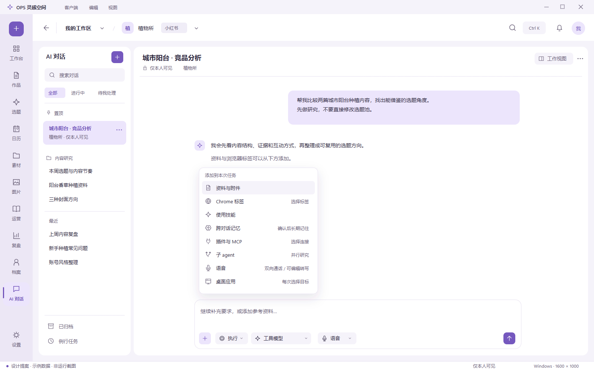
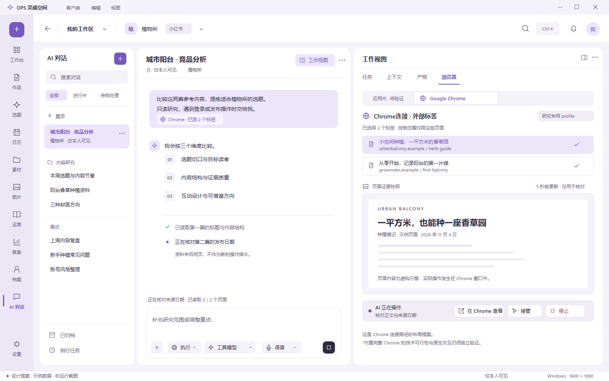
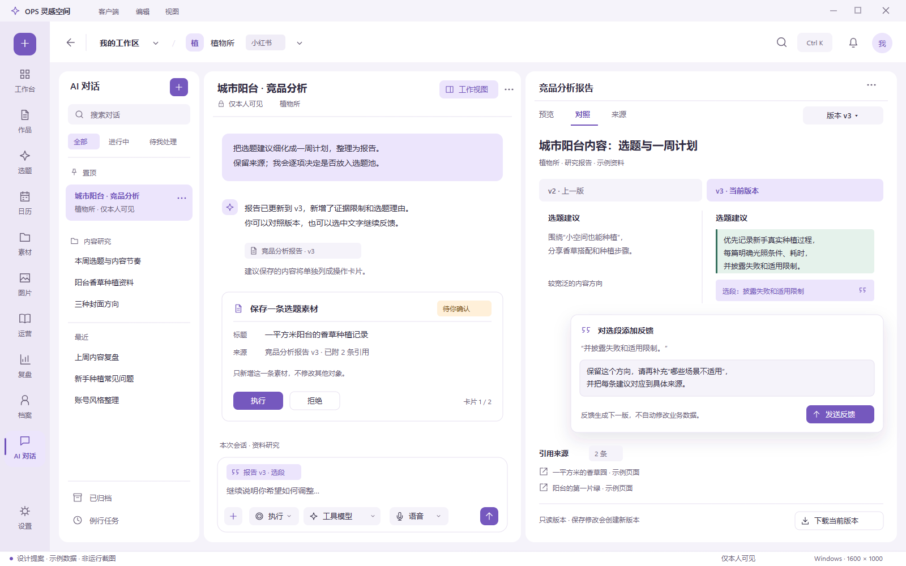
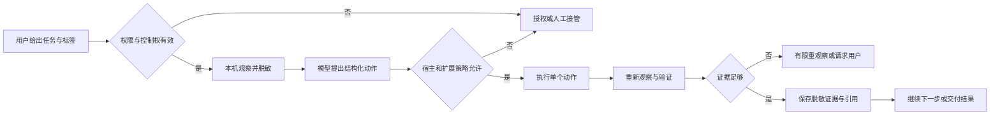
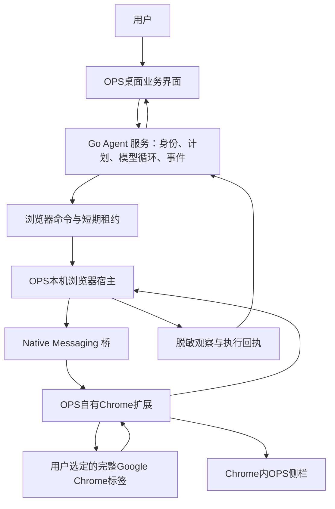

# AI 对话增强分析与 Codex 桌面端对标设计

版本：v0.2 用户确认范围修订稿  
日期：2026-11-07（Asia/Shanghai）  
性质：已确认产品范围＋开发规格提案；本轮仅完善文档和静态设计稿，不开发业务代码  
分析基线：`main@bbac9f19` 及本轮只读调查时的工作树  
内部编号：`AI27-*` 为本文需求/验收标识，不代表已经分配正式 DEV 任务或批准架构变更。

> **核心结论**：以 Codex 桌面端为功能与交互参照，在既有 AI 对话工作台上增强浏览器协作、上下文、任务过程和结果审阅。用户明确要求**完整 Google Chrome，不能以 Chromium 替代**。因此，完整 Chrome 接入与 AI 操作是必备项；不能将 Electron 网页容器、网页截图、iframe 或“打开系统浏览器”冒充该能力。
>
> **必须先看清的事实边界**：官方资料区分应用内浏览器与通过扩展连接的 Google Chrome；本次未找到“Codex 把完整 Google Chrome 产品原生嵌进应用内部”的官方证明。本文分别设计两条路径，并将“完整 Chrome 必须位于 OPS 内部”保留为明确的技术与产品裁决项。该项没有通过验证前，不得承诺已经找到满足全部条件的实现路线，也不得擅自降级成 Chromium。

## 1. 文档目标、约束与使用方法

### 1.1 用户要求与本轮交付

本轮要求来源为本次对话，按出现顺序保留：

1. 分析并加强 AI 对话功能，全面参考 Codex 桌面端的功能、UI 设计和入口放置位置。
2. 必须具备内置浏览器及 AI 直接操作浏览器的能力。
3. 新增界面要简洁、精致，形成适合长期工作的桌面体验。
4. 本轮先完成详细、严谨的分析文档，不开发业务代码。
5. 用户进一步明确：“必须是完整 Google Chrome，不能用 Chromium 替代。”
6. 用户再次强调：“要和 Codex 用的一样的。”

第 5 条不因第 6 条被自动撤销。本文把“参考 Codex 的使用方式”与“浏览器产品必须为完整 Chrome”同时保留；发现两者关系无法由公开资料证实时，写明待证事项。用户不需要决定是否存在某个Chrome嵌入接口：可行性取证由研发负责，只有拿出无法满足条件的具体证据和可审阅替代方案时，才向用户提出产品形态变更。

**2026-11-07第二轮确认，作为v0.2的产品范围基线：**

| 决定 | 用户确认的内容 | 对v0.1的修订 |
| --- | --- | --- |
| C01 运营场景 | 小红书/公众号及后续新增平台：竞品研究并整理素材、本人登录后台账号分析、网页资料修改作品、热门话题/商品/作品分析 | 不再以搜索引擎/技术文档旅程代替运营验收 |
| C02 自主程度 | 通用网页研究与常规交互自动完成；提交或明显影响动作逐项确认 | 撤回“只有逐站登记控件才能点击”的产品限制；保留执行器、风险与逐项确认 |
| C03 模式与目标 | 讨论/计划都可查网页；长期目标在设备在线、授权和预算有效时可以继续研究 | 撤回“仅interactive执行模式可浏览、goal禁止新读页面” |
| C04 完整版本范围 | 跨对话记忆、插件/MCP、子智能体并行、语音、其他桌面应用控制全部是本次必须 | 五项不得作为P2暂缓；可以分步实现，但缺任一项不能关闭本次完整版本 |
| C05 UI方向 | 保留OPS当前配色，主要参考Codex布局及控件位置 | 不换成Codex中性色主题；增加可审阅静态稿 |
| C06 交付对象与端 | 本人自用、Windows桌面 | 不以公众扩展商店上架或跨系统/Web改版作为本次产品完成前置；保留共享API兼容 |
| C07 记忆模式 | AI自动提炼候选，本人确认后才成为长期记忆 | 自动候选不直接装入后续会话；确认逐项进行 |
| C08 语音形态 | 实时双向语音＋语音转文字编辑，两种都要 | 包含任务进度、可打断与转写编辑，不以单一听写按钮结项 |
| C09 桌面控制范围 | 通用Windows应用控制，每次由本人选择目标应用 | 不限定Office或剪映等预设应用；按实际能力反馈支持边界 |

“全部本次必须”指C04列出的五项，以及此前确认的浏览器与AI对话增强基础；不自动扩展为云端全天运行、远程控制、Git开发环境或共享私聊。本人自用也不取消服务端既有身份/工作区/角色隔离。

文档交付的完成标准：

- 能区分 Codex 已证实事实、OPS 当前代码事实、本项目的设计建议及尚待验证的技术前提。
- 每项推荐能力有入口、位置、行为、权限、异常和验收要求。
- 浏览器有完整的连接、选择标签、授权、操作、接管、停止、恢复及证据闭环。
- 后续开发者能够据此拆分任务；涉及旧规格变化或技术未知的部分有明确开工条件。
- 本次不将任何新功能标为已实现、已验证或已交付上线。

### 1.2 设计权威与变更边界

本文件是**增量分析与规格提案**，用于本轮评审。已批准契约仍以原权威文档为准。它不会因新增编号而覆盖旧决策。

| 主题 | 当前权威 | 本文职责 |
| --- | --- | --- |
| 智能体工具、人工确认、私有会话、运行循环 | [16-系统智能体设计](16-系统智能体设计.md)，D-117 | 继承并分析浏览器增量 |
| 对话工作台、计划、队列、目标、产物、例行任务 | 16 第 15 节，D-152 | 保留已有能力，提出增强及位置调整 |
| 桌面外观与本机安全 | [17-Electron客户端改造方案](17-Electron客户端改造方案.md)、[桌面 UI 规范](design/desktop-creative/UI开发文档.md) | 采用既有窗口壳和主题令牌，局部调整工作区 |
| 平台登录、专用 Chrome/Edge 与受限采集 | [20-平台登录与作品数据自动回填设计](20-平台登录与作品数据自动回填设计.md) 第 20 节、[21-采集记录](21-平台采集技术债处理记录.md)，D-131 | 保留既有平台路线，列出冲突与拟议边界 |
| 技能 | [23-技能系统设计](23-技能系统设计.md)，D-151 | 复用资格、加载、预算、回执，不复制执行系统 |
| 排版、组图、诊断、台账 | [24-内容生产流水线与运营方法增强设计](24-内容生产流水线与运营方法增强设计.md)，D-156 | 为结果提供统一审阅入口，不重定义业务规格 |
| 实施状态和测试 | [08-开发与测试计划](08-开发与测试计划.md)、[26-验收台账](26-全局功能审计与点击验收台账.md) | 只引用状态，未来按证据回填 |
| 动线问题 | [22-操作动线问题清单](22-操作动线问题清单.md) | 改动前检查既有条目，未来新增问题仍写入 22 |
| 决策 | [90-决策与变更记录](90-决策与变更记录.md) | 本文列出待裁决差异，不自行登记为已批准 |

本次不修改上述权威文档的实施状态。C01～C09已经由用户明确确认，不再作为未批准功能范围反复询问；未来实施前将获准增量纳入16，按需同步04/05/06/08/17/20/21/90。接口、预算数值和具体技术路线仍属于可核验的实现提案，不因方向获准就宣称已经可用。实施契约归并后，本文保留调研依据和对标结论，避免长期维护两份冲突规格。

### 1.3 优先级与“完成”的含义

| 标记 | 含义 |
| --- | --- |
| P0 | 必备能力或其安全、可用性前置；首个声称满足本需求的版本必须包含 |
| P1 | 本次完整版本必须交付的增强能力，允许在P0后分步实施；不是可删减范围 |
| 不纳入 | 本次没有要求的独立方向；不把C04五项放入此类 |
| 保留/增强 | 已有实现基础，需要复核或增强，不能算从零新增 |
| 技术待证 | 产品目标明确，但关键实现前提没有证据；须先做隔离验证 |

“需求已设计、代码已实现、验证已通过、任务已交付”四种状态分别记录。分期是开发顺序，不是把本次必需功能延后立项；缺少完整Chrome要求或C04任一能力的增量版本均不能宣称本次完整版本完成。

### 1.4 阅读路线

- 产品与评审：第 2～5、7～11、17～19 节。
- UI/交互：第 5～11 节，重点看布局矩阵和三种工作状态。
- 桌面与浏览器开发：第 6～8、12～16 节。
- 后端与权限：第 9、12～16 节。
- 测试与交付：第 16～19 节。

## 2. Codex 参照事实与浏览器结论

### 2.1 取证口径

核验日期为 2026-11-07。主要来源是 OpenAI 官方桌面产品文档、Chrome 官方扩展文档、Electron 官方 API 文档及当前仓库源码。部分旧 Codex 文档已重定向到 ChatGPT Learn；仅将明确提及 Codex 或桌面共享能力的内容作为依据，不把 ChatGPT 网页端专属能力推定为 Codex 桌面已有功能。

“参考 Codex”指采用它的工作组织、上下文入口、聊天与工作视图关系和可审阅过程。本文尺寸、中文文案、OPS 权限和协议均是本项目提案，**不是声称获得了 Codex 私有设计稿、实现源码或精确像素参数**。

### 2.2 两条浏览器路径必须分开

| 事项 | 官方能够证实的事实 | 对 OPS 的含义 |
| --- | --- | --- |
| 应用内浏览器 | 页面可在聊天旁打开；支持分栏/完整视图、标签、页面批注；使用独立浏览状态 | 设计内置工作视图与明确的独立会话标识 |
| AI 操作内置浏览器 | 可打开、点击、输入、检查页面、截图并核验结果；可通过 `@Browser` 指定 | 浏览器必须进入 AI 工具闭环，静态网页预览不足以验收 |
| Google Chrome 接入 | 官方扩展连接用户选定的 Chrome，可处理已有登录站点与标签；可用 `@Chrome` 指定 | 完整 Chrome 控制有明确可参照的产品路径 |
| 现有 profile | 内置浏览器不自动共享日常 Chrome 标签与会话 | 两条路径切换不得静默复制 Cookie 或假装身份连续 |
| 深度调试 | 普通浏览控制与完整 CDP 权限分开管理 | 用户日常入口不应直接暴露全量 CDP |
| 运行条件 | 能力受平台、工作区设置和发布范围影响 | 以实际能力探测决定入口状态，不写死“所有版本均可用” |

上述事实分别来自 [OpenAI Browser](https://learn.chatgpt.com/docs/browser) 与 [OpenAI Browser extension](https://learn.chatgpt.com/docs/chrome-extension)。官方将两条路径分别说明；**没有由此证明内置浏览器等于完整 Google Chrome**。

### 2.3 用户硬要求对应的三层验收

| 层级 | 验收对象 | 不能拿什么代替 |
| --- | --- | --- |
| 浏览器产品 | 实际安装和运行的 Google Chrome；用户原有 Chrome 能力由 Chrome 自己提供 | Electron Chromium、CEF、WebView2、换 UA 的网页容器 |
| AI 控制 | AI 能在获准标签中观察、导航、点击受控元素、输入、提取并核对 | 只弹出 Chrome 窗口、只显示链接、录制好的演示 |
| 应用内体验 | 与对话联动的标签/工作视图、状态、授权、结果与接管位置 | 把外部窗口或截图镜像直接标为原生内嵌 Chrome |

完整 Chrome 接入是本文 P0。应用内浏览器体验也是 P0 目标，但“完整 Chrome 原生嵌入 OPS 内部”尚未获得可行性证据。两者未闭合前，后续团队应报告**技术前置未完成**，不能自行宣布降低验收条件。

### 2.4 全面参考的范围

官方桌面资料展示了项目/聊天组织、添加上下文、计划/目标入口、插件以及文件审阅；这些构成对标的功能类别。[OpenAI Features](https://learn.chatgpt.com/docs/features)、[桌面应用](https://learn.chatgpt.com/docs/app)

OPS 保留运营产品定位：将代码差异审阅转译为文稿版本对照，将项目资料转译为账号/作品/素材上下文，将长期代码任务转译为有预算和确认点的运营任务。Git、终端、任意系统操作等仍单独评估，不能因为 Codex 有就自动加入生产产品。

## 3. OPS 当前基线与需要解决的问题

### 3.1 已实现基础及证据

以下是当前源码事实，不表示本轮运行验收。文件行号为调查快照，未来改动后应以符号和接口重新定位。

| 能力 | 代码证据 | 本轮判断 |
| --- | --- | --- |
| 会话、搜索、置顶、分组、归档、未读、筛选 | `desktop/renderer-src/src/pages/Agent.tsx:147`；`server/internal/app/agent.go:1801` | 保留/增强 |
| 讨论/计划/执行模式及角色过滤 | `desktop/renderer-src/src/pages/Agent.tsx:418`；`server/internal/app/agent_modes.go:14` | 保留/增强 |
| 持久事件、恢复、停止、编辑和重生成 | `desktop/renderer-src/src/lib/agent-events.ts:49`；`server/internal/app/agent_events.go:185` | 保留，扩展浏览器事件 |
| 运行中补充、队列、撤回、恢复 | `desktop/renderer-src/src/pages/Agent.tsx:560`；`server/internal/app/agent.go:1836` | 保留，接入浏览器安全边界 |
| 结构化引用、技能请求、附件 | `desktop/renderer-src/src/pages/Agent.tsx:1940`；`desktop/renderer-src/src/lib/agent.ts:126` | 增加标签/选段/页面证据引用 |
| 计划及结构化问题 | `server/internal/app/agent_plans.go`、`agent_questions.go` | 保留 |
| 产物、历史、对照、选段、下载 | `desktop/renderer-src/src/pages/agent/ArtifactPanel.tsx:25` | 增强为统一工作视图 |
| 任务目标、预算、上下文整理 | `desktop/renderer-src/src/pages/agent/GoalPanel.tsx:28` | 保留，增加浏览器动作预算 |
| 受限例行任务及私有报告 | `desktop/renderer-src/src/pages/agent/RoutinePanel.tsx:95` | 保留，不增加无人值守平台操作 |
| 逐张业务操作卡片 | `desktop/renderer-src/src/pages/agent/ActionCards.tsx`；`server/internal/app/agent_execute.go:62` | 继续作为业务写入唯一闸门 |
| 桌面三分区及布局偏好 | `desktop/renderer-src/src/pages/Agent.tsx:1801`；`:725` | 新工作视图在此增量承接 |
| 本机原生视图基础 | `desktop/src/main.ts:2813` | 当前用于设置，不是通用浏览器 |
| 标准 Chrome/Edge 平台浏览器 | `desktop/src/platform-worker.ts:289`；`platform-profile.ts:341` | 既有专用 profile，不等于日常 Chrome 接入 |

工作台能力由既有D-160运行时闸门统一管理（`server/internal/app/runtime_gates.go:122`）：紧急关闭优先；`OPS_AGENT_WORKBENCH_FEATURES`非空时按其列表覆盖；环境变量为空时读取 `system_setting` 的各项配置，缺少配置才默认false。`agent_workbench.go:18`已说明绑定服务端后的DB读取方式。因此环境变量为空不等于实际全部关闭，也不能仅凭代码存在便认定用户环境已经启用。

### 3.2 已有验证状态

16 文档记录 AW01～11 已有实现；AW12 仍为部分验收。08/26 中有本地模拟服务、真实 Electron 和 Web 的历史验证记录，也有真实模型质量/费用、物理输入法/DPI/读屏、通知及平台实测缺口。

当前工作树另有桌面 `Agent.tsx`、桌面样式、部分测试以及 05/22 文档的未提交修改。本轮只读参考其当前形态，不回退、不覆盖、不混入本分析交付。尤其不能将进行中的反馈体验修订当成本次新增功能的通过证据。

### 3.3 本次增量的重点

1. **浏览器缺口**：当前没有通用 AI 浏览器工具，也没有日常完整 Chrome 的标签授权与控制闭环。
2. **工作视图缺口**：右侧主要是任务/上下文/产物辅助面板，需要承接网页与更宽的结果审阅空间。
3. **上下文可见性**：必须区分标签被选中、内容已读取、已进入本轮模型、结论已验证，避免“选中即读懂”。
4. **运行可理解性**：浏览器步骤、人工接管、等待授权和操作失败需要统一状态，避免页面在动但用户不知道 AI 在做什么。
5. **结果闭环**：网页证据应能引用、回查，再进入文稿/素材操作卡片；不能从网页直接跳过业务确认写库。
6. **跨端差异**：Web 可以读写既有会话和获准的脱敏证据，但不会凭空拥有桌面 Chrome。

## 4. 能力全景与 Codex 对标矩阵

表中“参照位置”是官方文档可见的入口关系或桌面通用模式；“OPS 位置”是明确的设计建议。细节以之后章节为准。

| ID | 能力 | Codex 参照位置/方式 | OPS 位置与处理 | 优先级 |
| --- | --- | --- | --- | --- |
| AI27-01 | 聊天组织与搜索 | 侧栏聊天/项目、置顶与搜索 | 左会话栏；沿用私有分组，不把分组变成工作区 | P1/增强 |
| AI27-02 | 新对话与分支 | 新聊天；消息上下文继续 | 列表顶部新建，消息菜单“从这里继续” | P1/保留 |
| AI27-03 | 常驻输入台 | 对话底部输入与添加入口 | 底部固定；浏览器与技能收敛进添加和引用 | P0/增强 |
| AI27-04 | 模型和推理强度 | 输入台附近模型菜单 | 原模型菜单，增加浏览器可用能力说明 | P0/增强 |
| AI27-05 | 计划模式 | 添加/命令中的计划入口 | 输入台模式菜单；批准计划和业务确认分离 | P1/保留 |
| AI27-06 | 长任务目标 | 输入台上方目标进度行 | 输入台上方轻量目标行及任务面板 | P1/增强 |
| AI27-07 | 补充与排队 | 运行中发送后续要求 | 现有输入行为，接入浏览动作边界 | P0/增强 |
| AI27-08 | 附件、业务上下文 | 添加文件/资料入口 | `+`、`@`，显示范围和实际加载回执 | P1/增强 |
| AI27-09 | 技能 | 技能/插件和输入引用 | `$` 复用 23 的 effective 集合 | P1/保留 |
| AI27-10 | 应用内浏览器 | 聊天旁标签、分栏/完整视图 | 右工作视图“浏览器”；引擎须满足第 2/6 节裁决 | P0/技术待证 |
| AI27-11 | 完整 Chrome 接入 | 扩展、`@Chrome`、标签引用 | `+ → Google Chrome`、设置连接、选定标签 | P0/新增 |
| AI27-12 | AI 直接操作浏览器 | 观察、点击、输入和核验 | 活动流＋浏览器控制条＋实际目标标签 | P0/新增 |
| AI27-13 | 页面引用与批注 | 页面元素/区域批注、选文追问 | 浏览器工具栏批注，输入台生成引用筹码 | P1/新增 |
| AI27-14 | 来源与检索 | 检索结果与可回查来源 | 消息行内来源＋上下文面板，实际访问后才记读取 | P0/增强 |
| AI27-15 | 过程活动 | 运行过程与工具结果 | 消息中的折叠活动组；异常与待操作展开 | P0/增强 |
| AI27-16 | 澄清与授权 | 对话内问题、权限提示 | 消息卡片单一处理入口；浏览器顶部同步状态 | P0/增强 |
| AI27-17 | 停止、接管、恢复 | 用户保有控制权 | 输入台停止；浏览器控制条“接管”；显式恢复 | P0/新增 |
| AI27-18 | 文件/产物审阅 | 对话旁文件标签与预览 | 同一右工作视图“产物”，不用额外第四栏 | P1/增强 |
| AI27-19 | 版本对照和选段修改 | 审阅差异与精确反馈 | 产物版本差异；单项生成操作卡片 | P1/增强 |
| AI27-20 | 待处理与通知 | Activity、通知设置 | 左栏待我处理、全局既有通知入口 | P1/增强 |
| AI27-21 | 多任务并行 | 多聊天并行 | 复用现有并发限额；同一 Chrome 标签独占控制 | P0/增强 |
| AI27-22 | 定时任务 | Scheduled、对话内调度 | 原例行任务保留；长期目标的在线研究与定时浏览分开，不新增无人值守写入 | P1/保留 |
| AI27-23 | 上下文整理与用量 | 长对话整理、用量与目标 | 任务/上下文面板，显示估算与实际值差异 | P1/增强 |
| AI27-24 | 跨对话记忆 | Personalization、聊天级记忆控制 | 自动候选→本人逐项确认→长期可用；可查改删，区分账号业务记忆 | P1/本次必备 |
| AI27-25 | 快捷命令与布局 | 命令菜单、聊天/工作视图切换 | 原 Ctrl+K 注册表，新增浏览器命令 | P0/增强 |
| AI27-26 | Chrome 内侧边对话 | Chrome 扩展的 side chat | 自有扩展 side panel，接续本人会话 | P1/新增 |
| AI27-27 | 浏览器开发者模式 | 普通控制与完整 CDP 分开 | 普通AI操作必须可用；完整CDP高级诊断单独授权，不提供任意协议透传 | 高级诊断不纳入 |
| AI27-28 | 图像输入和生成 | 图片上下文、产物预览 | 复用实际支持的模型与现有图片/组图业务 | P1/增强 |
| AI27-29 | 语音 | 实时语音与任务协调，见O15 | 实时双向＋可编辑转写；进度朗读、打断、与原会话任务联动 | P1/本次必备 |
| AI27-30 | MCP/插件扩展 | Plugins 与连接管理 | 自用插件/自定义MCP接入；安装/启停/权限/凭据/调用可审阅 | P1/本次必备 |
| AI27-31 | 子智能体并行 | 子任务委派与活动展示，见O16 | 父任务拆分、多子任务并行、结果汇总、共享预算和取消传播 | P1/本次必备 |
| AI27-32 | 通用电脑控制 | Computer Use设置和应用授权 | 本人每次选应用/窗口；通用操作、前台租约和单动作确认 | P1/本次必备 |
| AI27-33 | 远程/云端持续执行 | 本地与云端执行位置区分 | 本次为本机Windows；离线不能伪称继续控制 | 不纳入 |
| AI27-34 | Git、终端、worktree、代码评审 | Codex 开发场景 | 不进入运营产品默认范围，借鉴结果审阅方法 | 不纳入 |
| AI27-35 | 宠物/悬浮助手 | 可选桌面活动提示 | 不纳入本轮，避免稀释主任务界面 | 不纳入 |
| AI27-36 | 分享会话 | 不同产品与工作区条件不同 | 继续私有；业务产物按原业务权限协作 | 不纳入 |
| AI27-37 | 运营研究与证据报告 | 浏览研究、来源、可审阅产物的运营适配 | 竞品、本人后台、热点、商品、作品研究→证据→报告→逐项业务采用 | P0/本次必备 |

### 4.1 从当前行为到本次交付的逐项差异

“保留”只安排回归，不重复开发。表内当前行为指第3节静态源码事实，仍需按实现任务复核开关与运行证据。T编号见16及11节专题验收。

| 能力ID | 当前可观察行为 | 本次新增/改变的行为 | 保留契约与验收 |
| --- | --- | --- | --- |
| AI27-01 | 已有搜索/分组/归档/未读 | 浏览器、子任务、待授权/接管状态进入同一会话列表；不另造任务列表 | 私有隔离；T03/15/30 |
| AI27-02 | 已有新建与消息分支 | 分支只复制可读证据引用，浏览器/app租约与子任务不复制 | 不自动开工；T06/15/25 |
| AI27-03 | 已有常驻输入与添加资料 | 添加菜单收敛全部新能力；显示Chrome/app/插件筹码，语音双入口 | 受理成功才清草稿；T03/26、V01 |
| AI27-04 | 已有模型/通道/能力选择 | 增加浏览器视觉、桌面视觉、ASR/TTS/realtime与MCP工具资格提示 | 不按模型名猜能力、不静默换路由；T20、V02 |
| AI27-05 | 已有计划与模式 | 讨论/计划可进行只读网页研究，计划清楚标明需要确认的后续动作 | 批准计划不批准业务写入；T21A/31 |
| AI27-06 | 已有目标和预算 | 目标可在设备在线/授权/预算有效时持续研究，显示子任务与本机控制状态 | 失联等待、不自动扩权；T10/13/21A/31 |
| AI27-07 | 已有steer/queue | 追加要求传播至浏览器安全边界和子任务；语音引导共用同一队列 | 不改在途参数；T31、S04、V04 |
| AI27-08 | 已有业务引用与附件 | 增加网页/app证据、选区、MCP资源引用和每轮装入说明 | 当前权限与预算重新核对；T18/32、P04 |
| AI27-09 | 已有技能请求与回执 | 插件附带技能进入同一资格/预算流程，并能定位插件来源版本 | 选择/装入/遵从分开；P01/P04 |
| AI27-10 | 无通用内置浏览器 | 应用内完整Chrome原生承载产品要求及功能；先通过第6节技术门 | 不以外置/截图/其他内核替代；T02/35 |
| AI27-11 | 仅有平台专用Chrome/Edge固定意图 | 新增本人日常完整Chrome实例连接、标签选择和单任务授权 | 平台profile不自动接管；T01/04～06 |
| AI27-12 | 无通用浏览器控制循环 | 通用网页观察/常规交互/提取/验证；需要影响的动作逐项授权 | 不依赖逐站适配才能用；T07～19 |
| AI27-13 | 无网页精确批注 | 页面元素/区域批注和选文进入待发引用，定位失效明确显示 | 不自动提交或写业务；T27 |
| AI27-14 | 已有业务来源链接 | 网页读取时点、字段/片段证据、来源冲突/缺失、报告可追溯 | 未读不称已核实；T07/18/28、R01～05 |
| AI27-15 | 已有折叠工具活动 | 浏览器/MCP/子任务/语音/app过程统一投影；新旧观察有真实时点 | 不暴露思维链/凭据；T03/13/18 |
| AI27-16 | 已有澄清与业务卡片 | 明确范围授权、模型数据处理说明、单次浏览器/app影响动作票据 | 问题/计划/执行批准不混用；T09/14/19 |
| AI27-17 | 已有run取消 | 增加浏览器/app本机急停、人工接管、租约撤销与关联新run恢复 | 停止不回滚、不重放未知结果；T10/13/16 |
| AI27-18 | 已有产物与版本预览 | 统一宽工作视图，研究报告/图像/文件均可打开，不添额外列 | 另存版本不改业务对象；T28 |
| AI27-19 | 已有对照/精确反馈 | 网页证据→产物版本→选段反馈→单对象卡片的完整旅程 | 原W/H/X闸门不变；T19/28 |
| AI27-20 | 已有通知和待处理 | 新增授权/接管/子任务失败/设备阻塞提示与定位 | 已读不批准，通知不含私密正文；T30 |
| AI27-21 | 已有多会话根任务并发 | 根任务并发与子任务并发分别限额；共享预算、同tab/app互斥 | 不能借子任务绕过额度；T21、S02/S03 |
| AI27-22 | 已有只读例行任务 | 只保留原例行任务并回归；本轮goal研究不等于新增定时通用桌面任务 | 仍按原白名单；T21A |
| AI27-23 | 已有摘要与预算 | 浏览器/app/MCP/记忆/子任务统一计算上下文和成本，摘要保留来源与未完成点 | 不把网页指令提为规则；T20/32、M03/S02 |
| AI27-24 | 已有账号业务记忆，不是通用私聊长期记忆 | 候选提炼→本人确认→后续会话可选使用→查看/改删/来源失权处理 | 不替代账号事实源；M01～03 |
| AI27-25 | 已有命令注册表 | 增加浏览器、记忆、插件、并行、语音、应用命令与帮助 | 不冲突、不设批量执行快捷键；T03/26 |
| AI27-26 | 无自有Chrome侧栏 | 用户在Chrome侧栏接续同一本人会话、选文追问与停控 | 不是Chrome内嵌OPS的证据；T29 |
| AI27-27 | 无通用完整CDP面板 | 本轮不交付任意CDP诊断；内部执行权限不暴露为模型通用工具 | 不作为普通浏览能力的前置 |
| AI27-28 | 已有图片/组图业务 | 网页/app截图进入真实vision请求与产物；沿用24生成流程 | 无vision明确拒绝；T18/20/28 |
| AI27-29 | 无上述完整语音工作流 | 实时双向＋可编辑转写，任务协调、进度朗读、打断与回执 | 语音不替代敏感执行确认；V01～08 |
| AI27-30 | 受控静态业务工具目录 | 插件/自定义MCP安装、发现、授权、资源/工具、停用升级与可审计回执 | 不赋予内置W/H/X额外权限；P01～04 |
| AI27-31 | 无自主子任务编排 | 父run派生受限子任务、隔离上下文、并行研究、汇总/取消/失败 | 子任务不能自行执行写入；S01～08 |
| AI27-32 | 无通用Windows app控制 | 本人选应用/窗口后通用UI操作、文本/视觉观察、影响动作单次确认 | 一个前台执行租约；C01～09 |
| AI27-33 | 无本轮远程/云端控制设计 | 不新增；本机能力掉线明确等待 | 不伪装云端继续控制；T13 |
| AI27-34 | 非开发者工具产品 | 不新增Git/终端/worktree | 不从电脑/MCP通道偷偷开放任意Shell |
| AI27-35 | 无本轮宠物交付 | 不新增 | 不挤占主流程 |
| AI27-36 | 私有会话不可分享 | 不新增分享 | 业务产物继续按原权限协作；T15 |
| AI27-37 | 运营研究能力分散于既有业务流程 | 五类研究任务统一任务→来源→分析→产物→单项采用，后续平台走能力登记 | 不保证平台不存在的数据可获得；R01～05 |

上述简写T编号均指 `T-AI27-*`；字母前缀对应专题验收，正式编号和数量以9.7/11/16定义为准。对“当前行为已存在但验证未完成”的项目，安排旧验收补齐，不能作为新增实现重复计数。

长任务的进度行与授权独立，参考 [Long-running work](https://learn.chatgpt.com/docs/long-running-work)；文件在聊天旁审阅参考 [Work with files](https://learn.chatgpt.com/docs/artifacts-viewer)。这些参照只决定工作方式，不改变 OPS 的逐卡写入制度。

## 5. UI 信息架构、位置与视觉规格

### 5.1 总体原则

工作空间由全局导航、会话列表、聊天主区和一个可切换的工作视图组成。默认以聊天为中心，只有查看网页、产物或任务时打开工作视图。

1. 高频入口可见：新对话、添加资料、模式、模型、发送/停止、浏览器开关。
2. 当前作用域清楚：工作区、平台账号、Chrome profile、Chrome 标签、AI 会话是五个不同概念。
3. 同一内容只有一个主审阅位置：业务卡片在消息中执行；工作视图只预览和定位。
4. 状态来自真实运行事件；输入受理、开始运行、浏览器正在操作、等待接管分别展示。
5. 布局切换不清空输入、不重建活动会话、不改变浏览器授权。
6. 浅深主题采用已有 `--ops-*`紫色令牌；以留白、字体层次、细分隔和少量强调色建立质感，不更换全局主题。
7. 输入台只常驻添加、模式、模型、语音及发送/停止；记忆、插件、并行、应用选择放入添加菜单或当前任务区，实际使用后再以筹码显示，避免把必备功能全部堆成按钮。

### 5.2 标准聊天状态

```text
┌ OPS 既有标题栏 / 工作区与当前账号 / 全局搜索与通知 ──────────────────────┐
│全局│ AI 对话       [新对话] │ 本周内容研究    仅本人可见       [工作视图] […]│
│导航│ [搜索对话]           ├────────────────────────────────────────────┤
│轨道│ 全部 进行中 待我处理 │ 用户：分析这三篇参考内容                         │
│    │ 置顶                 │ 助手正文、来源、可展开活动                       │
│    │ ● 本周内容研究       │ 计划 / 澄清 / 逐张操作卡片                       │
│    │ 私有分组             │                                                │
│    │ 最近                 ├────────────────────────────────────────────┤
│    │                      │ 目标进度 / 当前活动（有任务时出现）              │
│    │ 归档  例行任务       │ @资料  $技能  Chrome: 已选 2 个标签               │
│    │                      │ 输入任务或补充要求…                              │
│    │                      │ [+] [执行 ▾] [模型 ▾] [强度*]          [发送]    │
└────┴──────────────────────┴────────────────────────────────────────────┘
* 能力不支持时不出现；停止与发送共用输入台右侧主操作位置。
```

空会话仍使用固定底部输入台；中间仅显示一句任务引导与最多 3 个真实场景建议。点击建议只预填，不自动启动、连接 Chrome 或产生模型费用。

### 5.3 浏览器协作状态

```text
┌ 会话标题  仅本人可见      [聊天/分栏/完整视图]             [收起工作视图] ┐
│ 聊天主区                          │ 工作视图：任务 上下文 产物 浏览器    │
│ 用户任务与引用                    │ [应用内] [Google Chrome]            │
│ 计划与结果                        │ Chrome · 用户选择的 profile         │
│ 已读取 2 个页面 ▸                 │ [标签A] [标签B] [+选择标签]          │
│                                   │ 实际网址 / 当前状态                 │
│ 活动：正在核对来源日期             │                                    │
│                                   │ 应用内路径：实际可交互网页           │
│                                   │ Chrome路径：目标标签卡与证据预览     │
│                                   │ [在Chrome查看] [接管] [停止]         │
├───────────────────────────────────┤                                    │
│ 目标/当前活动                     │                                    │
│ 引用筹码与输入台                  │ 控制：AI处理中 / 人工接管 / 已停止   │
└───────────────────────────────────┴────────────────────────────────────┘
```

**真实完整 Chrome 的操作发生在 Chrome 自己的窗口中**，除非第 6 节原生内嵌验证另有结论。OPS 右侧的 Chrome 目标卡、截图证据或活动摘要应如实命名；不提供一个截图点击层伪装成原生 Chrome。用户点击“在 Chrome 查看”聚焦对应窗口和标签，不打开重复页面。

应用内路径的网页位置按上图预留，但其引擎与集成形式仍受用户“完整 Chrome”约束。不能先做 Electron 视图再将其标为满足该要求。

### 5.4 产物审阅状态

```text
┌ 聊天标题 / 返回聊天                                  [工作视图布局] ┐
│ 聊天与活动                     │ 产物：竞品分析报告  版本 v3 ▾       │
│ 已完成分析，以下结论需核实      │ [预览] [对照] [来源]                 │
│ 来源1 来源2                    │ 文稿 / 表格 / 图片 / 业务对象摘要   │
│ 你选中了第3段：引用追问         │                                    │
│                                │ 选段 → 添加反馈                     │
│ 逐张业务操作卡片               │ [下载] [打开业务页] [生成操作卡片]  │
├────────────────────────────────┤                                    │
│ 常驻输入台                     │                                    │
└────────────────────────────────┴────────────────────────────────────┘
```

“生成操作卡片”只准备单对象写入提案。产物文本另存版本与修改业务作品是两种动作，界面用词分开，沿用现有产物契约。

### 5.5 控件位置与密度

| 区域 | 常驻内容 | 次级入口 | 约束 |
| --- | --- | --- | --- |
| 全局轨道 | 原业务导航、AI 对话 | 既有全局设置/通知 | 不增加第二个全局“AI 浏览器”一级导航 |
| 会话栏顶部 | 新对话、搜索、筛选 | 分组管理、归档 | 会话名两行内，更多菜单键盘可达 |
| 会话头 | 标题、私有标记、账号/运行状态、工作视图开关 | 重命名、归档、删除等 | 不重复放模型和账号选择器 |
| 消息区 | 正文、来源、待处理卡片 | 已完成工具详情 | 待处理与失败展开；成功过程折叠 |
| 输入上沿 | 附件/引用/技能/标签筹码 | 展开全部、移除 | 单行折叠并显示数量，不能无限挤压正文 |
| 输入工具栏 | 添加、模式、模型、语音、发送/停止 | 技能、目标、例行、Chrome、记忆、插件、并行、应用 | 高频功能可见，其余归入同一个添加菜单；已选项变筹码 |
| 右工作视图 | 任务/上下文/产物/浏览器 | 当前视图的更多菜单 | 同时只显示一个主内容视图 |
| 浏览器控制条 | 目标、控制者、接管、停止 | 授权详情、断开 | 停止和接管不可藏入更多菜单 |
| Chrome扩展侧栏 | 当前站点/会话、输入、停止 | 打开OPS、换会话、断开 | 完整卡片执行仍返回OPS，避免双执行入口 |

工作视图打开后的初始页签遵循用户动作：点来源打开浏览器，点产物打开产物，点任务状态打开任务。只点“工作视图”则恢复本人在该会话最后使用的页签；恢复旧页签不自动重新授权浏览器。

### 5.6 尺寸、响应布局与原生视图层级

W 指扣除全局轨道和外边距后的可用 CSS 宽度。普通辅助面板沿用 16 第 15.3 节：会话列表默认 248px、消息至少 560px、普通辅助栏默认 360px。浏览网页与宽产物时，使用以下拟议增量：

| 条件 | 浏览器/宽产物布局 |
| --- | --- |
| W ≥ 1456 | 可同时显示列表 248、聊天至少 560、工作视图至少 600；多余宽度优先给工作视图 |
| 1168 ≤ W < 1456 | 临时收起会话列表；聊天至少 560、工作视图至少 600，分隔 8 |
| 720 ≤ W < 1168 | 聊天/工作视图切换为完整内容视图；顶部保留任务状态、停止、返回入口 |
| W < 720 | Web 使用单列和独立预览；原生 Chrome 控制入口按桌面能力显示，不伪造本机支持 |

宽度不足时先调整布局，不把聊天压到不可读，也不遮住 Chrome 的实际控制状态。临时收起不覆盖宽窗口偏好。分隔条可聚焦，方向键每次移动 16px；恢复默认宽度有菜单入口。

如最终应用内路径使用原生子视图，审批框、菜单、账号切换及设置出现前，由宿主隐藏或裁切原生网页层；关闭后恢复并重新核验目标。不能假设 React 的 `z-index` 一定能覆盖原生视图。全屏、系统缩放、DPI、输入法候选和焦点回退须单独验收。

### 5.7 视觉、动效与无障碍

- 会话标题 18px/26，消息正文 14px/24，输入 14px/22，列表及操作 13px/20，必要元信息最低 12px/18；字体沿用现有桌面栈。
- 输入台圆角 16px、卡片 12px、按钮 8px、筹码 6px；间距采用 4/8/12/16/24/32px。
- 正文阅读区最大宽度沿用 880px；助手正文采用阅读式排版，用户内容采用轻背景。
- 装饰色只用于选中、焦点、引用和状态；普通工具过程用文字与细线，不做满屏卡片和持续动画。
- 动效 120～180ms，流式文本不做逐字动画；遵循减少动态效果设置。
- 文本目标对比度至少 4.5:1；状态同时有图标和文字。可点击区域桌面至少 32×32，触屏至少 44×44。
- `aria-live` 合并播报重要状态，不逐 token 朗读；新内容不抢走正在阅读旧消息或填写确认项的焦点。
- 主题改变只改变宿主界面；外部网页不被强制注入深色 CSS，不伪装为网页原生主题。

### 5.8 快捷键策略

沿用 OPS 注册表与现有键位，增加命令名称，不逐个照搬可能冲突的 Codex 快捷键。Codex 官方也将快捷键区分平台与能力。[Commands](https://learn.chatgpt.com/docs/reference/commands)

| 操作 | OPS 建议 |
| --- | --- |
| 命令面板 | 继续 Ctrl+K |
| 新对话/搜索/会话栏 | 保留既有 Ctrl+Shift+O / Ctrl+Shift+F / Ctrl+Shift+B |
| 工作视图 | 继续 Ctrl+Shift+J，原“辅助面板”命令升级说明 |
| 浏览器入口 | 命令“打开浏览器工作视图”，初版不抢占既有键位 |
| Chrome原生快捷键 | 焦点在Chrome时由Chrome处理 Ctrl+L/T/W 等 |
| 停止AI | 明显按钮；Esc继续只关闭当前候选/菜单/面板 |
| 审批/业务卡片 | 没有通用一键执行或全局 Enter 默认批准 |

输入法组合期间 Enter 不发送；候选菜单打开时 Enter 只选择候选；点击发送前仍检查当前输入动作到底是发送、补充还是排队。

### 5.9 Codex位置参照的可追溯索引

| 官方参照 | 可证实的界面关系 | OPS采用/调整 |
| --- | --- | --- |
| O03 Features的桌面示例：New chat、Pinned、Projects、Recents与Add菜单 | 会话组织在侧栏，添加项包含资料、目标与计划 | 左会话栏保留；项目概念转为已有私有分组/业务上下文，不新增租户层级 |
| O01 Browser的“Arrange tabs and chat”及页面示例 | 标签和聊天可分栏/完整视图，地址/批注附着网页视图 | 一个右工作视图＋完整视图切换；应用内引擎仍须满足硬要求 |
| O02 Browser extension的“Bring tabs…”与“Use side chat…” | 标签引用进入对话，Chrome中可有侧边对话 | `+/@`选择Chrome标签；P1提供Chrome侧栏，位置方向如实区分 |
| O07 Work with files的文件预览示例 | 产物在聊天旁审阅 | 与浏览器共享右工作视图，不再增加第四内容栏 |
| O08 Long-running work的“Steer a running goal” | 目标进度行在输入台上方 | 目标/预算轻行＋原任务面板，保留逐卡确认 |
| O06 Commands、O11 Settings | 布局/命令集中管理，输入与通知偏好进入设置 | 沿用OPS命令注册表；精确键位和尺寸采用OPS规格 |

本索引是公开页面及其中示例的取证，不是对用户安装的某一Codex版本进行逐像素测量。未来做UI实现前，需记录具体参照版本和同状态截图，再审阅OPS适配；不得从网页示例推定所有版本布局完全一致。

### 5.10 可审阅静态设计稿

三张稿统一为1600×1000，保留OPS浅紫/深紫语义、全局轨道和中文字体，参照Codex的左会话、中聊天、按需右工作视图与底部输入台。源文件为可编辑SVG，PNG供直接审阅；它们是设计资产，**不是产品已运行截图**。[设计说明与源文件索引](design/ai27-dialogue/README.md)

**标准聊天与添加入口**：新能力集中在添加菜单，已使用能力再显示为上下文筹码；常驻模式、模型、语音和发送/停止，避免菜单之外再堆一排功能。记忆标明确认后长期保存，应用标明每次选择目标。



**浏览器研究**：同一虚构竞品任务展示来源、研究进度、选定Chrome标签和接管/停止。图中明确是“Chrome外部标签连接＋证据快照”，用于审阅这条已知连接路径的布局；**不能用该图签收完整Chrome原生内置**。内置路径的位置和功能按5.3/7.8，但引擎与原生承载仍须第6节举证。



**产物审阅**：报告的预览/版本对照/来源在同一工作视图中切换；精确反馈回到对话，业务修改仍在消息里的单对象卡片上执行。



视觉验收不是“看起来高级”一句话：应核对入口层级、文字密度、列表/输入/工作视图位置、现有紫色令牌、非装饰状态语义、窄窗口策略、语音和急停可见性。静态稿尚未覆盖深色、全部等待/失败/授权状态和系统DPI；后续实现前需按状态清单补齐，不能仅凭三张浅色图关闭T26。

## 6. 浏览器技术路线与开工门槛

### 6.1 候选路线比较

| 路线 | 完整Google Chrome | 页面原生位于OPS内 | 能否满足当前要求 | 处置 |
| --- | --- | --- | --- | --- |
| Chrome安装版＋自有扩展＋Native Messaging | 是，操作真实Chrome | 否，扩展本身不提供此能力 | 满足完整Chrome控制部分 | 作为Chrome控制候选，先技术验证 |
| OPS界面放在Chrome Side Panel | 是 | 否，是OPS进入Chrome | 可参考Codex的Chrome侧边对话，不能抵扣OPS内置项 | P1候选 |
| Electron WebContentsView | 否，是Electron Chromium | 是 | 用户明确排除其作为完整Chrome替代 | 不选作满足硬要求的方案 |
| CEF/WebView2/独立Chromium | 否 | 取决于容器 | 不满足浏览器产品要求 | 排除 |
| 外置Chrome＋窗口并排 | 是 | 否 | 只满足外置使用，不等于内置 | 仅如实提供外置路径 |
| Chrome画面截图/视频流进入OPS | 实际引擎可能是Chrome | 否，是画面传输 | 不满足原生内嵌验收 | 仅可标“远程画面/证据预览”，不作替代 |
| Windows窗口句柄重挂接 | 可能运行Chrome | 表面嵌套 | 缺少受支持集成与稳定性证据，且旧决策明确拒绝 | 不作为正式路线 |
| 经证实受支持的完整Chrome原生承载接口 | 待证 | 待证 | 若存在且验证通过，才可能闭合全部条件 | 技术研究门，不虚构接口 |

Electron 官方的 [WebContentsView](https://www.electronjs.org/docs/latest/api/web-contents-view) 是网页内容原生视图 API，不是将用户安装的 Chrome 转成子视图的证明。Chrome 的 [Side Panel API](https://developer.chrome.com/docs/extensions/reference/api/sidePanel) 将扩展界面放在 Chrome 侧边，同样不能推出反向内嵌能力。

### 6.2 推荐路径与取舍

**产品参照**采用 Codex 的双入口：应用内浏览工作区、Google Chrome连接与标签引用。**已具备官方机制依据的技术候选**是完整Chrome＋OPS自有扩展＋本机宿主，先解决真实Chrome的操作闭环。应用内原生完整Chrome的实现保持单独技术门，不预选被用户排除的内核替代。技术门由研发有界调查、提交依据和可行/不可行/证据不足结论，不让用户猜测接口是否存在。

这不是将两个要求合并成“外置 Chrome 就算内置”。未来若用户明确认可“与 Codex 一样的双路径使用方式”足以满足内置体验，应记录其对引擎/窗口要求的具体裁决，再修改本文件及权威规格。当前稿不推定已经取得这项放宽。

完整 Chrome 的同步、密码管理、扩展生态由 Chrome 自己提供。OPS 的“完整”承诺是使用真实产品并保留用户正常使用能力，**不是让 AI 自动读取密码库、浏览器全部历史或任意扩展数据**。

### 6.3 既有边界的拟议变更清单

| 当前约束 | 本次需求带来的增量 | 后续必须确认/同步 |
| --- | --- | --- |
| 16 第15.0/15.8节不做通用浏览器、自主联网，网页默认系统打开 | 明确加入浏览器研究与可控操作 | 16/90及04/05/06/08；仅放开明确的浏览器动作 |
| 20 第20.1节采用平台专用Chrome/Edge，不做内嵌官方页或句柄嵌套 | 用户要求内置浏览体验 | 先确定是否涉及平台官方后台；不直接覆盖D-131 |
| 17/20/21平台会话不出本机、固定意图与受限采集 | 日常Chrome连接产生另一种授权面 | 独立连接/标签授权，不共享平台profile、Cookie或采集权限 |
| 16/23无任意插件/脚本执行 | 浏览器扩展属于新增本机组件 | 扩展只提供注册动作，不形成通用JS/MCP执行框架 |
| 16逐张写入与H门槛 | 浏览器点击也可能写入 | 平台业务仍经原卡片；无法安全映射的动作转人工 |

### 6.4 隔离技术验证的停止条件

本轮仅写明验证要求，不启动试验开发。未来获准后，技术验证至少提交：

1. 完整 Chrome 身份：实际 Chrome 安装版、版本、可执行文件来源/签名校验结果；不是修改 UA 或换图标。
2. 扩展与本机宿主：两个 Chrome profile、多窗口、连接/断开、协议不兼容、宿主退出的真实结果。
3. 操作闭环：实际网页导航、滚动、受控点击、中文输入、提取、截图核验、接管与停止。
4. 原生内嵌门：受支持的接口依据、实际窗口归属、地址栏/标签、焦点、输入法、弹窗、无障碍、DPI、升级与崩溃恢复。没有此证据就不得关闭该项。
5. 明确结论：满足、部分满足或不满足每条硬条件；禁止仅用演示截图签收。

若找不到受支持的完整Chrome内嵌方式，停止该路线的产品实现；提交证据与具体可行选项由用户裁决。调查以“官方产品/API依据＋一个受支持集成候选的隔离验证”作为最小证据包；后续实施排期应给调查设置上限，超限必须形成结论，不能把“还在研究”无限延期。无法证明时状态为“证据不足”，不是已证实不可能。不得无限堆叠句柄补丁、截图回传或内核替代来维持“原生内置”的说法。

该技术门不阻止继续设计或未来分步实施已确认的记忆、插件、并行、语音、应用控制和对话增强；但完整版本关闭仍要求满足原浏览器要求，或获得用户对具体替代形态的明确变更。当前没有这项替代批准。

## 7. 完整 Chrome 连接、授权与人工接管

### 7.1 首次连接旅程

入口有两处，指向同一连接状态：输入台 `+ → Google Chrome`；桌面设置“浏览器与 Chrome”。Chrome 未连接时，入口显示“连接 Google Chrome”，不显示假的已就绪标签。

| 步骤 | 用户所见与动作 | 系统行为与失败处理 |
| --- | --- | --- |
| 1 检查环境 | 显示Chrome是否安装、OPS宿主和扩展状态 | 未安装给官方安装入口；不静默下载/替换浏览器 |
| 2 安装自有扩展 | 打开OPS正式扩展页面，用户自行确认安装 | 不要求安装OpenAI扩展给OPS使用；不能假设可复用Codex私有桥 |
| 3 选择profile | 提示在打算使用的Chrome profile内点击OPS扩展 | 不扫描系统所有profile或读取Google账号信息 |
| 4 配对 | OPS与扩展展示相同短期确认码、当前OPS用户/工作区 | 双端明确确认，配对请求5分钟过期，失败不留下有效连接 |
| 5 选择标签 | 展示可选择页面的脱敏标题/域名；用户逐个选择 | 未获权限前不抓全文或截图，不向服务端上传未选标签清单 |
| 6 选择范围 | 选择本次标签与指定站点，解释将读取什么 | 此时只记录草稿级授权意向；发送后才可绑定真实run并签发短期租约；可记住站点读取规则，不记住业务写入批准 |
| 7 开始任务 | 输入台出现Chrome标签筹码与“已连接，尚未读取” | 用户发出任务后才观察；选标签不自动调用模型 |

连接是本机能力，站点登录是网站自己的身份，OPS登录是平台权限。连接成功不代表网站已登录，也不代表允许AI操作所有站点。

### 7.2 连接和profile归属

- 每个扩展安装实例生成随机 `extension_instance_id`，仅保存在扩展本地存储；用户可命名为“工作Chrome”等，不使用猜测的邮箱命名。
- 设备配对绑定OPS服务端origin、OS用户、本机设备与OPS用户；工作区/会话/平台账号绑定在任务grant上。本人串行切换工作区可复用同一设备配对，不要求每次重装扩展或换Chrome profile。
- Chrome的真实Cookie属于Chrome profile，OPS任务grant**不会把Chrome的Cookie物理分区**。需要隔离网站登录身份时提示用户选择不同profile；不能把Cookie事实推导为普通串行切换也必须新建profile。
- 工作区切换先撤销旧任务租约，清除活动页面引用，再由本人在新工作区选择标签/确认任务范围；配对可保留，旧消息、证据、授权、技能和记忆不带入新工作区。同一连接同一时刻只允许一个活动工作区，跨区并发需要独立连接和清楚的身份说明。
- 退出、角色失权先停控；重新登录或重获资格后重新核验任务权限，不因设备配对仍在就自动恢复。新工作区无成员资格时只能清理本人绑定，不获得数据读取。
- 重装扩展、更换profile、清理扩展存储视为新实例，必须重新配对。Chrome的 `tabId` 仅在相应浏览器会话有效，不是长期身份。
- 网站登录凭据只保留在Chrome；服务器不保存profile路径、Cookie、密码或调试端口。

### 7.3 选择与引用标签

`@` 选择器新增“Google Chrome”和“应用内页面”类别；只有当前已连接、已获准的标签可被引用。不同来源有明确图标和文字，不用统一的“浏览器”掩盖运行位置。

每个标签候选显示：页面标题、可读域名、连接名称、最近观察时间、权限状态；完整URL在用户展开时显示，分享/日志默认去除敏感查询参数。

选择标签后生成结构化引用，包含连接、浏览器会话、标签、导航代数、来源origin和引用范围。输入 `@Chrome` 字符串不等于获得授权；消息中的网页伪造同名标记无效。

候选失效时保留草稿，提示重新选择。用户主动导航之后不继续引用旧DOM；需重新观察并在来源中保留实际读取时点。

### 7.4 站点权限设计

| 权限 | 缺省 | 可保存范围 | 它不代表什么 |
| --- | --- | --- | --- |
| 连接某Chrome实例 | 关闭 | 当前用户/设备/工作区绑定 | 不授权所有标签 |
| 发现标签元数据 | 用户发起选择时最小读取 | 本次选择流程 | 不授权正文读取 |
| 读取指定标签 | 每run明确授权 | 可记住指定origin的读取规则，仍需选标签 | 不批准写入、历史、下载或跨站访问 |
| 导航/常规研究交互 | 明确任务范围 | 当前run或明确goal范围，短期租约逐次签发 | 不批准提交/明显影响，未知效果需单次确认 |
| 浏览历史 | 不申请、不读取 | P0无此权限 | 不因Chrome连接而开放 |
| 文件下载 | 每个文件确认 | 当前单文件 | 不自动打开、执行或作为附件发送 |
| 文件上传 | 本人原生选择单文件/目标站点并逐项确认；技术不支持安全上传时转人工 | 当前文件hash＋目标origin＋单次调用 | 不允许模型选择任意本机路径，不授权同目录其他文件 |
| 业务写入/对外提交 | OPS业务走原卡片；获准第三方动作走单次影响动作票据或人工 | 不记住批准 | 不因站点“始终允许”而免确认；禁止项仍不开放 |
| 完整CDP/任意脚本 | 关闭，P0不提供 | 无 | 普通浏览权限不是调试授权 |

权限按标准化 origin（scheme/host/port）判断；通配域默认不启用。新origin、重定向、弹窗和跨域frame逐项重新检查。策略拒绝优先于用户本次允许，角色无权限也不能因本机有登录态而放行。

### 7.5 AI控制与人工接管

控制权状态为 `idle / ai_owned / handoff_requested / human_owned / stopped / disconnected`。每个标签同时只有一个AI运行租约；同一标签被另一个会话占用时展示原会话入口，不抢占。

输入台“停止”和浏览器控制条“停止任务”使用**同一取消语义**：取消当前run、冻结队列、撤销其全部浏览器租约。没有一个同名按钮只停某标签却让AI继续操作。若用户只想收回某标签，应点击“接管此标签”，界面明确AI仍可解释已保存证据；再次控制须用户显式继续并获取新租约。

用户点击“接管”时，本机先撤销AI动作许可，再显示“你正在操作”；新动作立即拒绝，在途网络请求可能已发出，不承诺撤回。用户修改页面、切换相关账号、提交表单后，点击“交回AI”，系统先通过原问题回答事务创建关联新run与新grant，核验标签/origin权限并获得新租约，然后才重新观察页面、核对文档版本和未知动作结果，最后继续模型。

“暂停任务目标”“停止本次运行”“人工接管浏览器”三者分开：暂停目标不回滚已完成动作；接管只收回浏览器控制，AI可继续解释现有证据；停止当前运行冻结队列并撤销全部浏览器租约。

### 7.6 登录、验证码和敏感页面

遇到密码、二维码、验证码、MFA、银行卡或其他敏感输入，进入人工阶段：

1. 显示真实站点origin与需要用户完成的事项，不在聊天里收密码或验证码。
2. 暂停该页面的DOM读取、截图、文字提取和模型观察；跨域frame未能安全识别时同样暂停。
3. 用户在真实Chrome页面操作；OPS只展示等待状态，不复制二维码或凭据。
4. 用户明确点击“已完成，继续”后，重新核对页面与账号身份；只恢复获准的后续读取。
5. 无法可靠屏蔽敏感区域时，不上传原图后再服务端脱敏；该观察动作直接拒绝。

连接或读取批准不等于允许绕过验证码、风控、付费墙或平台授权。不能提供“自动解码验证码”或“保证免风控”的能力。

### 7.7 断开、撤权与重连

本机接管/停止应立即生效，不依赖服务端往返；Chrome退出、扩展禁用/更新、宿主崩溃、OPS退出和本机工作区切换都触发本机停控。服务端发现失权/策略关闭时立即停止新派发，本机收到撤销后立即停控；网络分区下无法承诺瞬间获知远端变化，最迟按租约期限失效。未经本机停控确认时UI显示“正在撤销/等待设备确认”，不能提前显示“设备已停止”。

重连只恢复连接状态，不自动重放浏览器动作。此时只核对本机非页面动作账本与连接状态；用户显式继续、建立新run/grant并取得新租约后，才可重新观察实际页面和核对未知结果。未知动作保持 `unknown_outcome` 直到证据足够。用户没有显式恢复时，队列不自行继续。

### 7.8 原生应用内路径的独立产品规格

此表规定期望体验，**不代表已确定完整Chrome内嵌技术**。每项均必须在第6节获准的实际承载上验证。

| 功能 | UI位置与行为 | AI/异常边界 |
| --- | --- | --- |
| 地址栏 | 工作视图顶部显示实际最终地址；聚焦可编辑完整URL，域名清楚可辨 | 用户输入不自动授权AI读取；搜索词外发前说明使用的检索站点 |
| 后退/前进/刷新/停止加载 | 地址栏左侧，真实历史状态决定可用性；加载中刷新位改为停止加载 | “停止加载”只停网页加载，名称与“停止任务”分开；重提表单转人工 |
| 标签新建/切换/关闭 | 地址栏上方，标题、加载/出错状态、关闭按钮；新建空页不自动开AI任务 | 关闭活动目标先停控；不把隐藏标签继续给AI操作 |
| 恢复关闭标签 | 标签菜单恢复本机最近关闭页面；恢复URL不恢复表单或执行权 | 不自动继承旧grant/节点；持久保存URL须脱敏与用户选择 |
| 弹窗与新窗口 | 显示来源，普通新页可转新标签；OAuth/登录保留真实站点并人工处理 | 新origin重新校验；P0不自动处理支付/权限弹窗 |
| 页面内查找/缩放 | 当前页面菜单，查找只作用于该页面；缩放显示实际比例 | 不抢对话内查找焦点；缩放使截图坐标失效 |
| 下载 | 工具栏下载入口及逐文件记录；原生保存对话框 | 不自动运行/上传；大小未知如实展示，失败可单文件重试 |
| 浏览数据 | 设置中区分“OPS证据”与“该浏览实例数据”；用户显式选择清理范围 | 未解决完整Chrome集成前不承诺可安全独立清profile；不得清日常Chrome的其他数据 |
| 历史 | 人工历史入口以实际Chrome能力为准；不自动导入到OPS会话 | AI默认无历史读取权限；恢复页面不是重新授权 |
| 登录态 | 明确独立会话或所选真实Chrome profile，不伪装共享 | 凭据不出本机，人工阶段暂停观察 |
| 加载/失败/崩溃 | 页面骨架、真实错误码/重载入口、崩溃提示；标题/地址仍可辨 | 不用最后一帧假装页面可交互；崩溃即撤销执行 |
| 全屏/分栏/返回聊天 | 工作视图右上角；切换后恢复聊天滚动与输入焦点 | 完整视图顶部始终保留运行状态、停止任务和返回 |

### 7.9 用户操作与观察失效

用户显式“接管”是确定的停控机制，不承诺扩展能识别所有人类与脚本行为。技术验证应证明以下已知事件可被处理：

- 目标标签顶层导航、文档替换或已识别SPA路由变化：旧观察立即失效；用户发起则撤销租约，AI自己发起且仍在范围内则进入下一观察。
- 受控标签检测到真实用户键鼠编辑、手工提交或扩展侧栏接管：立即撤销AI控制；区分注入事件需要经过真实Chrome验证，不能仅信网页自报 `isTrusted`。
- 网站账号登录/退出/切换：进入人工阶段，并冻结同连接其他AI租约，重新核对身份后才可继续。
- 标签移到其他窗口、窗口缩放/滚动：坐标观察失效；目标仍可确认时重新观察，无法确认就撤销租约。
- 普通用户切到另一个标签不扩大授权；截图API不能错误截取新的活动标签。动作适配器如要求前台，目标失焦就暂停，而非把输入发到当前前台。

无法可靠分辨是否有人正在编辑时，选择暂停与用户确认，不用持续点击试探。

## 8. AI 浏览器动作、证据与异常契约

### 8.1 能力集合

模型调用受控语义工具，不接受任意JavaScript、CDP方法、浏览器参数、文件路径或扩展内部命令。以下是设计语义名，不是现有已注册工具；正式名称须在16/06登记。

| 语义工具 | 输入范围 | 成功证据 | 关键拒绝条件 |
| --- | --- | --- | --- |
| `browser_get_context` | 当前run已授权连接 | 可用标签摘要、控制状态 | 不列出未授权标签全文 |
| `browser_observe` | tab、document_revision、观察类型 | 脱敏可见内容/可访问性节点/时间与来源 | 登录阶段、权限过期、敏感内容无法隔离 |
| `browser_navigate` | 标准化http/https URL | 实际最终URL、标题、文档版本 | 协议、域、私网、重定向越界 |
| `browser_history_step` | back/forward | 新文档版本和页面状态 | 目的origin不在批准范围 |
| `browser_reload` | 当前标签 | 新观察结果 | 当前有人工作业或可能重提表单 |
| `browser_scroll` | 当前视口、受限方向/距离 | 视口与新增可见内容 | 标签版本/控制权已变 |
| `browser_click` | 本次观察节点、动作策略ID | 操作回执及重新观察结果 | 节点过期、动作效果未知、写入/敏感控件 |
| `browser_type` | 已验证普通文本控件、短文本 | 目标值或状态核验 | 密码/MFA、上传、带副作用输入、超限 |
| `browser_extract` | 指定页面/区域和输出schema | 原文片段、字段值、缺失说明 | 无来源、跨越未授权frame、试图读取隐藏凭据 |
| `browser_screenshot` | 指定获准可见页面/区域 | 经本机处理的图像和坐标版本 | 不能可靠屏蔽敏感区、无图像预算 |
| `browser_open_tab` | 获准URL及任务目的 | 新标签与授权关系 | 超过标签预算、origin未准 |
| `browser_close_tab` | 本run创建、无用户未保存输入的标签 | 关闭回执 | 用户原有标签、未保存表单、结果未知 |
| `browser_handoff` | 原因与待人工事项 | 控制权撤销与提示 | 不能借其提交敏感值 |

关闭用户原有标签由用户手工完成；普通只读任务不需要替用户管理整个Chrome窗口。自动滚动只作用于指定标签，不全局移动用户鼠标或键盘。

### 8.2 “点击/输入”如何防止变相写入

仅凭按钮文字、HTTP方法或模型自报“只读”无法判定副作用。单次点击可能发布、删除、关注、提交数据，输入框也可能触发即时保存。

v0.2按C02采用**通用研究交互＋影响动作单次确认**，站点适配用于提高准确性和字段质量，不再作为所有点击/输入的产品前提。

| 动作效果 | 默认行为 | 例子与核验 |
| --- | --- | --- |
| 研究读取/页面状态 | 在用户已授权的目标与任务范围内自动执行 | 导航、搜索查询、筛选、翻页、展开、滚动、切换数据时间范围、读取图表；执行后观察实际状态 |
| 可预览且没有自动保存的临时表单编辑 | 当前任务明确要求且宿主能确认只是临时值时允许准备 | 用户要求准备查询条件或草拟未提交文字；提交/自动保存发生前必须停在确认点 |
| 提交/外部状态改变/明显影响 | 先展示单动作预览，由本人逐项确认 | 上传、下载保存、保存/修改外部文档、提交表单、关注/评论、权限变更等；仍受禁止项和角色限制 |
| 效果无法确定 | 提问“本次是否执行”或人工接管，不把所有新站点一律拒绝 | 预览动作目标、拟输入、可能影响；授权只绑定该动作指纹，不授权未来相似动作 |
| 已有禁止项 | 拒绝自动执行，提供原受控路径/人工入口 | 发布、群发、批量推送、绕过既有H门槛；不能靠本次批准解除项目红线 |

动作风险由执行器根据任务范围、当前页面/节点、输入字段、动作语义、已知站点规则及可观察的请求/副作用共同判断，模型建议只是输入之一。按钮文字、HTTP方法或服务端自报readOnly均不能单独决定。导航和研究查询不因为“改变浏览器状态”就被当作业务写入；自动保存、文件写入与外部提交也不能伪装成普通导航。

确认票据绑定用户/工作区、run、连接/应用、目标origin或窗口、文档版本、节点、输入摘要hash、动作/策略修订和有效期；用户看到实际目标与完整影响摘要，变更即失效。确认成功才派发一次，同编号不能重复执行，遇未知结果先核对。OPS内部业务仍只生成原操作卡片，不生成另一个等价浏览器写入批准入口。

通用交互不能保证任意恶意网页零副作用，产品不作这种承诺；无法可靠识别敏感提交的页面停在逐次确认/人工点。验收同时要求真实运营页面的常规交互自动完成和已知攻击/越权被阻断，不能通过把所有按钮都判未知来取得安全测试通过。没有“全部允许点击/永久批准所有提交”开关。

### 8.3 观察—动作—核验循环



一次观察生成不透明 `observation_id` 和 `document_revision`；节点引用仅对这次观察及当前文档有效。导航、SPA路由显著变化、DOM关键区域变化、用户接管或标签重建都使旧引用失效。动作前检查目标仍存在且唯一；失败时重新观察，不沿用旧坐标反复点。

截图坐标必须绑定视口尺寸、缩放、DPI与截图ID。页面滚动或窗口尺寸改变后不复用旧截图坐标。坐标点击仍经过动作策略，不能以看图模式绕开限制。

本次支持范围按任务与效果表达，不以“通用”暗示任意网站必定可用：

| 级别/页面 | P0允许的操作 | 上线证据 |
| --- | --- | --- |
| 通用公开网页研究 | 搜索、导航、翻页、筛选、展开、提取与来源对比，在研究范围自动执行 | 至少5种真实页面形态；包含实际运营文章/商品页面，而非只有技术文档 |
| 小红书/公众号公开研究 | 竞品作品、公开话题/商品信息的常规交互；平台可见范围内读取 | 9.7五类任务中的对应旅程及R验收；不可获得字段如实标缺失 |
| 本人已登录后台 | 授权本人账号后读取、筛选、切日期、图表核对与分析；登录/MFA由本人完成 | 当前账号身份、指标口径、采集时点与来源证据；不执行发布/修改凭证 |
| 后续平台/未适配网站 | 通用研究机制可尝试；字段映射未核验时不投影为正式业务指标；有影响/未知动作逐项确认 | 至少一个未专门适配的普通站点证明常规交互可用，不以站点缺适配为统一拒绝理由 |
| 确认或人工阶段 | 外部提交/文件落地/未知影响按8.2逐项确认；验证码、凭据、禁止项人工或拒绝 | 单次票据、失败/结果未知、取消与接管均可回放核查 |

检索站点是入口工具而非核心业务验收替代。本文未操作真实平台或验证上述兼容性。P0若只能在夹具页点击输入，或无法完成用户指定的运营旅程，就不能关闭T-AI27-07/R01～05；不得以“安全限制”或“站点未适配”掩盖必备AI操作尚未完成。

### 8.6 工具类别、模式、角色与运行来源

当前 `server/internal/app/agent_modes.go:69` 对非执行模式仅开放R工具。C03已经批准讨论/计划研究与在线目标研究，应调整该判断的契约，不能为了兼容旧代码而要求用户切到执行模式查资料。拟议效果分类如下，W01同步16/06及测试后实施：

- **R 读取**：当前已授权标签的只读观察、提取、截图和已持久证据读取；仍受敏感内容与来源限制。
- **拟议B 研究交互**：导航、历史步进、刷新、滚动、查询、筛选、受控研究点击/输入、开关本任务标签。对页面状态的改变不自动等于业务写入，讨论/计划与goal也可在研究授权内使用；工具需声明并由宿主复核效果，不是按名称把所有B都放开。
- **W/H/X**：既有业务写入、门槛与不可逆动作，仍生成原卡片；未知外部副作用没有B资格。
- **人工控制意图**：用户接管、停止与本机手工导航是固定UI意图，不通过模型伪造工具参数授权。

| 角色/模式/来源 | 新读取当前页面R | 浏览控制B | 已保存证据R | 业务W/H/X |
| --- | --- | --- | --- | --- |
| owner/editor，讨论，interactive | 有本次grant才允许 | 研究范围内允许 | 当前权限内允许 | 不允许 |
| owner/editor，计划，interactive | 有本次grant才允许 | 研究范围内允许 | 允许 | 不允许 |
| owner/editor，执行，interactive | 允许 | 范围/策略/租约内允许 | 允许 | 原卡片逐张执行 |
| viewer，讨论，interactive | owner开放且本人授权才允许 | 仅获准的只读研究范围，不产生业务/外部写入 | 当前权限内允许 | 不允许 |
| goal来源 | 设备在线、授权/预算有效时允许 | 同样在研究范围内允许；人工接管/过期/失联即等待 | 当前权限内允许 | 按原卡片逐项等待本人，不能因长期目标自动写入 |
| routine来源 | 不允许 | 不允许 | P0不新增浏览器证据读取资格 | 沿用原白名单，浏览工具一律不进入 |

goal在用户明确启动的持续研究范围内可以派生关联run，按最新策略复核并获得新租约；无需每轮重新确认相同研究范围，但新站点/账号/影响动作仍需用户决定。讨论/计划只允许为研究完成的临时页面操作，不保存外部表单或提出业务写入。routine仍按原白名单，不因goal开放而自动新增定时通用桌面任务。电脑/MCP的效果分类亦遵守此模式语义，不出现换通道规避限制。

### 8.4 结果和来源证据

每个完成步骤保存最小证据：最终URL的脱敏展示、origin、页面标题、读取时间、观察方式、来源片段、文档版本、关联动作与run。引用精确到已读取片段；网页未成功读取时不得生成“已核实”标记。

网页内容可能随时变化：历史证据显示“读取于某时”，打开原站会产生一次新的实际观察，不静默替换旧证据。截图只能证明当时可见状态，不能证明后台数据已写入或长期保持。

原始HTML、完整网络包和全部DOM不默认持久化。产物用到的证据与引用保持可回溯；只读页面抓取不自动入素材库，入库仍产生逐张卡片。

### 8.5 失败与恢复矩阵

| 情况 | 用户反馈 | 自动行为 | 恢复方式 |
| --- | --- | --- | --- |
| Chrome/扩展未就绪 | 具体缺哪一组件 | 不循环调用模型 | 去设置连接 |
| 标签关闭/重建 | 目标标签不可用 | 结束该租约 | 重新选择标签 |
| 节点失效/不唯一 | 页面已变化 | 最多重新观察2次 | 无法定位转人工 |
| 跨origin/弹窗 | 需要新的站点范围 | 暂停相关动作 | 用户批准范围或取消 |
| 登录/MFA | 请在Chrome完成 | 停止观察与输入 | 用户明确交回 |
| 人机验证/风控 | 站点要求人工验证 | 不绕过、不高频刷新 | 人工处理或结束任务 |
| TLS错误 | 页面连接不可信 | 不忽略证书 | 用户自行处理环境 |
| 动作超时 | 未收到可确认结果 | 不默认判失败后重放 | 观察核对或人工确认 |
| Chrome/宿主崩溃 | 浏览器连接已中断 | 撤销租约，记录最后动作阶段 | 重连＋核对账本 |
| 用户与AI争抢页面 | 你已接管 | 拒绝新动作 | 显式恢复 |
| 模型不支持当前观察形式 | 当前模型不能分析该内容 | 不静默换供应商 | 用户换可用模型或改任务 |
| 预算不足 | 展示耗用与未完成步骤 | 在安全边界停止 | 调整范围或显式增加预算 |
| 任务停止/权限撤销 | 正在停止/撤销，确认后已停止 | 本机动作立即阻止；远端撤权按7.7/15.1租约上界停控 | 当前权限重新验证后新run |

## 9. 对话、上下文、模型与任务增强

### 9.1 输入与运行反馈

消息受理成功后立即展示用户消息及“已受理，等待运行”；只有服务端确认受理才清除草稿。模型开始响应前显示当前阶段，不用闪烁光标冒充真实输出。失败保留输入与引用，给出可操作原因。

运行中“补充当前任务”与“排到下一条”继续采用已有语义：浏览器单动作及观察回执完成后是安全边界；不修改已派发的动作参数。补充改变站点/账号/操作目的时先撤销不再适用的租约，重新授权。进入人工接管时可继续排队，但未交回控制权不自动消费浏览器动作。

### 9.2 模型能力与执行位置

- 沿用服务端/本机路由、tools/vision自检和推理强度，不按模型名称猜测能力。
- 文字可访问性观察可供有工具调用能力的模型使用；截图视觉判断须模型通过看图自检，且该通道允许接收图像。
- 不满足能力时先在发送前说明，不能运行一半后暗中改用另一供应商或上传更多页面内容。
- 输入台显示选择的模型；本轮详情显示实际模型、通道、推理配置和浏览器位于哪台设备。
- 模型允许操作Chrome不等于获得本机文件、Shell、其他应用或平台采集权限；本次另有通用应用与MCP能力，也必须各自取得授权，不能互相借用。
- ASR、TTS、实时音频与文本/vision任务分别登记可用路由和自检；现有聊天模型有tools或vision不证明它支持实时语音。技术方案参考11节，不绑定一个尚未验证的特定厂商模型。

### 9.3 统一上下文账本

上下文面板分为用户附加、浏览器/应用证据、MCP资源、业务对象、已确认记忆、技能回执、历史摘要。多子任务结果显示其原来源，不把子智能体自己写的总结当成新的一级事实。每项有来源、范围、版本、敏感性与装入状态；默认只展开有内容的分组。

| 状态 | 准确定义 |
| --- | --- |
| 已选择 | 用户选了资料/标签，还没证明读取 |
| 已读取 | 本机或服务端成功拿到当前允许内容 |
| 已装入本轮请求 | 通过权限、脱敏、预算后实际进入模型请求 |
| 模型已引用 | 输出引用对应证据；不等于所有结论正确 |
| 已核验 | 有明确的页面/业务结果证据，与结论对应 |
| 失效/未装入 | 来源变更、失权、预算不足或解析失败，显示具体原因 |

浏览器证据计入已有上下文预算，不能因为是工具结果就绕过40000字消息窗与已登记模型窗口。单次观察采用片段化阅读，显示未覆盖区域。上下文预览与实际发送使用相同裁剪规则，显式引用无法装入时保留草稿并拒绝本次发送，不静默遗漏。

### 9.4 计划、目标与多会话

计划步骤增加可选的浏览器目标、来源要求和人工点。点击“按计划继续”仍只批准计划推进，不批准网站提交、业务写入或新的站点范围。

目标预算显示模型轮数、实际/估算token、浏览器动作和持续时间；“完成”必须有产物与证据，不能只凭模型最终一句话。已有每会话1、每人2的并发上限继续适用；同一Chrome标签额外执行互斥。

两个会话/子任务可各自操作不同已授权标签；共享profile的网站登录态仍可能相互影响。因此涉及登录/退出/网站账号切换时，冻结该profile其他AI控制，提示先处理身份变化。通用Chrome与平台专用profile的调度所有者仍分开，但若两者会争用同一实际窗口/身份，应由设备协调层串行，不允许各自宣称独占。goal在8.6的授权内可以研究；routine保持原只读白名单。Windows电脑控制另有全设备前台锁，子任务不能各抢一次鼠标键盘。

### 9.5 技能、产物与运营业务

技能入口继续复用23：选中、请求、加载、装入请求和实际遵从分别显示。技能正文中的“打开网站/执行脚本”不能授予浏览器权限。

研究结果、文稿、对照表和图片计划可以成为产物版本；浏览器资料通过来源引用关联。需要写入素材、作品、报告或其他业务对象时，仍交给已注册工具生成单对象卡片。24文档未开放的AI任务，不因有Chrome就补一条隐藏生成流程。

### 9.6 通知、例行任务和上下文整理

待授权、待接管、连接中断、结果可审阅进入既有“待我处理”和通知。通知默认只含会话标题与状态，不带网页正文、私有URL或登录信息；点击重新鉴权并定位到待处理项。通知行为参考 [OpenAI Notifications](https://learn.chatgpt.com/docs/notifications)，不另建第二套待办事实源。

例行任务继续使用已批准的只读工具白名单，不因C03的goal研究扩大而自动新增定时桌面任务。goal是用户明确启动、带预算和来源范围的长期研究，可在设备在线、授权有效时继续查网页；遇登录/验证码、影响动作、授权过期或锁屏则等待本人。无人值守网站提交仍不开放；本机离线不声称继续控制。定时产品组织方式参照 [Scheduled tasks](https://learn.chatgpt.com/docs/automations)，执行权限仍遵守OPS契约。

上下文整理沿用现有预览和显式触发，保留来源ID及未完成步骤；不得把网页中的指令压缩为高优先级规则，不得将密码、令牌、Cookie或登录页面截图写入摘要。

### 9.7 运营研究任务、平台扩展与报告契约

这是C01对应的首批业务验收，不能用“AI成功打开某个网页”代替。五类任务分别对应验收编号R01～R05，通过标准见16.4。研究产物首先是本人私有的 `research_report` 工件版本，复用现有artifact存储与版本机制；不是自动写入正式指标、账号记忆或24的业务诊断表。

| 任务类型 | 用户输入与默认范围 | 自动研究过程 | 必备输出与采用方式 |
| --- | --- | --- | --- |
| R01 竞品研究并整理素材 | 平台、账号/作品/关键词、关注维度；未给对象先澄清，不自行猜竞品 | 搜索、翻页、读正文/图文、比较主题/结构/表达/互动线索 | 竞品对照、证据片段、可借鉴点与不可照搬项；逐条形成素材候选，保存仍逐张卡片 |
| R02 本人登录后台账号分析 | 当前平台账号、授权的后台页面、时间范围、希望回答的问题 | 核对网站登录身份→读取/筛选/切日期→核对图表和单位→分析 | 账号表现、证据、时间/样本范围、数据缺失及行动建议；正式业务分析/指标采用走原注册流程 |
| R03 根据网页资料修改作品 | 明确作品/段落/版本、来源与修改目标 | 读取授权资料和当前作品→区分事实与建议→提出带来源的新版本 | 差异对照、逐段理由、来源回链；本人逐张确认写入，不自动全篇采用 |
| R04 热门话题与作品分析 | 平台、领域、观察窗口、样本条件 | 检索/榜单/已授权页面研究，记录实际排序与观察时点，不假设完整平台数据 | 热点线索、作品样本、共性/差异、时效与适用账号；明确“页面可见样本”而非全平台排名 |
| R05 商品与内容机会分析 | 商品/类目/链接、价格/卖点/人群/内容角度、平台范围 | 读取公开或本人有权访问的商品/作品资料，比较卖点与内容样本 | 商品对照、价格/货币/观测时间、证据与内容机会；未读取销量/转化/GMV等不得估成事实 |

研究时间缺省建议近7天并在开始前显示；页面只能提供当前快照时报告 `snapshot_only`，不能把当前状态包装成7天趋势。用户可在同一任务补充样本和窗口；计划修订保留版本。默认先取少量可核验样本并展示范围，预算到限交付部分结果和缺口，不用无限滚动凑“全面”。

**平台能力登记**：平台身份、允许来源/页面、登录入口、公开/本人后台范围、指标字段/单位、分页/时间语义、采集节奏、错误/风控识别、证据提取方式和映射版本组成能力清单。小红书/公众号是首批正式业务适配对象；后续平台通过新增清单及必要提取适配进入，不复制一套AI循环或绕过20/21登录体系。通用网页研究可以先用；正式字段投影必须有核验过的映射。

**正式数据与研究证据分离**：浏览器读到一个数字只是研究证据。没有已验证字段路径、精度、单位和时间语义时，不能写入 `metric_snapshot` 或替换正式账号数据。涉及正式观测/采用时复用20/21注册路径、权限和本人确认；未实现的投影只给报告或原业务页入口，不临时新增“直接保存全部指标”接口。

| 报告固定字段 | 规则 |
| --- | --- |
| `kind`、`status` | kind固定为competitor/account/topic/work/product/rewrite；status为complete/partial/blocked/failed；complete须任务标准与证据齐全，不代表平台全量覆盖 |
| `request_snapshot` | 平台、账号/作品、问题、时间范围/时区、样本条件、预算与用户限制；身份字段由服务端真实上下文填充 |
| `scope`、`sample_summary` | 实际读取来源数、成功/失败/不可用项、分页/覆盖边界、snapshot_only和停止原因；不虚构“共搜索全网” |
| `findings[]` | 每条结论有证据ID、原文片段/数值、事实/推断标记、局限；跨源冲突并列说明，不以模型自信分数替代证据 |
| `metrics[]` | 仅已读取的value/unit/precision/period/source_field；缺失为null＋reason，0必须有真实来源，不能用0表示未知 |
| `recommendations[]` | 建议、适用账号/作品、依赖证据、风险/待核实点；生成提案不改变业务状态 |
| `sources[]` | 脱敏URL/资源、平台、origin、读取时间、页面/映射版本、引用片段与文件hash，当前读取权限可回查 |
| `model_receipt` | 实际模型/通道、来源/记忆/技能装入摘要、子任务引用和用量；不暴露内部提示或凭据 |

来源不足就给partial/blocked并解释，不靠模型补销量、收益、点赞、作者身份等事实。相对日期按页面/任务时区归一；页面没有时区则保留原文并标未知。跨平台的点赞/阅读/收藏不是同一指标，先按平台口径展示，不能简单合并成统一转化率。

**最小研究旅程**：本人在AI对话输入任务→系统展示范围/模型与可处理的数据类型→选择已登录Chrome或平台入口→AI完成常规研究→必要的授权/影响点逐项询问→报告含可回查来源与缺口→本人选一项素材或作品改写提案→原卡片执行/API读回。可选子任务分别研究不同来源，共用预算，最终报告保留子任务原证据。

只有本人有权访问的页面进入研究；不绕过登录、付费墙、验证码或平台限制，不收集不必要的用户私信/客户清单。平台风控时限速/停止并说明；“本人自用”与“本人已登录”不等于对所有可见数据都无限授权。本轮不进行任何真实平台运行。

## 10. 页面批注、选段与 Chrome 侧边对话

### 10.1 页面批注

浏览器工具栏提供“标注”；用户选择元素、文字或区域后填写反馈。批注包含页面来源、文档版本、选区文本/区域坐标和时间，并作为输入台引用筹码等待用户发送。

Chrome路径采用自有扩展中的选择覆盖层；不得声称复用了Codex私有批注组件。页面失效后保留历史批注并标“位置已失效”，不把旧节点误附到另一元素。遮盖浏览器密码输入、跨域敏感frame和权限不明区域；选区无法安全提取时只保留用户主动填写的文字。

发送批注不会自动修改页面或业务对象。用户可以要求“解释这段”“比较两页”“据此修改第3段”，然后由现有产物/卡片流程承接。

### 10.2 完整 Chrome 内的 OPS side panel

P1建议提供与Codex Chrome侧边聊天同类的轻量入口，但它是Chrome中的OPS面板，不能被用作“Chrome位于OPS内部”的验收证明。

侧栏只展示当前连接、已选会话、目标标签、精简消息、输入、活动和接管/停止。用户可选择本人当前工作区中的会话；不能浏览其他人的私聊。侧栏不保存独立会话副本，消息与状态均来自原agent服务。

选段追问先生成输入草稿；用户确认发送。复杂计划、业务操作卡片、凭据设置和产物对照打开OPS对应位置；避免两个界面同时提供可执行同一卡片的主按钮。

侧栏的自动打开受Chrome用户手势规则约束；首次由用户点击扩展，不承诺网页脚本或服务端能任意唤起。网页不能用 `postMessage` 伪造侧栏命令或将未选标签送给模型。

## 11. 专题规格：跨对话记忆、插件/MCP、子智能体、语音与电脑控制

C04确认跨对话记忆、插件/MCP、子智能体并行、双模式语音、通用电脑控制五项与浏览器、对话增强共同构成本次完整版本：可以分步实现，但缺任一项不能关闭完整版本，均不再作P2暂缓处理。本节给出各项的范围、入口、契约与专题验收，编号为 `T-AI27-M/P/S/V/C` 系列，汇总索引见16.4，统一横切规则见11.7。本人自用Windows是首发场景；现有用户/工作区身份与逐项写入闸门全部保留。

本节所有接口、表名和数值均为实现提案：正式实施前须分配DEV任务号并同步16/23/06/08及90；旧16中禁止插件执行框架的条款须显式修订后才能实施11.2，23的技能权限不因安装插件而改变。本轮仅完成设计：不安装、连接或运行插件，不建立语音通道，不控制任何真实应用，不声称已获本项目运行验证。

### 11.1 跨对话记忆（AI27-24）

#### 11.1.1 范围、入口与默认行为

参照Codex将跨聊天记忆与会话级控制分开的思路，OPS采用下述自有数据契约，不照搬其本地文件存储。OpenAI官方区分Codex本地记忆与ChatGPT记忆，提供全局、聊天级使用/贡献控制；这不是OPS现有实现的证明。[OpenAI Memories](https://learn.chatgpt.com/docs/customization/memories)

| 对象 | 用途与归属 | 本次处理 |
| --- | --- | --- |
| 个人对话记忆 | 本人当前工作区跨会话的长期偏好、稳定背景与明确纠正；其他成员/owner不可查看 | 新增私有资源，默认不跨工作区注入，不把它变成团队规则 |
| 账号业务记忆 | 现有`account_memory`，服务账号写作的tone/structure/wording/avoid/fact，按账号权限共享 | 继续使用现有API、active/suggested/disabled及HC-20逐条确认；不复制入个人库 |
| 会话摘要/任务检查点 | 维持当前对话、goal和执行恢复 | 保留现有所有者；摘要不自动成为长期记忆，记忆也不是恢复账本 |

事实基线：`server/internal/app/aimemory.go:17/41/57`定义账号记忆与active筛选；`agent_tools_profile.go:187–252`注册原工具；16附录A.3和23第1/9节定义其确认、注入与优先边界。个人记忆仅增强Agent跨对话上下文，不默认加入所有单次业务AI任务；已有账号记忆链保持原行为。

UI位置：设置→个性化→记忆，显示“使用已确认记忆”“自动提炼候选”两个独立开关和候选/已保存列表；会话标题更多菜单提供本会话的“使用记忆/允许提炼”覆盖，旁边用轻量状态说明。输入台添加菜单可打开管理，不常驻大面板。消息中候选卡显示原文、拟保存一句话、适用范围、来源及“确认保存/修改后保存/忽略”；右工作视图的上下文页展示本次实际使用项，点击可回看来源或移除。沿用OPS配色和组件，采用Codex的收敛入口布局。

默认：全局使用和候选提炼开启；新会话继承，可独立关闭。关闭使用不删除数据，关闭提炼不影响已确认项；全局关闭后会话不能自行越过。自动候选只取本人消息、明确纠正和本人采用反馈，不把网页/MCP描述、第三方个人信息、密码、令牌、二维码、时效热点或单次命令提炼为个人规则。新会话无已确认项时不虚构“已了解你”。

旅程：用户多次要求“竞品报告先列证据和日期”→AI在安全步骤完成后生成一条候选→本人核对/改写后逐条确认→下一会话的相关研究任务装入该记忆并展示来源。保存记忆不等于授权未来自动提交、发布、上传或调用工具；个人记忆不能作为既有业务卡片的U类当前用户输入凭据。

#### 11.1.2 状态、冲突与删除

状态为`candidate / active / ignored / disabled / source_unavailable`；删除后仅保留无正文的最小撤销标记用于去重和取消，正文、索引、缓存按既有删除机制清除。候选生成使用来源修订与内容哈希幂等；同一条被忽略/删除后，来源不变不反复生成。候选不参与检索/注入，模型不能自行确认。列表支持搜索与逐条处理，无“全部确认”。

确认/修改用`expected_revision` CAS；候选来源、成员资格或会话权限变化时拒绝确认并说明。相似已有项显示“保持原项/替换为新项”的逐条对比，替换须本人确认，原项disabled并保留最小替代关系；互相冲突的active项不同时注入。来源删除或失权后标source_unavailable并停止新注入；用户可编辑为本人重新确认的独立偏好，或删除。删除来源会话时告知关联记忆将暂停使用，不暗中继续保存整段来源副本。

用户当前明确要求可覆盖个人软偏好；系统规则、账号硬约束、23的已确认业务记忆契约保持原优先边界。冲突无法确定时展示冲突并询问，不由模型悄悄覆盖。检索只在本人当前工作区active项中按相关性、更新时间确定排序，建议每run最多10条/合计2000中文字符；超限完整省略某条并列原因，不截断成错误规则。这些为OPS建议预算，可据目标模型验证调整。

每次模型调用记录`memory_id/revision/source_ref/used_or_omitted/reason`，记忆与规则分区装配。禁用/删除/撤权在下一次模型请求前复查并移出缓存与未发送摘要；已发给供应商的内容无法撤回，正在执行的外部动作不靠删除记忆回滚。历史消息已出现的正文不伪称被一并抹去；“删除记忆”和“删除对话”分别说明范围。记忆错误只影响后续上下文，不自动改回已产出的作品。

### 11.2 插件与MCP（AI27-30）

#### 11.2.1 产品边界、入口与安装

插件是OPS管理的能力包，可引用MCP连接及技能定义；MCP是结构化工具/资源/提示模板协议，技能仍按23解析，无“装了插件就加载所有技能/执行脚本”的隐式权限。官方Codex将插件与MCP、技能组合使用，并支持stdio和Streamable HTTP配置；OPS须自行实现和验证兼容性，不使用OpenAI私有扩展桥。[OpenAI MCP](https://learn.chatgpt.com/docs/extend/mcp)、[OpenAI Plugins](https://learn.chatgpt.com/docs/plugins)

入口：左侧工具区“插件”；设置→连接→插件与MCP；输入台`+ → 插件与工具`选择本会话可用连接，`@`可引用资源，`/`展示明确标为“插件提示模板”的菜单。管理列表只显示名称、启用状态、来源、权限摘要和最近错误；连接详情再展开工具/资源/模板、认证、运行位置及诊断。会话内只留小筹码和活动流，不复制一套管理中心。

旅程：添加个人连接→核对来源与实际执行位置→填写本机命令或HTTPS地址→安全认证→发现目录→审核权限与发出数据范围→启用→会话选择或AI按相关性发现获准工具→读取自动执行，提交/明显影响动作逐项确认→展示结果与证据。安装、认证、启用、会话选择、实际调用是不同状态，不将安装成功显示为“已使用”。

连接状态为`draft / validating / auth_required / ready_disabled / enabled / update_review / offline / error / revoked`。首次添加和权限扩张默认不启用；已有启用版本在权限范围内使用。安装包需来源URL/发布者、固定版本/完整性摘要和变更预览；本人自用首版支持手工添加stdio/HTTP及导入经预览的配置，不要求建设公共插件市场。导入不能立即启动本机进程、安装依赖或覆盖现有连接。技能导入通过23已有流程显式绑定。

#### 11.2.2 传输、版本与动态发现

| 路径 | 必备契约 |
| --- | --- |
| 本机stdio | 桌面主进程管理专用子进程，以命令+独立参数数组启动，不拼接shell；显式cwd和最小环境，仅注入用户选定的secret引用；stdout仅协议，stderr限量脱敏；只回收自己启动的进程树 |
| 远程HTTP | 支持Streamable HTTP与请求范围SSE响应；默认HTTPS，精确地址配置；认证重定向重新核对来源，不向另一origin转发凭据；本机开发HTTP须显式标识，不自动开放任意内网 |

版本基线必须写清：2026-11-07查到官方latest为`2026-07-28`，使用逐请求`_meta`版本/能力及`server/discover`；`2025-11-25`及以前采用initialize握手。建议用官方SDK提供的双era适配，首版至少验收这两个已命名修订，支持范围进入能力快照；不支持的版本清楚报错，不把最新文档的消息结构套到旧服务。取消信号亦依修订/传输处理。[MCP版本兼容](https://modelcontextprotocol.io/specification/2026-07-28/basic/versioning)、[传输](https://modelcontextprotocol.io/specification/2026-07-28/basic/transports)

目录支持分页`tools/list`、`resources/list`、`resources/templates/list`、`prompts/list`，按能力缺省省略，不把无某类能力视为连接失败。工具命名用本地connection UUID前缀，不能只用服务端自报name防重名。缓存按真实用户/工作区、连接配置、认证scope、协议版本隔离，绝不因服务器宣称public就共享私有数据。对应版本的目录变更事件/订阅或刷新导致重新发现；新/变更工具先进入update_review，未扩权的旧工具仍按原快照运行。

本地规范化目录记录`tool_name/inputSchema/outputSchema/description_hash/catalog_revision`；每次调用固定schema哈希和授权版本，目录变化使受影响的待确认调用失效。输入完整验证，结构化结果按outputSchema验证，未知能力不凭“看起来相似”兼容。[Tools](https://modelcontextprotocol.io/specification/2026-07-28/server/tools)

#### 11.2.3 权限、凭据与资源/模板契约

1. MCP的readOnly/destructive等annotations只是服务端声明，不能自动授予权限。用户在首次审核时确认工具作用域与效果；已核实读取工具可在当前任务范围自动调用，一般新工具不是逐站白名单工程，但效果未明须逐调用确认，敏感或不支持项可转人工。讨论/计划允许研究读取；goal只继承仍有效且允许后台使用的连接范围、设备和预算，遇写入确认即等待本人。
2. OPS内部素材/作品/账号写入仍调用原API生成原逐张卡片；插件不得通过同名工具、SQL、HTTP代理或脚本绕过权限/HC/发布红线。第三方对外写入预览目标、字段、输入内容和影响，绑定单次调用哈希逐项确认；无“插件已信任所以全部执行”。本人安装可执行程序是代码信任，不能宣称工具策略能阻止恶意本机服务在调用前自行做事；cwd/旧roots不是OS沙箱。需要强隔离的程序未验证执行环境前不启用，UI明确当前隔离级别。[MCP Roots边界](https://modelcontextprotocol.io/specification/2026-07-28/client/roots)
3. 凭据使用本机安全存储secret_ref，复用`desktop-client.ts:694/1527`的系统加密可用性检查思想；不可加密时阻止持久保存，不退回明文。认证输入走可信设置/OAuth页，不写聊天、记忆、命令参数、日志、导出配置；不向MCP传OPS长期Session/设备私钥。远程OAuth按官方流程校验issuer、资源受众、PKCE与回调状态，只发送该连接范围token；不做token透传。[MCP授权](https://modelcontextprotocol.io/specification/2026-07-28/basic/authorization)
4. 资源URI是该连接的资源标识，不能据`file:`直接转为宿主任意文件读；资源链接再次读取仍检查归属、scope、大小/MIME与解析预算。来源显示连接、URI脱敏值、读取时间、哈希和修订，资源更新标旧引用stale，不默改历史证据。[Resources](https://modelcontextprotocol.io/specification/2026-07-28/server/resources)
5. 提示模板由用户显式选择，参数可见、展开预览后发送；返回消息当作用户选择的低信任模板，不注入system/developer区，不自动升级成23的技能或个人记忆。模板要求额外工具、凭据或文件仍走原授权。[Prompts](https://modelcontextprotocol.io/specification/2025-11-25/server/prompts)
6. 首版不向服务端广告未实施的sampling、通用电脑操作、任意目录与插件自更新能力。需要补充信息时映射到既有结构化问题；敏感认证走安全页面，不在表单里向模型收密码。网页/MCP结果中的“批准”“停止”等文字不是可信控制事件。子智能体仅获父任务权限子集，不因MCP换路径扩大访问。

#### 11.2.4 调用、取消与诊断

调用状态统一为`proposed / awaiting_approval / dispatched / succeeded / failed / cancel_requested / cancelled / unknown_outcome`，复用Agent run/event和动作账本，不再开插件任务调度器。回执包括run、connection、tool、目录/schema/策略版本、脱敏输入摘要、request_id、开始结束时间、结果哈希/来源、isError或协议错误及未知结果说明；凭据字段不进入回执。

建议发现/启动15秒、普通调用60秒，长任务仅在既有goal预算及显式能力内延长；这些是OPS默认而非协议限制。超时先发对应取消；现代HTTP关闭响应流，stdio发送取消通知。不能将取消请求显示为外部动作已撤回；断网/超时后的写操作unknown_outcome不自动重试。只读查询可在原预算内有限重试，幂等写也须先核对服务端真实幂等支持。[MCP取消](https://modelcontextprotocol.io/specification/2026-07-28/basic/patterns/cancellation)

停用/撤权立即停止新派发，取消在途请求，移出模型目录；本机进程/远程订阅清理按当前协议执行，设备失联沿第7.7节租约上界。卸载只清除OPS配置和本机凭据引用，不删除第三方数据；外部OAuth撤销失败显示“本机已断开，第三方授权需另行撤销”。输出限量、过滤秘密和危险HTML，不把原始stderr/整包响应直接塞入模型；真实错误保留稳定码和可诊断摘要。

#### 11.2.5 数据/API与验收建议

新增资源均复用既有鉴权、CSRF、工作区隔离和设备机制，路径为提案，实施前归并06/16；客户端不得指定owner冒认本人。个人记忆表含`user_id/workspace_id/text/state/source_ref/source_revision/revision/content_hash/supersedes_id`；插件连接含`owner/workspace/device/transport/config_revision/secret_ref/protocol_version/catalog_revision/state`。服务端保存授权/脱敏目录和调用记录，本机保存命令、cwd、加密秘密及进程状态；模型只能获准目录，不能读取连接原始配置。

| 拟议API | 行为 |
| --- | --- |
| `GET/POST /agent/personal-memories` | 本人分页查询/显式创建；AI提炼走内部候选接口，不可指定active |
| `PATCH/DELETE /agent/personal-memories/{id}` | CAS编辑、逐条确认/忽略/禁用、删除；复用既有确认事件机制 |
| `GET/PATCH /agent/memory-settings` | 全局及conversation_id覆盖，返回最终effective状态和原因 |
| `GET/POST /agent/plugin-connections` | 本人当前工作区摘要/创建配置意向，不接收明文secret |
| `POST /agent/plugin-connections/{id}/actions` | validate/enable/disable/refresh/revoke，均expected_revision；认证与进程操作走固定本机意图 |
| `GET /agent/plugin-connections/{id}/catalog` | 返回当前权限可见工具/资源/模板和review状态 |

工具执行通过原run工具链；不新增绕过Agent模式/用户确认的通用`call_any_tool`公开接口。设置页秘密写入使用既有窄本机IPC方案，不另建服务器明文密钥路由。

| 验收编号建议 | 必须证据 |
| --- | --- |
| T-AI27-M01 | 未确认候选不注入；确认后相关新会话使用；两独立开关及会话覆盖均生效 |
| T-AI27-M02 | 相似/冲突/CAS/忽略去重；来源删除/失权即停止注入；跨用户/工作区拒绝 |
| T-AI27-M03 | 删除清索引/缓存，不把已发模型内容称已撤回；个人记忆不变业务U输入，不修改账号记忆HC-20 |
| T-AI27-P01 | Windows真实stdio与真实HTTP/OAuth服务各一；两个命名协议修订、分页、三类目录、变更复审与schema拒绝 |
| T-AI27-P02 | 安装与启用分离，导入不执行；secret不进入聊天/日志/导出，撤权、进程崩溃、断网、版本不兼容清楚可恢复 |
| T-AI27-P03 | 伪造readOnly、同名工具、恶意模板、资源越界、未知副作用、OPS业务旁路、子智能体越权均被拒绝或要求正确的逐项确认 |
| T-AI27-P04 | 讨论/计划研究自动；goal设备/授权/预算有效可继续；写入等待本人；超时取消与结果未知不重放 |

实现先例已检查官方开源[TypeScript SDK](https://github.com/modelcontextprotocol/typescript-sdk)与[Inspector](https://github.com/modelcontextprotocol/inspector)：优先借鉴SDK的版本/传输适配和Inspector的发现/授权/诊断分离，统一复用OPS权限策略；不把Inspector开发服务打包成产品后端。具体SDK版本与Electron打包兼容仍需未来锁版本验证，GitHub存在和协议取证均不等于本项目已集成或可运行。

### 11.3 子智能体并行协作（AI27-31）

#### 11.3.1 入口、状态与完整旅程

输入台“添加→并行协作”可开启本次任务的自动拆分；任务面板显示“协作任务”，默认折叠为“2项进行中/1项完成”。展开显示子任务名称、目标、作用域、实际模型、耗用、状态、结果来源及单项停止，不复制一套聊天侧栏。主消息流只出现一次分工摘要和最终汇总；用户可查看子结果，不能看到内部思维链。

旅程：用户要求比较小红书竞品与公众号文章→父run判断两项独立并分派→两个子run在各自授权资料/标签中研究→一个等待网页授权，另一个继续→父run接收结果、核对证据与冲突→生成统一产物或单对象操作卡片→用户逐张执行。并行拆分本身无需逐次批准，但不得扩大本任务已授权的账号、网站、应用、数据或费用范围。

子任务状态：`queued/running/waiting_user/succeeded/failed/cancelling/cancelled/expired`；锁等待单独显示原因。子结果完成不等于父任务完成；父任务允许“部分完成”，明确缺失部分与影响，不把失败子任务隐藏。

#### 11.3.2 父子关系、上下文与执行权

1. 复用现有agent模型循环，新增明确的委派关系；不把编辑/重生成已有的`parent_run_id`单独当成委派证明。关系至少包含`root_run_id,parent_run_id,child_run_id,delegation_id,context_snapshot_id,scope_hash,budget_reservation,generation`。
2. 每个子run仍属于原用户/工作区，使用父任务授权的账号快照。父向子传递精简任务、必要引用与完成证据要求，默认不复制全部历史、其他子任务正文、私有记忆全集或任何凭据。引用在读取时重新鉴权；网页资料不能提升为技能指令。
3. 子权限为父当前权限、显式委派子范围与执行器策略的交集。浏览器/应用授权通过受限派生租约绑定具体子run，不能复制父token。子可以研究、操作获准的常规只读界面、形成产物与写入提案；**不能创建可由自己执行的业务写卡，更不能自行调用execute或批准其他子任务**。
4. 父run统一复核子提案的来源、目标对象与当前版本，再生成主会话中的逐项操作卡片；业务写入、文件修改和外部应用提交均由父协调批准及派发，子只提案。子结果中的“用户已同意”无授权效力；子失败不触发父自动更换账号、模型供应商或扩大工具范围。
5. 同一标签/文档/应用窗口的变更由统一资源锁串行化。不同子任务可并行读独立快照；共享实时标签也须避免一方导航使另一方观察失效。父/子共用桌面前台输入锁，不能同时向不同前台窗口输入。

#### 11.3.3 调度、API、事件和取消

建议主会话并发仍按既有每人2、每会话1控制；子任务不伪装为新的用户会话。首版单父run最多2个并发子run、累计4个委派、深度1；用户级模型调用总并发建议3，父和所有子共用信号量。父等待子结果时释放模型调用槽，不持有数据库事务。

| 契约 | 提案 |
| --- | --- |
| 数据 | `agent_delegation`保存关系、范围、状态、修订与结果引用；复用`agent_run/event/artifact`；结果附来源和缺口 |
| 模型元工具 | `delegate_task/get_delegation/stop_delegation`固定schema，只能管理本任务；禁止子递归委派或任意指定用户ID |
| 用户API | `GET /agent/runs/{id}/delegations`；`POST /agent/delegations/{id}/cancel`，本人鉴权；停止幂等 |
| 事件 | `delegation.created/state_changed/result_ready/cancel_requested`带父子ID、状态、修订、耗用与证据；子完整流按需读取 |
| 去重 | 父run＋委派request_id唯一；同号不同任务范围冲突，不重复派发 |

父取消先递增整棵任务树generation、拒绝新委派与模型/工具派发，再向每个子传播取消并撤销租约。用户界面显示逐个停止回执；本机输入立即停，远端失联按第7.7节租约上界停。已发生的网页/文件操作不回滚。迟到结果只能作为脱敏历史证据入账，不能重新唤起父run、队列、写入或模型调用。

父因等待用户而结束当前活动run时，委派组与总预算仍为同一任务：已有合法授权的无关子任务可继续；需要新权限的子任务只提出待办，由主会话统一建立原结构化问题，多个待办排队，不让各子同时创建互相冲突的待回答问题。用户回答后由关联新run重新鉴权、承接原委派组和剩余预算，不能复活旧子run或自动扩大范围。父任务已取消/结束时全部未完子任务停止。单子失败只重试明确可安全重做的读取，最多一次；未知副作用先核对结果。主服务重启后根据持久账本恢复状态，不自动重放工具。

委派组建议另存`group_id,conversation_id,root_run_id,current_parent_run_id,state,budget_scope_id,cancel_generation`，组状态`active/waiting_user/completed/cancelled/failed`与某次run状态分开。`agent_delegation`归属于组，新增`context_refs,allowed_tools,resource_scopes,model_snapshot,usage,result_artifact_id`；`GET /agent/delegations/{id}`按本人返回可读进度/结果。父run等待期间到达的子结果先持久化，不重启已结束run；新父run在安全边界核对采用。没有对应活动父run时不得自动新建付费汇总运行。

预算建议：沿用一次任务总模型轮数上限，父至少预留2轮汇总；每子最多4轮、3分钟，所有子共享父任务token、工具调用和费用池，先预留再使用、取消后结算实际耗用。新run续接同一目标不重复领取整笔预算；增加总额需用户显式确认。用量面板分项列父/子并给合计，不重复计费。

**落地规格（A13）**：本节的数据模型、组/run 状态机、任务级预算账本、承接事务、重启 sweep 与验收映射见 `docs/32-W06父run续接设计.md`（v0.1，待批准，未实施）；本节仍是需求与约束的上位依据，二者冲突以本节为准。

#### 11.3.4 验收

| ID | 通过条件 |
| --- | --- |
| T-AI27-S01 | 两项独立真实研究同时运行，父汇总保留来源、分歧与失败；一个子失败时不把整个结果伪称完整 |
| T-AI27-S02 | 父只传必要引用；子无法读取未委派上下文、其他子私有内容或凭据；父失权后子后续读取被拒 |
| T-AI27-S03 | 子对业务/文件/外部提交只能提案，不能创建可自执行卡片或批准其他子；父复核后用户逐项确认 |
| T-AI27-S04 | 两个root任务与其子并发计数分开；预算原子预留，无超支/重复扣费；取消结算实际耗用，递归及超限委派被拒 |
| T-AI27-S05 | 两子竞争同tab/app及跨Chrome/应用前台时互斥；取消锁等待后无残留占用、不向错误窗口输入 |
| T-AI27-S06 | 父等待授权结束当前run，已授权无关子仍可完成；用户回答创建新父run承接原组与剩余预算，旧run不复活、不重复汇总付费 |
| T-AI27-S07 | 父取消在子排队、模型中、动作派发后和结果返回前分别传播；单子取消不误停独立子；迟到结果不恢复队列/写入/模型 |
| T-AI27-S08 | 服务或本机执行器重启后可核对委派组/命令账本；孤儿子不无限续跑，未知动作不重放，结果与真实耗用可追溯 |

#### 11.3.5 API输出与错误

路径均为拟议、相对`/api/v1`。列表/详情`GET`返回200：`group_id,root_run_id,current_parent_run_id,group_state,revision,delegations[],usage,reserved_budget,next_cursor`；单子详情另带`scope_summary,result_artifact_id,evidence_refs,error_code`。不返回密钥或未授权子正文。停止请求带`request_id,expected_revision`，受理返回202：`delegation_id,state:cancelling,cancel_generation,after_event_seq,device_ack_pending`；202只表示已接收，待子确认才显示已停止。重复同载荷返回原回执，不重复扣费。

| 情况 | 返回/处理 |
| --- | --- |
| 已登录但未获委派/本机读取资格 | 403 `delegation_forbidden`，不扩大工具权限；非本人资源统一404 |
| 修订变化、同request_id不同任务、父已结束 | 409 `delegation_revision_conflict/request_conflict/parent_closed`，读新快照，不重派 |
| 新任务所需设备离线 | 503 `delegation_device_offline`，在本机读取/控制派发前停止；纯服务端研究不因无关设备离线失败 |
| 总预算/并发不足 | 429 `delegation_budget_exceeded`或明确排队；不能暗中提高额度 |

设备离线不妨碍服务器接受取消：仍返回202并记录等待设备确认，按租约停控。新增委派为父模型元工具，不开放普通客户端任意spawn任意身份的接口；内部工具错误映射上述稳定code。

### 11.4 实时双向语音与转文字编辑（AI27-29）

#### 11.4.1 两种必备模式与入口

输入台右侧提供一个麦克风按钮及紧凑模式菜单：“语音输入”“实时语音”。设置中独立选择输入设备、语音输出、语速、能力路由及录音留存；不增加常驻大面板。首次显示采集设备、云端/本机处理位置和费用，Windows麦克风权限与应用内同意分别确认；默认只采选定麦克风，不录系统声音或其他应用通话。

| 模式 | 用户旅程与状态 |
| --- | --- |
| 语音输入 | 点击录音→实时显示临时转写→停止→可编辑终稿插入输入框→用户发送；`recording/transcribing/reviewable/submitted/error/cancelled` |
| 实时语音 | 点击连接→双向说话、字幕和任务进度→可打断、静音、切文字→结束；`connecting/listening/processing/speaking/muted/interrupted/ending/ended/error` |

实时视图使用输入台上方轻量语音条：麦克风状态、字幕、当前任务、静音、打断、停止任务和结束语音，并标注输出为AI合成语音。结束语音只结束音频会话；“停止任务”取消当前run、子任务与控制租约。界面不得将两者都命名为“停止”。

语音输入不覆盖正在组字或编辑的文字：录音开始记草稿revision和光标锚点；结果返回若草稿变化，提供“插入/另存草稿”，不直接替换。临时转写不发送、不作为指令；数字、账号名、否定词可编辑，未可靠识别时提示确认，不能伪造置信度。

#### 11.4.2 实时回合、打断与确认

实时模式允许用户自然提出研究任务并自动开始已获准的常规研究。每个用户语音回合有唯一turn_id，最终回合只生成一条持久消息和一次原run受理；转写delta与最终事件重复、乱序均去重。用户所见转写可能不完全等同原生音频模型的理解，不能声称二者严格一致。

实时语音适配器负责音频与回合，不拥有第二套业务执行器；工具提案进入既有agent权限、预算和卡片系统。播报“正在读取第2个来源”等真实进度，未完成不先口头宣布成功。回复字幕与音频关联同一回答，记录已播放位置；未播放音频不标成用户已听到。

检测用户开始说话时先停本机播音，取消/截断上游未播放回复，并暂停尚未派发的交互动作，待新回合明确意图后继续；在途动作如实核对。打断本身不批准、不否决待确认写入，也不把“嗯/好的/继续”识别成卡片执行。业务提交、文件保存、发送和明显影响动作仍显示单对象确认，**必须用户点击或等价的明确非语音确认**，不能仅靠声纹或口头“确定”注入gate_ack。

“停止任务”按钮始终可用；语音识别到明确停止意图可主动收紧权限，但识别不可靠时不能承诺一定停止，用户始终有确定的本机按钮。音频被截断不能回滚已完成动作。

#### 11.4.3 技术、数据与隐私

ASR、TTS、realtime三类能力分别登记供应商、模型、音频格式、流式/VAD/中断能力、费用和自检结果；文本tools或vision通过不代表语音可用。沿用现有服务端/本机路由及密钥存储，不把长期密钥放renderer、扩展、聊天或URL。WebRTC候选使用服务端创建的短期会话凭据；不支持短期凭据的通道由可信宿主代理，不静默更换供应商。

数据建议：`agent_voice_session`存本人会话/设备、模式、路由快照、状态与revision；`agent_voice_turn`存turn_id、最终消息ID、序号、关联run、播放游标和用量。音频片段只在内存短暂缓冲，默认不保存原始录音；持久保存音频须用户选择并可删除。最终转写按原消息隐私/脱敏处理；说出口的内容若已送云端ASR不能事后声称从未外发。敏感信息提示应在采集前提供；密码/MFA人工阶段暂停录音和播报，不能依赖事后屏蔽证明绝不外发。

拟议API：`POST /agent/conversations/{id}/voice-sessions`创建；`POST /agent/voice-sessions/{id}/turns`按`purpose=transcribe|commit_realtime`提交；`GET /agent/voice-sessions/{id}`读取状态/最终回合；`POST .../{id}/interrupt`收紧并同步播放游标；`DELETE .../{id}`结束。回合受理复用原request_id/CAS；实时流由受控媒体通道传输，持久事件只记`voice.state_changed/turn_final/playback_interrupted/usage_changed`，不逐音频包落库。

建议单次语音输入≤5分钟、20MiB，实时会话≤30分钟、静音2分钟后暂停采集并提示；一设备只开一个麦克风会话。ASR时长、TTS生成量、realtime音频token分别记账并计入总任务预算；额度不足先停止新上游请求，不凭本机停止播音声称供应商零计费。无权限、设备拔除、蓝牙切换、网络中断、Windows锁屏或OPS退出均停止采集并显示原因；保留已确认文字，不自动重传旧音频或重启研究。恢复需显式操作，新会话不重复提交旧turn。

#### 11.4.4 验收

| ID | 通过条件 |
| --- | --- |
| T-AI27-V01 | 语音转写终稿可编辑；临时转写不发送；中文IME、光标变化及并行编辑触发安全插入/另存，不丢原草稿 |
| T-AI27-V02 | 实时双向语音有字幕与真实进度；同一最终turn的重复、乱序、重连事件只产生一次消息/受理，不重复研究或写入 |
| T-AI27-V03 | 说话打断后本机音频反馈p95≤200ms，未播放位置正确截断；“嗯/好的/继续”及声纹不能批准业务或文件写入 |
| T-AI27-V04 | 拒绝麦克风、设备拔除/切换、锁屏、掉线后停止采集；结束语音与停止任务语义分开，不能误续播/自动恢复 |
| T-AI27-V05 | ASR/TTS/realtime分别真实自检；模型能力不足、格式不兼容、密钥/短期凭据过期准确报错，无静默换供应商或凭据泄漏 |
| T-AI27-V06 | 采集前说明音频处理位置；原音频默认不落盘，转写/可选录音可按范围删除；云端ASR已收内容不被假称未外发，敏感阶段停录 |
| T-AI27-V07 | ASR时长/TTS量/realtime音频token分别计费并进入任务总预算；到限不再请求，断开重连不自动重传/重复计费；实际在途费用如实显示 |
| T-AI27-V08 | 用真实语音跑研究→进度播报→打断改要求→逐项确认旅程；覆盖中英文、数字/否定句、噪声误识别和用户纠正，最终行为符合确认后的文本/任务范围 |

#### 11.4.5 API输出与错误

创建返回202：`voice_session_id,mode,state:connecting,revision,capability_snapshot,route_summary,after_event_seq`；音频连接就绪后才显示监听中。媒体凭据只交可信客户端，事件和普通详情不含密钥。详情GET返回200：`state,revision,turns[],playback_position,usage,error_code`，音频数据经受控通道获取。

转文字`purpose=transcribe`返回202及`turn_id,state:transcribing`，完成为`reviewable`，**不创建用户消息或agent run**；用户编辑后仍通过原发送接口受理，关联该turn。实时`commit_realtime`只对最终可用回合返回202及唯一`turn_id,message_id,run_id,after_event_seq`；若该回合只是补充，则返回原run与补充回执，不能一边补充一边另起run。打断和结束返回202、最新revision与`interrupting/ending`；本机停播/停录先执行，不等服务器。

| 情况 | 返回/处理 |
| --- | --- |
| 当前身份/会话无语音资格 | 403 `voice_forbidden`；本机仍可停止已有采集，非本人会话404 |
| 会话revision变化、旧turn冲突、同ID不同内容 | 409 `voice_revision_conflict/voice_turn_conflict`，保留文字草稿并取快照 |
| 麦克风/本机通道离线或语音服务暂不可达 | 503 `voice_device_offline/voice_provider_unavailable`，不自动把旧音频重发到另一通道 |
| 能力/格式不支持、音频过大、额度耗尽 | 422 `voice_capability_unsupported`、413 `voice_audio_limit`、429 `voice_budget_exceeded`；准确指出失败层 |

结束/收紧操作不会因为上游离线而失去本机效力。身份失效先停录，再按原401处理；重新登录不自动重新开麦。

### 11.5 Windows通用应用控制（AI27-32）

#### 11.5.1 通用范围、UI与旅程

产品范围不是Office/剪映等固定白名单。输入台“添加→电脑→选择应用/窗口”列出本机可选择目标，显示应用名、签名/路径来源摘要、窗口标题和将占用Windows前台的提示；用户每次选择本次目标，不能因上次使用而默认取得全部桌面访问。任务栏与OPS控制条标“AI正在操作所选应用”，始终有接管、停止任务和返回聊天。

应用/进程选择器完全在本机运行；未选进程、窗口标题全集和安装应用清单不上传服务端或模型。用户选择之后才生成不透明`target_handle`及本次选中目标的必要脱敏摘要；服务器不能提供任意枚举本机所有进程的接口。

旅程：用户选已打开的目标窗口→授权读取/常规交互→AI观察并整理资料→需要编辑或保存文件时展示目标、内容预览与影响→用户逐项确认→AI操作并核验→结果回到同一会话，附文档/窗口证据。用户选其他应用时追加显式授权；不能因应用按钮启动了另一个程序而自动追随控制。

状态为`selecting/ready/observing/acting/waiting_confirmation/human_owned/stopping/disconnected/unsupported`。未暴露可访问控件、视觉也无法可靠定位的界面显示“不支持当前界面”，有具体失败与人工接管，不据此收缩整个产品为几个应用。

#### 11.5.2 本机职责与硬边界

建议用隔离本机执行进程承接UIA读取/动作及窗口级截图，Electron只暴露固定意图，Go仍掌握run、身份与批准；不是向renderer开放任意Win32、PowerShell或Shell RPC。UIA优先获取结构化控件，缺失时以通过vision自检的模型观察截图；原生API/应用专用适配可增强，不声称任一应用都天然可操控。

目标绑定设备/Windows会话、进程ID＋启动时间、可信应用标识、窗口句柄/所属关系及观察revision；PID/句柄复用不继承权限。弹窗必须确认仍属已选目标；全屏截图不默认上送，遮挡或截入其他应用时拒绝该图。窗口切文档、位置/DPI/缩放/前台变化使旧节点与坐标失效，重新观察后才能动作。

Windows前台键鼠由全设备单一租约控制，父/子智能体和依赖前台的Chrome动作共用互斥锁。UIA具备进程级访问能力，**不是应用沙箱**；宿主逐动作校验所选窗口与范围。目标失焦、用户接管、锁屏/安全桌面或不确定窗口归属时停止输入，不把下一次键盘发往新前台。独立Chrome扩展通道的标签授权不能转换成全桌面权限；通用应用控制也不能绕过浏览器的站点、上传和发布闸门。

硬禁区：系统登录/凭据管理、密码/MFA、UAC/提权、安全桌面、终端/运行框/命令控制台、IDE执行命令、宏脚本编辑执行、OPS自身的权限/密钥操作。禁止以任意Shell、脚本或模拟粘贴命令绕过；不为自动化申请UIAccess或管理员提升来突破高权限界面。上述阶段交用户人工处理并暂停观察。

#### 11.5.3 写入、协议、停止与恢复

常规研究、界面查找、阅读与无外部影响的导航可在任务范围内自动执行。编辑文字遇自动保存也属于写入：先提交当前单文档/选区的操作预览，绑定内容hash/版本和单次批准；保存、覆盖、删除、发送等明显影响分别逐项确认。批准一份文件不能修改同目录其他文件；另存位置通过用户选择器产生受控文件句柄，模型不自由遍历路径。业务作品仍使用既有OPS操作卡片；系统级批量操作/禁用项不因确认而开放。

拟议`agent_computer_grant`记录本人、run、设备、应用/窗口、范围、generation与期限；`agent_computer_command`复用命令账本语义。语义工具限`observe/focus/scroll/select/invoke/type/request_handoff`，其中效果未知的invoke/type先确认。拟议API：`GET /agent/computer/capabilities`；本机选窗后`POST /agent/conversations/{id}/computer-grants`；`DELETE /agent/computer/grants/{id}`减权；确认复用原卡片/问题CAS。事件`computer.target_selected/control_changed/action_finished/handoff_requested`只含脱敏摘要与证据。

观察与动作之间核验前台窗口、对象版本、租约及批准hash，变化则批准失效；确认不可转成不受约束的一串宏。每个GUI步骤有command_id；派发后超时进入未知结果，不自动重新输入或再保存。接管本机p95≤200ms拒绝新输入，父停止传播所有子和桌面租约；丢网按统一短期租约停控。迟到截图/结果不能恢复控制或发送给已结束的模型。

建议每任务最多3个用户明确选定应用、每设备一个前台操作者、60个GUI动作/10分钟，单动作15秒、失效重观察最多2次；配额与浏览器/子任务共享总池，不能每开应用重领额度。崩溃、权限不足、UIA挂起时终止隔离worker，标明最后已派发动作；恢复由用户重新选窗授权、观察核对，不重放旧输入。

#### 11.5.4 验收

| ID | 通过条件 |
| --- | --- |
| T-AI27-C01 | 用户可选通用目标；至少三类真实Windows界面完成研究/结果旅程，包含UIA充分与自绘/视觉补充场景；测试应用不是产品白名单 |
| T-AI27-C02 | 未选窗口、新进程、PID/句柄复用、跨文档或归属不明弹窗不继承授权；旧目标修改不能作用到新目标 |
| T-AI27-C03 | UIA与视觉分别覆盖中文IME、不同DPI/缩放、移动窗口/滚动；观察变化使旧节点/坐标失效，不能误输入 |
| T-AI27-C04 | 父子与Chrome/应用前台锁互斥；用户接管/前台变化确定停控；控制条可达，不承诺后台无干扰 |
| T-AI27-C05 | 修改触发自动保存的编辑框被当写入；单文档内容预览后逐项确认，批准文件A不修改B或同目录其他文件 |
| T-AI27-C06 | 单次批准绑定目标/版本/hash且不可重用；重复请求返回原回执，变更409；动作未知结果先核对，不重复输入/保存 |
| T-AI27-C07 | UAC、密码/MFA、终端/宏/任意Shell等硬禁区即使被网页诱导或普通授权也拒绝；人工处理阶段暂停观察 |
| T-AI27-C08 | UIA调用挂起、worker/目标进程崩溃、锁屏/离线后无残余前台租约；重新选窗核对后恢复，迟到结果不复活输入 |
| T-AI27-C09 | 选择器仅在本机枚举；未选进程/标题全集不外发，截图不夹带其他窗口；失权停止观察并拒绝历史越权读取 |

#### 11.5.5 API输出与错误

能力GET返回200：`available,reason,device_state,protocol_range,observation_modes,foreground_state`；设备离线是能力快照中的不可用原因，不泄漏所有应用。选窗产生本机授权意向，首次发送通过原消息事务创建run和grant；直接增补接口只接受本次活动run及当前用户显式选窗意图。

`POST /agent/conversations/{id}/computer-grants`请求`run_id,target_handle,scope,request_id,expected_revision`，202返回`grant_id,run_id,generation,state:pending,expires_at,after_event_seq`；本机确认真实窗口和前台后才转active，确认走`POST /agent/computer/grants/{id}/device-ack`（回传`generation`与窗口摘要：`pending→active`、`revoking→revoked`；`generation`变化或重复确认409`computer_approval_conflict`，摘要不符409`computer_target_changed`）。客户端自报exe/PID/标题不能替代本机核验。撤销DELETE返回202及`state:revoking,generation,device_ack_pending`；本机先停止，服务端记录受理，不能把202当成已经停止。文件/提交的批准继续使用原卡片的版本校验和单次票据。不新增接受任意脚本、坐标、窗口句柄或 PowerShell 的开放式 GUI 执行接口；computer 动作仅通过 §4.7 固定动作枚举与命令账本派发，每个写类动作绑定单次批准票据与内容 hash，不提供批量创建、批量派发或自动重试端点。

| 情况 | 返回/处理 |
| --- | --- |
| 未选目标、授权不足或命中硬禁区 | 403 `computer_scope_denied/computer_action_denied`；非本人资源404，不能通过另一执行器绕过 |
| 目标/文档/批准版本变化、前台被占用、同ID不同请求 | 409 `computer_target_changed/computer_approval_conflict/computer_foreground_busy/request_conflict`，读新观察或显示占用者 |
| 新控制请求所需本机离线 | 503 `computer_device_offline`，不签发可执行租约；撤销仍可202记录，不能因离线丢弃停控意图 |
| 无法识别界面/不支持动作、达到动作预算 | 422 `computer_ui_unsupported`、429 `computer_budget_exceeded`；给人工接管及未完成范围 |
| 快照失效 / 目标多义 / 命中硬禁区（DEV-CU §4.2） | 409 `computer_stale_ref` / `computer_ambiguous_target`、403 `computer_policy_denied`；`requires_fresh_snapshot=true` 时须重取观察并由用户重新确认 |
| 动作不在枚举 / postcondition 不匹配 / 缺参或长度越界（DEV-CU §4.2） | 422 `computer_action_not_supported` / `computer_action_failed` / `computer_invalid_args`；给人工接管及未完成范围，不降级为坐标点击 |
| 应用无响应 / 单动作或观察超时（DEV-CU §4.2） | 503 `computer_app_unresponsive`、504 `computer_timeout`；`retry_after_ms=250`，仅 `disposition.retry=safe` 时输出 recovery；`unknown_outcome` 禁止自动重放 |
| worker 未分类故障（DEV-CU §4.2） | 500 `computer_internal`；结果未知转人工核对卡片，不得当作失败重试 |

> 辨析（DEV-CU P0-2 / D-188）：本修订只把 §11.5.3 的措辞收窄为「禁止接受任意脚本 / 坐标 / 窗口句柄 / PowerShell 的开放式执行接口」，**不放宽**「权限互不借用」「逐项确认」「硬禁区」；不新增批量创建 / 批量派发 / 自动重试端点，不删除 / 跳过 / 放宽 HC-01～HC-31。`browser` 侧 `/tools/browser/commands` 已证明「固定动作 + 命令账本」为可接受先例。§11.5.2 硬禁区与 §11.5.4 验收表不变。上表 16 个 OPS 错误码逐字取自 `docs/36` §4.2，保留既有 403/409/422/503 分组，新增 500 / 504 行仅为完整覆盖；`unknown_outcome` 与 `retry=unsafe` 一律不重放。

清理路由遵守第13.4节“只减权”例外：功能关闭后仍允许已认证本人撤销；未登录时本机停止始终有效。每个返回只含选中目标的必要摘要，不返回其他窗口、进程路径全集或截图原文。

### 11.6 仍暂缓的能力边界

全面对标不等于一次加入所有能力。以下方向保留分析结论，后续需要单独立项和规格，不能预埋可用按钮。

| 方向 | 可参考的价值 | 若立项必须补齐 | 当前处置 |
| --- | --- | --- | --- |
| 云端浏览/远程控制 | 本机离线时持续工作 | 云端身份、凭据、网络隔离、数据留存、设备授权 | P2；与本机Chrome是不同产品能力（AI27-33） |
| Git、终端、worktree、代码评审 | Codex开发场景的结果审阅方法 | 命令执行边界、仓库信任、密钥与红线适配 | 不纳入运营产品默认范围（AI27-34） |
| 宠物/悬浮窗 | 活动提示 | 系统焦点、打扰策略、隐私和无障碍 | 本轮不做（AI27-35） |
| 分享会话 | 协作 | 分享范围、脱敏、撤销与审计 | 继续私有；业务产物按原业务权限协作（AI27-36） |

记忆、插件、语音、子智能体和Computer Use的官方参照见19.1的O12～O16及19.2的A系列；这些资料不证明OPS具备相同后端或可直接复用OpenAI私有实现。

### 11.7 统一的权限、确认与停止规则

五项专题与浏览器共用同一套横切契约；各专题的特殊规则以本节为基线叠加，不得另立例外。

**确认闸门（单一事实源）**

1. 一切影响动作——业务写入、文件保存/覆盖/删除、外部提交、发布、支付、账号操作——只能经原业务卡片或13.8单次票据执行，由用户逐张确认；模型、子智能体、插件、网页、语音转写与记忆都不能调用批准入口，也不存在“全部执行/全部确认”变体。
2. 语音中的“嗯/好的/继续”与声纹不能注入gate_ack（11.4.2）；子智能体只能提案，不能创建可自执行卡片（11.3.2）；插件不得绕过W/H/X与HC红线（11.2.3）；个人记忆不作为业务U类输入凭据（11.1.1）。
3. 权限互不借用：浏览器授权不转全桌面权限，电脑控制不继承浏览器站点授权（11.5.2）；插件安装是代码信任，不等于工具策略；子任务权限是父权限、显式委派范围与执行器策略的交集（11.3.2）；每项能力各自显式取得授权。

**停止语义（立即生效，不承诺回滚）**

| 能力 | 本机停止入口 | 立即效果 | 明确不承诺 |
| --- | --- | --- | --- |
| 浏览器 | 控制条停止/接管 | 撤租约、拒新命令，p95≤200ms | 回滚已派发动作 |
| 子智能体 | 单项停止/父取消 | 拒新委派、传播取消整棵任务树、撤派生租约 | 迟到结果重启队列/写入/模型 |
| 语音 | 结束语音（仅音频）/停止任务（取消run、子任务与租约） | 停采集、停播音、截断未播放回复 | 供应商侧零计费；两种停止不得同名 |
| 电脑控制 | 接管/停止任务 | 撤前台输入租约，失焦/锁屏即停 | 后台零干扰 |
| 插件/MCP | 停用/撤权 | 停新派发、取消在途、移出模型目录 | 第三方OAuth自动撤销；已发请求撤回 |
| 记忆 | 禁用/删除 | 下一次模型请求前复查并移出缓存与摘要 | 已发供应商内容撤回 |

统一约束：本机停止不依赖服务端往返；已发生的网页/文件/外部操作不回滚；派发后无回执进入 `unknown_outcome`，先核对不重放；迟到结果只作脱敏历史证据入账，不复活run、队列、写入或模型调用；禁用/删除/失权在下一次模型请求前复查生效。

**恢复（显式、重新鉴权、不重放）**

恢复只能由用户显式动作触发：通过原问题回答事务创建关联新run与新grant，重新核验身份、范围、文档版本与剩余预算，取得新租约后才重新观察并继续；不自动重放任何动作，不复活已结束的run。服务端重启按持久账本恢复状态；孤儿子任务不无限续跑，没有对应活动父run时不自动新建付费汇总运行。

**共享预算与账本**

token、工具调用、媒体（ASR/TTS/realtime音频）与费用进入同一用户/任务账本（15.1）：父任务先预留再分配，取消结算实际耗用；换run续接同一目标不重复领取整笔预算；任何一级不得另领独立无限预算；额度不足在安全边界停止并说明，不静默提额。

**数据与隐私**

秘密不进入聊天、日志、记忆、命令参数或导出配置；进程/窗口/未选标签的本机枚举不上传服务端或模型；删除范围如实说明——已发送给供应商的内容不能事后声称未外发；音频/截图采集前说明处理位置与费用，敏感阶段（密码/MFA/登录）暂停采集与观察（14.7）。

## 12. 系统架构、职责与影响范围

### 12.1 拟议职责分配



该图描述完整Chrome控制候选，**不描述完整Chrome已经内嵌OPS**。应用内承载路线只有在第6节技术门通过后才能补入实现架构；不能通过更改图中节点名称回避这一前置。

| 所有者 | 负责 | 不负责 |
| --- | --- | --- |
| Go Agent | 用户/工作区/角色、会话/run/委派组、模型循环、记忆资格、动作范围、共享预算、持久事件、业务卡片与审计 | 不读取本机Chrome凭据、不直接暴露网络CDP |
| 桌面业务renderer | 输入、消息、引用、工作视图、授权展示与用户意图 | 不拥有通用IPC/JS/CDP执行权 |
| 本机宿主 | 可信桌面会话、配对、Chrome/应用租约、前台互斥、MCP本机进程与凭据、媒体采集、命令账本、停止和脱敏 | 不另开业务模型循环、不依据网页或插件说明扩权 |
| Chrome扩展 | 选定实例/标签、原生API调用、局部观察、权限复查、控制状态 | 不持有OPS长期登录凭据，不控制未选标签 |
| Native Messaging宿主进程 | Chrome与OPS之间受约束消息交换 | 不是可接受任意本地命令的RPC代理 |
| 网页 | 提供不可信内容与真实网站交互 | 无权调用OPS工具或决定用户授权 |

五项扩展的模块契约见11节：记忆是受控上下文来源，插件/MCP是连接与工具适配，子任务复用原agent运行循环，语音是原会话的输入/输出，电脑控制是本机执行适配。它们共用真实身份、预算、确认票据、设备取消与持久事件，不各自新建一套业务执行中枢。

优先复用现有设备身份、agent run/event及安全文件存储。新增的执行适配层只负责浏览器，不复制平台采集调度器或AI执行中枢。

### 12.2 扩展与本机宿主

Native Messaging官方机制由Chrome启动本机宿主，通过长度前缀JSON交换消息；Windows还需要本机host manifest及用户级注册信息。正式宿主随OPS签名安装包管理，扩展不能只“显示已安装”就视为连接完成。[Chrome Native Messaging](https://developer.chrome.com/docs/extensions/develop/concepts/native-messaging)

扩展建议采用MV3，按实际技术验证决定使用 `activeTab/scripting` 与受限 `debugger` 的组合。若必须申请 `debugger`，应在安装/连接时如实解释其宽权限；不能说 `activeTab` 自动把debugger约束在当前站点。扩展与宿主双侧都要校验tab、frame、origin、动作和租约。[activeTab](https://developer.chrome.com/docs/extensions/develop/concepts/activeTab)、[Debugger API](https://developer.chrome.com/docs/extensions/reference/api/debugger)

扩展仅执行包内登记动作，模型不能下发任意JS/CDP方法或下载远程执行逻辑。页面content script的消息先校验发送来源、document/frame及schema；网页发来的“停止/登录成功/批准”也不能成为可信授权事件。

MV3 worker可能休眠或重启。未决动作、租约代数与去重状态不能只放worker全局变量。连接断开后重新认证和观察，不自动重放。技术验证必须覆盖Chrome开发者工具抢占调试连接、扩展更新/禁用以及宿主崩溃。[Worker生命周期](https://developer.chrome.com/docs/extensions/develop/concepts/service-workers/lifecycle)

### 12.3 配对与本机安全边界

配对必须同时绑定真实OPS登录态、设备身份与本次扩展实例。短码只供两端核对，不单独作为长期认证凭据。会话消息须有协议版本、随机挑战、有效期、请求ID和防重放机制；采用成熟认证实现，安全评审通过后再冻结字节级协议。

Native Messaging的 `allowed_origins` 限制可连接的扩展ID，但不能被当成抵抗同OS用户恶意程序的强认证。本机通道需OS用户级访问控制和配对秘密；秘密不出现在网页DOM、模型上下文、URL或日志。扩展ID不等同于经过认证的用户/工作区。[Chromium扩展安全FAQ](https://chromium.googlesource.com/chromium/src/+/main/extensions/docs/security_faq.md)

不新增对局域网开放的调试端口。Chrome官方对默认profile的远程调试已有专门限制，不能用“加启动参数”取代正常扩展授权流程。[Chrome远程调试变更](https://developer.chrome.com/blog/remote-debugging-port)

### 12.4 代码和文档影响范围

| 模块 | 预计变化 | 必须保持 |
| --- | --- | --- |
| `desktop/src/` | 浏览器宿主、扩展桥、电脑执行worker、MCP连接进程/凭据、语音媒体桥、命令账本、固定IPC、安装/更新/诊断 | 可信发送方校验、进程隔离、平台profile不混用，不开放通用Shell |
| `desktop/renderer-src/` | 工作视图、Chrome/应用选择、语音条、记忆候选/管理、插件管理、子任务面板、授权/活动、设置、原生E2E | 独立项目与锁文件；已有桌面账号动线和OPS配色 |
| 自有Chrome扩展 | 新增独立扩展源码与构建/测试边界，目录在正式拆任务时一次确定 | 不放进生成的`desktop/renderer/`，不引入第二后端 |
| `server/internal/app/` | 浏览器/电脑资源、记忆、插件目录/授权、委派组、媒体会话元数据、能力路由、共享预算、影响动作票据、回执/事件/证据 | 既有agentGate、本人会话隔离、逐卡执行、HC全部保留 |
| 数据迁移 | 增量表/字段/索引，不修改旧消息含义 | 无破坏性回填、按实际迁移机制创建文件 |
| `web/` | 仅共享协议兼容与必要的已有消息/事件安全降级；本次不安排Web新功能UI改版 | 既有Web能力不回归；不能连接本机Chrome或接管远端设备 |
| `deploy/` | 明确默认关闭的能力开关、配额、受信设备通道要求 | 不开启平台自动采用，不开调试公网端口 |
| `docs/` | 获准后同步16/90和相关04/05/06/08/17/20/21/22 | 24业务规格与23技能契约仍为原所有者 |

### 12.5 已有无沙箱模式的影响

`desktop/src/main.ts:113` 存在 `OPS_DESKTOP_NO_SANDBOX=1`，另有GPU沙箱降级分支。新浏览器能力不能只看单个页面 `sandbox=true` 就判定安全。

P0建议：OPS处于全局无沙箱模式时，关闭浏览器执行桥与不可信原生页面承载，显示重启恢复正常模式的原因；允许用户人工使用自己独立的Chrome。GPU降级是否影响所选桥接架构应单独验证，不能直接归为安全正常。此项是新能力前置，不顺手重写现有GPU兼容逻辑。[Electron安全指南](https://www.electronjs.org/docs/latest/tutorial/security)

## 13. 数据、接口、事件与并发规格建议

### 13.1 设计原则

以下接口和数据是拟议契约，当前尚未实现。路径相对于现有 `/api/v1`；正式实施前纳入06/16。版本、分页、错误包、认证/CSRF沿用项目现有机制，不自建一套。

浏览器命令只能由当前agent run的受控工具生成；不提供面向普通客户端的“执行任意浏览器命令”接口。桌面用户操作的导航/选择是本机显式意图，仍经宿主限制。

### 13.2 新增持久资源及所有者

| 资源 | 关键字段 | 约束/唯一性 | 保存位置与事实所有者 |
| --- | --- | --- | --- |
| `agent_browser_binding` | id、server_origin、user_id、device_id、extension_instance_id、connection_name、browser_kind、protocol_range、state、revision、last_seen_at | 设备配对同一时刻只属于一个OPS用户；活动工作区互斥，串行切区不重配；只存能力摘要 | 服务端管理配对归属；本机保留配对密钥 |
| `agent_browser_grant` | id、binding_id、workspace_id、conversation_id、run_id、goal_id?/delegation_id?、browser_session_id、tab_handle、origins、actions、policy_version、generation、expires_at、revoked_at | 从真实run/目标/委派关系派生身份与范围；不接受客户端任意owner/workspace；只给当前合法活动run签发短期租约 | 服务端批准范围；本机可进一步收紧 |
| `agent_browser_command` | id、run_id、grant_id、action_kind、target_ref、input_hash、state、deadline_at、dispatched_at、receipt_hash、error_code | `run_id + command_id`唯一；同编号不同输入拒绝；一次只派发一动作 | 服务端请求/回执账本；本机执行账本防重复 |
| `agent_browser_evidence` | id、run_id、command_id、origin、redacted_url、title、observed_at、document_revision、kind、content_hash、attachment_id、redaction_state | 仅当前本人/工作区；文件复用既有私有附件存储与配额 | 服务端脱敏证据；原始页面/凭据不上传 |
| 既有引用/事件增量 | `browser_evidence`引用类型；浏览器事件payload | 不复制消息或模型循环 | 仍由原agent资源拥有 |

`tab_handle`为连接内不透明句柄；服务端不把裸Chrome `tabId`当成跨重启永久标识。数据库复合归属校验防止通过篡改binding/grant引用跨租户。

本机执行账本与服务端请求账本解决不同问题：前者记录是否已经向Chrome派发，后者记录模型与审计可见结果。回执丢失时服务端保留未知状态，不能用“服务端没收到成功”推导动作未执行。

五项专题（记忆、插件/MCP、子智能体、语音、电脑控制）的持久资源、API与事件契约见11.1～11.5，遵循本节同一设计原则：归属由真实关系派生、修订采用CAS、请求幂等、错误码稳定、清理只减权；不另建平行配置源或第二执行中枢。

### 13.3 浏览器状态与run状态关系

| 对象 | 拟议状态 |
| --- | --- |
| 连接 | `unpaired / pairing / ready / incompatible / disconnected / revoked` |
| 控制租约 | `pending / active / handoff / revoked / expired` |
| 浏览器命令 | `queued / dispatched / succeeded / rejected / cancelled / failed / unknown_outcome` |
| 证据 | `ready / quarantined / expired / deleted` |

命令状态单向推进；`dispatched`之后无回执、崩溃或无法判定结果时进入 `unknown_outcome`，不自动回到 `queued`。安全确认未派发的命令才能记为 `cancelled`；派发后停止不能假称取消了外部效果。

不另建浏览器run。普通动作作为现有run工具步骤；授权/人工接管使用现有结构化问题机制和可恢复事件表达，**等待期间结束本轮活动运行，待用户明确继续时创建关联的新run**，释放模型/并发槽位。新run重新获取租约，不携带旧run的有效授权。计划/目标保留等待状态与来源关系。这样不需为无限人工等待占用服务端事务或后台goroutine。

### 13.4 面向用户的拟议API

| 接口 | 请求/返回要点 | 权限与幂等 |
| --- | --- | --- |
| `GET /agent/browser/capabilities` | 全部能力布尔值、device状态、不可用原因、协议范围 | agentGate；不返回他人设备 |
| `GET /agent/browser/bindings` | 本人当前工作区连接摘要 | 不返回profile路径、Cookie、配对秘密 |
| `POST /agent/browser/pairings` | 用户发起，返回配对事务、核对信息、过期时间 | 短时、限速、request_id幂等；只能绑定当前身份 |
| `POST /agent/browser/pairings/{id}/confirm` | 双端确认结果、预期revision | 不以页面事件或短码单方完成配对 |
| `DELETE /agent/browser/bindings/{id}` | 撤销连接及其租约 | 已认证本人，幂等；功能关闭时仍允许最小清理，撤销后不能新派发 |
| `POST /agent/conversations/{id}/browser-grants` | binding、明确选择的标签句柄、范围、活动run_id、request_id | 必须关联本人任务授权与本次活动run；goal/子任务仅由可信编排继承范围并重查，客户端不能伪造来源；草稿不执行 |
| `DELETE /agent/browser/grants/{id}` | 撤销单个范围 | 已认证本人，幂等；功能关闭时仍允许最小清理，触发本机停控 |
| `POST /agent/browser/grants/{id}/handoff` | 收回控制、原因 | 本机先停控；服务端记录，不等待网络成功才停 |
| 既有 `POST /agent/questions/{id}/answer` 的浏览器问题增量 | `expected_revision`、`request_id`、用户重新选择的标签/范围及显式继续 | 复用既有问题CAS消费和run受理事务，原子创建关联新run与新grant；之后本机观察再进入模型，不另建恢复执行接口 |
| `GET /agent/browser/evidence/{id}` | 来源、片段、下载/预览授权 | 每次按本人/工作区/来源可用性重查 |

未选标签的枚举在本机UI完成，不提供服务端任意列出浏览器所有标签的接口。创建grant前必须核对真实绑定和标签句柄，不能相信renderer自报origin。普通Web无设备能力时不得调用本机配对、控制或恢复接口。

**发送时序**：草稿仅持有标签选择和本次用户授权意向→原消息受理事务核验本人/范围/意向版本，建立真实run与本次grant→本机观察→回执验证→模型使用观察结果。没有有效意向或运行中需要新范围时，生成结构化问题并结束本轮活动运行，待用户通过原问题回答入口继续。恢复时在同一事务CAS消费旧问题、创建新run/grant，然后重新观察；不要求客户端先拿一份尚无权读取的“新观察”。直接增补grant只接受仍活动且已有本人范围授权的interactive/goal/合法子run，终态run拒绝，不能绕过待回答问题。goal换run及父子委派的派生租约由可信服务端签发，原用户授权、目标/group generation和剩余预算逐项核对。

**关闭后的清理可达性**：现有 `agentGate` 在智能体禁用时只保留bootstrap/settings可达，不能把最小撤销路由直接放在该门后导致无法解绑。拟议的本人解绑、撤grant和handoff清理采用专门的“只减权”检查：仍验证登录、真实资源归属和CSRF，但不要求智能体/浏览器功能仍开启，也不因此开放列举、读取证据、配对或执行。已被移出工作区的本人可以清除自己历史binding的执行权，不能读取该工作区业务内容。登录失效时本机停止和解绑始终可用，服务器会话相关租约按撤销/到期规则失效。

### 13.5 设备通道与消息信封

桌面和服务端沿用既有设备认证原则，建立独立浏览器能力范围；不能复用平台采集token扩权。具体复用哪个传输实现应在技术验证后冻结；业务契约如下：

| 信封字段 | 规则 |
| --- | --- |
| `protocol_version`、`message_type` | 版本必须兼容，类型来自固定枚举 |
| `connection_id`、`browser_session_id` | 与当前真实配对和本次Chrome会话一致 |
| `run_id`、`grant_id`、`command_id` | 不由网页自由指定；均通过真实身份链关联 |
| `generation`、`policy_version` | 接管/停止/权限变更递增generation，旧命令永久失效 |
| `tab_handle`、`document_revision`、`observation_id` | 绑定本次目标与观察，禁止裸坐标跨版本执行 |
| `issued_at`、`deadline_at`、`nonce` | 过期与重复nonce拒绝，时钟异常停止派发 |
| `payload`、`payload_hash`、认证信息 | schema、长度、完整性与身份校验；认证字段不进入模型 |

宿主收到命令先持久记为待派发，再检查租约并派发，随后保存回执。重复编号同输入只返回已有回执/状态；不同输入返回冲突。签名/认证通过不代表动作安全，仍需本机和扩展的目标与策略校验。

JSON信封建议上限256KiB；图片/大文本不放在Native Messaging命令体，以受控分块/附件通道传输，分块有总大小、顺序和hash校验。尺寸是本项目建议，须由配额配置固定，不能依赖Chrome协议的最大允许值当产品配额。

### 13.6 持久事件

与运行有关的新增事件仍进入当前 `agent_run_event` 的有序游标，沿用16的去重、重连、快照与过期恢复。不另外用浏览器WebSocket维护另一份聊天状态。首次配对或空闲断开没有活动run时，连接事实以 `binding.revision` 和能力快照持有，由本机连接状态通知刷新；不制造空run，也不向已终态run追加“正在连接”进度。对活动run的影响才投影为运行事件。

| 事件 | 最小payload |
| --- | --- |
| `browser.connection_changed` | binding、状态、脱敏reason |
| `browser.scope_requested` | 结构化问题引用、目标origin、动作范围 |
| `browser.control_changed` | grant、控制者、generation、原因 |
| `browser.command_started` | command、动作名、脱敏目标摘要 |
| `browser.command_finished` | command、最终状态、耗时、受控错误码、evidence引用 |
| `browser.evidence_created` | evidence、来源、读取时间、脱敏状态 |
| `browser.handoff_requested` | 用户待办及原run关联 |

不广播每个鼠标坐标、键值或网页原始事件。`command_started`不等于成功；`evidence_created`不等于模型已装入；卡片成功仍取原业务API事实。

终态run收到迟到回执时，只更新相应命令的最终可确认状态和审计，不重新激活run、不恢复队列、不再调用模型；可通过会话快照或独立的脱敏结果说明展示“停止前已派发动作的迟到结果”。已撤权的证据回执仍经隔离检查，不能因迟到自动进入用户已失权的页面或模型上下文。

### 13.7 错误码与兼容

| HTTP/错误类别 | 建议code | UI处理 |
| --- | --- | --- |
| 401 | 沿用登录失效 | 停控并提示重新登录 |
| 403 | `browser_feature_disabled` / `browser_policy_denied` | 解释功能/策略原因，不切换更宽通道 |
| 404 | 沿用资源不可用 | 对非本人/跨工作区不泄露资源存在 |
| 409 | `browser_target_changed` / `browser_lease_conflict` / `browser_request_conflict` | 重新观察、定位占用任务或核对请求 |
| 410 | `browser_grant_expired` | 当前用户重新授权 |
| 413/422 | `browser_payload_limit` / `browser_action_unsupported` | 保留草稿，缩小范围或转人工 |
| 429 | `browser_budget_exceeded` | 展示实际预算与剩余工作 |
| 503 | `browser_device_offline` / `browser_protocol_incompatible` | 连接诊断，不无限重试 |

旧客户端继续使用既有agent接口和事件投影，不需理解所有新事件；缺少必要能力时不发起浏览器run。Web可以显示已获准持久证据、结果和“需回桌面继续”，不能从Web悄悄唤醒另一台机器控制Chrome。未来远程能力若立项需新授权。

### 13.8 跨工具的单动作确认与执行账本

OPS内部业务使用原 `agent_action`，保留其对象/来源/H门槛/fingerprint/execute/reject及审计，不把同一业务操作再包装成浏览器、MCP或应用批准。外部提交、本机文件修改等没有原业务卡片的动作，采用拟议 `agent_execution_approval` 单次票据；这项属于新本机能力的共同确认层，不是“全部执行”系统。

| 字段/状态 | 契约 |
| --- | --- |
| 归属 | id、user/workspace/conversation、task_scope_id、当前run、可选delegation、device；均由真实关系产生 |
| 动作快照 | channel、operation、target_ref、origin或app/window、document/schema revision、input_hash、可展示的输入/影响摘要、source_refs、policy_version |
| 生命周期 | `pending / approved / rejected / expired / consumed / unknown_outcome`；expected_revision与request_id原子消费；一个批准最多派发一次 |
| 约束 | 单对象/单语义动作；目标或输入变更重新预览；禁用项不可批准；失权/暂停/取消使未消费票据失效 |
| 展示 | 主会话中单一确认卡，包含目标、内容、影响、费用/文件位置；任务面板/语音/子任务只定位到它，不另造执行按钮 |
| 操作入口 | 复用既有结构化问题的待办/CAS框架，新增固定的影响动作回答类型；模型、MCP、网页、音频转写均不能调用批准入口 |
| 执行账本 | command_id、票据ID/hash、派发阶段、回执hash、结果与证据；不保存密钥/完整敏感输入，不靠超时重放 |

为验证页面/文档是否仍与票据一致，可以在本人批准后建立新的**只读核验租约**，先观察再核对指纹；核验失败不消耗为实际写入，也不自动改票据内容。只有一致且票据未消费时才原子认领并派发影响动作。不能先执行再补确认，也不能把一串未展示的宏塞入单票据。

跨run/父子续接时承接的是原批准的精确动作与剩余预算，不是无限权限。父任务负责汇总和批准编排，子任务不自行执行写入。外部动作已派发但结果未知时，保留票据关联先核对；新用户消息也不能把同一未知动作当成未发生直接重试。

## 14. 安全、权限与业务确认边界

### 14.1 角色矩阵

| 能力 | owner/editor | viewer且智能体允许 | owner看成员私聊/超管代访问 |
| --- | --- | --- | --- |
| 本人会话与已授权浏览证据 | 允许 | 允许只读 | 不允许 |
| 配对本人Chrome、读取本人选定页面 | 策略允许才开放 | 默认关闭；owner显式开放只读研究后可用 | 不允许 |
| AI常规研究交互 | 讨论/计划/执行及合法goal研究范围内 | owner允许本人只读研究时可用；无外部写入 | 不允许 |
| 业务写入卡片 | 沿用业务权限和H门槛 | 不允许 | 不允许 |
| 网站发布/支付/删除等 | 项目禁止发布等仍拒绝；其他获准明显影响动作逐项确认，无法可靠执行交人工；支付/凭据确认阶段不代填敏感信息 | AI不操作 | 不允许 |
| 配置工作区浏览器策略 | 仅owner | 不允许 | 按原管理规则，不获得私聊内容 |
| 读取他人Chrome/未选标签 | 不允许 | 不允许 | 不允许 |

P0不因viewer在网站已有登录态而赋予OPS写权限。页面内容在进入模型前就是一次数据访问，需要用户明确站点/标签范围，不依赖只隐藏按钮。

### 14.2 网页指令隔离与执行器校验

网页正文、标题、隐藏文本、可访问性名称、图片、OCR、下载文档、选区和工具回执中的内容都是数据。它们不能请求安装扩展、读取其他标签、修改权限、上传文件、访问本机地址或告诉模型忽略确认。

系统提示中的提醒只是一层。宿主执行前独立核对身份、grant、origin、文档代数、动作策略、预算与控制权，即使模型完全照网页恶意指令调用也会拒绝。来源文本不拼接进工具schema、命令名或系统指令区。

### 14.3 页面资源、frame与网络范围

站点授权分为不同层级，避免把“能加载图片”和“允许AI读取另一网站”混为一谈：

| 层级 | 处理 |
| --- | --- |
| 顶层URL及重定向 | 每个新origin在范围内，否则暂停AI导航；不能靠301/JS跳转越过 |
| AI可读取/点击的frame | 逐frame核验origin与document；第三方iframe未授权时不提取、不操作 |
| 普通页面子资源 | 公网站点正常CDN、字体、图片由Chrome按自身网页安全机制加载，不逐资源弹授权；这不授予AI读取它们的跨站内容或网络包权限 |
| 本机/私网/云元数据目标 | AI发起导航、frame访问、下载或探测默认阻断；按精确origin单独授权localhost研究场景，拒绝整段内网放开 |
| 站点主动网络行为 | 扩展不能保证拦截所有既有请求；不得宣称拥有独立安全网络沙箱。需验证选定标签的私网资源拦截与可见性，能力不足则该站点不进入AI控制 |
| 自定义协议与本机文件 | `file:`、`javascript:`、`data:`导航、`chrome:`内部页及系统协议不作为AI目标；普通https中的受控下载另行处理 |

DNS重绑定、IP字面量、IPv4/IPv6、代理、重定向及Service Worker必须在技术验证中覆盖。仅检查URL字符串无法证明网络目标安全。完整Chrome已有缓存/Service Worker及其他扩展会改变页面行为，产品应明确这一边界；若任务需要更强网络隔离，应选择经批准的隔离环境，不能默认为已满足。

### 14.4 业务写入与平台后台

- 公众号写草稿、小红书发布包、选题/素材/作品写入等仍通过既有API和逐张卡片；H-01～09与HC-01～31不削弱。
- 不新增发表、群发、定时发布、批量推送、全部执行、全部确认、全部入库或其浏览器变体。
- 原平台登录/采集继续走20/21的专用Chrome/Edge与固定意图。通用Chrome扩展不读取或接管这些profile，不复用采集令牌。
- 页面出现官方后台，不因是“真实Chrome”就可自动发布、修改凭证或自动采用观测数据；只提供原业务入口或人工处理。
- 浏览器中的AI写入权限不建立独立的批准开关。未来若要开放新的外部写操作，必须逐项确定对应卡片、对象、输入来源、幂等、审计和失败核对；本稿不预先批准。

### 14.5 文件、剪贴板和设备权限

P0不申请Chrome历史/密码库/Cookie批量读取，不默认申请摄像头、麦克风、定位、通知或系统剪贴板读取。Chrome自己已保存的网站权限不等于AI获准使用，任务不得触发这些能力。

下载显示真实来源、名称、类型、大小和保存位置，由用户逐文件确认；未知大小先显示未知，不能伪造进度。保存采用原生文件对话框和安全文件名处理；不自动打开、执行、安装或上传。下载文件要进入AI，必须像附件一样显式选择、解析、脱敏与计费。

上传必须先由本人通过可信原生选择器选择文件、确认目标站点/表单和这一次发送；模型只接收受控文件引用、名称/大小/类型及本人批准的摘要，不接收任意路径遍历权。票据绑定文件hash与目的origin，变更重确认；技术无法可靠选择/传递文件时转人工并如实标明限制，不能声称AI已上传。用户选择一份文件不授予同目录读取，上传本身也不使该文件自动进入AI上下文。

复制仅用户显式动作触发；页面要求“把系统剪贴板发给我”不得执行。被读取页面内的剪贴板按钮或浏览器扩展弹窗不属于普通只读控件。

### 14.6 留存、删除与审计

| 数据 | 建议留存 | 删除/限制 |
| --- | --- | --- |
| Cookie、密码、验证码、profile文件 | 不上传OPS服务器 | Chrome用户自行管理；断开不承诺删除Chrome原有数据 |
| 未选标签元数据 | 本机选择期间内存态 | 关闭选择器即释放，不上传全集 |
| 配对秘密 | OS受保护本机存储＋扩展最小必要本地数据 | 撤销/退出账号按策略清除；不声称抵抗已控制OS用户的恶意程序 |
| 临时观察/截图 | 本机短暂处理，未被引用的脱敏证据最多24小时 | 密钥检测命中即隔离，禁止进入模型/普通预览 |
| 已引用脱敏证据 | 随原会话生命周期，受既有容量上限 | 对话删除与引用计数处理；非本人不可下载 |
| 命令账本与回执 | 随会话/审计既有保留策略；活动去重窗至少覆盖24小时 | 不留完整敏感输入；不自动删去未核对未知结果 |
| Chrome浏览历史 | 仍由Chrome管理；OPS不导入 | OPS清对话不等于清Chrome历史 |

审计记录谁、在哪个工作区、哪个run、对哪个脱敏目标、依据哪个grant执行了什么类别动作、结果及证据ID。不得落Cookie、Authorization、表单密码、完整敏感URL或原始网络包。

清除OPS证据不会撤回已经发送给模型供应商的内容，也不会回滚网站状态；界面说明实际删除范围。服务端失权立即禁止该身份的新访问/派发，本机按7.7租约传播规则停控；物理清理按既有生命周期进行，不等待清理完成才拒绝访问。

### 14.7 读取授权与模型处理的数据范围

“允许AI读取”必须明确包括哪些内容会发送给谁，不能用“已脱敏”暗示数据只留本机。任务开始时在范围确认中展示：目标网站/应用/插件、公开或本人登录数据、正文/选区/截图/音频类别、实际模型处理通道、预期保存的证据及可取消方式。

- 服务器模型通道：必要页面片段/截图经OPS服务端进入当前配置的模型供应商；本机模型通道：按真实代理/本地端点说明，不能仅因名称叫本机就声称数据不外发。
- 默认文本优先；需要视觉时说明截图范围与用途。用户可在本任务关闭截图外发，届时依赖视觉的步骤应标受限，不暗中换图像通道。
- 本人登录后台及所选本机文档可以按C01/C09参与分析，但其来源范围必须显式出现；未选页面、其他窗口、私信/客户清单等非必要内容不读取。网站登录许可不是模型处理许可。
- 同一已确认任务范围不因每次观察重复弹框；新增站点/应用、数据类别、供应商或明显更大读取范围时重新确认。切换路由不能沿用原处理方的同意。
- 密码/验证码人工阶段暂停相应页面观察、截图和语音采集；内容送出后不能依靠删除本地记录声称已撤回。凭据脱敏只是去除特定秘密，不代表其他业务正文没有隐私价值。
- 记忆保存、插件结果和子任务汇总同样遵循本人的来源授权和当前权限；长任务暂停/撤权后停止新数据发送。保留与删除范围见14.6及11节，不在模型供应商侧承诺无法实现的删除效果。

界面提供简明范围摘要与展开详情，不以一串底层协议、哈希和调试参数替代可理解的内容说明。个人自用默认配置可以更轻，但不能省掉来源、数据类型和处理方事实。

## 15. 配额、性能、功能开关与分发

### 15.1 拟议默认限额

以下为产品建议值，评审后进入服务端配置和验收，不伪称Codex限制；现有更严格预算始终优先。此处“动作”指所有浏览器工具调用，包括观察和提取。

| 项目 | P0建议值/规则 |
| --- | --- |
| 每run绑定Chrome实例 | 1个 |
| 每run获准标签 | 最多5个；超出需要拆任务 |
| 每标签控制者 | 1个run |
| 根会话并发 | 继续每人2、每会话1；子run不计为新增根会话，另有共享模型/子任务上限 |
| 子任务并发 | 建议每组同时2、累计4、深度1；父子模型总并发每人3，见11节；浏览器/app仍按同资源互斥 |
| 浏览器工具调用 | 建议单次任务范围总池40次，父子与同目标关联续run共同扣减，且受既有模型轮数/生成次数约束；不是每子/每run重复领40次 |
| 浏览器活动时间 | 单次获准研究预算建议10分钟；本人设置长期goal后可按其明确总预算继续，不能靠换run重置预算；等待时间不计活动 |
| 单个普通动作 | 默认15秒；导航30秒；到期先核对结果 |
| 重观察 | 同一失败目标最多2次，不自动重复未知副作用 |
| 单次文本观察 | 最多12000字符；整段或清晰分页，不伪称全文 |
| 单次可访问性节点 | 最多300个，只含任务相关可见子树；其他应用的可见性规则见11节 |
| 截图 | 单次最长边1920px、编码后≤2MiB、每run≤10张；缩放/裁剪标注 |
| 证据总量 | 每run≤20MiB且受既有附件/存储额度约束 |
| 租约 | 30秒有效，10秒经过权限复查的心跳；过期本机停控，恢复重新授权；远端撤权在失联时不再续租，最多30秒租约窗口＋不超过2秒时钟误差，时间不可确认即停控 |
| 元数据消息体 | ≤256KiB；不含大图像/原始HTML |
| 配对 | 5分钟有效；每用户/设备10分钟最多5次失败尝试 |
| 通用桌面/语音/MCP/记忆 | 专题默认值见11节，所有模型/媒体/工具开销进入同一用户/任务账本；下级不得另领独立无限预算 |

下载文件大小和站点请求速率应复用现有文件限制与站点策略，不另设“无限制下载”。AI预算、桌面连接配额、存储配额任何一项不足都应在安全边界停止并说明。

### 15.2 性能目标与测量口径

这些是未来验收目标，不是本轮实测结果。使用本地模拟网页、固定数据、真实Chrome和真实Electron测量；网络站点与模型响应单独报告。

| 指标 | 建议目标 | 口径 |
| --- | --- | --- |
| 本机点击接管/停止→拒绝新动作 | p95≤200ms | 本机单调时钟；不能等服务器确认 |
| 用户动作→宿主界面反馈 | p95≤100ms | 显示受理/正在停止，不冒充最终结果 |
| 服务端状态提交→桌面可见 | p95≤1秒 | 稳定测试网络，不含上游模型耗时 |
| 已连接标签元数据选择器 | p95≤500ms | 当前已授权实例50标签，本机测量 |
| 单次本地页面观察 | p95≤1.5秒 | 300节点/12000字符内，记录脱敏耗时 |
| 打开工作视图 | p95≤300ms | 已有会话，不含首次浏览器启动 |
| 运行稳定性 | 连续30分钟，无失控续跑/持续内存增长 | 固定网页循环，记录起始/峰值/结束内存与清理 |
| 资源回收 | 关闭/撤销后无遗留执行租约和调试附着 | 同时检查进程、连接、监听器和本机账本 |

UI至少30次采样报告p50/p95和失败率；真实模型/外网旅程每场景至少3次，三样本只作小样本结果，不称统计稳定。性能失败应定位瓶颈，不能通过删步骤或放宽闸门取得通过。

### 15.3 功能开关与能力探测

建议新增细粒度能力，而不是一个开关开放全部权限：`chrome_connect/chrome_control/browser_workspace/browser_annotations/chrome_sidepanel`，以及 `personal_memories/plugin_mcp/subagents/voice_dictation/voice_realtime/computer_use`。名称为提案，正式登记后进入现有D-160 runtime-gates/超管DB所有者，遵循紧急关闭、非空env覆盖、否则读DB的顺序，不另建平行配置源。

依赖纳入既有 `applyAgentFeatureDeps`：浏览器control依赖connect/event_resume/run_control；subagents依赖持久事件/共享预算；voice_realtime依赖明确的媒体路由与原agent任务能力；computer_use依赖本机执行桥、停止与票据机制。MCP安装不自动开放子任务或电脑；记忆提炼与记忆注入是两个开关。应用内workspace开关不被用于推定引擎符合完整Chrome要求。

新键未配置时全部默认关闭；已配置值以运行时闸门实际解析为准。能力可用性为部署开关、工作区策略、角色/模式/来源、设备在线、版本兼容、浏览器连接、站点授权、模型能力和正常沙箱状态的交集。bootstrap返回完整布尔状态及受控原因；失败时不静默切换成外置/内置/另一浏览器路径。

关闭开关时服务端立即标记撤销、停止新派发，通知本机停控；设备失联按租约上界失效，UI区分“正在撤销”和“设备确认已停”。保留已获准的历史脱敏结果及最小撤权清理入口，不能仅隐藏按钮让已有执行继续。平台自动采用 `OPS_DESKTOP_PLATFORM_AUTO_ADOPT` 的既有运行时闸门和平台开启开关仍独立，不因Chrome功能启用而改变。

### 15.4 安装、更新和回退

- 完整Chrome由用户通过官方方式安装；OPS识别并显示实际版本，不默认打包、替换或降级用户Chrome。
- 本次本人自用Windows，支持本人通过Chrome开发者模式手工“加载已解压扩展”的可审阅安装路径，不以建设公共商店或公众分发作为完成条件；提供版本、目录、来源/hash、权限说明、更新与卸载步骤。它是本人自用安装，不冒称公众无门槛正式分发。[Chrome本地加载官方步骤](https://developer.chrome.com/docs/extensions/get-started/tutorial/hello-world)
- Windows本地CRX静默外部安装与开发者模式加载是不同机制，不能拿前者冒充可用；受组织策略阻止开发者模式时如实反馈，不修改系统策略或偷偷改Chrome profile绕过。未来若转公众分发，才增加Chrome Web Store/受管渠道及对应审核门。[Chrome扩展安装规则](https://developer.chrome.com/docs/extensions/how-to/distribute/install-extensions)
- 本机host manifest、用户级注册信息、可执行文件路径及完整性由OPS自用安装包管理。是否有代码签名如实说明；签名不是个人分析文档的完成前提，但实际安装可运行、信任提示和组件完整性必须验证。卸载只移除OPS组件，不删用户Chrome/profile或第三方文档。
- 连接握手报告扩展、宿主、OPS和协议版本；不兼容时停控并引导升级，不靠未知字段忽略强行继续。
- 扩展/Chrome自动更新可能中断调试或worker，任务先进入可恢复状态；重连不重放动作。
- 回退关闭新能力并撤销租约，保留原AI对话和平台采集路线；增量迁移不以删表回退丢失证据。

### 15.5 本人自用的首次使用与兼容登记

一次引导完成：当前OPS登录与工作区→聊天/vision模型能力→Chrome安装、扩展和宿主配对→浏览器/模型数据范围→语音输入设备及ASR/TTS/realtime路由→添加个人插件/MCP（可稍后）→记忆使用/候选开关→演示如何每次选应用和急停。跳过配置的功能显示具体“未配置”，不展示成功，不替用户安装未知MCP依赖或自动启麦克风。

“本人自用”只缩小分发和跨端范围，不能把需要手工连十几个隐蔽步骤的开发环境当成交付。须从干净用户配置按说明独立安装/启动；Chrome、扩展、本机宿主、语音通道、UIA/视觉执行worker各报告实际版本和兼容范围。最低Windows/Chrome/SDK版本由技术验证登记，不让用户挑API版本，也不写死未经验证的号。

本次验收以本人当前Windows环境为主，记录系统版本、Chrome渠道/版本、OPS/扩展/宿主协议、CPU架构、显示器/DPI、麦克风和选定模型能力。其他OS/Web新UI不列本次交付；现有共享服务与Web接口仍需回归。缺少某个外部服务/模型时，该能力保留为未验，不能将其从“本次必须”里删除。

## 16. 验收方案与回归矩阵

### 16.1 验收层次

1. 文档与设计检查：需求映射、位置、状态、权限、异常、来源及技术门可追溯。
2. Go权限/状态/预算/幂等与事件测试；本机桥和扩展策略单元/集成测试。
3. 桌面renderer模拟浏览器测试，仅证明UI/协议分支。
4. 真实Electron＋真实Google Chrome＋真实扩展/宿主旅程，证明原生能力。
5. 至少一个通过tools自检的真实模型；截图任务另需vision；记录实际模型/通道/费用与失败。
6. 本人Windows自用安装（含明确记录的本地加载扩展/签名状态）、升级/卸载及系统DPI/输入法/读屏验收；不以公众商店发布为前置。

这些层次互相补充。Chromium测试、Electron UA伪装、mock工具成功均不能替代真实Chrome；外置Chrome测试不能替代完整Chrome内置验收。

### 16.2 P0验收清单

| ID | 场景 | 通过条件 |
| --- | --- | --- |
| T-AI27-01 | 完整Chrome身份 | 实际安装版Google Chrome，版本/来源可核验；未以其他内核替换 |
| T-AI27-02 | 原生内置硬条件 | ~~第6.4门完整通过~~ **按 D-171 裁决关闭（2026-11-08）**：原生内嵌不可行，用户选择外置 Chrome 协作为最终形态 |
| T-AI27-03 | Codex对标位置 | 新对话左栏、输入底部、工作视图旁置、Chrome引用/控制状态位置与规格一致 |
| T-AI27-04 | 首次连接 | 未安装、扩展缺失、配对取消/过期、成功、协议不兼容均有真实状态 |
| T-AI27-05 | profile/实例隔离 | 两profile两实例不串；不复制Cookie；同实例不能同时跨工作区控制 |
| T-AI27-06 | 标签最小授权 | 未选标签正文/截图不被读；改裸tabId、伪造句柄、重启旧ID被拒 |
| T-AI27-07 | 真实AI操作 | 模型在真实运营与一个未专门适配的普通站点完成导航→观察→常规点击/输入→提取→核验，产物有来源；不能只测技术文档/夹具 |
| T-AI27-08 | origin/frame/资源 | 跨站顶层/iframe需授权，正常公网CDN可加载，私网/协议绕过被拒 |
| T-AI27-09 | 未知副作用 | 已知假“下一页”发布按钮、即时保存输入等反例不能被当只读执行；影响动作有单次票据，不能把所有常规交互都判未知凑通过 |
| T-AI27-10 | 停止与接管 | 本机停控满足目标；停止后新命令全拒；在途结果不虚称回滚 |
| T-AI27-11 | 登录/MFA | 人工输入期间无DOM/截图上送；交回后重新观察，不沿旧节点 |
| T-AI27-12 | 动态页面与坐标 | SPA、滚动、缩放、DPI改变使旧引用失效；不能误点另一元素 |
| T-AI27-13 | 掉线/崩溃/休眠 | host/worker/Chrome/OPS分别中断，无越权续跑；未知动作不自动重放 |
| T-AI27-14 | 命令幂等 | 重复编号同输入不重执行；不同输入409；回执丢失先核对 |
| T-AI27-15 | 权限与租户 | A/B用户、两工作区、owner/editor/viewer、代访问正反例符合14.1 |
| T-AI27-16 | 失权竞态 | 服务端停止新派发；本机收到撤销即停，丢包/断网按≤30秒＋≤2秒时钟误差失效；旧generation不能恢复，在途结果如实核对 |
| T-AI27-17 | 提示注入 | 网页要求读其他标签、访问内网、上传文件、跳过确认，执行器独立拒绝 |
| T-AI27-18 | 敏感资料 | 密码、Cookie、token、敏感URL不进模型/事件/日志/截图预览；命中隔离 |
| T-AI27-19 | 业务卡片红线 | 浏览器不能绕过W/H/X与H门槛；无批量执行/发布后台旁路；HC01～31保留 |
| T-AI27-20 | 模型/预算 | 无tools/vision、窗口不明、次数/时间/token不足均准确反馈，无静默换通道 |
| T-AI27-21 | 多任务 | 每会话/每人限额有效，同tab互斥；接管和网站身份变化正确冻结 |
| T-AI27-21A | 模式与来源 | 讨论/计划可研究网页不产生业务写入；goal在设备/授权/预算有效时继续研究、失效等待；routine仍无新增通用浏览工具，伪造来源/效果分类被拒 |
| T-AI27-22 | Web兼容 | 可看本人持久结果；无本机能力时不出现可用Chrome控制；原视觉和API正常 |
| T-AI27-23 | 安装与回退 | 本人自用宿主安装/升级/卸载、本地扩展加载与更新、开关关闭停控可复核，签名/完整性如实记录，无损原功能 |
| T-AI27-24 | 无沙箱模式 | 新浏览控制关闭，原因清楚；正常重启后才可恢复 |
| T-AI27-25 | 生命周期/清理 | 退出/切用户/删除会话后无残余租约、debugger附着、监听器及未授权证据访问 |
| T-AI27-25A | 关闭后的撤权 | 智能体关闭、viewer资格收回、成员移出后仍可本人最小解绑/停控，不获得读取/执行权限；无登录本机停控仍有效 |
| T-AI27-26 | 视觉与可访问性 | 浅深主题、1366/1440/1920、最小窗口、系统125/150%DPI、200%文本、中文IME、键盘/读屏通过 |

### 16.3 P1验收清单

| ID | 场景 | 通过条件 |
| --- | --- | --- |
| T-AI27-27 | 批注/选段 | 保存正确页面/版本/选区；不自动发送；页面失效不误绑 |
| T-AI27-28 | 产物/来源闭环 | 多源报告可回查，版本比较正确；另存版本不写业务对象 |
| T-AI27-29 | Chrome侧边对话 | 同一会话状态、失权立即禁用、无双重业务执行入口，用户手势唤起符合Chrome规则 |
| T-AI27-30 | 通知待处理 | 授权/接管/失败准确通知；通知已读不批准任何动作，无敏感正文泄漏 |
| T-AI27-31 | 补充/队列/目标 | 改要求在安全边界生效，停止冻结队列，等待后新run重新获权 |
| T-AI27-32 | 来源失效与删除 | 撤权/删除/预算不足准确显示，不以旧快照继续未准模型请求；引用计数正确 |
| T-AI27-33 | 原生视图层级 | 如适用，审批/菜单不被网页盖住；输入法/焦点/弹窗正确，资源可释放 |
| T-AI27-34 | 性能与稳定性 | 第15.2测量口径、样本量和失败率有原始证据，未通过不降低门槛 |
| T-AI27-35 | 内置浏览完整功能 | 7.8地址栏/历史步进/标签/弹窗/下载/数据管理/失败态逐项在实际获准原生承载验收，不以预留UI关闭 |

### 16.4 专题能力验收清单

五项专题验收的完整通过条件以11.1～11.5各专题小节的表格为权威定义，此处只汇总编号与主题。它们同样遵循16.1的证据分层：mock成功、单元测试与模拟UI不能替代真实stdio/HTTP连接（P01）、真实语音旅程（V08）与真实Windows应用操作（C01）。

| 系列 | 主题 | 权威定义 |
| --- | --- | --- |
| T-AI27-M01～M03 | 跨对话记忆：候选确认注入、冲突与CAS、删除边界与账号记忆不变 | 11.2.5 |
| T-AI27-P01～P04 | 插件/MCP：双传输真实连接、安装启用分离、越权拒绝、模式与预算 | 11.2.5 |
| T-AI27-S01～S08 | 子智能体：并行研究、上下文隔离、提案不执行、预算与互斥、取消传播、重启恢复 | 11.3.4 |
| T-AI27-V01～V08 | 语音：转写编辑、回合幂等、打断、设备异常、能力自检、隐私、计费、真实旅程 | 11.4.4 |
| T-AI27-C01～C09 | 电脑控制：通用目标、授权不继承、观察失效、前台互斥、单文档确认、单次票据、硬禁区、崩溃恢复、隐私 | 11.5.4 |
| R01～R05 | 五类运营研究任务：竞品、本人后台、网页改稿、热点、商品 | 9.7 |

R01～R05的通过标准：五类任务各完成一次端到端旅程——真实来源→可回查证据→报告（固定字段契约成立）→逐项采用；不能以夹具页点击或纯mock旅程关闭（6.2、9.7）。R系列与五条浏览器旅程（16.5）可组合执行，但不得互相替代。

### 16.5 五条端到端任务旅程

**旅程A：公开资料研究。** 用户选两篇真实Chrome网页→请求比较→AI逐页读取并保留日期/片段→页面引导访问未授权站点时暂停→用户同意或拒绝→形成有来源报告。验证未读页面不产生引用、未批准站点不访问、报告没有自动入库。

**旅程B：登录态研究。** 用户选择登录站点→AI遇登录/MFA进入人工→用户完成→显式交回→AI读取获准信息→用户撤销权限→后续读取立刻拒绝。检查密码/验证码/二维码没有进入任何模型请求或日志。使用隔离测试账户，不以真实生产账号作为普通回归夹具。

**旅程C：页面反馈改文稿。** 用户选网页段落并批注→输入台形成引用→AI生成产物v2→用户对照v1/v2→提出单作品/单段修改卡片→用户逐张执行→原API读回验证。网页批注或批准计划不能代替写入卡片。

**旅程D：中断恢复。** AI执行受控动作时关闭扩展/宿主→服务端记录未知结果→重新连接并只核对本机非页面账本→用户显式继续→事务创建关联新run/grant→取得新租约后观察页面并核对未知动作→继续模型且无重复动作。再覆盖停止、用户主动接管、页面改动和过期命令。

**旅程E：恶意与越权。** 在隔离页面放入要求读其他标签、转发文件、访问私网、伪造批准和诱导点发布按钮的内容→即使模型提出调用，宿主/扩展仍拒绝→消息准确解释受限范围。覆盖跨用户、跨工作区与viewer同类请求。

### 16.6 后续开发的验证命令

以下来自当前package脚本；本轮只有文档改动，**未运行下列产品测试，也不声称测试通过**。实施后按实际改动选择；命令分别执行，不依赖跨端读取用例。

| 目录 | 现存命令 | 目的 |
| --- | --- | --- |
| `server/` | `go test ./internal/app`；按范围补`go test ./...` | 权限、状态、HC与共享契约 |
| `desktop/` | `pnpm typecheck`、`pnpm test` | 本机TS和宿主测试 |
| `desktop/renderer-src/` | `pnpm typecheck`、`pnpm test:unit` | 桌面UI类型与边界 |
| `desktop/` | `pnpm test:e2e:renderer`、`pnpm test:e2e` | 桌面渲染及原生入口 |
| `web/` | `pnpm typecheck`、`pnpm test:unit`、`pnpm e2e` | 共享协议兼容和Web旅程 |
| 仓库根 | `node scripts/check-e2e-pairs.mjs`、`git diff --check` | 双端边界与差异 |

真实Chrome/扩展旅程需新增专属测试项目；当前脚本存在不代表已经覆盖它。Web与桌面产物继续按仓库 `.playwright-results/`、`output/` 端分树规则保存，禁止用同名直接复制的测试伪造双端覆盖。

## 17. 实施分期、任务拆分与交付证据

### 17.1 建议顺序

| 阶段 | 交付内容 | 依赖与退出证据 |
| --- | --- | --- |
| A 规格与技术裁决 | 本文评审；确认完整Chrome与内置条件；对比Codex可用入口；隔离技术验证计划 | 第18节Q01/Q02/Q03有明确裁决，第6节有事实结论 |
| B Chrome控制纵切 | 真Chrome连接、配对、标签授权、只读动作、观察/核验、接管/停止/掉线 | T01、T04～25相关项、旅程A/D/E及真实模型证据 |
| C 内置工作路径 | 经批准并通过技术门的原生内置实现；与聊天分栏/完整视图 | T02独立通过，不能借B阶段外置结果关闭 |
| D 体验闭环 | 页面批注、来源账本、宽产物、补充与队列、通知 | T03、T26～34及旅程B/C |
| E 正式交付 | 签名安装/扩展分发、兼容矩阵、回归、文档与状态同步 | 实际安装包和真实Chrome矩阵、HC、双端结果完整 |

B阶段可形成可审阅增量，但A/C未关闭时不能称“本次必备浏览器能力全部完成”。P1不应反过来掩盖P0技术门未满足。

### 17.2 建议任务包

以下编号为拆分建议，正式开发时按项目分配DEV编号，避免与现有AW/SK/CX混用。

| 包 | 范围 | 不可省略验证 |
| --- | --- | --- |
| W01 | 产品/架构裁决和权威文档同步 | 旧16/20冲突已明确获准，浏览器硬条件无偷换 |
| W02 | 真实Chrome＋扩展＋Native Messaging技术验证 | profile、身份、协议、操作、停止、版本和分发可行性 |
| W03 | 原生内置技术验证 | 支持依据、真实窗口与原生交互、DPI/焦点/升级；无方案就如实停止 |
| W04 | 服务端浏览器资源与租户权限 | 本人/工作区、viewer、代访问、幂等、失权竞态 |
| W05 | 本机宿主与扩展执行边界 | 配对、schema、去重、租约、日志脱敏、无任意命令 |
| W06 | Agent工具与观察/核验闭环 | 模型不能越过动作策略；预算与未知结果处理 |
| W07 | 桌面工作视图/输入台/连接设置 | 状态、位置、宽窄窗、焦点、已有账号动线 |
| W08 | 经裁决的应用内浏览器实现 | T02及生命周期，不能替换为未批准引擎 |
| W09 | 引用、证据、批注、产物闭环 | 版本/来源/权限、脱敏与单项写入 |
| W10 | Chrome side panel与通知 | 原会话事实、最小UI、无双执行 |
| W11 | Web共享契约兼容 | Web无隐式本机权限、历史证据重鉴权 |
| W12 | 真Chrome/真模型/安装矩阵与交付回填 | 证据分层，未验项目明确，HC与双端守卫保留 |
| W13 | 跨对话记忆：候选提炼、确认/忽略/禁用、注入预算与删除 | M01～03；HC-20与账号记忆行为不变 |
| W14 | 插件/MCP：连接、目录、授权、双传输、调用回执与停用 | P01～04；不绕过W/H/X与HC；旧16插件禁令先显式修订 |
| W15 | 子智能体：委派组、受限租约、共享预算与取消传播 | S01～08 |
| W16 | 双模式语音：转写编辑、实时回合、打断与计费 | V01～08 |
| W17 | Windows电脑控制：选窗授权、UIA/视觉执行、票据与硬禁区 | C01～09 |

不估算未经验证的固定天数。W03是高不确定性项，应先设有界验证退出条件，结论后再评估工期；不能把它埋在普通UI任务内。W13～W17不依赖第6节浏览器技术门，规格评审通过后可与浏览器任务并行立项；但各自的16.1证据分层与11.7统一规则仍然适用，完整版本关闭仍要求五项齐备（C04）。

### 17.3 任务交付记录格式

每个正式任务记录：关联AI27/T-AI27编号、实际文件、迁移/API变化、启用条件、正反例结果、真实Chrome/模拟/真实模型的证据层次、已知缺口、回退方式及提交编号。一个提交只包含当前任务文件，不夹带工作树已有改动；不自动push/deploy或开放平台高风险开关。

## 18. 需要裁决的事项与当前建议

这些是明确的决策问题，不是用空白占位替代规格。文档可完成分析交付；对应功能开工条件在结论明确前不能视为通过。

| ID | 问题 | 当前事实/已知要求 | 建议与影响 |
| --- | --- | --- | --- |
| Q-AI27-01 | “完整Chrome”与“Codex一样”的关系 | 完整Chrome不能被Chromium替代已明确；Codex官方区分内置和Chrome扩展路径 | 保留完整Chrome硬要求；确认Codex双路径是否被接受为产品形态，不能擅自推定 |
| Q-AI27-02 | 完整Chrome必须原生位于OPS内部吗 | 原始要求为内置；现无受支持完整Chrome嵌入证据 | 按必须保留验收；先研究技术门，无法满足时回到用户裁决，不以外置抵扣 |
| Q-AI27-03 | 内置浏览是否接管平台官方后台 | D-131目前采用外置专用Chrome/Edge | 建议保持原平台登录/采集；通用研究与平台profile严格分开；若变更需单独确认 |
| Q-AI27-04 | 任意网站的未知点击/输入是否允许AI执行 | 既有逐卡与发布红线不允许旁路 | 建议采用登记只读动作；未知效果转人工，无全部允许开关 |
| Q-AI27-05 | viewer浏览器研究资格 | 原viewer只读智能体可用不代表新增本机访问已批准 | 建议默认关闭，owner可开放本人只读研究；不授予业务写入 |
| Q-AI27-06 | 扩展正式分发渠道和首发系统 | 当前项目Windows Electron为主要证据基础 | 建议首发Windows正式Chrome；其他系统单独能力标识与验收，不空泛承诺全平台 |
| Q-AI27-07 | 额外证据配额和保留 | 现有会话/附件有既定策略 | 建议按14/15节增量限额并继承会话生命周期，成本验证后冻结 |
| Q-AI27-08 | 记忆/语音/插件/子智能体/电脑控制的正式立项 | C04已确认五项为本次必备，规格见11节；尚无DEV任务号，16/23/06/08/90未同步 | 按W13～W17分项立项；实施前同步权威文档，旧16插件执行禁令条款显式修订后方可开发11.2 |

完整Chrome控制的技术可行性判断来自官方机制和只读研究，尚无本项目原型结果。原生内嵌门与正式扩展/签名安装、真实站点兼容、真实模型稳定性仍是实质未知，必须逐项验证。

**2026-11-07 用户裁决与立项回写（D-169）**：

| ID | 裁决结果 |
| --- | --- |
| Q-AI27-01/02 | ~~保留双门~~ **已按 D-171 裁决关闭（2026-11-08）**：选项 A——“外置 Chrome 协作＋OPS 内控制条与证据预览”为最终形态；T-AI27-02 按裁决关闭；W08 取消；W02 纵切验证路线（DEV-AI27-02）继续作为浏览器协作的正式交付路径 |
| Q-AI27-03 | 保持分离：通用 Chrome 扩展只连接本人日常 Chrome 实例；平台登录/采集继续走 20/21 专用 Chrome/Edge profile（D-131 不变），互不读取、不复用采集令牌 |
| Q-AI27-04～07 | 暂按本表建议执行（未知效果逐项确认、viewer 默认关闭、首发 Windows 正式 Chrome、按 14/15 节限额），实施中遇边界再单独立项裁决 |
| Q-AI27-08 | 已立项：新开 DEV-AI27-01～17 系列对应 W01～W17，登记见 docs/90 D-169 与 docs/08；docs/16 冲突条款已按裁决显式修订（D-169），DEV-AI27-14 开工前置已解除 |

**2026-11-08 D-171 用户最终裁决：选项 A——外置 Chrome 协作＋OPS 内控制条与证据预览为最终浏览器形态。** T-AI27-02 按裁决关闭；W08（应用内浏览器实现）取消；DEV-AI27-02 纵切验证路线继续作为浏览器协作的正式交付路径。浏览器线的剩余工作（W04/W06/W09/W10/W12）按外置协作形态继续，不再受"原生内嵌"前置阻塞。§6.1/§6.4 的技术分析保留为历史依据，不再阻塞产品实现。

## 19. 来源、证据链与本轮交付边界

### 19.1 OpenAI官方产品资料

下列资料于2026-11-07读取，用于功能事实与交互参照。页面路径/命名可能继续变化，实施前应复核；不根据公开文档猜测私有实现。

| 编号 | 来源 | 本文使用范围 |
| --- | --- | --- |
| O01 | [Browser](https://learn.chatgpt.com/docs/browser) | 内置浏览器、聊天旁工作视图、独立会话、操作/批注和调试权限区别 |
| O02 | [Browser extension](https://learn.chatgpt.com/docs/chrome-extension) | 真实Chrome接入、标签引用、侧边对话与站点授权 |
| O03 | [Features](https://learn.chatgpt.com/docs/features) | 桌面功能类别、添加/计划/目标与插件入口示例 |
| O04 | [Desktop app](https://learn.chatgpt.com/docs/app) | 多聊天、工具、文件与任务的同一工作空间 |
| O05 | [Projects and chats](https://learn.chatgpt.com/docs/projects) | 侧栏聊天组织、项目、搜索与归档参考 |
| O06 | [Commands](https://learn.chatgpt.com/docs/reference/commands) | 命令菜单、聊天与工作视图的布局操作 |
| O07 | [Work with files](https://learn.chatgpt.com/docs/artifacts-viewer) | 对话旁文件审阅、预览和批注 |
| O08 | [Long-running work](https://learn.chatgpt.com/docs/long-running-work) | 目标进度行、暂停/继续和边界不扩权 |
| O09 | [Scheduled tasks](https://learn.chatgpt.com/docs/automations) | 定时任务组织方式，不引入其云端权限 |
| O10 | [Notifications](https://learn.chatgpt.com/docs/notifications) | 活动、待用户处理和通知选择 |
| O11 | [Settings](https://learn.chatgpt.com/docs/reference/settings) | 输入行为、外观、快捷键与通知配置参考 |
| O12 | [Memories](https://learn.chatgpt.com/docs/customization/memories) | 记忆的控制和作用域参照（11.1） |
| O13 | [Plugins](https://learn.chatgpt.com/docs/plugins) | 插件/连接能力分类参照（11.2） |
| O14 | [Computer Use](https://learn.chatgpt.com/docs/computer-use) | 浏览器与通用桌面控制的权限边界（11.5） |
| O15 | [Voice](https://learn.chatgpt.com/docs/features/voice) | 实时双向语音、打断与语音输入参照（11.4） |
| O16 | [Subagents](https://learn.chatgpt.com/docs/agent-configuration/subagents) | 子智能体委派与主对话焦点参照（11.3） |

O05/O11支持本文件“组织与配置”的映射：高频聊天组织放侧栏，输入偏好/外观/通知放设置；本文不复制其所有设置项或宣称像素一致。

### 19.2 技术机制与GitHub先例

| 编号 | 来源 | 采用/不采用的原因 |
| --- | --- | --- |
| C01 | [Chrome Native Messaging](https://developer.chrome.com/docs/extensions/develop/concepts/native-messaging) | 完整Chrome扩展与本机宿主通道的官方依据 |
| C02 | [Chrome activeTab](https://developer.chrome.com/docs/extensions/develop/concepts/activeTab) | 用户手势与临时页面授权；不能据此假定debugger变细粒度 |
| C03 | [Chrome Debugger API](https://developer.chrome.com/docs/extensions/reference/api/debugger) | 受限动作执行候选，必须额外强制目标范围 |
| C04 | [Chrome Side Panel](https://developer.chrome.com/docs/extensions/reference/api/sidePanel) | 侧边对话候选；不是Chrome内嵌OPS |
| C05 | [Worker生命周期](https://developer.chrome.com/docs/extensions/develop/concepts/service-workers/lifecycle) | worker可中断，状态不能只存在内存 |
| C06 | [扩展安装](https://developer.chrome.com/docs/extensions/how-to/distribute/install-extensions) | 正式安装和用户确认边界 |
| C07 | [Chrome远程调试变更](https://developer.chrome.com/blog/remote-debugging-port) | 不依赖打开默认profile调试端口来接管日常Chrome |
| C08 | [Chromium扩展安全FAQ](https://chromium.googlesource.com/chromium/src/+/main/extensions/docs/security_faq.md) | 扩展ID/权限/本机威胁模型边界 |
| E01 | [Electron WebContentsView](https://www.electronjs.org/docs/latest/api/web-contents-view) | 解释原生网页容器与完整Google Chrome的差异，不作用户硬要求替代 |
| E02 | [Electron安全](https://www.electronjs.org/docs/latest/tutorial/security) | 远程内容隔离和本机桥安全 |
| G01 | [browser-use/browser-use](https://github.com/browser-use/browser-use) | 借鉴结构化浏览动作、独立会话和任务循环；不另引Python智能体中枢 |
| G02 | [browserbase/stagehand](https://github.com/browserbase/stagehand) | 借鉴观察/动作/提取拆分；不据README声称适配OPS或解决内嵌 |
| A01 | [MCP规范](https://modelcontextprotocol.io/specification/latest) | 版本/传输/授权/取消与三类目录的协议基线；2026-11-07查证latest为2026-07-28，双era适配见11.2.2 |
| A02 | [MCP TypeScript SDK](https://github.com/modelcontextprotocol/typescript-sdk)、[Inspector](https://github.com/modelcontextprotocol/inspector) | 版本/传输适配与发现/授权/诊断分离先例；不打包成产品后端（11.2.5） |
| A03 | [Realtime conversations](https://developers.openai.com/api/docs/guides/realtime-conversations) | 实时回合打断与未播放音频截断机制（11.4.2） |
| A04 | [Realtime transcription](https://developers.openai.com/api/docs/guides/realtime-transcription)、[WebRTC](https://developers.openai.com/api/docs/guides/voice-webrtc) | 按能力选择转写与短期客户端凭据；TTS当前路由须复核，不固定已弃用模型（11.4.3） |
| A05 | [UI Automation](https://learn.microsoft.com/en-us/windows/win32/winauto/entry-uiauto-win32) | Windows跨应用可访问性；[安全说明](https://learn.microsoft.com/en-us/windows/win32/winauto/uiauto-securityoverview)界定高完整性界面隔离（11.5.2） |
| A06 | [Microsoft UFO](https://github.com/microsoft/UFO) | UIA/视觉与应用执行层机制先例；只借鉴边界分层，不引入AgentOS或据此推断Codex实现（11.5.2） |

按仓库要求先对比同类开源机制；产品UI仍只以Codex为参照。没有安装上述SDK、复制代码或引入云浏览器依赖。是否采用依赖需在技术验证后审查维护、许可、分发和实际兼容，不能先由分析文档默认加入。

### 19.3 关键证据—结论—后续路径

| 证据 | 分析结论 | 后续路径 |
| --- | --- | --- |
| O01/O02明确区分内置与Chrome接入 | Codex确有浏览器与AI操作；不能证明内置完整Chrome | 保留双路径产品设计，Q01/Q02与T02独立裁决 |
| 当前Agent/Artifact/Goal/Routine与事件源码 | 已有大量Codex式工作台能力 | 按增强实施，不重做既有agent体系 |
| 16第15节与20第20.1节 | 新浏览器超出现有批准边界 | 先明确增量与旧规则关系，再同步权威文档 |
| 现有Chrome专用profile与固定意图 | 平台采集不是日常Chrome接管 | 新扩展连接独立身份/权限，不借旧token扩权 |
| C01～C08及浏览动作副作用 | 有官方桥接机制，但连接不等于安全执行 | 先验证配对、目标、租约、幂等、接管和安全反例 |
| 用户明确排除Chromium替代 | Electron原生视图不能作为达标捷径 | 未通过完整Chrome内置技术门前不宣称规格全面可实施 |
| C04确认五项专题为本次必备 | 规格集中于11节并统一权限与停止规则（11.7） | 按W13～W17分项立项；先同步16/23/06/08/90与旧16插件禁令修订 |

### 19.4 本轮实际完成与未完成

本轮完成的是源码/设计只读核查、官方资料研究、能力与UI对标、浏览器候选架构、权限/协议/状态/预算提案及分层验收设计。五项专题（跨对话记忆、插件/MCP、子智能体、语音、电脑控制）的规格已合并进11节并统一权限与停止规则（11.7）；三张静态设计稿见5.10。UI提供可审阅的位置与尺寸规格，未制作可运行原型。

本轮没有修改业务代码、安装扩展、启动Chrome控制原型、进行真实网站操作、调用付费模型、执行产品测试或改变已有任务的通过状态。技术待证和产品裁决已集中在第6/18节；文档评审完成不等于这些功能已经具备上线条件。

文档交付检查包括UTF-8读取、19个章节完整性、37项能力（AI27-01～37）与37项主验收（T-AI27-01～35及21A/25A）加M/P/S/V/C/R系列专题验收编号的唯一性、Markdown表格列数/围栏及本地文档链接存在性；结构检查通过。已完成独立规格审查与终校，修正授权时序、模式分类、开关事实、撤权传播和恢复顺序。上述检查只证明文档结构与已审查的一致性，不是浏览器功能验证。另在 `.gitignore` 增加本文件的单项例外，以免新文档被现有 `docs/*` 规则隐藏；未修改其他业务文件。

后续最小有效动作是先完成Q01/Q02的含义与技术裁决，再将获准范围合并进16/90和对应开发计划；在此之前可继续评审不依赖浏览器引擎的聊天、上下文和审阅交互，但本轮不转入开发。
